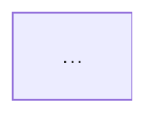

# ADR NNNN: <decision title>

- **Status:** Proposed
- **Date:** YYYY-MM-DD
- **Deciders:** <architect / tech lead — a person, never an agent>
- **Related:** <issue or PR link>

## Context

What problem are we solving, for whom, and under which constraints? Link the brief and the code you read (real paths).

## Decision drivers

- <driver> (cite standard ids such as STD-ARCH-001 when a standard applies)

## Options considered

### Option A: <name>

<description> · Pros · Cons · Standards that favour or block it

### Option B: <name>

<description> · Pros · Cons · Standards that favour or block it

## Decision

<Recommended option and why. While Status is Proposed this is a recommendation, not a sign-off.>

## Architecture



```mermaid
sequenceDiagram
  ...
```

## API impact

Output of `python .github/skills/contract-impact/contract_diff.py --base-ref origin/main` (or "No contract change").

## Threat model checklist

- [ ] Data sent to the AI service is limited to <fields> (STD-SEC-002)
- [ ] The service authenticates with managed identity (STD-SEC-001)
- [ ] Agent tools are read-only / scoped to one record and audited (STD-AI-001)
- [ ] Prompt injection in request text cannot trigger approvals or cross-record reads
- [ ] Failure, timeout, and unavailable states are observable and safe (STD-OBS-001)

## Consequences

Positive, negative, follow-up work.

## Implementation tasks

1. <bounded task with an owner role and acceptance criterion>
