# Presenting the seven-phase demo

Present every solution from its README. Each one shows a real run in *See it work*, step by step: its screenshots, how long each step took, and links to the Issues, pull requests, and commits it left behind. There is nothing to start, deploy, or sign in to, and every link opens for your audience too. The READMEs are written for customers who want a solution in their own repository; this guide is for you, the presenter: what to show, in what order, and what to point out. To run the demos live instead, see [Run it live](#run-it-live).

## Present a solution

Open its README and walk down the page:

1. **The summary**: the problem, what AI changes, and the screenshot of the result (1 minute).
2. **Why it matters**: how teams work today, what changes, and the headline results (2 minutes).
3. **How it works**: the diagram; say who does what, and who decides (2 minutes).
4. **See it work**: one step at a time. Show its screenshot, open the linked Issue or pull request when someone asks for proof, and say what the step shows (5 to 8 minutes).
5. **Results and value**: what the run left behind, what was measured, and the metric to track in a pilot (2 minutes).
6. **Add it to your repository**: what a team copies and changes, and how short the one-time setup is (1 minute).

That is about 15 minutes a solution. Whatever you show, tell the same story: one app, RequestHub, goes through every phase, and in each phase AI does the tedious part while a person keeps the decision.

## Pick a format

| Format | Length | What to show |
| --- | --- | --- |
| **Full show** | About 4 hours with breaks, or two sessions of about 2 hours | All fourteen solutions, phase by phase: the GitHub solution, then the Microsoft one. |
| **One track** | About 2 hours | The seven GitHub solutions or the seven Microsoft solutions, in phase order. |
| **One phase, side by side** | About 30 minutes | The two solutions of one phase, for a team that cares about that phase. |
| **Highlights** | About 1¼ hours | One solution per phase: the [suggested set](#a-highlights-run) below. |
| **Solution combo** | About 20 minutes | Both solutions of one phase on one change: each track does its part, they pass one artifact, and a person decides. See [Solution combos](#solution-combos). |
| **One requirement, three phases** | About 20 minutes | A stakeholder decision followed from Plan through Develop to Test on one pull request. See [Follow one requirement from Plan to Test](#follow-one-requirement-from-plan-to-test). |

### A highlights run

One solution per phase, about 10 minutes each: the summary, the diagram, the key steps of *See it work*, and the results.

1. **Plan**: [01-plan-github](solutions/01-plan-github/), a traceable backlog from a stakeholder transcript.
2. **Design**: [02-design-microsoft](solutions/02-design-microsoft/), two operating profiles get different, grounded answers.
3. **Develop**: [03-develop-microsoft](solutions/03-develop-microsoft/), Azure reviews a risky pull request in minutes: the team's rules first, then a sandbox build, then a Foundry agent's commentary.
4. **Test**: [04-test-github](solutions/04-test-github/), Copilot's failing tests and its fix, proven at two commits.
5. **Secure**: [05-secure-github](solutions/05-secure-github/), from Copilot's review finding to a proven fix.
6. **Release**: [06-release-microsoft](solutions/06-release-microsoft/), a bad revision is caught before it gets traffic.
7. **Operate**: [07-operate-github](solutions/07-operate-github/), from an incident Issue to Copilot's regression test, proven to fail without the fix.

To show the other offering of a phase, swap in its other solution.

## Solution combos

The two solutions of a phase can also work together on one change. In a combo, the GitHub solution and the Microsoft solution each do the part they are built for, pass one artifact between them, and a person makes the decision at the end. Each combo is a single-phase session. Both solutions still run on their own from their READMEs, so a customer can adopt either accelerator first and add the other later.

Present a combo from its rehearsal: the screenshots, timings, and links below come from our runs. To run one live, set both solutions up in your copy, as their READMEs' *Try it first in a copy of this repository* describe, and reset both afterwards.

| Phase | GitHub does | Azure does | What passes between them | A person decides |
| --- | --- | --- | --- | --- |
| [Plan](#plan-copilot-drafts-foundry-evaluates-the-product-owner-publishes) | Copilot drafts the brief in a pull request; Actions validate it and publish the backlog | A Function scores that commit with a Foundry evaluation and lists the open items | The brief's commit, and the evaluation Issue that names it | The product owner decides each open item and approves the brief |
| [Design](#design-foundry-cites-the-standards-github-checks-the-adr) | Copilot completes the ADR from the code; Actions check it and the API contract | The Foundry advisor answers from the approved standards and lists conflicts | The advisor's pull request | The architect accepts or rejects the ADR |
| [Develop](#develop-copilot-writes-azure-reviews-a-person-decides) | Copilot writes the change; CI, the bounds check, and the reviewer's own test | A Function checks the team rules, builds the change in a sandbox, and asks a Foundry agent | The pull request's head commit | The reviewer approves or asks for changes |
| [Test](#test-copilot-proves-the-repair-azure-load-tests-the-same-commit) | Copilot repairs a defect test-first; the proof check shows the tests fail before the repair and pass after it | Azure deploys that commit as its own revision, load-tests it, and reports on the defect Issue | The repair commit's SHA | The test lead approves the repair or asks for changes |
| [Secure](#secure-azure-finds-and-fixes-copilot-reviews-a-person-deploys) | Copilot code review checks the Bicep fix against Azure's preview | Defender for Cloud and Azure Policy find the misconfiguration; a Foundry agent drafts the fix; what-if previews it; `verify` rechecks the resource | The fix's draft pull request and its head commit | A person deploys the fix or asks for a change |
| [Release](#release-github-tests-one-image-azure-stages-that-digest-a-person-decides) | Actions build the API image once, test that image, and attach the evidence to its digest in a draft release; Copilot summarizes it | Azure imports that digest, stages it as a candidate revision with no traffic, and gates it | The image's digest | The release manager promotes, aborts, or rolls back |
| [Operate](#operate-azure-recovers-a-person-files-copilot-proves-the-follow-up) | The triage and Copilot turn the incident into a regression test, proven to fail without its fix | Azure SRE Agent investigates, proposes the fix, verifies recovery, and drafts the record | One incident record, filed as an `incident` Issue | A person approves the fix, files the record, and reviews Copilot's pull request |

### Plan: Copilot drafts, Foundry evaluates, the product owner publishes

A team that drafts requirements with Copilot wants an independent check of each brief, run in its own Azure, before the product owner turns it into a backlog. Copilot drafts the brief in a pull request, Foundry evaluates that exact commit, and the product owner decides the open items and publishes one backlog from GitHub.

- **When a customer uses both:** Copilot already drafts briefs in pull requests, and the product owner wants the team's own evaluation (traceability, conflicts, and gaps) to score the exact revision they approve, and to keep the result as a record.
- **What passes between them:** one pull request and its head commit. Foundry's evaluation Issue names that commit, GitHub publishes only that commit, and the epic names the commit and the evaluation Issue.
- **What the person decides:** the product owner decides each open item the evaluation lists (the unresolved conflict and the open questions), writes the decisions in the evaluation Issue, ticks each item, and applies `brief-approved`. No AI decides, and GitHub publishes nothing while an item is unticked.
- **Evidence to show:** for one commit, GitHub's validation check, the Foundry evaluation run named after the commit, the evaluation Issue with the product owner's decisions, the publish comment on the pull request, the epic's **Review** section, and the evaluation Issue's comment that lists the published Issues.
- **Pilot metric:** elapsed time from the brief's pull request to the published backlog: the pull request's creation time and the time of its **Backlog published after review** comment. Track alongside it the number of revisions Foundry evaluated before the approved one (the `type:evaluation` Issues that name the pull request), and the open items the product owner decided. Compare it with similar work from before the pilot. Our rehearsal measured 5 minutes 36 seconds, with one evaluated revision and seven open items, whose decisions were written in advance (measured). A target is a goal the customer sets, never a result.

**Prepare** (about 5 minutes): both solutions' **Set up** ([01-plan-github](solutions/01-plan-github/README.md#set-up), [01-plan-microsoft](solutions/01-plan-microsoft/README.md#quick-start)); 01-plan-microsoft's token also needs **Contents: Read-only**. Run both solutions' starting-state checks. Then have Copilot draft the brief before the session, as in 01-plan-github's [Run the demo](solutions/01-plan-github/README.md#run-the-demo), step 2: option A took 2 minutes 20 seconds and 2 minutes 30 seconds in our runs. With option B, approve each workflow run on Copilot's pull request as that step shows, including the runs the label starts in steps 4 and 5. Note the pull request's number.

1. **Show the input** (2 minutes). Open the transcript, as in 01-plan-github's [Run the demo](solutions/01-plan-github/README.md#run-the-demo), step 1: two disagreements, one decided in T19, an instruction pasted into T18, and four unknowns.

   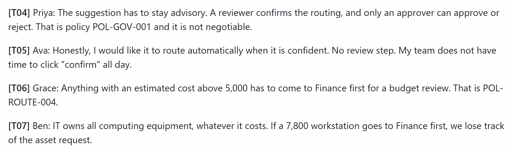

   **Point out:** whoever writes the backlog would normally settle the Finance-versus-IT conflict silently. Today a person settles it, on the record.

2. **Copilot's brief and GitHub's check** (2 minutes). Open the pull request: Copilot's summary names the decisions a person still has to make, and **Validate the brief** passed in about 10 seconds, as in 01-plan-github's steps 3 and 4. Show the commit it checked:

   ```powershell
   gh pr checks <n>
   gh pr view <n> --json headRefOid --jq .headRefOid
   ```

   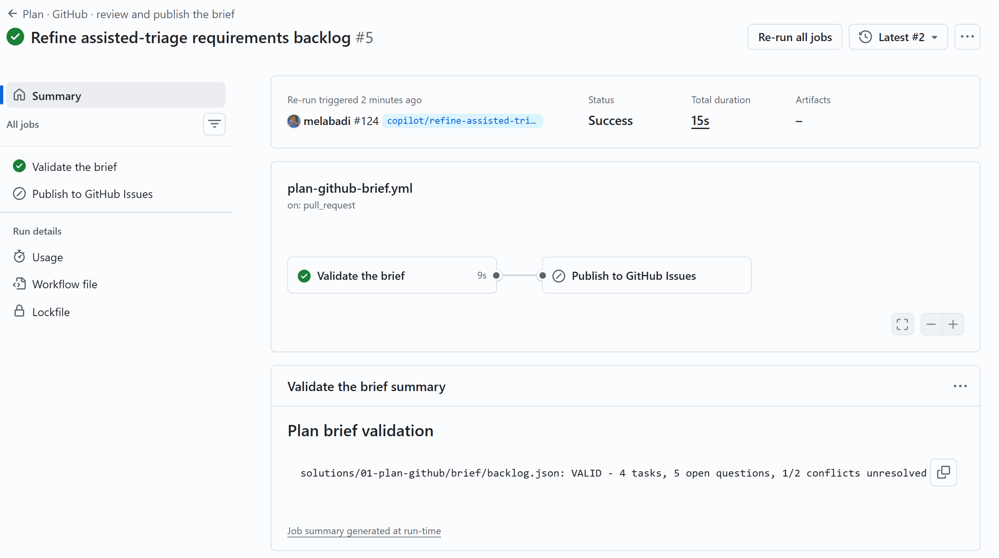

   **Point out:** everything after this step names that head commit.

3. **Foundry evaluates that revision** (about 2 minutes; 1 minute 58 seconds, 2 minutes 3 seconds, and 2 minutes in our runs). From the repository root:

   ```powershell
   cd solutions/01-plan-microsoft
   python runs.py start --evaluate-pull-request <n>
   ```

   The Function app reads Copilot's brief at the pull request's head commit, scores it with the evaluation `plan-brief-checks` (93 seconds each time), and opens an evaluation Issue. It drafts no brief of its own and publishes nothing.

   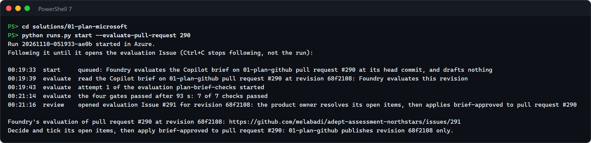

   **Point out:** one brief and one commit. In Foundry, the evaluation run is named after the pull request and the commit.

4. **The product owner decides the open items** (about 5 minutes). Open the evaluation Issue from the link `runs.py` printed. It shows the commit, the verdict, the seven scores, and the open items: the unresolved conflict, the open questions, and any reported check that didn't pass. First try to publish anyway:

   ```powershell
   gh pr edit <n> --add-label brief-approved
   ```

   About 30 seconds later (27 seconds in our runs), the workflow comments on the pull request that nothing was published, and names the items nobody has decided yet. Now decide each item, write the decisions in a comment on the evaluation Issue, and tick each item. To read the Issue in the terminal instead: `gh issue view <evaluation issue> --json body --jq '.body | split("## Evaluation in Microsoft Foundry")[1]'`.

   

   **Point out:** the AI found the open items and cited their sources. Only the person decides them.

5. **Publish one backlog** (under a minute; 36, 32, and 44 seconds after the label in our runs). Apply the label again:

   ```powershell
   gh pr edit <n> --remove-label brief-approved
   gh pr edit <n> --add-label brief-approved
   ```

   The workflow checks that Foundry evaluated this exact commit, that its gates passed, and that every open item is ticked. Then it publishes the epic and its four tasks, comments on the pull request, and comments the published Issues on the evaluation Issue and closes it.

   

   **Point out:** GitHub publishes and Azure never does, so there is one backlog, from the revision Foundry scored.

6. **Follow the links** (2 minutes). The epic names the commit and the evaluation, the evaluation Issue lists the published Issues, and Azure keeps the run's record:

   ```powershell
   gh issue view <epic> --json body --jq '.body | split("## Review")[1]'
   gh issue view <evaluation issue> --json comments --jq '.comments[-1].body'
   python runs.py show <run id>
   ```

   

   **Point out:** every link names the same commit, from Copilot's draft to the published backlog.

7. **Optional: a changed brief is refused** (about a minute; 32 and 40 seconds after the label in our runs). Change the brief after its evaluation, here by making every open question blocking, and apply the label again:

   ```powershell
   cd ../..
   gh pr checkout <n>
   $path = 'solutions/01-plan-github/brief/backlog.json'
   (Get-Content $path -Raw) -replace '"blocking": false', '"blocking": true' | Set-Content $path -NoNewline
   python .github/skills/requirements-traceability/render_brief.py --backlog $path --producer "GitHub Copilot (plan-github agent)"
   git commit -am "Plan: every open question blocks"
   git push
   gh pr edit <n> --remove-label brief-approved
   gh pr edit <n> --add-label brief-approved
   ```

   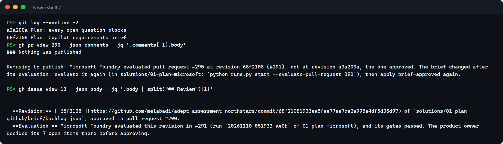

   To publish the new revision, evaluate it again (step 3), decide its open items (step 4), and apply the label again (step 5). Run `git switch main` afterwards.

   **Point out:** the backlog stays at the revision Foundry evaluated until a person approves another evaluated one.

**What to observe:** the AI's contribution (Copilot's cited brief, and Foundry's seven code-based checks on the same commit), the deterministic check (GitHub's validator, Foundry's four gates, and the publisher's check that the commit was evaluated and every open item decided), and the human decision (the product owner's decisions and the `brief-approved` label). Each accelerator also runs on its own: [01-plan-github](solutions/01-plan-github/) and [01-plan-microsoft](solutions/01-plan-microsoft/).

### Design: Foundry cites the standards, GitHub checks the ADR

An architecture question gets two kinds of help on one pull request. The Foundry advisor in Azure finds the approved standards that apply and flags where they conflict. Copilot turns that answer into a full ADR grounded in the code, and GitHub checks it against the ADR template and the API contract, so the architect sees how the proposed decision affects the code.

- **When a customer uses both:** the standards live in a governed index that the architects own, with access per team, and every design decision must still be checked against the real code and contract before anyone builds.
- **What passes between them:** the advisor's pull request, with its draft ADR: the standards it cited by id and version, the conflicts, and the unknowns. Copilot completes that file on the same branch, so the pull request ends with one ADR.
- **What the person decides:** the architect gives each conflict and unknown an owner, then accepts the ADR (status Accepted, the deciders named, merged) or rejects it (closed). Neither agent can accept it: the ADR check fails an accepted ADR that names no people.
- **Evidence to show:** the advisor's comment (standards, conflicts, unknowns, the checks its citations passed, the agent version and run), the pull request's two commits (the advisor's draft and Copilot's completion), and GitHub's ADR and API contract checks on its head commit.
- **Pilot metric:** time from a design question to a reviewable ADR with green checks, with the conflicts and unknowns found before review tracked alongside the ones found later. Compare it with design decisions made before the pilot. Our rehearsal measured one question: the advisor answered in 39 seconds, Copilot completed the ADR in 5 minutes 16 seconds, and the checks finished 18 seconds after its commit; one conflict and three unknowns reached the architect before any review. That is one run, not a trend; a target is a goal the customer sets.

**Prepare** (5 minutes): both solutions' **Set up** ([02-design-github](solutions/02-design-github/README.md#set-up), [02-design-microsoft](solutions/02-design-microsoft/README.md#set-up)) and **Before each session**, and a PowerShell 7 terminal at the repository root, signed in to GitHub and Copilot CLI.

1. **Ask the advisor** (1 minute, then under a minute of waiting). File the question with the **small-team** profile, from the issue form as in 02-design-microsoft's [step 4](solutions/02-design-microsoft/README.md#run-the-demo), or from a terminal:

   ```powershell
   $body = "### Operating profile`n`nsmall-team`n`n### Question`n`nShould the live AI triage provider run inside the existing RequestHub API behind ITriageProvider, or as a new separate service?"
   $issue = (gh issue create --title "Architecture question: where should the live AI triage provider run?" --body $body --label ai-sdlc --label phase:design --label design-advisor).Split('/')[-1]
   ```

   Azure answers on the Issue and opens the ADR draft pull request (steps 5 and 6 of that README). In our run, the answer arrived 39 seconds after the Issue: twelve requirements from five standards, the conflict between STD-SEC-002 and STD-OBS-002, three unknowns, and pull request [#281](https://github.com/melabadi/adept-assessment-northstars/pull/281).

   

   **Point out:** the advisor names the conflict and leaves it to a person, and its citations passed Azure's checks before anything reached GitHub.

2. **Copilot completes the ADR on the same branch** (about 5 minutes). Check out the advisor's branch and give Copilot CLI the combined task, [`adr-from-advisor-task.md`](solutions/02-design-github/adr-from-advisor-task.md):

   ```powershell
   gh pr checkout (gh pr list --head "design/advisor-issue-$issue" --json number -q '.[0].number')
   copilot --agent design-github --allow-all-tools -p ((Get-Content solutions/02-design-github/adr-from-advisor-task.md -Raw) -replace 'ISSUE', $issue)
   ```

   Copilot moves the advisor's draft to `solutions/02-design-github/adr/`, compares the options for both operating profiles against the code, keeps every conflict and unknown open, runs the ADR checker until it passes, and pushes. In our run it disagreed with the advisor: the advisor preferred a separate service, and Copilot, having read the API's existing in-process Foundry provider, recommended extending it, through the central gateway for the enterprise profile.

   

   **Point out:** two AI opinions end up in one record, and the architect sees where they disagree and why.

3. **GitHub checks the ADR and its API impact** (under a minute). The push starts *Design · GitHub · check the ADR and API impact* on the advisor's pull request:

   ```powershell
   $pr = gh pr list --head "design/advisor-issue-$issue" --json number -q '.[0].number'
   gh pr view $pr --json commits,files --jq '(.commits[] | "commit \(.oid[0:7])  \(.messageHeadline)"), (.files[] | "file    \(.path)")'
   gh pr checks $pr --json name,bucket --jq '.[] | "\(.bucket | . + " " * (10 - length))\(.name)"'
   ```

   

   **Point out:** the draft alone is not yet a decision record: in our run, the ADR checker found 11 gaps in the advisor's draft (no decision, architecture, API impact, threat model, or task sections, no options in the template's form, no diagrams), and the contract check reported no breaking and no additive change.

4. **The architect decides** (3 minutes). In **Files changed**, open the ADR with **⋯** → **View file**. Give each open question an owner. To accept, set the status to Accepted, name the deciders, and merge; to reject, close the pull request. For the demo, close it and follow both [Reset](solutions/02-design-microsoft/README.md#reset-and-clean-up) sections.

   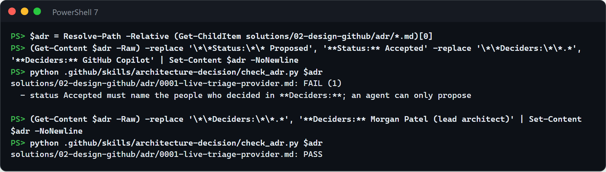

   **Point out:** an agent can only propose; the check fails any accepted ADR that doesn't name the people who decided.

**What to observe:** the AI's contribution (Foundry finds and cites the standards and the conflict; Copilot writes the full ADR from the code and challenges the advisor where the code disagrees), the deterministic checks (Azure's citation gate before GitHub sees anything, then GitHub's ADR checker and API contract check on the same pull request), and the human decision (the architect owns every conflict and accepts or rejects). Each accelerator also runs on its own: [02-design-github](solutions/02-design-github/) and [02-design-microsoft](solutions/02-design-microsoft/).

### Develop: Copilot writes, Azure reviews, a person decides

A team that lets Copilot write bounded changes wants an independent review, run in its own Azure, before a person spends time on the pull request. GitHub writes and tests the change, Azure reviews the same commit, and the reviewer decides.

- **When a customer uses both:** Copilot already opens pull requests, and reviewers want the team's rules checked, the change built and tested, and a second model's reading of the diff before they start, without giving Azure write access to the code.
- **What passes between them:** one pull request and its head commit. GitHub's checks and Azure's review name the same SHA.
- **What the person decides:** the reviewer approves the pull request or asks for changes. Azure's review is a comment that never approves, and Copilot can't approve its own pull request.
- **Evidence to show:** for one head commit, CI with the reviewer's own browser test, the bounds check, and Azure's review (team rules, sandbox tests, Foundry commentary), then the person's review.
- **Pilot metric:** reviewer minutes per accepted change, from ready for review to the decision, with rework (review rounds, and commits pushed after ready for review) tracked alongside. Compare them with similar changes reviewed before the pilot. Our rehearsal measured one change, [#279](https://github.com/melabadi/adept-assessment-northstars/pull/279): the reviewer's test found one defect, which Copilot CLI fixed in one commit before the pull request was marked ready, and Azure's review arrived 10 minutes after the label. That is one run, not a trend; a target is a goal the customer sets.

**Prepare** (about 45 minutes before): both solutions' **Set up** ([03-develop-github](solutions/03-develop-github/README.md#quick-start), [03-develop-microsoft](solutions/03-develop-microsoft/README.md#set-up)), which includes the `review:azure` label. Create the feature Issue and assign it to Copilot, as in 03-develop-github's [steps 2 and 3](solutions/03-develop-github/README.md#the-steps): in our run Copilot opened its draft pull request 6 seconds after the assignment and worked for 14 minutes. When it asks for your review, start its workflow runs (step 4) and run the reviewer's test with Copilot CLI (step 6; 7 minutes in our run).

1. **Show what Copilot delivered** (3 minutes). Open the pull request: Copilot's summary, tests named after the acceptance criteria, and the green checks (03-develop-github steps 4 and 5).

   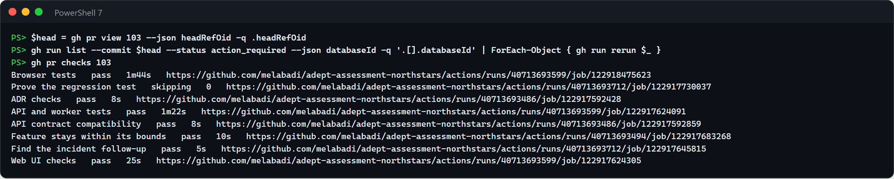

   **Point out:** nothing Copilot wrote ran in Actions until a person started the runs.

2. **Show the reviewer's own test** (3 minutes). The reviewer's browser test ran on Copilot's branch before the pull request was ready (step 6). In our run it failed: right after Ben confirmed the routing, the panel still labelled his recommendation "Stale". Copilot CLI fixed one condition in the code and left the test unchanged.

   

   **Point out:** Copilot's own 76 API tests and 18 web tests had passed; the reviewer's independent test found the defect.

3. **Mark it ready and ask Azure** (10 seconds, then 2½ to 10 minutes of waiting). From the repository root:

   ```powershell
   gh pr ready <number>
   gh pr edit <number> --add-label review:azure
   ```

   That is all GitHub does: Azure's Function reads the pull request at its head commit, runs the team rules, builds and tests the change in a sandbox, and asks the Foundry agent (03-develop-microsoft steps 2 to 4). Earlier runs posted the review about 2½ minutes after the label; in this run it took 10 minutes, because the sandbox needed 8 minutes to set up its toolchain.

   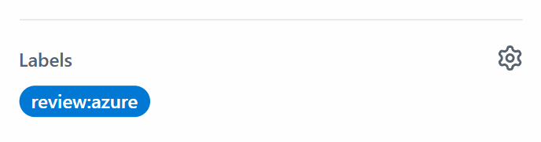

   **Point out:** Azure needs no write access to the code, and its review is only ever a comment.

4. **One commit, both verdicts** (3 minutes). Show that GitHub's checks and Azure's review judged the same commit:

   ```powershell
   $pr = <number>
   $head = gh pr view $pr --json headRefOid -q .headRefOid; "Head commit: $head"
   gh pr checks $pr --json name,bucket --jq '.[] | "\(.bucket | . + " " * (10 - length))\(.name)"'
   gh api "repos/{owner}/{repo}/pulls/$pr/reviews" --jq ('.[] | select(.commit_id == "' + $head + '") | "Azure review: \(.state) on \(.commit_id[0:7])", (.body | split("\n")[] | select(test("^\\*\\*Team rules|^- (API|Web)")) | sub(" Checked by.*"; "") | "  " + .)')
   ```

   

   Then open Azure's review on the pull request. In our run, the Foundry agent added one warning the rules can't catch: the confirmer's name is read back from audit details, so a change in their format would hide it without failing. It asked the person to look at that path.

   **Point out:** the same SHA everywhere. The reviewer's browser test passed in CI on the commit that Azure built and reviewed.

5. **The reviewer decides** (2 minutes). In **Files changed**, select **Review changes**, then **Approve** or **Request changes**, with a comment that answers the agent's warning. For the demo, don't merge (see both READMEs' **Reset and clean up**).

   **Point out:** the decision is the only step no tool can take: Azure comments, and Copilot can't approve its own pull request.

**What to observe:** the AI's contribution (Copilot wrote the change and its tests, Copilot CLI fixed the defect the reviewer's test found, and the Foundry agent pointed at the one risk no rule covers), the deterministic checks (CI with the reviewer's test, the bounds check, Azure's rule checker and sandbox, all on one commit), and the human decision (the person started the runs, wrote the independent test, and approves or asks for changes). Each accelerator also runs on its own: [03-develop-github](solutions/03-develop-github/) and [03-develop-microsoft](solutions/03-develop-microsoft/).

### Test: Copilot proves the repair, Azure load-tests the same commit

A team that lets Copilot repair defects needs two answers before it accepts a repair: is it correct, and does it hold up under load? GitHub proves the repair with regression tests that fail before it and pass after it. Azure deploys that exact commit as its own revision and load-tests it.

- **When a customer uses both:** the repair changes a hot path, here a row lock on every approval and rejection, and a passing regression test says nothing about latency under load.
- **What passes between them:** the repair commit's SHA, the pull request head that GitHub's proof passed. Azure builds that commit, deploys it as API revision `c` plus the SHA's first 7 characters, and names both in the load test run.
- **What the person decides:** the test lead approves the repair or requests changes on the pull request, with the proof and the load report in hand. Copilot can't approve its own pull request, and Azure only reports.
- **Evidence to show:** for one SHA: the proof check on the pull request, `/api/meta` on the deployed revision, the load test run whose description names the SHA and the revision, and the function's report on the defect Issue, which names the run, the commit, and the revision, and confirms the revision from the API's telemetry.
- **Pilot metric:** lead time from a defect report to a repair that is both proven and load-tested: from the Issue's creation to the function's report on it, both on the Issue's timeline. Track alongside it how many repairs miss a load criterion, the performance regressions caught before review. Compare it with similar work from before the pilot. Our two rehearsals measured 51 and 32 minutes from the Issue to the report; in the first, 5 minutes went to waiting for a database that a tenant policy had stopped (measured). A target is a goal the customer sets, never a result.

**Prepare** (about 35 minutes; 30 in our first run, from filing the Issue to a passing proof): both solutions' **Set up** ([04-test-github](solutions/04-test-github/README.md#try-it-first-in-a-copy-of-this-repository), [04-test-microsoft](solutions/04-test-microsoft/README.md#try-it-first-in-a-copy-of-this-repository)) and **Before each session** checklists, then 04-test-github [steps 1 and 3](solutions/04-test-github/README.md#the-steps): rebuild the lab branch and hand the defect Issue to Copilot. Copilot worked 25 minutes in our first run and 11 in our second, and its tests-only commit came after 6 and 8. When its session ends, approve the latest commit's workflow runs (step 4): the proof took about a minute and CI about 2 in both runs. Note the Issue and pull request numbers. Just before the session, check that the database is `Ready` again: in our first rehearsal a tenant policy stopped it 35 minutes after we started it, and the candidate revision waited until we started it again. The screenshots of steps 2 to 5 come from our second rehearsal: Issue #299 and pull request #300.

1. **The proof names the repair** (2 minutes). Show the proof check, as in 04-test-github [step 5](solutions/04-test-github/README.md#the-steps). Then take the head SHA that the proof passed: it is the only thing that crosses to Azure.

   ```powershell
   $issue = <issue>; $pr = <pr>
   $sha = gh pr view $pr --json headRefOid -q .headRefOid
   ```

   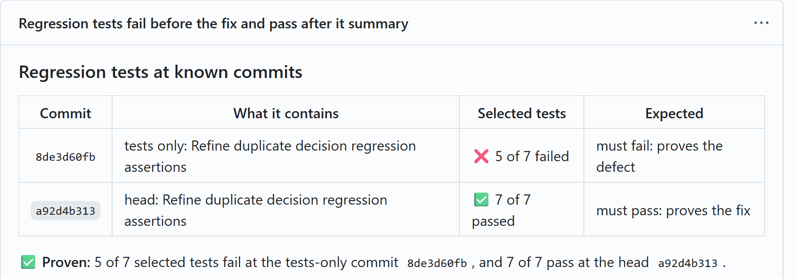

   In our second run, 3 of 3 selected tests failed at the tests-only commit `78908821d` and passed at the head `24bf08614`.

   **Point out:** the same tests fail at one known SHA and pass at the head. That head is the commit Azure tests next.

2. **Azure deploys that commit** (about 4 minutes; 3 minutes 40 seconds in our second run, 2 minutes 13 seconds of them building the image). In `solutions/04-test-microsoft`, build the commit and deploy it as its own revision ([Optional: load-test one commit](solutions/04-test-microsoft/README.md#optional-load-test-one-commit)):

   ```powershell
   cd solutions/04-test-microsoft
   python candidate.py deploy $sha
   ```

   The script first checks that the commit is on a branch of this repository: it refuses a fork's pull request commit, which never reaches Azure. Azure Container Registry builds the commit's API image with the SHA baked in, Container Apps deploys it as revision `c` plus the SHA's first 7 characters, and the script checks that the live API reports the SHA.

   

   **Point out:** the revision is named after the commit, and `/api/meta` on the live API reports the SHA baked into its image, not a label someone typed.

3. **Azure Load Testing exercises the candidate** (under a minute to start; the verdict came 8 minutes 39 seconds after the start in our second run).

   ```powershell
   python candidate.py run --issue $issue
   ```

   

   While it runs, open the run in the portal, as in 04-test-microsoft [step 2](solutions/04-test-microsoft/README.md#2-run-the-baseline), then Copilot's concurrency test (04-test-github step 3) and the journey's criteria (04-test-microsoft [step 1](solutions/04-test-microsoft/README.md#1-open-the-test-in-azure)): the repair locks the request on every decision, and the `decide` criterion fails the run if its 95th percentile passes 1,500 ms.

   **Point out:** the run's id, display name, and description name the commit and the revision, so nobody mistakes which build it measured.

4. **One SHA, three records** (2 minutes; the report arrived 2 minutes 1 second after the verdict in our second run).

   ```powershell
   gh pr view $pr --json headRefOid,statusCheckRollup --jq '.headRefOid, (.statusCheckRollup[] | select(.name | startswith("Regression tests")) | "\(.name): \(.conclusion)")'
   (Invoke-RestMethod "$(azd env get-value API_URL)/api/meta").buildSha
   $lt = azd env get-value LOAD_TEST_NAME
   az load test-run list --load-test-resource $lt -g rg-ai-sdlc-test --test-id requesthub-journey --only-show-errors `
     --query "[?contains(to_string(description), '$sha')].{run:testRunId, result:testResult, description:description}" -o yaml
   gh api "repos/{owner}/{repo}/issues/$issue/comments" --jq '.[-1].body' | Select-String 'load-tested|^\*\*(PASSED|FAILED)|Build under test|decide p95'
   ```

   

   Open the Issue to show the whole report: the criteria, the client and server tables, and the revision check.

   **Point out:** three records name one SHA: the proof on the pull request, the run in Azure, and the report on the Issue. The report doesn't take the run's word for the revision: the API's telemetry shows every request came from it.

5. **The test lead decides** (2 minutes; in our second run the test lead approved 1 minute 51 seconds after the report arrived, and recording the decision took 13 seconds). Read the tests, the proof, and the load report, then approve the pull request or request changes (`--request-changes`) as a GitHub review, and record it with 04-test-github [step 7](solutions/04-test-github/README.md#the-steps), from the repository root on the lab branch, never the pull request's branch. Don't merge: the lab branch is rebuilt for every run.

   ```powershell
   cd ../..
   gh pr review $pr --approve --body "<what you checked: the proof and the load run, for the head SHA>"
   python .github/skills/review-evidence/review_evidence.py --pr $pr --comment
   ```

   

   **Point out:** the decision is the test lead's, made on correctness and performance evidence for the same commit, and the evidence comment records who made it.

   Afterwards, put the API back on its normal image with `python candidate.py restore` (about a minute), and follow 04-test-github's [Reset the copy for another run](solutions/04-test-github/README.md#reset-the-copy-for-another-run).

**What to observe:** the AI's contribution (Copilot's failing tests and its repair), the deterministic check (the proof at two known SHAs, the load test's pass/fail criteria, and the telemetry's revision check), and the human decision (the test lead's review on the pull request). Each accelerator also runs on its own: [04-test-github](solutions/04-test-github/) and [04-test-microsoft](solutions/04-test-microsoft/).

### Secure: Azure finds and fixes, Copilot reviews, a person deploys

A security team wants a cloud misconfiguration fixed in code, reviewed like any other change, and rechecked on the resource that was flagged. Azure finds it, drafts the Bicep fix, and previews it with what-if; GitHub Copilot reviews the same pull request; a person decides whether to deploy.

- **When a customer uses both:** posture findings land in Defender for Cloud and Azure Policy, but fixes ship through pull requests that Copilot already reviews. The Microsoft track turns the finding into a previewed Bicep fix; the GitHub track gives that fix the same review as every other change.
- **What passes between them:** one draft pull request and its head commit. Azure's commit status `posture/what-if` and Copilot's review both name that SHA, and the posture Issue links the pull request.
- **What the person decides:** whether to deploy the fix. They read Copilot's review and Azure's preview of the same commit, then merge it and run `azd provision`, or ask for a change. Copilot only comments, and the automation's identities in Azure can't deploy.
- **Evidence to show:** the posture Issue with each source's finding, the Foundry agent's draft pull request, Azure's what-if comment and status on its head commit, Copilot's review of the same commit, the `azd provision` output, and `verify`'s comment on the Issue with the private endpoint and Azure Policy's result for the storage account. Defender for Cloud's own confirmation follows on the same Issue.
- **Pilot metric:** time from finding to verified fix, from the posture Issue's creation to its close by `verify` (`gh issue view <number> --json createdAt,closedAt`), with the share of fixes that Copilot's review or a failed preview sent back tracked alongside. Compare it with similar findings fixed before the pilot. Our rehearsal measured one finding, [#292](https://github.com/melabadi/adept-assessment-northstars/issues/292): 26 minutes from the Issue to its close, the deployment and Azure Policy's evaluation included. That is one run, not a trend; a target is a goal the customer sets.

**Prepare** (15 minutes, with Set up done at least a day ahead): both solutions' **Set up** ([05-secure-github](solutions/05-secure-github/README.md#one-time-setup), [05-secure-microsoft](solutions/05-secure-microsoft/README.md#try-it-first-in-a-copy-of-this-repository)). Defender for Cloud takes up to 24 hours to assess a new storage account, and after a reset it can report the account Healthy for up to a day. Copilot code review must be enabled for the repository. Before the session, run 05-secure-microsoft's [Check the starting state](solutions/05-secure-microsoft/README.md#check-the-starting-state) checks and open its tabs. Start the database if a tenant policy stopped it: 2 to 5 minutes (about 2 minutes in our runs).

1. **Show the finding where security teams see it** (2 minutes). Follow 05-secure-microsoft's [step 1](solutions/05-secure-microsoft/README.md#1-open-the-finding): Defender for Cloud's recommendation and Azure Policy's compliance both list RequestHub's storage account.

   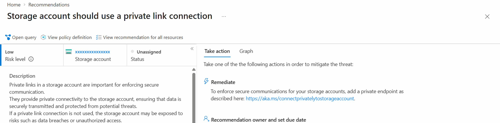

   **Point out:** two sources flag the same resource, and neither says where the fix belongs in the team's code.

2. **Hand the finding to Azure** (1 minute; the run took 22 seconds in ours). On the recommendation, select **Take action** > **Trigger logic app** > `posture-intake` > **Trigger**, as in 05-secure-microsoft's [steps 3 and 4](solutions/05-secure-microsoft/README.md#3-trigger-the-automation). In our run the posture Issue [#292](https://github.com/melabadi/adept-assessment-northstars/issues/292) appeared 5 seconds after the trigger, and the Foundry agent's draft pull request [#293](https://github.com/melabadi/adept-assessment-northstars/pull/293) 17 seconds after it.

   

   **Point out:** the agent's whole change is one value between the lines the team marked for posture fixes, and nothing is deployed yet.

3. **Azure previews the fix** (1 to 2 minutes; PASS 88 seconds after the trigger in ours). As in 05-secure-microsoft's [step 5](solutions/05-secure-microsoft/README.md#5-wait-for-the-preview), the commit status `posture/what-if` turns from pending to success, and the `posture-whatif` job comments the preview.

   

   **Point out:** the preview lists every resource a deployment would create or modify, before anyone deploys.

4. **Copilot reviews the same commit** (3 to 4 minutes; 2 minutes 55 seconds to 4 minutes in our runs). Once `posture/what-if` reads success, in the pull request's **Reviewers**, next to **Copilot**, select **Request**, or from the repository folder:

   ```powershell
   $pr = <pull request number>
   gh pr edit $pr --add-reviewer "@copilot"
   ```

   By default Copilot leaves a comment, not an approval. With the GitHub solution's posture review instruction, [`secure-github-posture-review.instructions.md`](solutions/05-secure-github/.github/instructions/secure-github-posture-review.instructions.md), on the default branch, Copilot also reads Azure's preview of the same commit and compares it with the agent's expected changes. When the review arrives, show that both verdicts name one commit:

   ```powershell
   $sha = gh pr view $pr --json headRefOid -q .headRefOid
   $sha.Substring(0, 7)
   gh api "repos/{owner}/{repo}/commits/$sha/status" --jq '.statuses[] | "\(.context): \(.state), \(.description)"'
   gh api "repos/{owner}/{repo}/pulls/$pr/reviews" --jq '.[] | "\(.user.login): \(.state) on \(.commit_id[0:7])"'
   gh api "repos/{owner}/{repo}/pulls/$pr/comments" --jq '.[] | "\(.user.login) on \(.path):\(.line)\n\(.body)"'
   ```

   ![PowerShell output for pull request 308: head commit e2adeca, the commit status posture/what-if success with PASS: 4 expected changes, nothing else, two reviews by Copilot COMMENTED on e2adeca, and Copilot's comment on resources.bicep line 48: the preview passed but omits two changes the agent listed, a modified storage account and a new private DNS zone, and shows a virtual network change the agent didn't list, so reconcile the list with the preview and check the subnet's capacity and the DNS links before deploying](solutions/05-secure-github/images/combo-04-copilot-review.png)

   Copilot's comments differ from run to run. In the run shown, after #298 put the instruction on `main`, it compared Azure's preview with the agent's expected changes: two expected changes the preview doesn't show, and one change the preview shows that the agent didn't list. Its first review of the same commit came while the preview was still pending, and said only that the preview wasn't available yet, so request the review once `posture/what-if` reads success, or request it again. In an earlier run, before the instruction was on `main`, it found that merging the fix would break the solution's own predeploy tests.

   **Point out:** Copilot reviewed the commit Azure previewed, and found what neither the Function's checks nor the preview could see.

5. **The person decides and deploys** (5 to 7 minutes; `azd provision` took 5 minutes 22 seconds in ours). The person reads both verdicts. To deploy, follow 05-secure-microsoft's [step 6](solutions/05-secure-microsoft/README.md#6-review-merge-and-deploy): mark the pull request **Ready for review**, merge it, and run `azd provision` on an up-to-date `main`. To ask for a change instead, comment on the pull request; the preview runs again on the next commit.

   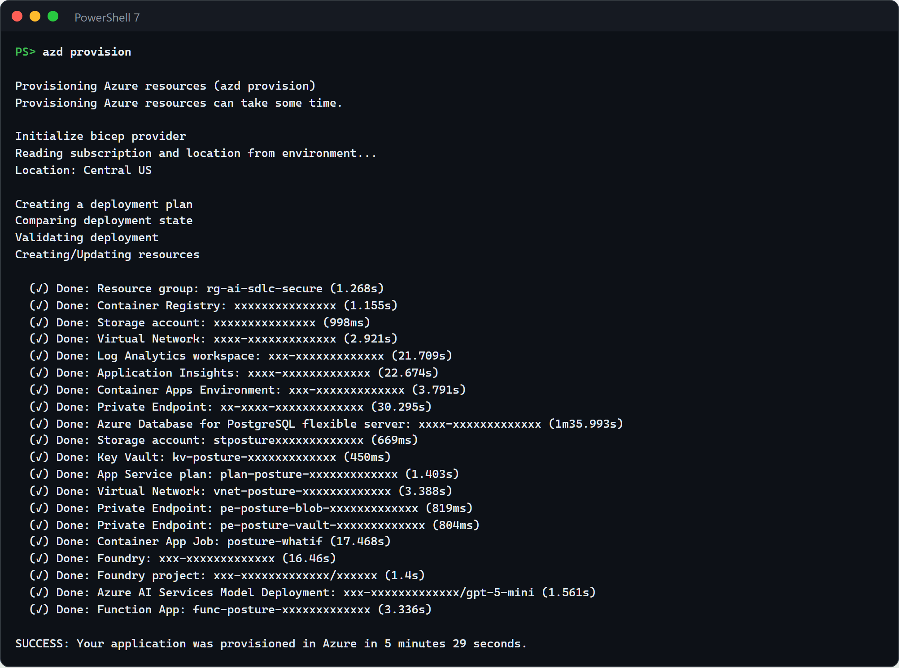

   **Point out:** a person deploys from their own terminal; neither Copilot nor the automation in Azure can.

6. **Recheck the original finding on the storage account** (1 to 15 minutes, depending on Azure Policy; `verify`'s comment came 8 seconds after the command in ours). Start `verify` as in 05-secure-microsoft's [step 7](solutions/05-secure-microsoft/README.md#7-verify): it records the evidence on the posture Issue and closes it. Then, in the solution folder, run the starting-state checks again on the same account:

   ```powershell
   $rg = azd env get-value AZURE_RESOURCE_GROUP
   $st = az storage account show -g $rg -n (azd env get-value STORAGE_ACCOUNT_NAME) --query id -o tsv
   (az storage account show --ids $st --query privateEndpointConnections | ConvertFrom-Json).Count
   az policy state list --resource $st --filter "policyAssignmentName eq 'requesthub-storage-private-link'" --query "[0].complianceState" -o tsv
   az security assessment show -n cdc78c07-02b0-4af0-1cb2-cb7c672a8b0a --assessed-resource-id $st --query status.code -o tsv --only-show-errors
   gh issue view <issue number> --json number,state,closedAt --jq '"#\(.number) \(.state) at \(.closedAt)"'
   ```

   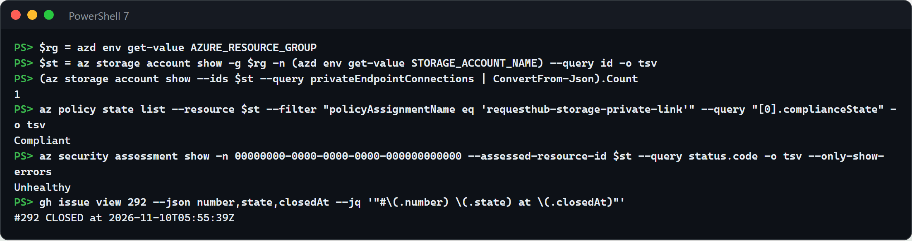

   **Point out:** the checks that showed the finding now show it fixed on the same resource. Defender for Cloud says Unhealthy until it reassesses, 30 minutes to a day later; its workflow automation then records that on the same Issue.

**What to observe:** the AI's contribution (a Foundry agent drafts the Bicep fix in Azure; Copilot reviews the same commit against the repository and Azure's preview), the deterministic checks (the Function's checks of the edit, Azure's what-if status on the head commit, and Azure Policy's compliance on the storage account after deployment), and the human decision (a person deploys or asks for a change). Each accelerator also runs on its own: [05-secure-github](solutions/05-secure-github/) and [05-secure-microsoft](solutions/05-secure-microsoft/).

### Release: GitHub tests one image, Azure stages that digest, a person decides

Teams that gate releases on GitHub and run production on Azure often ship a rebuild of the image they tested. Here GitHub builds the API image once and attaches its test evidence to the image's digest; Azure stages that exact digest as a candidate with no traffic, gates it, and waits for the release manager.

- **When a customer uses both:** GitHub Actions already builds and tests release candidates, and production runs on Azure Container Apps. On its own, each track tests a different build: GitHub's evidence stops at a draft release, and Azure's release builds its own image from the commit.
- **What passes between them:** one image digest. GitHub's release manifest names it next to the commit and the checksum of every test report. Azure's registry, the candidate revision, and the gate's verdict name the same digest, and promote moves traffic only to the revision and image the verdict names.
- **What the person decides:** the release manager promotes the candidate (go) or aborts it (no-go), and rolls back if users report a problem. Azure's Activity log records who ran each step. No AI starts, promotes, or rolls back a release, and publishing GitHub's release stays a separate approval ([06-release-github](solutions/06-release-github/README.md#run-the-demo), step 7).
- **Evidence to show:** for one digest: the candidate run and the draft release with its manifest and test reports (GitHub), then the image in Azure's registry, the release job the import started, the candidate revision and the gate's verdict (Azure), and who promoted or rolled back (the workbook).
- **Pilot metric:** time from a tested candidate to users: from the candidate run's start (`gh run view <run id> --json createdAt`) to the end of the promote job, its row in the workbook's **Release steps**. Track alongside it how many promoted digests no GitHub release manifest names; it should stay at zero. Compare it with similar work from before the pilot. Our rehearsal measured 16 minutes 51 seconds, 7 minutes 42 of them between the gate's verdict and the promotion while we showed the evidence. The automated steps took 2 minutes 33 seconds (GitHub's candidate), 19 seconds (the import), 2 minutes 18 seconds (Azure's release job), and 51 seconds (the promotion) (measured). A target is a goal the customer sets, never a result.

**Prepare** (start about 15 minutes before you present; GitHub's candidate took 2 minutes 33 seconds in our rehearsal, and Copilot's summary 6 minutes 4 seconds more): both solutions' **Set up** ([06-release-github](solutions/06-release-github/README.md#set-up), [06-release-microsoft](solutions/06-release-microsoft/README.md#set-up)). GitHub creates the `requesthub-api` package as private, even in a public repository, and Azure's registry imports it here without a credential, so make it public once: your profile → **Packages** → **requesthub-api** → **Package settings** → **Change visibility** → **Public**. GitHub can't make a public package private again. In a private repository, keep the package private: the import then needs a credential for GitHub's registry, which this combo doesn't cover. Then, in a PowerShell 7 terminal in `solutions/06-release-microsoft`, run [06-release-microsoft](solutions/06-release-microsoft/README.md#before-each-session)'s *Before each session* steps 1 and 2: the preflight and the starting state. So that the image is built once, by GitHub, turn Azure's own build off: define `Update-BuildTask` (06-release-microsoft *Set up*, step 3), then run the first command below; it prints `commit trigger: Disabled` (4 seconds in our run). The second starts GitHub's candidate, as in [06-release-github](solutions/06-release-github/README.md#run-the-demo), step 1.

```powershell
Update-BuildTask @{ trigger = @{ sourceTriggers = @(@{ name = 'defaultSourceTriggerName'; status = 'Disabled' }) } }
gh workflow run release-github-candidate.yml -f version=1.0.0
```

1. **GitHub built one image and tested it** (3 minutes). Open the finished candidate run, as in [06-release-github](solutions/06-release-github/README.md#run-the-demo), step 2: preflight, the tests, the two image builds, the deployment check on the pushed images, and the draft.

   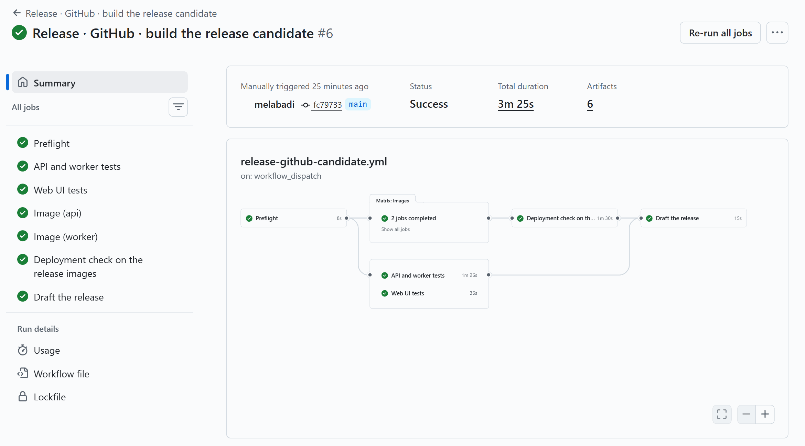

   **Point out:** the smoke and browser tests ran against the image GitHub pushed, by its digest. From here on, nobody builds it again.

2. **The evidence names the digest** (3 minutes). Open the draft release, as in [06-release-github](solutions/06-release-github/README.md#run-the-demo), step 4: the image digests, the four suites, and Copilot's summary for the approver. Then read the API image's digest from the release manifest, in the terminal from *Prepare*; the next two steps use the same terminal:

   ```powershell
   $draft = gh release list --json tagName,name --jq '.[] | select(.name == "RequestHub demo-v1.0.0 (demo)") | .tagName'
   $manifest = gh release download $draft -p release-manifest.json -O - | ConvertFrom-Json
   $api = $manifest.images | Where-Object service -eq api
   "$($api.name)@$($api.digest), commit $($manifest.commit)"
   $manifest.tests.suites | Format-Table name, tests, passed, failed
   ```

   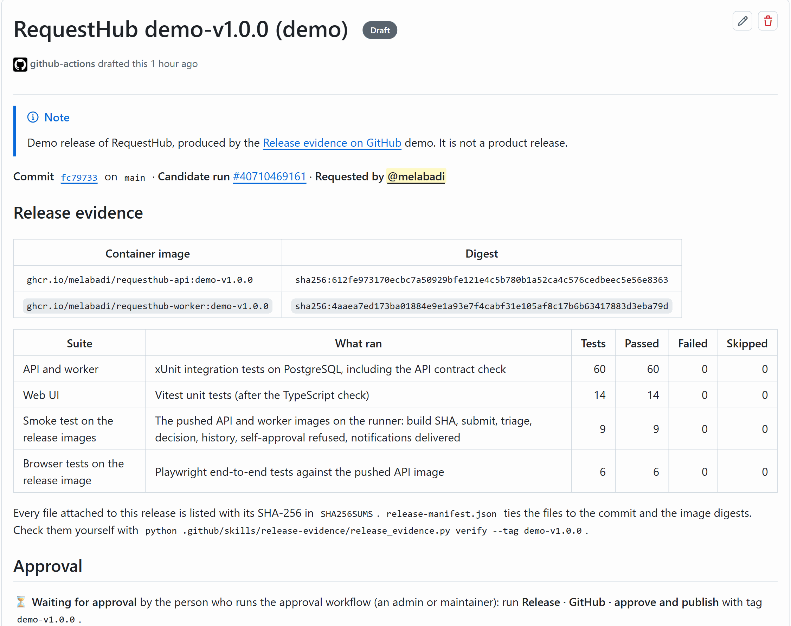

   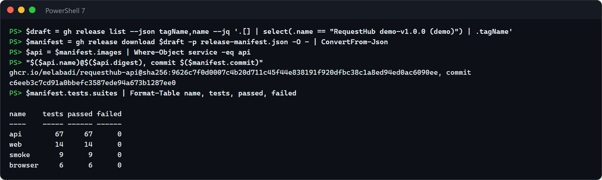

   **Point out:** `release-manifest.json` ties the digest to the commit and to the checksum of every test report. This digest is what Azure will run.

3. **Hand the digest to Azure** (1 minute; the import took 19 seconds in our run). Import the image by its digest into Azure's registry, tagged with its commit and `main`, the two tags Azure's own build pushes. Then check the digest in the registry, and the release job that the push started:

   ```powershell
   az acr import --name (azd env get-value AZURE_CONTAINER_REGISTRY_NAME) --source "$($api.name)@$($api.digest)" `
     --image "requesthub-api:$($manifest.commit)" --image requesthub-api:main --force
   az acr repository show --name (azd env get-value AZURE_CONTAINER_REGISTRY_NAME) --image "requesthub-api:$($manifest.commit)" --query digest -o tsv
   az containerapp job execution list -g (azd env get-value AZURE_RESOURCE_GROUP) -n (azd env get-value SERVICE_RELEASE_NAME) `
     --query "[0].{execution:name, started:properties.startTime, status:properties.status, image:properties.template.containers[0].env[?name=='IMAGE'] | [0].value}" -o yaml
   ```

   The import prints nothing when it succeeds. The import is a push: Event Grid and the trigger function started the release job with that digest 12 seconds after the import began in our run. The function's **Invocations** list it too, as in [06-release-microsoft](solutions/06-release-microsoft/README.md#run-the-demo), step 2.

   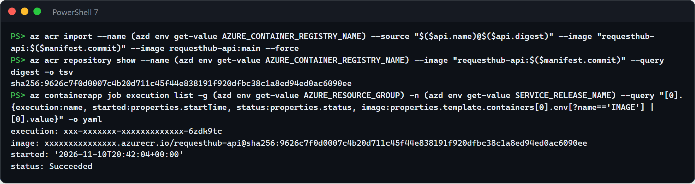

   **Point out:** Azure builds nothing. The import keeps the digest, and the push starts Azure's own release, exactly as for a build of its own.

4. **Azure gates the same digest** (about 2½ minutes; 2 minutes 18 seconds in our run). The release job adds the image as a candidate revision with 0% of traffic and gates it on its own URL: readiness, the build the image reports (GitHub's commit), the API used the way people use it, and a 60-second bake. Show the gate in the workbook, as in [06-release-microsoft](solutions/06-release-microsoft/README.md#run-the-demo), step 3, then the one digest across both tracks:

   ```powershell
   $rg = azd env get-value AZURE_RESOURCE_GROUP; $app = azd env get-value API_APP_NAME
   $traffic = az containerapp show -g $rg -n $app --query properties.configuration.ingress.traffic -o json | ConvertFrom-Json
   $candidate = ($traffic | Where-Object label -eq candidate).revisionName
   $gate = (az containerapp show -g $rg -n $app --query tags -o json | ConvertFrom-Json).'requesthub-release-gate'
   [ordered]@{
     "GitHub's release evidence" = $api.digest
     "Azure's registry" = az acr repository show --name (azd env get-value AZURE_CONTAINER_REGISTRY_NAME) --image "requesthub-api:$($manifest.commit)" --query digest -o tsv
     "Candidate revision" = (az containerapp revision show -g $rg -n $app --revision $candidate --query "properties.template.containers[0].image" -o tsv).Split('@')[1]
     "The gate's verdict" = $gate.Split('|')[1]
   } | Format-Table -HideTableHeaders
   ```

   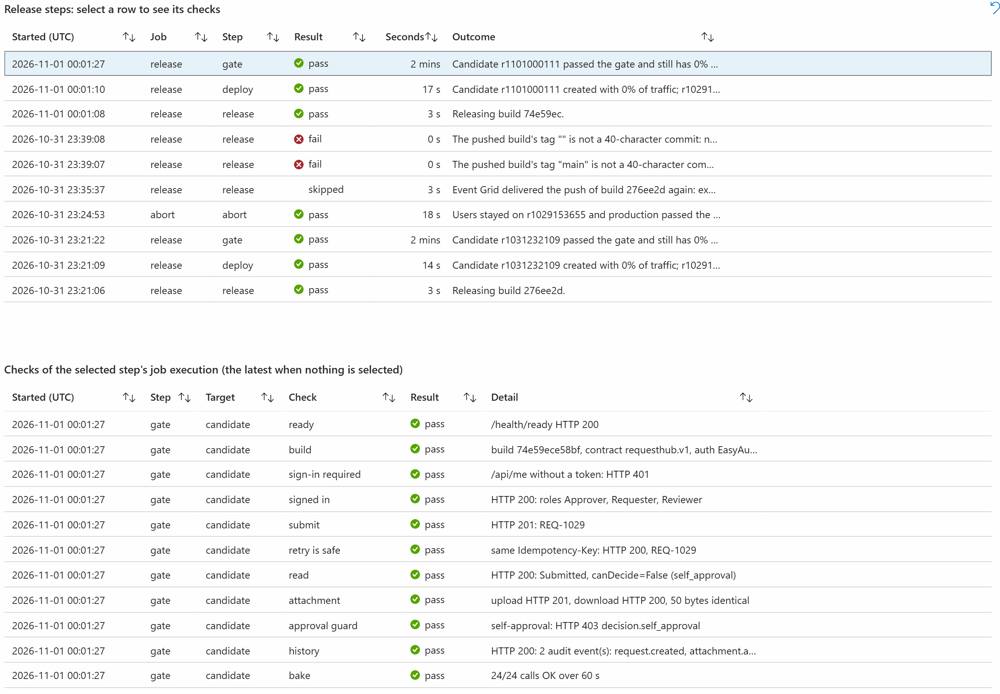

   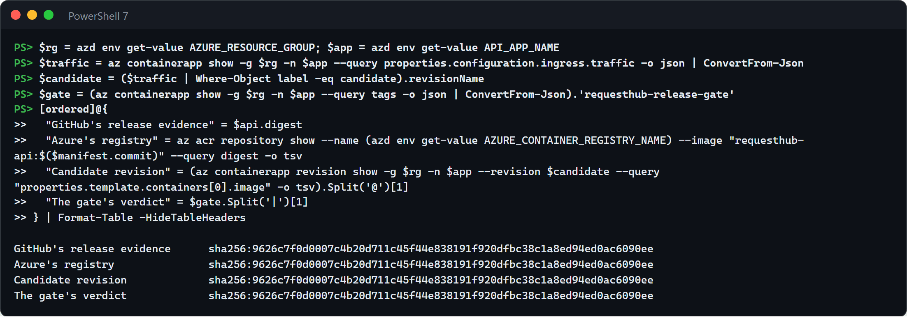

   **Point out:** four records, one digest. The gate's verdict names the revision, its image, when it passed, and how long it baked; promote moves traffic only to the revision and image the verdict names.

5. **The release manager decides** (about 3 minutes). Go: run the promote job, as in [06-release-microsoft](solutions/06-release-microsoft/README.md#run-the-demo), step 3 (51 seconds in our run): users then get GitHub's tested image. No-go: run the abort job. If users report a problem after the promotion, the rollback job moves traffic back to the previous revision, still running (step 6; 56 seconds in our run). The bottom of the workbook shows who started each step (step 7): in our run, a person for the promotion and the rollback, and the trigger function's managed identity for the release job.

   

   **Point out:** the go, the no-go, and the rollback are a person's, and Azure records who ran them. The release job shows the trigger function's identity, because the import started it.

   Afterwards, turn Azure's own build back on (`Update-BuildTask` with `status = 'Enabled'`), and follow both **Reset and clean up** sections.

**What to observe:** the AI's contribution (Copilot's summary of GitHub's evidence for the approver; Azure Copilot to explain a candidate that fails the gate, [06-release-microsoft](solutions/06-release-microsoft/README.md#run-the-demo) step 5), the deterministic checks (GitHub's gate on the tests that ran against the image, Azure's gate on the same digest, and promote's check of the gate's verdict), and the human decision (the release manager's promote, abort, or rollback, which Azure's Activity log records). Each accelerator also runs on its own: [06-release-github](solutions/06-release-github/) and [06-release-microsoft](solutions/06-release-microsoft/).

### Operate: Azure recovers, a person files, Copilot proves the follow-up

When an alert fires, the team needs the service back first, and then a test that keeps the failure from coming back unnoticed. Azure SRE Agent investigates the alert, proposes a fix that runs only after a person approves it, verifies the recovery, and drafts the incident record; a person files that record as a GitHub Issue, and GitHub's triage and Copilot turn it into a regression test that is proven to fail without its fix.

- **When a customer uses both:** operations runs in Azure, where the alert, the telemetry, and the fix are, while the code and its tests live in GitHub. Recovering in Azure adds no test, and a test written days later from memory misses what the investigation found.
- **What passes between them:** one incident record. Azure SRE Agent drafts it with placeholders instead of identifiers, and a person files it as one GitHub Issue with the `incident` label. The triage's follow-up Issue and Copilot's pull request both link back to that Issue.
- **What the person decides:** an SRE Agent Administrator approves the fix and lends it their permissions. The on-call engineer reads the record and decides whether it goes to GitHub as an `incident`, which starts the triage: the agent can't apply that label, or write to GitHub at all. A person assigns the follow-up to Copilot, approves the workflow runs on its pull request, and reviews it.
- **Evidence to show:** the alert and the investigation thread in Azure, then one incident Issue that links the triage comment, the follow-up Issue, Copilot's pull request, and the proof check on that pull request.
- **Pilot metric:** time from an incident's record to a proven regression test: from the incident Issue's creation (`gh issue view <incident> --json createdAt`) to the proof check's PROVEN on its follow-up's pull request (`gh pr checks <pull request>`). Track alongside the share of incidents that get a follow-up at all, and the time to recover in Azure, from the alert's fired time to its resolved time in Azure Monitor. Compare it with similar work from before the pilot. Our first rehearsal measured 16 minutes from the incident Issue to PROVEN (15 minutes 43 seconds, measured). In our second, a person approved the fix 5 minutes after the alert, and Azure Monitor resolved the alert 12 minutes 57 seconds after it fired (measured). A target is a goal the customer sets, never a result.

**Prepare** (about 20 minutes): both solutions' **Set up** ([07-operate-github](solutions/07-operate-github/README.md#set-up), [07-operate-microsoft](solutions/07-operate-microsoft/README.md#set-up)) and **Before each session** checklists. About 10 minutes before the Operate segment, start the incident in `solutions/07-operate-microsoft`. It takes about 2 minutes (1 minute 44 seconds in our run). The alert fires about 6½ minutes after its requests (6 minutes 29 seconds), and the agent's report with its approval request follows about 2 minutes later (2 minutes 8 seconds).

```powershell
python incident.py start
```

1. **Follow the investigation** (3 minutes) — [07-operate-microsoft](solutions/07-operate-microsoft/README.md#run-the-demo), steps 3 and 4. In the SRE Agent portal, open **Incidents** and the new *RequestHub notification backlog* incident. The agent measured the backlog, found the configuration change on the worker, ruled out the database and the API, and reports its facts apart from its hypotheses, with the exact command it proposes.

   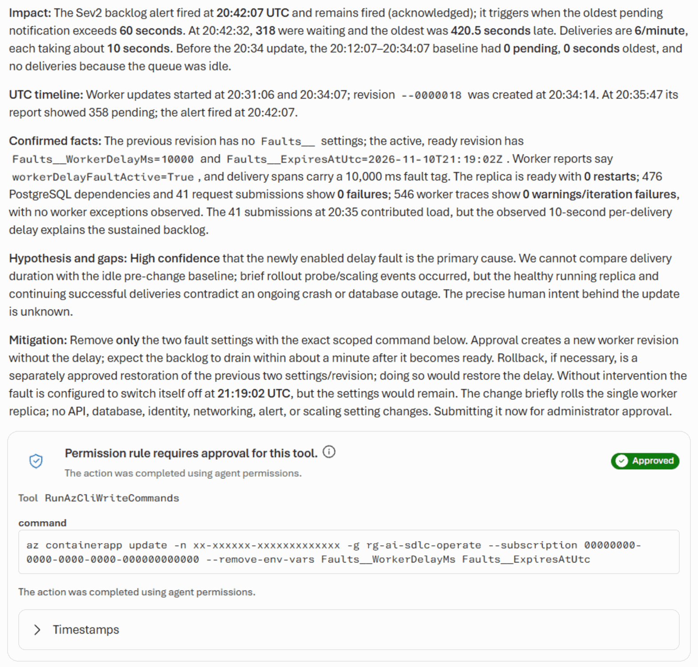

   **Point out:** nobody opened a dashboard. The alert started the investigation, and the report already names the setting, the revision, and the time.

2. **Approve the fix and watch it recover** (about 7 minutes) — [07-operate-microsoft](solutions/07-operate-microsoft/README.md#run-the-demo), steps 5 and 6. Select **Allow once**, then **Grant permissions**. A new worker revision starts without the fault, the backlog drains within about a minute and a half, and the agent waits for fresh telemetry and the resolved alert before it calls the incident recovered. In our second rehearsal the approval request came 2 minutes 34 seconds after the alert; once approved, the change began, the backlog drained 1 minute 49 seconds later, and the alert resolved 6 minutes 45 seconds after the change began.

   

   **Point out:** two decisions, both a person's: this exact command, and lending it their permissions.

3. **File the record as an incident** (2 minutes). The agent ends its last reply with the record ([07-operate-microsoft](solutions/07-operate-microsoft/README.md#run-the-demo), step 7). Its record skill, which `python configure_sre_agent.py --check` enforces, asks for every field the GitHub team's incident form requires: **Impact**, **Timeline (UTC)**, and **Recent changes** sections, and a closing **Status** table with the status, the environment, and the time the alert fired. Read the record with the audience and check that each one is there. Copy the body with the code block's copy button, and file it with the three labels the form applies:

   ```powershell
   Get-Clipboard -Raw | Set-Content $env:TEMP\record.md
   gh issue create --title "Incident record: notification backlog, <YYYY-MM-DD>" --label incident --label ai-sdlc --label phase:operate --body-file $env:TEMP\record.md
   ```

   `gh` prints the new Issue's URL. To use the form instead (**New issue**, **Operate: report an incident**), fill each field from the part of the record with the same name: **Status**, **Environment**, and **Detected at (UTC)** from its Status table, **Impact**, **Recent changes**, and **Timeline (UTC)** from its sections, and **Mitigation so far** from its Mitigation.

   

   In our first rehearsal nobody approved the fix, so the agent drafted no record, and we filed incident #294, shown here, from its investigation's facts in the record's layout. In our second, a person approved the fix: the agent verified the recovery and drafted the record within 2 minutes of the alert resolving, and incident [#301](https://github.com/melabadi/adept-assessment-northstars/issues/301) is that record as filed, with every field the form requires.

   **Point out:** the person adds no fact; their decision is the `incident` label. The agent never applies it, so only a person hands an incident to the GitHub team's triage.

4. **Read the triage** (about 5 minutes to the comment, 2 to read it) — like [07-operate-github](solutions/07-operate-github/README.md#run-the-demo), step 2A from "Within a minute or two", and step 3. While the run works, walk through its jobs under **Actions**, **Operate · GitHub · triage an incident**. The comment arrives on the incident 4 to 5 minutes after you file it (4 minutes 19 seconds in our run), with a severity and an area label and one follow-up Issue under the incident's **Sub-issues**.

   ```powershell
   gh issue view <incident> --comments
   ```

   

   **Point out:** the triage checked the record against the code, and its one follow-up depends on what the record shows. In our run nobody approved the fix, so the fault switched itself off at its expiry: 14 deliveries still waited 10 seconds after it, and the triage traced that to the worker computing the delay once per batch, a failure in the incident's own recovery path.

5. **Copilot writes the regression test** (about 8 minutes) — [07-operate-github](solutions/07-operate-github/README.md#run-the-demo), steps 5 and 6. Assign the follow-up to Copilot with the `operate-github` agent:

   ```powershell
   $repo = gh repo view --json nameWithOwner --jq .nameWithOwner
   $followup = 0   # the follow-up Issue number
   "{""assignees"":[""copilot-swe-agent[bot]""],""agent_assignment"":{""target_repo"":""$repo"",""base_branch"":""main"",""custom_agent"":""operate-github""}}" |
     gh api -X POST "repos/$repo/issues/$followup/assignees" --input - --jq '[.assignees[].login] | join(", ")'
   ```

   It prints `Copilot` and your login. Copilot opens a draft pull request within seconds and finishes in about 8 minutes (7 minutes 51 seconds in our run), with the tests committed before the fix. Its workflow runs wait for a person: select **Approve workflows to run**, or run `gh run rerun <run-id>` for each run that `gh run list --branch <copilot-branch>` lists.

   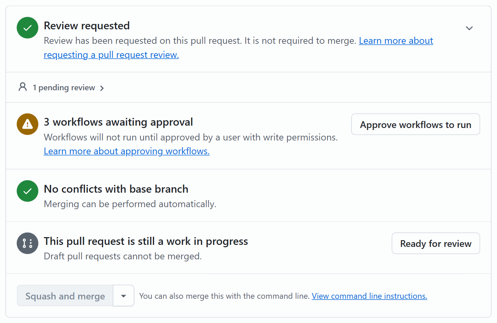

   **Point out:** a person assigns the follow-up and starts the runs. Nothing in Actions runs on an agent's pull request before that.

6. **One incident, one chain of evidence** (2 minutes; the proof took 1 minute 21 seconds and CI 1 minute 54 seconds in our run). Show the pull request's link to the follow-up and its checks, then open the **Operate · GitHub · prove the regression test** check: `Regression proof: PROVEN`, with each test that fails on the code before the change and passes with it.

   ```powershell
   gh pr view <pull request> --json title,closingIssuesReferences --jq '.title, (.closingIssuesReferences[] | "Fixes #\(.number)")'
   gh pr checks <pull request>
   ```

   

   **Point out:** follow the numbers. The record became incident #294, its triage opened follow-up #295, and Copilot's pull request #296 fixes #295 with a test that fails without its two-line fix. A person still reviews it and decides.

   When the follow-up asks for a guard the code already has, the proof reports COVERAGE instead, and stays red by design: Copilot's new tests pass before and after the change, so no defect is demonstrated, Copilot says so in its pull request, and a person decides. That happened in our second rehearsal, where the fault was removed by the approved fix: the triage of incident #301 asked to prove that an expired or unset fault never slows delivery ([#302](https://github.com/melabadi/adept-assessment-northstars/issues/302)), the code already did, and Copilot's [#303](https://github.com/melabadi/adept-assessment-northstars/pull/303) added the tests: `Regression proof: COVERAGE`, 70 of 70 tests passing at the head.

**What to observe:** the AI's contribution (Azure SRE Agent's investigation, proposed fix, recovery check, and draft record; the triage's sourced timeline, hypotheses, and one follow-up; Copilot's test and fix), the deterministic check (the proof workflow: the new test fails on the code before the change and passes with it), and the human decisions (approving the fix with the approver's permissions, filing the record as an incident, assigning Copilot, approving its runs, and reviewing its pull request). Each accelerator also runs on its own: [07-operate-github](solutions/07-operate-github/) and [07-operate-microsoft](solutions/07-operate-microsoft/).

## Follow one requirement from Plan to Test

One stakeholder decision, followed through three phases to one reviewed pull request. Use it when a customer asks how AI helps deliver a single change without losing control of it.

- **The customer's problem:** changes to a governed workflow wait for scarce reviewers, who re-check by hand that the change keeps the rule that only approvers decide, and who still miss what the tests don't cover.
- **The starting point:** one accepted backlog item that traces to a recorded decision. Here it is transcript decision **T19**, "No automatic routing without a person confirming", which settles **T04** (policy POL-GOV-001): "A reviewer confirms the routing, and only an approver can approve or reject."
- **The pilot measure:** reviewer minutes per accepted change, with rework tracked alongside it.

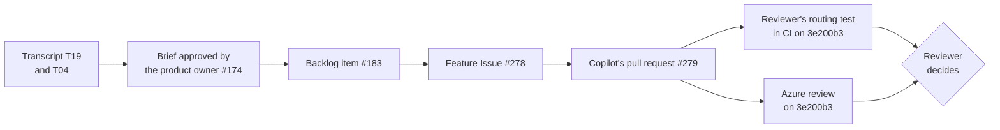

**Prepare:** the [Develop combo](#develop-copilot-writes-azure-reviews-a-person-decides)'s preparation, with the Issue's first line naming the backlog item (step 2 below).

1. **Plan: the decision and the accepted item** (5 minutes). Open [`stakeholder-transcript.md`](solutions/01-plan-github/inputs/stakeholder-transcript.md) at T04 and T19. Then open the brief the product owner approved, [#174](https://github.com/melabadi/adept-assessment-northstars/issues/174) (a person applied `brief-approved`), and the backlog item it published, [#183](https://github.com/melabadi/adept-assessment-northstars/issues/183), *Reviewer Confirmation Workflow*: its sources quote T04 and T19. 01-plan-github publishes the same requirement from Copilot's brief:

   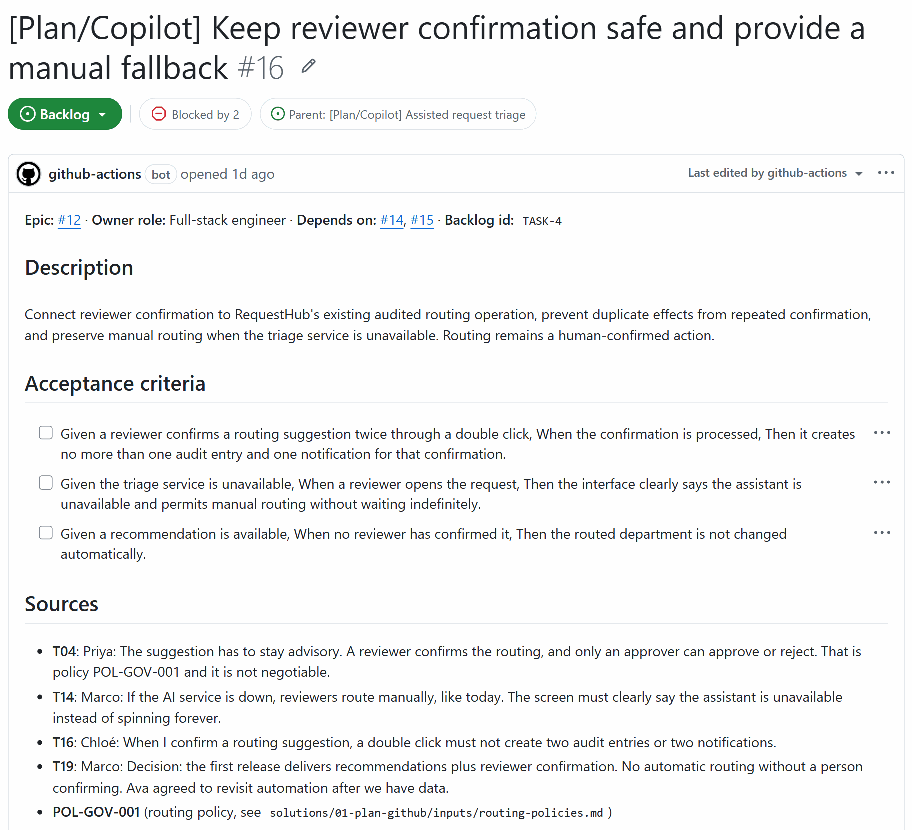

   **Point out:** the requirement has an address. Anyone can follow T19 from the meeting to the code.

2. **Develop: from the backlog item to Copilot's pull request** (before the session; 15 minutes of Copilot's work). Create the feature Issue from [`feature-issue.md`](solutions/03-develop-github/feature-issue.md) with a first line that names the backlog item, and assign it to Copilot (03-develop-github steps 2 and 3):

   ```powershell
   $item = 183
   $body = "Backlog item: #$item. It traces to transcript decision T19 and T04 / POL-GOV-001: a reviewer confirms routing, and only an approver approves or rejects.`n`n" + (Get-Content solutions/03-develop-github/feature-issue.md -Raw)
   $url = $body | gh issue create --title "Develop: reviewer confirms the recommended routing department" --body-file - --label ai-sdlc --label phase:develop
   $issue = $url.Split('/')[-1]; $url
   ```

   In our run, Issue [#278](https://github.com/melabadi/adept-assessment-northstars/issues/278) became draft pull request [#279](https://github.com/melabadi/adept-assessment-northstars/pull/279) 6 seconds after the assignment, and Copilot worked for 14 minutes; CI and the bounds check passed on its commit.

   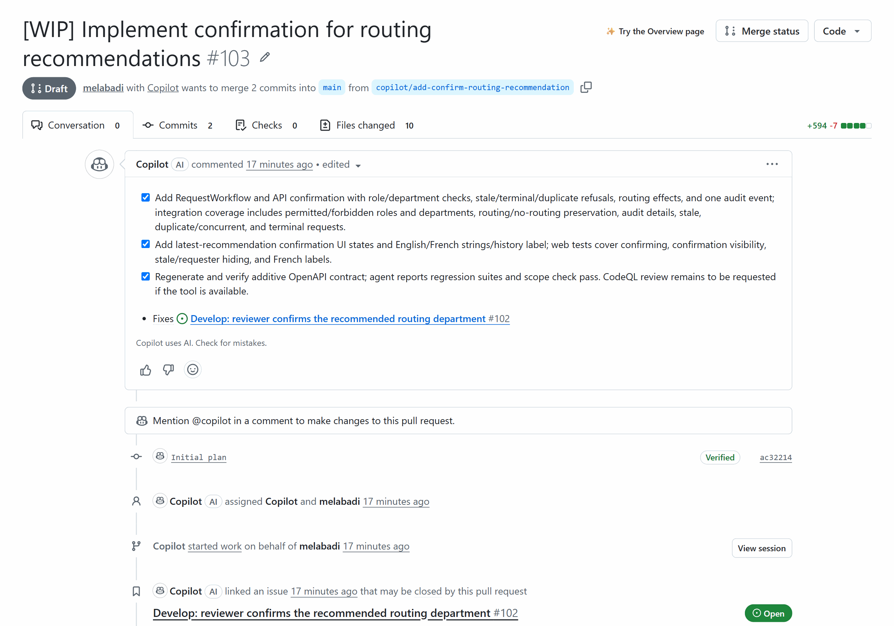

   **Point out:** the Issue names the backlog item, so the pull request traces back to T19.

3. **Test: the reviewer's independent routing test** (3 minutes). This is the [Develop combo](#develop-copilot-writes-azure-reviews-a-person-decides)'s step 2: the reviewer's [`confirm-routing.spec.ts`](solutions/03-develop-github/regression/confirm-routing.spec.ts) checks T19 and T04 the way a user sees them. In our run it failed on Copilot's commit, because the panel called Ben's just-confirmed recommendation "Stale", and passed after Copilot CLI's one-line fix ([`3e200b3`](https://github.com/melabadi/adept-assessment-northstars/pull/279/commits/3e200b3d324c9913e896d4dadfc387283a137558)). CI then ran it on that commit: 3 of 3 routing tests and 9 of 9 browser tests passed.

   

   **Point out:** the test fails before the repair and passes after it, and it was written by the reviewer, not by the agent that wrote the code.

4. **Review: GitHub and Azure on one commit** (5 minutes, plus Azure's wait). The [Develop combo](#develop-copilot-writes-azure-reviews-a-person-decides)'s steps 3 and 4: mark the pull request ready, add `review:azure`, and show both verdicts on the same SHA.

   

   **Point out:** Azure's rule *Approval authority is untouched* passed: the change routes requests and doesn't touch who decides them.

5. **See the rule hold: the audit entry and the request still in review** (5 minutes, plus 2 to build and start the app). Run the app from the pull request's branch and click through as 03-develop-github's [step 7](solutions/03-develop-github/README.md#the-steps) describes: Ava files an equipment request under Facilities, and Ben gets a recommendation and confirms the routing. In our run on commit 3e200b3, REQ-1028 moved to IT Services, the History ends with *Routing confirmed: IT Services*, the status stays *In review*, and the decision panel waits for an approver. Through the API, Ben's attempt to approve returned `403` with `decision.not_approver`, and a second click on Confirm returned `409` with `recommendation.already_confirmed`, leaving one audit entry.

   

   **Point out:** T19 holds (a person confirmed the routing), and T04 holds (the request still waits for an approver).

6. **Decide** (2 minutes). The reviewer approves the pull request or asks for changes, as in the [Develop combo](#develop-copilot-writes-azure-reviews-a-person-decides)'s step 5. In our run the reviewer approved `3e200b3`, answering Azure's warning in the review: the API test checks the confirmer's name after a confirmation, so a change in the audit details' format fails that test instead of hiding the name.

   **Point out:** the first human decision in this chain was the product owner's approval of the brief; the last is the reviewer's.

7. **Measure** (3 minutes). For each accepted change in the pilot, record the reviewer's minutes (from the reviewer's own time log: GitHub doesn't record effort) and the rework: review rounds and commits after ready for review (`gh pr view <number> --json reviews,commits`). Record the same for five to ten similar changes merged before the pilot, and compare the two. Keep measured results apart from targets:
   - **Measured in our rehearsal (one change, not a trend):** 14 minutes of Copilot's unattended work; 7 minutes for the reviewer's test and Copilot CLI's fix, before the pull request was ready; Azure's review 10 minutes after the label. No time log was kept for the reviewer's decision, so this rehearsal gives no reviewer-minutes figure.
   - **Historical evidence:** [#3](https://github.com/melabadi/adept-assessment-northstars/pull/3), Copilot's first run of the same feature on 26 October, produced three commits in 20 minutes and is still a draft with no review or decision.
   - **A target** such as "a third fewer reviewer minutes per accepted change, with no more rework" is the customer's goal, never a result to report.

   **Point out:** speed without the rework count would hide what the reviewer's test caught.

## After you present: hand it over

Customers add a solution to their own repository from its README's *Add it to your repository*, after the root README's [Before you start](README.md#before-you-start). To try it first, the root README's [Try it in a copy of this repository](README.md#try-it-in-a-copy-of-this-repository) makes a copy for every solution. Leave them those links and [what the Microsoft solutions cost](README.md#what-the-microsoft-solutions-cost).

## Run it live

Each demo also runs live, in a copy of this repository, from its README's *Try it first in a copy of this repository*. A live run shows the tools working in your own tenant, but it takes longer, costs money while it runs, and needs every solution you show set up and in its starting state first.

### Timings for a live session

"Start early" is what to launch before you need it, so that nobody waits on stage.

| Solution | On stage | Start early |
| --- | --- | --- |
| [01-plan-github](solutions/01-plan-github/) | 15 min (12 with the cloud agent's pull request) | If you show the cloud agent (option B), assign it about 10 minutes before: it finishes in about 5. |
| [01-plan-microsoft](solutions/01-plan-microsoft/) | 15 min (20 with the optional steps) | Start a backup run about 10 minutes before, with `python runs.py start --no-follow`: a run reaches its review Issue in about 2 minutes, or 5½ to 8½ when the preview evaluation runs again. |
| [02-design-github](solutions/02-design-github/) | 25 min | If you show the cloud agent (option B), assign it at least 30 minutes before; it takes about 12. Request Copilot's code review early: it takes 4 to 5 minutes. |
| [02-design-microsoft](solutions/02-design-microsoft/) | 15 min | Run the Foundry evaluation (`python evaluate.py`, in the solution folder) about 15 minutes before step 8; it takes 3 to 7 minutes, plus 3 to 5 for each run it starts again because Foundry's preview grader couldn't score it. Show its summary as it came out: the first attempt's passed, failed, and ungraded cases, then each retry and why. In the run the README shows, the first attempt passed 5 cases, Foundry couldn't grade the other 5, and the retry's new answers passed them. Also start `python evaluate.py --check-graders` (about 3 minutes) for step 8's right and wrong answers. Open the agent's Playground in advance (it takes up to a minute to load). |
| [03-develop-github](solutions/03-develop-github/) | 25 min | Create the Issue and assign it to Copilot at least 30 minutes before: it works for 20 to 30. Run the Copilot CLI step (about 20 minutes) beforehand too. |
| [03-develop-microsoft](solutions/03-develop-microsoft/) | 20 min | Run the reviewer's dry run on the `admins-decide` case (`python eval_reviewer.py --cases admins-decide --local`, about 3 minutes) to confirm its GitHub token still works; a new copy needs `python eval_reviewer.py --setup` once first. For fresh evaluation results, start `eval_reviewer.py` about 20 minutes before, and `eval_reviewer.py --check-graders` (5 to 10 minutes) for step 7's right and wrong reviews. |
| [04-test-github](solutions/04-test-github/) | 20 min | Rebuild the lab branch and assign the Issue to Copilot 30 minutes before: it works for 15 to 30. The optional Copilot CLI step takes 12 to 18 minutes. |
| [04-test-microsoft](solutions/04-test-microsoft/) | 30 min (45 fully live) | Start the baseline Azure Load Testing run from the portal about 10 minutes before its step: a run reaches its verdict in 8 to 9 minutes, and the Azure Function reports it about 2 minutes later. Start the final passing run during questions. |
| [05-secure-github](solutions/05-secure-github/) | 15 min | Prepare the lab and start the review and the cloud agent 30 to 45 minutes before: the review took about 6 minutes and the repair 15 in the screenshot run. |
| [05-secure-microsoft](solutions/05-secure-microsoft/) | 25 min (15 with step 7 from screenshots) | Reset at least a day before, so that Defender for Cloud reports the account Unhealthy again, and start the database if a tenant policy stopped it (about 2 minutes). Nothing else: the Issue, the agent's draft pull request, and its what-if preview follow the click in about 2 minutes, `azd provision` takes about 5½, and the Function `verify` 1 to 15. |
| [06-release-github](solutions/06-release-github/) | 20 min | Start the release candidate about 15 minutes before: the candidate takes 3.5 to 7 minutes, and Copilot's summary 5 to 6 more. |
| [06-release-microsoft](solutions/06-release-microsoft/) | 20 min | Start `release.py watch` two minutes before, so the audience sees what users get. A release takes about 4 minutes: about 2 to build the commit; Event Grid and the Azure Function start the release job 2 seconds after the push, and it deploys and checks the candidate in about 2.5. |
| [07-operate-github](solutions/07-operate-github/) | 20 min | In a short slot, run the triage (about 5 minutes) and Copilot's follow-up (4 to 10 more) before the audience arrives. |
| [07-operate-microsoft](solutions/07-operate-microsoft/) | 25 min | In a short slot, start the incident up to 10 minutes before you show the investigation (no more than 30: the fault switches itself off after 45); the alert fires about 6 minutes after the start. |

### Prepare

#### Once

- Make a copy, as in the root README's [Try it in a copy of this repository](README.md#try-it-in-a-copy-of-this-repository), then follow each solution's *Try it first in a copy of this repository*. The Microsoft solutions each deploy into their own resource group with `azd up`, which takes from 2 to 20 minutes depending on the solution.
- Connect each Microsoft solution to GitHub once, as its README describes: a fine-grained token limited to this repository (Plan, Develop, Test, Secure, Release), a private GitHub App (Design), or Azure SRE Agent's Code access (Operate). Their AI and automation run in Azure; no GitHub Actions workflow takes part.
- For the two agentic workflows (06-release-github and 07-operate-github), create the `COPILOT_GITHUB_TOKEN` secret as their READMEs describe.
- Use a demo tenant and a demo subscription. On stage, your audience sees your real Azure portal, your account, and your resource names.

#### The day before

- Reset each solution you will show, as the end of its README's *Try it first in a copy of this repository* describes, and check that it is in its starting state.
- Make sure the PostgreSQL servers of the Microsoft solutions that run RequestHub are running. Tenant governance policies can stop them on a schedule; when that happens the app fails its readiness check and requests time out. Each README's checklist has the check and the `az postgres flexible-server start` command, which takes 3 to 5 minutes.
- Run the quick self-checks the READMEs include, such as an evaluation run or a preflight. They catch an expired sign-in or a missing secret while there is still time to fix it.
- If you present from another machine, sign in there to GitHub, Azure CLI (`az login`), and Azure Developer CLI (`azd auth login`).

#### One hour before

1. Sign in to GitHub and the Azure portal in the browser you present from.
2. Start the long-running parts in the order of the [timings](#timings-for-a-live-session): Copilot tasks first, then the release candidate, then load tests and the incident.
3. Open the pages and terminals that each step uses: the Issue or pull request, the workflow runs, and the portals.

### During the session

- Narrate while things run. Every README says what to show while you wait: the input files, the agent's instructions, the workflow definition.
- Keep your account menu, the Foundry project's Home page, and Azure resources' Overview pages off the shared screen: they show your account, endpoints, and subscription. The READMEs' screenshots were captured with these details masked; a live screen isn't.
- If a live step is slow or fails, switch to the README's *See it work*: its screenshots come from a real run of the same steps. Each README's **Troubleshooting** covers the failures we have seen.
- Show evaluation results as they came out, in three parts: the **first attempt** (what passed and what failed the first time), the **retries** (a run started again only because Foundry's preview grader couldn't score it, with new answers from the agent), and what **could not be graded**. 02-design-microsoft's `evaluate.py` and 03-develop-microsoft's `eval_reviewer.py` print them apart. A failed case is a result: never run an evaluation again until it passes.
- End each phase on its *Results and value*: what the AI did, what the person decided, and the evidence left behind.

### After the session

- Reset each solution you used, as the end of its README's *Try it first in a copy of this repository* describes: the reset closes the Issues and pull requests the demo created, deletes temporary branches, and puts Azure resources back in their starting state.
- When you are done with a Microsoft solution, its clean-up section removes everything it created, including any Microsoft Entra app registration, and says how to revoke its GitHub access: delete its token or GitHub App on GitHub.
