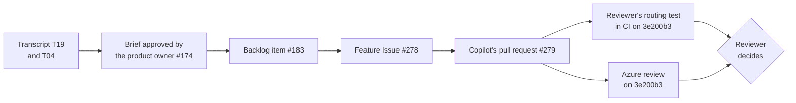

# Presenting the seven-phase demo

Each solution's README is the script for its own demo: every step has the command or click, a screenshot of what appears, and what to point out. This guide plans a whole session: which demos to show, what to start early, how to prepare, and what it costs while it runs.

## Pick a format

| Format | Length | What to show |
| --- | --- | --- |
| **Full show** | About 5 hours of demos: a full day with breaks, or two half days | All fourteen demos, phase by phase: the GitHub solution, then the Microsoft one. |
| **One track** | About 2½ hours | The seven GitHub demos (about 2 h 20 min) or the seven Microsoft demos (about 2 h 35 min), in phase order. |
| **One phase, side by side** | 30 to 50 minutes | The two solutions of one phase, for a team that cares about that phase. |
| **Highlights** | About 2 hours | One demo per phase. The [suggested set](#a-two-hour-highlights-run) below keeps the waiting off stage. |
| **Solution combo** | 30 to 50 minutes | Both solutions of one phase on one change: each track does its part, they pass one artifact, and a person decides. See [Solution combos](#solution-combos). |
| **One requirement, three phases** | About 45 minutes, plus waits started earlier | A stakeholder decision followed from Plan through Develop to Test on one pull request. See [Follow one requirement from Plan to Test](#follow-one-requirement-from-plan-to-test). |

Whatever the format, tell the same story: one app, RequestHub, goes through every phase, and in each phase AI does the tedious part while a person keeps the decision.

## Timings at a glance

"Start early" is what to launch before you need it, so that nobody waits on stage.

| Solution | On stage | Start early |
| --- | --- | --- |
| [01-plan-github](solutions/01-plan-github/) | 15 min (12 with the cloud agent's pull request) | If you show the cloud agent (option B), assign it about 10 minutes before: it finishes in about 5. |
| [01-plan-microsoft](solutions/01-plan-microsoft/) | 15 min (20 with the optional steps) | Start a backup run about 10 minutes before, with `python runs.py start --no-follow`: a run reaches its review Issue in about 2 minutes, or 5½ to 8½ when the preview evaluation runs again. |
| [02-design-github](solutions/02-design-github/) | 25 min | If you show the cloud agent (option B), assign it at least 30 minutes before; it takes about 12. Request Copilot's code review early: it takes 4 to 5 minutes. |
| [02-design-microsoft](solutions/02-design-microsoft/) | 15 min | Run the Foundry evaluation (`python evaluate.py`, in the solution folder) about 15 minutes before step 8; it takes 3 to 7 minutes, plus 3 to 5 for each run it starts again because Foundry's preview grader couldn't score it. Show its summary as it came out: the first attempt's passed, failed, and ungraded cases, then each retry and why. In the run the README shows, the first attempt passed 5 cases, Foundry couldn't grade the other 5, and the retry's new answers passed them. Also start `python evaluate.py --check-graders` (about 3 minutes) for step 8's right and wrong answers. Open the agent's Playground in advance (it takes up to a minute to load). |
| [03-develop-github](solutions/03-develop-github/) | 25 min | Create the Issue and assign it to Copilot at least 30 minutes before: it works for 20 to 30. Run the Copilot CLI step (about 20 minutes) beforehand too. |
| [03-develop-microsoft](solutions/03-develop-microsoft/) | 20 min | Run the reviewer's dry run on the `admins-decide` case (`python eval_reviewer.py --cases admins-decide --local`, about 3 minutes) to confirm its GitHub token still works; a new copy needs `python eval_reviewer.py --setup` once first. For fresh evaluation results, start `eval_reviewer.py` about 20 minutes before, and `eval_reviewer.py --check-graders` (5 to 10 minutes) for step 7's right and wrong reviews. |
| [04-test-github](solutions/04-test-github/) | 20 min | Rebuild the lab branch and assign the Issue to Copilot 30 minutes before: it works for 15 to 30. The optional Copilot CLI step takes 12 to 18 minutes. |
| [04-test-microsoft](solutions/04-test-microsoft/) | 30 min (45 fully live) | Start the baseline Azure Load Testing run from the portal about 10 minutes before its step: a run reaches its verdict in 8 to 9 minutes, and the Azure Function reports it about 2 minutes later. Start the final passing run during questions. |
| [05-secure-github](solutions/05-secure-github/) | 15 min | Prepare the lab and start the review and the cloud agent 30 to 45 minutes before: the review took about 6 minutes and the repair 15 in the screenshot run. |
| [05-secure-microsoft](solutions/05-secure-microsoft/) | 25 min (15 with step 7 from screenshots) | Reset at least a day before, so that Defender for Cloud reports the account Unhealthy again, and start the database if a tenant policy stopped it (about 2 minutes). Nothing else: the Issue, the agent's draft pull request, and its what-if preview follow the click in about 2 minutes, `azd provision` takes about 5½, and the Function `verify` 1 to 15. |
| [06-release-github](solutions/06-release-github/) | 20 min | Start the release candidate about 15 minutes before: the candidate takes 3.5 to 7 minutes, and Copilot's summary 5 to 6 more. |
| [06-release-microsoft](solutions/06-release-microsoft/) | 20 min | Start `release.py watch` two minutes before, so the audience sees what users get. A release takes about 4 minutes: about 2 to build the commit; Event Grid and the Azure Function start the release job 2 seconds after the push, and it deploys and checks the candidate in about 2.5. |
| [07-operate-github](solutions/07-operate-github/) | 20 min | In a short slot, run the triage (about 5 minutes) and Copilot's follow-up (4 to 10 more) before the audience arrives. |
| [07-operate-microsoft](solutions/07-operate-microsoft/) | 25 min | In a short slot, start the incident up to 10 minutes before you show the investigation (no more than 30: the fault switches itself off after 45); the alert fires about 6 minutes after the start. |

### A two-hour highlights run

One demo per phase, chosen for a short running time and a clear story, with the long waits started before the session (see the table above):

1. **Plan** (12 min): [01-plan-github](solutions/01-plan-github/), with the cloud agent's brief pull request already open.
2. **Design** (15 min): [02-design-microsoft](solutions/02-design-microsoft/), two operating profiles get different, grounded answers.
3. **Develop** (20 min): [03-develop-microsoft](solutions/03-develop-microsoft/), Azure reviews a risky pull request in minutes: the team's rules first, then a sandbox build, then a Foundry agent's commentary.
4. **Test** (20 min): [04-test-github](solutions/04-test-github/), with the failing tests and the fix already pushed.
5. **Secure** (15 min): [05-secure-github](solutions/05-secure-github/), from Copilot's review finding to a proven fix.
6. **Release** (20 min): [06-release-microsoft](solutions/06-release-microsoft/), a bad revision is caught before it gets traffic.
7. **Operate** (20 min): [07-operate-github](solutions/07-operate-github/), with the triage and Copilot's follow-up run beforehand.

To show the other offering of a phase, swap in its other solution; the table above shows what it adds to the time.

## Solution combos

Each phase's two solutions also work together on one change. In a combo, the GitHub solution and the Microsoft solution each do the part they are built for, pass one artifact between them, and a person makes the decision at the end. Each combo is a single-phase session. Both solutions still run on their own from their READMEs, so a customer can adopt either accelerator first and add the other later.

Before a combo, complete both solutions' **Set up** and run both **Before each session** checklists. Afterwards, follow both **Reset and clean up** sections.

| Phase | GitHub does | Azure does | What passes between them | A person decides |
| --- | --- | --- | --- | --- |
| [Design](#design-foundry-cites-the-standards-github-checks-the-adr) | Copilot completes the ADR from the code; Actions check it and the API contract | The Foundry advisor answers from the approved standards and lists conflicts | The advisor's pull request | The architect accepts or rejects the ADR |
| [Develop](#develop-copilot-writes-azure-reviews-a-person-decides) | Copilot writes the change; CI, the bounds check, and the reviewer's own test | A Function checks the team rules, builds the change in a sandbox, and asks a Foundry agent | The pull request's head commit | The reviewer approves or asks for changes |

### Design: Foundry cites the standards, GitHub checks the ADR

An architecture question gets two kinds of help on one pull request. The Foundry advisor in Azure finds the approved standards that apply and flags where they conflict. Copilot turns that answer into a full ADR grounded in the code, and GitHub checks it against the ADR template and the API contract, so the architect sees how the proposed decision affects the code.

- **When a customer uses both:** the standards live in a governed index that the architects own, with access per team, and every design decision must still be checked against the real code and contract before anyone builds.
- **What passes between them:** the advisor's pull request, with its draft ADR: the standards it cited by id and version, the conflicts, and the unknowns. Copilot completes that file on the same branch, so the pull request ends with one ADR.
- **What the person decides:** the architect gives each conflict and unknown an owner, then accepts the ADR (status Accepted, the deciders named, merged) or rejects it (closed). Neither agent can accept it: the ADR check fails an accepted ADR that names no people.
- **Evidence to show:** the advisor's comment (standards, conflicts, unknowns, the checks its citations passed, the agent version and run), the pull request's two commits (the advisor's draft and Copilot's completion), and GitHub's ADR and API contract checks on its head commit.
- **Pilot metric:** time from a design question to a reviewable ADR with green checks, with the conflicts and unknowns found before review tracked alongside the ones found later. Compare it with design decisions made before the pilot. Our rehearsal measured one question: the advisor answered in 39 seconds, Copilot completed the ADR in 5 minutes 16 seconds, and the checks finished within a minute of the push; one conflict and three unknowns reached the architect before any review. That is one run, not a trend; a target is a goal the customer sets.

**Prepare** (5 minutes): both solutions' **Set up** ([02-design-github](solutions/02-design-github/README.md#set-up), [02-design-microsoft](solutions/02-design-microsoft/README.md#set-up)) and **Before each session**, and a PowerShell 7 terminal at the repository root, signed in to GitHub and Copilot CLI.

1. **Ask the advisor** (1 minute, then under a minute of waiting). File the question with the **small-team** profile, from the issue form as in 02-design-microsoft's [step 4](solutions/02-design-microsoft/README.md#run-the-demo), or from a terminal:

   ```powershell
   $body = "### Operating profile`n`nsmall-team`n`n### Question`n`nShould the live AI triage provider run inside the existing RequestHub API behind ITriageProvider, or as a new separate service?"
   $issue = (gh issue create --title "Architecture question: where should the live AI triage provider run?" --body $body --label ai-sdlc --label phase:design --label design-advisor).Split('/')[-1]
   ```

   Azure answers on the Issue and opens the ADR draft pull request (steps 5 and 6 of that README). In our run, the answer arrived 39 seconds after the Issue: twelve requirements from five standards, the conflict between STD-SEC-002 and STD-OBS-002, three unknowns, and pull request [#281](https://github.com/melabadi/adept-assessment-northstars/pull/281).

   

   **Point out:** the advisor names the conflict and leaves it to a person, and its citations passed Azure's checks before anything reached GitHub.

2. **Copilot completes the ADR on the same branch** (about 5 minutes). Check out the advisor's branch and give Copilot CLI the combined task, [`adr-from-advisor-task.md`](solutions/02-design-github/adr-from-advisor-task.md):

   ```powershell
   gh pr checkout (gh pr list --head "design/advisor-issue-$issue" --json number -q '.[0].number')
   copilot --agent design-github --allow-all-tools -p ((Get-Content solutions/02-design-github/adr-from-advisor-task.md -Raw) -replace 'ISSUE', $issue)
   ```

   Copilot moves the advisor's draft to `solutions/02-design-github/adr/`, compares the options for both operating profiles against the code, keeps every conflict and unknown open, runs the ADR checker until it passes, and pushes. In our run it disagreed with the advisor: the advisor preferred a separate service, and Copilot, having read the API's existing in-process Foundry provider, recommended extending it, through the central gateway for the enterprise profile.

   

   **Point out:** two AI opinions end up in one record, and the architect sees where they disagree and why.

3. **GitHub checks the ADR and its API impact** (under a minute). The push starts *Design · GitHub · check the ADR and API impact* on the advisor's pull request:

   ```powershell
   $pr = gh pr list --head "design/advisor-issue-$issue" --json number -q '.[0].number'
   gh pr view $pr --json commits,files --jq '(.commits[] | "commit \(.oid[0:7])  \(.messageHeadline)"), (.files[] | "file    \(.path)")'
   gh pr checks $pr --json name,bucket --jq '.[] | "\(.bucket | . + " " * (10 - length))\(.name)"'
   ```

   

   **Point out:** the draft alone is not yet a decision record: in our run, the ADR checker found 11 gaps in the advisor's draft (no decision, architecture, API impact, threat model, or task sections, no options in the template's form, no diagrams), and the contract check reported no breaking and no additive change.

4. **The architect decides** (3 minutes). In **Files changed**, open the ADR with **⋯** → **View file**. Give each open question an owner. To accept, set the status to Accepted, name the deciders, and merge; to reject, close the pull request. For the demo, close it and follow both [Reset](solutions/02-design-microsoft/README.md#reset-and-clean-up) sections.

   

   **Point out:** an agent can only propose; the check fails any accepted ADR that doesn't name the people who decided.

**What to observe:** the AI's contribution (Foundry finds and cites the standards and the conflict; Copilot writes the full ADR from the code and challenges the advisor where the code disagrees), the deterministic checks (Azure's citation gate before GitHub sees anything, then GitHub's ADR checker and API contract check on the same pull request), and the human decision (the architect owns every conflict and accepts or rejects). Each accelerator also runs on its own: [02-design-github](solutions/02-design-github/) and [02-design-microsoft](solutions/02-design-microsoft/).

### Develop: Copilot writes, Azure reviews, a person decides

A team that lets Copilot write bounded changes wants an independent review, run in its own Azure, before a person spends time on the pull request. GitHub writes and tests the change, Azure reviews the same commit, and the reviewer decides.

- **When a customer uses both:** Copilot already opens pull requests, and reviewers want the team's rules checked, the change built and tested, and a second model's reading of the diff before they start, without giving Azure write access to the code.
- **What passes between them:** one pull request and its head commit. GitHub's checks and Azure's review name the same SHA.
- **What the person decides:** the reviewer approves the pull request or asks for changes. Azure's review is a comment that never approves, and Copilot can't approve its own pull request.
- **Evidence to show:** for one head commit, CI with the reviewer's own browser test, the bounds check, and Azure's review (team rules, sandbox tests, Foundry commentary), then the person's review.
- **Pilot metric:** reviewer minutes per accepted change, from ready for review to the decision, with rework (review rounds, and commits pushed after ready for review) tracked alongside. Compare them with similar changes reviewed before the pilot. Our rehearsal measured one change, [#279](https://github.com/melabadi/adept-assessment-northstars/pull/279): the reviewer's test found one defect, which Copilot CLI fixed in one commit before the pull request was marked ready, and Azure's review arrived 10 minutes after the label. That is one run, not a trend; a target is a goal the customer sets.

**Prepare** (about 45 minutes before): both solutions' **Set up** ([03-develop-github](solutions/03-develop-github/README.md#set-up), [03-develop-microsoft](solutions/03-develop-microsoft/README.md#set-up)), which includes the `review:azure` label. Create the feature Issue and assign it to Copilot, as in 03-develop-github's [steps 2 and 3](solutions/03-develop-github/README.md#run-the-demo): in our run Copilot opened its draft pull request 6 seconds after the assignment and worked for 14 minutes. When it asks for your review, start its workflow runs (step 4) and run the reviewer's test with Copilot CLI (step 6; 7 minutes in our run).

1. **Show what Copilot delivered** (3 minutes). Open the pull request: Copilot's summary, tests named after the acceptance criteria, and the green checks (03-develop-github steps 4 and 5).

   

   **Point out:** nothing Copilot wrote ran in Actions until a person started the runs.

2. **Show the reviewer's own test** (3 minutes). The reviewer's browser test ran on Copilot's branch before the pull request was ready (step 6). In our run it failed: right after Ben confirmed the routing, the panel still labelled his recommendation "Stale". Copilot CLI fixed one condition in the code and left the test unchanged.

   

   **Point out:** Copilot's own 76 API tests and 18 web tests had passed; the reviewer's independent test found the defect.

3. **Mark it ready and ask Azure** (10 seconds, then 2½ to 10 minutes of waiting). From the repository root:

   ```powershell
   gh pr ready <number>
   gh pr edit <number> --add-label review:azure
   ```

   That is all GitHub does: Azure's Function reads the pull request at its head commit, runs the team rules, builds and tests the change in a sandbox, and asks the Foundry agent (03-develop-microsoft steps 2 to 4). Earlier runs posted the review about 2½ minutes after the label; in this run it took 10 minutes, because the sandbox needed 8 minutes to set up its toolchain.

   

   **Point out:** Azure needs no write access to the code, and its review is only ever a comment.

4. **One commit, both verdicts** (3 minutes). Show that GitHub's checks and Azure's review judged the same commit:

   ```powershell
   $pr = <number>
   $head = gh pr view $pr --json headRefOid -q .headRefOid; "Head commit: $head"
   gh pr checks $pr --json name,bucket --jq '.[] | "\(.bucket | . + " " * (10 - length))\(.name)"'
   gh api "repos/{owner}/{repo}/pulls/$pr/reviews" --jq ('.[] | select(.commit_id == "' + $head + '") | "Azure review: \(.state) on \(.commit_id[0:7])", (.body | split("\n")[] | select(test("^\\*\\*Team rules|^- (API|Web)")) | sub(" Checked by.*"; "") | "  " + .)')
   ```

   

   Then open Azure's review on the pull request. In our run, the Foundry agent added one warning the rules can't catch: the confirmer's name is read back from audit details, so a change in their format would hide it without failing. It asked the person to look at that path.

   **Point out:** the same SHA everywhere. The reviewer's browser test passed in CI on the commit that Azure built and reviewed.

5. **The reviewer decides** (2 minutes). In **Files changed**, select **Review changes**, then **Approve** or **Request changes**, with a comment that answers the agent's warning. For the demo, don't merge (see both READMEs' **Reset and clean up**).

   **Point out:** the decision is the only step no tool can take: Azure comments, and Copilot can't approve its own pull request.

**What to observe:** the AI's contribution (Copilot wrote the change and its tests, Copilot CLI fixed the defect the reviewer's test found, and the Foundry agent pointed at the one risk no rule covers), the deterministic checks (CI with the reviewer's test, the bounds check, Azure's rule checker and sandbox, all on one commit), and the human decision (the person started the runs, wrote the independent test, and approves or asks for changes). Each accelerator also runs on its own: [03-develop-github](solutions/03-develop-github/) and [03-develop-microsoft](solutions/03-develop-microsoft/).

## Follow one requirement from Plan to Test

One stakeholder decision, followed through three phases to one reviewed pull request. Use it when a customer asks how AI helps deliver a single change without losing control of it.

- **The customer's problem:** changes to a governed workflow wait for scarce reviewers, who re-check by hand that the change keeps the rule that only approvers decide, and who still miss what the tests don't cover.
- **The starting point:** one accepted backlog item that traces to a recorded decision. Here it is transcript decision **T19**, "No automatic routing without a person confirming", which settles **T04** (policy POL-GOV-001): "A reviewer confirms the routing, and only an approver can approve or reject."
- **The pilot measure:** reviewer minutes per accepted change, with rework tracked alongside it.



**Prepare:** the [Develop combo](#develop-copilot-writes-azure-reviews-a-person-decides)'s preparation, with the Issue's first line naming the backlog item (step 2 below).

1. **Plan: the decision and the accepted item** (5 minutes). Open [`stakeholder-transcript.md`](solutions/01-plan-github/inputs/stakeholder-transcript.md) at T04 and T19. Then open the brief the product owner approved, [#174](https://github.com/melabadi/adept-assessment-northstars/issues/174) (a person applied `brief-approved`), and the backlog item it published, [#183](https://github.com/melabadi/adept-assessment-northstars/issues/183), *Reviewer Confirmation Workflow*: its sources quote T04 and T19. 01-plan-github publishes the same requirement from Copilot's brief:

   

   **Point out:** the requirement has an address. Anyone can follow T19 from the meeting to the code.

2. **Develop: from the backlog item to Copilot's pull request** (before the session; 15 minutes of Copilot's work). Create the feature Issue from [`feature-issue.md`](solutions/03-develop-github/feature-issue.md) with a first line that names the backlog item, and assign it to Copilot (03-develop-github steps 2 and 3):

   ```powershell
   $item = 183
   $body = "Backlog item: #$item. It traces to transcript decision T19 and T04 / POL-GOV-001: a reviewer confirms routing, and only an approver approves or rejects.`n`n" + (Get-Content solutions/03-develop-github/feature-issue.md -Raw)
   $url = $body | gh issue create --title "Develop: reviewer confirms the recommended routing department" --body-file - --label ai-sdlc --label phase:develop
   $issue = $url.Split('/')[-1]; $url
   ```

   In our run, Issue [#278](https://github.com/melabadi/adept-assessment-northstars/issues/278) became draft pull request [#279](https://github.com/melabadi/adept-assessment-northstars/pull/279) 6 seconds after the assignment, and Copilot worked for 14 minutes; CI and the bounds check passed on its commit.

   

   **Point out:** the Issue names the backlog item, so the pull request traces back to T19.

3. **Test: the reviewer's independent routing test** (3 minutes). This is the [Develop combo](#develop-copilot-writes-azure-reviews-a-person-decides)'s step 2: the reviewer's [`confirm-routing.spec.ts`](solutions/03-develop-github/regression/confirm-routing.spec.ts) checks T19 and T04 the way a user sees them. In our run it failed on Copilot's commit, because the panel called Ben's just-confirmed recommendation "Stale", and passed after Copilot CLI's one-line fix ([`3e200b3`](https://github.com/melabadi/adept-assessment-northstars/pull/279/commits/3e200b3d324c9913e896d4dadfc387283a137558)). CI then ran it on that commit: 3 of 3 routing tests and 9 of 9 browser tests passed.

   

   **Point out:** the test fails before the repair and passes after it, and it was written by the reviewer, not by the agent that wrote the code.

4. **Review: GitHub and Azure on one commit** (5 minutes, plus Azure's wait). The [Develop combo](#develop-copilot-writes-azure-reviews-a-person-decides)'s steps 3 and 4: mark the pull request ready, add `review:azure`, and show both verdicts on the same SHA.

   

   **Point out:** Azure's rule *Approval authority is untouched* passed: the change routes requests and doesn't touch who decides them.

5. **See the rule hold: the audit entry and the request still in review** (5 minutes, plus 2 to build and start the app). Run the app from the pull request's branch and click through as 03-develop-github's [step 7](solutions/03-develop-github/README.md#run-the-demo) describes: Ava files an equipment request under Facilities, and Ben gets a recommendation and confirms the routing. In our run on commit 3e200b3, REQ-1028 moved to IT Services, the History ends with *Routing confirmed: IT Services*, the status stays *In review*, and the decision panel waits for an approver. Through the API, Ben's attempt to approve returned `403` with `decision.not_approver`, and a second click on Confirm returned `409` with `recommendation.already_confirmed`, leaving one audit entry.

   

   **Point out:** T19 holds (a person confirmed the routing), and T04 holds (the request still waits for an approver).

6. **Decide** (2 minutes). The reviewer approves the pull request or asks for changes, as in the [Develop combo](#develop-copilot-writes-azure-reviews-a-person-decides)'s step 5.

   **Point out:** the first human decision in this chain was the product owner's approval of the brief; the last is the reviewer's.

7. **Measure** (3 minutes). For each accepted change in the pilot, record the reviewer's minutes (from the reviewer's own time log: GitHub doesn't record effort) and the rework: review rounds and commits after ready for review (`gh pr view <number> --json reviews,commits`). Record the same for five to ten similar changes merged before the pilot, and compare the two. Keep measured results apart from targets:
   - **Measured in our rehearsal (one change, not a trend):** 14 minutes of Copilot's unattended work; 7 minutes for the reviewer's test and Copilot CLI's fix, before the pull request was ready; Azure's review 10 minutes after the label. The reviewer's own minutes are recorded when the decision is made.
   - **Historical evidence:** [#3](https://github.com/melabadi/adept-assessment-northstars/pull/3), Copilot's first run of the same feature on 26 October, produced three commits in 20 minutes and is still a draft with no review or decision.
   - **A target** such as "a third fewer reviewer minutes per accepted change, with no more rework" is the customer's goal, never a result to report.

   **Point out:** speed without the rework count would hide what the reviewer's test caught.

## Prepare

### Once

- Work through the root README's [Before you start](README.md#before-you-start), then each solution's **Set up**. The Microsoft solutions each deploy into their own resource group with `azd up`, which takes from 2 to 20 minutes depending on the solution.
- Connect each Microsoft solution to GitHub once, as its **Set up** describes: a fine-grained token limited to this repository (Plan, Develop, Test, Secure, Release), a private GitHub App (Design), or Azure SRE Agent's Code access (Operate). Their AI and automation run in Azure; no GitHub Actions workflow takes part.
- For the two agentic workflows (06-release-github and 07-operate-github), create the `COPILOT_GITHUB_TOKEN` secret as their READMEs describe.
- Use a demo tenant and a demo subscription. On stage, your audience sees your real Azure portal, your account, and your resource names.

### The day before

- Run each solution's **Before each session** checklist. It confirms the demo is in its starting state and lists what to open.
- Make sure the PostgreSQL servers of the Microsoft solutions that run RequestHub are running. Tenant governance policies can stop them on a schedule; when that happens the app fails its readiness check and requests time out. Each README's checklist has the check and the `az postgres flexible-server start` command, which takes 3 to 5 minutes.
- Run the quick self-checks the READMEs include, such as an evaluation run or a preflight. They catch an expired sign-in or a missing secret while there is still time to fix it.
- If you present from another machine, sign in there to GitHub, Azure CLI (`az login`), and Azure Developer CLI (`azd auth login`).

### One hour before

1. Sign in to GitHub and the Azure portal in the browser you present from.
2. Start the long-running parts in the order of the [timings](#timings-at-a-glance): Copilot tasks first, then the release candidate, then load tests and the incident.
3. Open the tabs and terminals each README lists under **Before each session**.

## During the session

- Narrate while things run. Every README says what to show while you wait: the input files, the agent's instructions, the workflow definition.
- Keep your account menu, the Foundry project's Home page, and Azure resources' Overview pages off the shared screen: they show your account, endpoints, and subscription. The READMEs' screenshots were captured with these details masked; a live screen isn't.
- If a live step is slow or fails, keep going with the screenshots in the README: they come from real runs of the same steps. Each README's **Troubleshooting** covers the failures we have seen.
- Show evaluation results as they came out, in three parts: the **first attempt** (what passed and what failed the first time), the **retries** (a run started again only because Foundry's preview grader couldn't score it, with new answers from the agent), and what **could not be graded**. 02-design-microsoft's `evaluate.py` and 03-develop-microsoft's `eval_reviewer.py` print them apart. A failed case is a result: never run an evaluation again until it passes.
- End each phase on its **What to observe**: what the AI did, what the person decided, and the evidence left behind.

## After the session

- Reset each solution you used, following its **Reset and clean up**. Resets close the Issues and pull requests the demo created, delete temporary branches, and put Azure resources back in their starting state.
- When you are done with a Microsoft solution, its clean-up section removes everything it created, including any Microsoft Entra app registration, and says how to revoke its GitHub access: delete its token or GitHub App on GitHub.

## What it costs while it is deployed

The GitHub demos use your Copilot plan and Actions minutes. The Microsoft solutions bill while their resource groups exist, even when nobody presents:

| Bills by the hour while deployed | Solutions |
| --- | --- |
| A PostgreSQL flexible server and two container apps kept at one replica each (RequestHub) | 04-test, 05-secure, 06-release, and 07-operate (Microsoft) |
| Three private endpoints and their DNS zones, for the planner Function's storage, queue, and Key Vault: about $23 a month, plus up to about $4.50 for its timer, which runs every 30 seconds | 01-plan-microsoft |
| Azure AI Search, Basic tier, and three private endpoints and their DNS zones, for the advisor Function's storage, queues, and Key Vault: about $96 a month | 02-design-microsoft |
| Three private endpoints and their DNS zones, for the reviewer Function's storage and Key Vault: about $23 a month | 03-develop-microsoft |
| Three private endpoints and their DNS zones, for the reporting Function's storage, queue, and Key Vault: about $23 a month | 04-test-microsoft |
| Two private endpoints and their DNS zones, for the posture Function's storage and Key Vault: about $16 a month | 05-secure-microsoft |
| One private endpoint, for the release trigger Function's storage: about $7 a month | 06-release-microsoft |
| Azure SRE Agent: 4 Azure Agent Units (AAUs) an hour while it exists (about $292 a month), plus roughly 10 to 35 AAUs per investigation (capped at 1,000 a month) | 07-operate-microsoft |

Everything else bills for what you use: Foundry models and evaluations, Azure Functions, 05-secure-microsoft's Logic App, Container Apps jobs and dynamic sessions, Azure Load Testing, and Defender for Cloud. Delete a solution's resource group when you won't present it for a while: `azd up` recreates it.
