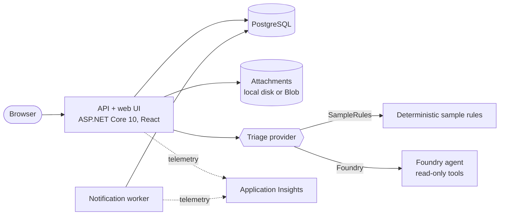

# RequestHub

RequestHub is the app every solution in this repository works on. It is a small request-and-approval portal: people ask for equipment, access, or services; a reviewer triages the request; an approver makes the decision. All people, requests, and policies are synthetic.

The app is shared on purpose. Each [solution](../README.md#the-fourteen-solutions) changes, tests, secures, ships, or operates the same app, so you can compare the GitHub and Microsoft approaches on identical ground.

## What it does

- **Requesters** create requests with comments and attachments.
- **Reviewers** work their department's queue and can ask for a **triage recommendation**: which department should handle the request, under which routing policy. The recommendation is advisory.
- The latest recommendation remains visible after a manual reroute, labeled stale and unavailable for confirmation.
- **Approvers** make the human decision. Nobody can decide their own request, and no triage provider or agent can approve anything.
- Every business action is written to an **audit history**. A background **worker** turns events into notification records.



## Run it locally

You need the [.NET 10 SDK](https://dotnet.microsoft.com/download), [Node.js 22](https://nodejs.org/), and PostgreSQL 16. Docker is the easiest way to get PostgreSQL.

```powershell
# 1. PostgreSQL (user requesthub, password devpass)
docker run -d --name requesthub-db -p 5432:5432 -e POSTGRES_USER=requesthub -e POSTGRES_PASSWORD=devpass -e POSTGRES_DB=requesthub postgres:16

# 2. Build the web UI into the API, then start the API (migrates and seeds the database on first run)
npm ci --prefix app/web
npm run build --prefix app/web
dotnet run --project app/src/RequestHub.Api        # http://localhost:5080

# 3. Optional: the notification worker, in a second terminal
dotnet run --project app/src/RequestHub.Worker
```

Or run the whole stack in containers: `docker compose -f app/docker-compose.yml up --build`, then open http://localhost:8080.

For UI work with hot reload, keep the API running and start `npm run dev --prefix app/web` (http://localhost:5173).

Locally you sign in with a **persona switcher**. It only exists in the Development environment and fails closed everywhere else.

| Persona | Roles | Department access |
| --- | --- | --- |
| `u-ava` Ava Martin | Requester | — |
| `u-ben` Ben Okafor | Requester, Reviewer | IT, Facilities |
| `u-chloe` Chloé Dubois | Requester, Approver | IT, Facilities |
| `u-dan` Dan Rivera | All roles, Admin | All departments |
| `u-grace` Grace Liu | Requester, Reviewer, Approver | Finance, HR |
| `u-hugo` Hugo Bernard | Requester, Approver | IT |

Scripts and tests pick a persona with the `X-RequestHub-User` header, for example `curl -H "X-RequestHub-User: u-ben" http://localhost:5080/api/requests?scope=queue`.

## Test it

```powershell
dotnet test --solution app/RequestHub.slnx        # API, worker, and contract tests on the local PostgreSQL
npm run typecheck --prefix app/web
npm test --prefix app/web                          # UI unit tests
npm exec --prefix app/web -- playwright install chromium   # once: the browser the e2e tests drive
npm run e2e --prefix app/web                       # browser tests; needs the API running on http://localhost:5080
```

The API contract is [`contracts/openapi.json`](contracts/openapi.json). A test fails when the API and the contract disagree. After an intended, additive API change, regenerate it with `UPDATE_CONTRACT=1` set and `dotnet test --solution app/RequestHub.slnx`, then describe the change in your PR.

## Configuration

Settings use standard ASP.NET Core configuration (`appsettings.json`, or environment variables such as `Triage__Provider`).

| Setting | Values | Purpose |
| --- | --- | --- |
| `Demo:Industry` | `general`, `manufacturing`, `retail`, `services`, `healthcare-admin`, `public-admin` | Changes vocabulary, seed requests, and policies. The business rules stay the same. |
| `Triage:Provider` | `SampleRules` (default), `Foundry` | Where triage recommendations come from. |
| `Foundry:ProjectEndpoint`, `Foundry:AgentName` | Foundry project URL, agent name | Used when `Triage:Provider` is `Foundry`. |
| `Auth:Mode` | `Development`, `EasyAuth` | Persona switcher locally; Microsoft Entra ID through Container Apps authentication in Azure. |
| `Storage:Provider` | `Local`, `Blob` | Where attachments are stored. |
| `Demo:AllowReset` | `true`, `false` | Lets an Admin reseed the demo data with `POST /api/admin/reset`. |
| `Demo:LoadTestRequesterIds` | comma-separated user ids, for example `aad-<object id>` | Lets `POST /api/admin/load-test/cleanup` delete only the requests these load-test identities submitted. An Admin cleans up all of them; a listed identity cleans up its own. Empty (the default) disables the cleanup. |

### Fault injection

Some demos need the app to misbehave on cue. Faults are off by default and **every fault needs an expiry**. After `Faults:ExpiresAtUtc` passes they switch themselves off, even if a demo is interrupted.

| Setting | Effect | Used by |
| --- | --- | --- |
| `Faults:QueueDelayMs` | Slows the request list endpoint | Test (Microsoft) |
| `Faults:FailReadiness` | The readiness probe fails, so a new revision never becomes ready | Release (Microsoft) |
| `Faults:WorkerDelayMs` | Slows notification processing until a backlog builds | Operate (Microsoft) |
| `Faults:ExpiresAtUtc` | UTC time after which all faults are ignored | All of the above |

## Deploy it to Azure

The app has no deployment of its own. Each Microsoft solution that needs a running RequestHub deploys its own copy, in its own resource group, by composing the modules in [`infra/`](infra/):

| File | What it creates |
| --- | --- |
| [`infra/requesthub.bicep`](infra/requesthub.bicep) | Monitoring, private network, PostgreSQL (Microsoft Entra authentication only), Blob storage reached through a private endpoint, container registry, Container Apps environment, the Entra app registration with RequestHub app roles, and the identity GitHub Actions uses through OIDC. |
| [`infra/api.bicep`](infra/api.bicep), [`infra/worker.bicep`](infra/worker.bicep) | The two container apps. `azd deploy` applies them with each new image, so code and configuration ship together as one revision. |

Data stays off the public internet by default. PostgreSQL has no public endpoint, and Blob storage is reached through a private endpoint (a subnet, a `privatelink.blob` private DNS zone linked to the virtual network, and the endpoint itself) with its public endpoint closed. Set the module's `storagePrivateEndpoint` parameter to `false` to keep a public storage endpoint instead; attachments then fail wherever Azure Policy disables public network access on storage accounts. The [Secure solution](../solutions/05-secure-microsoft/) starts that way to give Azure Policy and Defender for Cloud a real finding to report.

In the cloud, Container Apps authentication signs users in with Microsoft Entra ID and the API enforces app roles (`RequestHub.Requester`, `Reviewer`, `Approver`, `Admin`). Whoever runs `azd provision` gets every role. To call the deployed API from a terminal, run this in the folder of the solution that deployed it (for example `solutions/03-develop-microsoft`), where `azd` finds its environment:

```powershell
$token = az account get-access-token --scope "$(azd env get-value API_IDENTIFIER_URI)/user_impersonation" --query accessToken -o tsv
curl.exe -H "Authorization: Bearer $token" "$(azd env get-value API_URL)/api/me"
```

## Folder map

| Path | Contents |
| --- | --- |
| `src/RequestHub.Api` | Minimal API endpoints, authentication, attachment storage, the Foundry triage provider. Serves the built web UI. |
| `src/RequestHub.Core` | Domain model, EF Core and migrations, business rules (`Services/RequestWorkflow.cs`), industry profiles, seed data, triage abstractions. |
| `src/RequestHub.Worker` | Notification worker with idempotent processing. |
| `tests/RequestHub.Tests` | xUnit integration tests against real PostgreSQL, including authorization, concurrency, and the contract check. |
| `web/` | React + TypeScript UI with English and French resources, unit tests, and Playwright browser tests. |
| `contracts/` | The `requesthub.v1` OpenAPI contract. |
| `infra/` | Bicep modules that Microsoft solutions compose to host the app. |
