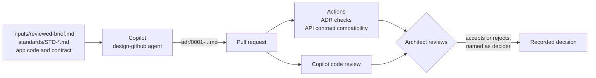

# Design · Architecture review with GitHub Copilot

Design decisions often live in meeting notes and people's memories. Reviewers cannot tell which standards were considered, designs describe the system as people remember it, and an API break shows up only in integration testing. In this solution a custom Copilot agent reads the reviewed brief, the approved architecture standards, and RequestHub's real code and API contract, then proposes an architecture decision record (ADR) that compares two options. GitHub Actions checks the ADR and the API contract impact on every pull request, Copilot code review questions it, and an architect decides.

## Where it fits

**Phase 2 of 7: Design and architect.** The Microsoft counterpart is [02-design-microsoft](../02-design-microsoft/).

| | Today | With this solution |
| --- | --- | --- |
| Drafting | An architect writes the decision from scratch, often after the code. | Copilot proposes an ADR with two options, diagrams, a threat model, and tasks in minutes. |
| Grounding | The design describes the system as people remember it. | Copilot reads the real extension point, workflow, contract, and Bicep. A check rejects references to files that do not exist. |
| Standards | Reviewers rely on memory to know which standards apply. | Every driver cites a standard by id and version. A check rejects ids and versions that do not exist, and conflicts between standards go to a person. |
| API changes | Breaking changes surface in integration testing. | Every pull request gets an additive-or-breaking report for the `requesthub.v1` contract. A breaking change fails the check. |
| Sign-off | "Approved" in a chat thread, and nobody knows who decided. | Copilot can only propose. A check fails any accepted ADR that does not name the people who decided. |

## How it works



- **Copilot** runs the custom agent [`design-github`](.github/agents/design-github.agent.md) with two skills. [`architecture-decision`](.github/skills/architecture-decision/SKILL.md) provides the ADR template and a deterministic checker. [`contract-impact`](.github/skills/contract-impact/SKILL.md) classifies every change to `app/contracts/openapi.json` as additive or breaking. The agent reads the inputs and the code, writes the ADR, and runs the checker until it passes.
- **GitHub Actions** runs [`design-github-review.yml`](.github/workflows/design-github-review.yml) on every pull request that changes an ADR or the API contract. It takes the checker, the contract tool, and the standards from the base branch, so a pull request cannot weaken them.
- **Copilot code review** follows [`design-github-adr-review.instructions.md`](.github/instructions/design-github-adr-review.instructions.md): unstated assumptions, standards the ADR missed, the API impact, and the threat model.
- **A person** reviews the ADR, settles the conflicts and open questions, and accepts or rejects it.

## What's in this folder

```text
02-design-github/
├── README.md
├── adr-task.md                         the task Copilot receives (CLI prompt; the issue template says the same)
├── inputs/
│   └── reviewed-brief.md               synthetic reviewed requirements and the open design question
├── standards/
│   ├── README.md                       how a standard is written: id, version, scope
│   └── STD-*.md                        twelve approved architecture standards (synthetic)
└── .github/
    ├── agents/design-github.agent.md   the custom Copilot agent
    ├── skills/
    │   ├── architecture-decision/      ADR template and check_adr.py
    │   └── contract-impact/            contract_diff.py: additive or breaking (shared with other solutions)
    ├── instructions/design-github-adr-review.instructions.md   what Copilot code review looks for in an ADR
    ├── workflows/design-github-review.yml   ADR checks and API contract compatibility on pull requests
    └── ISSUE_TEMPLATE/02-design-github-adr.yml
```

Copilot's pull request adds `adr/0001-live-triage-provider.md` to this folder.

## Prerequisites

- GitHub Copilot Business or Enterprise with Copilot code review. Option B below also needs the Copilot cloud agent enabled for the repository.
- [GitHub CLI](https://cli.github.com/), signed in with permission to create Issues and pull requests.
- [GitHub Copilot CLI](https://docs.github.com/copilot/how-tos/set-up/install-copilot-cli) for option A.
- Python 3.12 or later. The scripts use only the standard library.

## Set up

Nothing to install. The agent, skills, workflow, review instructions, and issue template are already active because the repository's root `.github/` folder mirrors them. In a fresh copy of the repository, create the labels the issue template applies:

```powershell
gh label create ai-sdlc --color 5319e7 --force
gh label create phase:design --color 1d76db --force
```

## Run the demo

About 15 minutes. Run the commands from the repository root.

1. **Show the question and the standards.** Open [`inputs/reviewed-brief.md`](inputs/reviewed-brief.md): seven accepted requirements (advisory only, data minimization, audit, an 8-second target, English and French), two operating profiles, and the open question: *how should RequestHub add a live AI triage provider?* Then open [`standards/`](standards/). Point out what a good design must notice, without telling Copilot:
   - **A conflict.** STD-OBS-002 says to log full prompts and completions for 30 days. STD-SEC-002 says never to persist raw prompts that contain user free text. Nobody has decided which wins.
   - **Profiles that pull apart.** STD-OPS-001 lets a small team add at most one runtime component and no gateway. STD-OPS-002 sends every enterprise model call through the central AI gateway.
   - **Extend before you add.** STD-ARCH-001 prefers the existing service, and RequestHub already has a triage extension point, `ITriageProvider`.

2. **Ask Copilot for the ADR.** Pick one option.

   **A. Live in the terminal (about 5 minutes).**

   ```powershell
   git switch -c design/copilot-adr
   copilot --agent design-github --allow-all-tools -p (Get-Content solutions/02-design-github/adr-task.md -Raw)
   git add solutions/02-design-github/adr
   git commit -m "Design: Copilot ADR for the live triage provider"
   git push -u origin design/copilot-adr
   gh pr create --fill
   ```

   In bash, use `-p "$(cat solutions/02-design-github/adr-task.md)"`.

   **B. Delegate to the Copilot cloud agent (start it before the session).** Create an Issue from the **Design: architecture decision with Copilot** template, assign it to **Copilot**, and pick the **design-github** agent. Copilot opens a draft pull request within a minute, works in it, and asks for your review when the ADR is ready. In our run Copilot worked for about 7 minutes once its environment was ready; preparing the environment (the repository's Copilot setup steps) took another 17 minutes.

   Workflows on Copilot's pull requests wait for a person. Select **Approve and run workflows** on the pull request, or re-run the waiting runs from a terminal with `gh run rerun <run-id>` (`gh run list --branch <copilot-branch>` shows the ids).

3. **Watch the gate.** The **Design · GitHub · check the ADR and API impact** workflow adds two checks, each in about ten seconds:
   - **ADR checks** prints `solutions/02-design-github/adr/0001-live-triage-provider.md: PASS`: the template's sections, at least two options, both diagrams, real standards and versions, real paths, and Status Proposed.
   - **API contract compatibility** compares `app/contracts/openapi.json` with the commit the branch started from. An ADR-only pull request reports `Breaking changes: 0` and `No contract changes.` in the run summary.

4. **Ask Copilot for a code review.** Select **Reviewers** → **Copilot** on the pull request, or run `gh pr edit <number> --add-reviewer "@copilot"`. Within a few minutes Copilot posts a review that summarizes the decision and names what still needs people. In our runs it flagged the prompt-logging versus privacy conflict, the boundary for data sent to the AI service, and latency that has not been measured yet.

5. **Review like an architect.** Open the ADR from the pull request (**Files changed** → **⋯** → **View file**) so the mermaid diagrams render. Look for:
   - the options compared in one table against the same standards, and a recommendation for each profile;
   - the STD-OBS-002 vs STD-SEC-002 conflict under **Open questions**, left for you to decide;
   - what Copilot found by reading the code, not the brief: in our runs, that the workflow's 45-second triage timeout cannot meet the 8-second target, and that today's prompt sends more than the title, description, and category that BR-3 allows;
   - the API impact tied to real endpoints and fields, the threat model for the real data flow, and the bounded tasks.

6. **Show that only people decide.** On the pull request branch, let the agent "accept" its own ADR, and run the checker:

   ```powershell
   $adr = (Get-ChildItem solutions/02-design-github/adr/*.md)[0].FullName
   (Get-Content $adr -Raw) -replace '\*\*Status:\*\* Proposed', '**Status:** Accepted' -replace '\*\*Deciders:\*\*.*', '**Deciders:** GitHub Copilot' | Set-Content $adr -NoNewline
   python .github/skills/architecture-decision/check_adr.py $adr
   ```

   It fails with `status Accepted must name the people who decided in **Deciders:**; an agent can only propose`. Now decide as the architect: replace `GitHub Copilot` with your name and role, run the checker again, and it passes. Commit and push: the **ADR checks** run passes, and the pull request's history shows who decided. Run `git checkout -- $adr` instead if you only want to show the failure.

   Pushing the failing version shows the same red check in the pull request, even if that commit also edits `check_adr.py` to always pass: the workflow runs the checker from the base branch.

7. **Optional: catch a breaking API change.** Remove a response field from a copy of the contract and compare it with `main`:

   ```powershell
   $contract = Get-Content app/contracts/openapi.json -Raw | ConvertFrom-Json -AsHashtable
   $contract.components.schemas.RecommendationDto.properties.Remove('providerTraceId')
   $contract | ConvertTo-Json -Depth 100 | Set-Content $env:TEMP/openapi-breaking.json
   python .github/skills/contract-impact/contract_diff.py --base-ref origin/main --head $env:TEMP/openapi-breaking.json --fail-on-breaking
   ```

   The report says `Breaking change` with `❌ schema RecommendationDto: property providerTraceId removed`, and the command exits with 1, which is what fails the **API contract compatibility** check on a pull request. Adding a property instead reports `Compatible` with `➕`.

   To show the same failure in GitHub Actions without opening a pull request, write the edited contract to `app/contracts/openapi.json` on a scratch branch, push it, and run `gh workflow run design-github-review.yml -f ref=<branch>`. The **API contract compatibility** job fails with the same line in its summary.

## What to observe

- **Grounded in the real system.** Copilot reads the code before it designs. In our runs it reused the existing `ITriageProvider` extension point, rejected a separate triage service under STD-ARCH-001, and found gaps the brief does not mention, such as the 45-second timeout. The check proves every file the ADR cites exists.
- **Standards, with versions.** Each driver cites `STD-xxx-nnn vX.Y`. The conflict between STD-OBS-002 and STD-SEC-002 reaches a person as a blocking open question instead of being settled silently.
- **One question, two answers.** The recommendation follows the operating profile where the standards do: direct calls for the small team (STD-OPS-001), the central AI gateway for the enterprise (STD-OPS-002).
- **Contract impact as evidence.** The API impact is a deterministic report on every pull request, not an opinion. Breaking changes fail; Copilot proposes any needed API change as an additive one.
- **People decide.** Copilot proposes and Copilot code review questions; only a named person accepts. The checker and the standards come from the base branch, so the proposal cannot weaken them.
- **Speed.** About five minutes from a reviewed brief to a reviewable design.

## Reset and clean up

```powershell
gh pr close <number> --delete-branch    # close the ADR pull request
gh issue close <number>                 # option B: close the design Issue
git switch main
git branch -D design/copilot-adr        # option A: drop the local branch
git push origin --delete <branch>       # step 7 in Actions: drop the scratch branch
```

Do not merge the ADR into `main`. Keeping it out keeps the demo repeatable: the next run starts again from ADR 0001.

## Use it in your own repository

1. Copy this folder's `.github/` contents into your repository's `.github/` folder.
2. Put your standards in a `standards/` folder, one Markdown file per standard with `id`, `version`, and `scope` in its front matter, and your brief in `inputs/`. The checker uses the nearest `standards/` folder above each ADR, or `--standards`.
3. Choose where ADRs live (for example `docs/adr/`, next to `docs/standards/`). Update the paths in the agent, `adr-task.md`, the issue template, the review instructions (`applyTo`), and the workflow (`paths`, `ADR_DIR`, and the standards folder it restores from the base branch).
4. Point the agent at your own extension points, contract, and infrastructure files, and adapt the threat-model checklist in `adr-template.md` to your standards.
5. `contract_diff.py` reads the contract from `app/contracts/openapi.json`. Change its `CONTRACT` constant if yours lives elsewhere.

## Troubleshooting

- **No checks on Copilot's pull request.** Workflows on pull requests from the cloud agent wait for a person to approve them. Select **Approve and run workflows**, or run `gh run rerun <run-id>`.
