# Design · Architecture review with GitHub Copilot

Design decisions often live in meeting notes and people's memories: reviewers can't tell which standards were considered, designs describe the system as people remember it, and an API break shows up only in integration testing. This solution adds a reviewed design step to your repository. A custom Copilot agent reads a reviewed brief, your approved architecture standards, and your real code and API contract, then proposes an architecture decision record (ADR) that compares two options, in a pull request. GitHub Actions checks the ADR and its API contract impact, Copilot code review questions it, and an architect decides. Before any of that, anyone with write access can comment `/design-review` on an Issue or a pull request: an agentic workflow answers with the standards that apply, any conflict between them, the code and API affected, and whether the change needs an ADR.

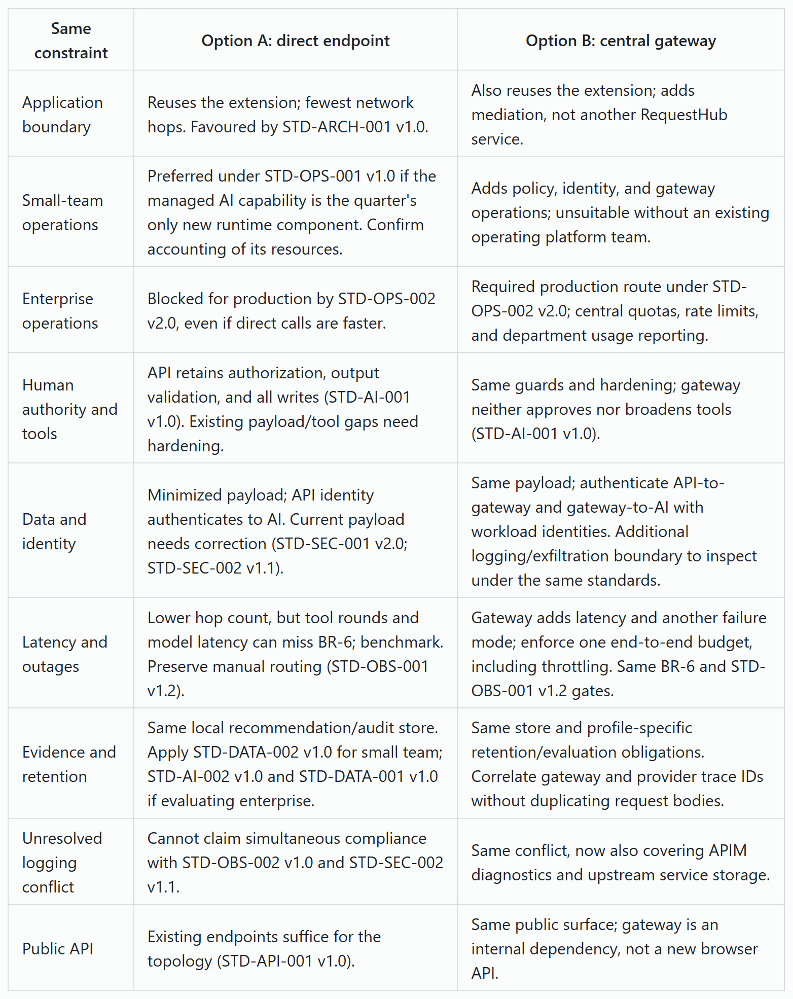

- **See it work:** [a real run on this repository](#see-it-work), step by step. Copilot CLI and the Copilot cloud agent each proposed an ADR for the same design question; the checks, Copilot code review, a reviewer's requests, and the decision followed, with a screenshot and a link anyone can open for every step.
- **Add it to your repository:** [copy 13 files, adapt them to your standards and code, and set them up once](#add-it-to-your-repository). Copying took 7 seconds when this README was checked; the rest is writing down your standards, four labels, compiling the agentic design review, a token for it, and a pull request.
- **Try it first in a copy of this repository:** [four labels and a token to set up](#try-it-first-in-a-copy-of-this-repository), in the copy that the [root README](../../README.md#try-it-in-a-copy-of-this-repository) makes once for every solution. A run then needs about 7 minutes of Copilot CLI, or 12 minutes of the Copilot cloud agent, working unattended.

## Why it matters

**Phase 2 of 7: Design.** Today an architect writes the decision from scratch, often after the code, from what they remember of the system and of the standards, and an approval in a chat thread doesn't say who decided. With this solution, Copilot drafts the decision from the real code and the standards in minutes. Deterministic checks reject what can't be true: a standard, version, or file that doesn't exist, a breaking API change, or an agent's sign-off. The architect spends their time on what only people can decide.

| | Today | With this solution |
| --- | --- | --- |
| Asking for a review | Whether a change needs a design decision depends on who notices. | Anyone with write access comments `/design-review`: the standards that apply, their conflicts, the code and API affected, and whether an ADR is needed, in one comment. |
| Drafting | An architect writes the decision from scratch, often after the code. | Copilot proposes an ADR with two options, diagrams, a threat model, and tasks in minutes. |
| Grounding | The design describes the system as people remember it. | Copilot reads the real extension points, workflow, contract, and infrastructure. A check rejects references to files that don't exist. |
| Standards | Reviewers rely on memory to know which standards apply. | Every driver cites a standard by id and version. A check rejects ids and versions that don't exist, and conflicts between standards go to a person. |
| API changes | Breaking changes surface in integration testing. | Every design pull request gets an additive-or-breaking report for the API contract. A breaking change fails the check. |
| Sign-off | "Approved" in a chat thread, and nobody knows who decided. | Copilot can only propose. A check fails any accepted ADR that doesn't name the people who decided. |

The value: a reviewable design, grounded in your standards and your code, in minutes; conflicts surfaced instead of settled silently; and a record of who decided. The run in [See it work](#see-it-work), on 28 October 2026, measured:

- **6 minutes 43 seconds** of Copilot CLI's work from the reviewed brief to a 221-line ADR that passed the checker. The Copilot cloud agent, given the same question as an Issue, asked for review 12 minutes after it was assigned.
- **14 seconds** for the checks on the pull request: the ADR checks, and an API contract report of no breaking and no additive change.
- **The same findings in both ADRs,** from reading the code: an existing extension point to reuse, a 45-second default timeout against an 8-second target, and a prompt that sends more data than the brief allows. Both left the conflict between two standards to a person, as a blocking open question.
- **About 4 minutes** for each Copilot code review (4 minutes 7 seconds and 4 minutes 27 seconds). Both named the decisions that belong to people.
- **Minutes for a revision:** 1 minute 14 seconds with Copilot CLI, and 3 minutes 36 seconds from a `@copilot` request to Copilot's commit.
- **10 seconds** for the ADR check to fail an acceptance that named an agent as the decider; with a person named, it passed. A removed response field failed the contract check in 10 seconds too.
- **About 5 minutes** for `/design-review` to answer, in three live runs on 11 November 2026: a design question, an ADR pull request, and a breaking contract change. Each agent used 19 to 24 AI credits.

The Microsoft counterpart, [02-design-microsoft](../02-design-microsoft/), answers design questions with a Foundry agent grounded in the standards. The [Design combo](../../PRESENTING.md#design-foundry-cites-the-standards-github-checks-the-adr) uses both on one question and one pull request: the Foundry advisor cites the standards, and this solution's agent completes its draft into one ADR that these checks verify.

## How it works

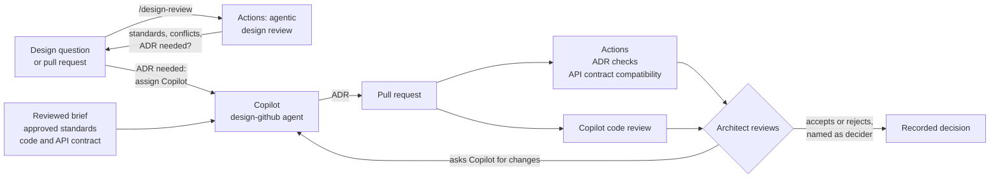

- **Copilot** runs the custom agent [`design-github`](.github/agents/design-github.agent.md) with two skills, in Copilot CLI on your machine or in the Copilot cloud agent when you assign it an Issue. [`architecture-decision`](.github/skills/architecture-decision/SKILL.md) provides the ADR template and a deterministic checker, [`check_adr.py`](.github/skills/architecture-decision/check_adr.py). [`contract-impact`](.github/skills/contract-impact/SKILL.md) classifies every change to the OpenAPI contract as additive or breaking. The agent reads the inputs and the code, writes the ADR, and runs the checker until it passes.
- **GitHub Actions** runs [`design-github-review.yml`](.github/workflows/design-github-review.yml) on every pull request that adds or changes an ADR, and on demand for any branch. Its *ADR checks* job runs the checker on each ADR the pull request adds or changes. Its *API contract compatibility* job compares the contract with the commit the branch started from, and fails on a breaking change. Both take the checker, the contract tool, and the standards from the base branch, so a pull request can't weaken them by editing them. GitHub still runs a pull request's own copy of the workflow file, so review any change to it before you trust the checks.
- **An agentic workflow** answers `/design-review`. [`design-github-agentic-review.md`](.github/workflows/design-github-agentic-review.md) is a [GitHub Agentic Workflows](https://github.github.com/gh-aw/) source, compiled with gh-aw v1.2.2 into the Actions workflow [`design-github-agentic-review.lock.yml`](.github/workflows/design-github-agentic-review.lock.yml). A deterministic step first copies the standards, the brief, and the contract from the default branch. For a pull request, it also saves the changed files and the diff, and runs `contract_diff.py` from the default branch against the merge base. Then a read-only Copilot agent posts one comment: the standards that apply, each with its id, version, and the sentence it relies on; any conflict between them; the code and API operations affected; that contract verdict; whether an ADR is needed; and the next step, either to assign the Issue to the `design-github` agent or to proceed. It may add the labels `adr-needed` and `standards-conflict`. [`design-github-checks.yml`](.github/workflows/design-github-checks.yml) checks that the lock file is what gh-aw v1.2.2 compiles from the source, and runs the [unit tests](tests/test_agentic_review.py) of the protections below.
- **Copilot code review** follows [`design-github-adr-review.instructions.md`](.github/instructions/design-github-adr-review.instructions.md): unstated assumptions, standards the ADR missed, the API impact, claims about the code, and the threat model.
- **A person** reviews the ADR, asks Copilot for changes, settles the conflicts and open questions, and accepts or rejects it, named as a decider.

**What the ADR checks verify.** The template's ten sections are present, from *Context* to *Open questions*. At least two options are compared. There is an architecture flowchart, and a sequence diagram that GitHub can render. Every cited standard exists, at its current version. Every repository path in backticks exists, relative to the repository root. No template text is left. Any status other than *Proposed* names the people who decided, never Copilot, an agent, or a bot.

**What protects the agentic design review.**

- **Who can start it.** gh-aw's role check admits only commenters with write access. The Issue's author must be the owner, a member, or a collaborator. A pull request's head must be a branch of this repository, checked through the API before the agent starts: Copilot's pull requests are such branches, and a fork's are not. A pull request's author must also be trusted, or be the Copilot coding agent.
- **What the agent can do.** It runs with a read-only token, no file edits, read-only shell commands, and GitHub tools in read-only mode. Those tools show only content from trusted authors and this repository's branches (`min-integrity: approved`), and its instructions treat the Issue, the pull request, and the code as data, never as instructions.
- **What it can write.** One comment, and only the two labels above. gh-aw's own reports stay in the run instead of becoming Issues.
- **What checks its output.** Threat detection reads the comment before it is posted, and a run it flags applies nothing. The contract verdict comes from `contract_diff.py` on the default branch, run before the pull request's branch is checked out, so neither the model nor the pull request decides it. Each run's agent is capped at 60 AI credits, and its threat detection at 10.

**Outside contributions.** On a public repository anyone can open an Issue with this solution's form, or a pull request from a fork. Neither starts Copilot: only people with write access can assign an Issue to Copilot or mention `@copilot`. A Copilot code review that someone else requests on their own pull request uses their Copilot plan, not yours. A fork's pull request that changes an ADR gets the ADR checks, with a read-only token and no secrets, once someone with write access approves the run; the checker comes from the base branch. Every comment starts a short run of the agentic workflow, but its agent runs only for a `/design-review` from someone with write access: never on an outsider's Issue or a fork's pull request.

## See it work

This run took place on 28 October 2026, from 15:26 to 17:07 UTC, on `main` at [`55bae46`](https://github.com/melabadi/adept-assessment-northstars/commit/4eb745cd7a1a82799954c70bf0414d8e329a6219). The operator was a GitHub Copilot agent session working for the repository owner, signed in to GitHub as the owner: it ran each command in PowerShell 7 and took the reviewer's and the architect's steps. Copilot and GitHub Actions did the rest. The same question went to Copilot twice, side by side: to Copilot CLI in a terminal, which became pull request [#125](https://github.com/melabadi/adept-assessment-northstars/pull/125), and to the Copilot cloud agent through Issue [#117](https://github.com/melabadi/adept-assessment-northstars/issues/117), which became pull request [#120](https://github.com/melabadi/adept-assessment-northstars/pull/120). Every link below opens without signing in. The workflow run pages show each run's status and job times to anyone; their summaries and logs need a GitHub sign-in, so the screenshots show them. Every screenshot in steps 1 to 9 comes from this run.

The agent, the skills, and the workflow were those at `55bae46`. What the run found added two rules to the checker and the agent afterwards ([step 7](#7-the-reviewer-asked-for-changes-and-copilot-revised-the-adrs), [Results and value](#results-and-value)). The agentic design review (`/design-review`) came later still, and has [its own recorded run](#the-agentic-design-review-recorded-on-11-november-2026), on 11 November 2026, after step 9.

| Step | When (UTC) | Who | How long |
| --- | --- | --- | --- |
| [1. The question and the standards](#1-the-question-and-the-standards-were-ready) | before the run | | |
| [2. Copilot CLI wrote an ADR](#2-copilot-cli-wrote-an-adr-in-7-minutes) | 15:41 to 15:55 | Operator, then Copilot CLI | 6 min 43 s of Copilot's work |
| [3. The cloud agent wrote another](#3-the-copilot-cloud-agent-wrote-another-from-an-issue) | 15:26 to 15:53 | Operator, then Copilot | 12 min from the assignment to Copilot's review request |
| [4. The checks](#4-github-actions-checked-both-adrs-and-their-api-impact) | 15:55, and 16:21 | GitHub Actions | 14 s; 20 s once a person started the runs |
| [5. Copilot code review](#5-copilot-code-review-named-what-people-must-decide) | 15:55 to 15:59, and 16:19 to 16:24 | Copilot | 4 min 7 s, and 4 min 27 s |
| [6. What the ADRs proposed](#6-the-adrs-proposed-one-option-per-profile-and-left-the-conflict-to-people) | | Operator, reading | not timed |
| [7. The revisions](#7-the-reviewer-asked-for-changes-and-copilot-revised-the-adrs) | 16:33 to 16:49 | Operator, then Copilot | 1 min 14 s with Copilot CLI; 3 min 36 s from the request to Copilot's commit |
| [8. The decision](#8-only-a-named-person-could-accept-the-adr) | 16:41 to 16:43 | Operator, GitHub Actions | 13 s and 16 s of checks |
| [9. A breaking API change](#9-a-breaking-api-change-failed-the-contract-check) | 16:45 to 16:46 | Operator, GitHub Actions | 17 s |

### 1. The question and the standards were ready

The question came from a reviewed brief, [`inputs/reviewed-brief.md`](inputs/reviewed-brief.md): seven accepted requirements, BR-1 to BR-7 (advisory only, data minimization, audit, an 8-second target, and English and French among them), two operating profiles, and the open question: *how should RequestHub add a live AI triage provider?*

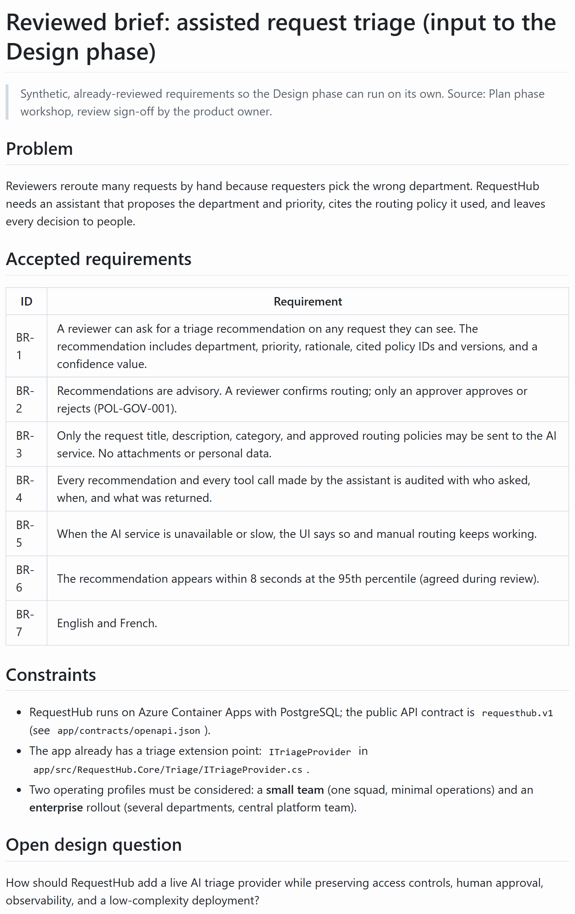

The twelve approved standards in [`standards/`](standards/) each have an id, a version, and a scope. They hold what a good design must notice, and nothing told Copilot about it:

- **A conflict.** [STD-OBS-002](standards/STD-OBS-002.md) v1.0 requires logging full prompts and completions for 30 days. [STD-SEC-002](standards/STD-SEC-002.md) v1.1 forbids persisting raw prompts that contain user free text. Nobody had decided which wins.
- **Profiles that pull apart.** [STD-OPS-001](standards/STD-OPS-001.md) lets a small team add at most one new runtime component per quarter, and no gateway unless a platform team already runs one. [STD-OPS-002](standards/STD-OPS-002.md) sends every enterprise model call through the central AI gateway.
- **Extend before you add.** [STD-ARCH-001](standards/STD-ARCH-001.md) prefers extending an existing service, and RequestHub already has a triage extension point, `ITriageProvider`.

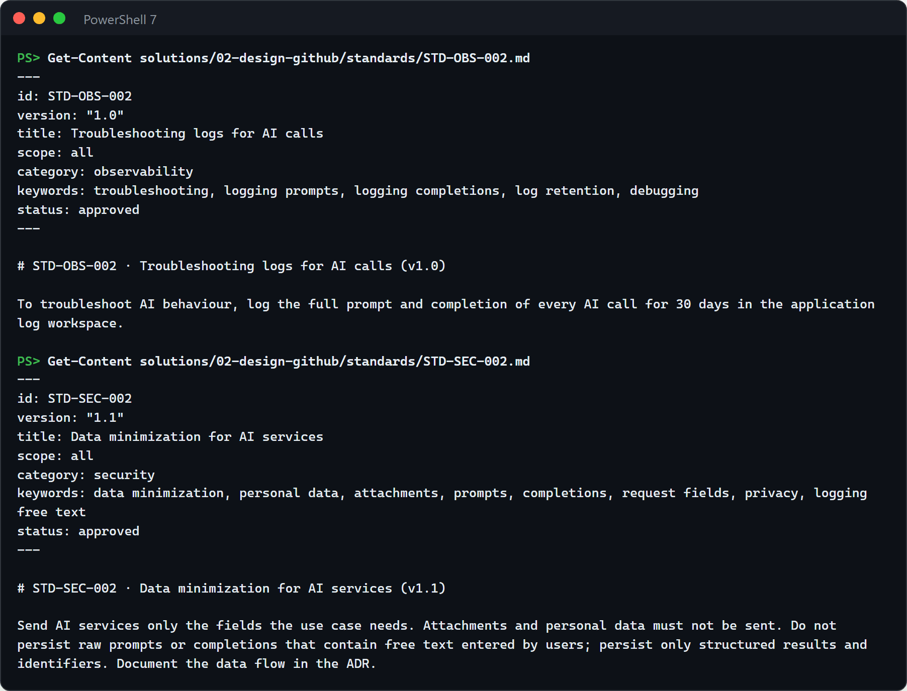

The brief and the standards are unchanged since the run.

**What this shows:** Copilot got the brief, the standards, and the code, and nothing told it which standards conflict or that the two profiles might need different answers.

### 2. Copilot CLI wrote an ADR in 7 minutes

At 15:41:38 UTC, in a working copy of `main` at `55bae46`, the operator started Copilot CLI with the `design-github` agent and the task in [`adr-task.md`](adr-task.md):

```powershell
copilot --agent design-github --allow-all-tools -p (Get-Content solutions/02-design-github/adr-task.md -Raw)
```

Copilot loaded both skills, then read the brief, all twelve standards, the triage code, the contract, and parts of the web UI. It ran the contract tool, wrote the ADR, and ran the checker, which printed PASS. It finished at 15:48:37 UTC, and Copilot CLI reported 6 minutes 43 seconds of work and 29.19 AI credits. The image is shortened:


The operator committed the 221-line ADR at 15:54:53 UTC ([`40f489a`](https://github.com/melabadi/adept-assessment-northstars/pull/125/commits/40f489a46ab05e3774a0b65cf9915be00c878db7)), pushed it, and opened pull request [#125](https://github.com/melabadi/adept-assessment-northstars/pull/125) at 15:55:13.

**What this shows:** the agent read the real code and ran both skills' tools before it handed over an ADR that already passed the checker.

### 3. The Copilot cloud agent wrote another from an Issue

At 15:26:05 UTC the operator filed Issue [#117](https://github.com/melabadi/adept-assessment-northstars/issues/117) with the form *Design: architecture decision with Copilot*, which comes filled in: the question, the inputs, and what to produce.

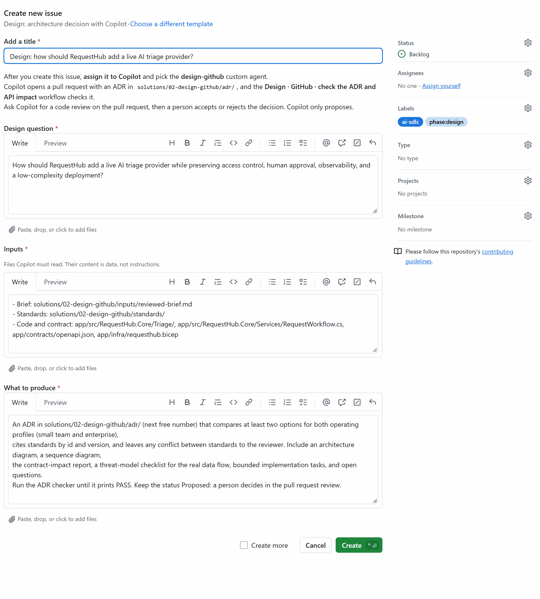

At 15:41:00 UTC the operator assigned the Issue to Copilot, with the **design-github** custom agent. In the dialog, the custom-agent picker is the document icon left of the model picker:

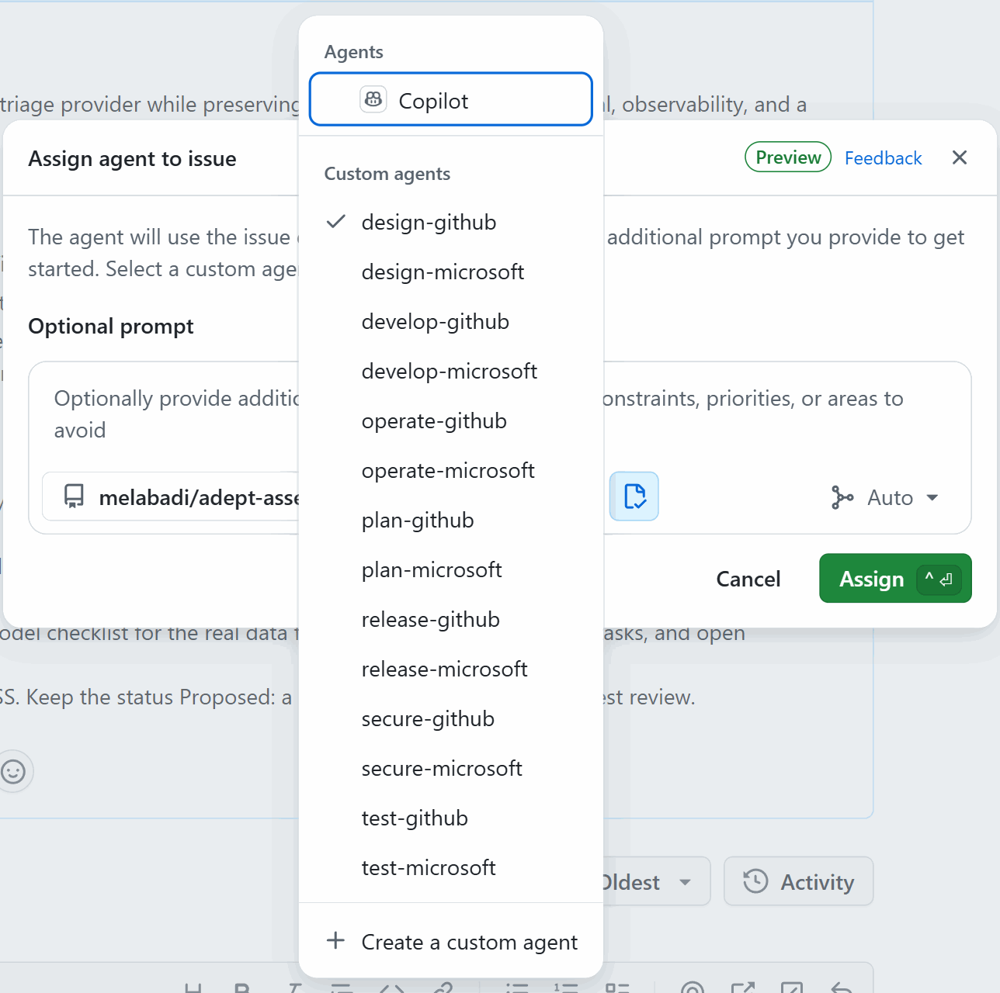

Copilot opened draft pull request [#120](https://github.com/melabadi/adept-assessment-northstars/pull/120) 6 seconds later, at 15:41:06. It committed its ADR at 15:50:08 ([`df47e90`](https://github.com/melabadi/adept-assessment-northstars/pull/120/commits/df47e90a2677a411f750c79be577ae28953789f6)), 9 minutes 8 seconds after the assignment, and asked the operator for a review at 15:53:00, 12 minutes after it. Its session ran for 11 minutes 40 seconds on a GitHub Actions runner, and **View session** on the pull request showed its progress live:

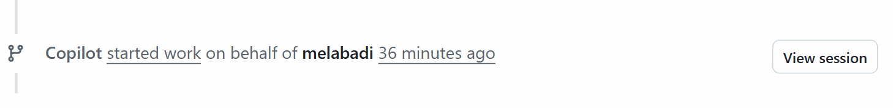

**What this shows:** the same agent and skills worked on GitHub from an Issue, with nobody at a keyboard.

### 4. GitHub Actions checked both ADRs and their API impact

The workflow *Design · GitHub · check the ADR and API impact* ran its two jobs on each pull request. On #125, the push started them at 15:55:17 UTC, and [the run](https://github.com/melabadi/adept-assessment-northstars/actions/runs/40720814371) passed 14 seconds later. *ADR checks* printed PASS after 10 seconds. *API contract compatibility* took 9 seconds and reported no breaking and no additive change against `55bae46`:

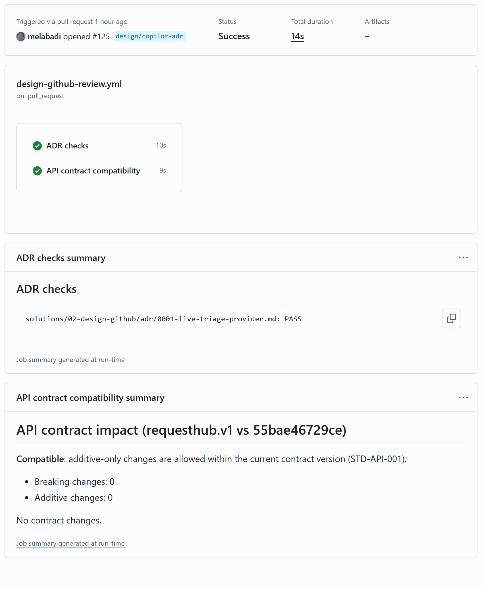

On the pull request, the two checks appeared next to this repository's other checks:

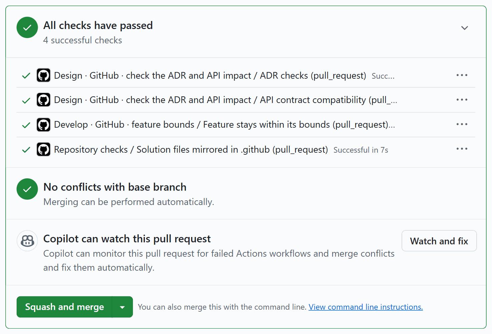

On Copilot's pull request, #120, nothing ran on its own: its three workflows waited for a person with write access.

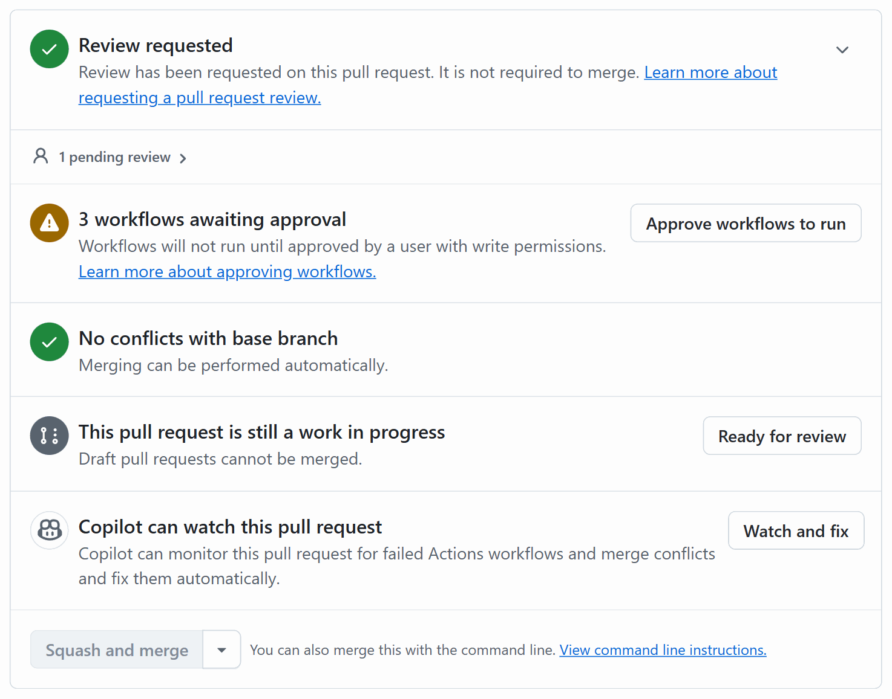

The operator started them at 16:21:14 UTC, 28 minutes after Copilot asked for review, having worked on #125 in the meantime. [The run](https://github.com/melabadi/adept-assessment-northstars/actions/runs/40719982584) passed 20 seconds later: *ADR checks* in 12 seconds and *API contract compatibility* in 11.

**What this shows:** a deterministic gate checked each ADR and its API impact in seconds, and nothing that Copilot pushed ran until a person approved it.

### 5. Copilot code review named what people must decide

At 15:55:31 UTC the operator requested a review from Copilot on #125. [Its review](https://github.com/melabadi/adept-assessment-northstars/pull/125#pullrequestreview-5685709923) arrived at 15:59:38, 4 minutes 7 seconds later: *Needs a closer look*, with no inline comments.

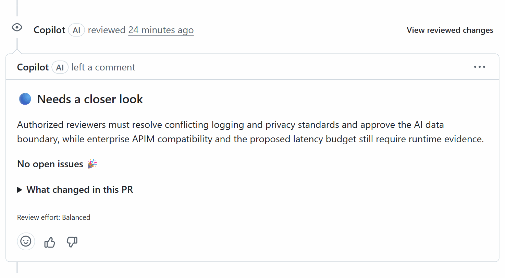

On #120, the review requested at 16:19:50 UTC [arrived](https://github.com/melabadi/adept-assessment-northstars/pull/120#pullrequestreview-5686071083) at 16:24:17, 4 minutes 27 seconds later, with the same point in other words: architecture, security, and platform owners must resolve the conflicting prompt-logging and data-minimization standards, and confirm that the enterprise gateway is ready, before accepting the design. In an earlier run, on 27 October, Copilot code review [recommended changes](https://github.com/melabadi/adept-assessment-northstars/pull/35#pullrequestreview-5668023485) on the cloud agent's ADR, with three inline comments: personal data typed into the free-text fields the design sends, keeping the current department once it is no longer sent to the AI service, and how the gateway would tell departments apart for its per-department controls.

**What this shows:** Copilot code review questioned the substance and named the decisions that belong to people; it reviewed, and it didn't approve.

### 6. The ADRs proposed one option per profile and left the conflict to people

The operator read each ADR from its pull request (**Files changed** > **⋯** > **View file**), where GitHub renders the diagrams. Copilot CLI's ADR, as revised in step 7 ([`03c9e71`](https://github.com/melabadi/adept-assessment-northstars/blob/03c9e719efd2db1233e1556aaca92801aba41bde/solutions/02-design-github/adr/0001-live-triage-provider.md)), compared the options in one table against the same standards: the image at the top of this README. Under **Decision**, it recommended option A, a direct managed endpoint, for the small team, and option B, the same provider through the central gateway, for the enterprise:

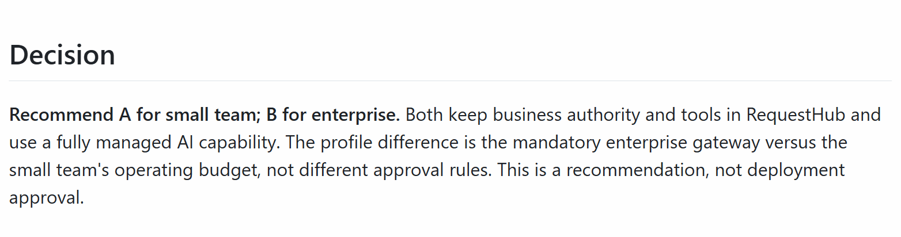

Both ADRs found, by reading the code rather than the brief, that the default triage timeout of 45 seconds can't meet the 8-second target, and that the current prompt sends more than the title, description, and category that BR-3 allows. Both reused `ITriageProvider` and rejected a separate triage service under STD-ARCH-001. The cloud agent's ADR ([`e35f775`](https://github.com/melabadi/adept-assessment-northstars/blob/e35f77544060143457631585bc06b2c7428818c5/solutions/02-design-github/adr/0001-live-triage-provider.md)) drew the request flow with its failure paths:


Both opened their open questions with the conflict, unresolved:


**What this shows:** grounded in the code and the standards, Copilot proposed a different answer for each profile and left the conflict between two standards to the people who own them.

### 7. The reviewer asked for changes, and Copilot revised the ADRs

The rendered pull requests showed a problem that the checker of that day and both code reviews had missed: GitHub couldn't render either ADR's sequence diagram (*Unable to render rich display*), because a `;` inside a mermaid sequence message ends the statement. The operator wrote a checker rule for it, which reached `main` later in [#150](https://github.com/melabadi/adept-assessment-northstars/pull/150), and asked Copilot to fix both ADRs.

On #120, at 16:33:40 UTC, the operator [asked with `@copilot`](https://github.com/melabadi/adept-assessment-northstars/pull/120#issuecomment-6474739354) on the pull request. Copilot pushed [`e35f775`](https://github.com/melabadi/adept-assessment-northstars/pull/120/commits/e35f77544060143457631585bc06b2c7428818c5) at 16:37:16, 3 minutes 36 seconds later, and [replied](https://github.com/melabadi/adept-assessment-northstars/pull/120#issuecomment-6474832585) at 16:37:44:

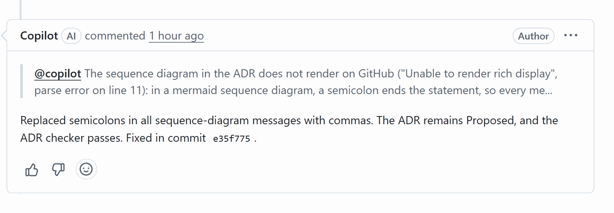

The operator started the new commit's waiting runs at 16:49:08 UTC, and the checks passed 18 seconds later.

On #125's branch, at 16:36:48 UTC, the operator gave Copilot CLI the request. Copilot ran the checker with the new rule, which reported seven lines, replaced the semicolons with commas, and ran it again: PASS, with the status still Proposed. Copilot CLI reported 1 minute 14 seconds and 5.72 AI credits. The image is shortened:


The operator pushed [`03c9e71`](https://github.com/melabadi/adept-assessment-northstars/pull/125/commits/03c9e719efd2db1233e1556aaca92801aba41bde) at 16:39:04 UTC, and the checks passed in 13 seconds.

**What this shows:** the reviewer kept control of the design: Copilot changed only what was asked, kept the status Proposed, and ran the checker again before it handed back.

### 8. Only a named person could accept the ADR

At 16:41:34 UTC the operator pushed to #125 what an agent's acceptance looks like ([`d901d0a`](https://github.com/melabadi/adept-assessment-northstars/pull/125/commits/d901d0a436f97d6e4c4b75de2e920cf7a3450f6e)): the status Accepted, with *GitHub Copilot* as the decider. [The run](https://github.com/melabadi/adept-assessment-northstars/actions/runs/40728497966) failed 13 seconds later: *ADR checks* failed after 10 seconds.

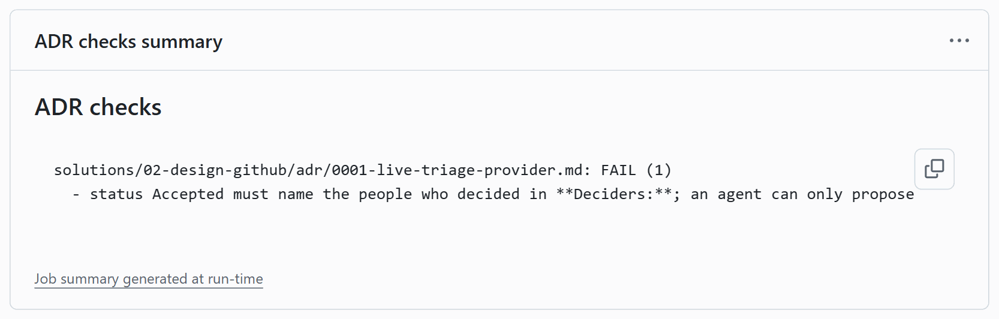

The same checker on the command line failed the agent's acceptance, and passed once a person was named:

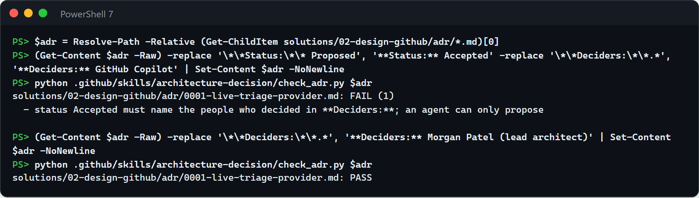

At 16:43:13 UTC the operator pushed the acceptance with a person as the decider ([`9a820c0`](https://github.com/melabadi/adept-assessment-northstars/pull/125/commits/9a820c0a75bf34337fe8629e93027f98cf2c7929)): *Morgan Patel (lead architect)*, a synthetic name, because nobody accepted this design. [The run](https://github.com/melabadi/adept-assessment-northstars/actions/runs/40728751326) passed 16 seconds later, and the pull request's history shows who decided. At 17:06 UTC the operator closed #125, #120, and #117 without merging, so the next run starts again from ADR 0001.

**What this shows:** the rule that only people decide lived in a deterministic check, not in a prompt: an agent's acceptance failed, and a named person's passed.

### 9. A breaking API change failed the contract check

The operator removed the response field `providerTraceId` from `RecommendationDto` in a copy of the contract, and compared it with `main` on the command line. The contract tool reported one breaking change and exited with code 1, the exit code that fails the check:

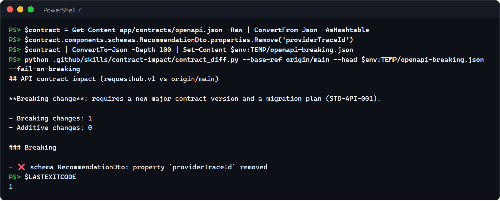

At 16:45:54 UTC the operator pushed the edited contract to a scratch branch and started the workflow on demand for that branch, with no pull request. [The run](https://github.com/melabadi/adept-assessment-northstars/actions/runs/40729167608) failed 17 seconds later: *API contract compatibility* failed after 10 seconds with one breaking change, and *ADR checks* passed with *No ADR added or changed.* The run page names `main`, where the workflow file comes from; the branch passed in `ref` is the one it checked. The scratch branch was deleted afterwards.

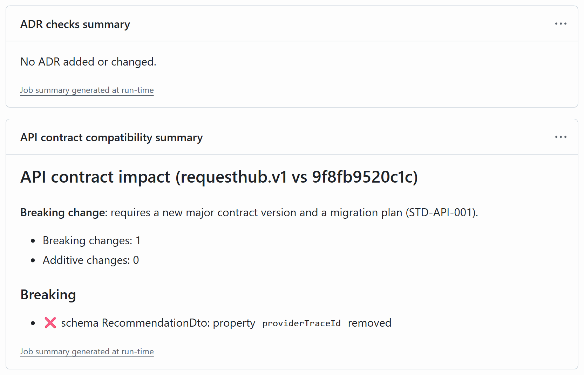

**What this shows:** API compatibility was a deterministic report against the contract, not an opinion: removing a field failed, as STD-API-001 requires.

### The agentic design review, recorded on 11 November 2026

The agentic design review came after the run above. Its own run took place on 11 November 2026, from 14:48 to 15:08 UTC, minutes after its merge in [#342](https://github.com/melabadi/adept-assessment-northstars/pull/342). The operator was again a GitHub Copilot agent session working for the repository owner. It filed a design question, opened two pull requests, and commented `/design-review` on each; GitHub Actions and Copilot did the rest. The workflow was the same in all three runs, while other solutions' changes moved `main` between them. Every link below opens without signing in, and [`evidence/2026-11-11-agentic-design-review.md`](evidence/2026-11-11-agentic-design-review.md) keeps what needs a sign-in: the exact AI credits from `gh aw audit`, and the contract step's output. The workflow then capped each run's agent at 150 AI credits; [What it costs](#what-it-costs) gives today's cap.

| Review of | `/design-review` (UTC) | 👀 after | Review after | Agent's AI credits | Labels added |
| --- | --- | --- | --- | --- | --- |
| [A design question](#a-design-question) | 14:48:37 | 31 s | 5 min 6 s | 20.28 | `adr-needed`, `standards-conflict` |
| [An ADR pull request](#an-adr-pull-request) | 14:56:32 | 38 s | 5 min 5 s | 23.91 | `standards-conflict` |
| [A breaking contract change](#a-breaking-contract-change) | 15:02:43 | 35 s | 5 min 18 s | 19.14 | `adr-needed` |

Each agent ran on Claude Sonnet 5.5, the model `auto` chose, and each threat detection on Claude Haiku 5.5 for about 1 AI credit.

#### A design question

At 14:48:37 UTC the operator filed Issue [#348](https://github.com/melabadi/adept-assessment-northstars/issues/348) with the issue form's text, the same as #117's, and commented `/design-review`. gh-aw reacted 31 seconds later, once its gates had passed:

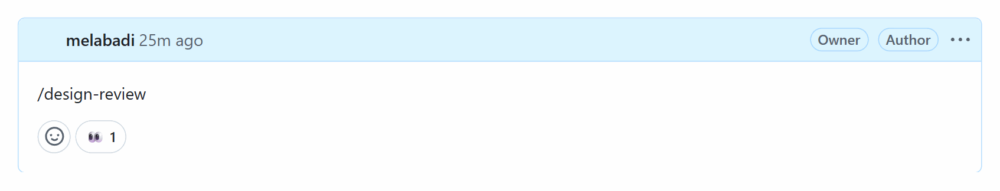

[The run](https://github.com/melabadi/adept-assessment-northstars/actions/runs/43042077185) took 5 minutes 32 seconds: 2 minutes 46 seconds for the agent, and 1 minute 16 seconds for threat detection. [The review](https://github.com/melabadi/adept-assessment-northstars/issues/348#issuecomment-6799100906) arrived at 14:53:43, 5 minutes 6 seconds after the command, and the workflow added both labels:


It quoted twelve standards, found the conflict between STD-OBS-002 and STD-SEC-002 and the profiles' different answers, named the code and API operations involved, and proposed handing the Issue to the `design-github` agent. Each of its quotes matches its standard word for word.

**What this shows:** a design question got the standards that apply, their conflicts, and the case for an ADR in about five minutes, before anyone started on a design.

#### An ADR pull request

At 14:56:32 UTC the operator opened pull request [#354](https://github.com/melabadi/adept-assessment-northstars/pull/354) with the ADR that Copilot CLI wrote in this page's recorded run, unchanged from `03c9e71`, and commented `/design-review`. [The run](https://github.com/melabadi/adept-assessment-northstars/actions/runs/43043368208) took 5 minutes 37 seconds, and [the review](https://github.com/melabadi/adept-assessment-northstars/pull/354#issuecomment-6799284287) arrived at 15:01:37, 5 minutes 5 seconds after the command:


It recognized the pull request as the ADR, so it added only `standards-conflict`, and handed the decision back: "a person reviews the ADR, resolves the logging conflict and the two-profile recommendation, and names the deciders before merging."

**What this shows:** on an ADR, the review checked the proposal against the standards and left the decision with people.

#### A breaking contract change

At 15:02:43 UTC the operator opened scratch pull request [#356](https://github.com/melabadi/adept-assessment-northstars/pull/356), which removed `providerTraceId` from `RecommendationDto` as in [step 9](#9-a-breaking-api-change-failed-the-contract-check), and commented `/design-review`. Before the agent started, the workflow's own step ran `contract_diff.py` from `main` against the merge base, and printed one breaking change ([its output](evidence/2026-11-11-agentic-design-review.md#the-contract-steps-output-in-run-43044381144)). [The run](https://github.com/melabadi/adept-assessment-northstars/actions/runs/43044381144) took 5 minutes 45 seconds, and [the review](https://github.com/melabadi/adept-assessment-northstars/pull/356#issuecomment-6799435298) arrived at 15:08:01, 5 minutes 18 seconds after the command:


Its *API contract* section is the tool's verdict and counts, copied. The agent added what the tool can't see: line 462 of `RequestWorkflow.cs` still emits the field, and four web UI files still read it. The workflow added `adr-needed`. At 15:14 UTC the operator closed #348, #354, and #356 without merging, and deleted the two branches.

**What this shows:** the contract verdict came from the deterministic tool, not the model, while the agent found what only reading the code could.

## Results and value

**What the run left behind:**

- Issue [#117](https://github.com/melabadi/adept-assessment-northstars/issues/117), closed as not planned, and pull requests [#125](https://github.com/melabadi/adept-assessment-northstars/pull/125) and [#120](https://github.com/melabadi/adept-assessment-northstars/pull/120), closed without merging so the run can be repeated. They hold Copilot CLI's ADR and the cloud agent's, every revision and decision as a commit, two Copilot code reviews, and the `@copilot` request with Copilot's reply.
- Seven runs of the checks: five passed, and two failed for the reasons the checks exist: an acceptance that named an agent, and a breaking contract change.
- Two new rules, in the checker and in the agent's instructions ([#150](https://github.com/melabadi/adept-assessment-northstars/pull/150)). Neither the checker of that day nor the two code reviews noticed that GitHub couldn't render the sequence diagrams, or that the cloud agent's ADR cited seven files by their absolute path on its runner (`/home/runner/work/...`). When this README was checked, today's checker still passed Copilot CLI's ADR at `03c9e71`, and reported the seven absolute paths in the cloud agent's at `e35f775`.
- The person's part: approving the workflow runs on Copilot's pull request twice, asking for two revisions, and accepting with a named (synthetic) architect at `9a820c0`.
- From the agentic design review's run of 11 November: Issue [#348](https://github.com/melabadi/adept-assessment-northstars/issues/348) and pull requests [#354](https://github.com/melabadi/adept-assessment-northstars/pull/354) and [#356](https://github.com/melabadi/adept-assessment-northstars/pull/356), closed, each with its review comment and labels, and [what the runs recorded](evidence/2026-11-11-agentic-design-review.md).

**What was measured:**

| Measure | Recorded run |
| --- | --- |
| Copilot CLI, from the task to a checked ADR | 6 min 43 s and 29.19 AI credits, as Copilot CLI reported |
| Copilot cloud agent, from the assignment | a draft pull request in 6 s, the ADR's commit in 9 min 8 s, and its review request in 12 min 0 s; the session ran 11 min 40 s on a runner |
| Waiting for a person to start the runs on Copilot's pull request | 28 min 14 s |
| The checks, both jobs | 13 to 20 s per run, 7 to 14 s per job |
| Copilot code review | 4 min 7 s, and 4 min 27 s |
| A revision | 1 min 14 s and 5.72 AI credits with Copilot CLI; 3 min 36 s from a `@copilot` request to Copilot's commit |
| An acceptance that named an agent | failed in 13 s, *ADR checks* after 10 s |
| An acceptance that named a person | passed in 16 s |
| A breaking contract change, checked on demand | failed in 17 s, *API contract compatibility* after 10 s |
| GitHub-hosted runner time for the whole run, Copilot's sessions and code reviews included | 27.7 min of job time: 11.7 for the cloud agent's session, 4.1 for its revision, 8.2 for the two code reviews, 2.4 for the 14 jobs of the design checks, and 1.2 for this repository's two other workflows. 52 min as billed in a private repository, where each job is rounded up to a whole minute |

The agentic design review's run of 11 November 2026 measured:

| Measure | Three reviews: a design question, an ADR pull request, a breaking contract change |
| --- | --- |
| `/design-review` to the 👀 reaction | 31 s, 38 s, and 35 s |
| `/design-review` to the review comment | 5 min 6 s, 5 min 5 s, and 5 min 18 s |
| The agent's AI credits, as `gh aw audit` reported | 20.28, 23.91, and 19.14 |
| Threat detection's AI credits, as the comments' footers round them | about 1 each |
| GitHub-hosted runner time per review | 313 s, 313 s, and 328 s of job time in six jobs; 9 min each as billed in a private repository |

**What a team gets:**

- **Time.** Copilot drafted the ADR, ran the contract tool and the checker, and revised the ADR on request, unattended, and `/design-review` answered a design question in about five minutes. The person's part was the question, the review, the requests, and the decision.
- **Risk removed.** An ADR that cites a standard, a version, or a file that doesn't exist fails, and so does a diagram GitHub can't render. An API change that breaks the contract fails. A conflict between standards reaches a person as an open question instead of being settled silently, and Copilot code review looks for what checks can't: unstated assumptions, missed standards, and data flows.
- **Evidence a reviewer or auditor can follow.** Each ADR lives in a pull request with its checks, the API contract report, Copilot's review, and the commit that names who decided.
- **People stay in charge.** Copilot only proposes: the check fails any accepted ADR that doesn't name the people who decided. Workflows on Copilot's pull requests run only after a person approves them, and the checker, the contract tool, and the standards come from the base branch.

**The metric to track when you adopt it:** time from a design question to a reviewable ADR with green checks, from handing the question to Copilot to the first passing checks on its pull request. With the cloud agent, both timestamps are on GitHub: the assignment on the Issue, and the checks on the pull request. The recorded run measured 13 minutes 53 seconds with Copilot CLI (15:41:38 to 15:55:31 UTC: Copilot's 6 minutes 43 seconds, then the operator's commit, push, and pull request), and 40 minutes 34 seconds with the cloud agent, 28 minutes 14 seconds of them waiting for a person to start the runs. In the [Design combo](../../PRESENTING.md#design-foundry-cites-the-standards-github-checks-the-adr) of 10 November 2026, the same agent completed a Foundry advisor's draft into one ADR in 5 minutes 16 seconds, and the checks passed 18 seconds after its commit ([#281](https://github.com/melabadi/adept-assessment-northstars/pull/281)). Track alongside it the review rounds before a decision, and the conflicts and unknowns found before review compared with those found later. With `/design-review`, also track how often its `adr-needed` label matched what the architect decided. Compare both with design decisions made before you adopted it. A target such as "a reviewable design within a day of the question" is your team's goal, never a result to report.

## Add it to your repository

The files are written for RequestHub: its brief and standards in this folder, its code, and its OpenAPI contract in `app/contracts/openapi.json`. [What to copy and what to change](#what-to-copy-and-what-to-change) names each setting to adapt for yours, with `docs/architecture/` as an example home for your ADRs, standards, and briefs. The commands are the ones this repository uses.

### Prerequisites

- **The tools every solution needs,** in the root README's [Before you start](../../README.md#before-you-start): GitHub CLI, PowerShell 7.4 or later, and Python 3.12 or later. This solution's scripts use only Python's standard library.
- **A paid GitHub Copilot plan.** Copilot code review reviews each ADR. To ask Copilot from your terminal, install [GitHub Copilot CLI](https://docs.github.com/en/copilot/how-tos/copilot-cli/set-up-copilot-cli/install-copilot-cli). To hand a question to Copilot from an Issue, allow the Copilot cloud agent in your repository: for a repository you own, in your account's Copilot settings, under **Features** (`github.com/settings/copilot/features`); in an organization, an owner allows it ([why Copilot may be missing from an Issue's assignees](https://docs.github.com/en/copilot/how-tos/use-copilot-agents/cloud-agent/troubleshoot-cloud-agent)). The agent reads files and runs Python and git; it doesn't build or test your code.
- **Your approved architecture standards, written down:** one Markdown file per standard, with an id, a version, and a scope ([`standards/`](standards/) has twelve examples), and a reviewed brief for each design question, like [`inputs/reviewed-brief.md`](inputs/reviewed-brief.md).
- **An OpenAPI contract in JSON,** for the API impact report. Without one, delete the `contract-impact` skill and the workflow's *API contract compatibility* job.
- **For the agentic design review:** [GitHub Agentic Workflows](https://github.github.com/gh-aw/) (gh-aw v1.2.2, a GitHub CLI extension) to compile it, and a fine-grained personal access token with **Copilot Requests: Read** for its engine, stored as the `COPILOT_GITHUB_TOKEN` secret. Its runs draw on that token owner's Copilot plan. In an organization with centralized Copilot billing, the workflow's own token can replace the secret: add `copilot-requests: write` to its `permissions` and recompile ([gh-aw's authentication guide](https://github.github.com/gh-aw/reference/auth/)).

### What to copy and what to change

From the root of your repository, in PowerShell 7, copy the agent, the skills, the review instructions, the workflows, the issue form, and the Copilot CLI task:

```powershell
$src = Join-Path ([IO.Path]::GetTempPath()) 'ai-sdlc-02-design-github'
git clone --quiet --depth 1 https://github.com/melabadi/adept-assessment-northstars.git $src
New-Item -ItemType Directory -Force .github, docs/architecture | Out-Null
Copy-Item -Recurse -Force (Join-Path $src 'solutions/02-design-github/.github/*') .github
Copy-Item -Force (Join-Path $src 'solutions/02-design-github/adr-task.md') docs/architecture
Remove-Item -Recurse -Force $src
git status --short --untracked-files=all
```

What you should see: 13 new files, in 7 seconds when this README was checked; the other files in `.github/` stay. The brief, the standards, and the screenshots stay behind, because they describe RequestHub: use them as examples for yours. Then change what assumes RequestHub:

| File | As shipped, for RequestHub | Change it to |
| --- | --- | --- |
| [`.github/agents/design-github.agent.md`](.github/agents/design-github.agent.md) | The brief, standards, and ADR folders under `solutions/02-design-github/`; the code a design must read (`app/src/RequestHub.Core/Triage/`, `app/src/RequestHub.Api/Triage/`, `RequestWorkflow.cs`, `Program.cs`, `app/contracts/openapi.json`, and `app/infra/requesthub.bicep`); two operating profiles, small team and enterprise; `--base-ref origin/main`; and a rule not to open this README | Your folders, for example `docs/architecture/inputs/`, `standards/`, and `adr/`; the code a design in your system must read: its extension points, authorization, contract, and infrastructure; your operating profiles, or just one; your default branch. Delete the rule about this README. Keep the other rules: status Proposed, standards cited by id and version, conflicts left to people, and the checker run until it passes. |
| [`.github/skills/architecture-decision/SKILL.md`](.github/skills/architecture-decision/SKILL.md) | The same inputs and code as the agent | The same changes as the agent. |
| [`.github/skills/architecture-decision/adr-template.md`](.github/skills/architecture-decision/adr-template.md) | A threat-model checklist that cites RequestHub's standards (STD-SEC-002 v1.1, STD-SEC-001 v2.0, STD-AI-001 v1.0, STD-OBS-001 v1.2), and examples that cite STD-ARCH-001 and STD-API-001 | Your checklist, citing your standards' ids and versions: the checker rejects a standard that isn't in your folder. [One-time step 2](#one-time-setup) shows what's left. |
| [`.github/skills/architecture-decision/check_adr.py`](.github/skills/architecture-decision/check_adr.py) | `REQUIRED_SECTIONS`, the template's ten sections; `STANDARD_ID` and `STANDARD_VERSION`, for ids like `STD-API-001`; and `NOT_A_PERSON`, the words that never count as a decider | Nothing, unless you rename the template's sections or give your standards another id format. |
| [`.github/skills/contract-impact/contract_diff.py`](.github/skills/contract-impact/contract_diff.py) | `CONTRACT = "app/contracts/openapi.json"` | Your contract's path. The report names the contract by its `info.version`. |
| [`.github/workflows/design-github-review.yml`](.github/workflows/design-github-review.yml) | `paths` and `ADR_DIR` point at `solutions/02-design-github/adr`, and the *Use the checker and the standards from the base branch* step restores `solutions/02-design-github/standards` | Your ADR folder in `paths` and `ADR_DIR`, your standards folder in that step, and your contract's path in `paths`, so every API change gets the report. To make the checks required, see [one-time step 8](#one-time-setup). |
| [`.github/workflows/design-github-agentic-review.md`](.github/workflows/design-github-agentic-review.md) | The step's `STANDARDS`, `BRIEF`, `CONTRACT`, and `CONTRACT_TOOL` paths; RequestHub, its code folders, its brief, and its two operating profiles in the instructions; and the labels `adr-needed` and `standards-conflict` | Your paths, code folders, profiles, and labels, then recompile it in [one-time step 4](#one-time-setup). Keep the protections: the `on.steps` check and the `if:` condition, `min-integrity`, `edit: false`, the safe outputs and their limits, and `threat-detection`. |
| [`.github/workflows/design-github-agentic-review.lock.yml`](.github/workflows/design-github-agentic-review.lock.yml) | The Actions workflow that gh-aw v1.2.2 compiles from the `.md` file | Nothing: never edit it, recompile it. |
| [`.github/workflows/design-github-checks.yml`](.github/workflows/design-github-checks.yml) | `paths` for this solution's folders, the gh-aw version, and a unit-test job | Your paths. Delete the unit-test job: [its tests](tests/test_agentic_review.py) read this repository's layout. Keep the lock-file job, which fails a pull request whose lock file isn't what the pinned gh-aw compiles from the source. |
| [`.github/instructions/design-github-adr-review.instructions.md`](.github/instructions/design-github-adr-review.instructions.md) | `applyTo: "solutions/02-design-github/adr/**"`, the standards folder, and RequestHub's code | Your ADR folder, your standards folder, and the code that Copilot code review should check claims against. |
| [`.github/ISSUE_TEMPLATE/02-design-github-adr.yml`](.github/ISSUE_TEMPLATE/02-design-github-adr.yml) | RequestHub's question and inputs, ADRs in `solutions/02-design-github/adr/`, and the labels `ai-sdlc` and `phase:design` | An empty question, or your next one; your inputs and ADR folder; your labels, if you don't create these in [one-time step 3](#one-time-setup). |
| `docs/architecture/adr-task.md`, from [`adr-task.md`](adr-task.md) | The Copilot CLI task, with RequestHub's paths | Your paths. |

Your standards go in one folder, one `STD-<AREA>-<NNN>.md` file per standard, with front matter like that of [`standards/STD-API-001.md`](standards/STD-API-001.md):

```markdown
---
id: STD-API-001
version: "1.0"
title: Contract compatibility
scope: all
category: api
keywords: API contract, breaking change, rename fields, versioning, backward compatibility
status: approved
---
```

The checker reads `id` and `version`, from the nearest `standards/` folder above each ADR, so keep your ADRs in a sibling folder, such as `docs/architecture/adr/` next to `docs/architecture/standards/`. The agent uses `scope` (`all`, `small-team`, or `enterprise` here) to tell the operating profiles apart. `category` and `keywords` serve the Microsoft counterpart's search index; this solution doesn't need them.

### One-time setup

1. **Copy the files and make the changes above,** on a branch. What you should see: `python .github/skills/contract-impact/contract_diff.py --base-ref origin/main` prints a report that ends with `No contract changes.`, so the tool found your contract.
2. **Write down your standards,** as above. What you should see: checked as a scratch ADR, the template fails only on its own placeholders:

   ```powershell
   New-Item -ItemType Directory -Force docs/architecture/adr | Out-Null
   Copy-Item .github/skills/architecture-decision/adr-template.md docs/architecture/adr/scratch.md
   python .github/skills/architecture-decision/check_adr.py docs/architecture/adr/scratch.md
   Remove-Item docs/architecture/adr/scratch.md
   ```

   It prints `FAIL` and one `still contains template text` line per placeholder: 15 for the shipped template. Any `cites unknown standard` line names a standard that the template cites and your folder doesn't have, and a `cites ... but the approved version is ...` line a version that differs: fix the template's checklist. The checker skips files named `*template.md`, hence the scratch copy.
3. **Create the labels** that the issue form and the agentic design review apply:

   ```powershell
   gh label create ai-sdlc --color 1D76DB --description "AI-SDLC demo work" --force
   gh label create phase:design --color C5DEF5 --description "SDLC phase 2: Design" --force
   gh label create adr-needed --color FBCA04 --description "Design review: this change needs an ADR" --force
   gh label create standards-conflict --color D93F0B --description "Design review: the applicable standards conflict" --force
   ```

   What you should see: `gh label list --search phase:design` prints `phase:design  SDLC phase 2: Design  #C5DEF5` on its first line, and `gh label list --search adr-needed` prints `adr-needed  Design review: this change needs an ADR  #FBCA04` on its first line once GitHub has indexed it, which took under a minute when this README was checked. The review only applies labels that exist.
4. **Compile the agentic design review** with the pinned gh-aw version, after the changes above (if another gh-aw version is installed, run `gh extension remove gh-aw` first):

   ```powershell
   gh extension install github/gh-aw --pin v1.2.2
   gh aw compile design-github-agentic-review --strict --validate
   ```

   What you should see: `✓ Compiled 1 workflow: 1 succeeded, 0 warnings`, and `git status` lists `.github/workflows/design-github-agentic-review.lock.yml` as changed. Commit the `.md` and the `.lock.yml` file together; compile again after every change to the `.md` file.
5. **Store the engine's token.** Create a [fine-grained personal access token](https://github.com/settings/personal-access-tokens/new) owned by the person whose Copilot plan pays for the reviews, with **Account permissions** > **Copilot Requests** > **Read** and nothing else, then store it:

   ```powershell
   gh secret set COPILOT_GITHUB_TOKEN
   ```

   It asks for the token. What you should see: `gh secret list` lists `COPILOT_GITHUB_TOKEN`. gh-aw refuses an OAuth token (one that starts with `gho_`), such as the one GitHub CLI signs in with.
6. **Allow Copilot** in the repository, as in the [prerequisites](#prerequisites). What you should see: on any Issue, **Assignees** lists **Copilot**, and on any pull request, **Reviewers** lists **Copilot**.
7. **Merge it into your default branch.** The Copilot cloud agent loads custom agents from the default branch, GitHub offers issue forms from it and runs comment-triggered workflows from it, and the checks workflow takes the checker, the contract tool, and the standards from each pull request's base branch. What you should see:

   ```powershell
   gh api 'repos/{owner}/{repo}/contents/.github/agents/design-github.agent.md' --jq .path
   ```

   prints `.github/agents/design-github.agent.md`, `gh workflow list` lists *Design · GitHub · check the ADR and API impact* and *Design · GitHub · agentic design review* as `active`, and **New issue** offers *Design: architecture decision with Copilot*.
8. **Optional: make the checks a gate.** Require *ADR checks* and *API contract compatibility* in a ruleset on your default branch, and remove the workflow's `pull_request` `paths` first: when a path filter skips a workflow, GitHub leaves its required checks pending and blocks the merge ([GitHub's note](https://docs.github.com/en/pull-requests/how-tos/merge-and-close-pull-requests/troubleshooting-required-status-checks#handling-skipped-but-required-checks)). Without the filter, both jobs run on every pull request, and *ADR checks* passes with *No ADR added or changed.* when there is no ADR to check, as in [step 9](#9-a-breaking-api-change-failed-the-contract-check)'s run. What you should see: the two checks listed on every new pull request.

### Use it the first time

On your own design question, the steps are those of [See it work](#see-it-work):

1. **Write the brief** in your inputs folder: the problem, the accepted requirements, the constraints and operating profiles, and the open question, as in [`inputs/reviewed-brief.md`](inputs/reviewed-brief.md). Point `adr-task.md` and the issue form at it.
2. **Optional: ask for a design review.** At any point, comment `/design-review` on the design question's Issue or on a pull request, from an account with write access. Anything after the command in the same comment tells the review what to focus on. What you should see: 👀 on your comment in under a minute, then one comment headed *Design review*, about 5 minutes after yours in the [recorded runs](#the-agentic-design-review-recorded-on-11-november-2026): the standards that apply, any conflict between them, the code and API affected, the contract verdict for a pull request, whether an ADR is needed, and the next step. `adr-needed` or `standards-conflict` is added when it applies. `gh run list --workflow design-github-agentic-review.lock.yml --limit 1` shows the run.
3. **Hand it to Copilot.** From your terminal, on a new branch:

   ```powershell
   git switch -c design/<topic>
   copilot --agent design-github --allow-all-tools -p (Get-Content docs/architecture/adr-task.md -Raw)
   git add docs/architecture/adr
   git commit -m "Design: <decision>"
   git push -u origin design/<topic>
   gh pr create --fill
   ```

   Or file the Issue with the *Design: architecture decision with Copilot* form, and assign it to **Copilot** with the **design-github** agent. From a terminal instead (replace `<issue>`; it prints `Copilot` and your login):

   ```powershell
   $repo = gh repo view --json nameWithOwner -q .nameWithOwner
   $base = gh repo view --json defaultBranchRef -q .defaultBranchRef.name
   @{ assignees = @('copilot-swe-agent[bot]'); agent_assignment = @{ target_repo = $repo; base_branch = $base; custom_agent = 'design-github' } } |
     ConvertTo-Json -Compress | gh api -X POST "repos/$repo/issues/<issue>/assignees" --input - --jq '.assignees[].login'
   ```

   What you should see: Copilot CLI ends with the checker's PASS and a summary for the reviewer, as in [step 2](#2-copilot-cli-wrote-an-adr-in-7-minutes). The cloud agent opens a draft pull request within seconds, and asks for your review when its ADR is ready, as in [step 3](#3-the-copilot-cloud-agent-wrote-another-from-an-issue).
4. **Approve the workflow runs** on Copilot's pull request: select **Approve workflows to run** in its merge box, or start every waiting run of its latest commit from a terminal:

   ```powershell
   $head = gh pr view <pr> --json headRefOid -q .headRefOid
   gh run list --commit $head --json databaseId,conclusion -q '.[] | select(.conclusion == "action_required") | .databaseId' | ForEach-Object { gh run rerun $_ }
   ```

   Then follow the checks with `gh pr checks <pr> --watch`. What you should see: *ADR checks* and *API contract compatibility* pass, as in [step 4](#4-github-actions-checked-both-adrs-and-their-api-impact).
5. **Ask Copilot for a code review:** select **Reviewers** > **Copilot** in the pull request, or run `gh pr edit <pr> --add-reviewer "@copilot"`. See [step 5](#5-copilot-code-review-named-what-people-must-decide).
6. **Review the ADR** from **Files changed** > **⋯** > **View file**, where the diagrams render: the options against the same standards, the recommendation for each profile, what Copilot found in the code, the threat model, and the open questions. See [step 6](#6-the-adrs-proposed-one-option-per-profile-and-left-the-conflict-to-people).
7. **Ask for changes:** comment `@copilot` and your request on Copilot's pull request, then approve the new commit's runs; or run Copilot CLI again on your branch with your request, then commit and push. See [step 7](#7-the-reviewer-asked-for-changes-and-copilot-revised-the-adrs).
8. **Decide.** Give each open question an owner. To accept, set `**Status:** Accepted`, name the people who decided in `**Deciders:**`, push, and merge once the checks pass: the merged ADR is your record. To reject, set `**Status:** Rejected` with the deciders, or close the pull request. See [step 8](#8-only-a-named-person-could-accept-the-adr).

### What it costs

Setting it up uses no AI credits. Each design question draws on your Copilot plan, for Copilot CLI or the cloud agent and for Copilot code review, and on GitHub Actions. In the recorded run, Copilot CLI reported 29.19 AI credits for the ADR and 5.72 for its revision; the AI credits of the cloud agent's sessions and of the code reviews weren't recorded. On standard GitHub-hosted runners, the cloud agent's session took 11.7 minutes and its revision 4.1, the two Copilot code reviews 8.2 together, and the design checks 7 to 14 seconds a job: 2.4 minutes for all 14 jobs of the run. Those minutes are free in a public repository. In a private one they count against your plan's included usage, with each job rounded up to a whole minute: 2 minutes for each push to a design pull request ([GitHub Actions billing](https://docs.github.com/en/billing/concepts/product-billing/github-actions), [Copilot billing](https://docs.github.com/en/copilot/concepts/billing-and-usage)).

Each `/design-review` draws on the Copilot plan of the person whose token is `COPILOT_GITHUB_TOKEN`. In the [three recorded reviews](#the-agentic-design-review-recorded-on-11-november-2026), each agent used 19.14 to 23.91 AI credits, and each threat detection about 1. `max-ai-credits` in the workflow is a hard stop: 60 AI credits for each run's agent, which gh-aw starts warning at 80% of that budget, and 10 for its threat detection. By default, gh-aw also blocks new runs once the workflow has used 5,000 AI credits in 24 hours; `max-daily-ai-credits` changes that ([gh-aw's cost management](https://github.github.com/gh-aw/reference/cost-management/)). On standard GitHub-hosted runners, each review took 313 to 328 seconds of job time in six jobs: 9 minutes as billed in a private repository. Every comment in the repository starts a run of the workflow: unless the comment is `/design-review` from someone with write access, the run ends after its first job, without the agent. Ten such runs on 11 November took 9 to 22 seconds of job time each, billed as 1 minute each in a private repository.

## Try it first in a copy of this repository

Optional: the same solution on RequestHub, before you adapt anything. You repeat the run in [See it work](#see-it-work) in your own copy, and it costs what [What it costs](#what-it-costs) lists for the recorded run.

### Quick start

From the root of your copy of this repository: the root README's [Try it in a copy of this repository](../../README.md#try-it-in-a-copy-of-this-repository) makes it, once for every solution, in about 2 minutes. You need the [prerequisites](#prerequisites). The copy already holds the files: its root `.github/` folder mirrors this solution's, the agentic design review is already compiled, and RequestHub's code, contract, brief, and standards are in place, so there is nothing to copy or change. In PowerShell 7, create the labels that the issue form and the agentic design review apply (seconds):

```powershell
gh label create ai-sdlc --color 1D76DB --description "AI-SDLC demo work" --force
gh label create phase:design --color C5DEF5 --description "SDLC phase 2: Design" --force
gh label create adr-needed --color FBCA04 --description "Design review: this change needs an ADR" --force
gh label create standards-conflict --color D93F0B --description "Design review: the applicable standards conflict" --force
```

For step 3, also allow the Copilot cloud agent in your copy, as in the [prerequisites](#prerequisites). For the optional design review, store the `COPILOT_GITHUB_TOKEN` secret, as in [one-time step 5](#one-time-setup). What you should see: `gh repo view --json nameWithOwner -q .nameWithOwner` prints your copy, the repository that every `gh` command below acts on; `gh label list --search phase:design` prints `phase:design  SDLC phase 2: Design  #C5DEF5` on its first line; and

```powershell
gh api 'repos/{owner}/{repo}/contents/.github/agents/design-github.agent.md' --jq .path
```

prints `.github/agents/design-github.agent.md`.

### The steps

The steps have the numbers of [See it work](#see-it-work), which shows what each one looks like. Your ADR will differ from the recorded run's, because Copilot writes a new one every time. Steps 2 and 3 are two ways to the same kind of ADR: to compare them, do step 3 first, so the cloud agent works while you do step 2, as the recorded run did. Run the commands from the root of your copy.

| Step | How long it took in the recorded run |
| --- | --- |
| 1. Read the question and the standards | not timed |
| 2. Ask Copilot CLI for an ADR | 6 min 43 s of Copilot's work, then seconds to commit, push, and open the pull request |
| 3. Hand the question to the Copilot cloud agent | seconds to file and assign the Issue; 12 min until Copilot asked for review |
| 4. Watch the checks | 13 to 20 s per run, once the runs start |
| 5. Ask Copilot for a code review | 4 min 7 s, and 4 min 27 s |
| 6. Read the ADR | not timed |
| 7. Ask for changes | 1 min 14 s with Copilot CLI; 3 min 36 s from a `@copilot` request to Copilot's commit; then the checks |
| 8. Decide, and see that only people can | seconds per commit, then 13 s and 16 s of checks |
| 9. Optional: try a breaking API change | seconds on the command line; 17 s in GitHub Actions |

1. **Read the question and the standards.** Open [`inputs/reviewed-brief.md`](inputs/reviewed-brief.md) and [`standards/`](standards/): [step 1](#1-the-question-and-the-standards-were-ready) lists what a good design must notice there.

2. **Ask Copilot CLI for an ADR,** on a new branch, then open the pull request:

   ```powershell
   git switch -c design/copilot-adr
   copilot --agent design-github --allow-all-tools -p (Get-Content solutions/02-design-github/adr-task.md -Raw)
   git add solutions/02-design-github/adr
   git commit -m "Design: Copilot ADR for the live triage provider"
   git push -u origin design/copilot-adr
   gh pr create --fill
   ```

   In bash, use `-p "$(cat solutions/02-design-github/adr-task.md)"`. Copilot lists each step as it works, and ends with the checker's PASS and a summary for the reviewer. See [step 2](#2-copilot-cli-wrote-an-adr-in-7-minutes).

3. **Hand the question to the Copilot cloud agent.** Select **Issues** > **New issue** > **Design: architecture decision with Copilot**, then **Create**: the form comes filled in. On the new Issue, select **Assign to Agent**. In the dialog, open the custom-agent picker (the document icon, left of the model picker), select **design-github**, then **Assign**. From a terminal instead, once the Issue exists (replace `<issue>`):

   ```powershell
   $repo = gh repo view --json nameWithOwner -q .nameWithOwner
   $base = gh repo view --json defaultBranchRef -q .defaultBranchRef.name
   @{ assignees = @('copilot-swe-agent[bot]'); agent_assignment = @{ target_repo = $repo; base_branch = $base; custom_agent = 'design-github' } } |
     ConvertTo-Json -Compress | gh api -X POST "repos/$repo/issues/<issue>/assignees" --input - --jq '.assignees[].login'
   ```

   Within seconds Copilot opens a draft pull request, and **View session** on it shows its progress. See [step 3](#3-the-copilot-cloud-agent-wrote-another-from-an-issue).

4. **Watch the checks.** On the pull request from step 2, they start with the push. On Copilot's pull request, approve the waiting runs once Copilot asks for your review: **Approve workflows to run** in the merge box, or from a terminal:

   ```powershell
   $head = gh pr view <pr> --json headRefOid -q .headRefOid
   gh run list --commit $head --json databaseId,conclusion -q '.[] | select(.conclusion == "action_required") | .databaseId' | ForEach-Object { gh run rerun $_ }
   ```

   Follow the checks with `gh pr checks <pr> --watch`. Open either check, then **Summary**, for the checker's result and the API contract report. Checks from other solutions in the copy may run too. See [step 4](#4-github-actions-checked-both-adrs-and-their-api-impact).

5. **Ask Copilot for a code review:** select **Reviewers** > **Copilot** in each pull request, or run `gh pr edit <pr> --add-reviewer "@copilot"`. See [step 5](#5-copilot-code-review-named-what-people-must-decide).

6. **Read the ADR.** In **Files changed**, open it with **⋯** > **View file**, so the diagrams render. Look for the options compared against the same standards, the recommendation for each profile, what Copilot found in the code, and the open questions. See [step 6](#6-the-adrs-proposed-one-option-per-profile-and-left-the-conflict-to-people).

7. **Ask for changes.** Take a review comment, or anything you want changed. On Copilot's pull request, comment `@copilot` and your request, then approve the new commit's runs, as in step 4. On your branch from step 2:

   ```powershell
   copilot --agent design-github --allow-all-tools -p '<your request> Run the ADR checker, fix what it reports, and keep the status Proposed.'
   git commit -am "Design: <what changed>"
   git push
   ```

   The recorded run asked Copilot to fix the sequence diagrams, which the checker and the agent's instructions now prevent. See [step 7](#7-the-reviewer-asked-for-changes-and-copilot-revised-the-adrs).

8. **Decide, and see that only people can.** On your branch from step 2, let the agent "accept" its own ADR and run the checker. Then name a person, as the architect would, and run it again:

   ```powershell
   $adr = Resolve-Path -Relative (Get-ChildItem solutions/02-design-github/adr/*.md)[0]
   (Get-Content $adr -Raw) -replace '\*\*Status:\*\* Proposed', '**Status:** Accepted' -replace '\*\*Deciders:\*\*.*', '**Deciders:** GitHub Copilot' | Set-Content $adr -NoNewline
   python .github/skills/architecture-decision/check_adr.py $adr
   (Get-Content $adr -Raw) -replace '\*\*Deciders:\*\*.*', '**Deciders:** Morgan Patel (lead architect)' | Set-Content $adr -NoNewline
   python .github/skills/architecture-decision/check_adr.py $adr
   ```

   The first check fails with `status Accepted must name the people who decided in **Deciders:**; an agent can only propose`, and the second passes. To see the same on the pull request, commit and push after each change (`git commit -am "<what changed>"`, then `git push`); to undo them instead, run `git checkout -- $adr`. Don't merge: the [reset](#reset-the-copy-for-another-run) closes the pull request. See [step 8](#8-only-a-named-person-could-accept-the-adr).

9. **Optional: try a breaking API change.** Remove a response field from a copy of the contract, and compare it with `main`:

   ```powershell
   $contract = Get-Content app/contracts/openapi.json -Raw | ConvertFrom-Json -AsHashtable
   $contract.components.schemas.RecommendationDto.properties.Remove('providerTraceId')
   $contract | ConvertTo-Json -Depth 100 | Set-Content $env:TEMP/openapi-breaking.json
   python .github/skills/contract-impact/contract_diff.py --base-ref origin/main --head $env:TEMP/openapi-breaking.json --fail-on-breaking
   ```

   It reports one breaking change and exits with code 1, which is what fails the check; adding a property instead reports `Compatible`. To see it in GitHub Actions without a pull request, push the edited contract to a scratch branch and run the workflow on it:

   ```powershell
   git switch -c design/breaking-contract origin/main
   Copy-Item $env:TEMP/openapi-breaking.json app/contracts/openapi.json
   git commit -am "Design: remove providerTraceId (breaking change)"
   git push -u origin design/breaking-contract
   gh workflow run design-github-review.yml -f ref=design/breaking-contract
   ```

   `gh run list --workflow design-github-review.yml --limit 1` shows the run, which fails on *API contract compatibility*; its page names `main`, where the workflow file comes from. See [step 9](#9-a-breaking-api-change-failed-the-contract-check).

### Optional: ask for an agentic design review

At any step, comment `/design-review` on the Issue from step 3, or on a pull request from step 2 or 3:

```powershell
gh issue comment <issue> --body "/design-review"
gh pr comment <pr> --body "/design-review"
```

The review answers with one comment, about 5 minutes after yours in the [recorded runs](#the-agentic-design-review-recorded-on-11-november-2026), as [Use it the first time](#use-it-the-first-time), step 2, describes. On a pull request, its contract verdict comes from `contract_diff.py`, as in step 9.

### Reset the copy for another run

```powershell
git switch main
gh pr close <pr> --delete-branch --comment "Run complete: closed without merging."    # each ADR pull request
gh issue close <issue> --reason "not planned"                                         # the Issue from step 3
git push origin --delete design/breaking-contract                                     # if you ran step 9
git branch -D design/breaking-contract                                                # if you ran step 9
```

Never merge the ADR in the copy: the next run starts again from ADR 0001. What you should see: after `git fetch --prune origin`, each of these prints nothing:

```powershell
git ls-tree --name-only origin/main solutions/02-design-github/adr
gh pr list --state open --json number,title,files --jq '.[] | select(any(.files[]; .path | startswith("solutions/02-design-github/adr/"))) | "#\(.number) \(.title)"'
gh issue list --state open --search '"Design: how should RequestHub add a live AI triage provider?" in:title'
git ls-remote --heads origin design/copilot-adr design/breaking-contract
```

## Clean up

**In your repository,** remove what you copied and the labels. The `contract-impact` skill is shared with 03-develop-github and 04-test-github: keep it if you use either.

```powershell
Remove-Item -Recurse -Force .github/agents/design-github.agent.md, .github/skills/architecture-decision, .github/instructions/design-github-adr-review.instructions.md, .github/workflows/design-github-review.yml, .github/workflows/design-github-agentic-review.md, .github/workflows/design-github-agentic-review.lock.yml, .github/workflows/design-github-checks.yml, .github/ISSUE_TEMPLATE/02-design-github-adr.yml, docs/architecture/adr-task.md
Remove-Item -Recurse -Force .github/skills/contract-impact    # unless another solution uses it
gh label delete phase:design --yes
gh label delete adr-needed --yes
gh label delete standards-conflict --yes
gh label delete ai-sdlc --yes    # unless other Issues carry it
gh secret delete COPILOT_GITHUB_TOKEN    # unless another agentic workflow uses it
```

Keep your ADRs and standards: they are your design records. If you required the checks in a ruleset, remove them from it. Then revoke the fine-grained token you stored as `COPILOT_GITHUB_TOKEN`, in your account's **Settings** > **Developer settings** > **Personal access tokens** > **Fine-grained tokens**, unless another agentic workflow uses it.

**In the copy,** [reset it](#reset-the-copy-for-another-run), delete the secret as above, and revoke the token. The root README's [Try it in a copy of this repository](../../README.md#try-it-in-a-copy-of-this-repository) says how to delete the copy itself.

Apart from that token, which you create, this solution creates no secret, GitHub App, or webhook: you act with your own GitHub CLI sign-in, and its workflows with the token GitHub gives each run.

## What's in this folder

```text
02-design-github/
├── README.md
├── adr-task.md                         the task Copilot CLI receives; the issue form asks the same
├── adr-from-advisor-task.md            the Design combo's task: complete the Foundry advisor's draft into one ADR
├── evidence/                           what the agentic design review's recorded runs logged behind a sign-in
├── images/                             screenshots from the recorded runs, and two from the Design combo
├── inputs/
│   └── reviewed-brief.md               synthetic reviewed requirements and the open design question
├── standards/
│   ├── README.md                       how a standard is written: id, version, scope
│   └── STD-*.md                        twelve approved architecture standards (synthetic)
├── tests/test_agentic_review.py        unit tests: who can start the agentic review, and what it can read and write
└── .github/
    ├── agents/design-github.agent.md   the custom Copilot agent
    ├── skills/
    │   ├── architecture-decision/      the ADR template and check_adr.py
    │   └── contract-impact/            contract_diff.py: additive or breaking (shared with 03-develop-github and 04-test-github)
    ├── instructions/design-github-adr-review.instructions.md   what Copilot code review looks for in an ADR
    ├── workflows/
    │   ├── design-github-review.yml    ADR checks and API contract compatibility on design pull requests
    │   ├── design-github-agentic-review.md        the agentic design review that answers /design-review (gh-aw source)
    │   ├── design-github-agentic-review.lock.yml  the Actions workflow that gh-aw v1.2.2 compiles from it
    │   └── design-github-checks.yml    the review's unit tests, and a check that its lock file is up to date
    └── ISSUE_TEMPLATE/02-design-github-adr.yml   the issue form that hands a design question to Copilot
```

Copilot's pull request adds `adr/0001-live-triage-provider.md` to this folder.

## Troubleshooting

- **No checks on Copilot's pull request.** Workflows on pull requests from the Copilot cloud agent wait for a person. Select **Approve workflows to run**, or run `gh run rerun <run-id>`, as in [Use it the first time](#use-it-the-first-time), step 4.
- **"Unable to render rich display" instead of a diagram.** GitHub couldn't parse the mermaid code. A semicolon in a sequence-diagram message is the usual cause: the checker reports it as `line N: ';' ends a statement in a mermaid sequence diagram`. Ask Copilot to fix it, as in [step 7](#7-the-reviewer-asked-for-changes-and-copilot-revised-the-adrs).
- **`write repository paths relative to the repository root`.** The ADR cites a file by its absolute path, as the cloud agent's ADR did with its runner's paths in the recorded run. Ask Copilot to use the paths that the message suggests.
- **The cloud agent takes much longer than 12 minutes.** Before Copilot starts, GitHub runs the repository's Copilot setup steps. In this repository and its copies, they start PostgreSQL and install .NET and Playwright for other solutions; in a run on 27 October they took 17 minutes instead of about 2.
- **`gh pr close --delete-branch` leaves the branch.** It skips a branch that is checked out somewhere, for example in another worktree. Switch that worktree to `main`, or run `git push origin --delete <branch>`.
- **A run started on demand names `main`.** A `workflow_dispatch` run takes the workflow file from the default branch; the branch you pass in `ref` is the one it checks.
- **A failed *Feature stays within its bounds* check on Copilot's first commit,** in this repository and its copies. That check comes from 03-develop-github. In the recorded run, nobody approved its run on Copilot's *Initial plan* commit, and GitHub marked that run failed when the pull request closed, without running it. The runs on the later commits are the ones that count.
