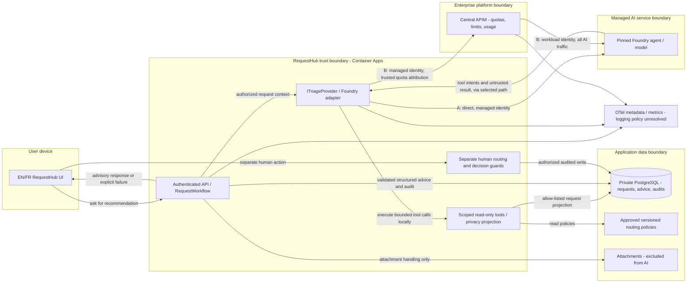
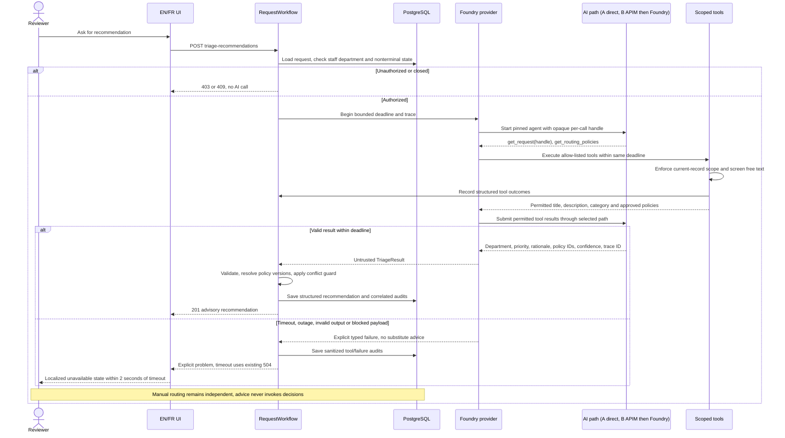

# ADR 0001: Live triage through the existing provider boundary

- **Status:** Proposed
- **Date:** 2026-10-28
- **Deciders:** to be named in the design review (people, never an agent)
- **Related:** `solutions/02-design-github/inputs/reviewed-brief.md`

## Context

RequestHub needs advisory department and priority recommendations with rationale, versioned policy citations, confidence, audit evidence, English/French support, and manual routing during outages (BR-1 through BR-7). Successful recommendations must appear within 8 seconds at p95. The small team has one squad; enterprise has several departments and a platform team.

The extension already exists in `app/src/RequestHub.Core/Triage/ITriageProvider.cs`. `app/src/RequestHub.Core/Triage/SampleRulesTriageProvider.cs` is deterministic, explicitly labelled sample logic. `app/src/RequestHub.Api/Triage/FoundryTriageProvider.cs` already implements a live Foundry agent with API-executed tools. This decision hardens and deploys that boundary rather than inventing a replacement.

Relevant implementation facts:

- `app/src/RequestHub.Api/Program.cs` selects Foundry when `Triage:Provider=Foundry`; otherwise the core registration supplies sample rules. Foundry supports an agent version pin, but an empty version selects latest.
- `app/src/RequestHub.Core/Services/RequestWorkflow.cs` requires staff access to the request's current department and a nonterminal request before calling the provider. Staff includes reviewers, approvers, and admins. Reading one's own request alone does not permit triage.
- The workflow validates departments, priorities, policy citations, rationale, and confidence; it forces human review for detected policy conflicts. It resolves cited IDs to local policy versions and persists a recommendation, not a routing or approval action.
- Routing separately requires reviewer/admin authority and access to both departments. Decisions separately require the Approver role, department access, and a requester different from the deciding person. Preserve these API guards.
- The provider loops over tools, with a default maximum of four rounds. Its current check counts any tool call; it does not prove that both permitted request data and all policies were successfully read.
- Current tools deny another request ID, but send request ID, current department, and priority as well as title, description, and category. The initial prompt also sends department names/IDs. These exceed BR-3's literal allow-list. Free text is not currently screened for personal data.
- The default provider timeout is 45 seconds. Workflow spans, duration/outcome metrics, tool audit events, failure codes, and provider response IDs exist, but do not by themselves prove the latency or complete-audit requirements.
- `app/infra/requesthub.bicep` supplies Container Apps hosting, workload identity, private PostgreSQL, attachment storage, and monitoring. It does not provision the AI endpoint or central AI gateway.
- `app/contracts/openapi.json` already exposes recommendations independently from routing and decisions. `app/web/src/features/detail/TriagePanel.tsx` displays advice without an apply action; `app/web/src/i18n/messages.ts` contains EN/FR triage and error strings. Generated rationale is displayed as returned, not translated.

## Decision drivers

- Extend `ITriageProvider`; a new application service needs independent scaling, security, or release-cadence justification (STD-ARCH-001 v1.0).
- Preserve additive-only `requesthub.v1` compatibility (STD-API-001 v1.0), human decisions, and scoped, audited tools (STD-AI-001 v1.0).
- Use managed identity or federation; disable supported AI local/key authentication (STD-SEC-001 v2.0). Minimize transmitted data and do not persist raw user-text prompts/completions (STD-SEC-002 v1.1).
- Emit spans and metrics for every dependency call. Show unavailable within two seconds after a timeout, without blocking manual routing (STD-OBS-001 v1.2). BR-6's successful-recommendation p95 target is separate from this failure-response deadline.
- Small team: at most one new runtime component per quarter; prefer managed services and avoid an unowned gateway (STD-OPS-001 v1.0). Retain recommendations 90 days; business decisions seven years (STD-DATA-002 v1.0).
- Enterprise: use the central APIM AI gateway, never direct production model/agent calls (STD-OPS-002 v2.0). Record provider trace IDs and release a versioned evaluation dataset with at least ten labelled cases, including adversarial cases (STD-AI-002 v1.0). Retain recommendations and their audits 13 months, business decisions seven years (STD-DATA-001 v1.0).
- Full prompt/completion logging for 30 days (STD-OBS-002 v1.0) conflicts with STD-SEC-002 v1.1 for user-entered free text. Both apply to both profiles. Neither option resolves this conflict; human disposition is required.

## Options considered

### Option A: In-process Foundry provider, direct managed endpoint

Reuse `FoundryTriageProvider` and API-owned `ScopedTriageTools`. The API calls a pinned managed Foundry agent directly using its workload identity. Harden the existing serializer/tool boundary before enabling it. No queue, gateway, separate triage service, or new triage database.

### Option B: In-process Foundry provider through central APIM

Keep the same workflow, provider interface, tools, and PostgreSQL persistence. Route every agent request, continuation, and tool-result submission through the platform-owned central AI gateway to the pinned Foundry agent. The API still executes tools locally; APIM does not gain business-decision authority or database access. SDK routing and identity compatibility require a proof before rollout.

| Same constraint | Option A: direct endpoint | Option B: central gateway |
| --- | --- | --- |
| Application boundary | Reuses the extension; fewest network hops. Favoured by STD-ARCH-001 v1.0. | Also reuses the extension; adds mediation, not another RequestHub service. |
| Small-team operations | Preferred under STD-OPS-001 v1.0 if the managed AI capability is the quarter's only new runtime component. Confirm accounting of its resources. | Adds policy, identity, and gateway operations; unsuitable without an existing operating platform team. |
| Enterprise operations | Blocked for production by STD-OPS-002 v2.0, even if direct calls are faster. | Required production route under STD-OPS-002 v2.0; central quotas, rate limits, and department usage reporting. |
| Human authority and tools | API retains authorization, output validation, and all writes (STD-AI-001 v1.0). Existing payload/tool gaps need hardening. | Same guards and hardening; gateway neither approves nor broadens tools (STD-AI-001 v1.0). |
| Data and identity | Minimized payload; API identity authenticates to AI. Current payload needs correction (STD-SEC-001 v2.0; STD-SEC-002 v1.1). | Same payload; authenticate API-to-gateway and gateway-to-AI with workload identities. Additional logging/exfiltration boundary to inspect under the same standards. |
| Latency and outages | Lower hop count, but tool rounds and model latency can miss BR-6; benchmark. Preserve manual routing (STD-OBS-001 v1.2). | Gateway adds latency and another failure mode; enforce one end-to-end budget, including throttling. Same BR-6 and STD-OBS-001 v1.2 gates. |
| Evidence and retention | Same local recommendation/audit store. Apply STD-DATA-002 v1.0 for small team; STD-AI-002 v1.0 and STD-DATA-001 v1.0 if evaluating enterprise. | Same store and profile-specific retention/evaluation obligations. Correlate gateway and provider trace IDs without duplicating request bodies. |
| Unresolved logging conflict | Cannot claim simultaneous compliance with STD-OBS-002 v1.0 and STD-SEC-002 v1.1. | Same conflict, now also covering APIM diagnostics and upstream service storage. |
| Public API | Existing endpoints suffice for the topology (STD-API-001 v1.0). | Same public surface; gateway is an internal dependency, not a new browser API. |

A separately deployed triage microservice is not recommended: there is no demonstrated independent scaling, security boundary, or release need under STD-ARCH-001 v1.0. It would duplicate authorization propagation and add operations without removing the need for the enterprise gateway.

## Decision

**Recommend A for small team; B for enterprise.** Both keep business authority and tools in RequestHub and use a fully managed AI capability. The profile difference is the mandatory enterprise gateway versus the small team's operating budget, not different approval rules. This is a recommendation, not deployment approval.

Keep sample rules for explicitly selected demo/local use. Never silently substitute sample advice after a live-service failure. Preserve the existing 502/503/504 unavailable paths and independent manual routing.

Propose a six-second total provider deadline, including all tool rounds and gateway waits, leaving two seconds of the eight-second user journey for authorization, persistence, network, and rendering. These are proposed engineering allocations, not standards or measured performance. Bound calls and input/output sizes; no automatic retry may exceed the deadline. Tune or reject this allocation using measurements. An error returned quickly is not a successful recommendation.

**Rollout gates:** reviewer resolution of the logging conflict; privacy-safe payloads; demonstrated end-to-end latency; and, for enterprise, verified gateway compatibility. Do not enable live production traffic merely because this ADR passes its structural checker.

## Architecture

Proposed target, after hardening. Only the selected profile path is active.





The opaque handle, screening, and complete tool-outcome auditing above are proposed changes, not claims about current code. A handle is protocol metadata; its permissibility under BR-3 needs product/security agreement before adoption.

## API impact

Report from `python .github/skills/contract-impact/contract_diff.py --base-ref origin/main` against the working-tree contract on 2026-10-28; the existing local baseline ref was present:

```text
## API contract impact (requesthub.v1 vs origin/main)

**Compatible**: additive-only changes are allowed within the current contract version (STD-API-001).

- Breaking changes: 0
- Additive changes: 0

No contract changes.
```

The report describes the current diff, not validation of a future implementation. The topology needs no public contract change; this task leaves the contract untouched. The report's standard is STD-API-001 v1.0.

The design relies on these existing operations and fields in `app/contracts/openapi.json`:

- `POST /api/requests/{id}/triage-recommendations`: no request body; returns 201 `RecommendationDto`. Preserve `id`, `provider`, `isSample`, `suggestedDepartmentId`, `suggestedPriority`, `rationale`, `policyRefs[].policyId`, `policyRefs[].version`, `confidence`, `needsHumanReview`, `status`, `departmentAtRecommendation`, `createdBy`, `createdAt`, and nullable `providerTraceId`. Keep 403/404/409 and 502/503/504 failures.
- `GET /api/requests/{id}/triage-recommendations` and `GET /api/requests/{id}`: history/latest recommendation and `permissions.canTriage`, `canRoute`, `canDecide`, `decideBlockedReason`. These client permissions do not replace API checks. Request detail includes people, comments, and attachments; never forward the whole DTO to AI.
- `GET /api/policies`: approved `id`, `version`, `kind`, `title`, `text`, `routeTo`, `priority`, `threshold`, `ref`; `GET /api/departments`: UI `id`, `nameEn`, `nameFr`. Keep names local unless BR-3 is explicitly amended.
- `PUT /api/requests/{id}/routing`: human `departmentId` and nullable `reason`; it does not apply suggested priority. `POST /api/requests/{id}/decisions`: human `outcome`, nullable `comment`, and optional `Idempotency-Key`; never exposed as an agent tool.
- `GET /api/requests/{id}/history`: `action`, `actor`, `occurredAt`, structured `details`, `correlationId`. `app/src/RequestHub.Api/Endpoints/ApiEndpoints.cs` emits problem extensions with stable `code`, including `triage.timeout`, `triage.unavailable`, and `triage.invalid_output`; the generic problem schema does not enumerate that extension.

If review requires a selectable rationale language, propose an **optional locale query parameter** on recommendation POST, with existing behavior when omitted, rather than a required body. If review requires people to apply priority, propose a **separate additive routing-adjustment endpoint** with the same authority/audit guards, leaving the old routing operation intact. Neither addition is approved here. Regenerate and re-diff the contract when implementing either (STD-API-001 v1.0); do not tighten existing public validation as an incidental provider change.

## Threat model checklist

Unchecked items are implementation/review gates, not completed security evidence.

- [ ] **Disclosure:** allow only screened title, description, category, and approved policies to cross the AI boundary (BR-3; STD-SEC-002 v1.1). Do not serialize `TriageContext` or request-detail DTOs. Exclude attachments, comments, people, actual request IDs, current priority/department, and unrelated department metadata. Keep opaque-handle mapping local; obtain agreement on that protocol metadata.
- [ ] **Personal data in allowed fields:** inspect free text before egress; block unsafe/uncertain payloads with an explicit localized failure while retaining manual routing. Screen structured rationale/clarifying text for copied personal data before persistence. Field selection alone is insufficient.
- [ ] **Spoofing and credential leakage:** use workload identity on each service hop and disable supported key authentication (STD-SEC-001 v2.0). Grant only required invocation access. Do not forward browser credentials or accept a client-supplied department quota claim.
- [ ] **Cross-record reads and injection:** API authorization precedes AI; a local per-invocation handle resolves only to the authorized record. Allow only the two read tools. Audit denied, unknown, malformed, and successful calls, including sanitized returned outcomes (STD-AI-001 v1.0; BR-4). Prompt text cannot grant another record, routing, or decision access.
- [ ] **Tampered output:** preserve deterministic validation, policy-version resolution, and conflict guards. Require successful request and full-policy reads, not merely a nonzero call count. Treat rationale as untrusted text; no model-supplied approval can execute a business action.
- [ ] **Repudiation:** correlate initiating person, UTC time, request, provider/agent version, tool outcome, structured result, and trace identifiers. Persist complete allowed outcomes without raw prompts; audit failures and disconnects durably. Current tool audit records contain names/arguments/outcomes, not full returned result evidence (BR-4; STD-AI-001 v1.0; enterprise STD-AI-002 v1.0).
- [ ] **Denial of service:** bound tool rounds, calls per round, payload sizes, concurrency, and the total deadline. Instrument each outbound call, including continuations. Test gateway throttling/authentication failure and provider outages; manual routing must still work (STD-OBS-001 v1.2).
- [ ] **Logging/storage boundaries:** review application, SDK, APIM, and Foundry response-chain storage and diagnostics. Resolve STD-OBS-002 v1.0 versus STD-SEC-002 v1.1 before enabling live traffic; disabling application body logs alone is not sufficient.
- [ ] **Retention:** delete only eligible recommendation data at 90 days for small team (STD-DATA-002 v1.0), and recommendation plus related audit data at 13 months for enterprise (STD-DATA-001 v1.0). Preserve seven-year business decisions and their evidence; settle small-team audit retention and upstream/backup retention explicitly.

## Consequences

One application implementation serves both profiles. Business rules, policy citations, failure semantics, and manual actions remain in the API. Enterprise gains central controls without a separate triage microservice; small team avoids operating a gateway.

The existing live provider is not production-ready merely by selecting its configuration. Privacy projection, complete audit evidence, retention cleanup, and a shorter measured latency budget require work. Agent tool round trips may make the eight-second target infeasible at the chosen model/capacity. Enterprise adds gateway latency, availability, and SDK-routing risk. No option can honestly claim full standards compliance until people resolve the logging contradiction.

## Implementation tasks

1. **Architecture reviewer + security/data owner:** resolve logging Q1 and data-handling Q2 below in review. **Acceptance:** a recorded human disposition identifies applicable exceptions or corrected standards and permitted storage at every hop; otherwise live rollout stays blocked.
2. **API engineer:** harden the provider projection and local scoped tools, preserving current workflow authority. **Acceptance:** outbound-payload tests exclude extra fields/PII; cross-record, malformed/unknown tool, injection, and approval attempts fail safely; both required reads are verified; all successful/denied/failed tool outcomes and recommendation results are durably correlated without raw user-text logs.
3. **Platform engineer:** provision/configure only the managed AI capability for small team, or integrate the existing central gateway for enterprise. Pin the agent version. **Acceptance:** workload-identity calls work with key auth disabled where supported; no credentials in configuration; enterprise continuations/tool results all traverse APIM, client quota attribution cannot be forged, and cross-department quota isolation is demonstrated. Verify the small-team quarterly component count before provisioning.
4. **API + web engineers:** instrument per-call spans/metrics and apply the proposed total deadline; preserve manual routing and localize all new UI strings. **Acceptance:** delayed, invalid, unavailable, throttled, and disconnected scenarios produce explicit audited outcomes; timeout-to-visible-error is at most two seconds in EN and FR; routing works while AI fails. For each profile, measure ask-to-visible successful recommendation p95 at most eight seconds under an agreed representative workload; report error rate separately, not as successful low latency.
5. **Data engineer:** add profile-specific cleanup in an existing operated process, not a new service. **Acceptance:** seeded age-boundary tests remove 90-day small-team recommendations or 13-month enterprise recommendations/audits, preserve unexpired advice and seven-year decision evidence, and apply the reviewer-approved policy to backups and upstream storage.
6. **QA + AI engineer:** version a labelled dataset and run reproducible evaluations against the pinned model/agent and policy versions. **Acceptance:** enterprise release evidence includes at least ten cases (STD-AI-002 v1.0), covering normal EN/FR routing, ambiguity, conflicts, missing context, cross-record access, and prompt injection. Both profiles have negative API authorization/self-approval tests and unchanged human routing/decision behavior; reviewers set quality thresholds before release.
7. **Product owner + API/web engineers:** decide Q3/Q4 before implementing language or priority application changes. **Acceptance:** documented EN/FR behavior and authority match approved criteria; any chosen public additions pass the regenerated additive contract comparison, with old clients and endpoints unchanged.

## Open questions

1. **Blocking standards conflict, both profiles:** STD-OBS-002 v1.0 requires full prompts/completions in application logs for 30 days; STD-SEC-002 v1.1 prohibits persisting raw prompts/completions containing user-entered free text. Request title/description make this a real contradiction. Which standard will the authorized reviewer amend or formally except? Redaction/structured-only logging is a candidate, not an asserted resolution. APIM and Foundry storage must be included in that decision.
2. **Data boundary and retention gaps:** who approves the free-text personal-data screening method, residual risk, blocked-payload UX, and opaque protocol handle under BR-3? Can Foundry response chains meet that storage policy? No supplied standard specifies AI geography, provider-side retention, backup deletion, or small-team tool-audit retention. STD-DATA-002 v1.0 sets 90 days for recommendations, not audit entries; do not borrow enterprise's 13 months silently.
3. **Meaning of BR-7:** must rationale be in the viewer's selected language, the request's language, or both? Current UI chrome is bilingual, but the provider receives no locale and deterministic guard/question text is English. If selected-language rationale is required, approve the optional locale parameter and its permitted AI metadata, plus localized guard text; otherwise record the agreed behavior.
4. **Scope of human routing and BR-1:** recommendations contain priority, but existing routing changes only department. Is advisory priority enough, or must an authorized reviewer be able to apply it through a new additive endpoint? BR-1 says any request a reviewer can see, while the implementation excludes terminal requests and requires current-department staff access even when requester ownership grants visibility. Should the brief explicitly preserve those restrictions? No access expansion is proposed by default.
5. **Performance and platform evidence:** what representative workload, success/error criterion, model, capacity, and sample size will establish BR-6? Does the chosen Foundry agent API/SDK support all traffic through central APIM with workload identity and reliable department attribution? Who owns gateway onboarding and outage response? Direct enterprise production access is not a fallback under STD-OPS-002 v2.0.
6. **Release/operating ownership:** does the small-team managed AI deployment count as one new runtime component within the current quarter, and is that budget available (STD-OPS-001 v1.0)? Who owns agent/policy version updates, quality thresholds, and cleanup scheduling? These are reviewer decisions, not additional invented standards.
