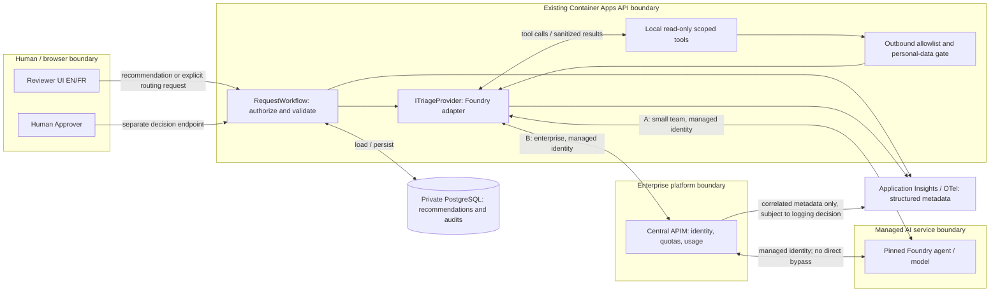

# ADR 0001: Live triage through the existing provider boundary

- **Status:** Proposed
- **Date:** 2026-10-28
- **Deciders:** to be named in the design review (people, never an agent)
- **Related:** Issue #117; `/home/runner/work/adept-assessment-northstars/adept-assessment-northstars/solutions/02-design-github/inputs/reviewed-brief.md`

## Context

Reviewers need advisory department and priority recommendations, policy citations, confidence, and English/French support. BR-1–BR-7 require authorization, human decisions, minimal disclosure, auditability, manual fallback, and p95 recommendation latency within eight seconds.

The current system already has much of the live integration:

- `/home/runner/work/adept-assessment-northstars/adept-assessment-northstars/app/src/RequestHub.Core/Triage/ITriageProvider.cs` defines the provider, result, and read-only tools. The adjacent SampleRulesTriageProvider is explicitly labelled sample logic.
- `/home/runner/work/adept-assessment-northstars/adept-assessment-northstars/app/src/RequestHub.Api/Triage/FoundryTriageProvider.cs` already calls a Foundry prompt agent, executes tools locally, bounds tool rounds, and returns a response identifier. It is not a proposed new component.
- `/home/runner/work/adept-assessment-northstars/adept-assessment-northstars/app/src/RequestHub.Api/Program.cs` selects it with `Triage:Provider=Foundry`, otherwise retaining the sample provider. OpenTelemetry export is enabled when Application Insights is configured.
- `/home/runner/work/adept-assessment-northstars/adept-assessment-northstars/app/src/RequestHub.Core/Services/RequestWorkflow.cs` checks department/staff access and terminal state before triage. It validates outputs, stamps approved policy versions, enforces policy-conflict review, persists recommendations and audits, and separates routing from approval. Its default provider timeout is **45 seconds**, not BR-6 compliance.
- `/home/runner/work/adept-assessment-northstars/adept-assessment-northstars/app/infra/requesthub.bicep` supplies Container Apps hosting, managed identity, private Entra-only PostgreSQL, and Application Insights with a 30-day log workspace. It does not provision an AI endpoint or central gateway.
- `/home/runner/work/adept-assessment-northstars/adept-assessment-northstars/app/contracts/openapi.json` already describes recommendation, routing, decision, and history endpoints.

Existing tools bind reads to the current request, but send its ID, current department, and priority as well as title, description, and category. The initial agent prompt also sends department metadata. This exceeds BR-3's strict allowlist. Neither field selection nor current output validation guarantees that free text is free of personal data. Tool audits record names and outcomes, not returned results. The provider checks only that *some* tool was called, not that both required reads succeeded.

## Decision drivers

- Keep AI advisory and tools scoped/read-only: STD-AI-001 v1.0; BR-2 and POL-GOV-001.
- Reuse the provider interface and API deployable: STD-ARCH-001 v1.0.
- Managed identity, no configured keys, key authentication disabled where supported: STD-SEC-001 v2.0.
- Minimize outbound data and avoid persisting raw user-text prompts/completions: STD-SEC-002 v1.1.
- Dependency spans/metrics and unavailable UI within two seconds of timeout: STD-OBS-001 v1.2; additionally meet BR-6's eight-second p95.
- Preserve `requesthub.v1` compatibility: STD-API-001 v1.0.
- Small team: at most one new runtime component per quarter, managed services preferred (STD-OPS-001 v1.0); recommendation retention 90 days (STD-DATA-002 v1.0).
- Enterprise: central gateway mandatory (STD-OPS-002 v2.0); correlate every AI call and release at least ten labelled evaluation cases, including adversarial cases (STD-AI-002 v1.0); retain recommendations and their audits 13 months (STD-DATA-001 v1.0).
- Both profiles: STD-OBS-002 v1.0 requires full prompt/completion logs for 30 days. This conflicts with STD-SEC-002 v1.1 for user free text; see the unresolved release blocker below.

## Options considered

### Option A: In-process provider calling Foundry directly

Extend the existing Foundry provider and locally executed tools. The API's managed identity calls a pinned Foundry agent version directly; no new application service, queue, or gateway. Provision the managed AI service through the solution's infrastructure composition.

### Option B: In-process provider calling Foundry through central API Management

Keep the same workflow and tools inside the API. Adapt the provider's client/transport so **every** initial and continuation call goes through the platform-operated AI gateway. The API authenticates to the gateway with managed identity; the gateway uses its identity to call Foundry. No subscription keys. The gateway applies quotas, rate limits, and department usage accounting using API-derived department context, not model-supplied values. Strip that routing metadata before forwarding to the model.

| Same constraint | A: direct Foundry | B: central gateway → Foundry |
| --- | --- | --- |
| Access and approval | API remains the authority; local tools only; STD-AI-001 v1.0. | Same. Gateway does not replace record authorization or grant approval rights. |
| Deployment and latency | Fewest hops and configuration changes; favoured by STD-ARCH-001 v1.0. Multiple agent rounds can still miss eight seconds. | Adds a hop, identity/audience configuration, quota policy, and another failure mode. Reuses central operations, not a new triage deployable. |
| Small team | Recommended conditionally: one managed AI service fits STD-OPS-001 v1.0 if counted as the quarter's single addition; confirm the component inventory. | Not preferred without an existing operated gateway; a new gateway plus AI service exceeds the one-component budget. |
| Enterprise | **Not permitted in production** by STD-OPS-002 v2.0, despite lower complexity. | Recommended: satisfies STD-OPS-002 v2.0; justify the gateway boundary for central security/quota enforcement under STD-ARCH-001 v1.0. |
| Identity and disclosure | Managed identity and minimized payloads required by STD-SEC-001 v2.0 and STD-SEC-002 v1.1. | Same, on both hops; gateway logging must not create another prompt store. |
| Observability and retention | Dependency telemetry, 90-day recommendations; logging conflict remains unresolved. | Per-hop telemetry, every-call response IDs, release evaluation, 13-month recommendations/audits; logging conflict also applies to gateway diagnostics. |

Both options require the same authorization, sanitization, audit, timeout, and bilingual work. A separately deployed triage microservice is not justified now: there is no evidenced independent scaling or release requirement, and it would duplicate a security boundary and increase operations (STD-ARCH-001 v1.0).

## Decision

**Propose A for the small team and B for enterprise.** The application architecture stays in-process in both profiles. Enterprise's mandatory central controls outweigh the extra hop; the small team avoids that overhead unless an existing platform already supplies it. Do not silently use direct calls if the enterprise gateway fails.

This is not approval to ship. Resolve the logging conflict and data/locale questions below first. Prefer structured, sanitized evidence rather than raw prompt logging, but a person must authorize the standards resolution; this ADR does not declare either standard satisfied by ignoring the other.

Keep `RequestWorkflow` responsible for access, output validation, policy conflict guards, persistence, and business audits. A model never changes routing, priority, or decisions. A reviewer explicitly confirms department routing; only a human Approver with department access, who is not the requester, may approve or reject. Suggested priority remains advisory pending the product decision below.

Use a bounded end-to-end budget. Propose a six-second total provider deadline across all tool rounds and SDK attempts, leaving up to two seconds for validation, audit persistence, and UI rendering. These are proposed engineering allocations, not new standards or proof of BR-6. Replace the 45-second default for live operation, propagate cancellation, and prevent retries from extending the deadline. Demonstrate p95 of successful displayed recommendations within eight seconds under representative load; report failures separately so timeouts cannot make the metric look healthy.

Map outages/quota failures to the existing unavailable response, deadlines to timeout, and unusable output to invalid-output. Show localized EN/FR states; keep manual routing usable independently of AI health. Never silently substitute sample rules and label them live.

## Architecture

Recommended flows after the bounded tasks; controls below are not claims about current implementation.



Only one of A/B is active per operating profile. Request/actor IDs remain in the application audit boundary; any provider-required opaque correlation mechanism needs the BR-3 decision below.

```mermaid
sequenceDiagram
  actor R as Reviewer
  participant API as RequestWorkflow
  participant DB as PostgreSQL
  participant P as In-process provider
  participant E as Foundry (via APIM in enterprise)
  R->>API: POST /api/requests/{id}/triage-recommendations
  API->>DB: Load current request
  API->>API: Check staff/department access and nonterminal state
  alt Unauthorized or closed
    API-->>R: 403 / 404 / 409; no AI call
  else Authorized
    API->>P: Bound local context; start deadline and trace
    P->>E: Start pinned agent; no raw request identifiers
    E-->>P: Read-only tool requests
    P->>API: Execute tools bound to this request only
    API->>API: Allowlist, sanitize or refuse; audit safe returned result
    API-->>P: Sanitized title/description/category and approved policies
    P->>E: Tool results within same deadline
    alt Valid recommendation before deadline
      E-->>P: Structured result and response identifier
      P-->>API: TriageResult
      API->>API: Validate schema, citations, privacy, conflict guard
      API->>DB: Persist recommendation, actor/time, audits, trace IDs
      API-->>R: 201 advisory recommendation
    else Invalid output
      P-->>API: Invalid-output failure
      API->>DB: Persist safe failure/tool audits
      API-->>R: 502 triage.invalid_output; manual routing available
    else Deadline or dependency outage
      P-->>API: Cancel or unavailable failure
      API->>DB: Persist safe failure/tool audits
      API-->>R: 504 triage.timeout / 503 triage.unavailable
      Note over R,API: Localized unavailable state within 2 seconds of timeout
    end
    opt Reviewer chooses manual routing (AI success not required)
      R->>API: PUT /api/requests/{id}/routing
      API->>API: Recheck reviewer role, both departments and current state
      API->>DB: Save routing and audit; no approval
    end
  end
```

## API impact

Executed the contract-impact skill's contract_diff.py with `--base-ref origin/main` against the working-tree contract. Report:

```markdown
## API contract impact (requesthub.v1 vs origin/main)

**Compatible**: additive-only changes are allowed within the current contract version (STD-API-001).

- Breaking changes: 0
- Additive changes: 0

No contract changes.
```

This checks the current diff, not future implementation compatibility. This ADR changes no contract.

- POST and GET `/api/requests/{id}/triage-recommendations`: reuse `RecommendationDto` fields `provider`, `isSample`, `suggestedDepartmentId`, `suggestedPriority`, `rationale`, `policyRefs` (`policyId`, `version`), `confidence`, `needsHumanReview`, `status`, `createdBy`, `createdAt`, and nullable `providerTraceId`. The server resolves cited IDs against the approved policy snapshot, not model-invented versions.
- GET `/api/requests/{id}`: reuse `latestRecommendation`, `version`, and `permissions.canTriage`, `canRoute`, `canDecide`, `decideBlockedReason`. UI permissions are hints; API checks remain authoritative.
- PUT `/api/requests/{id}/routing`: existing `RoutingInput.departmentId` and `reason` confirm department only. There is **no priority update field**; do not imply that this endpoint applies `suggestedPriority`.
- POST `/api/requests/{id}/decisions`: preserve `outcome`, `comment`, and `Idempotency-Key` behaviour. No agent tool may invoke it.
- GET `/api/requests/{id}/history`: reuse audit `action`, `actor`, `occurredAt`, `details`, `correlationId`. Existing triage errors are 502 `triage.invalid_output`, 503 `triage.unavailable`, and 504 `triage.timeout`.

No new public endpoint is required to select the provider or enterprise transport. Language selection and priority confirmation need product decisions: if exposed, propose a new optional locale input and a new authorized priority-update endpoint or optional routing field, with negative tests. Do not make a new field mandatory, rename fields, or tighten existing public validation within v1 (STD-API-001 v1.0). Regenerate and compare the contract only in that later implementation.

## Threat model checklist

Unchecked items are implementation/release gates, not completed security evidence.

- [ ] Before AI egress, restrict business content to sanitized title, description, category, and approved routing policies (BR-3, STD-SEC-002 v1.1). Do not serialize TriageContext wholesale. Remove current priority/department, request ID, and department catalog from model payloads unless a person explicitly revises BR-3. Keep the tool's record binding server-side; do not trust a model-supplied ID.
- [ ] Inspect both user free text and approved policy content for personal data. Redact or refuse to send when safe minimization cannot be established; keep manual routing available. No attachments, comments, requester names, actor credentials, or attachment access tools. Test output echoing as well as input leakage.
- [ ] Authenticate API → AI, API → gateway, and gateway → AI with least-privilege managed identities; disable AI local authentication where supported (STD-SEC-001 v2.0). Give the AI no database or business-decision identity. Test wrong audiences and missing roles; no key fallback.
- [ ] Keep tools read-only, scoped to the authorized current record, with a bounded allowlist. Require successful request and full approved-policy reads before accepting an agent result; reject unknown tools and audit denied/failed calls too (STD-AI-001 v1.0).
- [ ] Treat request text/tool arguments as untrusted data. Injection must not enable other-record reads, new network destinations, approval claims, or writes. Validate department, priority, finite confidence in [0,1], bounded rationale, real policy references, and human-review guards server-side; render output as text, not executable markup.
- [ ] Record who/when and sanitized structured returned results for every recommendation/tool call (BR-4). Correlate via local business ID, audit ID, model/agent version, span ID, and provider response ID. Enterprise records an ID for **each** model call/round, including failed attempts when available; the current final-only response ID is insufficient (STD-AI-002 v1.0).
- [ ] Do not persist user-text echoes in rationales, clarifying questions, tool-result audits, exception messages, traces, or gateway diagnostics. Persist safe structured results/identifiers, not raw prompts/completions. Link tool evidence to the exact approved policy version and sanitized result; restrict audit access through existing API authorization. Resolve STD-OBS-002 v1.0 versus STD-SEC-002 v1.1 before enabling production logging.
- [ ] Emit OTel dependency spans and latency/outcome metrics for each AI/gateway attempt; avoid request/response IDs as high-cardinality metric labels. Test cancellation, quota exhaustion, unavailable UI timing, and concurrent manual routing (STD-OBS-001 v1.2). AI failure must not make core readiness depend on AI health.
- [ ] Enforce 90-day recommendation expiry for small team (STD-DATA-002 v1.0), or 13-month recommendation/audit expiry for enterprise (STD-DATA-001 v1.0). Include copied tool results, provider-side state, exports, and backups in the retention review. Keep human business decisions seven years; never cascade recommendation cleanup into decisions. Small-team audit retention remains an explicit question.

## Consequences

The API keeps a single authorization and audit boundary. Existing UI and contract can consume real recommendations without a new triage service. Enterprise gains central quota enforcement; small teams avoid operating a gateway.

Multi-round agent calls and gateway throttling may miss BR-6. Reduce round trips or revisit agent execution strategy if measured evidence fails; do not relax the latency target or hide failures. Gateway availability and SDK routing/identity support must be demonstrated, not assumed from the current direct client.

Data sanitization, complete tool-result auditing, retention cleanup, and bilingual results are real implementation work. The existing 30-day workspace setting alone does not satisfy recommendation retention. Do not place 13-month recommendation evidence only in 30-day operational logs.

## Implementation tasks

1. **Architecture reviewer + security/data owner:** resolve logging precedence, outbound metadata/personal-data handling, locale, retention gaps, and priority-confirmation scope. Acceptance: recorded human decisions and approved release gates; no production enablement while the standards conflict is unresolved.
2. **API engineer:** harden the existing provider/tools, without changing approval authority. Bind reads locally; enforce BR-3, both successful reads, strict output checks, sanitized result audits, and per-call trace IDs. Acceptance: integration tests deny unauthorized/other-record/injection attempts, reject malformed/private output, retain actor/time/results, and show unchanged request/decision state after triage.
3. **Platform engineer:** provision one managed AI service for A; for B configure the existing gateway route, trusted department quotas, both identity hops, and no direct production bypass. Pin agent/model versions and keep settings secret-free. Acceptance: real service calls succeed with intended identities, denied identities fail, key auth is disabled where supported, and quota failures do not reroute directly. Verify SDK initial and continuation requests use the gateway.
4. **API + web engineers:** implement the proposed total deadline and EN/FR recommendation/error presentation after locale review. Acceptance: targeted timeout/outage tests show localized unavailable UI within two seconds of timeout, manual routing still works, and real representative-load evidence meets eight-second successful-recommendation p95 with failure rate reported separately. Mocks are regression evidence only, not live acceptance.
5. **Data engineer:** add profile-specific expiry using existing operational scheduling where practical, not a new cleanup service. Acceptance: time-controlled tests delete expired recommendations and required associated copies/audits without deleting seven-year business decisions; document backup/provider-state expiry and the small-team audit decision.
6. **QA + release owner:** retain versioned labelled EN/FR normal, ambiguous, conflicting, missing-context, unauthorized, injection, and outage cases. Enterprise requires at least ten cases and release-attached results (STD-AI-002 v1.0). Acceptance: real-provider evaluation records versions, response IDs, pass/fail and latency; existing authorization/approval regressions remain green. Re-run the additive contract check for any later API additions.

## Open questions

1. **Blocking standards conflict, both profiles:** STD-OBS-002 v1.0 mandates every full prompt/completion in the application workspace for 30 days; STD-SEC-002 v1.1 forbids persisting raw prompts/completions containing user free text. These cannot both hold for this flow. Will the human standards owners amend the logging rule or authorize a documented resolution? Structured metadata is proposed, not an already-approved exception. Do not log raw text pending that decision.
2. **BR-3 and personal data:** which approved redaction/refusal mechanism establishes safe title/description/policy content? May locale, a department catalog, or opaque service correlation identifiers cross the AI boundary, or must tools become parameterless and context remain entirely local? No standard defines the classifier or permitted residual risk.
3. **Language and priority:** how is the requested EN/FR language selected and how are policy citations preserved across translation? Must reviewers confirm suggested priority as well as department? The current routing contract cannot apply priority. Product owners decide any additive API scope.
4. **Retention:** STD-DATA-002 v1.0 specifies 90-day recommendations but not their small-team tool/business-audit retention. What period and cleanup ownership apply to those audits? How will both profiles reconcile provider conversation state, backups, and sanitized returned-result evidence with deletion requirements? Enterprise's 13 months and small-team's 90 days are scoped differences, not conflicting standards.
5. **Enterprise readiness:** who owns the existing central gateway, its Entra audience, trusted department mapping, quotas, supported Foundry agent routes, and an availability commitment? STD-OPS-002 v2.0 forbids a direct production workaround. If there is no ready gateway, enterprise launch waits.
6. **Performance and budget:** what representative workload, concurrency, model/agent version, cost envelope, and success-rate gate will the reviewer accept? BR-6 supplies the latency target, not a workload definition or spend limit. Does the small team's AI service fit the quarter's remaining one-component allowance (STD-OPS-001 v1.0)?
