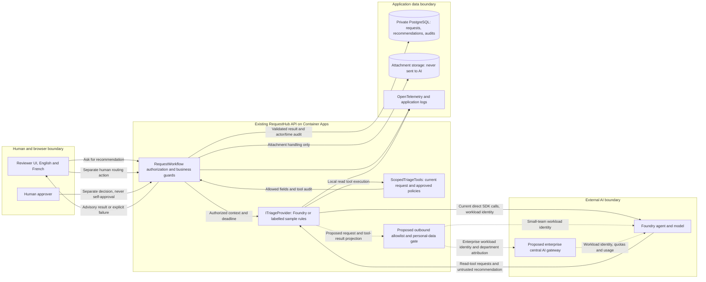
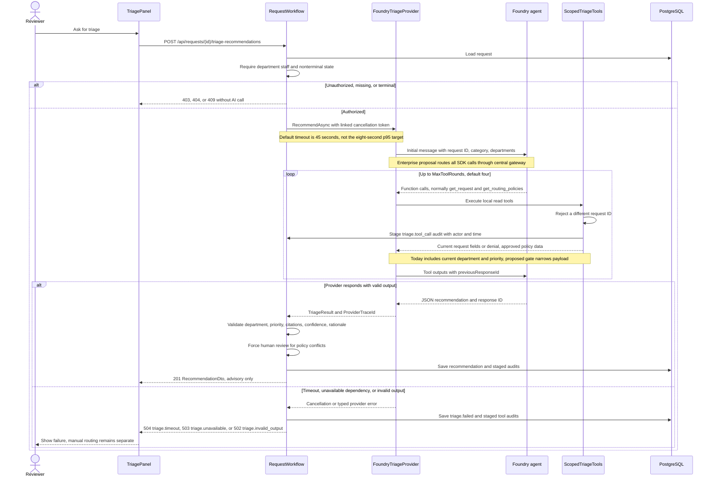

# ADR 0001: Extend the live triage provider before adding a service

- **Status:** Proposed
- **Date:** 2026-11-10
- **Deciders:** to be named in the design review (people, never an agent)
- **Related:** #280, PR #281, `solutions/02-design-github/inputs/reviewed-brief.md`
- **Advisor source:** Microsoft Foundry comment on #280 and its draft, moved here from solutions/02-design-microsoft/adr/issue-280.md. Agent `architecture-advisor-small-team` v2, model `gpt-5.4-mini`, advisor run `f0fe5068390b`, response `resp_09c3b3958d852fa7006af29cf2d84c81969d851e7926de90d7`, 2026-11-10T04:26:26+00:00.

## Context

One ADR joins the Microsoft advisor's evidence and the GitHub design review on PR #281. The advisor answered the small-team question in #280 and recommended a separate service. Its one knowledge call retrieved STD-AI-001 v1.0, STD-DATA-002 v1.0, STD-OBS-002 v1.0, STD-SEC-001 v2.0, and STD-SEC-002 v1.1. Its reported deterministic checks validated citation existence, scope, version, and quotations, not architectural fitness. Those citations were checked against the approved files in `solutions/02-design-github/standards/`; this ADR also considers every other standard there.

The reviewed brief requires advisory department and priority recommendations, rationale, versioned policy citations, confidence, audited tools, English/French, manual routing during outages, and end-to-end p95 within eight seconds (BR-1 through BR-7). Profiles are one squad with minimal operations and an enterprise with a central platform team.

The real system already has both options' integration seam:

- `app/src/RequestHub.Core/Triage/ITriageProvider.cs` defines the provider, context, scoped read tools, result, and dependency errors. `app/src/RequestHub.Core/Triage/SampleRulesTriageProvider.cs` supplies explicitly labelled deterministic sample rules.
- `app/src/RequestHub.Api/Triage/FoundryTriageProvider.cs` already calls a Foundry agent in-process with a token credential, at most four tool rounds by default, response correlation, and no mutation tools. `app/src/RequestHub.Api/Program.cs` selects it for `Triage:Provider=Foundry`; `app/src/RequestHub.Core/Services/CoreServiceExtensions.cs` otherwise registers sample rules. Selection is configuration, not automatic failover.
- `app/src/RequestHub.Core/Services/RequestWorkflow.cs` owns authorization, same-record tool access, validation, policy-conflict guards, recommendation storage and audit. Triage requires department staff and a nonterminal request. Rerouting requires a reviewer or admin with access to both departments. Decisions require an approver with department access who is not the requester.
- `app/contracts/openapi.json` already describes recommendations and errors. `app/infra/requesthub.bicep` supplies Container Apps hosting, a managed identity, private Entra-only PostgreSQL, attachment storage, and a 30-day log workspace. It does not supply an AI gateway or a triage service.

Current code is not proof of compliance. The initial agent message sends request ID, category, and department IDs/names. Its request tool returns ID, title, description, category, current department, and priority, beyond BR-3's strict allowlist. It omits people and attachments but does not detect personal data embedded in free text. The provider timeout defaults to 45 seconds. Workflow metrics cover overall calls and duration, not demonstrated per-dependency metrics. Tool audits record names, arguments, and outcomes rather than complete returned snapshots. These are bounded follow-up gaps, not reasons to claim an existing safe deployment.

## Decision drivers

- Extend a stable interface first; justify a new deployable by independent scaling, security boundary, or release cadence (STD-ARCH-001 v1.0).
- Small team: at most one new runtime component per quarter, managed services preferred, no new gateway/queue/cluster without an existing platform operator (STD-OPS-001 v1.0).
- Enterprise: model and agent traffic must use the central Azure API Management AI gateway, with department quotas, rate limits, and usage reporting. Direct production calls are prohibited (STD-OPS-002 v2.0).
- Both profiles: workload identity, no configured shared secrets, and local key authentication disabled where supported (STD-SEC-001 v2.0); minimized AI data and no persisted raw user-text prompts/completions (STD-SEC-002 v1.1).
- AI remains advisory, with scoped and audited tools (STD-AI-001 v1.0). BR-2 preserves human routing and approval authority.
- Dependency spans/metrics, unavailable UI within two seconds of timeout, and independent manual flow (STD-OBS-001 v1.2) must fit BR-6's eight-second p95.
- Full prompt/completion logging for 30 days (STD-OBS-002 v1.0) contradicts STD-SEC-002 v1.1 when user text is present. Neither option resolves this conflict.
- Small-team recommendations: 90 days, business decisions: seven years (STD-DATA-002 v1.0). Enterprise recommendations and their audits: 13 months, business decisions: seven years (STD-DATA-001 v1.0). These scopes differ rather than contradict.
- Enterprise requires response/trace IDs correlated to business records and a versioned evaluation dataset with at least ten labelled cases, including adversarial cases, with release results (STD-AI-002 v1.0).
- Keep public `requesthub.v1` additive-only (STD-API-001 v1.0).

## Options considered

### Option A: Extend the existing in-process Foundry provider

Keep the API-owned `ITriageProvider` implementation and tools. Tighten outbound projection and validation rather than create another provider from scratch. Small-team calls go to Foundry directly with workload identity. Enterprise calls go through the central gateway, subject to SDK/agent compatibility verification. The API remains the only business-data and authorization boundary.

### Option B: Extract a dedicated AI triage service

An API-side `ITriageProvider` adapter calls a new Container Apps service using workload identity. Pass a minimized snapshot of the authorized record and approved policies, not the full `TriageContext`, user identity, database access, or executable tool object. Any tools in the service read only that supplied snapshot and return audit metadata to the API. Enterprise service-to-Foundry traffic still goes through the central gateway.

| Same constraint | A: In-process provider | B: Separate service |
| --- | --- | --- |
| Deployment and lifecycle | Reuses existing runtime and release, favored by STD-ARCH-001 v1.0. No independent AI scale or rollback. | Independent scaling/releases and potential isolation. No such need established in the brief, so justification under STD-ARCH-001 v1.0 is missing. |
| Small-team operating budget | No new app runtime. Confirm managed AI onboarding fits the quarter's remaining allowance (STD-OPS-001 v1.0). | Extra runtime and managed AI may exceed the allowance. Another identity, deployment, on-call surface, and network hop. |
| Enterprise operations | Mandatory central gateway, not the current direct SDK route (STD-OPS-002 v2.0). Central control does not require service extraction. | Mandatory central gateway too. Service boundary could help multiple consumers, but none are established. |
| Data and identity, both profiles | Explicit serializer/redaction gate can enforce STD-SEC-002 v1.1; token credential already exists for STD-SEC-001 v2.0. Shared API identity/process increases blast radius. | Separate least-privilege identity can reduce blast radius. Extra hop copies data and adds authentication/audit failure modes. Separation alone satisfies neither standard. |
| Authority and audit, both profiles | Retains same-record tools and all business guards under STD-AI-001 v1.0. Must close returned-result audit gaps (BR-4). | Keep authority in API. Snapshot-only tools avoid a broad callback API, but remote tool auditing needs reliable transfer and correlation (STD-AI-001 v1.0). |
| Latency and failure, both profiles | Fewer hops and cancellation already supported. Default 45 seconds and multi-round calls need measured improvement (BR-6, STD-OBS-001 v1.2). | Additional hop and possible cold start consume the same eight-second budget. Requires propagated deadlines, dependency telemetry, and extra failure handling. |
| Logging and retention, both profiles | Logging conflict unresolved: STD-OBS-002 v1.0 versus STD-SEC-002 v1.1. Apply scoped STD-DATA-002 v1.0 or STD-DATA-001 v1.0 after classification is decided. | Same unresolved conflict and retention rules, plus any service-side copies. Service isolation is not a policy exemption. |
| Enterprise evidence and public API | Existing response ID supports STD-AI-002 v1.0; evaluations still needed. No public shape change (STD-API-001 v1.0). | Needs end-to-end trace correlation and the same evaluations. Internal adapter can preserve public shape, but adds a private service protocol. |

## Decision

**Small team: recommend A**, extending the existing provider. This disagrees with the advisor's separate-service preference. STD-SEC-002 v1.1 and STD-SEC-001 v2.0 require data and identity controls, not another deployable. The omitted STD-ARCH-001 v1.0 and STD-OPS-001 v1.0 favor the simpler existing seam until a distinct boundary or scaling need is demonstrated.

**Enterprise: recommend A through the central AI gateway**, not the current direct route. The advisor only assessed small-team scope; its separate-service reasoning is useful but is not enterprise evidence. Gateway enforcement, trace/evaluation evidence, and 13-month recommendation/audit retention distinguish this profile. A central platform team does not by itself establish a separate triage service's need.

Agree with the advisor on minimized inputs, workload identity, advisory output, scoped tools, and keeping its conflicts/unknowns unresolved. Retain sample rules as an explicitly selected non-AI mode, not a silent fallback that disguises a live outage. Manual routing is the normal outage path. Revisit B only with evidence of a separate security boundary, independent scaling, or independent release cadence.

This is a proposal, not implementation approval. The architect must resolve the logging conflict and other release-blocking questions below. No policy exception, attachment access, or new approval authority is granted here.

## Architecture

Solid flows describe existing components and behavior. Dashed flows are proposed additions, including the enterprise gateway and stricter outbound gate. The current enterprise direct path must be replaced before production.

The sequence shows today's in-process path, including real tool payloads and failure handling, not a claim that the proposed controls already exist. Enterprise inserts the gateway at every API-to-Foundry call. The proposed data gate applies to both initial messages and tool outputs.

## API impact

Report from `python .github/skills/contract-impact/contract_diff.py --base-ref origin/main` on 2026-11-10:

## API contract impact (requesthub.v1 vs origin/main)

**Compatible**: additive-only changes are allowed within the current contract version (STD-API-001).

- Breaking changes: 0
- Additive changes: 0

No contract changes.

The governing version is STD-API-001 v1.0. The report compares files, not future implementation behavior. This ADR changes no contract.

The design relies on these existing endpoints and fields in `app/contracts/openapi.json`:

- POST and GET `/api/requests/{id}/triage-recommendations`: `RecommendationDto.id`, `provider`, `isSample`, `suggestedDepartmentId`, `suggestedPriority`, `rationale`, `policyRefs` (`policyId`, `version`), `confidence`, `needsHumanReview`, `status`, `departmentAtRecommendation`, `createdBy`, `createdAt`, and nullable `providerTraceId`. The POST has no request body. Existing 403/404/409/502/503/504 responses carry `ProblemDetails`; workflow errors use the stable codes shown above.
- GET `/api/requests/{id}`: `title`, `description`, `category`, `departmentId`, `priority`, `latestRecommendation`, and `permissions.canTriage`, `canRoute`, `canDecide`. A full detail DTO, including requester, comments, and attachments, must never become the AI payload.
- GET `/api/policies`: `PolicyDto.id`, `version`, `kind`, `title`, `text`, `routeTo`, `priority`, `threshold`, `ref`. Internal read tools use the profile directly, not unauthenticated public callbacks.
- PUT `/api/requests/{id}/routing`: `RoutingInput.departmentId`, `reason`, for a separate human action. POST `/api/requests/{id}/decisions`: `DecisionInput.outcome`, `comment`, for a separate authorized approver. A suggested priority is advisory; the existing routing input does not apply it.

No public endpoint is needed for either placement option. Gateway quota attribution stays internal and must not send user identity to the model. If the language question requires a locale input, propose a new optional field/header or endpoint separately, preserving existing required fields, types, and validation under STD-API-001 v1.0. Do not silently tighten public validation to implement the outbound AI data gate.

## Threat model checklist

Unchecked items are implementation/release acceptance gates, not verified controls.

- [ ] Project only title, description, category, and approved routing policies into AI content (BR-3, STD-SEC-002 v1.1). Resolve required correlation/routing metadata separately. Exclude attachments, comments, requester identity, and personal data even when embedded in allowed free-text fields. Check initial prompt, every tool output, gateway, and provider-side storage.
- [ ] Use narrowly scoped workload identities on every service hop and disable local key authentication where supported (STD-SEC-001 v2.0). Verify enterprise gateway backend identity and prevent direct-route bypass. Give AI no PostgreSQL or Blob credentials.
- [ ] Keep tools read-only and bound to the current authorized record. Audit successful, denied, unknown, and malformed tool calls with actor, time, correlation, and approved result representation (BR-4, STD-AI-001 v1.0). The current unknown-tool path does not use scoped-tool auditing.
- [ ] Treat request text and model output as untrusted. Adversarial text cannot read another record, invoke mutations, approve/reject, or override workflow policy guards. Validate result schema, citations, bounds, and advisory wording in the API, not only in the prompt or UI.
- [ ] Demonstrate eight-second end-to-end p95 and an unavailable UI within two seconds of the configured timeout, including enterprise gateway limits, cold starts, tool rounds, and cancellation. Manual routing must work during AI outages (BR-5/6, STD-OBS-001 v1.2).
- [ ] Resolve raw-log prohibition versus mandatory full logging before enabling production AI. Review SDK response-chain persistence, gateway diagnostics, exception logging, stored rationale, and telemetry for free-text leakage (STD-SEC-002 v1.1 versus STD-OBS-002 v1.0).
- [ ] After classification is decided, enforce profile-specific recommendation retention and protect seven-year business decisions from recommendation cleanup. Enterprise includes recommendation audits (STD-DATA-001 v1.0); small-team audit duration remains a question (STD-DATA-002 v1.0).
- [ ] Enterprise: correlate response/trace IDs with the business record and attach versioned evaluation results with at least ten labelled, including adversarial, cases to release evidence (STD-AI-002 v1.0). Cover English/French behavior under BR-7.

## Consequences

Reusing A avoids an extra deployable, preserves API authorization, and makes the sample/live distinction explicit. It shares API resources, identity, and release cadence with AI code, and does not provide process isolation. Gateway latency, data controls, retention cleanup, and operational evidence are still real work. B remains available if a demonstrated boundary or scaling need outweighs those costs.

Neither placement solves contradictory logging rules, embedded personal data, or model-side retention automatically. A 30-day log workspace is not an implemented prompt-logging policy or recommendation-retention mechanism. Existing recommendation storage and audit summaries do not by themselves establish complete BR-4 compliance.

## Implementation tasks

These are bounded follow-up tasks, not changes authorized by this ADR. Tasks affected by open questions wait for the architect's recorded decision.

1. **Architect with security/data owners:** record decisions for logging, triage classification, attachments, and metadata/language questions below. Acceptance: each blocking question has a named human decision and explicit standards-owner resolution where necessary; status here remains Proposed until human review.
2. **API engineer:** tighten the existing provider's outbound projection and personal-data handling without changing public validation. Acceptance: captured synthetic initial messages and all tool results contain only approved content/metadata; tests deny other-record reads, personal-data leakage, attachments, and mutation attempts.
3. **Platform engineer:** configure least-privilege identity and enterprise gateway routing for the existing provider. Acceptance: initial and continuation agent calls succeed with workload identity, gateway reports department quota usage, direct enterprise calls and keys fail, and no new triage deployable is added. Confirm small-team runtime allowance before provisioning.
4. **API and web engineers:** instrument dependency calls and tune deadlines/tool rounds; preserve explicit failures and manual routing. Acceptance: measured end-to-end p95 is at most eight seconds, timeout UI appears within two seconds of timeout in English/French, and outage/invalid-output tests preserve routing and approval guards without silent sample fallback.
5. **API/data engineer:** close audit-result gaps and implement approved retention cleanup for app and AI-side copies. Acceptance: actor/time/returned-result correlation survives successful and failed calls, all tool attempts are audited, expiry tests remove eligible recommendations/audits by profile, and seven-year decision records are unaffected.
6. **QA/AI engineer:** pin the agent version and build release evaluation evidence. Acceptance: enterprise dataset has at least ten labelled cases including adversarial and bilingual inputs, records provider response/trace IDs, and results are attached to the release. Both profiles' targeted tests reject invalid citations, cross-department access, self-approval, and prompt-driven approval claims.

## Open questions

All questions remain unresolved for the architect. Owners below are roles to supply evidence, not recorded deciders.

1. **Advisor conflict and logging unknown, both profiles; architect + security/observability owners:** STD-SEC-002 v1.1 forbids persisting raw user-text prompts/completions, while STD-OBS-002 v1.0 requires full copies for 30 days. Which standard is changed or receives an authorized exception? How is troubleshooting reconciled with the prohibition across application logs, gateway logs, and Foundry response chains? Redaction alone does not satisfy a requirement for full logging. Do not claim both are met.
2. **Advisor attachment unknown; architect + product/security owners:** will triage ever need attachments? BR-3 and STD-SEC-002 v1.1 currently forbid sending them. This proposal grants no exception; a changed need requires human requirements/policy review.
3. **Advisor retention-classification unknown; architect + data owner:** are triage outputs AI recommendations in every case, including outputs later relied on for a business decision? STD-DATA-002 v1.0 assigns small-team recommendations 90 days and decisions seven years; STD-DATA-001 v1.0 assigns enterprise recommendations/audits 13 months and decisions seven years. Decide classification and treatment of shared audit references without silently choosing one duration. Small-team recommendation-audit duration is not specified in STD-DATA-002 v1.0.
4. **Payload and privacy gap; architect + product/security owners:** BR-3 permits only title, description, category, and approved policies, yet the live agent also receives record IDs, department metadata, current department, and priority. Which metadata, if any, is approved? What personal-data detection/redaction or explicit rejection mechanism protects free text? No approved standard specifies that mechanism or permits these extra fields.
5. **Enterprise gateway readiness; architect + platform owner:** does the central gateway support the existing Foundry project/agent SDK, response continuation, authenticated department attribution, and required deadlines? What endpoint configuration and bypass prevention are needed? STD-OPS-002 v2.0 does not permit direct production calls as a compatibility fallback.
6. **Latency and language; architect + product/AI owners:** what deadline/tool-round budget demonstrates BR-6 despite today's 45-second default? How is the recommendation language selected for BR-7 when neither `TriageContext` nor the recommendation POST carries a locale? These mechanisms are not settled by the standards.
7. **Authority and audit interpretation; architect + product/data owners:** BR-1 says reviewers may triage any request they can see, while code permits department staff only on nonterminal records. Is that restriction intended? Does BR-4 require full returned tool/result snapshots or immutable references to approved structured results? Decide how stored rationale and audits avoid retaining copied user text under STD-SEC-002 v1.1.
8. **Service justification and budget; architect + operating owners:** is there evidence of independent scale, a distinct security boundary, or release cadence that would justify B under STD-ARCH-001 v1.0? What remains of the small team's quarterly runtime allowance under STD-OPS-001 v1.0? Until answered, the advisor's preferred extraction is not approved.
