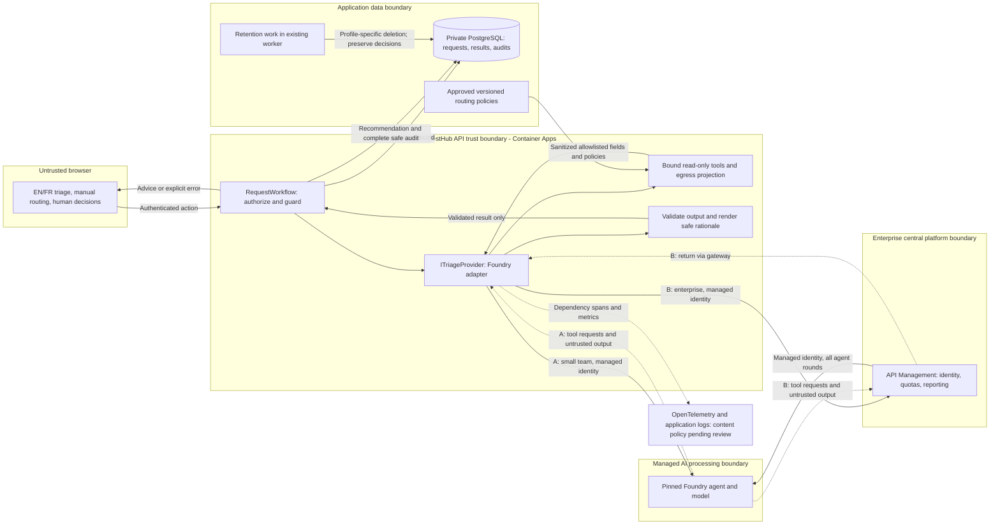

# ADR 0001: Live advisory triage within the RequestHub API

- **Status:** Accepted
- **Date:** 2026-10-27
- **Deciders:** GitHub Copilot
- **Related:** `solutions/02-design-github/inputs/reviewed-brief.md`, BR-1 through BR-7

## Context

Reviewers need department and priority suggestions with rationale, versioned policy citations, and confidence. Suggestions must not route, approve, or reject automatically. RequestHub runs on Azure Container Apps and PostgreSQL. Consider one squad with minimal operations and an enterprise with a central platform team.

The extension already exists in `app/src/RequestHub.Core/Triage/ITriageProvider.cs`. `app/src/RequestHub.Core/Triage/SampleRulesTriageProvider.cs` supplies labelled deterministic examples. A live implementation already exists in `app/src/RequestHub.Api/Triage/FoundryTriageProvider.cs`: this proposal hardens and deploys it, rather than inventing another triage service.

`app/src/RequestHub.Api/Program.cs` replaces the default provider when `Triage:Provider=Foundry`. The Foundry provider uses an Azure credential, supports a pinned agent version, and executes up to four tool rounds inside the API. It currently accepts any nonzero tool-call count as evidence of reading context; it does not prove that both required tools succeeded.

`app/src/RequestHub.Core/Services/RequestWorkflow.cs` owns authorization, validation, persistence, and audit. Triage requires department staff access and a nonterminal request. Staff includes reviewers, approvers, and admins, not just reviewers. Routing requires reviewer/admin privileges and access to both departments. Decisions require the Approver role, department access, and a different requester. Preserve these boundaries.

The workflow validates department, priority, citations, rationale, and confidence, stamps citations with local policy versions, and forces human review for policy conflicts. It stores the provider trace ID. Tool audits currently record arguments/outcomes, not returned content; recommendation audits omit some returned fields, although the recommendation itself stores them. Unknown tools are rejected by the provider but are not audited there.

Current gaps matter: the default provider timeout is 45 seconds; the AI prompt includes request ID and department names; the request tool also returns current department and priority. Title and description can contain personal data despite the DTO excluding people and attachments. These are not BR-3 or BR-6 compliance guarantees.

The public surface is `app/contracts/openapi.json`. `app/web/src/features/detail/TriagePanel.tsx` already separates advice from routing and displays errors, but renders rationale as returned. `app/infra/requesthub.bicep` provides managed identity, private Entra-only PostgreSQL, attachment storage, and a 30-day log workspace; it does not provision Foundry or an AI gateway. `app/src/RequestHub.Worker/Program.cs` currently processes notifications, not recommendation retention.

## Decision drivers

- Extend the existing provider interface; no demonstrated need for independent triage scaling, security boundary, or release cadence (STD-ARCH-001 v1.0).
- Keep all decisions human and tools read-only, scoped, and audited (STD-AI-001 v1.0; BR-2, BR-4).
- Minimize egress and exclude personal data, attachments, and raw user-text persistence; authenticate service calls with workload identity and disable supported key authentication (STD-SEC-002 v1.1; STD-SEC-001 v2.0).
- Measure every dependency with OpenTelemetry. Show unavailability within two seconds of timeout, preserve manual routing, and meet the brief's eight-second p95 recommendation target (STD-OBS-001 v1.2; BR-5, BR-6).
- Preserve `requesthub.v1` compatibility and English/French operation (STD-API-001 v1.0; BR-7).
- Small team: at most one new runtime component per quarter, preferably managed; retain recommendations for 90 days, business decisions for seven years (STD-OPS-001 v1.0; STD-DATA-002 v1.0).
- Enterprise: use central API Management for every production model/agent call, retain recommendations and their audits for 13 months and decisions for seven years, correlate provider identifiers, and release with at least ten labelled evaluation cases including adversarial cases (STD-OPS-002 v2.0; STD-DATA-001 v1.0; STD-AI-002 v1.0).
- Both profiles face a blocking conflict: STD-OBS-002 v1.0 requires full prompts/completions in application logs for 30 days; STD-SEC-002 v1.1 forbids persisting raw prompts/completions containing user free text. No option resolves that conflict.

## Options considered

### Option A: In-process Foundry provider, direct managed endpoint

Keep the existing workflow and Foundry tool loop in the API. Harden the provider and publish a version-pinned agent. Authenticate directly to Foundry with the API's managed identity. No new application service, queue, or gateway.

### Option B: In-process Foundry provider, central API Management endpoint

Keep exactly the same authorization, tools, validation, and persistence in the API. Route every initial and continuation agent call through platform-operated API Management to Foundry. Authenticate API-to-gateway and gateway-to-Foundry using managed identities. Gateway policy supplies trusted per-department quotas, rate limits, and reporting; the agent cannot choose its quota identity.

| Same constraint | Option A: direct | Option B: central gateway |
| --- | --- | --- |
| Extension and deployables | Reuses API/provider; one managed AI dependency. Favoured by STD-ARCH-001 v1.0. | Same extension; adds a gateway dependency, not a separate triage application. Compatible with STD-ARCH-001 v1.0. |
| Access and human authority | Workflow remains authoritative; only scoped reads reach tools. Hardening needed for STD-AI-001 v1.0. | Same; gateway quotas do not replace record authorization or grant approval rights. |
| Privacy and identity | Minimized payload; API identity needs Foundry access. Logging conflict remains. | Same payload controls; an additional processor and identity hop. Body/header logging at gateway must enter the same standards review (STD-SEC-001 v2.0; STD-SEC-002 v1.1; STD-OBS-002 v1.0). |
| Latency and failure | Fewer hops; four tool rounds still risk missing eight seconds. Must measure and bound calls. | Extra hop and quota rejection; shared deadline must include gateway and all tool rounds (STD-OBS-001 v1.2). |
| Small-team fit | Preferred if the managed AI capability fits the quarter's single-component budget (STD-OPS-001 v1.0). | Avoid a squad-owned gateway. Viable only if a platform team already operates it and the budget still holds (STD-OPS-001 v1.0). |
| Enterprise fit | Prohibited for direct production calls by STD-OPS-002 v2.0, even with managed identity. | Required production route under STD-OPS-002 v2.0. Adds central operations and gateway availability dependence. |
| Evidence and retention | Both need audit completeness. Small-team recommendation deletion at 90 days (STD-DATA-002 v1.0). | Same small-team obligations if used there; enterprise needs trace/evaluation evidence and 13-month recommendation/audit deletion (STD-AI-002 v1.0; STD-DATA-001 v1.0). |
| Cost and ownership | Squad operates integration and AI usage; fewer operational surfaces. | Platform owns quotas, routing, and gateway incidents; shared costs and onboarding coordination. No price estimate is evidenced. |

A separate triage microservice would duplicate the scoped authorization/audit boundary and add network latency and deployment work. Neither profile currently demonstrates the justification required by STD-ARCH-001 v1.0. Reconsider only with evidence of a separate boundary, scaling requirement, or release cadence.

## Decision

**Recommend A for the small team and B for enterprise**, subject to human resolution of the open questions. Share the in-process implementation and tests; differ in endpoint routing and operating policy. Enterprise must not use a direct endpoint as an outage fallback. Do not silently substitute sample recommendations for failed live calls. An explicit configuration rollback to labelled sample mode is different from manual routing and needs an operator decision.

For either option, propose a strict egress projection: sanitized title, description, category, and approved routing policies only, plus fixed task/tool/schema instructions. Keep request IDs, user identity, current routing/priority, and department catalog local. Bind the cloud-facing request tool to the current record without a model-selectable record ID; internally it can still call the existing scoped tool. Project its output rather than forwarding its current JSON wholesale. Derive allowable routing targets from approved policies. Treat any additional business metadata as requiring a reviewed BR-3 clarification, not an implicit exception.

Require successful reads of the bound request and the complete approved policy snapshot before accepting a result. Audit successful, denied, malformed, and unknown tool calls. Keep the existing deterministic workflow guards and validate against the exact policy snapshot used for inference. Use a structured reason code and validated policy references to render EN/FR rationale and clarifying questions locally, avoiding stored model echoes of user text. This is proposed internal provider hardening, not a new public response shape.

Propose a **six-second total provider deadline** across all rounds, transport retries, and gateway calls, leaving two seconds for authorization/loading, persistence, response, and UI rendering. This is a design budget, not an approved standard or measured result. Do not add retries beyond that deadline. Record failure audits with bounded persistence time; database failure must be explicit, not reported as a successful recommendation. Verify successful click-to-visible recommendations at p95 no more than eight seconds, and timeout-to-visible unavailability no more than two seconds. Fast errors alone do not satisfy BR-6.

This ADR does not authorize either raw-content logging policy. Live rollout remains blocked on the logging conflict and the unresolved privacy boundary.

## Architecture

Proposed target; privacy projection, complete audit, retention, and gateway wiring are follow-up work. The two outbound routes are alternatives selected by operating profile.



The telemetry arrow describes metadata instrumentation, not a resolution of the conflicting log-content requirements. Attachments and personal identities stay in the application boundary and have no AI data path. The sequence below shows one enterprise request; the small-team route omits the gateway, not the controls.

```mermaid
sequenceDiagram
  actor Reviewer
  participant UI as EN/FR browser
  participant W as RequestWorkflow
  participant DB as PostgreSQL
  participant P as Foundry provider and bound tools
  participant G as Central gateway
  participant F as Foundry agent
  Reviewer->>UI: Ask for recommendation
  UI->>W: POST triage-recommendations
  W->>DB: Load record and check staff, department, terminal state
  alt Unauthorized or terminal
    W-->>UI: 403 or 409; no AI call
  else Authorized
    W->>P: Authorized context, policy snapshot, shared deadline
    P->>G: Start agent response with fixed instructions
    G->>F: Forward authenticated call
    loop Bound tool rounds within total deadline
      F-->>G: Request get_request or get_routing_policies
      G-->>P: Return tool request
      P->>P: Enforce scope, sanitize, project permitted fields
      P->>DB: Durable audit of tool, outcome, safe return descriptor
      P->>G: Submit permitted tool output
      G->>F: Continue response
    end
    alt Valid output before deadline
      F-->>G: Structured suggestion, citations, confidence, response ID
      G-->>P: Return untrusted result
      P-->>W: Validated provider result and trace ID
      W->>W: Validate policies, force conflict review, render safe rationale
      W->>DB: Save recommendation and correlated audit
      W-->>UI: 201 RecommendationDto
      UI-->>Reviewer: Advisory result; no routing or decision performed
    else Timeout, unavailable dependency, or invalid output
      P-->>W: Cancellation or typed provider failure
      W->>DB: Bounded failure audit
      W-->>UI: 504, 503, or 502 with stable code
      UI-->>Reviewer: Localized unavailable/error state; manual routing remains
    end
  end
  Note over Reviewer,W: Routing requires a separate human action; approval remains approver-only
```

An invalid result discovered by workflow validation follows the same 502/audit path. A failure to persist must surface explicitly; AI-independent routing still depends on a working API/database.

## API impact

Report from `python .github/skills/contract-impact/contract_diff.py --base-ref origin/main` on the unchanged working-tree contract:

```text
## API contract impact (requesthub.v1 vs origin/main)

**Compatible**: additive-only changes are allowed within the current contract version (STD-API-001).

- Breaking changes: 0
- Additive changes: 0

No contract changes.
```

This reports today's diff, not validation of future implementation. STD-API-001 v1.0 governs future changes. No contract is edited by this ADR.

The design relies on these existing operations and fields:

- POST `/api/requests/{id}/triage-recommendations`: bodyless call, 201 `RecommendationDto`; `suggestedDepartmentId`, `suggestedPriority`, `rationale`, `policyRefs[].policyId/version`, `confidence`, `needsHumanReview`, `provider`, `isSample`, `providerTraceId`, `createdBy`, and `createdAt`. Preserve `status` and `departmentAtRecommendation` for display/staleness. Failure statuses already include 502/503/504; runtime problem details carry `code` values `triage.invalid_output`, `triage.unavailable`, and `triage.timeout`.
- GET `/api/requests/{id}` and GET `/api/requests/{id}/triage-recommendations`: `latestRecommendation`, recommendation history, and `permissions.canTriage/canRoute/canDecide`. Do not send the full request detail, comments, people, or attachment metadata to AI.
- GET `/api/policies`: `id`, `version`, `ref`, `text`, `routeTo`, `priority`, and `threshold`; use server-side approved policies, not browser-supplied policies. GET `/api/departments` supplies localized names to the UI only.
- GET `/api/requests/{id}/history`: `action`, `actor`, `occurredAt`, `details`, and `correlationId`. Safely extend audit details without exposing raw tool returns.
- PUT `/api/requests/{id}/routing`: existing `departmentId` and `reason`, human reviewer/admin only. It does **not** apply `suggestedPriority`. POST `/api/requests/{id}/decisions` remains a separate human-only operation with `outcome` and `comment`.

Propose optional `Accept-Language: en|fr` handling on recommendation creation, defaulting to current English behavior when omitted, for server-rendered rationale and conflict notices. Document this optional header additively in a future generated contract; leave existing response fields/types intact. Internal tool schema changes and gateway routing do not require new public endpoints. If product wants humans to apply priority too, design a separate additive capability after review, not an automatic side effect of triage.

## Threat model checklist

Unchecked items are implementation/review gates, not claims that existing code passes.

- [ ] **Data leakage:** verify outbound bytes contain only sanitized title, description, category, approved policies, and fixed instructions. Reject/redact personal data before egress; test personal data embedded in free text. No comments, attachments, people, current routing, catalog, or record IDs (BR-3; STD-SEC-002 v1.1).
- [ ] **Identity and bypass:** use API managed identity directly for A; API-to-gateway and gateway-to-Foundry identities for B. Disable supported AI/data key auth. Deny enterprise direct egress and reject spoofed department quota metadata; approve metadata handling before rollout (STD-SEC-001 v2.0; STD-OPS-002 v2.0).
- [ ] **Prompt injection and confused deputy:** treat request text/tool arguments/model output as untrusted. Bind reads to the authorized record, reject and audit other-record/unknown/malformed calls, require both successful tool reads, and expose no mutation, attachment, or approval tool (STD-AI-001 v1.0).
- [ ] **Output integrity:** validate finite confidence in range, permitted enums, cited snapshot versions, safe bounded rationale, and conflict escalation. Model claims cannot override routing authorization, approver role, self-approval prevention, or terminal-state checks. Cover injected approval instructions in both languages.
- [ ] **Audit completeness:** durably correlate actor, time, record, provider/agent version, tool outcome, and sanitized structured return/descriptor with the recommendation. Include suggested priority, confidence, review flag, policy versions, and trace identifiers. Do not audit raw user-text echoes. A call failing before a provider ID exists records that absence and local correlation rather than inventing an ID (BR-4; STD-AI-002 v1.0 for enterprise).
- [ ] **Logging conflict:** obtain a human disposition for STD-OBS-002 v1.0 versus STD-SEC-002 v1.1, covering SDK tracing, exceptions, gateway diagnostics, model-side response storage, and application logs. No assertion that redacted logging satisfies a full-prompt mandate.
- [ ] **Availability and resource exhaustion:** enforce one total deadline, bounded rounds and in-flight work, dependency spans/metrics, explicit quota/outage errors, and no retry amplification. Verify eight-second successful p95 and timeout-to-visible state within two seconds while manual routing succeeds during an AI outage (BR-5/6; STD-OBS-001 v1.2).
- [ ] **Retention and access:** protect recommendation/audit reads with API access checks. Delete small-team recommendations after 90 days; enterprise recommendations and associated audits after 13 months. Keep business decisions for seven years, including separation from recommendation deletion (STD-DATA-002 v1.0; STD-DATA-001 v1.0). Small-team audit retention and backup/provider copies require review.

## Consequences

Both profiles reuse the authoritative workflow and existing UI/API shape. A is simpler; B enforces enterprise governance but adds latency, onboarding, and a shared failure domain. Neither needs a new application service or queue. Costs, capacity, and eight-second p95 remain unmeasured.

Strict privacy and safe local rationale reduce debugging detail and free-form explanation richness. The full-prompt logging requirement remains unresolved, not waived. More complete audit and profile-specific deletion require implementation; the workspace's 30-day retention is not business-record retention.

Retain the sample provider for explicit local/demo use. Triage unavailability must remain visibly different from a valid recommendation. Human confirmation and approval stay independent of model availability and confidence.

## Implementation tasks

These are bounded follow-up changes, not authorized infrastructure or application edits in this ADR.

1. **Architecture reviewer + security/data owners:** settle the logging conflict, BR-3 metadata/redaction boundary, and BR-4 safe audit representation. Acceptance: a human-recorded disposition names applicable versions, exceptions or amendments, owners, and release gates; unresolved items block live rollout.
2. **API/agent engineer:** harden the existing provider's egress projection and bound tool schema; require successful request and full-policy reads; pin agent version and validate structured reasons locally. Acceptance: transport tests capture every round and prove the allowlist, personal-data handling, rejected cross-record/unknown calls, and no accepted answer missing either required read.
3. **API/security engineer:** complete durable recommendation/tool/failure audits and output validation without changing authorization boundaries. Acceptance: integration tests cover forbidden department/requester access, self-approval denial, terminal states, invalid/approval-claim output, policy conflicts, finite confidence, audit persistence failures, and returned-result audit linkage. Extend `app/tests/RequestHub.Tests/TriageTests.cs`; preserve existing guarantees.
4. **Platform engineer:** provision/configure the managed AI dependency for A or onboard B to existing central API Management; use workload identities and supported key-auth disabling. Acceptance: authenticated smoke requests work, anonymous/key calls fail, enterprise direct calls are denied, and department quota/reporting isolation is demonstrated. Verify SDK agent and continuation routes through the gateway before selecting B for production.
5. **API/web engineer + SRE:** implement the shared deadline, bounded failure persistence, dependency telemetry, and EN/FR rationale/errors using existing localization patterns. Acceptance: injected timeout/outage/quota failures show explicit localized states within two seconds of timeout; manual routing still works. Under an agreed concurrent-load/cold-start workload, successful click-to-visible p95 is at most eight seconds; also report failures and success rate so timeouts cannot mask poor performance.
6. **Data engineer:** add idempotent, bounded recommendation cleanup to the existing worker, separate from notifications and decisions. Acceptance: time-controlled tests delete records at the profile's 90-day or 13-month boundary, delete enterprise AI audits at 13 months, and preserve seven-year business-decision records; implement small-team audit/copy cleanup only after its policy is agreed.
7. **QA/AI engineer + release reviewer:** assemble a versioned bilingual evaluation set and release evidence. Acceptance: enterprise has at least ten labelled cases including adversarial inputs, response/trace IDs correlated to business records, and attached results (STD-AI-002 v1.0). Include normal routing, ambiguity, conflicts, personal data, injection, and unauthorized access; people agree quality thresholds. Rerun the contract diff and ADR checker for follow-up design/contract changes.

## Open questions

1. **Blocking standards conflict, both profiles:** STD-OBS-002 v1.0 mandates full prompt/completion logs for 30 days, while STD-SEC-002 v1.1 prohibits persisting raw prompts/completions containing user free text. Which requirement will the authorized human reviewers amend or explicitly except? This ADR chooses neither. Redacting payloads or changing the retention period does not satisfy both as written.
2. **Privacy/product owners:** what approved redaction or rejection process makes user-entered title/description safe, and what happens when safe text is insufficient for a recommendation? Does BR-3 allow any record/correlation metadata at the AI boundary or a trusted department label at the enterprise gateway? Define model-region, response-chain storage/deletion, and subprocessors; current standards do not specify these deployment choices.
3. **Product/audit owners:** does BR-4 accept structured safe return descriptors plus the linked recommendation instead of verbatim tool-return text? Who may view audits? For the small team, STD-DATA-002 v1.0 specifies recommendation retention but not AI audit retention. Decide audit/telemetry/provider-copy/backup deletion and how retained business decisions reference expired recommendations.
4. **Platform/SRE owners:** is a central gateway already available, with identity support for the Foundry project/agent SDK routes and continuations? What trusted department dimension enforces quotas without widening AI egress? For the small team, does the complete managed Foundry deployment fit this quarter's one-new-component budget?
5. **Product/performance owners:** agree load, concurrency, region, cold-start coverage, success-rate and quality thresholds, and whether the proposed six-second provider budget is feasible. BR-6 gives eight-second p95 but no traffic envelope. Do not relax it to accommodate multi-round latency without human review.
6. **Product/localization owners:** should advice follow the reviewer's selected language, request language, or contain both? Confirm optional language-header behavior and safe templated rationale sufficiency. Should human routing eventually include priority changes? Current routing changes only department; this proposal adds no automatic application.
7. **Security/product owners:** reconcile BR-1's "any request they can see" with staff-for-department triage checks: a reviewer may view their own out-of-department request but cannot currently triage it. Confirm existing approver/admin triage access and reviewer/admin routing access alongside BR-1/2. Keep API authorization unchanged pending a separately reviewed requirement; a provider or gateway must never become an approval authority.
