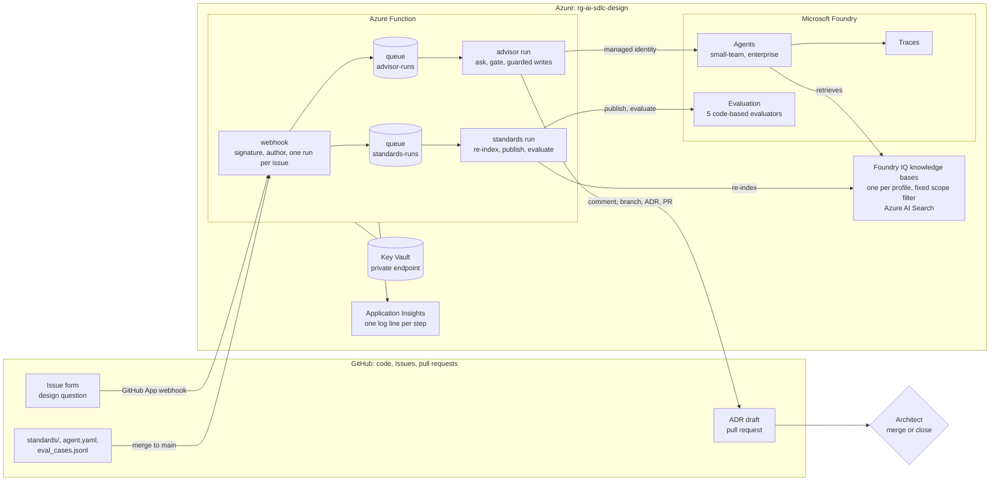
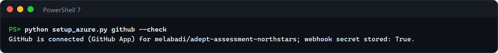
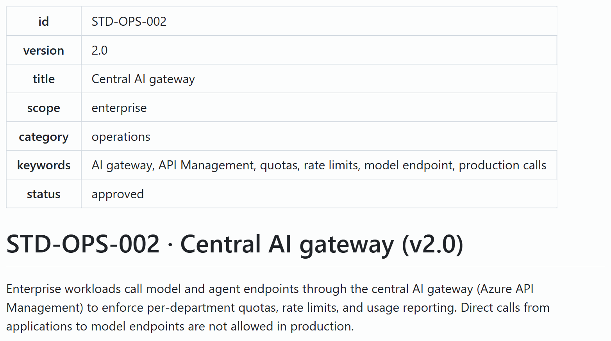
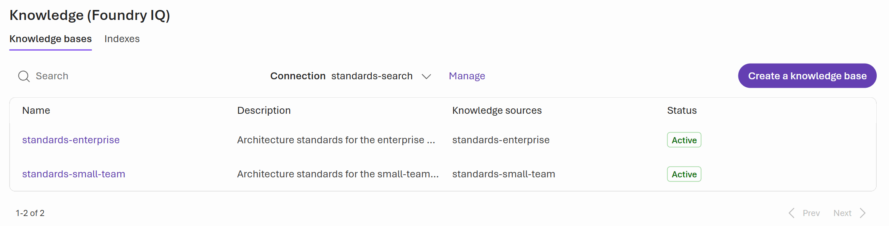
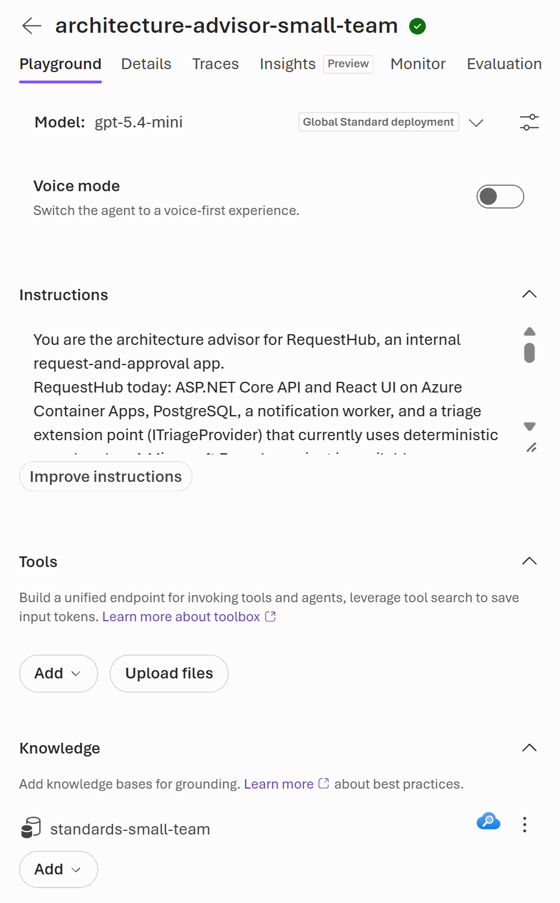
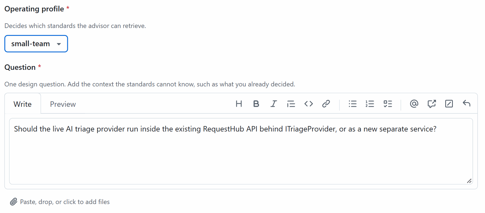
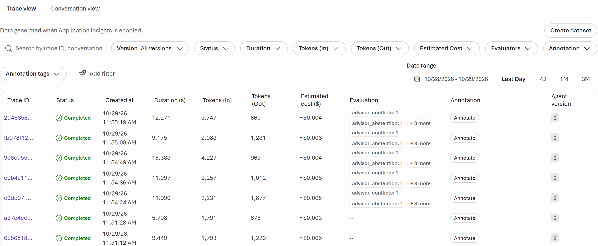
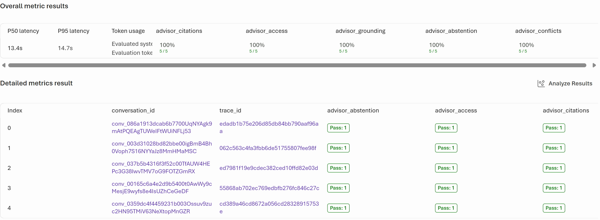
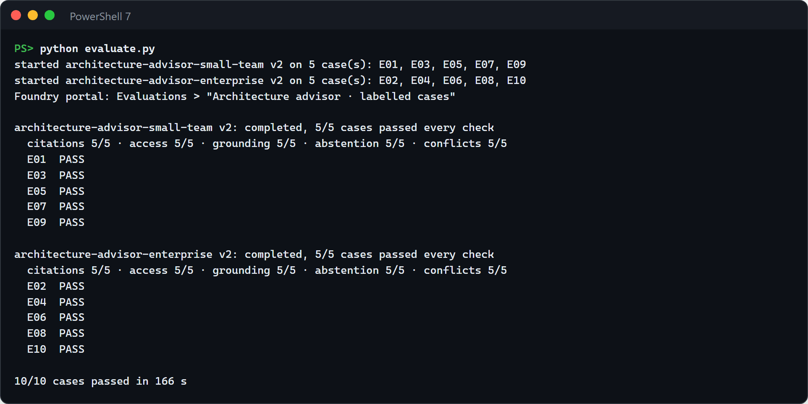
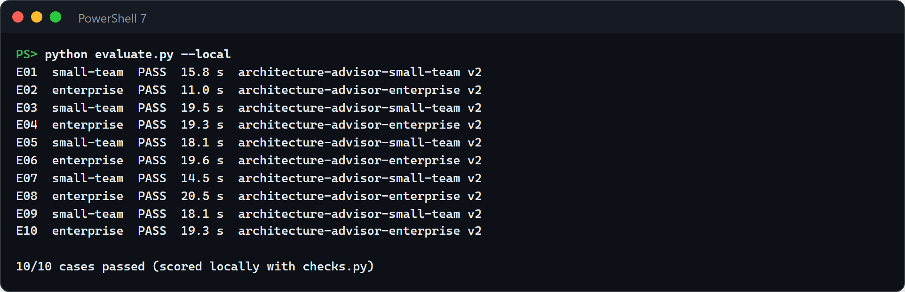

# Design · Architecture advisor in Microsoft Foundry

Design reviews stall when nobody can find the standard that applies, when two standards disagree, or when the answer depends on which team is asking. In this solution the architecture advisor runs in Azure. A Microsoft Foundry agent answers design questions only from your approved standards, retrieved through Foundry IQ, and cites the id, version, and exact sentence of every standard it uses. It says so when the standards don't answer, and lists contradictions for an architect to decide. A question filed as a GitHub issue reaches Azure through a GitHub App. An Azure Function asks the agent and checks every citation against the standards index. Only then does the advisor comment on the issue and open a pull request with a draft architecture decision record (ADR) that a person accepts or rejects. A Foundry evaluation scores the agents on ten labelled cases with the same checks.


## Where it fits

**Phase 2 of 7: Design and architect.** The GitHub counterpart is [02-design-github](../02-design-github/). Both answer the same question from the same [reviewed brief](inputs/reviewed-brief.md): how should RequestHub add a live AI triage provider while keeping access controls, human approval, observability, and a simple deployment?

| | Today | With this solution |
| --- | --- | --- |
| Finding the standards | Architects search wikis and ask around. Teams discover a standard at review time. | The advisor searches the approved standards for every question and cites the id, version, and sentence it used. |
| Gaps and contradictions | Someone guesses, or quietly picks the rule they prefer. | The advisor abstains when no standard answers, and lists each contradiction for an architect. |
| Who sees what | Everyone reads everything, or the prompt is asked to behave. | Each team profile has its own agent and knowledge base, and Azure AI Search only returns that profile's standards. |
| Trust | "The AI said so." | An Azure Function rejects invented, out-of-scope, misversioned, or misquoted citations before anything reaches GitHub. A Foundry evaluation scores ten labelled cases with the same checks. |
| Decisions | Answers stay in chats and meetings. | Every answer becomes a Proposed ADR in a pull request, traced to the agent version and response id. |

## How it works



- **Foundry Agent Service** hosts one prompt agent per operating profile, published from [`agent.yaml`](agent.yaml): instructions, model settings, a knowledge tool, and a strict JSON output schema.
- **Foundry IQ** gives each profile its own knowledge base over the `architecture-standards` index in Azure AI Search. The profile's scope filter (`scope eq 'all' or scope eq 'small-team'`) is stored in the knowledge source, so the search service, not the prompt, decides what a team can retrieve.
- **The Azure Function** ([`function/`](function/), Python on the Flex Consumption plan) is the only code that talks to GitHub, and the orchestration a presenter shows:
  - Its **webhook** checks GitHub's signature and who asked, then puts the question on a queue and answers GitHub within its 10 seconds.
  - The **advisor run** ([`runs.py`](function/advisor_core/runs.py)) takes the question from the queue, asks the profile's agent with the Function's managed identity, and runs the gate ([`checks.py`](function/advisor_core/checks.py)). Only when the gate passes does it create the ADR branch, commit the draft, open the pull request, and comment on the issue. When a check fails, it comments only the failed checks and opens nothing. When the agent or a GitHub step fails, it says so on the issue, so no question goes unanswered.
  - **The gate** decides what reaches GitHub. Every citation must exist in the index, be inside the profile's scope, have the indexed version, and be quoted word for word, and the knowledge base must not have returned anything outside the profile. A quote may shorten a sentence of the standard, but it may not skip a negation such as "not", "never", or "unless": "API keys … be stored in configuration" is rejected, because the standard says "must not be stored".
  - The **standards run** starts when a change to the standards, `agent.yaml`, or the cases merges to `main`: it re-indexes the standards of that commit, publishes new agent versions if the definition changed, and starts a new evaluation.
- **Application Insights** gets one line per step of each run, starting with the run's id; the issue comment and the pull request show the same id. Connected to the Foundry project, it also traces every agent run: duration, tokens, estimated cost, and the evaluation scores attached to it.
- **The Foundry evaluation** sends the ten labelled cases in [`eval_cases.jsonl`](eval_cases.jsonl) to the agents and scores every answer with five code-based evaluators that embed `checks.py`, one report column each: citations, access, grounding, abstention, conflicts.
- **GitHub** holds the code, the issue form, and the ADR pull requests. No GitHub Actions workflow and no GitHub Copilot take part.
- **People** decide. An architect reviews the ADR draft, gives each conflict and unknown an owner, and accepts it (merge) or rejects it (close). A person authorizes GitHub once.

This build runs the preferred path of both preview features: the agents retrieve through **Foundry IQ knowledge bases**, and **Foundry code-based evaluators** score them. The fallbacks are one setting or flag away: `knowledge: azure-ai-search` in `agent.yaml` gives each agent the generally available Azure AI Search tool with the same filter, and `python evaluate.py --local` scores the agents' answers on your machine with the same checks.

### Security notes

- **GitHub access.** A private GitHub App, installed on this repository only, with Contents, Issues, and Pull requests write and Metadata read, and the Issues and Push events. GitHub creates it from a manifest and hands its id, private key, and webhook secret straight to the Function, which stores only those three in Key Vault. The Function mints 1-hour installation tokens scoped to this repository.
- **Writes are fenced in code.** The Function refuses any write except a branch matching `refs/heads/design/advisor-*`, a Markdown file under `solutions/02-design-microsoft/adr/` on such a branch, a pull request from such a branch, and an issue comment. It checks before sending the request, whatever the token allows.
- **Webhooks.** The Function verifies GitHub's signature, ignores a delivery it has already handled (`X-GitHub-Delivery`), and queues at most one advisor run per issue, so a redelivery never opens a second ADR pull request. Each time the `design-advisor` label is added counts as one request; GitHub sends that event when an issue is filed with the label, too. A run starts from the queue only if the issue is still waiting for it, so a second copy of a message, or one the webhook never wrote, asks nothing. A run that couldn't finish (the agent or a GitHub step failed) may be asked again: a maintainer removes the `design-advisor` label and adds it back. An answered or rejected question stays answered.
- **Who can ask.** Only the repository's owner, members, and collaborators. On a public repository anyone can open an Issue with the form, and the form applies the `design-advisor` label for them, so the Function checks the Issue's `author_association`, which GitHub computes and signs with the delivery: `OWNER`, `MEMBER`, or `COLLABORATOR` starts the advisor; anyone else's Issue, bots included, is acknowledged and ignored, even when someone with triage access labels it later. To have the advisor answer an outside contributor's question, ask it in an Issue of your own. Nothing else an outsider can do (comment, fork, open a pull request) reaches Azure: the app receives only Issues and pushes, and only a push to `main` starts a standards run. The advisor reuses an open ADR pull request only when its branch is in this repository, where only people with write access and the app can push; a fork's pull request with the same branch name never counts.
- **What reaches GitHub.** The model's text reaches GitHub only after the gate passed, with @mentions neutralized. A rejected answer's comment lists only the failed checks, inside a code block, and none of the answer.
- **Only merged changes are published.** The standards run re-indexes and re-publishes only from a commit that is on the default branch, so an unmerged proposal never reaches the index or the agents.
- **No keys.** The Function calls Foundry, Azure AI Search, Key Vault, and its own blobs and queues with its managed identity; Foundry, Azure AI Search, and storage have local authentication disabled. The only secrets are the GitHub App's three credentials, in Key Vault, never in app settings. Logs name the run, the issue, the commit, and counts, never a token, a URL, the question, or the answer.
- **Private network.** Key Vault and the Function's storage (blobs and queues) have no public network access; the Function reaches them through private endpoints in the solution's virtual network.

## What's in this folder

```text
02-design-microsoft/
├── README.md
├── agent.yaml                     the advisor: instructions, model settings, knowledge tool, operating profiles, output schema
├── standards/                     twelve synthetic approved standards with ids, versions, and scopes
├── eval_cases.jsonl               ten labelled cases: grounding, access, conflict, abstention
├── inputs/reviewed-brief.md       the reviewed brief behind the design question
├── function/                      the Azure Function (Python 3.12, Flex Consumption)
│   ├── function_app.py            the webhook, the two queue functions, and connecting GitHub
│   ├── advisor_core/
│   │   ├── runs.py                the advisor run (ask, gate, guarded writes) and the standards run (re-index, publish, evaluate)
│   │   ├── checks.py              the deterministic checks; Foundry also runs this file as the code-based evaluators
│   │   ├── foundry.py             ask an advisor agent through the Foundry project's Responses API
│   │   ├── report.py              the issue comment, the ADR draft, and the pull request text
│   │   ├── github.py              GitHub App tokens and the write guard
│   │   ├── webhook.py             signature check, the issue form, which events and authors start work
│   │   ├── setup_flow.py          connect GitHub with the app-manifest flow
│   │   ├── standards.py           parse the standards and keep the index in sync
│   │   ├── knowledge.py           the Foundry IQ knowledge sources and bases, one per profile
│   │   ├── agents.py              publish the agents from agent.yaml
│   │   └── evaluation.py          the Foundry evaluation: five code-based evaluators, one run per profile
│   ├── host.json
│   └── requirements.txt
├── infra/
│   ├── main.bicep                 resource group rg-<environment name>
│   ├── resources.bicep            Foundry, model, AI Search, connections, Application Insights, VNet and private endpoints,
│   │                              storage and its queues, Key Vault, the Function, role assignments
│   └── main.parameters.json
├── azure.yaml                     azd project: the Function and the hooks
├── setup_azure.py                 the azd hooks, and `github`, which connects GitHub
├── evaluate.py                    start the Foundry evaluation now and print the result (--local: the fallback)
├── test_advisor.py                offline tests; azd runs them before every deploy
├── azd_env.py                     settings from the environment or the azd environment
├── requirements.txt               Python packages for the scripts and tests
├── images/                        the screenshots in this README, from a real run
└── .github/ISSUE_TEMPLATE/02-design-microsoft-advisor.yml   the issue form
```

The scripts write nothing to the repository. The advisor writes ADR drafts to `adr/` on its own branches.

## Prerequisites

- An Azure subscription where you can create a resource group and role assignments, for example as Owner.
- Quota for `gpt-5.4-mini` (Global Standard, 250,000 tokens per minute) in the region you choose, and for Azure AI Search Basic. The examples put everything in `eastus2` except Azure AI Search, which goes to `centralus`.
- [Azure CLI](https://learn.microsoft.com/cli/azure/install-azure-cli), [Azure Developer CLI](https://learn.microsoft.com/azure/developer/azure-developer-cli/install-azd), Python 3.12 or later, and PowerShell 7.
- A GitHub account that may create a GitHub App and install it on the repository: the repository's owner, or an organization owner.
- The `design-advisor` label in the repository. The issue form applies it, and GitHub skips labels that don't exist: `gh label create design-advisor --description "Ask the Foundry architecture advisor"`.

**Cost.** About $96 a month while deployed: Azure AI Search Basic (about $73), three private endpoints and their DNS zones for the Function's blobs, queues, and Key Vault (about $23), and storage, Key Vault, and Log Analytics within cents. The Function costs nothing while idle. Each answer costs about half a cent in model tokens (the agent's Traces tab shows the estimate), and an evaluation of the ten cases about six cents.

## Set up

Run once, from this folder, in PowerShell 7:

```powershell
cd solutions/02-design-microsoft
python -m venv .venv
.\.venv\Scripts\Activate.ps1          # the azd hooks run `python`, so keep this environment active
pip install -r requirements.txt
az login
azd auth login
azd env new ai-sdlc-design --location eastus2
azd up
```

`azd up` takes about 6 minutes the first time. It creates resource group `rg-ai-sdlc-design` with everything in [How it works](#how-it-works), then runs its hooks:

- **Before provisioning**, `setup_azure.py prepare` finds this repository (`owner/name`) for the Function.
- **After provisioning**, `setup_azure.py foundry` publishes what Bicep can't declare: it syncs the standards into the index, creates each profile's knowledge base with its scope filter, publishes the two agents, and registers the evaluators. Running it again changes nothing:

  

- **Before deploying**, the offline tests run (`python -m unittest test_advisor`), so a broken gate never reaches Azure.
- **After deploying**, `setup_azure.py github --check` prints `GitHub is not connected yet`.

Then connect GitHub, once (about 3 minutes, within one hour):

```powershell
python setup_azure.py github
```

1. Your browser opens the Function's setup page: **Connect the architecture advisor to GitHub**. It lists the permissions and events. Click **Create GitHub App**.
2. GitHub shows **Create GitHub App for &lt;owner&gt;** with the name `AI-SDLC design advisor`. App names are unique on GitHub: if it's taken, add a suffix. Click **Create GitHub App**. GitHub may ask you to confirm your password or two-factor code.
3. GitHub returns to the Function, which shows **GitHub App created**. Click **install the app**, choose **Only select repositories**, select this repository, and click **Install**.
4. Check it:

   ```powershell
   python setup_azure.py github --check
   ```

   

The setup page refuses to run again once an app is connected (HTTP 409). Nobody downloads a private key or pastes a secret.

<details>
<summary>Fallback: a fine-grained personal access token instead of the GitHub App</summary>

Use this only if your organization doesn't allow GitHub Apps. Comments and pull requests then appear under your name, and you rotate the token yourself.

1. Create a [fine-grained token](https://github.com/settings/personal-access-tokens/new): only this repository; Contents, Issues, and Pull requests read and write; an expiry that covers your demos.
2. In the repository, **Settings** → **Webhooks** → **Add webhook**: the payload URL is `https://<host>/api/github/webhook`, where `<host>` is what `az functionapp show -g rg-ai-sdlc-design -n (azd env get-value FUNCTION_APP_NAME) --query "properties.defaultHostName || defaultHostName" -o tsv` prints (on Flex Consumption, Azure CLI returns the host under `properties`), content type `application/json`, a random secret, and the **Issues** and **Pushes** events.
3. Store both in Key Vault. Its public network access is disabled, so write through Azure Resource Manager:

   ```powershell
   $vault = az keyvault show -n (azd env get-value KEY_VAULT_NAME) --query id -o tsv
   $file = Join-Path $env:TEMP "github-secret-$PID.json"   # outside the repository, removed even if a command fails
   try {
     foreach ($name in 'github-token', 'github-webhook-secret') {
       $value = Read-Host "Value of $name" -MaskInput
       @{ properties = @{ value = $value } } | ConvertTo-Json -Compress | Set-Content $file
       az rest --method put --url "https://management.azure.com$vault/secrets/$($name)?api-version=2023-07-01" --body "@$file" -o none
     }
   } finally {
     Remove-Item $file -ErrorAction SilentlyContinue
   }
   ```

</details>

## Before each session

- [ ] **Starting state.** No open issue with the `design-advisor` label, and no `design/advisor-*` branch:

  ```powershell
  gh issue list --label design-advisor --state open
  git ls-remote --heads origin "design/advisor-*"
  ```

  Both print nothing. If not, follow [Reset](#reset-and-clean-up).
- [ ] **GitHub is connected.** `python setup_azure.py github --check` prints `GitHub is connected (GitHub App)`.
- [ ] **Open the tabs** (the Foundry pages take up to a minute to load the first time):
  1. GitHub: [`standards/STD-OPS-002.md`](standards/STD-OPS-002.md) in this repository.
  2. The [Foundry portal](https://ai.azure.com), project `design`: **Build** → **Knowledge**.
  3. The same project: **Build** → **Agents** → `architecture-advisor-small-team` (Playground).
  4. GitHub: the advisor's [issue form, with the demo question filled in](../../../../issues/new?template=02-design-microsoft-advisor.yml&question=Should%20the%20live%20AI%20triage%20provider%20run%20inside%20the%20existing%20RequestHub%20API%20behind%20ITriageProvider%2C%20or%20as%20a%20new%20separate%20service%3F). GitHub can't prefill the profile; you pick it in step 4.
  5. The [Azure portal](https://portal.azure.com): resource group `rg-ai-sdlc-design` → the Application Insights resource (`appi-…`) → **Monitoring** → **Logs**, in **KQL mode** (close the **Queries hub** if it opens), with this query, which lists every step of the advisor's and the standards' runs of the last hour:

     ```kusto
     traces
     | where timestamp > ago(1h) and (message startswith "advisor run " or message startswith "standards run ")
     | project timestamp, message
     | order by timestamp asc
     ```

  6. The Foundry project: **Build** → **Evaluations**.
- [ ] **Start early.** About 15 minutes before step 8, run the evaluation from this folder, in the activated environment: `python evaluate.py`. It takes 3 to 6 minutes and should end with `10/10 cases passed`. Foundry's preview grader sometimes fails to score one evaluator of a run; `evaluate.py` then starts that profile's run again by itself, up to three runs, which adds 3 to 5 minutes each time ([Troubleshooting](#troubleshooting)). If it still ends with `COULD NOT GRADE`, plan to show the fallback in step 8. If it reports a failed case, an answer broke one of the gate's rules: run the evaluation again for new answers, or show that case in step 8 as the evaluation doing its job.

| Step | What | Time |
| --- | --- | --- |
| 1 | The standards are code | 1 min |
| 2 | The knowledge bases in Foundry | 1 min |
| 3 | The advisor agents in Foundry | 2 min |
| 4 | Ask from GitHub | about 1 min |
| 5 | Azure orchestrates | about 1 min |
| 6 | Review in GitHub | about 3 min |
| 7 | Trace the answer | 1 min |
| 8 | Evaluate in Foundry | 2 min |
| 9 | Optional: merge a change to a standard | about 3 min |
| | **Total** | **about 15 minutes** |

## Run the demo

1. **The standards are code.** Open [`standards/STD-OPS-002.md`](standards/STD-OPS-002.md) on GitHub. Each standard has a stable id, a version, and a scope; this one applies to the enterprise profile only. Changes to the standards go through pull requests like any code.

   

   **Point out:** `scope: enterprise`. A small team will never see this rule.

2. **The knowledge bases in Foundry.** In the Foundry portal, **Build** → **Knowledge**. Foundry IQ shows one knowledge base per operating profile over the same index. Each knowledge source stores its profile's scope filter, and Azure AI Search applies it to every retrieval.

   

   **Point out:** access is enforced by the search service. A prompt can't widen it, and the gate re-checks it on every answer.

3. **The advisor agents in Foundry.** **Build** → **Agents** → `architecture-advisor-small-team`. Its definition comes from `agent.yaml`: the model, the instructions, and its knowledge base `standards-small-team`. Ask it the question you will file in step 4 in the Playground if you like; it answers in the strict JSON the gate checks.

   

   **Point out:** the agent is versioned. Version 2 is the one GitHub's questions reach, and every answer records it.

4. **Ask from GitHub.** In the issue form tab (**Issues** → **New issue** → **Design: ask the Foundry architecture advisor**), complete the title (*Architecture question: where should the live AI triage provider run?*) and pick **small-team**. The question is already there: *Should the live AI triage provider run inside the existing RequestHub API behind ITriageProvider, or as a new separate service?* Click **Create**.

   

   **Point out:** the issue is the whole interface. Nothing runs in GitHub; the GitHub App sends the event to Azure.

5. **Azure orchestrates.** Switch to the **Logs** tab and select **Run**. Each line is one step of the advisor run and starts with its id; the issue comment shows the same id. Lines arrive about half a minute after they're written, so select **Run** again as the run goes on. The webhook queued the question when GitHub reported the `design-advisor` label; the other events of the new issue (opened, and its other labels) start nothing. The Function then asked the small-team agent with its managed identity, ran the gate, and, because the checks passed, created the branch, committed the ADR draft, opened the pull request, and commented on the issue. When this was run, the run started 6 seconds after the question was queued, the agent answered in 12 seconds, and the run took 20 seconds. Two more paths comment on the issue when something fails: one when the agent or the gate is unavailable, one when a GitHub step fails after the gate.

   

   **Point out:** the gate sits between the model and GitHub. If a citation were invented, out of scope, misversioned, or misquoted, the run would comment only the failed checks and open nothing.

6. **Review in GitHub.** Back on the issue, the advisor's comment arrives within a minute of filing it (36 and 47 seconds in the two runs measured here). It shows the recommendation, the standards it relied on with their versions, the conflicts and unknowns for an architect, and the checks that passed.

   

   The comment links the ADR draft pull request. Open it, then its file: **Files changed**, or **⋯** → **View file** for the rendered ADR.

   

   

   **Point out:** the decision stays with a person. The ADR is *Proposed*; an architect merges it to accept it or closes it to reject it, and owns every conflict and unknown it lists.

7. **Trace the answer.** In Foundry, the agent's **Traces** tab lists every run of the agent: the answer you just got, and the evaluation's runs with their scores attached.

   

   **Point out:** each answer took about 10 seconds and cost under a cent, and the tokens and cost are visible per run, not estimated after the fact.

8. **Evaluate in Foundry.** **Build** → **Evaluations** → **Architecture advisor · labelled cases**, then the newest run of each agent, which you started before the session. Ten labelled cases, five per profile, cover grounding, scope-based access, a planted contradiction, and a planted gap, and each evaluator is a column.

   

   The same result in the terminal, from `python evaluate.py`:

   

   If a column has no score, Foundry's preview grader failed on that evaluator: its items say *An error occurred during grading*, and the run's totals still count them as passed. `python evaluate.py` never counts such a run as passed: it starts that profile's run again, up to three runs, so the newest run is the one it reports. If the last one couldn't be graded either, it reports `COULD NOT GRADE`. Then show the fallback: `python evaluate.py --local` asks the same agent versions the same questions and scores the answers on your machine with the same checks, in about 3 minutes.

   

   **Point out:** the evaluators run the gate's own code (`checks.py`), so the cases measure exactly what protects GitHub, and the scope and abstention cases prove the advisor says "the standards don't say" rather than inventing a budget.

9. **Optional: merge a change to a standard.** Merge a pull request that edits a file in `standards/` (for example, add a keyword). The push reaches the Function, which queues a standards run within 2 seconds of the merge. In the **Logs** tab, select **Run** again: its lines start with `standards run`. In about 20 seconds it checks that the commit is on `main`, re-indexes that commit's standards, publishes new agent versions only if `agent.yaml` changed, and starts a new evaluation run, which appears in step 8's list a few minutes later, named after the commit. It only publishes commits that are on the default branch, so an unmerged proposal never reaches the index or the agents.

   

   **Point out:** every change to the standards is measured, by Azure, before the next question.

## What to observe

- **Grounded or silent.** Every recommendation cites standards by id, version, and verbatim sentence, and the advisor abstains when the standards are silent (case E08 asks for a token budget no standard sets).
- **Access by design.** The two profiles get different answers to the same question because their knowledge bases return different standards, and the gate and the `access` evaluator prove nothing leaked.
- **Trust is measured, not assumed.** The gate stops a bad answer before GitHub sees it, and the evaluation shows the same checks across ten cases, per profile, every time the standards change.
- **The decision stays human.** The advisor only proposes: the ADR is a pull request an architect merges or closes.
- **AI helps the people in the SDLC.** The architect gets a cited first draft in under a minute instead of a search through wikis, and the team gets a decision record by default.

## Reset and clean up

Reset after each session, from the repository root (the issue number is the one you filed):

```powershell
$issue = <number>
gh pr close "design/advisor-issue-$issue" --comment "Demo reset." --delete-branch
gh issue close $issue --reason "not planned" --comment "Demo reset."
```

The Function remembers that it answered that issue, so the issue never gets a second ADR draft; a new issue starts fresh.

Remove everything when you are done:

```powershell
cd solutions/02-design-microsoft
azd down --purge --force
```

Then delete the GitHub App: GitHub → **Settings** → **Developer settings** → **GitHub Apps** → `AI-SDLC design advisor` → **Advanced** → **Delete GitHub App**. To recreate the solution right after `azd down --purge`, give it new resource names first (`azd env set AZURE_RESOURCE_SEED <any new value>`): a purged Foundry name can keep pointing at the deleted account for a while. New names mean a new Function address, so connect GitHub again with a new app.

To connect a different GitHub App without removing anything, empty the GitHub secrets in Key Vault, then run `python setup_azure.py github` again. The vault is closed to the internet, so this goes through Azure Resource Manager, which can't delete a secret but can replace its value; the Function treats an empty secret as missing:

```powershell
$vault = az keyvault show -n (azd env get-value KEY_VAULT_NAME) --query id -o tsv
$file = Join-Path $env:TEMP "github-secret-$PID.json"
try {
  '{"properties":{"value":""}}' | Set-Content $file
  foreach ($name in 'github-app-id', 'github-app-private-key', 'github-webhook-secret', 'github-token') {
    az rest --method put --url "https://management.azure.com$vault/secrets/$($name)?api-version=2023-07-01" --body "@$file" -o none
  }
} finally {
  Remove-Item $file -ErrorAction SilentlyContinue
}
```

## Use it in your own repository

1. Copy this folder. Keep `inputs/reviewed-brief.md` for the same scenario, or write your own.
2. Replace `standards/` with your standards: one Markdown file per standard, with `id`, `version`, `title`, `scope`, `category`, `keywords`, and `status: approved` in the front matter.
3. Edit `agent.yaml`: the instructions (describe your system), the operating profiles and the scopes each may see, and the model settings.
4. Write labelled cases in `eval_cases.jsonl` for your standards: at least one each for grounding, access, a known contradiction, and a known gap.
5. If your folder isn't `solutions/02-design-microsoft/`, change `SOLUTION` in [`webhook.py`](function/advisor_core/webhook.py), `ADR_DIR` in [`github.py`](function/advisor_core/github.py), and `SOURCE_DIR` in [`standards.py`](function/advisor_core/standards.py).
6. Copy the issue form to `.github/ISSUE_TEMPLATE/`, create the `design-advisor` label, then run [Set up](#set-up).

## Troubleshooting

- **`ModuleNotFoundError` in an azd hook.** The hooks run `python` from your PATH. Activate the solution's virtual environment before `azd up`.
- **azd shows no hook output.** azd doesn't print hook output when it isn't attached to a terminal. Run the hook yourself to see it: `python setup_azure.py foundry`.
- **`setup_azure.py github --check` warns that the Function answered 404 or 503 right after a deploy.** The Function restarts after a deployment and indexes its routes for up to a minute. Run the check again.
- **An issue gets no answer.** Check that the issue has the `design-advisor` label (GitHub skips labels that don't exist in the repository), and that its author is the repository's owner, a member, or a collaborator: the advisor ignores anyone else's Issue. Then run the **Logs** query from [Before each session](#before-each-session) with `delivery ` added to its prefixes: every delivery the Function ignored has a line that says why. No line at all means the webhook didn't reach the Function: GitHub → **Settings** → **Developer settings** → **GitHub Apps** → the app → **Advanced** → **Recent Deliveries** lists each delivery and the Function's response. A queued run can wait about 10 seconds while Azure starts an instance for it, and log lines arrive about half a minute after they're written.
- **The issue says the advisor could not answer, or that the ADR draft could not be completed.** Foundry, the index, or a GitHub step failed; the **Logs** lines of that advisor run (its id is in the comment) say which. Once the service is back, remove the `design-advisor` label from the issue and add it back: a run that couldn't finish may run again, and it reuses the branch and pull request the last one created. An answered or rejected question doesn't run again; ask it in a new issue.
- **An evaluation run fails with `use of builtin 'compile()' is not allowed in Python graders`.** Foundry runs `checks.py` as a Python grader, which refuses any call named `compile()`, even `re.compile`. Use pattern strings with `re.findall` and `re.sub`; the tests check this.
- **`python evaluate.py` reports `COULD NOT GRADE` and exits with code 2.** Foundry's code-based evaluators are a preview, and the service sometimes fails to grade every item of one evaluator in a run. Those items say *An error occurred during grading*, yet the Foundry portal counts them as passed, so trust `evaluate.py` here. It happened in 7 of the 20 runs measured over three days, to a different evaluator from one run to the next. The checks take milliseconds, far inside Foundry's limit of 2 minutes per grading call, and turn any error into a fail, so the error comes from the service. `evaluate.py` starts such a run again by itself, up to three runs per profile (`--attempts`), so `COULD NOT GRADE` means the last of them failed too: run the evaluation again later, or use `python evaluate.py --local`. `no answer to grade` means the agent call itself failed, and `no result for this case` means Foundry returned no result for it; open the run in Foundry for the details.
- **`python evaluate.py` reports a case as `FAIL: citations`.** An excerpt the agent quoted isn't one the gate accepts, so the gate would have kept that answer from GitHub too. Once in 100 answers, the agent quoted the last five words of a longer sentence of STD-AI-001 (*every tool call is audited*): the check wants a whole sentence or at least six words in a row, so a shortened quote can't drop a *not*. `evaluate.py` never starts a run with a failed case again, because that would hide the result. Run the evaluation again for new answers.
- **A case fails every evaluator at once.** The agent's run ended without an answer: in Foundry, the item's output has no final message. It happened once in more than 100 answers, after 80 seconds instead of the usual 15. Run the evaluation again; if the same case keeps failing, read that case's trace in the agent's **Traces** tab.
- **`DefaultAzureCredential failed to retrieve a token` from a script.** The Azure CLI took too long to return a token. Run `az account get-access-token --resource https://ai.azure.com` to check that it responds, then run the script again.
- **The Foundry portal opens another project.** It reopens the project you used last. Pick `design` in the project switcher next to **Microsoft Foundry**, at the top left.
