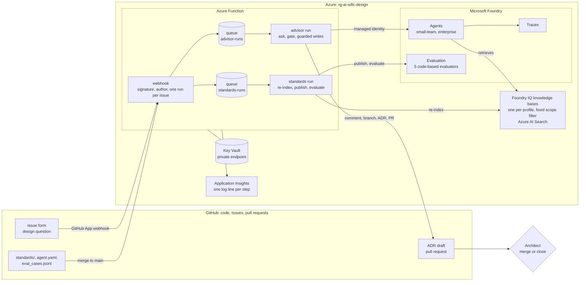
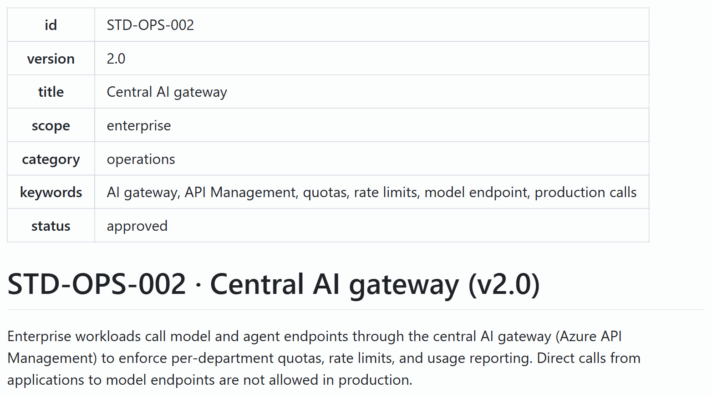
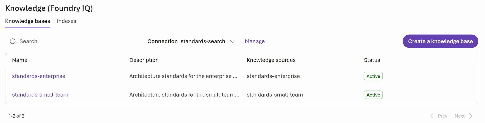
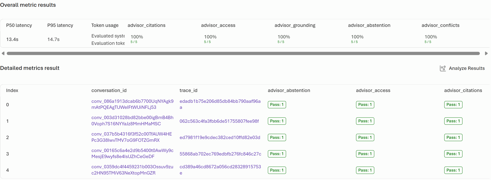
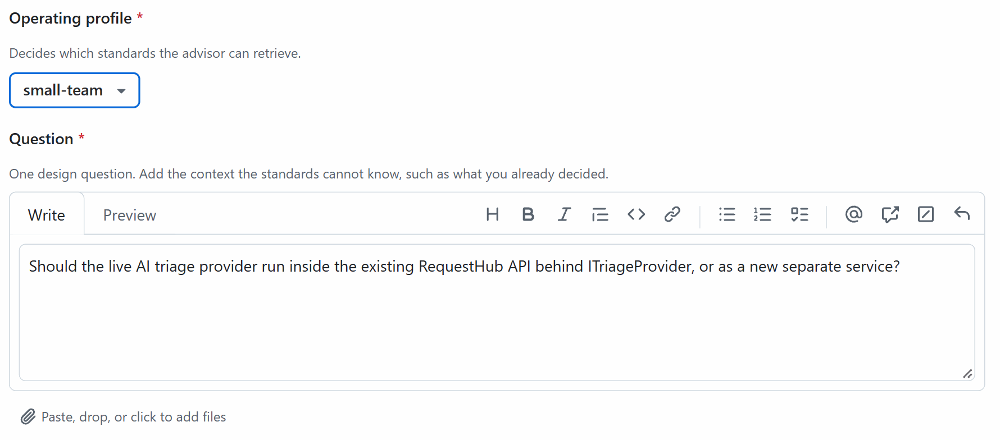
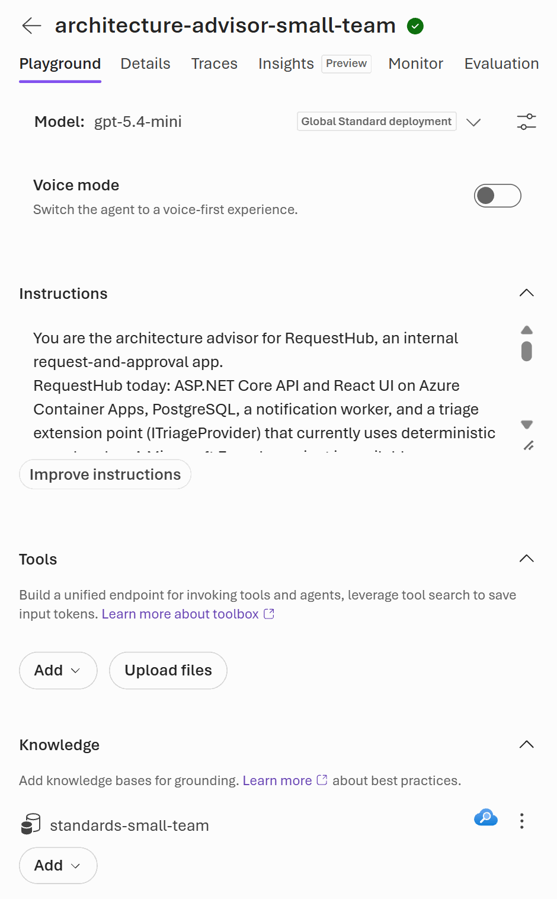
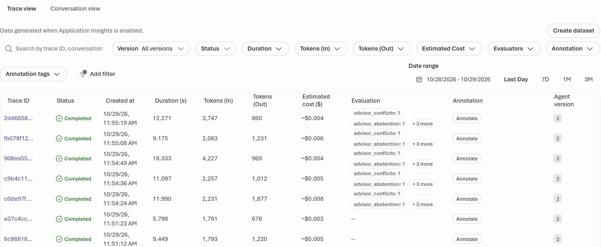
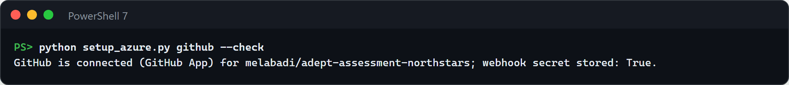
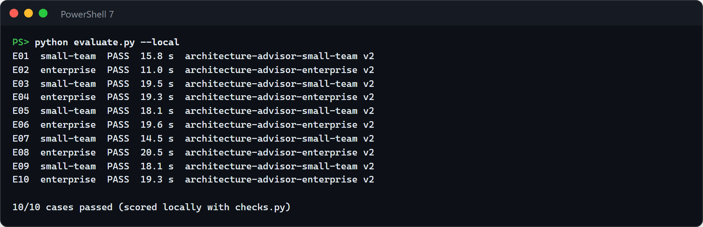

# Design · Architecture advisor in Microsoft Foundry

Design reviews stall when nobody can find the standard that applies, when two standards disagree, or when the answer depends on which team is asking. This solution adds an architecture advisor to your repository's workflow, and runs it in Azure. Anyone on the team files a design question as a GitHub Issue. An Azure Function asks a Microsoft Foundry agent that answers only from your approved standards, retrieved through Foundry IQ with each team's access enforced by Azure AI Search, and checks every citation before anything reaches GitHub. The advisor then comments on the Issue and opens a pull request with a draft architecture decision record (ADR), which an architect accepts or rejects. The standards live in the repository: when a change to them merges, Azure re-indexes them and scores both agents again on labelled cases with the same checks.


- **[See it work](#see-it-work):** a real run on RequestHub, this repository's sample app. A change to a standard was in the index 16 seconds after it merged, both agents then passed ten labelled cases, and a design question got a cited answer and an ADR draft 32 seconds after it was filed.
- **[Add it to your repository](#add-it-to-your-repository):** about 10 minutes of one-time setup in Azure and GitHub, once the folder holds your standards, your teams' profiles, and labelled cases.
- **[Try it first in a copy of this repository](#try-it-first-in-a-copy-of-this-repository):** about 10 minutes to set it up on RequestHub, then about 20 minutes for the steps of See it work.

## Why it matters

**Phase 2 of 7: Design and architect.** The GitHub counterpart is [02-design-github](../02-design-github/), where a Copilot agent drafts the ADR from the code and GitHub Actions check it and its API contract impact. Both answer the same question from the same [reviewed brief](inputs/reviewed-brief.md): how should RequestHub add a live AI triage provider while keeping access controls, human approval, observability, and a simple deployment? To use both on one design question and one pull request, see the [Design solution combo](../../PRESENTING.md#design-foundry-cites-the-standards-github-checks-the-adr).

| | Today | With this solution |
| --- | --- | --- |
| Finding the standards | Architects search wikis and ask around. Teams discover a standard at review time. | The advisor searches the approved standards for every question and cites the id, version, and sentence it used. |
| Gaps and contradictions | Someone guesses, or quietly picks the rule they prefer. | The advisor abstains when no standard answers, and lists each contradiction for an architect. |
| Who sees what | Everyone reads everything, or the prompt is asked to behave. | Each team profile has its own agent and knowledge base, and Azure AI Search returns only that profile's standards. |
| Trust | "The AI said so." | An Azure Function rejects invented, out-of-scope, misversioned, or misquoted citations before anything reaches GitHub. |
| Changing a standard | A wiki page changes, and nobody knows which answers it affects. | A pull request. When it merges, Azure re-indexes the standards and scores both agents on labelled cases with the same checks. |
| Decisions | Answers stay in chats and meetings. | Every answer becomes a Proposed ADR in a pull request, traced to the agent version and response id. |

**The value:** an architect starts from a cited first draft instead of a search, every gap and contradiction is named before the review, and nothing reaches GitHub until deterministic checks agree with the standards. In [See it work](#see-it-work):

- A merged change to a standard was in the index 16 seconds after the merge. Both agents then passed all ten labelled cases, with all 50 checks graded, 6 minutes 46 seconds after the merge.
- A design question got a cited answer and a Proposed ADR pull request 32 seconds after it was filed: eight standards with their versions, one conflict between two of them, and four unknowns, left to an architect.
- The answer for the small-team profile relied on the two standards that only small teams see and on none of the three that only the enterprise profile sees, and the gate checked all eight citations before GitHub saw any of them.

## How it works



- **Foundry Agent Service** hosts one prompt agent per operating profile, published from [`agent.yaml`](agent.yaml): instructions, model settings, a knowledge tool, and a strict JSON output schema.
- **Foundry IQ** gives each profile its own knowledge base over the `architecture-standards` index in Azure AI Search. The profile's scope filter (`scope eq 'all' or scope eq 'small-team'`) is stored in the knowledge source, so the search service, not the prompt, decides what a team can retrieve.
- **The Azure Function** ([`function/`](function/), Python on the Flex Consumption plan) is the only code that talks to GitHub:
  - Its **webhook** checks GitHub's signature and who asked, then puts the question on a queue and answers GitHub within its 10 seconds.
  - The **advisor run** ([`runs.py`](function/advisor_core/runs.py)) takes the question from the queue, asks the profile's agent with the Function's managed identity, and runs the gate ([`checks.py`](function/advisor_core/checks.py)). Only when the gate passes does it create the ADR branch, commit the draft, open the pull request, and comment on the issue. When a check fails, it comments only the failed checks and opens nothing. When the agent or a GitHub step fails, it says so on the issue, so no question goes unanswered.
  - **The gate** decides what reaches GitHub. Every citation must exist in the index, be inside the profile's scope, have the indexed version, and be quoted word for word, and the knowledge base must not have returned anything outside the profile. A quote may shorten a sentence of the standard, but it may not skip a negation such as "not", "never", or "unless": "API keys … be stored in configuration" is rejected, because the standard says "must not be stored".
  - The **standards run** starts when a change to the standards, `agent.yaml`, or the cases merges to `main`: it re-indexes the standards of that commit, publishes new agent versions if the definition changed, and starts a new evaluation.
- **Application Insights** gets one line per step of each run, starting with the run's id; the issue comment and the pull request show the same id. Connected to the Foundry project, it also traces every agent run: duration, tokens, estimated cost, and the evaluation scores attached to it.
- **The Foundry evaluation** sends the ten labelled cases in [`eval_cases.jsonl`](eval_cases.jsonl) to the agents and scores every answer with five code-based evaluators that embed `checks.py`, one report column each: citations, access, grounding, abstention, conflicts. Grounding reads what the answer concludes, not only what it quotes: its summary and recommendation must state the conclusion the case is labelled with, never its opposite, and quote the sentence of the standard that supports it. An answer that quotes STD-AI-001 word for word and still recommends automatic approval passes citations and fails grounding.
- **GitHub** holds the code, the issue form, and the ADR pull requests. No GitHub Actions workflow and no GitHub Copilot take part.
- **People** decide. An architect reviews the ADR draft, gives each conflict and unknown an owner, and accepts it (merge) or rejects it (close). A person authorizes GitHub once.

This build runs the preferred path of both preview features: the agents retrieve through **Foundry IQ knowledge bases**, and **Foundry code-based evaluators** score them. The fallbacks are one setting or flag away: `knowledge: azure-ai-search` in `agent.yaml` gives each agent the generally available Azure AI Search tool with the same filter, and `python evaluate.py --local` scores the agents' answers on your machine with the same checks.

### Security notes

- **GitHub access.** A private GitHub App, installed on one repository only, with Contents, Issues, and Pull requests write and Metadata read, and the Issues and Push events. GitHub creates it from a manifest and hands its id, private key, and webhook secret straight to the Function, which stores only those three in Key Vault. The Function mints 1-hour installation tokens scoped to that repository.
- **Writes are fenced in code.** The Function refuses any write except a branch matching `refs/heads/design/advisor-*`, a Markdown file under `solutions/02-design-microsoft/adr/` on such a branch, a pull request from such a branch, and an issue comment. It checks before sending the request, whatever the token allows.
- **Webhooks.** The Function verifies GitHub's signature, ignores a delivery it has already handled (`X-GitHub-Delivery`), and queues at most one advisor run per issue, so a redelivery never opens a second ADR pull request. Each time the `design-advisor` label is added counts as one request; GitHub sends that event when an issue is filed with the label, too. A run starts from the queue only if the issue is still waiting for it, so a second copy of a message, or one the webhook never wrote, asks nothing. A run that couldn't finish (the agent or a GitHub step failed) may be asked again: a maintainer removes the `design-advisor` label and adds it back. An answered or rejected question stays answered.
- **Who can ask.** Only the repository's owner, members, and collaborators. On a public repository anyone can open an Issue with the form, and the form applies the `design-advisor` label for them, so the Function checks the Issue's `author_association`, which GitHub computes and signs with the delivery: `OWNER`, `MEMBER`, or `COLLABORATOR` starts the advisor; anyone else's Issue, bots included, is acknowledged and ignored, even when someone with triage access labels it later. To have the advisor answer an outside contributor's question, ask it in an Issue of your own. Nothing else an outsider can do (comment, fork, open a pull request) reaches Azure: the app receives only Issues and pushes, and only a push to `main` starts a standards run. The advisor reuses an open ADR pull request only when its branch is in the same repository, where only people with write access and the app can push; a fork's pull request with the same branch name never counts.
- **What reaches GitHub.** The model's text reaches GitHub only after the gate passed, with @mentions neutralized. A rejected answer's comment lists only the failed checks, inside a code block, and none of the answer.
- **Only merged changes are published.** The standards run re-indexes and re-publishes only from a commit that is on the default branch, so an unmerged proposal never reaches the index or the agents.
- **No keys.** The Function calls Foundry, Azure AI Search, Key Vault, and its own blobs and queues with its managed identity; Foundry, Azure AI Search, and storage have local authentication disabled. The only secrets are the GitHub App's three credentials, in Key Vault, never in app settings. Logs name the run, the issue, the commit, and counts, never a token, a URL, the question, or the answer.
- **Private network.** Key Vault and the Function's storage (blobs and queues) have no public network access; the Function reaches them through private endpoints in the solution's virtual network.

## See it work

On 31 October and 1 November 2026, the solution ran end to end against the real services in resource group `rg-ai-sdlc-design`, with Microsoft Foundry and the Function in East US 2 and Azure AI Search in Central US, on RequestHub, this repository's sample app: a change to a standard at 23:23 UTC on 31 October, then a design question 78 minutes later. The operator was a GitHub Copilot agent session working for the repository owner: it merged the change and filed the question, signed in to GitHub as the owner. The GitHub App, the Function, Azure AI Search, and Foundry did the rest. The Function ran the code of pull request [#244](https://github.com/melabadi/adept-assessment-northstars/pull/244) ([the code that ran](evidence/2026-10-31-recorded-run.md#the-code-that-ran)), and both agents were at version 2.

Every step links evidence that opens without signing in: the pull request that changed the standard, the Issue and the pull request the advisor created, and [what Azure recorded](evidence/2026-10-31-recorded-run.md), exported from Application Insights and the Foundry evaluation. Times are UTC. Where a screenshot of the Foundry portal comes from another run, the step says which.

### 1. A change to a standard merged

*31 October, 23:23:08 to 23:23:48: the pull request merged 40 seconds after it opened.*

The standards are Markdown files in [`standards/`](standards/), one per standard. Each has a stable id, a version, a scope (`all`, `small-team`, or `enterprise`), keywords, and the rule itself. The operator opened pull request [#238](https://github.com/melabadi/adept-assessment-northstars/pull/238), which added the keyword *Application Insights* to [STD-OBS-001](standards/STD-OBS-001.md), and merged it as commit [`74e59ec`](https://github.com/melabadi/adept-assessment-northstars/commit/1baf5004d0cc6a447b5163649359b1b77d1c8d61). The screenshot shows another standard, STD-OPS-002, whose scope is `enterprise`: the small-team profile can never retrieve it.



Evidence: pull request [#238](https://github.com/melabadi/adept-assessment-northstars/pull/238) and commit [`74e59ec`](https://github.com/melabadi/adept-assessment-northstars/commit/1baf5004d0cc6a447b5163649359b1b77d1c8d61).

**What this shows:** the standards are reviewed like code, and only a merged change can reach the advisor.

### 2. Azure re-indexed the standards

*23:23:50 to 23:24:11: queued 2 seconds after the merge, finished in 12 seconds.*

GitHub sent the push to the Function through the GitHub App. The Function saw a push to the default branch that changed a standard, queued a standards run, and answered GitHub in a quarter of a second. The run checked that the commit was on `main`, then re-indexed that commit's twelve standards into the `architecture-standards` index in Azure AI Search. One had changed, and 16 seconds after the merge the index held the new keyword. The run kept both agents at version 2, because `agent.yaml` hadn't changed, and started an evaluation in Foundry. Both Foundry IQ knowledge bases read this index, each through a scope filter that Azure AI Search applies to every retrieval: `standards-small-team` sees the nine standards scoped `all` or `small-team`, and `standards-enterprise` the ten scoped `all` or `enterprise`.


The knowledge bases in the Foundry portal, captured on 29 October; their definitions didn't change after that:



Evidence: [the standards run](evidence/2026-10-31-recorded-run.md#the-standards-run), from the Function's log and its invocations.

**What this shows:** Azure publishes exactly what merged, within seconds, and the search service, not a prompt, decides which standards each team's agent can see.

### 3. Azure evaluated both agents

*23:24:10 to 23:30:34: the small-team results came 2 minutes 17 seconds after their run started, the enterprise results 6 minutes 23 seconds after theirs.*

Foundry sent the ten labelled cases in [`eval_cases.jsonl` as of `74e59ec`](https://github.com/melabadi/adept-assessment-northstars/blob/1baf5004d0cc6a447b5163649359b1b77d1c8d61/solutions/02-design-microsoft/eval_cases.jsonl), five per profile, to that profile's agent, and scored every answer with five code-based evaluators that embed the gate's checks: citations, access, grounding, abstention, and conflicts. All 50 checks passed, and Foundry graded every one. Case E01 asked the question that the operator filed in step 4. Case E07 expected the conflict between STD-OBS-002 and STD-SEC-002, and the small-team agent reported it. Case E08 asked for a monthly token budget that no standard sets, and the enterprise agent abstained instead of inventing one. The enterprise results waited for E08's answer, which took 261 seconds; the other nine answers took 8 to 14 seconds.

The screenshot comes from another run with the same agent and evaluator versions: the small-team run that `evaluate.py` started on 29 October at 18:38.



Evidence: [the evaluation](evidence/2026-10-31-recorded-run.md#the-evaluation): both runs, with every case, its expected result, and each check, exported from Foundry.

**What this shows:** a change to the standards is measured on labelled cases, with the checks that guard GitHub, without anyone starting it.

### 4. A design question was filed as an Issue

*1 November, 00:42:01: 78 minutes after the merge.*

The operator filed Issue [#242](https://github.com/melabadi/adept-assessment-northstars/issues/242) with the fields and labels of the issue form *Design: ask the Foundry architecture advisor*: the operating profile **small-team**, and the question *Should the live AI triage provider run inside the existing RequestHub API behind ITriageProvider, or as a new separate service?* The form's `design-advisor` label is what asks the advisor. The screenshot, captured on 29 October, shows the form's two fields with the same answers; the fields haven't changed since.



Evidence: Issue [#242](https://github.com/melabadi/adept-assessment-northstars/issues/242).

**What this shows:** the Issue is the whole interface: nothing runs in GitHub, and the question reaches Azure through the GitHub App.

### 5. Azure asked the agent and checked its answer

*00:42:08 to 00:42:28: queued 7 seconds after the Issue; the agent answered in 12 seconds, and the gate passed 2 seconds later.*

GitHub sent four deliveries for the new Issue: one for the Issue and one for each of its three labels. The Function ignored the first three and queued one advisor run when the `design-advisor` label arrived. Five seconds later, the run took the question from the queue and asked `architecture-advisor-small-team` version 2, with the Function's managed identity rather than a key. The agent retrieved from its knowledge base twice and answered in the strict JSON of its output schema. Then the gate checked the answer against the index: each of the eight standards it cited exists, is inside the small-team scope, has the indexed version, and is quoted word for word, and the knowledge base had returned nothing outside the profile.

The agent in the Foundry portal, captured on 29 October at the same version 2:



The advisor run's log:


Evidence: [the advisor run](evidence/2026-10-31-recorded-run.md#the-advisor-run), with every delivery the Function received and why it ignored or queued it.

**What this shows:** the gate stands between the model and GitHub: had a citation been invented, out of scope, misversioned, or misquoted, the run would have commented only the failed checks and opened nothing.

### 6. The answer and a Proposed ADR reached GitHub

*00:42:30 to 00:42:33: the pull request opened 31 seconds after the Issue, and the comment 32 seconds after it.*

With the gate passed, the Function created the branch `design/advisor-issue-242`, committed the ADR draft [`b3d0e0f`](https://github.com/melabadi/adept-assessment-northstars/commit/b3d0e0f819e52ac62d254d2fe983311934d02ad0), opened pull request [#243](https://github.com/melabadi/adept-assessment-northstars/pull/243), and commented on the Issue, as the GitHub App. The comment recommends implementing the live triage provider inside the existing API behind `ITriageProvider`, not as a separate service. It lists the eight standards it relied on, each with its version and requirement: two of them, STD-OPS-001 and STD-DATA-002, apply to small teams only, and no enterprise-only standard appears. It names the conflict between STD-SEC-002 and STD-OBS-002 for an architect to resolve, four unknowns, the checks that passed, and the agent version, model, response id, and advisor run. The ADR draft in the pull request is *Proposed*.


Evidence: [the advisor's comment](https://github.com/melabadi/adept-assessment-northstars/issues/242#issuecomment-6551311653), pull request [#243](https://github.com/melabadi/adept-assessment-northstars/pull/243), and [the ADR draft](https://github.com/melabadi/adept-assessment-northstars/blob/b3d0e0f819e52ac62d254d2fe983311934d02ad0/solutions/02-design-microsoft/adr/issue-242.md).

**What this shows:** 32 seconds after the question, an architect had a cited first draft with the conflict and the unknowns named, and the decision was still theirs.

### 7. Foundry traced the answer

*00:42:16 to 00:42:26: the agent run took 9.7 seconds.*

Application Insights, connected to the Foundry project, recorded the answer as a trace of response `resp_0a49f2eb8c636a19006ae68ae7a6648195b6b45e5ae7e95d8c`: the agent invocation (9.7 seconds), two knowledge-base retrievals (1.5 and 1.4 seconds), and the model call (4.4 seconds, 3,443 input and 1,577 output tokens). The agent's **Traces** tab in Foundry lists each such trace with its duration, tokens, estimated cost, evaluation results, and agent version. The screenshot shows that list on 29 October, before this run; the traces with scores belong to an evaluation's runs.



Evidence: [the agent's trace](evidence/2026-10-31-recorded-run.md#the-agents-trace).

**What this shows:** every answer is traceable to an agent version and a response id, with its duration and tokens recorded per run.

## Results and value

**What the run left behind.**

- Pull request [#238](https://github.com/melabadi/adept-assessment-northstars/pull/238) and commit [`74e59ec`](https://github.com/melabadi/adept-assessment-northstars/commit/1baf5004d0cc6a447b5163649359b1b77d1c8d61): the reviewed change to the standards, which Azure indexed.
- Two evaluation runs in Foundry, named after that commit: 10 of 10 cases and 50 of 50 checks passed, and Foundry graded every check.
- Issue [#242](https://github.com/melabadi/adept-assessment-northstars/issues/242), with the advisor's answer, and pull request [#243](https://github.com/melabadi/adept-assessment-northstars/pull/243), with the Proposed ADR. Both name the agent version, the response id, and the advisor run.
- [The evidence](evidence/2026-10-31-recorded-run.md) behind every number in [See it work](#see-it-work) and in these results: the Function's log and invocations, the agent's spans, and the evaluation's results.
- The decision, left to a person. An architect gives each conflict and unknown an owner, then merges the ADR pull request to accept it or closes it to reject it. Here the question tested the advisor, so the operator closed #243 without merging and closed #242 as not planned, 16 minutes after the answer.

**What was measured.**

| | In See it work |
| --- | --- |
| From the merge to the change in the index | 16 seconds |
| From the merge to both evaluation runs' results | 6 minutes 46 seconds |
| Labelled cases passed, and checks graded | 10 of 10, and 50 of 50 |
| From the Issue to the ADR draft pull request, and to the comment | 31 seconds, and 32 seconds |
| The advisor run, from the start of its queued work to the comment | 20 seconds, 12 of them waiting for the agent |
| Standards cited, and cited outside the profile's scope | 8, and 0 |
| Conflicts and unknowns named for the architect | 1, and 4 |
| Model tokens for the answer | 3,443 input and 1,577 output |

**What a team gets.**

- **Time saved.** The architect starts from a cited draft 32 seconds after the question, instead of searching wikis and asking around, and every question leaves an ADR draft by default. A change to the standards needs no follow-up either: Azure re-indexed it and scored both agents again without anyone starting anything.
- **Risk removed.** An invented, out-of-scope, misversioned, or misquoted citation never reaches GitHub, and no prompt can make the search service return another team's standards. Only merged standards are published. No key exists for anyone to leak: the Function signs in with its managed identity, and the GitHub App's credentials stay in Key Vault.
- **Evidence a reviewer or an auditor can follow.** The standards change in pull requests. Each answer names its agent version, response id, and advisor run, each ADR is a pull request, and each evaluation run is named after the commit it measured.

**The metric to track when you adopt it:** the time from a design question to a reviewable ADR draft (32 seconds in See it work), and how many conflicts and unknowns are named before the review rather than found later (one and four here). Compare both with how design decisions were made before. Also watch the evaluation's pass rate after each change to your standards. A target is a goal you set, never a result.

## Add it to your repository

These are the steps that set the solution up for this repository, with what to change for yours. We have run them only on this repository: for yours, the commands stay the same, and the changes are the ones named below.

### Prerequisites

- Your repository on GitHub, with admin rights, and the tools in the root README's [Before you start](../../README.md#before-you-start): the GitHub CLI, Python 3.12 or later, PowerShell 7, the Azure CLI, and the Azure Developer CLI. This solution uses neither GitHub Copilot nor GitHub Actions.
- An Azure subscription where you can create a resource group and role assignments, for example as Owner.
- Quota for `gpt-5.4-mini` (Global Standard, 250,000 tokens per minute) in the region you choose, and for Azure AI Search Basic. We put everything in `eastus2`, except Azure AI Search, which goes to `centralus` unless you set `AZURE_SEARCH_LOCATION`.
- A GitHub account that may create a GitHub App and install it on the repository: the repository's owner, or an organization owner.
- Your approved standards, as text you can split into one file per standard, and a few design questions whose right answers you know, for the evaluation.

### What to copy and what to change

Copy this folder into your repository at the same path, `solutions/02-design-microsoft/`, without `images/` and `evidence/`, which belong to the run in [See it work](#see-it-work). At another path, replace `solutions/02-design-microsoft` with your folder in every Python file of the folder: the path constants named below, the tests that check them, and the text of the ADR pull request. Then change these files:

| File | What it does here | What to change for your repository |
| --- | --- | --- |
| [`standards/`](standards/) | Twelve synthetic standards for RequestHub. Each file has front matter (`id`, `version`, `title`, `scope`, `category`, `keywords`, `status`) and the rule. | Replace them with your approved standards, one Markdown file per standard, with the same front matter. Name each file after its `id`: `STD-`, capital letters, a hyphen, and three digits, such as `STD-SEC-001.md`; the index skips any other file name. `scope` is `all` or one profile's name. Only `status: approved` is indexed. |
| [`agent.yaml`](agent.yaml) | The advisor: instructions that describe RequestHub, model settings, the knowledge tool, `profiles` with the scopes each may retrieve, and the output schema | The instructions, for your system and your design rules; `profiles`, one per team that sees different standards; the model settings. Keep the output schema: the gate reads it. |
| [`eval_cases.jsonl`](eval_cases.jsonl), [`eval_heldout.jsonl`](eval_heldout.jsonl), and [`grader_checks.jsonl`](grader_checks.jsonl) | Ten labelled cases, six held-out cases never used to tune the checks, and a right and a wrong answer per labelled question | Your own questions: at least one each for grounding, access (`forbidStandards`), a known contradiction (`expectConflict`), and a known gap (`expectAnswerable: false`). Give every answerable case an `expectConclusion`: the claims a right answer states (`states`), the claims that would be the opposite conclusion (`rejects`), and the words of the standard that support it (`evidence`). Claims are a few positive words in order, such as `approv* automat*`. Add a right and a wrong answer per case to `grader_checks.jsonl`, with the same quotes, and keep a few questions in `eval_heldout.jsonl` that you never tune the labels on. |
| [`.github/ISSUE_TEMPLATE/02-design-microsoft-advisor.yml`](.github/ISSUE_TEMPLATE/02-design-microsoft-advisor.yml) | The issue form: the operating profile, the question, and the labels it applies | Copy it to your repository's `.github/ISSUE_TEMPLATE/`, where GitHub reads issue forms. Its profile options are your profiles. Keep the labels *Operating profile* and *Question*, which the Function reads, and the `design-advisor` label. |
| [`function/advisor_core/webhook.py`](function/advisor_core/webhook.py) | `PROFILES`, the profiles the Function accepts; `LABEL`; and `SOLUTION`, the folder whose changes start a standards run | `PROFILES`: your profiles, as in `agent.yaml` and the issue form. `SOLUTION`: your folder, with a trailing `/`. |
| [`function/advisor_core/runs.py`](function/advisor_core/runs.py), [`standards.py`](function/advisor_core/standards.py), and [`github.py`](function/advisor_core/github.py) | `SOLUTION`, where the standards run reads `agent.yaml` and the cases; `SOURCE_DIR`, the standards; `ADR_DIR`, the only folder the Function may write to | Your folder in each, if it isn't `solutions/02-design-microsoft/`. |
| [`test_advisor.py`](test_advisor.py) | The offline tests, which read this folder's standards and cases; many quote RequestHub's standards, and some check this folder's paths | Update the tests that quote RequestHub's standards (search for `STD-`) to quote yours, and the paths if you moved the folder: azd runs these tests before every deploy and stops when one fails. |
| [`inputs/reviewed-brief.md`](inputs/reviewed-brief.md) | RequestHub's design brief, which no code reads | Leave it out, or keep your own brief there. |

### One-time setup

About 10 minutes, once the folder describes your standards and teams. In our setup, `azd up` took about 6 minutes the first time and 3 to 4 minutes after that, and connecting GitHub took about 3 minutes.

#### 1. Deploy

From the root of your repository:

```powershell
cd solutions/02-design-microsoft
python -m venv .venv
.\.venv\Scripts\Activate.ps1          # the azd hooks run `python`, so keep this environment active
pip install -r requirements.txt
az login
azd auth login
gh label create design-advisor --description "Ask the Foundry architecture advisor"
azd env new <environment name> --location eastus2
azd up
```

The issue form applies the `design-advisor` label, and GitHub skips labels that don't exist, so the label comes first. The GitHub App that step 2 creates is named `AI-SDLC design advisor`; app names are unique on GitHub, so to give yours another name, run `azd env set GITHUB_APP_NAME "<your app name>"` before `azd up`.

**What you should see:** `azd up` creates resource group `rg-<environment name>` with everything in [How it works](#how-it-works) and ends with `SUCCESS`. On the way, its hooks print:

- **Before provisioning:** `GitHub repository: <owner>/<repository>`, the repository the Function will answer, from your clone's `origin` remote.
- **After provisioning:** what `setup_azure.py foundry` published in Azure AI Search and Foundry, which Bicep can't declare: the standards in the index and what each profile alone can see, each knowledge base's filter, the agents, and the evaluators. Running it again changes nothing. On this repository, on 29 October, it printed:

  

- **Before deploying:** the offline tests (`python -m unittest test_advisor`), so a broken gate never reaches Azure.
- **After deploying:** `GitHub is not connected yet. To connect <owner>/<repository>, run: python setup_azure.py github`.

#### 2. Connect GitHub

About 3 minutes; finish within an hour of starting:

```powershell
python setup_azure.py github
```

1. Your browser opens the Function's setup page: **Connect the architecture advisor to GitHub**. It lists the permissions and events. Select **Create GitHub App**.
2. GitHub shows **Create GitHub App for &lt;owner&gt;** with the app's name. If the name is taken, add a suffix. Select **Create GitHub App**. GitHub may ask you to confirm your password or two-factor code.
3. GitHub returns to the Function, which shows **GitHub App created**. Select **install the app**, choose **Only select repositories**, select your repository, and select **Install**.
4. Check it:

   ```powershell
   python setup_azure.py github --check
   ```

**What you should see:**



Nobody downloads a private key or pastes a secret: GitHub hands the app's credentials to the Function, which stores them in Key Vault. The setup page refuses to run again once an app is connected (HTTP 409).

<details>
<summary>If your organization doesn't allow GitHub Apps: a fine-grained personal access token</summary>

Comments and pull requests then appear under your name, and you rotate the token yourself.

1. Create a [fine-grained token](https://github.com/settings/personal-access-tokens/new): only your repository; Contents, Issues, and Pull requests read and write; an expiry you will renew.
2. In the repository, **Settings** → **Webhooks** → **Add webhook**: the payload URL is `https://<host>/api/github/webhook`, where `<host>` is what `az functionapp show -g (azd env get-value AZURE_RESOURCE_GROUP) -n (azd env get-value FUNCTION_APP_NAME) --query "properties.defaultHostName || defaultHostName" -o tsv` prints (on Flex Consumption, Azure CLI returns the host under `properties`), content type `application/json`, a random secret, and the **Issues** and **Pushes** events.
3. Store both in Key Vault. Its public network access is disabled, so write through Azure Resource Manager:

   ```powershell
   $vault = az keyvault show -n (azd env get-value KEY_VAULT_NAME) --query id -o tsv
   $file = Join-Path $env:TEMP "github-secret-$PID.json"   # outside the repository, removed even if a command fails
   try {
     foreach ($name in 'github-token', 'github-webhook-secret') {
       $value = Read-Host "Value of $name" -MaskInput
       @{ properties = @{ value = $value } } | ConvertTo-Json -Compress | Set-Content $file
       az rest --method put --url "https://management.azure.com$vault/secrets/$($name)?api-version=2023-07-01" --body "@$file" -o none
     }
   } finally {
     Remove-Item $file -ErrorAction SilentlyContinue
   }
   ```

</details>

### Use it the first time

1. **Put the folder and the issue form on your default branch,** through a pull request: GitHub offers an issue form only from there. Once GitHub is connected, each merge that changes `standards/`, `agent.yaml`, or `eval_cases.jsonl` starts a standards run, as in [See it work](#see-it-work) steps 2 and 3: Azure re-indexes that commit's standards, publishes new agent versions if `agent.yaml` changed, and starts an evaluation named after the commit.
2. **Ask a question.** **Issues** → **New issue** → **Design: ask the Foundry architecture advisor**; pick a profile, write one design question, and select **Create**. **What you should see:** within a minute, a comment from your GitHub App with the answer, the standards it relied on, the conflicts and unknowns, and the checks that passed, and an ADR draft pull request from a `design/advisor-issue-<number>` branch, as in [step 6](#6-the-answer-and-a-proposed-adr-reached-github). If the gate rejects the answer, the comment lists only the failed checks, and no pull request opens.
3. **Evaluate the agents on your cases,** from the solution folder, in the activated environment:

   ```powershell
   python evaluate.py                    # 3 to 7 minutes: one Foundry run per profile on eval_cases.jsonl
   python evaluate.py --check-graders    # about 3 minutes: your right and wrong answers, graded here and in Foundry
   ```

   **What you should see:** `evaluate.py` ends with the last run of each profile, for example `10/10 cases passed`. Its summary keeps the first attempt, each retry, and what couldn't be graded apart: it starts a profile's run again only when Foundry's preview grader couldn't score it, never because a case failed. `--check-graders` shows each right answer passing and each wrong one failing, and whether Foundry graded them exactly as `checks.py` does.

To follow a run step by step, query its log lines in Application Insights. Each line starts with the run's id, which the comment and the pull request also name, and lines arrive about half a minute after they're written:

```powershell
$query = Join-Path $env:TEMP "advisor-runs.kql"
'traces | where timestamp > ago(1h) and (message startswith "advisor run " or message startswith "standards run ") | project timestamp, message | order by timestamp asc' | Set-Content $query -Encoding utf8NoBOM
az monitor app-insights query --app (azd env get-value APPLICATIONINSIGHTS_NAME) -g (azd env get-value AZURE_RESOURCE_GROUP) --analytics-query "@$query" --query "tables[0].rows" -o tsv
```

Saving the query in a file keeps PowerShell from mangling its quotes. To search further back than an hour, change `ago(1h)` and add `--offset`, for example `--offset 24h`. In the Azure portal, the same query runs in your resource group → the Application Insights resource (`appi-…`) → **Monitoring** → **Logs**, in **KQL mode**.

### What it costs

About $96 a month while deployed: Azure AI Search Basic (about $73), three private endpoints and their DNS zones for the Function's blobs, queues, and Key Vault (about $23), and storage, Key Vault, and Log Analytics within cents. The Function costs nothing while idle. Each answer costs about half a cent in model tokens (the agent's Traces tab shows the estimate), and an evaluation of the ten cases about six cents. The root README compares [what the Microsoft solutions cost](../../README.md#what-the-microsoft-solutions-cost).

## Try it first in a copy of this repository

Optional: the same solution on RequestHub, before you adapt anything. It needs the [prerequisites](#prerequisites), with this repository's standards and cases in place of yours.

### Quick start

From the root of your copy of the repository, which the root README's [Try it in a copy of this repository](../../README.md#try-it-in-a-copy-of-this-repository) makes once for every solution:

```powershell
cd solutions/02-design-microsoft
python -m venv .venv
.\.venv\Scripts\Activate.ps1          # the azd hooks run `python`, so keep this environment active
pip install -r requirements.txt
az login
azd auth login
gh label create design-advisor --description "Ask the Foundry architecture advisor"
azd env new ai-sdlc-design --location eastus2
azd up
python setup_azure.py github
```

`azd up` takes about 6 minutes and prints what [Deploy](#1-deploy) describes, with this repository's twelve standards. Then finish in the browser, as in [Connect GitHub](#2-connect-github). This repository's own app already has the name `AI-SDLC design advisor`, so give yours a suffix on GitHub's page, or set `GITHUB_APP_NAME` before `azd up`. Allow about 10 minutes in all. While deployed, the copy costs what [What it costs](#what-it-costs) says.

### Check the starting state

Under a minute, from `solutions/02-design-microsoft`, before each run of the steps below:

```powershell
python setup_azure.py github --check    # GitHub is connected (GitHub App) for <owner>/<repository>; webhook secret stored: True.
```

If it says GitHub isn't connected yet, follow [Connect GitHub](#2-connect-github). Issues and ADR pull requests left from an earlier run don't block a new question; [Reset the copy](#reset-the-copy-for-another-run) closes them.

### How long each step takes

| Step | Takes | In See it work |
| --- | --- | --- |
| 1. Change a standard | about 2 minutes | merged 40 seconds after the pull request opened |
| 2. Azure re-indexes | under half a minute after the merge | 16 seconds to the index, 24 seconds to the evaluation's start |
| 3. The evaluation | 3 to 7 minutes after the merge | 2 minutes 39 seconds and 6 minutes 46 seconds after the merge |
| 4. Ask from GitHub | about 1 minute | |
| 5. The advisor run | under a minute | queued 7 seconds after the Issue, done 20 seconds after it started |
| 6. Review | about 3 minutes | the comment 32 seconds after the Issue |
| 7. Trace | about 1 minute | |

All seven take about 20 minutes. You can start step 4 while step 3's evaluation runs.

### 1. Change a standard

*About 2 minutes. What you should see: [See it work, step 1](#1-a-change-to-a-standard-merged).*

```powershell
git switch -c standards/obs-keyword
```

In [`standards/STD-OBS-001.md`](standards/STD-OBS-001.md), add a keyword to the `keywords:` line, for example `OpenTelemetry collector`. Then commit, open a pull request, and merge it:

```powershell
git commit -am "02-design-microsoft: add a keyword to STD-OBS-001"
git push -u origin standards/obs-keyword
gh pr create --fill
gh pr merge --squash --delete-branch
git switch main
git pull
```

### 2. Watch Azure re-index the standards

*Under half a minute after the merge. What you should see: [See it work, step 2](#2-azure-re-indexed-the-standards).*

Run the log query from [Use it the first time](#use-it-the-first-time). The standards run's lines start with `standards run`, and the last one says `evaluation started in Foundry`. If you don't see them yet, run the query again in half a minute.

### 3. Read the evaluation

*3 to 7 minutes after the merge. What you should see: [See it work, step 3](#3-azure-evaluated-both-agents).*

In the [Foundry portal](https://ai.azure.com), project `design`: **Build** → **Evaluations** → **Architecture advisor · labelled cases**, then the two runs named after your merge commit, one per profile. Each evaluator is a column.

To evaluate without changing a standard, run `python evaluate.py` from the solution folder (3 to 7 minutes). On 10 November, Foundry's preview grader couldn't score the enterprise run's `access` evaluator, so `evaluate.py` started that run again, and the agent's new answers passed:


`python evaluate.py --check-graders` (about 3 minutes, no agent asked) grades a right and a wrong answer to every labelled question, which quote the same sentences of the same standards. The wrong answer to E05, for example, quotes STD-AI-001's *Approvals, rejections, payments, and access grants always require a human decision* and still recommends automatic approval above 95% confidence. Its run on 10 November:


If Foundry still can't grade a profile's third run, `evaluate.py` reports `COULD NOT GRADE`. Then `python evaluate.py --local` asks the same agent versions the same questions and scores the answers on your machine with the same checks, in about 3 minutes. Its run on 30 October:



### 4. Ask from GitHub

*About 1 minute. What you should see: [See it work, step 4](#4-a-design-question-was-filed-as-an-issue).*

Open the [issue form, with the question filled in](../../../../issues/new?template=02-design-microsoft-advisor.yml&question=Should%20the%20live%20AI%20triage%20provider%20run%20inside%20the%20existing%20RequestHub%20API%20behind%20ITriageProvider%2C%20or%20as%20a%20new%20separate%20service%3F). Complete the title (*Architecture question: where should the live AI triage provider run?*), pick **small-team** (GitHub can't fill in a dropdown from the link), and select **Create**. Or file it from the terminal:

```powershell
$body = "### Operating profile`n`nsmall-team`n`n### Question`n`nShould the live AI triage provider run inside the existing RequestHub API behind ITriageProvider, or as a new separate service?"
$issue = (gh issue create --title "Architecture question: where should the live AI triage provider run?" --body $body --label design-advisor).Split('/')[-1]
```

### 5. Follow the advisor run

*Under a minute. What you should see: [See it work, step 5](#5-azure-asked-the-agent-and-checked-its-answer).*

Run the log query from [Use it the first time](#use-it-the-first-time) again: the advisor run's lines start with `advisor run` and end with `commented the answer`. To see the agent that answered, open the Foundry portal: **Build** → **Agents** → `architecture-advisor-small-team`, with its model, instructions, and knowledge base.

### 6. Review the answer and the ADR draft

*About 3 minutes. What you should see: [See it work, step 6](#6-the-answer-and-a-proposed-adr-reached-github).*

```powershell
$issue = <number>    # the Issue's number, if you filed it from the form
gh issue view $issue --comments
gh pr view "design/advisor-issue-$issue"
gh pr diff "design/advisor-issue-$issue"
```

On GitHub, the pull request's **Files changed** → **⋯** → **View file** shows the rendered ADR. An architect accepts the ADR by merging the pull request, or rejects it by closing it.

### 7. Trace the answer

*About 1 minute. What you should see: [See it work, step 7](#7-foundry-traced-the-answer).*

In the Foundry portal: **Build** → **Agents** → `architecture-advisor-small-team` → **Traces**. The newest trace is the answer; select it to see the retrievals and the model call. The tab can take up to a minute to load the first time.

### Reset the copy for another run

From the solution folder, with `$issue` the number of the Issue you filed:

```powershell
gh pr close "design/advisor-issue-$issue" --comment "Reset." --delete-branch
gh issue close $issue --reason "not planned" --comment "Reset."
```

The Function remembers each question it answered, so a closed Issue never gets a second ADR draft; a new Issue starts fresh. The keyword from step 1 can stay: the next change to a standard re-indexes them all again.

## Clean up

When you no longer need the solution, in your repository or in the copy, from the solution's folder:

```powershell
azd down --purge --force
```

This removes the solution's resource group, with Foundry and its agents and evaluations, Azure AI Search, the Function, and the Key Vault that holds the GitHub App's credentials. Then delete the GitHub App, which is how the Function reached your repository: GitHub → **Settings** → **Developer settings** → **GitHub Apps** → your app → **Advanced** → **Delete GitHub App** (for an app that an organization owns, the organization's settings). If you used the fine-grained token instead, revoke it in **Settings** → **Developer settings** → **Personal access tokens** → **Fine-grained tokens**, and delete the repository's webhook. The Issues and ADR pull requests stay in your repository.

To set the solution up again right after `azd down --purge`, give it new resource names first (`azd env set AZURE_RESOURCE_SEED <any new value>`): a purged Foundry name can keep pointing at the deleted account for a while. New names mean a new Function address, so connect GitHub again with a new app.

## What's in this folder

```text
02-design-microsoft/
├── README.md
├── agent.yaml                     the advisor: instructions, model settings, knowledge tool, operating profiles, output schema
├── standards/                     twelve synthetic approved standards with ids, versions, and scopes
├── eval_cases.jsonl               ten labelled cases: grounding, access, conflict, abstention, and the conclusion each answer must state
├── eval_heldout.jsonl             six held-out labelled cases, never used to tune the checks (`evaluate.py --held-out`)
├── grader_checks.jsonl            a right and a wrong answer per labelled question, same quotes, opposite conclusions (`--check-graders`)
├── inputs/reviewed-brief.md       the reviewed brief behind the design question
├── evidence/
│   └── 2026-10-31-recorded-run.md what Azure recorded during the run in See it work, exported for anyone to check
├── function/                      the Azure Function (Python 3.12, Flex Consumption)
│   ├── function_app.py            the webhook, the two queue functions, and connecting GitHub
│   ├── advisor_core/
│   │   ├── runs.py                the advisor run (ask, gate, guarded writes) and the standards run (re-index, publish, evaluate)
│   │   ├── checks.py              the deterministic checks; Foundry also runs this file as the code-based evaluators
│   │   ├── foundry.py             ask an advisor agent through the Foundry project's Responses API
│   │   ├── report.py              the issue comment, the ADR draft, and the pull request text
│   │   ├── github.py              GitHub App tokens and the write guard
│   │   ├── webhook.py             signature check, the issue form, which events and authors start work
│   │   ├── setup_flow.py          connect GitHub with the app-manifest flow
│   │   ├── standards.py           parse the standards and keep the index in sync
│   │   ├── knowledge.py           the Foundry IQ knowledge sources and bases, one per profile
│   │   ├── agents.py              publish the agents from agent.yaml
│   │   └── evaluation.py          the Foundry evaluation: five code-based evaluators, one run per profile
│   ├── host.json
│   └── requirements.txt
├── infra/
│   ├── main.bicep                 resource group rg-<environment name>
│   ├── resources.bicep            Foundry, model, AI Search, connections, Application Insights, VNet and private endpoints,
│   │                              storage and its queues, Key Vault, the Function, role assignments
│   └── main.parameters.json
├── azure.yaml                     azd project: the Function and the hooks
├── setup_azure.py                 the azd hooks, and `github`, which connects GitHub
├── evaluate.py                    start the Foundry evaluation now and print the result (--local: the fallback; --check-graders, --held-out)
├── test_advisor.py                offline tests; azd runs them before every deploy
├── azd_env.py                     settings from the environment or the azd environment
├── requirements.txt               Python packages for the scripts and tests
├── images/                        the screenshots in this README
└── .github/ISSUE_TEMPLATE/02-design-microsoft-advisor.yml   the issue form
```

The scripts write nothing to the repository. The advisor writes ADR drafts to `adr/` on its own branches.

## Troubleshooting

- **`ModuleNotFoundError` in an azd hook.** The hooks run `python` from your PATH. Activate the solution's virtual environment before `azd up`.
- **azd shows no hook output.** azd doesn't print hook output when it isn't attached to a terminal. Run the hook yourself to see it: `python setup_azure.py foundry`.
- **`setup_azure.py github --check` warns that the Function answered 404 or 503 right after a deploy.** The Function restarts after a deployment and indexes its routes for up to a minute. Run the check again.
- **An issue gets no answer.** Check that the issue has the `design-advisor` label (GitHub skips labels that don't exist in the repository), and that its author is the repository's owner, a member, or a collaborator: the advisor ignores anyone else's Issue. Then run the log query from [Use it the first time](#use-it-the-first-time) with `delivery ` added to its prefixes: every delivery the Function ignored has a line that says why. No line at all means the webhook didn't reach the Function: GitHub → **Settings** → **Developer settings** → **GitHub Apps** → the app → **Advanced** → **Recent Deliveries** lists each delivery and the Function's response. A queued run can wait about 10 seconds while Azure starts an instance for it, and log lines arrive about half a minute after they're written.
- **The issue says the advisor could not answer, or that the ADR draft could not be completed.** Foundry, the index, or a GitHub step failed; the log lines of that advisor run (its id is in the comment) say which. Once the service is back, remove the `design-advisor` label from the issue and add it back: a run that couldn't finish may run again, and it reuses the branch and pull request the last one created. An answered or rejected question doesn't run again; ask it in a new issue.
- **The setup page answers HTTP 409, or you need to connect a different GitHub App.** The setup page runs only while no app is connected. Empty the GitHub secrets in Key Vault, then run `python setup_azure.py github` again. The vault is closed to the internet, so this goes through Azure Resource Manager, which can't delete a secret but can replace its value; the Function treats an empty secret as missing:

  ```powershell
  $vault = az keyvault show -n (azd env get-value KEY_VAULT_NAME) --query id -o tsv
  $file = Join-Path $env:TEMP "github-secret-$PID.json"
  try {
    '{"properties":{"value":""}}' | Set-Content $file
    foreach ($name in 'github-app-id', 'github-app-private-key', 'github-webhook-secret', 'github-token') {
      az rest --method put --url "https://management.azure.com$vault/secrets/$($name)?api-version=2023-07-01" --body "@$file" -o none
    }
  } finally {
    Remove-Item $file -ErrorAction SilentlyContinue
  }
  ```

- **An evaluation run fails with `use of builtin 'compile()' is not allowed in Python graders`.** Foundry runs `checks.py` as a Python grader, which refuses any call named `compile()`, even `re.compile`. Use pattern strings with `re.findall` and `re.sub`; the tests check this.
- **`python evaluate.py` reports `COULD NOT GRADE` and exits with code 2.** Foundry's code-based evaluators are a preview, and the service sometimes fails to grade every item of one evaluator in a run. Those items say *An error occurred during grading*, yet the Foundry portal counts them as passed, so trust `evaluate.py` here. It happened in 7 of the 20 runs measured over three days, to a different evaluator from one run to the next. The checks take milliseconds, far inside Foundry's limit of 2 minutes per grading call, and turn any error into a fail, so the error comes from the service. `evaluate.py` starts such a run again by itself, up to three runs per profile (`--attempts`), so `COULD NOT GRADE` means the last of them failed too: run the evaluation again later, or use `python evaluate.py --local`. `no answer to grade` means the agent call itself failed, and `no result for this case` means Foundry returned no result for it; open the run in Foundry for the details.
- **`python evaluate.py` reports a case as `FAIL: citations`.** An excerpt the agent quoted isn't one the gate accepts, so the gate would have kept that answer from GitHub too. Once in 100 answers, the agent quoted the last five words of a longer sentence of STD-AI-001 (*every tool call is audited*): the check wants a whole sentence or at least six words in a row, so a shortened quote can't drop a *not*. `evaluate.py` never starts a run with a failed case again, because that would hide the result. Run the evaluation again for new answers.
- **A case fails every evaluator at once.** The agent's run ended without an answer: in Foundry, the item's output has no final message. It happened once in more than 100 answers, after 80 seconds instead of the usual 15. Run the evaluation again; if the same case keeps failing, read that case's trace in the agent's **Traces** tab.
- **Every case fails every evaluator, in every run.** The evaluators can't find the answers. In November 2026, Foundry began handing a code-based evaluator the agent's answer in its `sample` argument instead of the evaluation item; evaluators that read only the item then failed all 50 checks of a run. [`evaluation.py`](function/advisor_core/evaluation.py) reads the answer from either place. If your copy predates that change, update it and run `python evaluate.py`: it registers the new evaluator versions. A standards run uses the evaluators of the deployed Function, so run `azd deploy` too.
- **`python evaluate.py` reports a case as `FAIL: grounding` although the answer looks right.** The check reads the answer's conclusion as short claims with their negations, conditions, and comparisons; it isn't a reader. In 80 answers to the ten labelled questions it failed two, both genuine: they reported the STD-OBS-002 and STD-SEC-002 conflict but quoted a sentence of STD-SEC-002 that doesn't say what conflicts. In 90 answers to the six held-out questions (84 asked directly and 6 in a Foundry run with `--held-out`), it misread three right answers, in two ways: one described the rejected tool as a sentence's subject, and two put "extending the existing service and avoiding new queues" in a single clause. `python evaluate.py --check-graders` lists the known misreads. Read the case's answer in Foundry before you call it wrong.
- **`DefaultAzureCredential failed to retrieve a token` from a script.** The Azure CLI took too long to return a token. Run `az account get-access-token --resource https://ai.azure.com` to check that it responds, then run the script again.
- **The Foundry portal opens another project.** It reopens the project you used last. Pick `design` in the project switcher next to **Microsoft Foundry**, at the top left.
