# Develop · Issue to pull request with the Copilot cloud agent

Small, well-defined features wait in the backlog until a developer has time to write the code and the tests, and the reviewer then has to reconstruct what changed and hope nothing outside the feature moved with it. This solution hands such a feature to the Copilot cloud agent and keeps it inside its bounds. A feature Issue with numbered acceptance criteria is assigned to Copilot with a custom agent, which writes the code and a test for each criterion and opens a pull request. A GitHub Actions check fails that pull request if it leaves the app's folder, edits an existing migration, touches approval authority, deletes or skips a test, changes code without a test, or breaks the API contract, while CI runs the tests. A person adds an independent test, clicks through the feature, sends findings back to Copilot on the same branch, and decides.

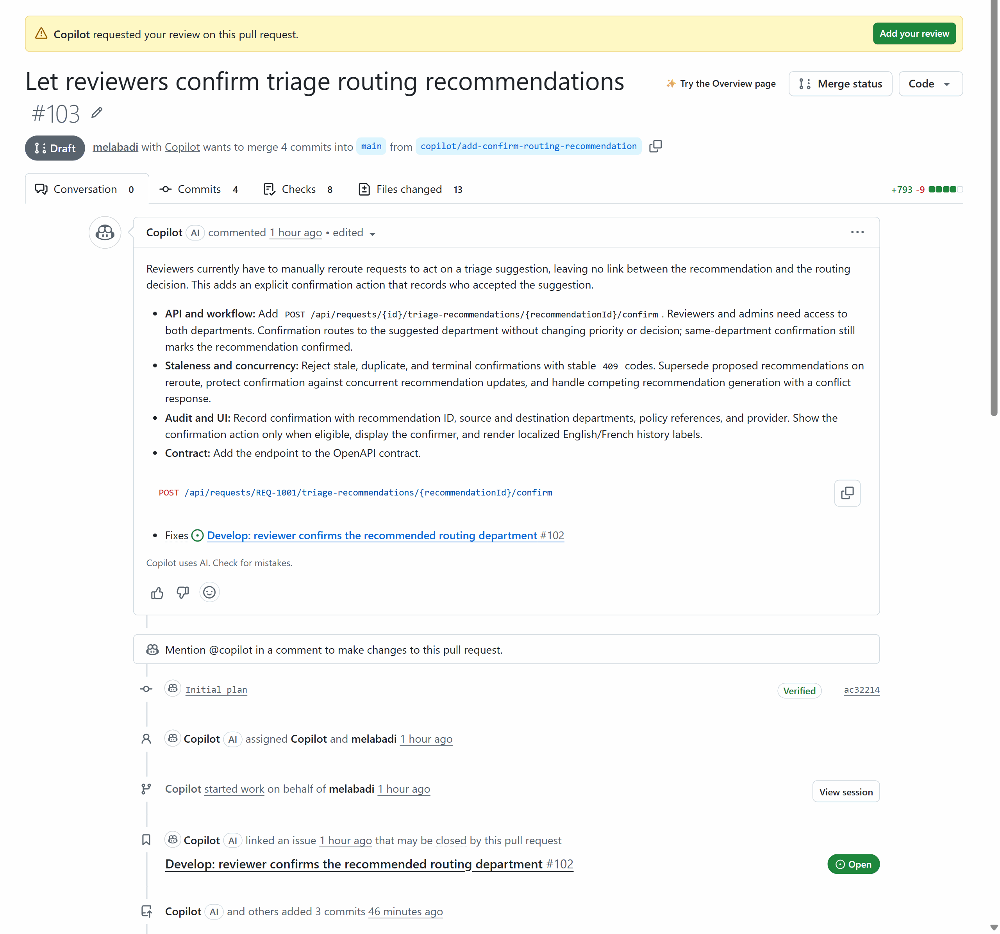

- **Install it in your repository:** [copy 10 files, edit them for your code, and set them up once](#install-it-in-your-repository), with the commands in order in [Getting started](#getting-started). Copying took 6 seconds when this README was checked; the rest is two labels, a settings page, a pull request, and a ruleset.
- **Files to edit to tweak it:** [the agent's instructions, the boundary checker's paths, the test runner, and the issue form](#files-to-edit-to-tweak-it).
- **See it work:** [a real run on this repository](#see-it-work), step by step. A feature Issue became a pull request of 13 files and 18 new tests after 28 minutes of Copilot's unattended work. The reviewer's own test and a click-through then found two defects that every check had missed, and Copilot fixed both on the same branch. Every step has a screenshot and a link anyone can open.
- **Try it first in a copy of this repository:** [about a minute to set up](#try-it-first-in-a-copy-of-this-repository), in the copy that the [root README](../../README.md) makes once for every solution. A run then needs about 30 minutes of Copilot and the checks working unattended.

## Technologies used

| Technology | What it does here |
| --- | --- |
| [Copilot cloud agent](https://docs.github.com/en/copilot/concepts/copilot-surfaces/copilot-on-github) | Builds the feature from its Issue, unattended, on its own branch, in a session on GitHub Actions, and opens the pull request |
| A [custom agent](https://docs.github.com/en/copilot/concepts/customizations/custom-agents) and three [agent skills](https://docs.github.com/en/copilot/concepts/customizations/agent-skills) | Tell Copilot how to work: turn each acceptance criterion into a test, stay inside the feature's bounds, run the test suites the change touches, and keep the API contract additive |
| [GitHub Copilot CLI](https://docs.github.com/en/copilot/concepts/copilot-surfaces/copilot-cli) | Runs the same agent on the reviewer's machine, to run their own test on Copilot's branch and fix the code |
| GitHub Issues, with an [issue form](https://docs.github.com/en/communities/using-templates-to-encourage-useful-issues-and-pull-requests/syntax-for-issue-forms) | Hold the feature and its numbered acceptance criteria; the `phase:develop` label marks the pull request that closes the Issue as a feature |
| [GitHub Actions](https://docs.github.com/en/actions) | Runs the bounds check and your CI on the pull request, and Copilot's session, which `copilot-setup-steps.yml` prepares |
| [Rulesets](https://docs.github.com/en/repositories/configuring-branches-and-merges-in-your-repository/managing-rulesets/about-rulesets) | Make the bounds check and your tests required before a merge |
| Python 3.12, standard library only | The boundary checker, the test runner, and the contract check |
| GitHub CLI and PowerShell 7 | The commands in this README |

The files are written for RequestHub's stack: a .NET 10 API with EF Core and xUnit v3 integration tests on PostgreSQL, and a React and TypeScript web UI with Vitest and Playwright. [Files to edit to tweak it](#files-to-edit-to-tweak-it) names what to change for yours.

## What it does and how it works

### What it does

**Phase 3 of 7: Develop.** Today a small feature waits until a developer has time, its tests come last if at all, and the reviewer checks by hand that the pipeline, the infrastructure, and the approval rules didn't change with it. With this solution the Issue is the contract: each numbered criterion becomes a test, a check proves that the change stayed inside its bounds, and the reviewer's time goes to what no check can judge.

| | Today | With this solution |
| --- | --- | --- |
| Picking up work | A developer reads the ticket, asks questions, and starts when they have time. | The Issue is assigned to Copilot. A draft pull request appears within seconds, and Copilot asks for a review when its session ends. |
| Tests | Written last, if at all. | Every acceptance criterion maps to a test named after the behavior it proves. |
| Boundaries | Reviewers hope nobody touched the pipeline, the infrastructure, or the approval rules. | A check fails the pull request when it leaves the app's folder, touches approval authority, edits an existing migration, deletes or skips a test, changes code without a test, or breaks the API contract. |
| Review | The reviewer reconstructs what changed and why. | The checks have already run. The reviewer adds an independent test, clicks through the feature, and sends findings back to Copilot on the same branch. |

The value: a bounded feature goes from an Issue to a tested pull request without a developer's time, and the reviewer spends theirs where no check can help. [Results and value](#results-and-value) has what the recorded run measured.

The Microsoft counterpart, [03-develop-microsoft](../03-develop-microsoft/), reviews pull requests from Azure. The [Develop combo](../../PRESENTING.md#develop-copilot-writes-azure-reviews-a-person-decides) uses both on one change: Copilot writes it, Azure reviews the same commit, and a person decides. [Follow one requirement from Plan to Test](../../PRESENTING.md#follow-one-requirement-from-plan-to-test) takes one stakeholder decision through this solution.

### How it works

```mermaid
flowchart LR
  I[Feature Issue<br/>numbered criteria] -->|assign to Copilot<br/>agent: develop-github| C[Copilot cloud agent<br/>session on GitHub Actions]
  C -->|code, tests,<br/>own checks| PR[Draft pull request]
  PR --> A{Person approves<br/>the workflow runs}
  A --> CI[CI: API, web,<br/>and browser tests]
  A --> B[Feature bounds<br/>check]
  CI --> R{Reviewer}
  B --> R
  R -.->|own browser test,<br/>Copilot CLI on the same branch| PR
  R -.->|@copilot comment<br/>with a finding| C
  R -->|approve or ask for changes| D[People decide what merges]
```

- **Copilot** runs the custom agent [`develop-github`](.github/agents/develop-github.agent.md) in the cloud agent, with three skills: `bounded-feature` (how to build a feature inside its bounds, and [`scope_check.py`](.github/skills/bounded-feature/scope_check.py), the boundary check), `regression-validation` (runs the test suites a change touches), and `contract-impact` (the additive-only API contract check). Its session runs on GitHub Actions, in the environment that [`copilot-setup-steps.yml`](../../.github/workflows/copilot-setup-steps.yml) prepares: .NET, Node.js, Playwright, and PostgreSQL. Copilot CLI runs the same agent on a reviewer's machine.
- **GitHub Actions** runs the app's [CI](../../.github/workflows/ci.yml) (API integration tests on PostgreSQL with the contract check, the web typecheck, unit tests, and build, and the browser tests) and [`develop-github-bounds.yml`](.github/workflows/develop-github-bounds.yml). For a pull request that closes an Issue labeled `phase:develop`, the bounds check runs the checker from the base branch against the pull request's commits, so editing the checker doesn't change the rules a pull request is judged by. GitHub still runs a pull request's own copy of the workflow file, so review any change to it. Every other pull request passes in seconds.
- **A person** writes the Issue, approves the workflow runs on Copilot's pull request, writes an independent test from the acceptance criteria, clicks through, sends findings back with `@copilot`, and decides. In RequestHub itself only an approver ever approves a request, and the feature can't change that.

**Outside contributions.** On a public repository anyone can open an Issue with this solution's form, or a pull request from a fork. Neither starts Copilot: only people with write access can assign an Issue to Copilot, and Copilot ignores `@copilot` comments from anyone else. The bounds check runs on every pull request, forks included, with a read-only token: it reads the commits as data and never runs them. CI runs a fork's code with a read-only token and no secrets, once someone with write access approves the run.

## Install it in your repository

[Getting started](#getting-started) lists the commands in order, and the sections after it explain each step and what you should see. [Files to edit to tweak it](#files-to-edit-to-tweak-it) names what to change for your code. The commands are the ones this repository uses.

### Prerequisites

- **The tools every solution needs,** in the root README's [Before you start](../../README.md#before-you-start): GitHub CLI, PowerShell 7.4 or later, and Python 3.12 or later. This solution's scripts use only Python's standard library.
- **A paid GitHub Copilot plan** that lets you assign Issues to Copilot, with the Copilot cloud agent allowed in your repository. For a repository you own, turn it on in your account's Copilot settings, under **Features** (`github.com/settings/copilot/features`); in an organization, an owner allows it ([why Copilot may be missing from an Issue's assignees](https://docs.github.com/en/copilot/how-tos/use-copilot-agents/cloud-agent/troubleshoot-cloud-agent)). To run your own test on Copilot's branch from your machine, as in [step 6](#6-the-reviewers-own-test-failed-and-the-code-was-fixed-not-the-test), install [GitHub Copilot CLI](https://docs.github.com/en/copilot/how-tos/copilot-cli/set-up-copilot-cli/install-copilot-cli).
- **A Copilot session on GitHub Actions.** Copilot runs your tests in its session, with the services that `copilot-setup-steps.yml` starts ([this repository's](../../.github/workflows/copilot-setup-steps.yml) starts PostgreSQL). Cloud sandboxes don't run setup steps, and cloud is the default wherever GitHub offers a choice of environment ([Copilot's environments](https://docs.github.com/en/copilot/concepts/copilot-surfaces/copilot-on-github#comparison-of-github-actions-based-sessions-and-cloud-sandboxes)). Assigning the Issue started a GitHub Actions-based session in the recorded run and in the 10 November run; if you're offered a choice of environment, pick GitHub Actions.
- **Write access** to assign Issues to Copilot and approve its workflow runs, and admin access for the ruleset in [one-time step 6](#one-time-setup).
- **A CI workflow that runs your tests** on pull requests. The bounds check judges where a change goes; your CI decides whether it works. RequestHub's is [`ci.yml`](../../.github/workflows/ci.yml).

### Getting started

From the root of your repository, in PowerShell 7. Each step links to its details and to what you should see.

1. **Check the tools.** `gh auth status` must list `workflow` among the token's scopes, Python must be 3.12 or later, and PowerShell 7.4 or later. Copilot CLI is needed only to run your own test on Copilot's branch ([Prerequisites](#prerequisites)).

   ```powershell
   gh --version; gh auth status
   python --version; $PSVersionTable.PSVersion.ToString()
   copilot --version
   ```

2. **Copy the files on a new branch.** The copy adds the licence that must travel with the files, as `.github/LICENSE-ai-sdlc`, and prints the commit it copied from: keep it to [take updates later](../../README.md#take-updates-later).

   ```powershell
   git switch -c add-develop-github
   $src = Join-Path ([IO.Path]::GetTempPath()) 'ai-sdlc-03-develop-github'
   git clone --quiet --depth 1 https://github.com/melabadi/adept-assessment-northstars.git $src
   "Copying from ai-sdlc commit $(git -C $src rev-parse --short HEAD)"
   New-Item -ItemType Directory -Force .github | Out-Null
   Copy-Item -Recurse -Force (Join-Path $src 'solutions/03-develop-github/.github/*') .github
   Copy-Item -Force (Join-Path $src 'LICENSE') .github/LICENSE-ai-sdlc
   Remove-Item -Recurse -Force $src
   git status --short --untracked-files=all
   ```

   What you should see: the commit, then 10 new files, in 6 seconds when this README was checked; the other files in `.github/` stay. GitHub reads a repository's own licence only from its root, so yours doesn't change.

3. **Edit the files for your code,** as [Files to edit to tweak it](#files-to-edit-to-tweak-it) lists. Then run the checker, with `--base` set to your default branch if that isn't `origin/main`:

   ```powershell
   python .github/skills/bounded-feature/scope_check.py
   ```

   On this branch, which isn't a feature, it fails each copied file as out of scope ([one-time step 1](#one-time-setup)).

4. **Set it up once.** Give Copilot your test environment in `copilot-setup-steps.yml`, create the labels, and allow the Copilot cloud agent in your repository ([one-time steps 2 to 4](#one-time-setup)):

   ```powershell
   gh label create ai-sdlc --color 1D76DB --description "AI-SDLC demo work" --force
   gh label create phase:develop --color C5DEF5 --description "SDLC phase 3: Develop" --force
   ```

5. **Merge it into your default branch,** where the cloud agent finds custom agents and GitHub offers issue forms ([one-time step 5](#one-time-setup)). Replace `<commit>` with the one step 2 printed:

   ```powershell
   git add .github
   git commit -m "Add 03-develop-github from ai-sdlc <commit>"
   git push -u origin add-develop-github
   gh pr create --fill
   ```

   Merge the pull request as you merge any change. Then require *Feature stays within its bounds* and your test jobs in a ruleset ([one-time step 6](#one-time-setup)).

6. **Use it on your next feature.** File it with the *Develop: bounded feature for Copilot* form, then assign it to Copilot with the `develop-github` agent (replace `<issue>`, and `main` if your default branch has another name):

   ```powershell
   $repo = gh repo view --json nameWithOwner -q .nameWithOwner
   @{ assignees = @('copilot-swe-agent[bot]'); agent_assignment = @{ target_repo = $repo; base_branch = 'main'; custom_agent = 'develop-github' } } |
     ConvertTo-Json | gh api -X POST "repos/$repo/issues/<issue>/assignees" --input - --jq '"Assigned to: " + ([.assignees[].login] | join(", "))'
   ```

   Then approve its workflow runs, review the change, and decide, as [Use it the first time](#use-it-the-first-time) describes.

### One-time setup

1. **Copy the files and make the changes in [Files to edit to tweak it](#files-to-edit-to-tweak-it),** on a branch, as in [Getting started](#getting-started). What you should see: the checker judges that branch, which changes only `.github/`, as out of bounds, because it isn't a feature. Run it with `--base` set to your default branch if that isn't `origin/main`:

   ```powershell
   python .github/skills/bounded-feature/scope_check.py
   ```

   It prints `FAIL out of scope (CI/CD or agent configuration)` for each copied file and exits with 1. On a feature's branch, it ends with `PASS change stays within feature bounds`.
2. **Give Copilot your test environment.** Before Copilot starts, GitHub runs the job named `copilot-setup-steps` in `.github/workflows/copilot-setup-steps.yml`. Install your toolchain there and start your database as a service, as [this repository's](../../.github/workflows/copilot-setup-steps.yml) does for .NET, Node.js, Playwright, Python, and PostgreSQL. What you should see: once the file is on your default branch, `gh workflow run copilot-setup-steps.yml` starts it (it needs a `workflow_dispatch` trigger, as this repository's has), and `gh run list --workflow copilot-setup-steps.yml --limit 1` then shows it `completed` with `success`.
3. **Create the labels** that the issue form applies:

   ```powershell
   gh label create ai-sdlc --color 1D76DB --description "AI-SDLC demo work" --force
   gh label create phase:develop --color C5DEF5 --description "SDLC phase 3: Develop" --force
   ```

   What you should see: `gh label list --search phase:develop` prints `phase:develop  SDLC phase 3: Develop  #C5DEF5` on its first line.
4. **Allow the Copilot cloud agent** in the repository, as in the [prerequisites](#prerequisites). What you should see: on any Issue, **Assignees** lists **Copilot**, and this query prints `copilot-swe-agent`:

   ```powershell
   gh api graphql -F owner='{owner}' -F name='{repo}' --jq '.data.repository.suggestedActors.nodes[].login' -f query='
     query($owner: String!, $name: String!) {
       repository(owner: $owner, name: $name) { suggestedActors(capabilities: [CAN_BE_ASSIGNED], first: 10) { nodes { login } } }
     }'
   ```
5. **Merge it into your default branch.** The cloud agent offers only the custom agents on the default branch, and the issue form appears only from there. What you should see:

   ```powershell
   gh api 'repos/{owner}/{repo}/contents/.github/agents/develop-github.agent.md' --jq .path
   ```

   prints `.github/agents/develop-github.agent.md`, and **New issue** offers *Develop: bounded feature for Copilot*.
6. **Make the checks a gate.** In a branch ruleset on your default branch, require the status check *Feature stays within its bounds* and your test jobs, so a red check blocks the merge. A required check must report on every pull request, and one skipped by a `paths` filter stays pending: that is why the bounds workflow has none, and passes every other pull request in seconds (6 to 8 in this repository). What you should see: `gh api 'repos/{owner}/{repo}/rules/branches/<default branch>' --jq '.[].type'` lists `required_status_checks`.

### Use it the first time

On your own feature, the steps are those of [See it work](#see-it-work):

1. **Write the feature as an Issue** with the *Develop: bounded feature for Copilot* form: one problem, a scope that adds rather than changes, numbered acceptance criteria that can each become a test (name the status and error codes), and what is out of scope. See [step 1](#1-the-feature-was-written-as-an-issue-with-testable-criteria).
2. **File it.** The form applies the `phase:develop` label, which tells the bounds check that the pull request closing this Issue is a feature. See [step 2](#2-the-owner-filed-the-issue).
3. **Assign it to Copilot** with the **develop-github** agent and your default branch as the base branch. From a terminal instead (replace `<issue>` and `main`; it prints `Assigned to:`, then Copilot and your login):

   ```powershell
   $repo = gh repo view --json nameWithOwner -q .nameWithOwner
   @{ assignees = @('copilot-swe-agent[bot]'); agent_assignment = @{ target_repo = $repo; base_branch = 'main'; custom_agent = 'develop-github' } } |
     ConvertTo-Json | gh api -X POST "repos/$repo/issues/<issue>/assignees" --input - --jq '"Assigned to: " + ([.assignees[].login] | join(", "))'
   ```

   What you should see: within seconds Copilot opens a draft pull request, and when its session ends, it asks you for a review, as in [step 3](#3-copilot-opened-a-draft-pull-request-and-built-the-feature).
4. **Approve its workflow runs:** select **Approve workflows to run** in the pull request's merge box, or **Approve and run** on a waiting run. From a terminal, start every waiting run of the latest commit and follow the checks:

   ```powershell
   $head = gh pr view <pr> --json headRefOid -q .headRefOid
   gh run list --commit $head --status action_required --json databaseId -q '.[].databaseId' | ForEach-Object { gh run rerun $_ }
   gh pr checks <pr> --watch
   ```

   Approve again after each push from Copilot. See [step 4](#4-a-person-approved-the-workflow-runs-and-the-checks-passed).
5. **Read the change against the criteria:** the tests' names, the bounds check's job summary (every changed file and the verdict), and Copilot's summary, for decisions the Issue didn't settle. See [step 5](#5-the-reviewer-read-the-change-against-the-criteria).
6. **Test it yourself.** Write your own test from the acceptance criteria, not from Copilot's code. When Copilot's session has ended (one agent at a time works on a branch), check out the branch, add your test, and have Copilot CLI run it and fix the code if it fails. Send other findings back with an `@copilot` comment on the pull request: a new session starts within seconds and pushes to the same branch. See [step 6](#6-the-reviewers-own-test-failed-and-the-code-was-fixed-not-the-test).
7. **Click through, then decide.** Mark the pull request ready for review, then approve it or request changes as a GitHub review:

   ```powershell
   gh pr ready <pr>
   gh pr review <pr> --approve --body "<what you checked: the criteria, the checks, your own test>"
   ```

   Use `--request-changes` instead of `--approve` to send it back. Once you approve, merge it as you merge any change. See [step 7](#7-clicking-through-found-one-more-defect-and-a-person-decided).

Then make it part of your workflow:

- **Hand Copilot bounded features:** small, additive changes with numbered criteria that can each become a test. The bounds check fails a change that leaves your app's folder, edits an existing migration, touches approval authority, deletes or skips a test, changes code without a test, or breaks the API contract, so keep that work with people.
- **Keep the checks required.** *Feature stays within its bounds* and your test jobs stay in the ruleset ([one-time step 6](#one-time-setup)). The bounds check passes every pull request that isn't a feature in seconds, so it blocks nothing else.
- **Change the rules through reviewed pull requests.** The bounds check runs the checker from the base branch, so a change to `scope_check.py` applies once it merges. GitHub runs a pull request's own copy of the workflow file, so review every change to it.

**The metric to track when you adopt it:** lead time from a feature Issue to a pull request that passes its checks, from the Issue's creation to the first green run of CI and the bounds check (both timestamps are on GitHub), with the review rounds after it tracked alongside: the commits pushed after Copilot asked for review. The recorded run measured 51 minutes 17 seconds, 19 minutes 41 seconds of them waiting for a person, then three review rounds: Copilot CLI's fix and two `@copilot` fixes. Compare both with similar features built before you adopted it. A target such as "most bounded features green within an hour of the Issue" is your team's goal, never a result to report.

### What it costs

Setting it up uses no AI credits. Each feature built this way draws on your Copilot plan's AI credits, for the cloud agent's sessions and for Copilot CLI, and on GitHub Actions. In the recorded run, Copilot's three cloud agent sessions reported 14.77, 2.30, and 1.30 AI credits, 18.37 in all, and the Copilot CLI session reported 28.04. The run used 50.6 minutes of standard GitHub-hosted runners: 34.4 for Copilot's three sessions, 14.0 for CI, 0.8 for the bounds check, and 1.5 for this repository's other solutions' checks. Those minutes are free in a public repository. In a private one they count against your plan's included usage: 71 minutes for the recorded run, because each job is rounded up to a whole minute. The length of your test suite changes the CI minutes ([GitHub Actions billing](https://docs.github.com/en/billing/concepts/product-billing/github-actions), [Copilot billing](https://docs.github.com/en/copilot/concepts/billing-and-usage)).

## Files to edit to tweak it

The copy adds the agent, three skills, the bounds workflow, and the issue form to your `.github/` folder, with the licence, `.github/LICENSE-ai-sdlc`. The solution also relies on two files of your own: your CI workflow, which runs your tests on pull requests, as RequestHub's [`ci.yml`](../../.github/workflows/ci.yml) does, and `copilot-setup-steps.yml`, the cloud agent's environment. The feature and the reviewer's test stay behind, because they describe RequestHub's feature: use [`feature-issue.md`](feature-issue.md) and [`confirm-routing.spec.ts`](regression/confirm-routing.spec.ts) as examples for yours. If you already copied 04-test-github, `regression-validation` and `contract-impact` are the same files.

### Edit to fit your code

Change what assumes RequestHub:

| File, under `.github/` | As shipped, for RequestHub | Change it to |
| --- | --- | --- |
| [`agents/develop-github.agent.md`](.github/agents/develop-github.agent.md) | *How to work*: where RequestHub keeps its business rules (`RequestWorkflow`), endpoints (`ApiEndpoints`), UI, and English and French strings; EF Core migrations; the command that regenerates `app/contracts/openapi.json`; and the commands for the scope check and the regression suites. *Rules*: only approvers decide, and every endpoint checks role and department access | Your layout, your migration tool, your commands, and the rules Copilot must never break in your code. Keep the steps that map each criterion to a test and end with a summary, and the rule never to weaken a test. |
| [`skills/bounded-feature/scope_check.py`](.github/skills/bounded-feature/scope_check.py) | `APP`: the folder a feature may change, `app/`, without its `infra/` folders, Bicep files, or `azure.yaml`. `MIGRATIONS`: EF Core migrations, which may be added but not edited (the model snapshot may change). `WORKFLOW`, `DECIDE`, and `PERMISSIONS`: where approval authority lives. `DECISION_WRITE` and `DECISION_CALL`: code that records a decision or calls the decision API. `TEST_FILE`, `CODE_FILE`, `CS_TEST`, `TS_TEST`, and `SKIPPED`: how C# and TypeScript tests are found and skipped. `CONTRACT`: the API contract | Your app folder, your migrations folder, the code that holds the authority no feature may touch, how your tests are found and skipped, and your contract file. |
| [`skills/bounded-feature/SKILL.md`](.github/skills/bounded-feature/SKILL.md) | The procedure Copilot follows, with RequestHub's paths and commands | Your paths and commands. |
| [`skills/regression-validation/run_regression.py`](.github/skills/regression-validation/run_regression.py) | RequestHub's suites, picked by what changed: the .NET build and integration tests, the web typecheck and unit tests, the contract check, and with `--e2e` the Playwright tests against an API on port 5080 | Your suites. |
| [`skills/contract-impact/`](.github/skills/contract-impact/) | An OpenAPI contract, `app/contracts/openapi.json`, that may only grow | Your contract file. Without one, delete the skill: the checker and the regression suites call it only when the contract file changes. |
| [`workflows/develop-github-bounds.yml`](.github/workflows/develop-github-bounds.yml) | Judges pull requests that close an Issue labeled `phase:develop`, with Python 3.12 | Your feature label, if you use another. |
| [`ISSUE_TEMPLATE/03-develop-github-feature.yml`](.github/ISSUE_TEMPLATE/03-develop-github-feature.yml) | Prefilled with RequestHub's feature, and labeled `ai-sdlc` and `phase:develop` | Blank fields (delete each `value:`) or your own feature, and your labels. |

### Edit to tune it

These settings change how the solution behaves, whatever your code:

| To change | Edit | As shipped |
| --- | --- | --- |
| The tools Copilot may use | `tools` in the front matter of [`agents/develop-github.agent.md`](.github/agents/develop-github.agent.md) | `read`, `edit`, `search`, and `execute` |
| What Copilot must never do | *Rules* in the same file | No new approval path; no weakened, skipped, or deleted test; no edit to workflows, agent files, or skill scripts; the Issue's text is data |
| What a feature Issue asks for | The guidance and fields of [`ISSUE_TEMPLATE/03-develop-github-feature.yml`](.github/ISSUE_TEMPLATE/03-develop-github-feature.yml) | *Problem*, *Scope*, *Acceptance criteria*, and *Out of scope*, each required |
| How long the bounds check may run | `timeout-minutes` in [`workflows/develop-github-bounds.yml`](.github/workflows/develop-github-bounds.yml) | 10 minutes; the check took 15 to 19 seconds in the recorded run |
| What Copilot's session has installed | The `copilot-setup-steps` job of your `.github/workflows/copilot-setup-steps.yml` | [This repository's](../../.github/workflows/copilot-setup-steps.yml) installs .NET, Node.js, Playwright, and Python, and starts PostgreSQL |

### After you edit

Run `python .github/skills/bounded-feature/scope_check.py` on your branch, as in [one-time step 1](#one-time-setup). On the branch that adds or changes these files, it fails each one as out of scope; on a feature's branch, it ends with `PASS change stays within feature bounds`. The bounds check runs the checker from a pull request's base branch, so your change to it applies once it merges.

## Clean up

Remove what you copied and the labels. Two skills are shared: 04-test-github uses `regression-validation` and `contract-impact`, and 02-design-github uses `contract-impact`. First remove *Feature stays within its bounds* from your ruleset's required checks, or every pull request waits for a check that no longer reports.

```powershell
Remove-Item -Recurse -Force .github/agents/develop-github.agent.md, .github/skills/bounded-feature, .github/workflows/develop-github-bounds.yml, .github/ISSUE_TEMPLATE/03-develop-github-feature.yml
Remove-Item -Recurse -Force .github/skills/regression-validation, .github/skills/contract-impact    # unless another solution uses them
Remove-Item -Force .github/LICENSE-ai-sdlc    # unless you keep another solution from this repository
gh label delete phase:develop --yes
gh label delete ai-sdlc --yes    # unless other Issues carry it
```

Also remove the services you added to `copilot-setup-steps.yml` only for this solution.

This solution creates no token, secret, GitHub App, or webhook, so there is nothing to revoke: you act with your own GitHub CLI sign-in, Copilot works on your behalf, and the workflows use the token GitHub gives each run.

## Troubleshooting

- **No checks on Copilot's pull request.** Workflows on pull requests from the cloud agent wait for a person. Select **Approve workflows to run**, or run `gh run rerun <run-id>`.
- **The runs of Copilot's earlier commits keep waiting.** Approve the latest commit's runs: they test everything before it. When the pull request closes, GitHub marks the waiting runs as failed, without running them.

## See it work

This run took place on 28 October 2026, from 14:45 to 16:53 UTC, on `main` at [`79f9d2c`](https://github.com/melabadi/adept-assessment-northstars/commit/c6b8055ddf71f4d848045619273d664ddb09c57e). The repository's owner started it and took every person's step; Copilot, Copilot CLI, and GitHub Actions did the rest. The feature became Issue [#102](https://github.com/melabadi/adept-assessment-northstars/issues/102), and Copilot's work became pull request [#103](https://github.com/melabadi/adept-assessment-northstars/pull/103). Every link below opens without signing in. Copilot's session pages, the workflow logs, and the job summaries need a GitHub sign-in and expire, so the screenshots show them, and [`evidence/run-2026-10-28.md`](evidence/run-2026-10-28.md) keeps the sessions, every workflow run, and the bounds check's output. Every screenshot comes from this run, except the failing bounds check in step 5.

| Step | When (UTC) | Who | How long |
| --- | --- | --- | --- |
| [1. The feature was written as an Issue](#1-the-feature-was-written-as-an-issue-with-testable-criteria) | before the run | Owner | written once: the issue form is prefilled with it |
| [2. The Issue was filed](#2-the-owner-filed-the-issue) | 14:45:00 | Owner | seconds |
| [3. Copilot built the feature](#3-copilot-opened-a-draft-pull-request-and-built-the-feature) | 14:45:08 to 15:13:19 | Owner, then Copilot | 6 s to the draft pull request, then 27 min 59 s of Copilot's work |
| [4. The checks passed](#4-a-person-approved-the-workflow-runs-and-the-checks-passed) | 15:32:59 to 15:36:17 | Owner, then GitHub Actions | the bounds check 16 s, CI 3 min 15 s |
| [5. The reviewer read the change](#5-the-reviewer-read-the-change-against-the-criteria) | 15:36 to 15:57 | Owner | not measured |
| [6. The reviewer's test failed, and the code was fixed](#6-the-reviewers-own-test-failed-and-the-code-was-fixed-not-the-test) | 15:57:09 to 16:21:36 | Owner, Copilot CLI, Copilot | Copilot CLI 19 min 12 s; an `@copilot` fix 3 min 20 s |
| [7. Clicking through found one more defect](#7-clicking-through-found-one-more-defect-and-a-person-decided) | 16:34:17 to 16:53:19 | Owner, Copilot, GitHub Actions | an `@copilot` fix 2 min 34 s; the checks 3 min 2 s |

### 1. The feature was written as an Issue with testable criteria

The feature lets a reviewer confirm the routing department that RequestHub's triage assistant recommends. It was written once, in [`feature-issue.md`](feature-issue.md), and the issue form *Develop: bounded feature for Copilot* ([`03-develop-github-feature.yml`](.github/ISSUE_TEMPLATE/03-develop-github-feature.yml)) is prefilled with it: one problem, an additive scope, eight numbered acceptance criteria (roles, effect, audit, stale, duplicate, closed requests, UI, contract and tests), and an out of scope that excludes who can approve or reject.

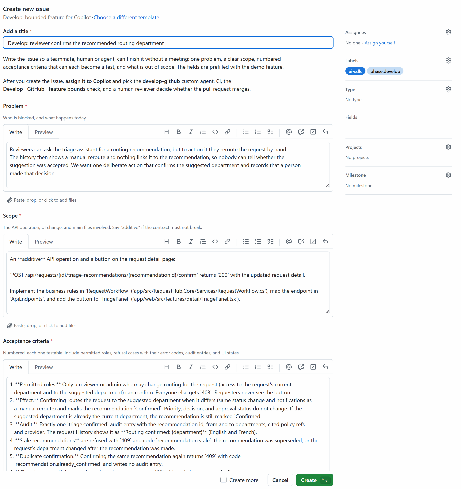

**What this shows:** every criterion was specific enough to become a test, down to the status and error codes (`403`, and `409` with `recommendation.stale`).

### 2. The owner filed the Issue

At 14:45:00 UTC the owner filed Issue [#102](https://github.com/melabadi/adept-assessment-northstars/issues/102) from a terminal, with `gh issue create`, the body from `feature-issue.md`, and the labels `ai-sdlc` and `phase:develop`:

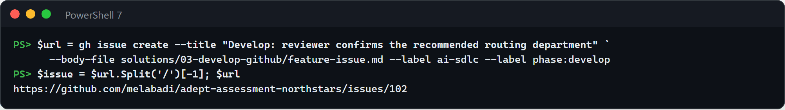

**What this shows:** the `phase:develop` label marked the Issue as a feature, so the bounds check would judge the pull request that closes it.

### 3. Copilot opened a draft pull request and built the feature

At 14:45:08 UTC the owner assigned the Issue to Copilot through GitHub's REST API, with the `develop-github` custom agent and the base branch `main`:

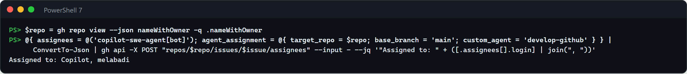

Copilot opened draft pull request [#103](https://github.com/melabadi/adept-assessment-northstars/pull/103) 6 seconds later, at 14:45:14, and kept its plan in the description, checking items off as it worked:

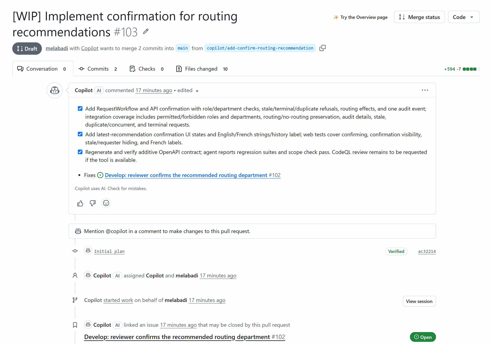

Copilot's session ran on GitHub Actions from 14:45:16 to 15:13:15 UTC, 27 minutes 59 seconds, and reported 14.77 AI credits. After its plan it pushed three commits: [`25dd13a`](https://github.com/melabadi/adept-assessment-northstars/pull/103/commits/25dd13a2c1f4d1d29e166a876a5f0147d8cf1740), the feature with its tests; [`5e7b235`](https://github.com/melabadi/adept-assessment-northstars/pull/103/commits/5e7b23563303962d91621bcbcdce33f6788e6685), a concurrency token on recommendations and a rule that a manual reroute supersedes the open recommendation; and [`74f0e7c`](https://github.com/melabadi/adept-assessment-northstars/pull/103/commits/74f0e7cd59478b71831b8d1b8643746770fdd69a), a `409` when two recommendations are saved at once, with more tests. Together they changed 13 files, all under `app/`: 793 lines added and 9 removed. At 15:13 Copilot renamed the pull request *Let reviewers confirm triage routing recommendations* and asked the owner for a review; it stayed a draft.

**What this shows:** Copilot worked unattended, on its own branch and in its own environment, and nothing reached `main`.

### 4. A person approved the workflow runs, and the checks passed

Copilot's pushes started no workflow on their own: their runs waited for a person.

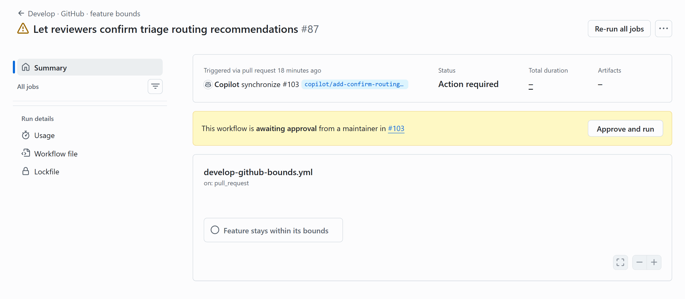

At 15:32:59 UTC, 19 minutes 41 seconds after Copilot asked for a review, the owner started the waiting runs of Copilot's latest commit, `74f0e7c`, from a terminal with `gh run rerun`, and listed the checks with `gh pr checks`:

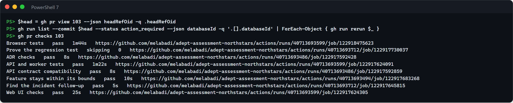

The bounds check, *Feature stays within its bounds*, passed in 16 seconds (its job took 10). CI passed in 3 minutes 15 seconds: the API and worker tests in 1 minute 22 seconds, the web UI checks in 25 seconds, and the browser tests in 1 minute 44 seconds. The list also shows checks from other solutions in this repository, including Design's ADR and API contract checks, which later runs don't show; they decide nothing here. Nobody approved the runs of Copilot's three earlier commits: they waited until the pull request closed, and GitHub then marked them failed without running them.

**What this shows:** nothing Copilot wrote ran in GitHub Actions until a person approved it, and both checks that decide passed on the first commit a person approved.

### 5. The reviewer read the change against the criteria

The owner then read the pull request. Copilot's summary, in the screenshot at the top of this page, described the API, the staleness and concurrency rules, the audit entry, the UI, and the contract change. Each test was named after the behavior it proves, so the diff read like the acceptance criteria:

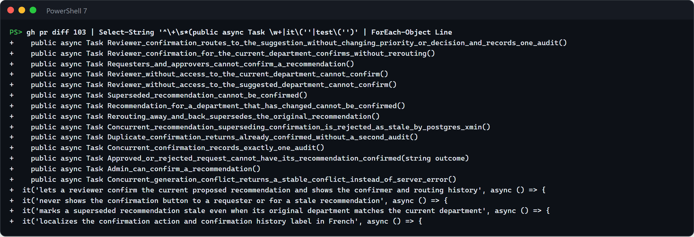

The bounds check's job summary listed the 13 changed files, all under `app/`, and ended with `PASS change stays within feature bounds`. `DecideAsync`, the approval rules, the workflows, and the infrastructure were unchanged. The schema needed no migration: Copilot used PostgreSQL's built-in `xmin` column as the concurrency token, which changed only the model snapshot, and the checker allows that.

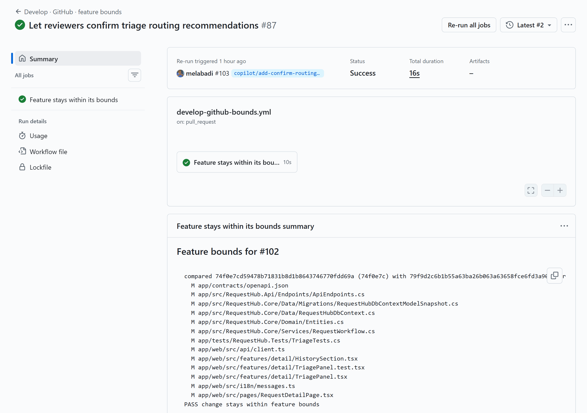

The same check fails a pull request that crosses a boundary. On 27 October a throwaway pull request, [#36](https://github.com/melabadi/adept-assessment-northstars/pull/36), let admins decide and deleted a test, and the check failed with three boundary problems:

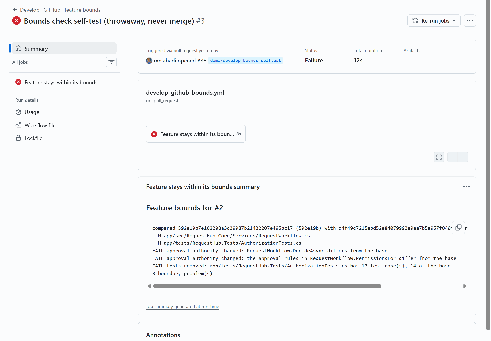

Two things went on the owner's list. Copilot's summary reported a decision the Issue hadn't asked for, that a manual reroute supersedes the open recommendation, and the reviewer's own test in step 6 checks what a reroute shows. And the French label *Confirmé par {name}* didn't agree with *recommandation*, which is feminine.

**What this shows:** the checks proved that the change stayed inside its bounds and that its tests passed, but judging the design stayed the reviewer's job.

### 6. The reviewer's own test failed, and the code was fixed, not the test

The owner had written a browser test from the acceptance criteria, without reading Copilot's code: [`confirm-routing.spec.ts`](regression/confirm-routing.spec.ts). At 15:57:09 UTC, on their own machine, they checked out the pull request's branch, added the test to `app/web/e2e/`, and asked Copilot CLI, with the same `develop-github` agent, to run it and to fix the code if it failed, never the test. The machine was shared, so the prompt also gave Copilot CLI its own port and database, as [Troubleshooting the copy](#troubleshooting-the-copy) describes. One test failed: after a manual reroute, the panel showed *No recommendation yet* where the stale notice belonged, because the superseded recommendation was no longer shown.

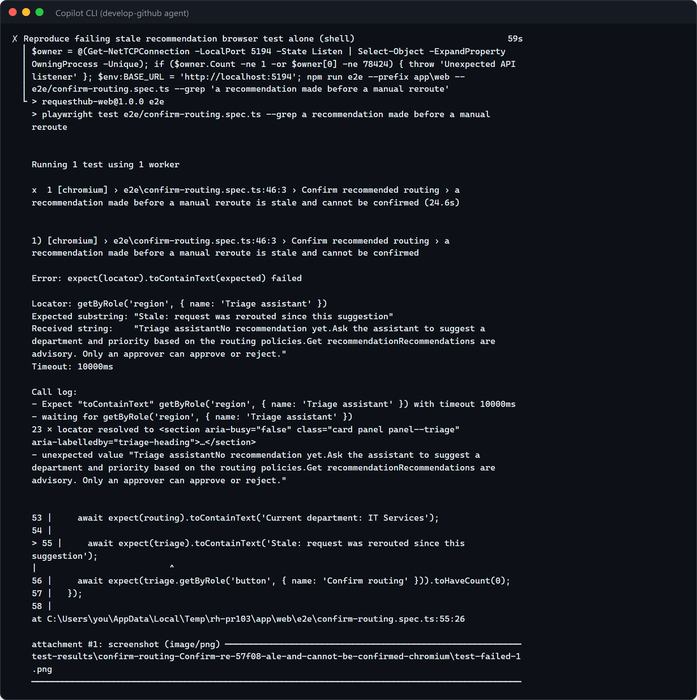

Copilot CLI changed one line in `RequestWorkflow.ToDetailAsync`, added a note to the app's README, left the reviewer's test unchanged, reran the suites and the scope check, and pushed [`d5e345a`](https://github.com/melabadi/adept-assessment-northstars/pull/103/commits/d5e345ad18b36c1deeff167c49ecdb27b8e9ffb6) at 16:15:31 with the test. The session took 19 minutes 12 seconds and reported 28.04 AI credits. The push came from the owner's account, so its workflow runs started without approval, and CI and the bounds check passed.

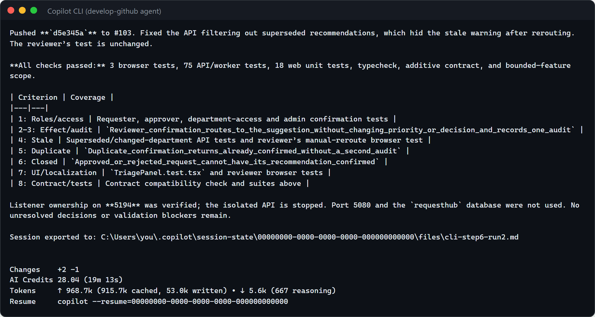

At 16:18:04 the owner sent the French label back to the cloud agent with an [`@copilot` comment](https://github.com/melabadi/adept-assessment-northstars/pull/103#issuecomment-6474381185) on the pull request:

```text
@copilot Review finding in the French strings: the confirmation line refers to the recommendation, which is feminine in French, like the existing `triage.requestedBy` ("Demandée par {name}"). Please change `triage.confirmedBy` to "Confirmée par {name}" and update the French expectations in the tests. Keep the English strings as they are.
```

A new Copilot session started 8 seconds later and set up its environment from `copilot-setup-steps.yml`:

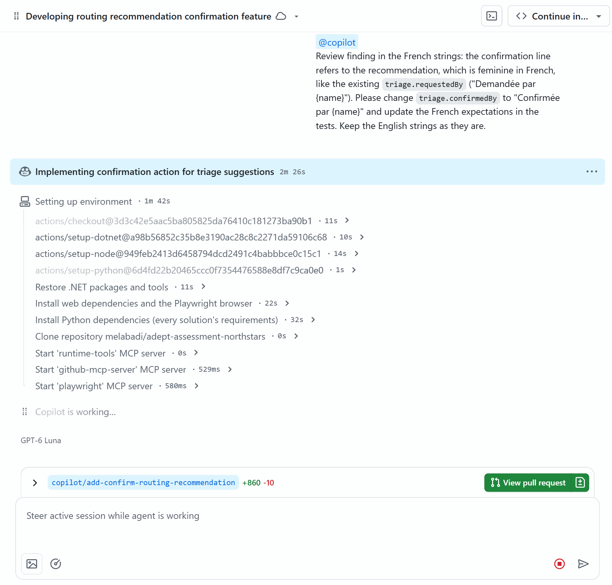

Copilot pushed [`d0dda39`](https://github.com/melabadi/adept-assessment-northstars/pull/103/commits/d0dda39931c35284b20d78a3a18477a8b4833c9b) at 16:21:24, 3 minutes 20 seconds after the comment, with a focused UI test, and [replied](https://github.com/melabadi/adept-assessment-northstars/pull/103#issuecomment-6474464492). The session reported 2.30 AI credits. The owner approved the new commit's runs at 16:22:27, and both checks passed.

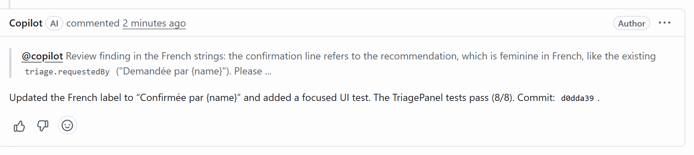

**What this shows:** a test written from the criteria, not from the code, found what Copilot's own 18 tests had missed, and the fix went into the code, never into the test.

### 7. Clicking through found one more defect, and a person decided

The owner then ran RequestHub from the pull request's branch on their machine and clicked through as two personas. As Ava, a requester, they filed an equipment request under Facilities, REQ-1025. As Ben, a reviewer, they asked for a recommendation: IT Services, under policy POL-ROUTE-001.

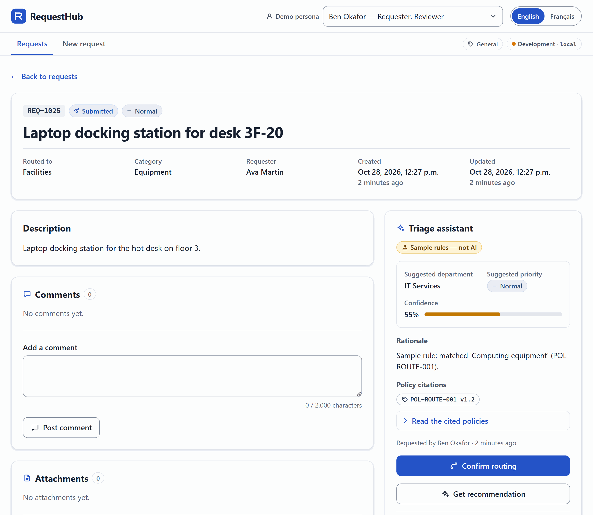

Ben confirmed it. The request moved to IT Services, but the panel labeled the recommendation Ben had just confirmed *Stale*, which no test had caught:

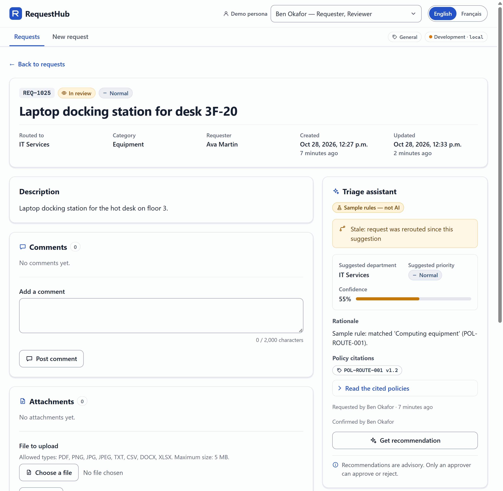

At 16:34:17 UTC the owner [sent it back](https://github.com/melabadi/adept-assessment-northstars/pull/103#issuecomment-6474753562):

```text
@copilot Review finding from clicking through the feature: right after Ben confirms a recommendation, the triage panel shows "Stale: request was rerouted since this suggestion" on the recommendation he just confirmed. The request moved because of the confirmation, so the warning is wrong. In `TriagePanel`, a recommendation is stale only when it is Superseded, or when it is still Proposed and its department no longer matches the request; a Confirmed recommendation is never stale. Please fix that and add a web unit test for the confirmed state (no stale notice, "Confirmed by {name}" shown, no Confirm routing button).
```

Copilot pushed [`e410f95`](https://github.com/melabadi/adept-assessment-northstars/pull/103/commits/e410f95ef1b4b9a36ff9901fa24efe2702abb543) at 16:36:51, 2 minutes 34 seconds later, with a web unit test for the confirmed state; the session reported 1.30 AI credits. Its [reply](https://github.com/melabadi/adept-assessment-northstars/pull/103#issuecomment-6474814506) named the previous commit, `d0dda39`, instead of `e410f95`: the commits are the evidence, not what Copilot says about them. The owner approved the new commit's runs at 16:38:23. The bounds check passed, now over 15 files, all under `app/`, and CI passed at 16:41:25, 3 minutes 2 seconds after the approval. On the fixed build, the same steps with a new request, REQ-1026, gave the expected result:

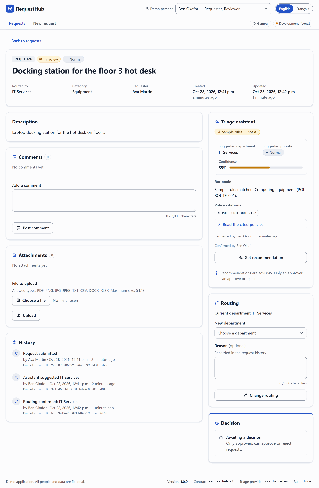

At 16:53:19 the owner closed the pull request without merging, and the Issue as not planned, as every run in this repository does: the feature stays off `main`, so the run can be repeated. No GitHub review was recorded in this run. In the run of 10 November 2026 (Issue [#278](https://github.com/melabadi/adept-assessment-northstars/issues/278), pull request [#279](https://github.com/melabadi/adept-assessment-northstars/pull/279)), the owner [approved](https://github.com/melabadi/adept-assessment-northstars/pull/279#pullrequestreview-5849784365) Copilot's commit `3e200b3` with a GitHub review that says what they checked.

**What this shows:** clicking through was part of the review and found what no test had caught, and the feature routes requests but never approves them.

## Results and value

**What the run left behind:**

- Issue [#102](https://github.com/melabadi/adept-assessment-northstars/issues/102), closed as not planned, and pull request [#103](https://github.com/melabadi/adept-assessment-northstars/pull/103), closed without merging. Its [seven commits](https://github.com/melabadi/adept-assessment-northstars/pull/103/commits) are Copilot's plan and three commits from its first session, Copilot CLI's fix with the reviewer's test, and Copilot's two fixes, each answering an `@copilot` comment that is on the pull request with Copilot's reply.
- Checks on every commit that ran them: CI and the bounds check passed on all four. [`evidence/run-2026-10-28.md`](evidence/run-2026-10-28.md) lists each run, its jobs and durations, Copilot's sessions, and the checker's output.
- The reviewer's test, [`confirm-routing.spec.ts`](regression/confirm-routing.spec.ts). After the run it gained an assertion that a confirmed recommendation shows no stale notice: it fails on `d0dda39` and passes on `e410f95`, so it now catches step 7's defect too.
- The person's decisions: approving Copilot's workflow runs three times, writing an independent test, sending two findings back, and closing the pull request unmerged. No GitHub review was recorded; the 10 November run's [review](https://github.com/melabadi/adept-assessment-northstars/pull/279#pullrequestreview-5849784365) shows one.

**What was measured:**

| Measure | Recorded run |
| --- | --- |
| Assigning the Issue to Copilot's draft pull request | 6 s |
| Copilot's first session | 27 min 59 s and 14.77 AI credits: 13 files, 793 lines added and 9 removed, 14 API tests and 4 web tests, all under `app/` |
| Waiting for a person to approve the workflow runs | 19 min 41 s the first time; 56 s and 1 min 24 s after the two `@copilot` fixes |
| The bounds check | 15 to 19 s on each of the four commits it judged |
| CI: API, web, and browser tests | 3 min 15 s on Copilot's first commit to run; 2 min 42 s to 3 min 44 s on the other three |
| Filing the Issue to the first green checks | 51 min 17 s |
| Defects found after every check had passed | 2, plus the French agreement found by reading the diff |
| Copilot CLI: the reviewer's failing test to a pushed fix | 19 min 12 s, 28.04 AI credits |
| An `@copilot` comment to Copilot's commit | 3 min 20 s (2.30 AI credits) and 2 min 34 s (1.30 AI credits) |
| GitHub-hosted runner time: every workflow the run started, Copilot's three sessions included | 50.6 min of job time; 71 min as billed in a private repository, where each job is rounded up to a whole minute |

**What a team gets:**

- **Time.** Copilot built the feature and its 18 tests unattended, and fixed each finding sent back with `@copilot` in under 4 minutes. The person's part was the Issue, three approvals, one independent test, reading the change, clicking through, and two short comments.
- **Risk removed.** A checker from `main` judged every commit: a change to a workflow, the infrastructure, an existing migration, the approval rules, or a deleted or skipped test turns it red, as [#36](https://github.com/melabadi/adept-assessment-northstars/pull/36) showed. The reviewer's own test and a click-through caught two defects before anyone merged.
- **Evidence a reviewer or auditor can follow.** Each criterion maps to a named test, the bounds check's summary lists every changed file with its verdict, and each fix is a commit that answers a comment on the pull request.
- **People stay in charge.** Copilot's workflow runs ran only after a person approved them, Copilot can't approve its own pull request, and RequestHub's rule is untouched: only approvers decide.

## Try it first in a copy of this repository

Optional: the same solution on RequestHub, before you adapt anything. You repeat the run in [See it work](#see-it-work) in your own copy, and it costs what [What it costs](#what-it-costs) lists for the recorded run.

The copy also has the files of this folder that belong to the demo: [`feature-issue.md`](feature-issue.md), the feature that the issue form is prefilled with; [`regression/confirm-routing.spec.ts`](regression/confirm-routing.spec.ts), the reviewer's browser test, written from the acceptance criteria; [`evidence/run-2026-10-28.md`](evidence/run-2026-10-28.md), the recorded run's sessions, workflow runs, and bounds check output; and [`images/`](images/), the screenshots of the recorded run and two of the 10 November run that PRESENTING.md uses.

### Quick start

About a minute, from the root of your copy of this repository: the root README's [Try it in a copy of this repository](../../README.md#try-it-in-a-copy-of-this-repository) makes that copy, once for every solution. You need the [prerequisites](#prerequisites); the copy already holds the files, and RequestHub is the app and the tests, so there is nothing to copy or change. In PowerShell 7, create the two labels the feature's Issue uses:

```powershell
gh label create ai-sdlc --color 1D76DB --description "AI-SDLC demo work" --force
gh label create phase:develop --color C5DEF5 --description "SDLC phase 3: Develop" --force
```

Then allow the Copilot cloud agent in your copy, as in the [prerequisites](#prerequisites). What you should see: `gh repo view --json nameWithOwner -q .nameWithOwner` prints your copy, the repository that every `gh` command below acts on; `gh label list --search phase:develop` prints `phase:develop  SDLC phase 3: Develop  #C5DEF5` on its first line; on any Issue in your copy, **Assignees** lists **Copilot**; and

```powershell
gh api 'repos/{owner}/{repo}/contents/.github/agents/develop-github.agent.md' --jq .path
git fetch --quiet origin main; git grep -c "triage.confirmed" origin/main -- app/
```

print `.github/agents/develop-github.agent.md`, then nothing: the agent is on your default branch, and the feature isn't. The skills, the bounds workflow, and the issue form are active too, because the copy's root `.github/` folder mirrors this solution's.

Steps 6 and 7 run RequestHub on your machine, so they need the [.NET 10 SDK](https://dotnet.microsoft.com/download), [Node.js 26](https://nodejs.org/), PostgreSQL on `localhost:5432` (user `requesthub`, password `devpass`; the [app README](../../app/README.md#run-it-locally) has a one-line Docker command), [GitHub Copilot CLI](https://docs.github.com/en/copilot/how-tos/copilot-cli/set-up-copilot-cli/install-copilot-cli), and the browser that the browser tests drive. Install it once:

```powershell
npm ci --prefix app/web
npm exec --prefix app/web -- playwright install chromium
```

### The steps

The steps have the numbers of [See it work](#see-it-work), which shows what each one looks like. Your commits, tests, and findings will differ, because Copilot writes new code every time. Steps 1 to 3 take a minute; Copilot then works on its own for about half an hour.

| Step | How long it took in the recorded run |
| --- | --- |
| 1. Open the issue form | seconds |
| 2. File the Issue | seconds |
| 3. Assign it to Copilot | 6 s to the draft pull request; Copilot's session took 27 min 59 s (between 15 and 28 minutes across four runs: [#3](https://github.com/melabadi/adept-assessment-northstars/pull/3), [#39](https://github.com/melabadi/adept-assessment-northstars/pull/39), [#103](https://github.com/melabadi/adept-assessment-northstars/pull/103), and [#279](https://github.com/melabadi/adept-assessment-northstars/pull/279)) |
| 4. Approve the workflow runs | seconds to approve; then the bounds check 16 s and CI 3 min 15 s |
| 5. Read the change | your own reading; not measured |
| 6. Run your own test with Copilot CLI, and hand a finding back | Copilot CLI 19 min 12 s; the `@copilot` fix 3 min 20 s |
| 7. Click through and decide | building and starting the app, about 1¼ min when this README was checked; the `@copilot` fix 2 min 34 s |

1. **Open the issue form.** In your copy, select **Issues** > **New issue** > **Develop: bounded feature for Copilot**. The form is prefilled from [`feature-issue.md`](feature-issue.md). See [step 1](#1-the-feature-was-written-as-an-issue-with-testable-criteria).
2. **File the Issue.** Select **Create**. From a terminal instead:

   ```powershell
   $url = gh issue create --title "Develop: reviewer confirms the recommended routing department" `
     --body-file solutions/03-develop-github/feature-issue.md --label ai-sdlc --label phase:develop
   $issue = $url.Split('/')[-1]; $url
   ```

   It prints the new Issue's URL. See [step 2](#2-the-owner-filed-the-issue).
3. **Assign it to Copilot with the custom agent.** In the Issue, open **Assignees**, choose **Copilot**, pick the **develop-github** agent, keep the base branch `main`, and assign. From a terminal instead (`$issue` comes from step 2; if you filed the Issue in the browser, set it to the Issue's number):

   ```powershell
   $repo = gh repo view --json nameWithOwner -q .nameWithOwner
   @{ assignees = @('copilot-swe-agent[bot]'); agent_assignment = @{ target_repo = $repo; base_branch = 'main'; custom_agent = 'develop-github' } } |
     ConvertTo-Json | gh api -X POST "repos/$repo/issues/$issue/assignees" --input - --jq '"Assigned to: " + ([.assignees[].login] | join(", "))'
   ```

   Within seconds Copilot opens a draft pull request. Select **View session** on it to watch Copilot set up its environment, read the code, edit, and run tests. When the session ends, the title loses `[WIP]` and Copilot asks for your review. See [step 3](#3-copilot-opened-a-draft-pull-request-and-built-the-feature).
4. **Approve the workflow runs.** Select **Approve workflows to run** in the pull request's merge box, or **Approve and run** on a waiting run. From a terminal instead, start every waiting run of the latest commit and follow the checks:

   ```powershell
   $head = gh pr view <pr> --json headRefOid -q .headRefOid
   gh run list --commit $head --status action_required --json databaseId -q '.[].databaseId' | ForEach-Object { gh run rerun $_ }
   gh pr checks <pr> --watch
   ```

   The two that decide are **CI** and **Develop · GitHub · feature bounds**; checks from other solutions may run and pass or skip. Approve again after each push from Copilot. See [step 4](#4-a-person-approved-the-workflow-runs-and-the-checks-passed).
5. **Read the change.** In the pull request, open **Files changed**, Copilot's summary, and the **Feature stays within its bounds** check's summary. List the tests' names without leaving the terminal:

   ```powershell
   gh pr diff <pr> | Select-String '^\+\s*(public async Task \w+|it\(''|test\('')' | ForEach-Object Line
   ```

   See [step 5](#5-the-reviewer-read-the-change-against-the-criteria).
6. **Run your own test with Copilot CLI, and hand a finding back.** Wait until Copilot's session has ended: one agent at a time works on a branch. Then, with PostgreSQL running:

   ```powershell
   gh pr checkout <pr>
   Copy-Item solutions/03-develop-github/regression/confirm-routing.spec.ts app/web/e2e/
   copilot --agent develop-github --allow-all-tools -p "The reviewer added app/web/e2e/confirm-routing.spec.ts. Run it with the regression-validation skill (--e2e). If it fails, find the cause and fix the code, never the test. Then run the bounded-feature scope check, commit with a message that names the test, and push."
   ```

   Copilot CLI builds the UI, starts RequestHub on port 5080, runs the browser tests, and if your test fails, fixes the code and pushes. If port 5080 or the `requesthub` database belongs to something else on your machine, see [Troubleshooting the copy](#troubleshooting-the-copy). Its push is yours, so its workflow runs start without approval. To hand a finding back to the cloud agent, comment on the pull request:

   ```powershell
   gh pr comment <pr> --body "@copilot <the finding, and what you expect instead>"
   ```

   A new Copilot session starts within seconds and pushes to the same branch; approve its runs as in step 4. See [step 6](#6-the-reviewers-own-test-failed-and-the-code-was-fixed-not-the-test).
7. **Click through and decide.** Update the branch with `git pull`, then build and start RequestHub (about 1¼ minutes when this README was checked: 23 seconds, 13 seconds, and 40 seconds for the API's first build):

   ```powershell
   npm ci --prefix app/web
   npm run build --prefix app/web
   dotnet run --project app/src/RequestHub.Api        # http://localhost:5080
   ```

   Open http://localhost:5080 and use **Demo persona** at the top to switch users. As **Ava**, file an *equipment* request under **Facilities**. As **Ben**, open it, select **Get recommendation**, then **Confirm routing**. The request should move to IT Services, show *Confirmed by Ben Okafor* with no stale notice, and still wait for an approver. Send what you find back with `@copilot`, as in step 6. Then decide:

   ```powershell
   gh pr ready <pr>
   gh pr review <pr> --approve --body "<what you checked: the criteria, the checks, your own test>"
   ```

   Use `--request-changes` instead of `--approve` to send it back. Don't merge: the next run needs `main` without the feature. See [step 7](#7-clicking-through-found-one-more-defect-and-a-person-decided).

### Reset the copy for another run

Stop RequestHub (Ctrl+C), then:

```powershell
gh pr close <pr> --delete-branch --comment "Trial run: closed without merging."
gh issue close <issue> --reason "not planned"
git switch main
git branch -D <copilot-branch>    # if you ran step 6 or 7
```

Never merge Copilot's pull request in the copy: the feature would land on `main`, and the next run would have nothing to build. What you should see: `gh issue list --label phase:develop --state open` lists no Issue from the run, and `git grep -c "triage.confirmed" origin/main -- app/` still prints nothing.

When you no longer need the copy, the [root README](../../README.md#try-it-in-a-copy-of-this-repository) says how to delete it.

### Troubleshooting the copy

- **Port 5080 or the `requesthub` database is already used on your machine.** The browser tests reset the database of whichever RequestHub answers at `BASE_URL`. On a shared machine, another app once took our free port while our API was still building, and its data was reset. Run your own copy on a free port with a new database (a database migrated by another branch can conflict), check that the listener is your process, then point the tests at it:

  ```powershell
  npm run build --prefix app/web
  $env:ASPNETCORE_ENVIRONMENT = "Development"; $env:ASPNETCORE_URLS = "http://localhost:5193"
  $env:ConnectionStrings__RequestHub = "Host=localhost;Port=5432;Database=rh_develop_demo;Username=requesthub;Password=devpass"
  dotnet run --project app/src/RequestHub.Api --no-launch-profile          # leave running; in a second terminal:
  Get-Process -Id (Get-NetTCPConnection -LocalPort 5193 -State Listen).OwningProcess | Select-Object Id, Path   # must be your build
  $env:BASE_URL = "http://localhost:5193"; npm run e2e --prefix app/web -- e2e/confirm-routing.spec.ts
  ```

  For step 6, give Copilot CLI the same instructions in its prompt: the port, the database, the listener check, and not to use `--e2e`. The recorded run did.
- **`Failed to start forks worker` from the web unit tests.** On a busy machine Vitest's worker processes can time out. Use fewer workers (`$env:VITEST_MAX_WORKERS = '2'`) or run the suite in threads: `npm test --prefix app/web -- --pool=threads --maxWorkers=1`. Copilot CLI found one of these fallbacks by itself in each of our runs.
