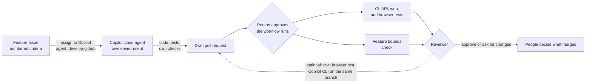

# Develop · Issue to pull request with the Copilot cloud agent

Small, well-defined features often wait in the backlog until a developer has time to write the code and the tests and ask for review. In this solution a feature Issue with numbered acceptance criteria is assigned to the Copilot cloud agent with a custom agent. Copilot writes the code and a test for every criterion in its own cloud environment, and opens a pull request. Deterministic checks decide whether the change works and stays inside its boundaries: approval authority, CI/CD, infrastructure, existing migrations, tests, and the API contract. A person reviews and decides.

## Where it fits

**Phase 3 of 7: Develop.** The Microsoft counterpart is [03-develop-microsoft](../03-develop-microsoft/): there, an AI agent runs *inside* RequestHub. Here, an AI agent *writes* RequestHub's code.

| | Today | With this solution |
| --- | --- | --- |
| Picking up work | A developer reads the ticket, asks questions, and starts when they have time. | Assign the Issue to Copilot. A draft pull request appears within a minute and is ready for review in about 20. |
| Tests | Written last, if at all. | Every acceptance criterion maps to a test, and the pull request lists them. |
| Boundaries | Reviewers hope nobody touched the pipeline, the infrastructure, or the approval rules. | A check fails the pull request when it leaves `app/`, touches approval authority, edits a migration, deletes or skips a test, or breaks the API contract. |
| Review | The reviewer reconstructs what changed and why. | The checks have already run. The reviewer reads a criterion-to-test table, adds an independent browser test, and iterates on the same branch with Copilot CLI. |

## How it works



- **Copilot cloud agent** runs the custom agent [`develop-github`](.github/agents/develop-github.agent.md) with three skills: `bounded-feature` (how to build a feature inside its bounds, plus the boundary check), `regression-validation` (runs the test suites a change touches), and `contract-impact` (additive-only API contract check). It works in the environment that [`copilot-setup-steps.yml`](../../.github/workflows/copilot-setup-steps.yml) prepares: .NET, Node.js, Playwright, and PostgreSQL.
- **GitHub Actions** runs the app's [CI](../../.github/workflows/ci.yml) (API integration tests on PostgreSQL with the contract check, web typecheck, unit tests and build, browser tests) and this solution's [`develop-github-bounds.yml`](.github/workflows/develop-github-bounds.yml). The bounds check runs the checker from the base branch, so a pull request cannot change the rules it is judged by.
- **A person** writes the Issue, approves the workflow runs on Copilot's pull request, reviews, and decides. In RequestHub itself, only an approver ever approves a request, and the feature cannot change that.

## What's in this folder

```text
03-develop-github/
├── README.md
├── feature-issue.md                        the demo feature Issue, the same text the issue template is prefilled with
├── regression/confirm-routing.spec.ts      the reviewer's browser test, written from the acceptance criteria
└── .github/
    ├── agents/develop-github.agent.md      the custom Copilot agent
    ├── skills/
    │   ├── bounded-feature/                procedure and scope_check.py, the boundary checker
    │   ├── regression-validation/          runs the suites a change touches (shared with 04-test-github)
    │   └── contract-impact/                additive-only contract check (shared with 02-design-github)
    ├── workflows/develop-github-bounds.yml fails a feature pull request that crosses a boundary
    └── ISSUE_TEMPLATE/03-develop-github-feature.yml
```

The solution also relies on two repository-wide workflows that belong to no single solution: [`ci.yml`](../../.github/workflows/ci.yml), the app's tests, and [`copilot-setup-steps.yml`](../../.github/workflows/copilot-setup-steps.yml), the cloud agent's environment.

## Prerequisites

- GitHub Copilot Business or Enterprise, with the **Copilot cloud agent** enabled for the repository. Copilot then appears in the **Assignees** menu of an Issue.
- Write access to the repository, to assign Issues and approve workflow runs.
- [GitHub CLI](https://cli.github.com/), signed in (`gh auth login`).
- For the optional step 6 on your machine: [GitHub Copilot CLI](https://docs.github.com/copilot/how-tos/set-up/install-copilot-cli), Python 3.12 or later (the scripts use only the standard library), and RequestHub's local toolchain: .NET 10 SDK, Node.js 22, and PostgreSQL ([app/README.md](../../app/README.md#run-it-locally)).

## Set up

Run once from the repository root:

```powershell
gh label create ai-sdlc --color 1D76DB --description "AI-SDLC demo work" --force
gh label create phase:develop --color C5DEF5 --description "SDLC phase 3: Develop" --force
```

The agent, skills, workflow, and issue template are active because the repository's root `.github/` folder mirrors them. The cloud agent only offers custom agents that are on the default branch.

## Run the demo

About 15 minutes of presenting. Copilot needs about 20 minutes on its own, so start step 3 before the session.

1. **Show the feature.** Open [`feature-issue.md`](feature-issue.md). One problem, an additive scope, eight numbered acceptance criteria (roles, effect, audit, stale, duplicate, closed requests, UI, contract and tests), and an explicit out of scope: who can approve or reject.

2. **Create the Issue.** In the browser: **Issues → New issue → Develop: bounded feature for Copilot → Create**. The fields are prefilled. Or from a terminal:

   ```powershell
   $url = gh issue create --title "Develop: reviewer confirms the recommended routing department" `
     --body-file solutions/03-develop-github/feature-issue.md --label ai-sdlc --label phase:develop
   $issue = $url.Split('/')[-1]
   ```

3. **Assign it to Copilot with the custom agent.** In the Issue, open **Assignees**, choose **Copilot**, pick the **develop-github** agent, keep the base branch `main`, and assign. Or from a terminal:

   ```powershell
   $repo = gh repo view --json nameWithOwner -q .nameWithOwner
   @{ assignees = @('copilot-swe-agent[bot]'); agent_assignment = @{ target_repo = $repo; base_branch = 'main'; custom_agent = 'develop-github' } } |
     ConvertTo-Json | gh api -X POST "repos/$repo/issues/$issue/assignees" --input -
   ```

   Copilot opens a draft pull request linked to the Issue within seconds. Select **View session** on the pull request to watch it plan, edit, and run tests live. In our run it finished in 19 minutes, about 3 of them preparing its environment.

4. **Approve the workflow runs.** Workflows on Copilot's pull requests wait for a person, because they could run unreviewed code with the repository's secrets. When Copilot has finished, select **Approve and run workflows** on the pull request, or start the waiting runs for its latest commit from a terminal:

   ```powershell
   $head = gh pr view <number> --json headRefOid -q .headRefOid
   gh run list --commit $head --status action_required --json databaseId -q '.[].databaseId' | ForEach-Object { gh run rerun $_ }
   ```

   Two workflows report: **CI** (API and worker tests, web UI checks, browser tests; about 3 minutes) and **Develop · GitHub · feature bounds** (seconds). Approve again after each new push from Copilot.

5. **Review like a tech lead.** In the pull request:
   - **Files changed**: a new operation in `RequestWorkflow` with role and department checks and stable error codes, one new route, a *new* migration, an additive contract change, the button in `TriagePanel`, a History label, and English and French strings.
   - The tests read like the acceptance criteria, for example `Requester_cannot_confirm_a_recommendation`, `Recommendation_is_stale_after_request_department_changes`, and `Duplicate_confirmation_conflicts_without_a_second_audit`. Match them to the Issue's eight criteria.
   - The **Feature stays within its bounds** job summary ends with `PASS change stays within feature bounds`. Point out what did not change: `DecideAsync`, the approval rules, workflows, and infrastructure.
   - **View session** shows every command Copilot ran, including the boundary check and the regression suite with browser tests. That is its own account; the checks above are the evidence.
   - Optionally request a review from **Copilot** for a second opinion. Its comments are advice; the checks are the gate.

6. **Optional: add your own test and iterate on the same branch with Copilot CLI** (15 to 20 minutes, most of it building and testing). One agent at a time works on a branch: wait until the cloud agent session has finished, then:

   ```powershell
   gh pr checkout <number>
   Copy-Item solutions/03-develop-github/regression/confirm-routing.spec.ts app/web/e2e/
   copilot --agent develop-github --allow-all-tools -p "The reviewer added app/web/e2e/confirm-routing.spec.ts. Run it with the regression-validation skill (--e2e). If it fails, find the cause and fix the code, never the test. Then run the bounded-feature scope check, commit with a message that names the test, and push."
   ```

   Copilot CLI builds the UI, starts RequestHub on http://localhost:5080, and runs the browser tests. If the reviewer's test fails, it reads the failing assertion, finds the cause in the code, fixes it, and reruns. Then it commits the test, pushes to the same pull request, and CI runs it from then on. In our run the test passed against Copilot's code without changes. Against an earlier run, the same test caught a History entry that read `Activity: triage.confirmed` instead of plain words.

   To hand the branch back to the cloud agent, for example with a review finding, mention `@copilot` in a pull request comment. A new session starts within seconds, continues from your latest commit, and pushes a fix (6 minutes for a wording fix in our run). Approve its workflow runs as in step 4.

7. **See it and decide.** To click through the feature, start the app from the branch (`npm ci --prefix app/web`, `npm run build --prefix app/web`, then `dotnet run --project app/src/RequestHub.Api`) and open http://localhost:5080. As **Ava**, file an *equipment* request under **Facilities**; as **Ben**, open it, select **Get recommendation**, then **Confirm routing**. The request moves to IT Services and the History reads *Routing confirmed: IT Services*. Then approve the pull request or ask for changes. For the demo, do not merge it (see below).

## What to observe

- **The Issue is the contract.** Each numbered criterion became a test named after the behavior it proves.
- **Boundaries are enforced, not hoped for.** The bounds check ran the checker from `main` against Copilot's commits. A change to a workflow, the infrastructure, an existing migration, `DecideAsync`, or a deleted or skipped test turns it red.
- **Human approval stays human.** The new action routes a request; it never approves one. Copilot's workflow runs needed a person, and so does the merge.
- **Facts over narrative.** CI and the bounds check are green or red. What Copilot says it did is a summary, not evidence.
- **Review still matters.** Green checks do not judge wording, product vocabulary, or design choices. Send a finding back with an `@copilot` comment and Copilot fixes it on the same branch.
- **Two agents, one branch, no collisions.** The cloud agent and Copilot CLI take turns on the same pull request.
- **Impact to measure.** Time from Issue to a green pull request, the number of review rounds, and how many criteria passed the reviewer's own test the first time. Generated lines of code are not a measure.

## Reset and clean up

```powershell
gh pr close <number> --delete-branch --comment "Demo run, not merged."
gh issue close <issue> --reason "not planned"
```

Never merge the demo pull request: the feature would land on `main` and the next run would have nothing to build. Keep one earlier run's pull request as a fallback for when the service is unavailable, and present it as a recording, never as a live run.

## Use it in your own repository

1. Copy this folder's `.github/` contents into your repository's `.github/` folder, and add a `copilot-setup-steps.yml` that installs what your tests need (SDKs, dependencies, browsers, databases as services).
2. In `scope_check.py`, point `APP`, `WORKFLOW`, `MIGRATIONS`, `CONTRACT`, `DECIDE`, `PERMISSIONS`, and the decision patterns at your own code: the folder a feature may change, and the code that holds your approval authority.
3. Rewrite the agent's **How to work** section for your stack's layout and test commands. Keep its rules.
4. Replace the issue template's prefilled values with a feature of your own, or clear them for a blank form. The bounds check runs for pull requests that close an Issue labeled `phase:develop`; change the label in the workflow if you use another one.
5. Make **Feature stays within its bounds** and your test jobs required status checks in a branch ruleset, so a red check blocks the merge. A required workflow must run on every pull request: one skipped by a `paths` filter stays pending and blocks merging. The bounds workflow has no `paths` filter for that reason.

## Troubleshooting

- **No checks on Copilot's pull request.** Workflows on pull requests from the cloud agent wait for a person to approve them. Select **Approve and run workflows**, or run `gh run rerun <run-id>`.
- **Port 5080 or the `requesthub` database is already used on your machine.** The browser tests reset the database of whichever RequestHub answers at `BASE_URL`. On a shared machine, another app took our free port while our API was still building, and its demo data was reset. Run your own copy on a free port with a new database (a database migrated by another branch can conflict), check that the listener is your process, then point the tests at it:

  ```powershell
  npm run build --prefix app/web
  $env:ASPNETCORE_ENVIRONMENT = "Development"; $env:ASPNETCORE_URLS = "http://localhost:5193"
  $env:ConnectionStrings__RequestHub = "Host=localhost;Port=5432;Database=rh_develop_demo;Username=requesthub;Password=devpass"
  dotnet run --project app/src/RequestHub.Api --no-launch-profile          # leave running; in a second terminal:
  Get-Process -Id (Get-NetTCPConnection -LocalPort 5193 -State Listen).OwningProcess | Select-Object Id, Path   # must be your build
  $env:BASE_URL = "http://localhost:5193"; npm run e2e --prefix app/web -- e2e/confirm-routing.spec.ts
  ```
