# Develop · Issue to pull request with the Copilot cloud agent

Small, well-defined features often wait in the backlog until a developer has time to write the code and the tests and ask for review. In this solution a feature Issue with numbered acceptance criteria is assigned to the Copilot cloud agent with a custom agent. Copilot writes the code and a test for every criterion in its own cloud environment, and opens a pull request. Deterministic checks decide whether the change works and stays inside its boundaries: approval authority, CI/CD, infrastructure, existing migrations, tests, and the API contract. A person reviews, sends findings back to Copilot, and decides.

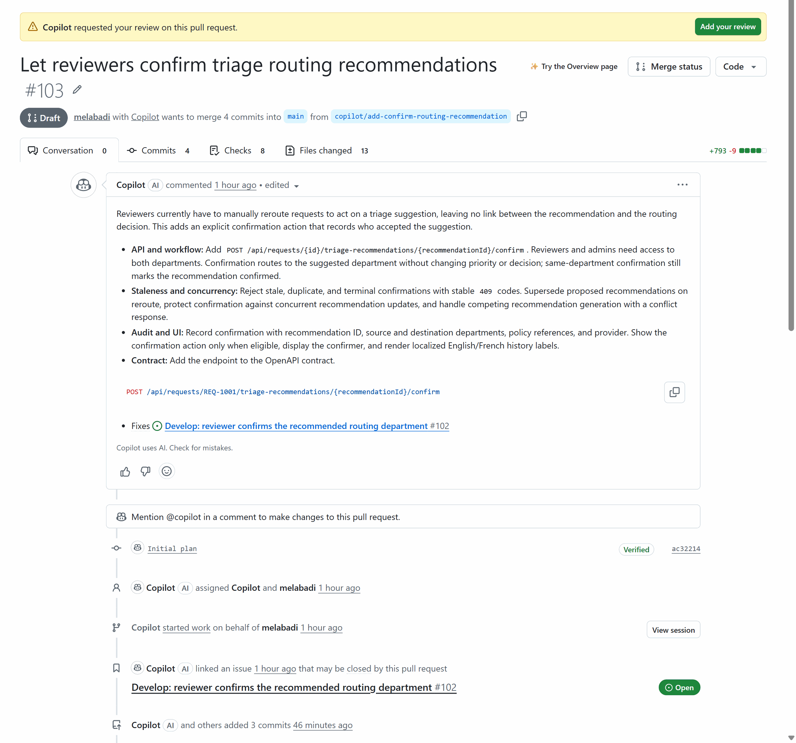

## Where it fits

**Phase 3 of 7: Develop.** The Microsoft counterpart is [03-develop-microsoft](../03-develop-microsoft/): there, an agent in Azure *reviews* RequestHub's pull requests. Here, an AI agent *writes* RequestHub's code.

| | Today | With this solution |
| --- | --- | --- |
| Picking up work | A developer reads the ticket, asks questions, and starts when they have time. | Assign the Issue to Copilot. A draft pull request appears within seconds and is ready for review in 20 to 30 minutes. |
| Tests | Written last, if at all. | Every acceptance criterion maps to a test named after the behavior it proves. |
| Boundaries | Reviewers hope nobody touched the pipeline, the infrastructure, or the approval rules. | A check fails the pull request when it leaves `app/`, touches approval authority, edits a migration, deletes or skips a test, or breaks the API contract. |
| Review | The reviewer reconstructs what changed and why. | The checks have already run. The reviewer adds an independent test, clicks through the feature, and sends findings back to Copilot on the same branch. |

## How it works

```mermaid
flowchart LR
  I[Feature Issue<br/>numbered criteria] -->|assign to Copilot<br/>agent: develop-github| C[Copilot cloud agent<br/>own environment]
  C -->|code, tests,<br/>own checks| PR[Draft pull request]
  PR --> A{Person approves<br/>the workflow runs}
  A --> CI[CI: API, web,<br/>and browser tests]
  A --> B[Feature bounds<br/>check]
  CI --> R{Reviewer}
  B --> R
  R -.->|own browser test,<br/>Copilot CLI on the same branch| PR
  R -.->|@copilot comment<br/>with a finding| C
  R -->|approve or ask for changes| D[People decide what merges]
```

- **Copilot cloud agent** runs the custom agent [`develop-github`](.github/agents/develop-github.agent.md) with three skills: `bounded-feature` (how to build a feature inside its bounds, plus the boundary check), `regression-validation` (runs the test suites a change touches), and `contract-impact` (additive-only API contract check). It works in the environment that [`copilot-setup-steps.yml`](../../.github/workflows/copilot-setup-steps.yml) prepares: .NET, Node.js, Playwright, and PostgreSQL.
- **GitHub Actions** runs the app's [CI](../../.github/workflows/ci.yml) (API integration tests on PostgreSQL with the contract check, web typecheck, unit tests and build, browser tests) and this solution's [`develop-github-bounds.yml`](.github/workflows/develop-github-bounds.yml). The bounds check runs the checker from the base branch, so a pull request cannot change the rules it is judged by.
- **A person** writes the Issue, approves the workflow runs on Copilot's pull request, reviews, sends findings back with an `@copilot` comment, and decides. In RequestHub itself, only an approver ever approves a request, and the feature cannot change that.

## What's in this folder

```text
03-develop-github/
├── README.md
├── feature-issue.md                        the demo feature Issue, the same text the issue template is prefilled with
├── regression/confirm-routing.spec.ts      the reviewer's browser test, written from the acceptance criteria
├── images/                                 screenshots from a live run, used in this README
└── .github/
    ├── agents/develop-github.agent.md      the custom Copilot agent
    ├── skills/
    │   ├── bounded-feature/                procedure and scope_check.py, the boundary checker
    │   ├── regression-validation/          runs the suites a change touches (shared with 04-test-github)
    │   └── contract-impact/                additive-only contract check (shared with 02-design-github)
    ├── workflows/develop-github-bounds.yml fails a feature pull request that crosses a boundary
    └── ISSUE_TEMPLATE/03-develop-github-feature.yml
```

The solution also relies on two repository-wide workflows that belong to no single solution: [`ci.yml`](../../.github/workflows/ci.yml), the app's tests, and [`copilot-setup-steps.yml`](../../.github/workflows/copilot-setup-steps.yml), the cloud agent's environment.

## Prerequisites

- GitHub Copilot Business or Enterprise, with the **Copilot cloud agent** enabled for the repository. Copilot then appears in the **Assignees** menu of an Issue.
- Write access to the repository, to assign Issues and approve workflow runs.
- [GitHub CLI](https://cli.github.com/), signed in (`gh auth login`), and PowerShell 7.
- For steps 6 and 7 on your machine: [GitHub Copilot CLI](https://docs.github.com/copilot/how-tos/set-up/install-copilot-cli), Python 3.12 or later (the scripts use only the standard library), and RequestHub's local toolchain: .NET 10 SDK, Node.js 22, and PostgreSQL ([app/README.md](../../app/README.md#run-it-locally)).

## Set up

Run once from the repository root:

```powershell
gh label create ai-sdlc --color 1D76DB --description "AI-SDLC demo work" --force
gh label create phase:develop --color C5DEF5 --description "SDLC phase 3: Develop" --force
```

Check them with `gh label list --search phase:develop`: the first line reads `phase:develop  SDLC phase 3: Develop`. The agent, skills, workflow, and issue template are active because the repository's root `.github/` folder mirrors them. The cloud agent only offers custom agents that are on the default branch.

## Before each session

1. **Confirm the starting state.** From the repository root:

   ```powershell
   git fetch origin main
   git grep -c "triage.confirmed" origin/main -- app/        # prints nothing: the feature is not on main yet
   gh issue list --label phase:develop --state open           # no demo Issue left open, except a fallback you keep on purpose
   gh api 'repos/{owner}/{repo}/contents/.github/agents/develop-github.agent.md' --jq .path
   gh api graphql -F owner='{owner}' -F name='{repo}' --jq '.data.repository.suggestedActors.nodes[].login' -f query='
     query($owner: String!, $name: String!) {
       repository(owner: $owner, name: $name) { suggestedActors(capabilities: [CAN_BE_ASSIGNED], first: 10) { nodes { login } } }
     }'
   ```

   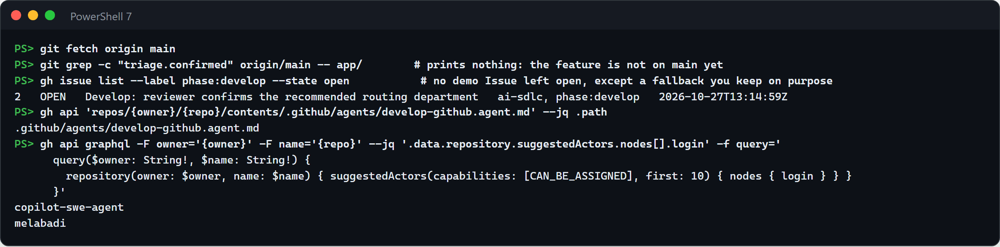

   If `git grep` finds the feature, someone merged a demo pull request: revert it before the session.
2. **Start Copilot early.** Run steps 2 and 3 at least 30 minutes before you present. Copilot needs 20 to 30 minutes for its first session (19 and 28 minutes in our runs). In the session, start from step 1 and switch to the pull request when you reach step 3.
3. **Open in advance:**
   - the issue form (**Issues → New issue → Develop: bounded feature for Copilot**), the repository's **Pull requests** and **Actions** tabs, and Copilot's draft pull request once it exists;
   - an earlier run's pull request, left unmerged as a fallback, to present as a recording if the service is unavailable;
   - a terminal at the repository root, signed in to `gh`;
   - for step 6, a second clone or worktree with `npm ci --prefix app/web` and `dotnet restore app/RequestHub.slnx` done, and Copilot CLI signed in;
   - for step 7, PostgreSQL running.
4. **Timings.** About 25 minutes of presenting, plus the waits below. To keep the session short, run step 6's Copilot CLI before the session too and show its output.

   | Step | You | Waiting |
   | --- | --- | --- |
   | 1. Show the feature | 1 min | |
   | 2. Create the Issue | 1 min | |
   | 3. Assign it to Copilot | 1 min | draft pull request in seconds; Copilot's session 20 to 30 min |
   | 4. Approve the workflow runs | 1 min | bounds check 15 s, CI about 3 min |
   | 5. Review like a tech lead | 5 min | |
   | 6. Your own test, Copilot CLI, `@copilot` | 3 min | Copilot CLI about 20 min; an `@copilot` fix 3 to 6 min |
   | 7. See it and decide | 5 min | 2 min to build and start the app |

## Run the demo

1. **Show the feature.** Open **Issues → New issue → Develop: bounded feature for Copilot**. The form is prefilled from [`feature-issue.md`](feature-issue.md): one problem, an additive scope, eight numbered acceptance criteria (roles, effect, audit, stale, duplicate, closed requests, UI, contract and tests), and an explicit out of scope. Scroll to the **Out of scope** field at the bottom of the form: who can approve or reject is excluded. *1 minute.*

   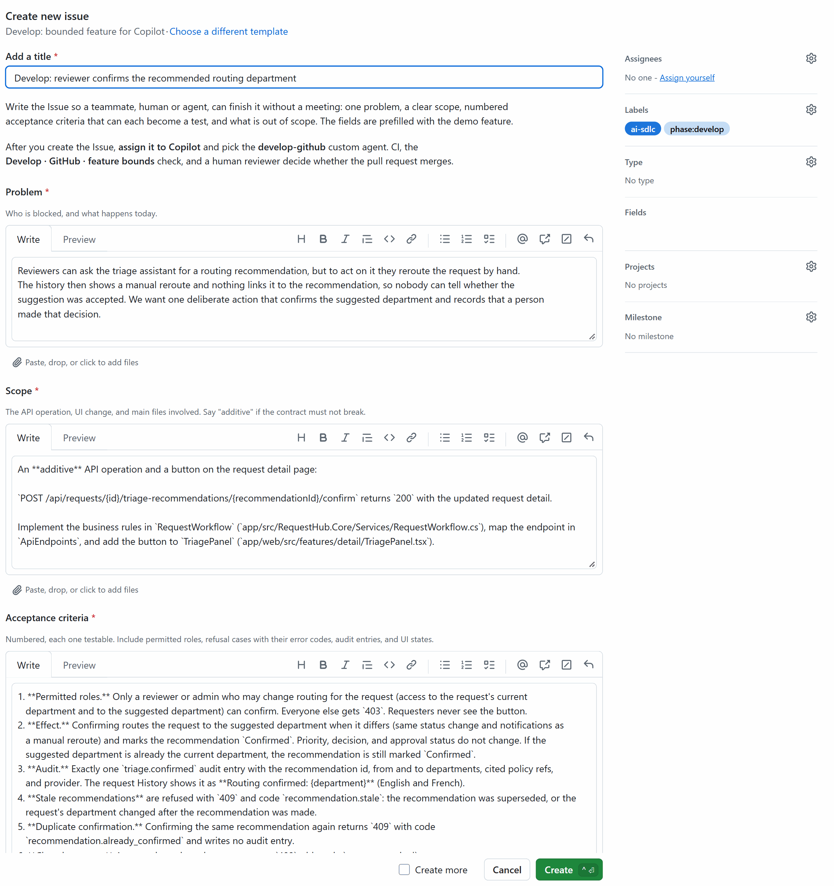

   **Point out:** every criterion is specific enough to become a test, down to the status and error codes (`403`, `409` with `recommendation.stale`).

2. **Create the Issue.** Select **Create**. Or from a terminal:

   ```powershell
   $url = gh issue create --title "Develop: reviewer confirms the recommended routing department" `
     --body-file solutions/03-develop-github/feature-issue.md --label ai-sdlc --label phase:develop
   $issue = $url.Split('/')[-1]; $url
   ```

   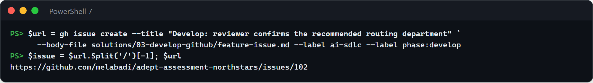

   *A few seconds.* **Point out:** the `phase:develop` label marks the Issue as a feature, so the bounds check judges the pull request that closes it.

3. **Assign it to Copilot with the custom agent.** In the Issue, open **Assignees**, choose **Copilot**, pick the **develop-github** agent, keep the base branch `main`, and assign. Or from a terminal (`$issue` comes from step 2; if you created the Issue in the browser, set it to the Issue number first):

   ```powershell
   $repo = gh repo view --json nameWithOwner -q .nameWithOwner
   @{ assignees = @('copilot-swe-agent[bot]'); agent_assignment = @{ target_repo = $repo; base_branch = 'main'; custom_agent = 'develop-github' } } |
     ConvertTo-Json | gh api -X POST "repos/$repo/issues/$issue/assignees" --input - --jq '"Assigned to: " + ([.assignees[].login] | join(", "))'
   ```

   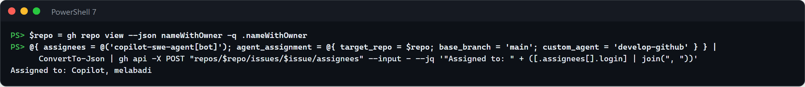

   Copilot opens a draft pull request linked to the Issue within seconds (5 seconds in our run) and keeps its plan in the description, checking items off as it works. Select **View session** to watch it live: it sets up the environment from `copilot-setup-steps.yml`, reads the code, edits, and runs tests (step 6 shows the live view).

   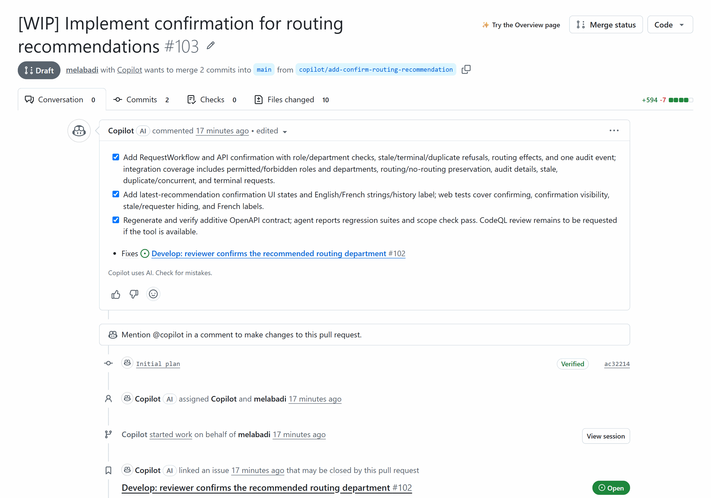

   *Seconds to assign; Copilot then works for 20 to 30 minutes.* **Point out:** "Copilot started work on behalf of" you: it works with your permissions, in its own cloud environment, on its own branch.

4. **Approve the workflow runs.** Workflows on Copilot's pull requests wait for a person, because they could run unreviewed code with the repository's secrets. When Copilot has finished (the title loses `[WIP]` and Copilot requests your review), select **Approve and run workflows** on the pull request or **Approve and run** on a waiting run.

   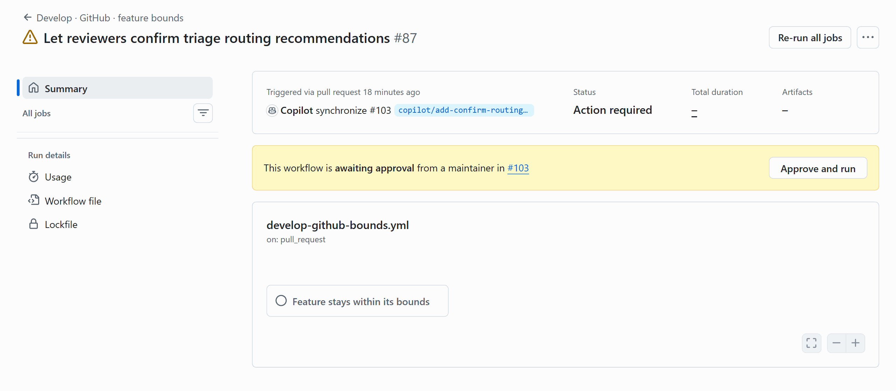

   Or start every waiting run of the latest commit from a terminal, then list the checks (add `--watch` to wait for them):

   ```powershell
   $head = gh pr view <number> --json headRefOid -q .headRefOid
   gh run list --commit $head --status action_required --json databaseId -q '.[].databaseId' | ForEach-Object { gh run rerun $_ }
   gh pr checks <number>
   ```

   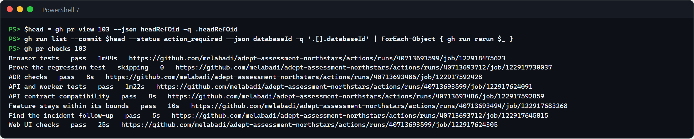

   The checks that decide are **CI** and **Develop · GitHub · feature bounds**, which also fails any API contract change that is not additive. Checks from other solutions in this repository can appear in the list too; the ADR and API contract checks in this screenshot came from Design, and newer runs don't show them. *1 minute; the bounds check takes about 15 seconds and CI about 3 minutes.* Approve again after each new push from Copilot. **Point out:** nothing Copilot wrote ran in Actions until a person approved it.

5. **Review like a tech lead.** In the pull request:
   - **Files changed**: a new operation in `RequestWorkflow` with role and department checks and stable error codes, one new route, an additive contract change, the button in `TriagePanel`, a History label, and English and French strings. Schema changes come as a *new* migration; in our latest run Copilot needed none, because it used PostgreSQL's built-in `xmin` column as the concurrency token.
   - The tests read like the acceptance criteria. List them without leaving the terminal:

     ```powershell
     gh pr diff <number> | Select-String '^\+\s*(public async Task \w+|it\(''|test\('')' | ForEach-Object Line
     ```

     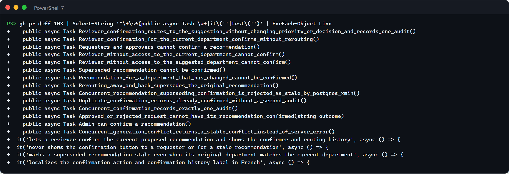

   - The **Feature stays within its bounds** job summary lists every changed file and ends with `PASS change stays within feature bounds`. Point out what did not change: `DecideAsync`, the approval rules, workflows, and infrastructure.

     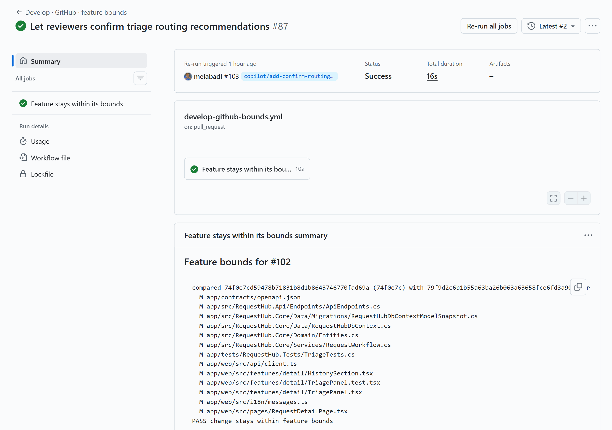

   - **View session** shows every command Copilot ran, including the boundary check and the regression suite with browser tests. That is its own account; the checks above are the evidence.
   - Read Copilot's summary for decisions the Issue did not ask for. In our latest run it said it supersedes recommendations on a manual reroute. That choice is worth testing: step 6 shows what it did to the existing "stale" notice.
   - Optionally request a review from **Copilot** for a second opinion. Its comments are advice; the checks are the gate.

   *5 minutes.* **Point out:** the checks prove the boundaries held and the tests pass. They can't prove the design is right; that is the reviewer's job.

6. **Add your own test, iterate on the same branch with Copilot CLI, and hand findings back.** One agent at a time works on a branch: wait until the cloud agent session has finished, then:

   ```powershell
   gh pr checkout <number>
   Copy-Item solutions/03-develop-github/regression/confirm-routing.spec.ts app/web/e2e/
   copilot --agent develop-github --allow-all-tools -p "The reviewer added app/web/e2e/confirm-routing.spec.ts. Run it with the regression-validation skill (--e2e). If it fails, find the cause and fix the code, never the test. Then run the bounded-feature scope check, commit with a message that names the test, and push."
   ```

   On a machine where port 5080 or the `requesthub` database belongs to something else, tell Copilot CLI to use its own port and database instead of `--e2e` (see [Troubleshooting](#troubleshooting)). Copilot CLI builds the UI, starts RequestHub, and runs the reviewer's browser tests. When one fails, it reads the failing assertion, finds the cause in the code, and fixes it:

   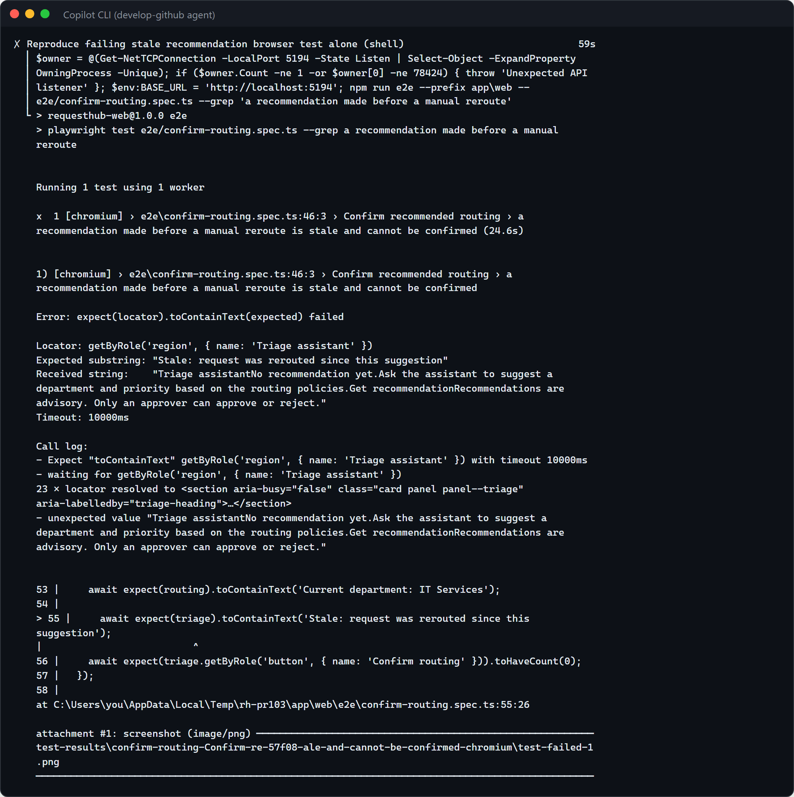

   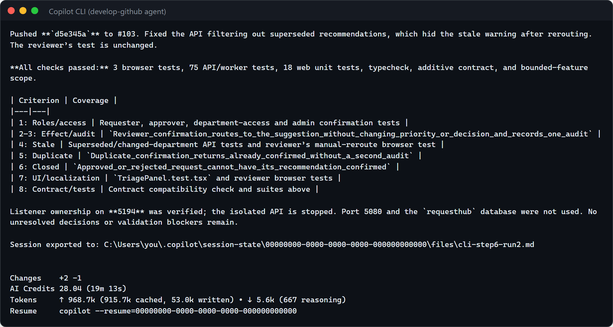

   In both of our runs the reviewer's test caught something Copilot's own tests missed. In the latest run, all of Copilot's own tests passed (14 API tests and 4 web tests), but superseding recommendations on a manual reroute had hidden the existing stale notice; Copilot CLI fixed one line in `RequestWorkflow.ToDetailAsync` and pushed (19 minutes). In an earlier run, the same test caught a History entry that read `Activity: triage.confirmed`. CI runs the test from then on; approve the new runs as in step 4.

   To hand the branch back to the cloud agent, for example with a review finding, mention `@copilot` in a pull request comment. A new session starts within seconds and continues from the latest commit:

   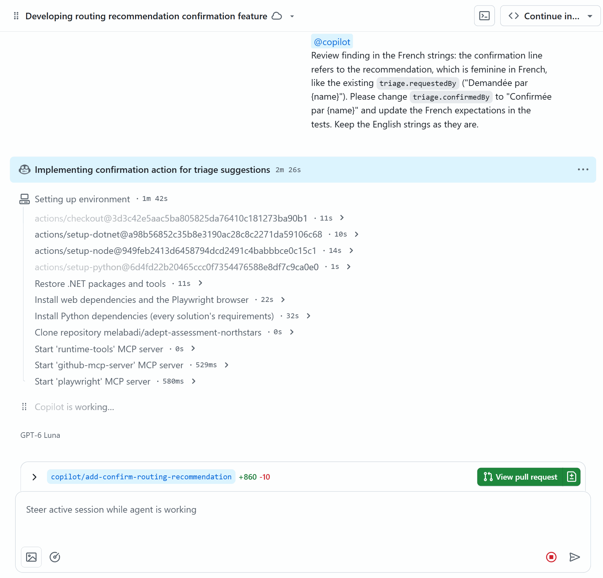

   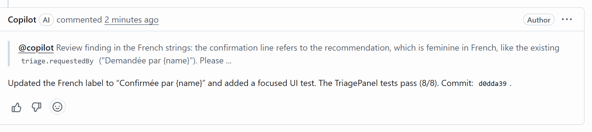

   *About 20 minutes for Copilot CLI; 3 to 6 minutes for an `@copilot` fix (3 minutes 20 seconds in our run).* **Point out:** your independent test found what Copilot's own tests missed, and the fix went into the code, never into the test.

7. **See it and decide.** Start the app from the branch (`npm ci --prefix app/web`, `npm run build --prefix app/web`, then `dotnet run --project app/src/RequestHub.Api`) and open http://localhost:5080. Use **Demo persona** at the top to switch users. As **Ava**, file an *equipment* request under **Facilities**. As **Ben**, open it, select **Get recommendation**, then **Confirm routing**.

   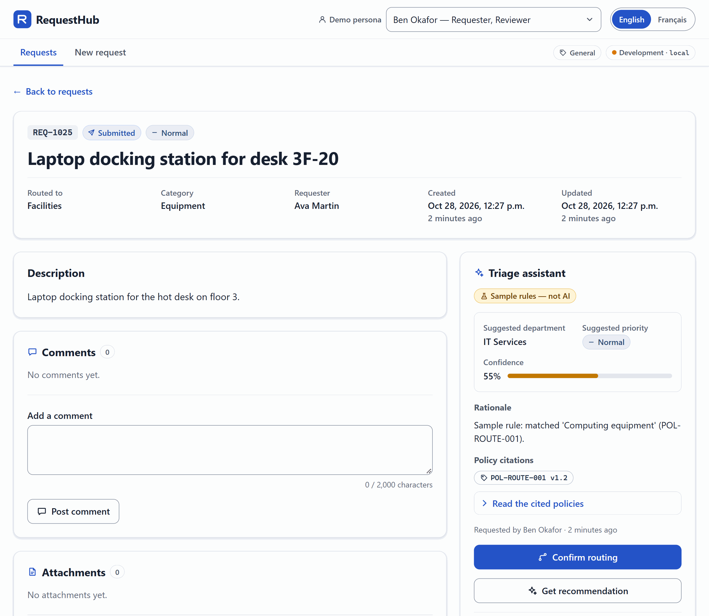

   Clicking through is part of the review. In our latest run, confirming REQ-1025 routed it to IT Services, but the panel labeled the recommendation Ben had just confirmed "Stale", which no test caught:

   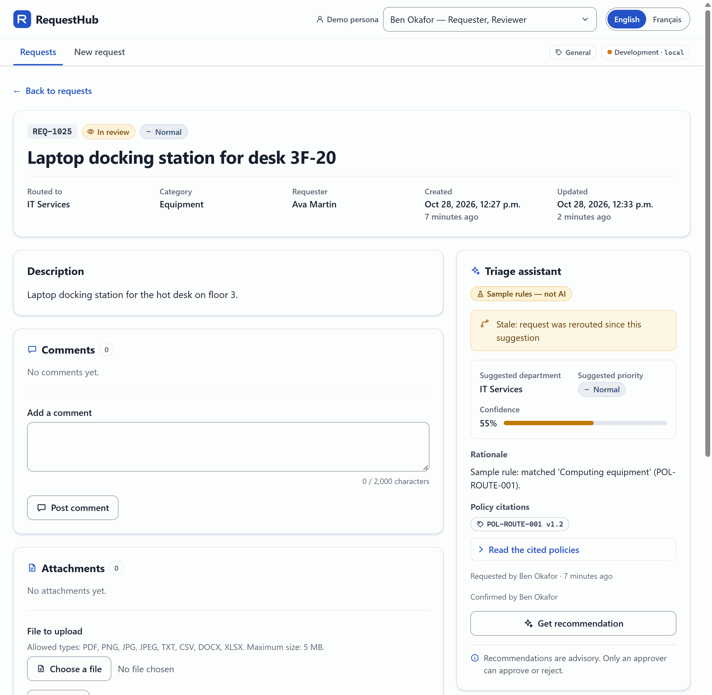

   We sent it back with an `@copilot` comment. Copilot fixed the rule and added a unit test in under 3 minutes, and the reviewer's browser test now checks it too. The same steps on the fixed build, with a new request:

   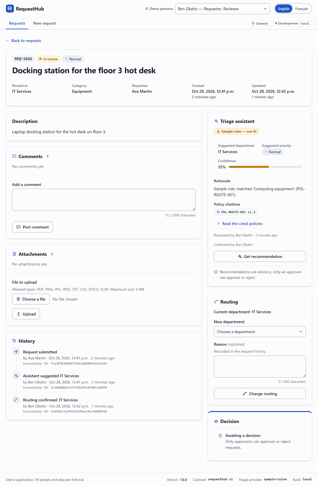

   Then approve the pull request or ask for changes. For the demo, do not merge it (see [Reset](#reset-and-clean-up)). *5 minutes, plus 2 minutes to build and start the app.* **Point out:** the decision panel still says "Awaiting a decision": the feature routes requests, it never approves them.

## What to observe

- **The Issue is the contract.** Each numbered criterion became a test named after the behavior it proves.
- **Boundaries are enforced, not hoped for.** The bounds check ran the checker from `main` against Copilot's commits. A change to a workflow, the infrastructure, an existing migration, `DecideAsync`, or a deleted or skipped test turns it red:

  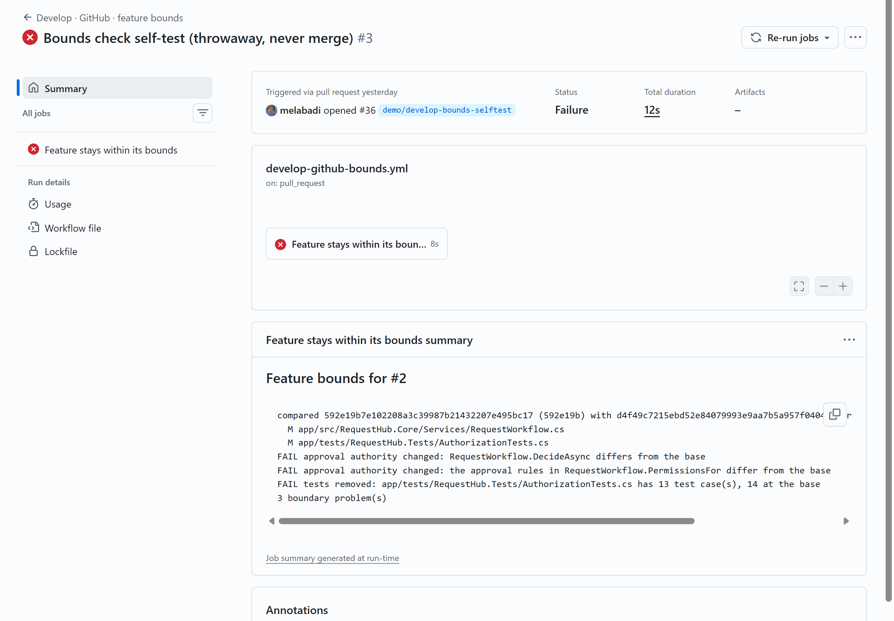

- **Human approval stays human.** The new action routes a request; it never approves one. Copilot's workflow runs needed a person, and so does the merge.
- **Facts over narrative.** CI and the bounds check are green or red. What Copilot says it did is a summary, not evidence.
- **Review still matters.** Green checks don't judge design, wording, or how the screen reads. In our latest run a reviewer's test and a reviewer's click-through each found a problem after every check had passed, and Copilot fixed both on the same branch within minutes.
- **Two agents, one branch, no collisions.** The cloud agent and Copilot CLI take turns on the same pull request.
- **Impact to measure.** Time from Issue to a green pull request, the number of review rounds, and how many criteria passed the reviewer's own test the first time. Generated lines of code are not a measure.

## Reset and clean up

```powershell
gh pr close <number> --delete-branch --comment "Demo run, not merged."
gh issue close <issue> --reason "not planned"
```

If you ran steps 6 and 7 on your machine, stop RequestHub (Ctrl+C), switch back with `git switch main`, and delete the local branch with `git branch -D <copilot-branch>`.

Never merge the demo pull request: the feature would land on `main` and the next run would have nothing to build. Keep one earlier run's pull request as a fallback for when the service is unavailable, and present it as a recording, never as a live run.

## Use it in your own repository

1. Copy this folder's `.github/` contents into your repository's `.github/` folder, and add a `copilot-setup-steps.yml` that installs what your tests need (SDKs, dependencies, browsers, databases as services).
2. In `scope_check.py`, point `APP`, `WORKFLOW`, `MIGRATIONS`, `CONTRACT`, `DECIDE`, `PERMISSIONS`, and the decision patterns at your own code: the folder a feature may change, and the code that holds your approval authority.
3. Rewrite the agent's **How to work** section for your stack's layout and test commands. Keep its rules.
4. Replace the issue template's prefilled values with a feature of your own, or clear them for a blank form. The bounds check runs for pull requests that close an Issue labeled `phase:develop`; change the label in the workflow if you use another one.
5. Write the reviewer's test from the acceptance criteria before Copilot finishes, not from its code, so it checks the behavior you asked for.
6. Make **Feature stays within its bounds** and your test jobs required status checks in a branch ruleset, so a red check blocks the merge. A required workflow must run on every pull request: one skipped by a `paths` filter stays pending and blocks merging. The bounds workflow has no `paths` filter for that reason.

## Troubleshooting

- **No checks on Copilot's pull request.** Workflows on pull requests from the cloud agent wait for a person to approve them. Select **Approve and run workflows**, or run `gh run rerun <run-id>`.
- **Port 5080 or the `requesthub` database is already used on your machine.** The browser tests reset the database of whichever RequestHub answers at `BASE_URL`. On a shared machine, another app took our free port while our API was still building, and its demo data was reset. Run your own copy on a free port with a new database (a database migrated by another branch can conflict), check that the listener is your process, then point the tests at it:

  ```powershell
  npm run build --prefix app/web
  $env:ASPNETCORE_ENVIRONMENT = "Development"; $env:ASPNETCORE_URLS = "http://localhost:5193"
  $env:ConnectionStrings__RequestHub = "Host=localhost;Port=5432;Database=rh_develop_demo;Username=requesthub;Password=devpass"
  dotnet run --project app/src/RequestHub.Api --no-launch-profile          # leave running; in a second terminal:
  Get-Process -Id (Get-NetTCPConnection -LocalPort 5193 -State Listen).OwningProcess | Select-Object Id, Path   # must be your build
  $env:BASE_URL = "http://localhost:5193"; npm run e2e --prefix app/web -- e2e/confirm-routing.spec.ts
  ```

  For step 6, give Copilot CLI the same instructions in its prompt: the port, the database, the listener check, and "do not use `--e2e`".
- **`Failed to start forks worker` from the web unit tests.** On a busy machine Vitest's worker processes can time out. Use fewer workers (`$env:VITEST_MAX_WORKERS = '2'`) or run the suite in threads: `npm test --prefix app/web -- --pool=threads --maxWorkers=1`. Copilot CLI found one of these fallbacks by itself in each of our runs.
