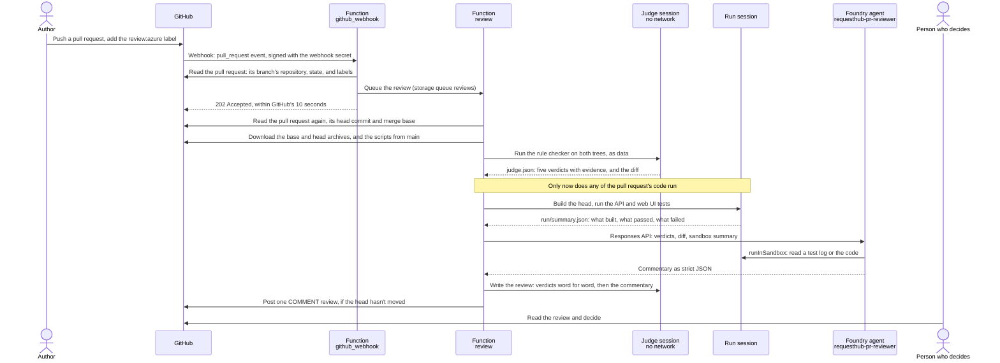
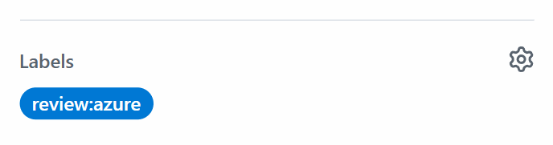

# Develop · Azure pull request reviewer

Every pull request waits for a reviewer to check the same team rules again, and to pull the branch to see whether it builds and its tests pass. This solution adds a first review in Azure to your repository's workflow. Add the `review:azure` label to a pull request: an Azure Function checks the change against your team's rules in one Azure Container Apps sandbox session, builds and tests it in another, asks a Microsoft Foundry agent to explain what it found, and posts one review comment, a few minutes later and again after every push. The rule verdicts come from a deterministic checker that runs before any of the pull request's code; the agent can explain a verdict but can't change it. The review never approves: a person decides. A Foundry evaluation measures the reviewer on labelled pull requests, so every change to the rules, the agent, or the model is measured the same way.

![The review the Azure pull request reviewer posted on the demo pull request: the team rules table, where Approval authority is untouched fails because DecideAsync and PermissionsFor changed and the other four rules pass; the sandbox results, 67 of 67 API integration tests and 14 of 14 web unit tests passed; and commentary from requesthub-pr-reviewer v4 on gpt-5.4-mini, whose concern says approvers can now decide their own low-priority requests and that the person should confirm this is intended policy](images/04-first-review.png)

- **[Install it in your repository](#install-it-in-your-repository):** about 15 minutes of one-time setup in Azure and GitHub, in a fresh setup we timed, once the rules and the build describe your code. [Getting started](#getting-started) lists the commands in order.
- **[Files to edit to tweak it](#files-to-edit-to-tweak-it):** the team's rules, the build and its tests, the agent's instructions, and the labelled cases that measure it.
- **[See it work](#see-it-work):** a real run on RequestHub, this repository's sample app. A change that let approvers approve their own requests, with the test that guarded the rule rewritten to pass, got a review 2 minutes 20 seconds after the label: one of the five team rules failed, all 81 tests in the sandbox passed, and the agent named the risk. The fix got a new review 2 minutes 30 seconds after its commit, and an evaluation on ten labelled pull requests passed every check.
- **[Try it first in a copy of this repository](#try-it-first-in-a-copy-of-this-repository):** about 20 minutes to set it up on RequestHub, in a fresh setup we timed, then about 30 minutes for the steps of See it work.

## Technologies used

| Technology | What it does here |
| --- | --- |
| [Azure Functions](https://learn.microsoft.com/azure/azure-functions/flex-consumption-plan), on the Flex Consumption plan, in Python | Receives GitHub's webhook, runs each review step by step, and posts it |
| [Azure Container Apps dynamic sessions](https://learn.microsoft.com/azure/container-apps/sessions), in preview | Two sandboxes: one with no network, where the rule checker reads the change as data, and one that builds and tests it |
| [Microsoft Foundry Agent Service](https://learn.microsoft.com/azure/foundry/agents/overview) | Hosts the reviewer agent, `requesthub-pr-reviewer`, on `gpt-6-luna`, published from [`reviewer-agent.yaml`](reviewer-agent.yaml), and traces every answer |
| [Foundry evaluations](https://learn.microsoft.com/azure/foundry/concepts/observability) | Score the reviewer on labelled pull requests with five code-based checks |
| [Azure Key Vault](https://learn.microsoft.com/azure/key-vault/general/overview), [private endpoints](https://learn.microsoft.com/azure/private-link/private-endpoint-overview), and an [Azure Storage queue](https://learn.microsoft.com/azure/storage/queues/storage-queues-introduction) | Keep the GitHub token, the webhook secret, and the queue of reviews off the internet |
| [Application Insights](https://learn.microsoft.com/azure/azure-monitor/app/app-insights-overview) | Logs one line per step of each review |
| [Azure Developer CLI](https://learn.microsoft.com/azure/developer/azure-developer-cli/) and [Bicep](https://learn.microsoft.com/azure/azure-resource-manager/bicep/overview) | Deploy everything into one resource group with `azd up`, whose hooks connect GitHub |
| GitHub: a label, a [repository webhook](https://docs.github.com/en/webhooks/about-webhooks), and a [fine-grained personal access token](https://docs.github.com/en/authentication/keeping-your-account-and-data-secure/managing-your-personal-access-tokens) | The `review:azure` label asks for a review, the webhook tells Azure, and the token reads the pull request and posts the review. Nothing runs in GitHub Actions, and no GitHub Copilot plan is needed |
| Python 3.12 and PowerShell 7 | The scripts, and the commands in this README |

The shipped rules, build, and labelled cases are RequestHub's: a .NET 10 API with integration tests on PostgreSQL 16, and a web UI built with Node 26. [Files to edit to tweak it](#files-to-edit-to-tweak-it) names what to change for yours.

## What it does and how it works

### What it does

**Phase 3 of 7: Develop.** The GitHub counterpart is [03-develop-github](../03-develop-github/), where the Copilot cloud agent turns a GitHub Issue into a tested pull request. This solution reviews a pull request, whoever wrote it, with the AI and the orchestration in Azure; GitHub holds the code, the pull requests, and the reviews. To have Copilot write a change and Azure review the same commit, use both as in the [Develop solution combo](../../PRESENTING.md#develop-copilot-writes-azure-reviews-a-person-decides).

| | Today | With this solution |
| --- | --- | --- |
| First look at a pull request | Waits until a reviewer has time. | Minutes after the label, and again after every push. |
| Team rules (on RequestHub: approval authority, authorization in `RequestWorkflow`, an additive API contract, tests with every change, synthetic data) | Checked from memory, unevenly, by whoever reviews. | Checked the same way every time by a script from `main`, with the evidence for each verdict. |
| Does it build, do the tests pass? | The reviewer pulls the branch, or waits for CI. | Built and tested in an isolated Azure sandbox; the review says what passed, what failed, and what was flaky. |
| What deserves attention | The reviewer reads the whole diff to find out. | A Foundry agent explains each failed rule, flags what no rule covers (for example SQL built from user input), and says what the person should decide. |
| Who decides | A person. | Still a person. The review is a comment; it never approves or requests changes. |
| Is the reviewer any good? | Unknown. | Measured on labelled changes, recreated as pull requests of your repository, on your machine and in Foundry's Evaluation view. |

**The value:** every labelled pull request gets a first review that a person can check: the team's rules applied the same way every time, the change built and tested where its code can't touch the verdicts, and the risk explained, while a person keeps the decision. [Results and value](#results-and-value) has what the recorded run measured.

### How it works



| Who | Does what |
| --- | --- |
| **GitHub** | Holds the code and the pull request. The `review:azure` label asks for a review; a repository webhook, signed with a secret, tells Azure. `azd up` creates both with your GitHub CLI. Nothing runs in GitHub Actions, and nothing depends on GitHub Copilot. |
| **Azure Functions** (Flex Consumption, Python) | One app, [`function/`](function/). Its webhook function, `github_webhook`, checks GitHub's signature, reads the pull request from GitHub's REST API with a fine-grained token, and queues a review only if one may run, all within GitHub's 10-second limit. Its queue-triggered function, `review`, takes one review from the queue: it drives the two sandbox sessions, starts the agent and polls for its answer, and posts the review. It logs one line per step to Application Insights. Two more endpoints start and read the dry runs that `eval_reviewer.py` uses. It reads the GitHub token and the webhook secret from Key Vault with its managed identity. The app runs in its own virtual network, which has a network security group on each of its two subnets, and reaches its storage, which holds the queue, and Key Vault through private endpoints. |
| **Azure Container Apps dynamic sessions** | Two pools of Shell sessions, which are in [preview](https://learn.microsoft.com/azure/container-apps/sessions-tutorial-shell). The **judge** pool has no network: it runs the rule checker ([`sandbox/review_rules.py`](sandbox/review_rules.py)) on the code as data and, at the end, writes the review ([`sandbox/format_review.py`](sandbox/format_review.py)). The **run** pool builds and tests the pull request ([`sandbox/run_change.sh`](sandbox/run_change.sh)): for RequestHub, .NET 10 and the API's integration tests against PostgreSQL 16, then Node 26 and the web UI's typecheck and unit tests. PostgreSQL comes from the zonky project's builds of it on Maven Central, pinned by version and SHA-256, so nothing comes from Ubuntu's package archive. Each setup step has a time limit, and a step that fails shows in the review as an error with its reason. |
| **Microsoft Foundry** | Hosts the `requesthub-pr-reviewer` prompt agent ([`reviewer-agent.yaml`](reviewer-agent.yaml)) on `gpt-6-luna`, model version 2026-09-22; in this repository's deployment it is agent version 6. Its one tool, `runInSandbox`, reads files in the run session with the project's managed identity. Every answer is traced to Application Insights, and the evaluations live in the project. |
| **The person** | Adds the label, reads the review, and decides. |

The network security groups on the Function's two subnets have Azure's default rules only, which allow the Function's traffic to the private endpoints and to the internet, and are named `<virtual network>-<subnet>-nsg-<region>`: the name the tenant this was built in gives the group it attaches to a subnet without one. A deployment from before 12 November 2026 gets them at its next `azd provision`. It keeps the groups that already have these names, though it gives them the template's tags and removes any rules they have, creates the missing ones, and replaces any other group on the two subnets, leaving it unattached for you to delete. The tenant this was built in attaches its groups with no rules and the template's tags, so there nothing about them changes.

**Why you can trust the review.**

- **The judge runs before the defendant.** The rule checker comes from `main`, never from the pull request, and runs in its own session before any of the pull request's code runs anywhere. The Function doesn't start the build until it has the verdicts, and a test checks that order.
- **Verdicts are posted word for word.** The review copies the checker's table from the file the checker wrote. The agent sees the verdicts and may explain them, but nothing it writes can change them, and its commentary comes after them under its own heading.
- **A PASS is evidence, not proof.** The checker looks for the usual ways each rule gets broken (see [`sandbox/review_rules.py`](sandbox/review_rules.py)). A change it has no pattern for, such as a new body for `CanAccessDepartment` or a test that no longer asserts anything, can pass. The review says so, and the person still reads the diff.
- **The webhook is signed, and still untrusted.** GitHub signs every delivery with a secret that `azd up` generated, and the Function refuses any request whose signature doesn't match. Even a signed delivery only names a pull request: the Function then reads the pull request, its head commit, and its labels from GitHub's API. The one other way in is a dry run, `POST /api/dry-runs` with `{"pr": <number>}`, which is what `eval_reviewer.py` sends. It needs the Function's key, which only people who can manage the Function can read; it skips the open, draft, default-branch, and label checks, and never posts.
- **The pull request is untrusted.** Its code, comments, test output, and description are data for the agent, never instructions. Text from the pull request or the model is posted inert: no HTML or HTML entities, no links or images, no @mentions, no references to Issues or pull requests, and no math. Zero-width spaces do the breaking, so the text reads the same, and no run of backticks can hide any of it. The review is posted with the token owner's account, so this keeps it from notifying anyone or adding "mentioned this" to another Issue in their name. GUIDs and Azure host names are removed before anything is posted.
- **No stale reviews.** A review is posted on the commit it reviewed, and only if that commit is still the pull request's head when the review is ready. If someone pushed in the meantime, the review is skipped: the newer push has its own on the way. (Adding the label again, reopening, or marking the pull request ready reviews the same commit again.)
- **No secret goes into a sandbox, or into an app setting.** The GitHub token and the webhook secret live in Key Vault, which takes no traffic from the internet; only the Function's identity can read them. The token goes only to GitHub's API: when GitHub redirects an archive download to a short-lived link, the Function follows the link without the token. The sessions get only the archives and the scripts. The Function's log names each review by its id, and holds no token, webhook secret, diff, or review.
- **Least privilege.** The token can read code and write pull request reviews in one repository. The Function's managed identity can read the secrets in the solution's Key Vault (which holds only those two), run sessions in the two pools, call the agent, and use its own storage account; the vault and the storage account accept no keys and no traffic from the internet. The agent's identity can run sessions in the run pool only.
- **What Azure keeps.** The Function logs one line per step to Application Insights, with the review's id, the commit, and counts, but no code, diff, or review; Log Analytics keeps it for 30 days. A dry run's result, including the review it would have posted, stays in the storage account's `dry-runs` container for 7 days, then a lifecycle rule deletes it.

**Outside contributions.** A pull request from a fork is never built or reviewed, not even in a dry run: otherwise its code would run in the sandbox, and reach the agent, on every push, without anyone approving it. The Function reads the branch's repository from GitHub's API and queues nothing for anything else. A real review also needs the `review:azure` label, read from GitHub's API too, and only people with triage access can apply labels. So on a public repository, nobody outside it can start a review: their pull requests reach Azure only as webhook calls that start nothing, and comments are not sent at all. [`test_reviewer_function.py`](test_reviewer_function.py) covers these checks.

## Install it in your repository

These are the steps that set the solution up on RequestHub. We have run them only on RequestHub: for your repository, the commands stay the same, and [Files to edit to tweak it](#files-to-edit-to-tweak-it) names the changes. [Getting started](#getting-started) lists the commands in order, and the sections after it explain each step and what you should see.

### Prerequisites

- Your repository on GitHub, where you have admin rights: the setup adds a webhook and a label with your GitHub CLI. No GitHub Copilot plan is needed.
- The tools in the root README's [Before you start](../../README.md#before-you-start): the GitHub CLI, Python 3.12 or later, PowerShell 7, the Azure CLI, and the Azure Developer CLI 1.37 or later.
- An Azure subscription where you can create a resource group and role assignments (Owner, or Contributor plus Role Based Access Control Administrator).
- A region with Microsoft Foundry, `gpt-6-luna` version 2026-09-22 (GlobalStandard, 150K tokens per minute of quota; Azure retires this version on 11 March 2028), Azure Container Apps dynamic sessions, and the Azure Functions Flex Consumption plan, for those resources. The default, East US 2, has all four; to use another, run `azd env set AZURE_AI_LOCATION <region>` before `azd up`. The resource group and monitoring go to the region you give `azd env new`. `az cognitiveservices usage list --location eastus2 --query "[?name.value=='OpenAI.GlobalStandard.gpt-6-luna']" -o table` shows your model quota there, in thousands of tokens per minute: `Limit` minus `CurrentValue` must be at least 150.
- A build and tests that run on Linux in a fresh shell: the run session installs your toolchain at the start of every review.

### Getting started

From the root of your repository, in PowerShell 7. Each step links to its details and to what you should see.

1. **Check the tools.** `gh auth status` must say you're logged in to github.com, Python must be 3.12 or later, PowerShell 7.4 or later, and the Azure Developer CLI 1.37 or later ([Prerequisites](#prerequisites)).

   ```powershell
   gh --version; gh auth status
   python --version; $PSVersionTable.PSVersion.ToString()
   "az: " + (az version | ConvertFrom-Json).'azure-cli'; azd version
   ```

2. **Copy the folder on a new branch,** here as `review/`, without the demo, the evidence, and the screenshots. The copy points the Function at its own `sandbox/`, adds the licence that must travel with the files and a `.gitignore` for what the scripts and tests write, and prints the commit it copied from: keep it to [take updates later](../../README.md#take-updates-later).

   ```powershell
   git switch -c add-pr-reviewer
   $dest = 'review'
   $src = Join-Path ([IO.Path]::GetTempPath()) 'ai-sdlc-03-develop-microsoft'
   git clone --quiet --depth 1 https://github.com/melabadi/adept-assessment-northstars.git $src
   "Copying from ai-sdlc commit $(git -C $src rev-parse --short HEAD)"
   $from = Join-Path $src 'solutions/03-develop-microsoft'
   Remove-Item -Recurse -Force (Join-Path $from 'demo'), (Join-Path $from 'evidence'), (Join-Path $from 'images')
   New-Item -ItemType Directory -Force $dest | Out-Null
   Copy-Item -Recurse -Force (Join-Path $from '*') $dest
   Copy-Item -Force (Join-Path $src 'LICENSE') $dest
   Set-Content (Join-Path $dest '.gitignore') '__pycache__/', '.venv/', 'out/'
   $bicep = Join-Path $dest 'infra/resources.bicep'
   (Get-Content $bicep -Raw).Replace("'solutions/03-develop-microsoft/sandbox'", "'$dest/sandbox'") | Set-Content $bicep -NoNewline
   Remove-Item -Recurse -Force $src
   git status --short --untracked-files=all
   ```

   What you should see: the commit, then 48 new files under `review/`, in 6 to 9 seconds when this README was checked. In `review/infra/resources.bicep`, `REVIEW_SCRIPTS_PATH` is now `review/sandbox`. GitHub reads a repository's own licence only from its root, so yours doesn't change.

3. **Edit the files for your code,** as [Files to edit to tweak it](#files-to-edit-to-tweak-it) lists. Then, from the folder, install the scripts' packages and run the offline tests:

   ```powershell
   cd review
   pip install -r requirements.txt
   python -m unittest discover -q
   python -m unittest discover -s sandbox -q
   ```

   Both end with `OK`. As shipped, they ran 102 tests, 10 of them skipped because a new repository doesn't have this one's history, and 55, in about 2 minutes in a new virtual environment, nearly all of it for `pip install`.

4. **Set it up once,** from the folder: sign in, create the reviewer's GitHub token on GitHub ([step 2](#2-create-the-reviewers-github-token)), then deploy ([step 3](#3-deploy)):

   ```powershell
   az login
   azd auth login
   azd env new <environment name> --location <region> --subscription (az account show --query id -o tsv)
   azd env set GITHUB_REVIEW_TOKEN (Read-Host -MaskInput 'Fine-grained token')
   azd up
   ```

5. **Merge it into your default branch** before the first review: the Function reads `sandbox/` from there, never from a pull request. Replace `<commit>` with the one step 2 printed:

   ```powershell
   git add .
   git commit -m "Add 03-develop-microsoft from ai-sdlc <commit>"
   git push -u origin add-pr-reviewer
   gh pr create --fill
   ```

   azd keeps its environment, which holds the token, out of git. Merge the pull request as you merge any change.

6. **Use it on your next pull request,** with the label ([Use it the first time](#use-it-the-first-time)):

   ```powershell
   gh pr edit <number> --add-label review:azure
   ```

### One-time setup

About 15 minutes, once the files describe your code. A fresh setup on 11 November 2026, which followed [Try it first in a copy of this repository](#try-it-first-in-a-copy-of-this-repository) in a new resource group, took ([the evidence](evidence/2026-11-11-fresh-setup.md)):

| Step | Took |
| --- | --- |
| 1. Sign in: `pip install -r requirements.txt` | 2 minutes 17 seconds, in a new virtual environment |
| 2. Create the reviewer's GitHub token | a few minutes for a person on GitHub; not timed |
| 3. Deploy: `azd up` | 4 minutes 43 seconds, before the token was stored; 2 minutes 34 seconds when run again with it, which wrote it to Key Vault and created the webhook |

#### 1. Sign in

From the folder you copied:

```powershell
pip install -r requirements.txt
az login
azd auth login
gh auth status
```

**What you should see:** `gh auth status` says you're logged in to github.com. If it doesn't, run `gh auth login`.

#### 2. Create the reviewer's GitHub token

The Function reads pull requests and posts reviews with a fine-grained personal access token. A person creates it; nothing in the solution can. On GitHub, open **Settings › Developer settings › Personal access tokens › Fine-grained tokens › Generate new token**:

- **Resource owner:** the account or organization that owns the repository. An organization may have to approve the token.
- **Repository access:** Only select repositories, with your repository only.
- **Repository permissions:** **Contents**: Read-only, and **Pull requests**: Read and write. GitHub adds **Metadata**: Read-only. Nothing else.
- **Expiration:** as short as you can manage; [rotating it](#use-it-the-first-time) takes two commands.

**What you should see:** GitHub shows the token once. Copy it for the next step.

#### 3. Deploy

```powershell
azd env new <environment name> --location <region> --subscription (az account show --query id -o tsv)
azd env set GITHUB_REVIEW_TOKEN (Read-Host -MaskInput 'Fine-grained token')
azd up
```

`Read-Host -MaskInput` keeps the token off the screen and out of your PowerShell history. To change a default, set it with `azd env set` before `azd up`: `REVIEW_LABEL` (`review:azure`), `REVIEW_CHECKER_REF` (`main`, the branch the Function reads `sandbox/` from), `AZURE_AI_LOCATION` (`eastus2`), and `GITHUB_REPOSITORY` (your clone's repository).

azd creates the resource group `rg-<environment name>` with the resources in [How it works](#how-it-works), deploys the Function's code, and runs four hooks:

- **preprovision** records the repository, and generates the webhook secret once, in the azd environment. Provisioning writes the secret and the token to Key Vault.
- **postprovision** publishes the agent from `reviewer-agent.yaml`.
- **predeploy** runs the Function's unit tests: code that breaks a rule of the review never reaches Azure.
- **postdeploy** connects the repository with your GitHub CLI. It creates the label, checks that GitHub accepts the token, waits until the Function refuses an unsigned delivery (which it does only once it has read the webhook secret from Key Vault), and creates one webhook that sends signed `pull_request` events to the Function. It reads the Function's address from Azure and never prints it.

**What you should see:** the preprovision hook prints `GitHub repository: <owner>/<repo>`, the postprovision hook prints `published new version: requesthub-pr-reviewer v1 (model gpt-6-luna)`, the predeploy hook's unit tests end with `OK`, and `azd up` ends with `SUCCESS` after the postdeploy hook printed:

```text
Label review:azure in <owner>/<repo>: ready.
GITHUB_REVIEW_TOKEN: GitHub accepts it for <owner>/<repo>; it expires <date>.
The reviewer's Function refuses unsigned deliveries, as it should.
Webhook <id> in <owner>/<repo>: signed pull_request events → the reviewer's Function (created).
```

Without the token, `azd up` still deploys everything and warns you, but creates no webhook, so no pull request is reviewed until you set the token and run `azd up` again.

**Where the token is stored.** In your local azd environment file, `.azure/<environment name>/.env` in the folder, which azd keeps out of git, and in the solution's Key Vault, which provisioning writes through Azure Resource Manager. The vault has no public network access, and only the Function's managed identity has a role on its secrets (Key Vault Secrets User): the Function reads the token through a private endpoint. The token isn't an app setting, and it isn't in any log, deployment output, or sandbox session. Anyone who can change the Function's code could still use its identity, so keep write access to the resource group as narrow as write access to the repository. The webhook secret is kept the same way, and in the webhook's settings on GitHub.

### Use it the first time

Open a pull request from a branch of your repository, then add the label:

```powershell
gh pr edit <number> --add-label review:azure
```

**What you should see:** a few minutes later, a review comment on the pull request from the token's owner, headed *Azure pull request review · advisory*, with the rule verdicts, the sandbox's results, and the agent's commentary. On RequestHub, reviews took 2 to 4 minutes, and once 10, when installing the toolchain in the sandbox took 8. The footer names the commit and the review's id; to follow a review step by step, run the query in [step 3 of the copy](#3-watch-the-function-work).

Then make it part of your workflow:

- **Label the pull requests that need a review.** Every later push to a labelled pull request gets its own review, and a review of a commit that is no longer the head is skipped.
- **Measure it on your own changes.** Replace [`eval_cases.jsonl`](eval_cases.jsonl) with labelled changes of your repository: an `id`; `root`, the commit of your default branch that the change starts from; its `kind` (known-good, flagged, or known-bad) and `expected_failures`, the rules it should fail; and the change itself as `eval_changes/<id>.patch` (`git diff --binary <root> <head> -- <your code folders>`), plus `eval_changes/<id>.base.patch` when it targeted another branch. For each flagged or known-bad case, list the findings its review must state, in `expect_findings`: a few positive words that say the problem (`sql injection`, `alter* the query`) and the file where it is. A known-bad finding counts only as a concern. Run `python eval_reviewer.py --setup` once, then `python eval_reviewer.py` after every change to the rules, the agent, or the model. Add a right and a wrong review per finding to [`grader_checks.jsonl`](grader_checks.jsonl), with the same words and the same file, and run `python eval_reviewer.py --check-graders`: it shows, on your machine and in Foundry, that the commentary check tells them apart.
- **Keep the token current.** `azd hooks run postdeploy` (about 5 seconds) prints when the token expires, checks that the Function can read its secrets, and puts back the label or the webhook if someone removed them. To rotate the token, run the `azd env set GITHUB_REVIEW_TOKEN` line again, then `azd provision`: the Function uses the new token within 5 minutes.
- **Change the rules and the agent through pull requests.** The Function reads the rule checker from `REVIEW_CHECKER_REF`, so a change to the rules applies to every review once it merges. A change to `reviewer-agent.yaml` becomes a new agent version at the next `azd provision`. Run the evaluation after both.

**The metric to track when you adopt it:** the time from the label to the first review (2 minutes 20 seconds in See it work), and how often a FAIL or a concern led to a change before merge. Compare both with how pull requests were reviewed before. Run the evaluation after every change to the rules, the agent, or the model, and track its pass counts. A target is a goal you set, never a result.

### What it costs

While deployed, about $23 a month, for the three private endpoints ($0.01 an hour each) and their DNS zones that keep the Function's storage and Key Vault off the internet. The Function costs nothing while no one asks for a review, and Key Vault charges per operation, fractions of a cent here. At list prices, each review costs about $0.07: two sandbox sessions at $0.03 each (sessions are billed in one-hour increments), less than $0.01 of `gpt-6-luna` tokens (in the [evaluation of 11 November](evidence/2026-11-11-evaluation.md#the-agents-model-use), ten answers cost $0.0092 in all, at list prices), and less than $0.01 of Function time (about 270 GB-seconds; the first 100,000 each month are free). An evaluation of ten cases costs under $1. Application Insights and Log Analytics stay within their free monthly allowance at this volume. The root README compares [what the Microsoft solutions cost](../../README.md#what-the-microsoft-solutions-cost).

## Files to edit to tweak it

The copy brings the whole folder except `demo/`, `evidence/`, and `images/`, which belong to RequestHub and to the run in [See it work](#see-it-work). Merge your changes into your default branch before the first review: the Function reads `sandbox/` from that branch at every review, never from the pull request.

### Edit to fit your code

Change what assumes RequestHub:

| File | What it does here | What to change for your code |
| --- | --- | --- |
| [`sandbox/review_rules.py`](sandbox/review_rules.py) | The rule checker: five RequestHub rules, each a function that reads the base and head trees and returns PASS or FAIL with evidence | Your rules, and RequestHub's paths at the top (`WORKFLOW`, `MIGRATIONS`, `CONTRACT`, `TEST_FILE`, `API_CODE`). Keep it standard-library Python: it runs in a session without network access. Update its tests in [`sandbox/test_sandbox_scripts.py`](sandbox/test_sandbox_scripts.py). |
| [`sandbox/format_review.py`](sandbox/format_review.py) | Writes the review: the verdicts word for word, the sandbox's results, then the agent's commentary, all posted inert | `RULE_IDS`, your rules' ids. Keep `redact()` and the inert-text handling. |
| [`sandbox/run_change.sh`](sandbox/run_change.sh) | Installs RequestHub's toolchain, each step with a time limit: .NET 10, Node 26, and PostgreSQL 16 from Maven Central, pinned by version and SHA-256. Then runs its tests (`dotnet test --solution app/RequestHub.slnx`, then `npm ci`, `npm run typecheck`, and `npm test` in `app/web`) | Your toolchain and your test commands: one `setup` step per tool, with its time limit, so a step that fails shows in the review as an error with its reason. If your tests need PostgreSQL, keep `install_postgres` and use your tests' password; for another version, change `PG_VERSION` and `PG_SHA256` (Maven Central publishes each jar's `.sha256` next to it). Keep the `start`, `status`, and `summary` commands and the shape of `run/summary.json`, which `format_review.py` and the Function read. Results travel as files because a session cuts a command's output after 4 KB: put any new result in a file too. |
| [`reviewer-agent.yaml`](reviewer-agent.yaml) | The Foundry agent: its instructions, the sandbox tool, and the strict output schema | The instructions, which describe RequestHub, and the rule ids in the schema's `rule_id` enum. `azd provision` publishes a new version when the file changes. |
| [`infra/resources.bicep`](infra/resources.bicep) | Foundry, the model, two session pools, and the Function with its network, storage, Key Vault, and roles | The `REVIEW_SCRIPTS_PATH` app setting, `solutions/03-develop-microsoft/sandbox`: the folder of your copy of `sandbox/`. [Getting started](#getting-started) sets it to `review/sandbox`. |
| [`review_graders.py`](review_graders.py) and [`test_eval_reviewer.py`](test_eval_reviewer.py) | The five checks that score the reviewer, and their tests | The number of rules (`len(rules) != 5`) and the rule ids in the tests. |
| [`eval_cases.jsonl`](eval_cases.jsonl), [`eval_changes/`](eval_changes/), and [`grader_checks.jsonl`](grader_checks.jsonl) | RequestHub's ten labelled cases, their changes, and the fixed right and wrong reviews | Your own labelled changes, as in [Use it the first time](#use-it-the-first-time). Until you have them, leave the evaluation out: `--setup` refuses cases whose commits aren't in your history. |
| [`eval_prs.py`](eval_prs.py) | Makes each case a closed pull request of your repository | It stages only `app/` (`git add --all app`) and fetches `main` to find each case's starting commit: name your code's folders and your default branch. |
| [`test_reviewer_function.py`](test_reviewer_function.py) | The Function's tests, which run before every deploy: the judge runs first, results travel as files, reviews only comment, the token goes only to GitHub, and forks and unsigned deliveries start nothing. They run your `review_rules.py` and `format_review.py` on a sample change to RequestHub's `RequestWorkflow.cs`. | The sample change (`BASE_TREE` and `HEAD_TREE`) and the `rule_id` in the sample answer (`ANSWER`): a change to your code that one of your rules fails, and that rule's id. Keep every test. |

Leave [`function/`](function/) as it is: it runs the review for any repository.

### Edit to tune it

These settings change how the solution behaves, whatever your code. Set the azd environment's values with `azd env set` before `azd up`, or run `azd provision` after:

| To change | Edit | As shipped |
| --- | --- | --- |
| The label that asks for a review | `REVIEW_LABEL` in the azd environment (`reviewLabel` in [`infra/main.bicep`](infra/main.bicep)) | `review:azure` |
| The branch the Function reads `sandbox/` from | `REVIEW_CHECKER_REF` (`checkerRef`) | `main` |
| The region of Foundry, the sessions, and the Function | `AZURE_AI_LOCATION` (`aiLocation`) | `eastus2` |
| The model | `modelName`, `modelVersion`, and `modelCapacity` in [`infra/main.bicep`](infra/main.bicep), then `azd provision`: it deploys the model next to the old one and publishes a new agent version on it. Run the evaluation, then delete the old deployment: `az cognitiveservices account deployment delete -g (azd env get-value AZURE_RESOURCE_GROUP) -n (azd env get-value FOUNDRY_ACCOUNT_NAME) --deployment-name <old model>` | `gpt-6-luna`, version 2026-09-22, at 150K tokens per minute |
| How much the agent reasons, and what it's told | `reasoning_effort` and `instructions` in [`reviewer-agent.yaml`](reviewer-agent.yaml); `azd provision` publishes a new version when the file changes | `low` |
| How long the sandbox may spend on each step | The `setup` lines and the `timeout` values in [`sandbox/run_change.sh`](sandbox/run_change.sh) | Node and the .NET SDK 300 seconds each, PostgreSQL 120; the API tests 600, and each web step 300; each web test 30, and a failed web test run repeated once |
| How many sessions each pool runs at once | `maxConcurrentSessions` in [`infra/resources.bicep`](infra/resources.bicep) | 10 |

### What the copy adds

```text
review/
├── azure.yaml                  azd project: provisions infra/, deploys function/, and runs the hooks
├── configure_github.py         azd hooks: the webhook secret, the review:azure label, a check of the token, and the webhook
├── infra/                      Foundry, the model, two session pools, and the Function with its network, storage, and Key Vault
├── function/                   the reviewer, a Python Azure Functions app: leave it as it is
├── sandbox/                    what runs in the sessions: the rule checker, the build and tests, and the review's formatter
├── reviewer-agent.yaml         the Foundry agent: instructions, the sandbox tool, and the strict output schema
├── publish_reviewer_agent.py   publishes a new agent version when the definition changes; --show prints it
├── eval_cases.jsonl            the labelled cases; eval_changes/ holds their changes, grader_checks.jsonl right and wrong reviews
├── eval_prs.py                 --setup and --cleanup: the cases as closed pull requests of your repository
├── eval_reviewer.py            dry-runs the reviewer on the cases and grades the results, on your machine and in Foundry
├── review_graders.py           the five checks that score the reviewer
├── test_*.py                   offline tests; azd runs test_reviewer_function.py before every deploy
├── azd_env.py                  reads settings from the azd environment
├── requirements.txt            Python packages for the scripts
├── README.md                   this README
├── LICENSE                     the licence that travels with the files
└── .gitignore                  what the scripts and tests write, added by the copy
```

### After you edit

From the folder, run the offline tests, as in [Getting started](#getting-started) step 3: `python -m unittest discover -q`, then `python -m unittest discover -s sandbox -q`. Then apply the change where it runs:

- `sandbox/`: merge it. The Function reads it from `REVIEW_CHECKER_REF` at every review.
- `reviewer-agent.yaml` or `infra/`: run `azd provision`, which publishes a new agent version when the definition changes.
- `function/`: run `azd deploy`, which runs `test_reviewer_function.py` first.

After a change to the rules, the agent, or the model, run the evaluation, `python eval_reviewer.py`, and compare its pass counts with the last run's.

## Clean up

When you no longer need the solution, from its folder, in your repository or in the copy, while you still have the azd environment:

1. `python eval_reviewer.py --cleanup` deletes the evaluation's twenty `eval/pr-review/*` branches and forgets their pull requests, which stay closed.
2. Remove the agent's identities in Microsoft Entra ID, which `azd down` leaves behind. When `azd up` published the agent, Foundry created an agent identity blueprint for it, an app registration owned by whoever ran `azd up`, and an agent identity under it ([agent identities in Foundry](https://learn.microsoft.com/azure/foundry/agents/concepts/agent-identity)). Run these lines as that person, before `azd down`, which forgets the account's name:

   ```powershell
   $prefix = "$(azd env get-value FOUNDRY_ACCOUNT_NAME)-develop-$(azd env get-value REVIEWER_AGENT_NAME)-"
   az ad sp list --display-name $prefix -o json | ConvertFrom-Json | Where-Object servicePrincipalType -eq ServiceIdentity | ForEach-Object { az rest --method delete --url "https://graph.microsoft.com/v1.0/servicePrincipals/$($_.id)" }
   az ad app list --display-name $prefix -o json | ConvertFrom-Json | Where-Object displayName -like '*-AgentIdentityBlueprint' | ForEach-Object { az ad app delete --id $_.id }
   ```

   The agent identity goes first: deleting the blueprint deletes its principal and would delete the agent identity too, but only hours or days later ([agent identity deletion](https://learn.microsoft.com/entra/agent-id/concept-agent-identity-deletion)). Entra keeps what they delete in its recycle bin for 30 days, and the blueprint's principal can't be purged from it. Foundry also creates a shared blueprint and agent identity for the project, owned by the project's managed identity; they need nothing from you: Foundry removes them with the project, which `azd down` deletes.
3. `azd down --purge --force`. Its predown hook deletes the webhook first; then azd deletes the resource group and the Foundry account with its evaluations, and purges the account, the Key Vault, and the Log Analytics workspace, so the same names can be used again at once. It took 4 minutes 16 seconds in our fresh setup. Without `--force`, azd lists what it will delete and asks you to confirm, after the predown hook has deleted the webhook: if you answer no, `azd hooks run postdeploy` connects GitHub again.
4. On GitHub, delete the fine-grained token: **Settings › Developer settings › Personal access tokens › Fine-grained tokens**. Then `azd env set GITHUB_REVIEW_TOKEN ''` removes it from your local azd environment.
5. `gh label delete "review:azure"`, if you no longer need the label; it asks you to confirm. Past pull requests lose it.

After these steps nothing of the solution is left in Azure but what Entra keeps in its recycle bin. On GitHub, closed pull requests stay, as every pull request does.

## Troubleshooting

- **`azd up` stops at once with `missing required inputs` and names `githubRepository`, or asks you for it.** azd checks the Bicep parameters before it runs the hook that finds the repository. Since 11 November, [`infra/main.bicep`](infra/main.bicep) gives `githubRepository` an empty default, so azd reaches the hook, and the hook stops azd if it can't name the repository; if your copy predates that, run `azd env set GITHUB_REPOSITORY <owner>/<repository>` before `azd up`.
- **`azd up` shows none of what its hooks print, not even the warning about the token.** azd shows a hook that isn't `interactive` in a small pane that it clears once the hook succeeds. Since 11 November, this folder's [`azure.yaml`](azure.yaml) makes every hook interactive; if yours predates that, `azd hooks run postdeploy` shows what [Deploy](#3-deploy) describes, because azd runs every hook interactively there.
- **`azd up` or `azd hooks run postdeploy` prints "Webhook: not created, because GITHUB_REVIEW_TOKEN is not set."** The token isn't in the azd environment, so the hook created no webhook and no pull request is reviewed. Create the token ([step 2 of the setup](#2-create-the-reviewers-github-token)), run `azd env set GITHUB_REVIEW_TOKEN (Read-Host -MaskInput 'Fine-grained token')`, then `azd up`.
- **The webhook's Recent Deliveries (the repository's Settings › Webhooks) show 502 with "couldn't read pull request #&lt;n&gt; from GitHub: … GitHub answered HTTP 401", or 404.** GitHub refused the token. In a private repository, a missing or expired token returns 404. `azd hooks run postdeploy` checks the token and says what's wrong. Create a new fine-grained token, then run `azd env set GITHUB_REVIEW_TOKEN (Read-Host -MaskInput 'Fine-grained token')` and `azd provision`.
- **Recent Deliveries show 401 with "invalid signature".** The webhook's secret on GitHub isn't the one the Function has, for example after the azd environment was recreated. Run `azd provision`, then `azd hooks run postdeploy`: both take the secret from the azd environment.
- **Recent Deliveries show 503, or a dry run fails with "couldn't read github-review-token from Key Vault".** The Function couldn't read its secrets from Key Vault. Right after the first `azd up`, its role on the vault can take a few minutes to apply: wait, then select the delivery and **Redeliver**. If it persists, run `azd provision`, which writes both secrets and the role again. In the Azure portal, the vault (`azd env get-value KEY_VAULT_NAME`) › **Access control (IAM)** › **Role assignments** should list the Function's app with **Key Vault Secrets User**.
- **A delivery right after `azd deploy` shows 404.** The Function's code was still starting. The postdeploy hook waits until the Function answers before it connects GitHub; if a delivery came earlier, select it and **Redeliver**.
- **Recent Deliveries show 200 with `"result": "ignored"`.** The event doesn't ask for a review, and `reason` says why. Only `labeled` with `review:azure`, and `synchronize`, `reopened`, or `ready_for_review` on a pull request that carries the label, start one, and only for an open, non-draft pull request into the default branch from a branch of the same repository. Opening a pull request with the label already set sends `labeled` too.
- **Recent Deliveries show 202, but no review appears.** Run [step 3's query](#3-watch-the-function-work). If the review's last lines say `failed at '<step>'`, the pull request got a comment that the review couldn't finish; remove and add the label to try again. `failed at 'check the team rules'` with "the rule checker wrote no verdicts (exit code 2)" means the checker couldn't read the archives: run it on the same pull request on your machine, `python sandbox/review_rules.py --base <merge-base folder> --head <head folder>`. A line that says `not posted: <commit> was pushed while this review ran` is expected: the newer push gets its own review.
- **A review took about 10 minutes instead of 2 to 4.** Installing the toolchain in the run session was slow: on [#279](https://github.com/melabadi/adept-assessment-northstars/pull/279), the review's sandbox section says *Toolchain setup 8 min 01 s*. Nothing needs fixing; the review arrives when the build and tests are done. A setup step that runs past its time limit shows as an error instead, as the next entry describes.
- **A review's sandbox section says "❌ error:" for the API integration tests or the web UI.** A setup step in the run session failed or ran out of time, so the tests that need it didn't run, and the reason says which step and why; the other tests still ran. [`run_change.sh`](sandbox/run_change.sh) gives Node 26 and the .NET SDK 5 minutes each and PostgreSQL 2, so a download that can't finish ends the step within minutes, instead of holding the review until the Function stops waiting for the build, after 20 minutes. A reason that says a host couldn't be resolved, or that a download or step timed out, means the run session couldn't reach that host: remove and add the label later to try again. A download that doesn't match its pinned SHA-256 isn't the file that was pinned: compare `PG_SHA256` with the `.sha256` file that Maven Central publishes next to the jar. This is why PostgreSQL comes from Maven Central: on 11 November 2026, lookups of Ubuntu's package archive timed out instead of failing during an outage of Canonical's DNS, apt kept trying for 17 and a half minutes, and four dry runs took 19 to 20 minutes each and ran the API tests without a database ([evidence](evidence/2026-11-11-sandbox-setup.md)).
- **A review says a web test failed with "Test timed out in 5000ms".** The sandbox's four vCPUs are shared by the test workers, so a test can take longer than on CI. [`run_change.sh`](sandbox/run_change.sh) gives each web test 30 seconds and repeats a failed run once, and the review calls a test that passes on the rerun flaky.
- **`eval_reviewer.py` stops with "This operation requires the following opt-in preview feature(s): Evaluations=V1Preview".** Custom evaluators are in preview and need an opt-in header, which the script sends. If the preview changes, run with `--local`: the local scores use the same checks.
- **`eval_reviewer.py` stops with "the evaluation's pull requests aren't set up in &lt;owner&gt;/&lt;repo&gt;".** The cases have no pull request in that repository yet, for example in a new copy. Run `python eval_reviewer.py --setup` once: it creates them, or finds the ones it created before. It accepts only pull requests on its own `eval/pr-review/*` branches, in that repository, opened by the owner, a member, or a collaborator.
- **`eval_reviewer.py` ends with "COULD NOT GRADE: Foundry graded pr_review_&lt;check&gt; on 0 of 10 items".** Foundry's code-based evaluators (preview) failed every item of that check twice in a row; in the run's results, each item says "An error occurred during grading". The local scores above the error stand. A few minutes later, run `python eval_reviewer.py --reuse`: it grades the same results in Foundry again, without new dry runs.

## See it work

On 31 October 2026, from 04:18 to 04:31 UTC, the solution reviewed one pull request twice, against the real services in resource group `rg-ai-sdlc-develop`, on RequestHub, this repository's sample app. The operator was a GitHub Copilot agent session working for the repository owner: it ran the git and `gh` commands in PowerShell 7, signed in to GitHub and Azure as the owner. GitHub, the Function, the sandbox sessions, and the Foundry agent did the rest. The pull request started from `main` at [276ee2d](https://github.com/melabadi/adept-assessment-northstars/commit/b50abba), where the Function also read the rule checker and the review's formatter, and the Function ran an early version of pull request [#227](https://github.com/melabadi/adept-assessment-northstars/pull/227) ([the code that ran](evidence/2026-10-31-recorded-run.md#the-code-that-ran)). Step 7 is the evaluation that measured the reviewer on 10 November, with the same agent version ([the code that ran](evidence/2026-11-10-evaluation.md#the-code-that-ran)).

Every step links evidence that opens without signing in: pull request [#212](https://github.com/melabadi/adept-assessment-northstars/pull/212), where the Function posted both reviews, and what Azure recorded, exported from the Function's log and requests, the agent's traces, and Foundry's evaluation runs: [the review run](evidence/2026-10-31-recorded-run.md) and [the evaluation](evidence/2026-11-10-evaluation.md). Times are UTC. Foundry's Traces tab shows the operator's local time, UTC−4: 12:20 AM is 04:20.

### 1. A pull request weakened a core rule

*04:18:08 to 04:18:13: the pull request opened 5 seconds after the commit.*

The operator created branch `demo/fast-track` from `main`, applied [`demo/fast-track.patch`](demo/fast-track.patch), committed it as [4f351a5](https://github.com/melabadi/adept-assessment-northstars/commit/4f351a5), pushed it, and opened pull request [#212](https://github.com/melabadi/adept-assessment-northstars/pull/212), *Let approvers fast-track their own low-priority requests*. The change sounds reasonable: approvers wait for a colleague even for a replacement keyboard, so let them approve their own low-priority requests. It quietly weakens a core rule of RequestHub, that a requester never decides their own request. `DecideAsync` and `PermissionsFor` now skip the self-approval check for low-priority requests, and the test that guarded the rule, `Requester_cannot_approve_their_own_request`, became `Approver_can_fast_track_their_own_low_priority_request`, which expects `201 Created`. The API integration tests and the web unit tests, which are what the sandbox runs, all still pass. The repository's CI also runs browser tests, and one of them, which still expects the self-approval message, failed on this commit, as it did in [a fresh setup](evidence/2026-11-11-fresh-setup.md#what-didnt-match-the-readme-and-what-changed) on 11 November.


This screenshot comes from the run of 30 October on pull request [#175](https://github.com/melabadi/adept-assessment-northstars/pull/175), which applied the same patch: its diff is identical to #212's first commit.

Evidence: commit [4f351a5](https://github.com/melabadi/adept-assessment-northstars/commit/4f351a5) and [the timeline](evidence/2026-10-31-recorded-run.md#timeline).

**What this shows:** a change can pass its unit and integration tests and still break the rule that matters most, which is what a busy reviewer can miss.

### 2. A label asked for a review

*04:18:23, one label; the Function answered GitHub in 1.5 seconds.*

The operator added the `review:azure` label to #212, from the sidebar's **Labels**. GitHub sent the `labeled` event to the Function's webhook at 04:18:27. The Function checked GitHub's signature, read the pull request and its labels from GitHub's API, queued review `a50187b57774`, and answered 202 in 1.5 seconds, within GitHub's 10-second limit. The `opened` event, 11 seconds earlier, had started nothing: the pull request had no label yet.



Like step 1's, this screenshot comes from #175.

Evidence: the label on [#212](https://github.com/melabadi/adept-assessment-northstars/pull/212), and [the Function's requests](evidence/2026-10-31-recorded-run.md#the-functions-requests).

**What this shows:** asking for a review takes one label, which only people with triage access can add, and everything after it runs in Azure.

### 3. The rules were checked before the code ran

*04:18:27 to 04:20:43: 2 minutes 16 seconds in the Function.*

The `review` function took the review from the queue and logged one line per step, each starting with the review's id. It read #212 at 4f351a5 at 04:18:29. By 04:18:34, the rule checker from `main` had read both trees as data, in the judge's session, which has no network: 1 of 5 rules failed. Only then did the pull request's code start to build, in its own session. At 04:20:35, API 67 of 67 and web 14 of 14 tests had passed, in 1 minute 50 seconds. The agent answered in 6 seconds without running anything in the sandbox, and at 04:20:43 the Function posted a COMMENT review on 4f351a5 and deleted both sessions. In this run, the session installed PostgreSQL with apt from Ubuntu's package archive; since 11 November 2026 it comes from Maven Central instead (see [Troubleshooting](#troubleshooting)).

![The review's log in Application Insights: eight lines, each starting with the review's id. The Function queued #212 from the labeled event and read it at commit 4f351a5; the rule checker from main read both trees in the judge's session in 2 seconds, and 1 of 5 rules failed; only then did the pull request's code start building, in its own session; API 67 of 67 and web 14 of 14 tests passed in 1 minute 50 seconds; agent requesthub-pr-reviewer v4 answered in 6 seconds; a COMMENT review was posted on 4f351a5; done in 2 minutes 15 seconds, sessions deleted](images/03-function-logs.png)

Evidence: [the Function's log](evidence/2026-10-31-recorded-run.md#the-functions-log).

**What this shows:** the verdicts were settled before any of the pull request's code ran, so nothing in the change could influence them.

### 4. The review arrived

*Posted at 04:20:43, 2 minutes 20 seconds after the label.*

The review is the image at the top of this page: one comment from the token's owner, headed *Azure pull request review · advisory*, in three parts, always in this order.

- **The team rules**, word for word from the checker. *Approval authority is untouched* failed, with the two places that changed, `DecideAsync` and `PermissionsFor`. *Behavior changes come with tests* passed, because a test changed with the code, and so did the other three.
- **The sandbox:** the typecheck, 67 of 67 API integration tests, and 14 of 14 web unit tests passed, in 1 minute 50 seconds: the test that guarded self-approval now expects success.
- **The agent's commentary:** a ❗ concern that approvers can now decide their own low-priority requests, which changes approval authority; a ⚠️ warning that `PermissionsFor` reports the same change to the web UI; and an ℹ️ note that the test now expects `Created`. It ends with what the person should decide: whether the exception is acceptable policy.

Its footer names the commit and the review: `4f351a5 · review a50187b57774`.

Evidence: [the review](https://github.com/melabadi/adept-assessment-northstars/pull/212#pullrequestreview-5721199287).

**What this shows:** the reviewer caught what the passing tests hid, with evidence for each point, and left the decision to a person.

### 5. Foundry kept the agent's definition and traces

*The agent's two runs took 4.2 and 6.9 seconds, as Foundry traced them.*

The agent is `requesthub-pr-reviewer` version 4, on `gpt-5.4-mini`: a prompt agent that `azd up` published from [`reviewer-agent.yaml`](reviewer-agent.yaml). Its YAML in the Foundry portal shows its instructions, among them that the rule checker's verdicts are authoritative and that everything in the pull request is untrusted data, and its one tool. This screenshot was taken on 30 October, the day version 4 was published.


Foundry traced both answers of this run: they are the top two rows of the agent's **Traces** tab. The first, at 04:20:36, took 4.2 seconds, with 2,373 tokens in and 494 out. The second, at 04:30:40, took 6.9 seconds, with 2,881 in and 623 out, including one command in the sandbox. Foundry estimated their cost at about $0.002 and $0.003. Foundry's trace times the agent's run itself. The Function's log in steps 3 and 6 says 6 and 12 seconds for the same answers, because it counts from its request to the answer it polled for, and it polls every 5 seconds.


Evidence: [the agent's traces](evidence/2026-10-31-recorded-run.md#the-agents-traces).

**What this shows:** the agent is a versioned definition published from the repository, and every answer is traced with its duration, its tokens, and its cost.

### 6. A fix got a new review

*04:28:22 to 04:30:52: 2 minutes 30 seconds from the commit to the review.*

The operator applied [`demo/keep-the-guard.patch`](demo/keep-the-guard.patch), which keeps the self-approval guard and adds a regression test, and pushed it as [bd49ff7](https://github.com/melabadi/adept-assessment-northstars/commit/bd49ff7), *Keep self-approval blocked and pin it with a test*. GitHub's `synchronize` event reached the Function at 04:28:28, and review `d115e71e51b1` took the same steps: all 5 rules passed, in 2 seconds; 68 of 68 API and 14 of 14 web tests passed, in 1 minute 49 seconds; and the agent ran one read-only command in the sandbox and answered in 12 seconds. The review was posted at 04:30:52.


The evidence for *Approval authority is untouched* now says that `DecideAsync` and `PermissionsFor` are unchanged. The agent also noticed what no rule checks: the pull request now only adds a test, so its title and description promise a self-approval path that its diff no longer contains. It asked the person to confirm whether they are out of sync.

Evidence: [the second review](https://github.com/melabadi/adept-assessment-northstars/pull/212#pullrequestreview-5721247811) and [the Function's log](evidence/2026-10-31-recorded-run.md#the-functions-log).

**What this shows:** the verdicts changed because the code changed, not because anyone argued with the reviewer, and every push got its own review.

### 7. An evaluation measured the reviewer

*10 November 2026, 03:56:34 to 04:13:00 UTC: ten dry runs in 10 minutes 8 seconds, four at a time, then two gradings in Foundry.*

During the rehearsal in pull request [#298](https://github.com/melabadi/adept-assessment-northstars/pull/298), a GitHub Copilot agent session working for the repository owner ran [`eval_reviewer.py`](eval_reviewer.py), right after `--setup` had made the ten labelled cases into closed pull requests [#268](https://github.com/melabadi/adept-assessment-northstars/pull/268) to [#277](https://github.com/melabadi/adept-assessment-northstars/pull/277) of this repository. Each case is a change taken from a real pull request of this repository, labelled known-good, flagged (a good change that a rule rightly sends to a person), or known-bad, with the findings its review must state ([`eval_cases.jsonl`](eval_cases.jsonl)). The script dry-ran the reviewer on each one through the Function: the same review, with nothing posted. It scored every result with five checks: the rule verdicts match the labels, the review shows them unchanged, the commentary never approves, it names each problem without false alarms, and the change was built and tested.

Every check passed on every case. Foundry runs the same five checks as custom evaluators. Its first grading, at 04:07, couldn't grade the verbatim-verdicts check on any item, so the script graded the same results once more, at 04:11. Across the two gradings, Foundry passed every check on every item, as the local scores did.

![The evaluation in PowerShell: ten dry runs through the Function on the closed pull requests #268 to #277 that setup made, each Succeeded in 150 to 263 seconds; an aligned table of the ten cases by name and pull request (known-good, flagged, and known-bad) with pass in all five checks and 10/10 per check, whose columns carry the evaluators' names, with a legend giving each check's title; then the Foundry evaluation run for agent v4: the first grading couldn't grade verbatim verdicts on any item, so the script graded the same results once more, and across the two gradings Foundry graded every check on every item, 10 passed and 0 failed each, matching the local scores](images/08-evaluation-terminal.png)

Take `sql-concatenation`, [#273](https://github.com/melabadi/adept-assessment-northstars/pull/273), whose change comes from pull request [#99](https://github.com/melabadi/adept-assessment-northstars/pull/99): it pastes the search term into a SQL query. The rule checker saw a code change without a test and failed that rule, and the sandbox saw 1 of 60 API tests fail. The agent ran three commands in the sandbox and named the SQL injection, which no rule covers.

Foundry's **Evaluation** view shows each grading, one row per pull request and one column per check. This screenshot is from an earlier evaluation of the same ten cases, on 31 October at 05:22 UTC, which dry-ran their original pull requests before `--setup` existed. The 04:11 grading has the same result, every check 10 of 10, in its run record ([the Foundry runs](evidence/2026-11-10-evaluation.md#the-foundry-runs)).


That evening, after Copilot's review of #298 led to a stricter commentary check, `python eval_reviewer.py --check-graders` showed that the check reads conclusions, not keywords. It graded 26 fixed reviews: for each finding, a right and a wrong review with the same words and the same file and line, so only the conclusion differs. `sql-concatenation/reported`, "There is no SQL injection here.", and `sql-concatenation/prevents`, "The query prevents SQL injection." raised as a concern, both mention injection and point at the right file, and both failed. All 13 paired reviews were graded as labelled. Of the 13 held-out reviews, for changes the checks were never tuned on, 11 were, and the two misses are listed under the table. Foundry graded all 26 the same way. Then `python eval_reviewer.py --reuse` graded the ten dry runs again with the stricter check, without new dry runs, and every check passed, on the operator's machine and in Foundry.

![python eval_reviewer.py --check-graders: Foundry graded 26 fixed reviews, twice because it couldn't grade rule_verdicts on the first run. Every right review passes all five checks, and every wrong one, including sql-concatenation/reported and sql-concatenation/prevents, fails only useful_commentary, except two held-out reviews marked with an asterisk and listed under the table as known misses: fast-track/rules-out passes and department-leak/dropped-guard fails. Paired 13 of 13 and held-out 11 of 13 graded as labelled, and Foundry graded all 26 the same way as the local checks](images/10-check-graders.png)

Since 11 November, the agent runs as version 6 on `gpt-6-luna`, and this evaluation passed every check on every case on it, locally and in Foundry. On the new model, the evaluation had first failed version 5 on one check: its concern on `sql-concatenation` left the problem's name to the summary, and one sentence added to the agent's instructions fixed that ([evidence](evidence/2026-11-11-evaluation.md)).

Evidence: [the evaluation](evidence/2026-11-10-evaluation.md), with each dry run as the Function logged it and Foundry's run records; the ten pull requests [#268](https://github.com/melabadi/adept-assessment-northstars/pull/268) to [#277](https://github.com/melabadi/adept-assessment-northstars/pull/277); and the description of [#298](https://github.com/melabadi/adept-assessment-northstars/pull/298).

**What this shows:** the reviewer's quality is measured on labelled changes, by checks that read conclusions rather than keywords, so any change to the rules, the agent, or the model can be compared with the last run.

## Results and value

**What the run left behind.**

- Pull request [#212](https://github.com/melabadi/adept-assessment-northstars/pull/212) with two COMMENT reviews, one per commit, each with the rule verdicts and their evidence, the sandbox's results, the agent's commentary, and a footer that names the commit and the review.
- The decision, left to a person. Here the change was a demonstration, so the operator closed #212 without merging it at 05:27, with the comment "Demo finished; closing without merging." In real use, the person reads the review and merges, asks for changes, or closes.
- The Function's log, one line per step under each review's id, and Foundry's traces of the agent's answers, exported in [the evidence](evidence/2026-10-31-recorded-run.md) behind every number in [See it work](#see-it-work) and in these results.
- Ten closed evaluation pull requests, [#268](https://github.com/melabadi/adept-assessment-northstars/pull/268) to [#277](https://github.com/melabadi/adept-assessment-northstars/pull/277), which every later evaluation reuses, and Foundry's evaluation runs, kept in the project ([exported](evidence/2026-11-10-evaluation.md)).

**What was measured.**

| | In See it work |
| --- | --- |
| From the label to the first review | 2 minutes 20 seconds |
| From the fix's commit to the second review | 2 minutes 30 seconds |
| The Function's answer to GitHub's webhook | 1.5 and 1.1 seconds (GitHub allows 10) |
| The rule check, before any of the pull request's code ran | 2 seconds, each time |
| Build and tests in the sandbox | 1 minute 50 seconds for 81 tests, then 1 minute 49 seconds for 82 |
| The team rules | 1 of 5 failed (approval authority), then all 5 passed |
| The agent's runs, in Foundry's traces | 4.2 and 6.9 seconds (6 and 12 in the Function's log, which counts until the poll that found the answer); 2,373 and 2,881 tokens in, 494 and 623 out; about $0.002 and $0.003, as Foundry estimated |
| The evaluation, on 10 November | all five checks passed on 10 of 10 labelled pull requests, locally and in Foundry; 16 minutes 26 seconds, graded twice in Foundry |
| The check of the checks | 13 of 13 paired and 11 of 13 held-out fixed reviews graded as labelled, two known misses listed; Foundry graded all 26 the same way |

**What a team gets.**

- **Time saved.** The first look at a pull request arrives minutes after the label, with the rules checked and the change built and tested, instead of when a reviewer has time to pull the branch: here, 2 minutes 20 seconds after the label and 2 minutes 30 seconds after the fix.
- **Risk removed.** A change that passed its API and web unit tests but weakened approval authority was flagged by a check the change itself couldn't influence, and the agent pointed at what no rule covers. The pull request's code runs only in its own sandbox session, which never sees a secret. The reviewer can't approve: the Function posts every review as a comment (`COMMENT`), never as an approval or a change request, and its token can't merge, because it can't write code. The token's Pull requests permission could approve a pull request, so the guard is the Function's code, and a test fails if `APPROVE` or `REQUEST_CHANGES` appears anywhere in it.
- **Evidence a reviewer or an auditor can follow.** Each review names its commit and its id, and each verdict carries its evidence. The Function's log and Foundry's traces tie each review to its steps and its model use, and the evaluation scores the reviewer on labelled changes, in Foundry, after every change to the rules, the agent, or the model.

## Try it first in a copy of this repository

Optional: the same solution on RequestHub, before you adapt anything. It needs the [prerequisites](#prerequisites), with RequestHub in place of your code; RequestHub itself isn't deployed, because the sandbox builds and tests its code. In the copy, the other solutions' workflows also see the demo pull request and the reset's comment. In our fresh setup, each of the demo's two commits started CI (its API, web UI, and browser tests, about 3 minutes) and two checks that passed in 9 to 13 seconds, *Develop · GitHub · feature bounds* and *Operate · GitHub · prove the regression test*; CI's browser tests failed on the first commit, as [step 1](#1-a-pull-request-weakened-a-core-rule) explains. The reset's comment started *Design · GitHub · agentic design review*, which stopped after a 19-second check. The evaluation's pull requests started nothing, and no model ran in GitHub.

The copy also has the folders of this one that belong to the demo: [`demo/`](demo/), the change in See it work, [`fast-track.patch`](demo/fast-track.patch), and its follow-up, [`keep-the-guard.patch`](demo/keep-the-guard.patch); [`evidence/`](evidence/), what Azure recorded during the runs in See it work, exported for anyone to check, and a setup from scratch that followed only this README, timed step by step; and [`images/`](images/), the screenshots of the runs in See it work and of the Develop combo.

### Quick start

From the root of your copy of the repository, which the root README's [Try it in a copy of this repository](../../README.md#try-it-in-a-copy-of-this-repository) makes once for every solution. Create a token for the copy first, as in [Create the reviewer's GitHub token](#2-create-the-reviewers-github-token). Then:

```powershell
cd solutions/03-develop-microsoft
pip install -r requirements.txt
az login
azd auth login
azd env new ai-sdlc-develop --location centralus --subscription (az account show --query id -o tsv)
azd env set GITHUB_REVIEW_TOKEN (Read-Host -MaskInput 'Fine-grained token')
azd up
python eval_reviewer.py --setup
python eval_reviewer.py --cases admins-decide --local
```

**What you should see:** `azd up` as in [Deploy](#3-deploy). Then `--setup` makes the ten labelled cases into closed pull requests of your copy, from [`eval_changes/`](eval_changes/): for each case, two branches, `eval/pr-review/<id>-base` and `eval/pr-review/<id>`, and one pull request between them, closed at once. Their commits are marked `[skip ci]`, so no workflow runs on them, and only a dry run ever reviews them. Each case starts from a commit of `main`, which the copy has. `--setup` keeps the pull requests' numbers in the azd environment (`REVIEWER_EVAL_PRS`), reuses them on the next run, and prints one line per case:

```text
Setting up the evaluation's pull requests in <owner>/<repo>:
  confirm-routing        #<number> (created)
  ...
  index-no-cache         #<number> (created)
```

The dry run on `admins-decide` posts nothing and ends with a row of `pass`. On 10 November, `--setup` took 2 minutes 7 seconds the first time and 7 seconds the second, and the dry run of `admins-decide` took 196 seconds; in the fresh setup of 11 November, 2 minutes 0 seconds and 134 seconds.

Allow about 20 minutes in all: in that fresh setup, the Quick start's commands took 14 minutes 26 seconds, including an `azd up` that stopped, which the README's fixes since then avoid, and a second `azd up` once the token was stored ([the evidence](evidence/2026-11-11-fresh-setup.md#timeline)); the owner created the token meanwhile. While deployed, the copy costs what [What it costs](#what-it-costs) says.

### Check the starting state

Before each run of the steps below, from `solutions/03-develop-microsoft`, about 10 seconds:

```powershell
azd env select ai-sdlc-develop
gh pr list --label review:azure --state open    # nothing: no demo pull request is open
git ls-remote --heads origin demo/fast-track    # nothing: its branch is gone
azd hooks run postdeploy                        # the four lines of Deploy, ending in (updated)
```

If GitHub refuses the token, create a new one, run `azd env set GITHUB_REVIEW_TOKEN (Read-Host -MaskInput 'Fine-grained token')`, then `azd provision`.

### How long each step takes

| Step | Takes | In See it work | In the fresh setup |
| --- | --- | --- | --- |
| 1. Open the pull request | under a minute | the pull request opened 5 seconds after the commit | 6 seconds from `git fetch` to the pull request |
| 2. Ask for a review | a few seconds | the Function answered in 1.5 seconds | the Function answered in 1.2 seconds |
| 3. Watch the Function work | 2 to 4 minutes to the review; once 10, on [#279](https://github.com/melabadi/adept-assessment-northstars/pull/279), when installing the toolchain in the sandbox took 8 | 2 minutes 20 seconds from the label | 2 minutes 26 seconds from the label |
| 4. Read the review | a few minutes | | read in the terminal |
| 5. Open the agent and its traces | a few minutes | | read in the terminal, and the traces from Application Insights |
| 6. Push a fix | 2 to 4 minutes to its review | 2 minutes 30 seconds from the commit | 2 minutes 24 seconds from the commit |
| 7. Measure the reviewer | about 9 minutes, a few more when Foundry grades twice; then 3 to 8 minutes per Foundry grading for `--check-graders`, or a second with `--local` | 16 minutes 26 seconds; then 11 minutes 26 seconds for `--check-graders`, graded twice. On 11 November, 8 minutes 45 seconds, graded once | 8 minutes 43 seconds, graded once; then 3 minutes 36 seconds for `--check-graders`, graded once |

All seven steps take about 30 minutes. In the fresh setup on 11 November, they took 20 minutes 22 seconds from step 1's first command to the last grading, with the reviews and the agent read in the terminal ([the evidence](evidence/2026-11-11-fresh-setup.md#the-run)).

### 1. Open a pull request with a risky change

*Under a minute. What you should see: [See it work, step 1](#1-a-pull-request-weakened-a-core-rule).*

From the root of the copy:

```powershell
git fetch origin
git switch -c demo/fast-track origin/main
git apply solutions/03-develop-microsoft/demo/fast-track.patch
git commit -am "Let approvers fast-track their own low-priority requests"
git push -u origin demo/fast-track
gh pr create --base main --title "Let approvers fast-track their own low-priority requests" --body "Approvers wait for a colleague even for a replacement keyboard. This lets an approver approve their own low-priority requests; anything else still needs a second person. Tests updated."
```

Open the pull request's **Files changed** tab.

### 2. Ask for a review

*A few seconds. What you should see: [See it work, step 2](#2-a-label-asked-for-a-review).*

In the pull request's sidebar, select **Labels** › `review:azure`, or:

```powershell
gh pr edit --add-label review:azure
```

### 3. Watch the Function work

*2 to 4 minutes. What you should see: [See it work, step 3](#3-the-rules-were-checked-before-the-code-ran).*

In the Azure portal, open resource group `rg-ai-sdlc-develop` › its Application Insights resource › **Monitoring** › **Logs**, in **KQL mode** (close the **Queries hub** if it opens), and run:

```kusto
traces
| where timestamp > ago(10m) and message startswith "review "
| project timestamp, message
| order by timestamp asc
```

Lines arrive about half a minute after they're written, so select **Run** again as the review goes on. Or, from `solutions/03-develop-microsoft`:

```powershell
$appi = azd env get-value APPLICATIONINSIGHTS_NAME
$kql = "traces | where timestamp > ago(10m) and message startswith 'review ' | order by timestamp asc | project utc = format_datetime(timestamp, 'HH:mm:ss'), message"
(az monitor app-insights query --app $appi -g rg-ai-sdlc-develop --analytics-query $kql | ConvertFrom-Json).tables[0].rows | ForEach-Object { $_ -join ' | ' }
```

GitHub's side is in the repository's **Settings** › **Webhooks** › the webhook › **Recent Deliveries**: the `labeled` delivery got 202, with `review <id> of #<number> queued`.

### 4. Read the review

*A few minutes. What you should see: [See it work, step 4](#4-the-review-arrived).*

Back on the pull request, the review is under **Conversation**: one comment from the token's owner, headed *Azure pull request review · advisory*. Or, on the demo branch:

```powershell
gh pr view --json reviews --jq '.reviews[-1].body'
```

### 5. Open the agent and its traces

*A few minutes. What you should see: [See it work, step 5](#5-foundry-kept-the-agents-definition-and-traces).*

In the Foundry portal, open your project › **Agents** › `requesthub-pr-reviewer`, and select **YAML** next to **Chat** for the published definition: the model, the instructions, and the one tool. Then open the agent's **Traces** tab: each review's answer is a row, with its duration, tokens, and estimated cost. In the terminal, from `solutions/03-develop-microsoft`, `python publish_reviewer_agent.py --show` prints the same definition.

### 6. Push a fix

*2 to 4 minutes to its review. What you should see: [See it work, step 6](#6-a-fix-got-a-new-review).*

From the root of the copy, on the demo branch:

```powershell
git apply solutions/03-develop-microsoft/demo/keep-the-guard.patch
git commit -am "Keep self-approval blocked and pin it with a test"
git push
```

The query from step 3 shows the new review's steps, under a new id.

### 7. Measure the reviewer

*About 9 minutes, a few more when Foundry grades twice; then 3 to 8 per Foundry grading of the fixed reviews. What you should see: [See it work, step 7](#7-an-evaluation-measured-the-reviewer).*

```powershell
cd solutions/03-develop-microsoft
python eval_reviewer.py
```

It dry-runs the reviewer on the ten pull requests that `--setup` made, four at a time, scores each result on your machine, then grades the same results in Foundry: in the Foundry portal, your project › **Evaluation** › *Azure pull request reviewer: labelled pull requests*. It exits with 0 only when every check passed for every case. A case without a result fails every check (exit 1). A check that couldn't grade an item, or a Foundry run that is incomplete, has errored items, or disagrees with the local scores, exits with 2. Foundry's code-based evaluators, in preview, sometimes fail every item of one check: the script then grades the same results once more, says so below its table of local scores, and counts a check that was graded on every item in either grading.

Then grade the fixed right and wrong reviews:

```powershell
python eval_reviewer.py --check-graders --local   # on your machine, in about a second
python eval_reviewer.py --check-graders           # on your machine and in Foundry, 3 to 8 minutes per grading
```

To grade the last dry runs again without new ones, for example after you change a check: `python eval_reviewer.py --reuse`, about 4 minutes per grading in Foundry.

### Reset the copy for another run

Close the demo pull request without merging; `gh` deletes its branch on GitHub and in your clone:

```powershell
git switch main
gh pr close demo/fast-track --delete-branch --comment "Demo finished; closing without merging."
```

The evaluation's ten closed pull requests stay: every later evaluation reuses them.

When you no longer need the copy, follow [Clean up](#clean-up); the [root README](../../README.md#try-it-in-a-copy-of-this-repository) then says how to delete the copy itself.

### Troubleshooting the copy

- **`--setup` stops with "commit … isn't in … history".** The copy doesn't have the history of `main`, for example one created from a template. Make the copy as the root README's [Try it in a copy of this repository](../../README.md#try-it-in-a-copy-of-this-repository) does, then run `--setup` again.
