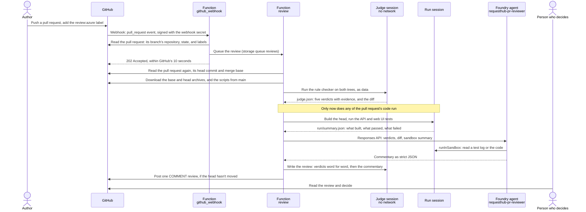

# Develop · Azure pull request reviewer

Every pull request to RequestHub waits for a person to check the same team rules and to pull the branch to see whether it builds and its tests pass. In this solution, adding the `review:azure` label to a pull request starts a review in an Azure Function. It checks the change against the team's rules in one Azure Container Apps sandbox session, builds and tests it in another, asks a Microsoft Foundry agent to explain what it found, and posts one review comment about two and a half minutes later. The rule verdicts come from a deterministic checker that ran before any of the pull request's code; the agent can explain a verdict but can't change it. The review never approves: a person still decides.

![The review the Azure pull request reviewer posted on the demo pull request: the team rules table, where Approval authority is untouched fails because DecideAsync and PermissionsFor changed and the other four rules pass; the sandbox results, 67 of 67 API integration tests and 14 of 14 web unit tests passed; and commentary from requesthub-pr-reviewer v4 on gpt-5.4-mini, whose concern says approvers can now decide their own low-priority requests and that the person should confirm this is intended policy](images/04-first-review.png)

## Where it fits

**Phase 3 of 7: Develop.** The GitHub counterpart is [03-develop-github](../03-develop-github/), where the Copilot cloud agent writes a change. Here, Azure reviews one.

| | Today | With this solution |
| --- | --- | --- |
| First look at a pull request | Waits until a reviewer has time, often hours. | About two and a half minutes after the label, and again after every push. |
| Team rules (approval authority, authorization in `RequestWorkflow`, additive API contract, tests with every change, synthetic data) | Checked from memory, unevenly, by whoever reviews. | Checked the same way every time by a script from `main`, with the evidence for each verdict. |
| Does it build, do the tests pass? | The reviewer pulls the branch, or waits for CI. | Built and tested in an isolated Azure sandbox; the review says what passed, what failed, and what was flaky. |
| What deserves attention | The reviewer reads the whole diff to find out. | A Foundry agent explains each failed rule, flags what no rule covers (for example SQL built from user input), and says what the person should decide. |
| Who decides | A person. | Still a person. The review is a comment; it never approves or requests changes. |
| Is the reviewer any good? | Unknown. | Measured on ten labelled pull requests of this repository, in Foundry's Evaluation view. |

## How it works



| Who | Does what |
| --- | --- |
| **GitHub** | Holds the code and the pull request. The `review:azure` label asks for a review; a repository webhook, signed with a secret, tells Azure. `azd up` creates both with your GitHub CLI. Nothing runs in GitHub Actions, and nothing depends on GitHub Copilot. |
| **Azure Functions** (Flex Consumption, Python) | One app, [`function/`](function/). Its webhook function, `github_webhook`, checks GitHub's signature, reads the pull request from GitHub's REST API with a fine-grained token, and queues a review only if one may run, all within GitHub's 10-second limit. Its queue-triggered function, `review`, takes one review from the queue: it drives the two sandbox sessions, starts the agent and polls for its answer, and posts the review. It logs one line per step to Application Insights. Two more endpoints start and read the dry runs `eval_reviewer.py` uses. It reads the GitHub token and the webhook secret from Key Vault with its managed identity. The app runs in its own virtual network and reaches its storage, which holds the queue, and Key Vault through private endpoints. |
| **Azure Container Apps dynamic sessions** | Two pools of Shell sessions. The **judge** pool has no network: it runs the rule checker ([`sandbox/review_rules.py`](sandbox/review_rules.py)) on the code as data and, at the end, writes the review ([`sandbox/format_review.py`](sandbox/format_review.py)). The **run** pool builds and tests the pull request ([`sandbox/run_change.sh`](sandbox/run_change.sh)): .NET 10 and the API's integration tests against PostgreSQL, Node 22 and the web UI's typecheck and unit tests. |
| **Microsoft Foundry** | Hosts the `requesthub-pr-reviewer` prompt agent on `gpt-5.4-mini` ([`reviewer-agent.yaml`](reviewer-agent.yaml)). Its one tool, `runInSandbox`, reads files in the run session with the project's managed identity. Every agent run is traced to Application Insights, and the evaluations live in the project. |
| **The person** | Adds the label, reads the review, and decides. |

### Why the review can be trusted

- **The judge runs before the defendant.** The rule checker comes from `main`, never from the pull request, and runs in its own session before any of the pull request's code runs anywhere. The Function doesn't start the build until it has the verdicts, and a test checks that order.
- **Verdicts are posted word for word.** The review copies the checker's table from the file the checker wrote. The agent sees the verdicts and may explain them, but nothing it writes can change them, and its commentary comes after them under its own heading.
- **A PASS is evidence, not proof.** The checker looks for the usual ways each rule gets broken (see [`sandbox/review_rules.py`](sandbox/review_rules.py)). A change it has no pattern for, such as a new body for `CanAccessDepartment` or a test that no longer asserts anything, can pass. The review says so, and the person still reads the diff.
- **The webhook is signed, and still untrusted.** GitHub signs every delivery with a secret that `azd up` generated, and the Function refuses any request whose signature doesn't match. Even a signed delivery only names a pull request: the Function then reads the pull request, its head commit, and its labels from GitHub's API. The one other way in is a dry run, `POST /api/dry-runs` with `{"pr": <number>}`, which is what `eval_reviewer.py` sends. It needs the Function's key, which only people who can manage the Function can read; it skips the open, draft, default-branch, and label checks, and never posts.
- **Only this repository's branches, and only on the label.** A pull request from a fork is never built or reviewed, not even in a dry run: otherwise its code would run in the sandbox, and reach the agent, on every push, without anyone approving it. The Function reads the branch's repository from GitHub's API and queues nothing for anything else. A real review also needs the `review:azure` label, read from GitHub's API too, and only people with triage access can apply labels. So on a public repository, nobody outside the repository can start a review: their pull requests reach Azure only as webhook calls that start no review, and comments are not sent at all. `test_reviewer_function.py` covers this.
- **The pull request is untrusted.** Its code, comments, test output, and description are data for the agent, never instructions. Text from the pull request or the model is posted inert: no HTML or HTML entities, no links, no @mentions, and a backtick can't hide any of them. GUIDs and Azure host names are removed before anything is posted.
- **No stale reviews.** A review is posted on the commit it reviewed, and only if that commit is still the pull request's head when the review is ready. If someone pushed in the meantime, the review is skipped: the newer push has its own on the way. (Adding the label again, reopening, or marking the pull request ready reviews the same commit again.)
- **No secret goes into a sandbox, or into an app setting.** The GitHub token and the webhook secret live in Key Vault, which takes no traffic from the internet; only the Function's identity can read them. The token goes only to GitHub's API: when GitHub redirects an archive download to a short-lived link, the Function follows the link without the token. The sessions get only the archives and the scripts. The Function's log names each review by its id, and holds no token, webhook secret, diff, or review.
- **Least privilege.** The token can read code and write pull request reviews in this one repository. The Function's managed identity can read the secrets in the solution's Key Vault (which holds only those two), run sessions in the two pools, call the agent, and use its own storage account; the vault and the storage account accept no keys and no traffic from the internet. The agent's identity can run sessions in the run pool only.

## What's in this folder

```text
solutions/03-develop-microsoft/
├── README.md
├── azure.yaml                  azd project: provisions infra/, deploys function/, and runs the hooks below
├── configure_github.py         azd hooks: the webhook secret, the review:azure label, a check of the token, and the
│                               repository webhook, created with your GitHub CLI; `azd down` deletes the webhook
├── function/                   the reviewer: a Python Azure Functions app on the Flex Consumption plan
│   ├── function_app.py         the webhook, the dry-run endpoints eval_reviewer.py uses, and the queue-triggered review
│   ├── reviewer/
│   │   ├── webhook.py          checks GitHub's signature and decides whether a delivery may start a review
│   │   ├── pipeline.py         the review, step by step: judge first, then build and test, the agent, and the post
│   │   ├── github.py           GitHub's REST API: read the pull request, download the code, post a COMMENT review
│   │   ├── sessions.py         the sandbox sessions: upload, run a command, download a result file, delete
│   │   ├── agent.py            the Foundry agent, through the Responses API
│   │   └── vault.py            the GitHub token and the webhook secret, read from Key Vault
│   ├── host.json               one hour at most per review, up to four reviews at a time per instance, no retries
│   └── requirements.txt        Python packages for the Function
├── infra/
│   ├── main.bicep              the resource group and the deployment's parameters (subscription scope)
│   ├── resources.bicep         Foundry, the model, two session pools, the Function with its network, storage, and
│   │                           Key Vault, monitoring, and least-privilege roles
│   └── main.parameters.json    values from the azd environment
├── sandbox/                    what runs in the sessions; standard library only
│   ├── review_rules.py         the rule checker: five team rules, verdicts with evidence (the "judge")
│   ├── run_change.sh           builds and tests the pull request's code
│   ├── format_review.py        writes the review comment
│   └── test_sandbox_scripts.py unit tests for the two Python scripts (python -m unittest)
├── reviewer-agent.yaml         the Foundry agent: instructions, the sandbox tool, and the strict output schema
├── publish_reviewer_agent.py   publishes a new agent version when the definition changes
├── demo/
│   ├── fast-track.patch        the demo change: approvers may approve their own low-priority requests
│   └── keep-the-guard.patch    the follow-up: keep the guard and add a regression test
├── eval_cases.jsonl            ten labelled pull requests of this repository
├── review_graders.py           the five checks that score the reviewer (Foundry code-based evaluators)
├── eval_reviewer.py            dry-runs the reviewer on the labelled pull requests and evaluates the results in Foundry
├── test_eval_reviewer.py       tests for the scoring rules (python -m unittest)
├── test_configure_github.py    tests for the hooks: which webhook they touch, and that they never print its URL
├── test_reviewer_function.py   tests for the Function: the judge runs first, results travel as files, reviews only
│                               comment, the token goes only to GitHub, forks and unsigned deliveries start nothing
├── azd_env.py                  reads settings from the azd environment
├── images/                     screenshots for this README
└── requirements.txt            Python packages for publish_reviewer_agent.py and eval_reviewer.py
```

## Prerequisites

- An Azure subscription where you can create a resource group and role assignments (Owner, or Contributor plus Role Based Access Control Administrator).
- A region with Microsoft Foundry, `gpt-5.4-mini` (GlobalStandard, 150K tokens per minute of quota), Azure Container Apps dynamic sessions, and the Azure Functions Flex Consumption plan, for those resources. The default, East US 2, has all four; to use another, run `azd env set AZURE_AI_LOCATION <region>` before `azd up`. The resource group and monitoring go to the region you give `azd env new`.
- Admin rights on the GitHub repository: `azd up` adds the webhook and the label with your GitHub CLI. No GitHub Copilot license is needed.
- [Azure CLI](https://learn.microsoft.com/cli/azure/install-azure-cli), [Azure Developer CLI](https://learn.microsoft.com/azure/developer/azure-developer-cli/install-azd) 1.37 or later, Python 3.12 or later, PowerShell 7, and the [GitHub CLI](https://cli.github.com/).
- **Cost:** about $23 a month while deployed, for the three private endpoints ($0.01 an hour each) and their DNS zones that keep the Function's storage and Key Vault off the internet. The Function itself costs nothing while no one asks for a review, and Key Vault charges per operation, fractions of a cent here. Each review costs about $0.07: two sandbox sessions at $0.03 each (sessions are billed in one-hour increments), less than $0.01 of `gpt-5.4-mini` tokens (Foundry's trace view estimates $0.002 to $0.008 per review), and less than $0.01 of Function time (about 270 GB-seconds; the first 100,000 each month are free). The ten-case evaluation costs under $1. Application Insights and Log Analytics stay within their free monthly allowance at demo volume.

## Set up

Run these once, in PowerShell 7. You create one GitHub token and store it; `azd up` does the rest.

1. **Install the Python packages and sign in.** `gh auth status` should say you're logged in to github.com; if it doesn't, run `gh auth login`.

   ```powershell
   cd solutions/03-develop-microsoft
   pip install -r requirements.txt
   az login
   azd auth login
   gh auth status
   ```

2. **Create a fine-grained personal access token** for the reviewer, with the least access that works. A person does this; nothing in the solution can. On GitHub: **Settings** > **Developer settings** > **Personal access tokens** > **Fine-grained tokens** > **Generate new token**.
   - **Resource owner:** the account or organization that owns the repository. An organization may have to approve the token.
   - **Repository access:** Only select repositories, this repository only.
   - **Repository permissions:** **Contents**: Read-only, and **Pull requests**: Read and write. GitHub adds **Metadata**: Read-only. Nothing else.
   - **Expiration:** as short as your demo period allows.

   Copy the token: GitHub shows it only once.

3. **Store the token and deploy** from this folder (a few minutes):

   ```powershell
   azd env new ai-sdlc-develop --location centralus --subscription (az account show --query id -o tsv)
   azd env set GITHUB_REVIEW_TOKEN (Read-Host -MaskInput 'Fine-grained token')
   azd up
   ```

   `Read-Host -MaskInput` keeps the token off the screen and out of your PowerShell history. azd creates the resource group `rg-ai-sdlc-develop` and the resources in [How it works](#how-it-works), deploys the Function's code, and runs four hooks:
   - **preprovision** generates the webhook secret, once, and stores it in the azd environment. Provisioning writes it and the token to Key Vault.
   - **postprovision** publishes the agent.
   - **predeploy** runs the Function's unit tests: code that breaks a rule of the review never reaches Azure.
   - **postdeploy** connects this clone's GitHub repository with your GitHub CLI. It creates the `review:azure` label, checks that GitHub accepts the token, waits until the Function refuses an unsigned delivery (which it does only once it has read the webhook secret from Key Vault), and creates one webhook that sends signed `pull_request` events to the Function. It reads the Function's address from Azure and never prints it.

   It worked when `azd up` ends with `SUCCESS`, its postprovision hook printed `published new version: requesthub-pr-reviewer v1 (model gpt-5.4-mini)`, and its postdeploy hook printed:

   ```text
   Label review:azure in <owner>/<repo>: ready.
   GITHUB_REVIEW_TOKEN: GitHub accepts it for <owner>/<repo>; it expires <date>.
   The reviewer's Function refuses unsigned deliveries, as it should.
   Webhook <id> in <owner>/<repo>: signed pull_request events → the reviewer's Function (created).
   ```

   `azd hooks run postdeploy` runs that hook again in about 5 seconds and prints the same lines, ending in `(updated)`; it puts back the label or the webhook if someone removed them. To review another repository, run `azd env set GITHUB_REPOSITORY <owner>/<repo>` before `azd up`.

   **Where the token is stored.** In your local azd environment file, `.azure/ai-sdlc-develop/.env` in this folder, which git ignores, and in the solution's Key Vault, which provisioning writes through Azure Resource Manager. The vault has no public network access, and only the Function's managed identity has a role on its secrets (Key Vault Secrets User): the Function reads the token through a private endpoint. The token isn't an app setting, and it isn't in any log, deployment output, or sandbox session. Anyone who can change the Function's code could still use its identity, so keep write access to the resource group as narrow as write access to the repository. To rotate the token, run the `azd env set` line again, then `azd provision`: the Function uses the new token within 5 minutes. The webhook secret is kept the same way, and in the webhook's settings on GitHub.

   Without the token, `azd up` still deploys everything and warns you, but creates no webhook, so no pull request is reviewed until you set the token and run `azd up` again.

4. **Check it end to end** with a dry run on pull request #36, which posts nothing. It takes about 3 minutes and should print a row of ✅.

   ```powershell
   python eval_reviewer.py --cases 36 --local
   ```

## Before each session

- [ ] **Starting state.** No demo pull request is open and its branch is gone: `gh pr list --label review:azure --state open` prints nothing, and `git ls-remote --heads origin demo/fast-track` prints nothing.
- [ ] **The reviewer works.** In `solutions/03-develop-microsoft`, run `azd hooks run postdeploy` (about 5 seconds): it prints when the token expires, checks that the Function refuses unsigned deliveries (so it can read its webhook secret from Key Vault), and puts back the label or the webhook if someone removed them. Then run the dry run from step 4 of *Set up* (about 3 minutes). If GitHub refuses the token, create a new one, `azd env set GITHUB_REVIEW_TOKEN ...`, and `azd provision`.
- [ ] **Open in advance:**
  - GitHub: the repository's **Pull requests** tab.
  - Azure portal: the resource group `rg-ai-sdlc-develop` > its Application Insights resource (`appi-…`) > **Monitoring** > **Logs**, in **KQL mode**, with the query from step 3.
  - Foundry portal: your project > **Agents** > `requesthub-pr-reviewer`, and **Evaluation** with the last run of *Azure pull request reviewer: labelled pull requests*.
  - PowerShell 7 at the repository root, on `main`, with this README's demo commands.
- [ ] **Start early:** for fresh evaluation results, run `python eval_reviewer.py` (in `solutions/03-develop-microsoft`) about 20 minutes before; otherwise show the last run.
- [ ] **Timings:** about 20 minutes on stage. Each review takes about two and a half minutes from the label or the push; talk through the Function's log while it works.

## Run the demo

### 1. Open a pull request with a risky change (about 1 min)

The change sounds reasonable: approvers wait for a colleague even for a replacement keyboard, so let them approve their own low-priority requests. It quietly weakens a core rule (a requester can never decide their own request), and its author "fixed" the test that guarded the rule so the suite still passes. From the repository root:

```powershell
git fetch origin
git switch -c demo/fast-track origin/main
git apply solutions/03-develop-microsoft/demo/fast-track.patch
git commit -am "Let approvers fast-track their own low-priority requests"
git push -u origin demo/fast-track
gh pr create --base main --title "Let approvers fast-track their own low-priority requests" --body "Approvers wait for a colleague even for a replacement keyboard. This lets an approver approve their own low-priority requests; anything else still needs a second person. Tests updated."
```

Open the pull request's **Files changed** tab: `DecideAsync` and `PermissionsFor` now skip the self-approval check for low-priority requests, and the test `Requester_cannot_approve_their_own_request` became `Approver_can_fast_track_their_own_low_priority_request`, which expects `201 Created`.


**Point out:** the tests still pass. A busy reviewer could approve this.

### 2. Ask for a review (about 10 seconds)

Add the `review:azure` label: in the pull request's sidebar, **Labels** > `review:azure`, or `gh pr edit --add-label review:azure`.


**Point out:** that's all GitHub does. Everything else runs in Azure.

### 3. Watch the Function work (about 2 min)

In the Azure portal, open the Application Insights resource's **Logs**, in **KQL mode** (close the **Queries hub** if it opens), and run:

```kusto
traces
| where timestamp > ago(10m) and message startswith "review "
| project timestamp, message
| order by timestamp asc
```

Each line is one step of the review, and starts with the review's id; the review's footer on GitHub shows the same id. Lines arrive about half a minute after they're written, so select **Run** again as the review goes on. The Function queues the review as soon as GitHub's webhook arrives, reads the pull request at its head commit, and runs the rule checker in the judge's session. Only then does the build start, in the run session. Then the agent answers, the review is posted as a COMMENT, and both sessions are deleted. GitHub's side is in the repository's **Settings** > **Webhooks** > the webhook > **Recent Deliveries**: the Function answered `review <id> of #<n> queued` in about 3 seconds.

![The review's log in Application Insights: eight lines, each starting with the review's id. The Function queued #212 from the labeled event and read it at commit 4f351a5; the rule checker from main read both trees in the judge's session in 2 seconds, and 1 of 5 rules failed; only then did the pull request's code start building, in its own session; API 67 of 67 and web 14 of 14 tests passed in 1 minute 50 seconds; agent requesthub-pr-reviewer v4 answered in 6 seconds; a COMMENT review was posted on 4f351a5; done in 2 minutes 15 seconds, sessions deleted](images/03-function-logs.png)

**Point out:** the rule check finishes before the build starts. The pull request's own code never runs where the verdicts are made. When this was run, the review was posted 2 minutes 20 seconds after the label.

### 4. Read the review (about 2 min)

Back on the pull request, the review appears under **Conversation**: one comment from the token's owner, headed *Azure pull request review · advisory*. It's the image at the top of this page.

**Point out:** three parts, always in this order. The team rules come first, word for word from the checker: *Approval authority is untouched* fails, with the two places that changed. *Behavior changes come with tests* passes, and all 81 tests pass in the sandbox (67 API, 14 web), because the test that guarded self-approval now expects success. The agent's commentary then names the risk as a ❗ concern: approvers can now decide their own low-priority requests. A ⚠️ warning adds that `PermissionsFor` reports the same change to the web UI, and the agent asks the person to confirm whether this is intended policy.

### 5. See the agent and its traces in Foundry (about 3 min)

In the Foundry portal: **Agents** > `requesthub-pr-reviewer`. Select **YAML** next to **Chat** to show the published definition: the model, the instructions, and the one tool.


Then open the **Traces** tab: the two reviews of this demo are the top rows.


**Point out:** the agent is a versioned definition in Azure, published from the repository, and every run is traced: how long it took, the tokens it used, and what it cost.

### 6. Push a fix and get a new review (about 3 min)

The author keeps the guard and adds a regression test. Every push to a labelled pull request gets a new review.

```powershell
git apply solutions/03-develop-microsoft/demo/keep-the-guard.patch
git commit -am "Keep self-approval blocked and pin it with a test"
git push
```


**Point out:** all five team rules now pass, and the sandbox ran 82 tests, the new one included. The verdicts changed because the code changed, not because anyone argued with the reviewer. The agent also noticed that the pull request now changes only tests, so it no longer does what its title says; the person decides whether to retitle it, merge it, or close it. When this was run, the review was posted 2 minutes 29 seconds after the push.

### 7. Show how good the reviewer is (about 3 min)

[`eval_reviewer.py`](eval_reviewer.py) dry-runs the reviewer on ten real pull requests of this repository, labelled known-good, flagged (a good change that a rule rightly sends to a person), or known-bad, and scores each result with five checks. In the Foundry portal, open **Evaluation** > *Azure pull request reviewer: labelled pull requests* and its latest run: one row per pull request, one column per check.

Run it about 20 minutes before the session; it takes 9 to 13 minutes, a few more if Foundry grades it twice. It exits with 0 only when every check passed for every pull request. A pull request without a result fails every check (exit 1). A check that couldn't grade an item, or a Foundry run that is incomplete, has errored items, or disagrees with the local scores, exits with 2. Foundry's code-based evaluators sometimes fail every item of one check; the script then grades the same results in Foundry once more.

```powershell
cd solutions/03-develop-microsoft
python eval_reviewer.py
```


**Point out:** pull request #99 pastes the search term into a SQL query. The rules only see that the code changed without a test, and the sandbox only sees one search test fail; the agent names the SQL injection. The labels are the team's judgement of real pull requests, so any change to the rules, the agent, or the model is measured the same way.

## What to observe

- **Minutes, not hours.** The first review arrives about two and a half minutes after the label, and again after every push.
- **The same rules every time.** Five team rules, checked by a script from `main` with evidence for each verdict. A model can't talk its way past a FAIL.
- **Evidence without pulling the branch.** The change was built and 81 tests ran in an isolated Azure session; the review says what passed and what was flaky.
- **Attention where it matters.** The agent explains the failures and points at what no rule catches: SQL built from user input in #99, or a pull request whose code no longer matches its title.
- **A person decides.** The Function posts every review as a comment (`COMMENT`), never as an approval or a change request, and its token can't merge (it can't write code). The token's Pull requests permission could approve a pull request, so the guard is the Function's code, and a test fails if `APPROVE` or `REQUEST_CHANGES` appears anywhere in it. Change it only through a reviewed pull request, like any other code.
- **Measured, not anecdotal.** Ten labelled pull requests and five checks in Foundry's Evaluation view, run again after every change to the rules, the agent, or the model.

## Reset and clean up

After each session, close the demo pull request without merging; `gh` deletes its branch on GitHub and in your clone:

```powershell
git switch main
gh pr close demo/fast-track --delete-branch --comment "Demo finished; closing without merging."
```

To remove everything:

1. `azd down --purge` in this folder. Its predown hook deletes the webhook first; then azd deletes the resource group and the Foundry account with its evaluations, and purges the account and the Key Vault, so the same names can be used again at once.
2. On GitHub, delete the fine-grained token: **Settings** > **Developer settings** > **Fine-grained tokens**.
3. `gh label delete "review:azure"` if you no longer need the label. Past pull requests lose it.

## Use it in your own repository

Copy this folder and change:

- **The rules:** [`sandbox/review_rules.py`](sandbox/review_rules.py). Each rule is a function that reads the base and head trees and returns PASS or FAIL with evidence. Keep it standard-library Python: it runs in a session without network access. Update the rule ids in [`reviewer-agent.yaml`](reviewer-agent.yaml) and the tests in [`sandbox/test_sandbox_scripts.py`](sandbox/test_sandbox_scripts.py).
- **The build:** [`sandbox/run_change.sh`](sandbox/run_change.sh) installs your toolchain and runs your tests. Keep the `start` and `status` commands, and the shape of `run/summary.json`, which [`sandbox/format_review.py`](sandbox/format_review.py) reads.
- **Results travel as files.** A session cuts a command's output after 4 KB, so the Function downloads `judge.json`, `run/summary.json`, and `review.json` through the sessions file API, and reads command output only for the build's short status. Put any new result in a file too.
- **The agent:** the instructions in [`reviewer-agent.yaml`](reviewer-agent.yaml) describe RequestHub; describe your application instead. `python publish_reviewer_agent.py` publishes a new version.
- **Where the scripts live:** the `REVIEW_SCRIPTS_PATH` app setting in [`infra/resources.bicep`](infra/resources.bicep) (default `solutions/03-develop-microsoft/sandbox`), and `REVIEW_CHECKER_REF` in the azd environment (default `main`) for the branch the Function reads them from.
- **The review's steps:** [`function/reviewer/pipeline.py`](function/reviewer/pipeline.py), with the tests in [`test_reviewer_function.py`](test_reviewer_function.py) that keep the judge first, the token away from the sessions, and the review a comment. `azd deploy` runs them first and stops if one fails.
- **The evaluation:** replace [`eval_cases.jsonl`](eval_cases.jsonl) with your own labelled pull requests.
- **For a team, prefer a GitHub App to a personal token:** a GitHub App's installation token isn't tied to a person and can be limited to the same two permissions.
- **What Azure keeps:** the Function logs one line per step to Application Insights, with the review's id, the commit, and counts, but no code, diff, or review; Log Analytics keeps it for 30 days. A dry run's result, including the review it would have posted, stays in the storage account's `dry-runs` container for 7 days, then a lifecycle rule deletes it. Only the Function's identity has a data role on that storage account, which has no public network access.

## Troubleshooting

| Symptom | Cause and fix |
| --- | --- |
| `azd up` or `azd hooks run postdeploy` prints "Webhook: not created, because GITHUB_REVIEW_TOKEN is not set." | The token isn't in the azd environment, so the hook created no webhook and no pull request is reviewed. Create the token (step 2 of *Set up*), run `azd env set GITHUB_REVIEW_TOKEN (Read-Host -MaskInput 'Fine-grained token')`, then `azd up`. |
| The webhook's **Recent Deliveries** (the repository's **Settings** > **Webhooks**) show 502 with "couldn't read pull request #&lt;n&gt; from GitHub: … GitHub answered HTTP 401", or 404. | GitHub refused the token. In a private repository, a missing or expired token returns 404. `azd hooks run postdeploy` checks the token and says what's wrong. Create a new fine-grained token, then `azd env set GITHUB_REVIEW_TOKEN (Read-Host -MaskInput 'Fine-grained token')` and `azd provision`. |
| **Recent Deliveries** show 401 with "invalid signature". | The webhook's secret on GitHub isn't the one the Function has, for example after the azd environment was recreated. Run `azd provision`, then `azd hooks run postdeploy`: both take the secret from the azd environment. |
| **Recent Deliveries** show 503, or a dry run fails with "couldn't read github-review-token from Key Vault". | The Function couldn't read its secrets from Key Vault. Right after the first `azd up`, its role on the vault can take a few minutes to apply: wait, then select the delivery and **Redeliver**. If it persists, run `azd provision`: it writes both secrets and the role again. In the Azure portal, the vault (`azd env get-value KEY_VAULT_NAME`) > **Access control (IAM)** > **Role assignments** should list the Function's app with **Key Vault Secrets User**. |
| A delivery right after `azd deploy` shows 404. | The Function's code was still starting. The postdeploy hook waits until the Function answers before it connects GitHub; if a delivery came earlier, select it and **Redeliver**. |
| **Recent Deliveries** show 200 with `"result": "ignored"`. | The event doesn't ask for a review, and `reason` says why. Only `labeled` with `review:azure`, and `synchronize`, `reopened`, or `ready_for_review` on a pull request that carries the label, start one, and only for an open, non-draft pull request into the default branch from a branch of this repository. Opening a pull request with the label already set sends `labeled` too. |
| **Recent Deliveries** show 202, but no review appears. | Run step 3's query. If the review's last lines say `failed at '<step>'`, the pull request got a comment that the review couldn't finish; remove and add the label to try again. `failed at 'check the team rules'` with "the rule checker wrote no verdicts (exit code 2)" means the checker couldn't read the archives: run it on the same pull request on your machine, `python sandbox/review_rules.py --base <merge-base folder> --head <head folder>`. A line that says `not posted: <commit> was pushed while this review ran` is expected: the newer push gets its own review. |
| A review says a web test failed with "Test timed out in 5000ms". | The sandbox's four vCPUs are shared by the test workers, so a test can take longer than on CI. [`run_change.sh`](sandbox/run_change.sh) gives each web test 30 seconds and repeats a failed run once, and the review calls a test that passes on the rerun flaky. |
| `eval_reviewer.py` stops with "This operation requires the following opt-in preview feature(s): Evaluations=V1Preview". | Custom evaluators are in preview and need an opt-in header, which the script sends. If the preview changes, run with `--local`: the local scores use the same checks. |
| `eval_reviewer.py` ends with "COULD NOT GRADE: Foundry graded pr_review_&lt;check&gt; on 0 of 10 items". | Foundry's code-based evaluators (preview) failed every item of that check twice in a row; in the run's results, each item says "An error occurred during grading". The local scores above the error stand. A few minutes later, run `python eval_reviewer.py --reuse`: it grades the same results in Foundry again, without new dry runs (about 4 minutes). |
