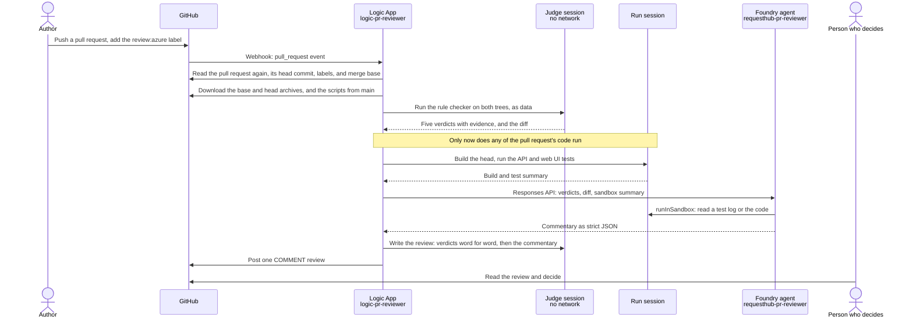
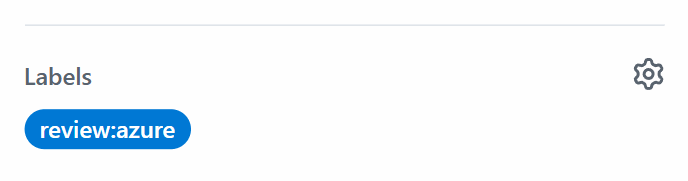
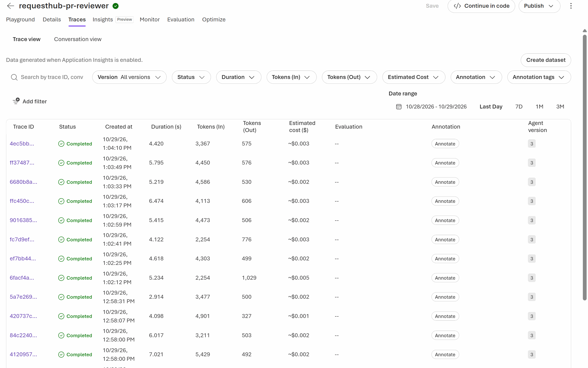
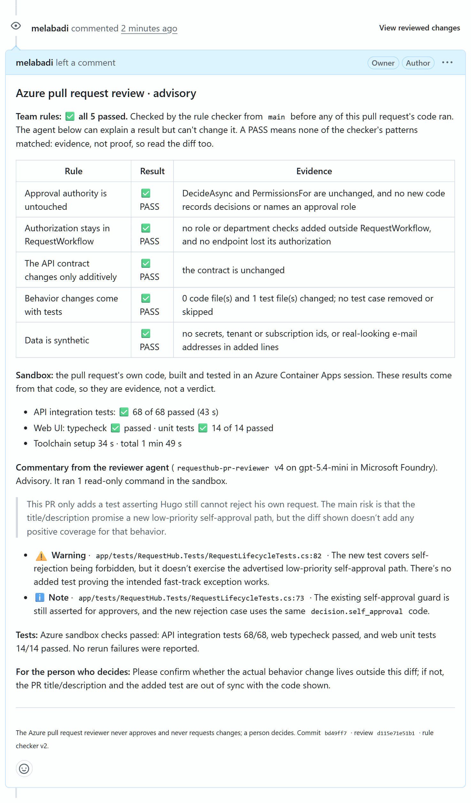
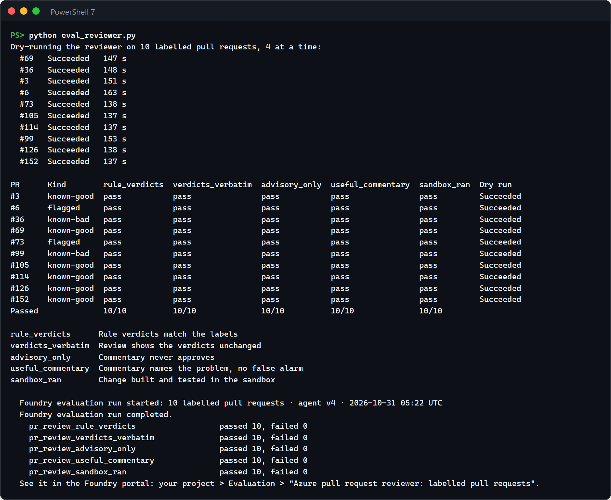

# Develop · Azure pull request reviewer

Every pull request to RequestHub waits for a person to check the same team rules and to pull the branch to see whether it builds and its tests pass. In this solution, adding the `review:azure` label to a pull request starts an Azure Logic App. It checks the change against the team's rules in one Azure Container Apps sandbox session, builds and tests it in another, asks a Microsoft Foundry agent to explain what it found, and posts one review comment about four minutes later. The rule verdicts come from a deterministic checker that ran before any of the pull request's code; the agent can explain a verdict but can't change it. The review never approves: a person still decides.


## Where it fits

**Phase 3 of 7: Develop.** The GitHub counterpart is [03-develop-github](../03-develop-github/), where the Copilot cloud agent writes a change. Here, Azure reviews one.

| | Today | With this solution |
| --- | --- | --- |
| First look at a pull request | Waits until a reviewer has time, often hours. | About four minutes after the label, on every push. |
| Team rules (approval authority, authorization in `RequestWorkflow`, additive API contract, tests with every change, synthetic data) | Checked from memory, unevenly, by whoever reviews. | Checked the same way every time by a script from `main`, with the evidence for each verdict. |
| Does it build, do the tests pass? | The reviewer pulls the branch, or waits for CI. | Built and tested in an isolated Azure sandbox; the review says what passed, what failed, and what was flaky. |
| What deserves attention | The reviewer reads the whole diff to find out. | A Foundry agent explains each failed rule, flags what no rule covers (for example SQL built from user input), and says what the person should decide. |
| Who decides | A person. | Still a person. The review is a comment; it never approves or requests changes. |
| Is the reviewer any good? | Unknown. | Measured on ten labelled pull requests of this repository, in Foundry's Evaluation view. |

## How it works



| Who | Does what |
| --- | --- |
| **GitHub** | Holds the code and the pull request. The `review:azure` label asks for a review; a repository webhook tells Azure. `azd up` creates both with your GitHub CLI. Nothing runs in GitHub Actions, and nothing depends on GitHub Copilot. |
| **Azure Logic Apps** (Consumption) | Runs one review per event: reads the pull request through GitHub's REST API with a fine-grained token, drives the two sandbox sessions, starts the agent and polls for its answer, and posts the review. Its run history shows every step. |
| **Azure Container Apps dynamic sessions** | Two pools of Shell sessions. The **judge** pool has no network: it runs the rule checker ([`sandbox/review_rules.py`](sandbox/review_rules.py)) on the code as data and, at the end, writes the review ([`sandbox/format_review.py`](sandbox/format_review.py)). The **run** pool builds and tests the pull request ([`sandbox/run_change.sh`](sandbox/run_change.sh)): .NET 10 and the API's integration tests against PostgreSQL, Node 22 and the web UI's typecheck and unit tests. |
| **Microsoft Foundry** | Hosts the `requesthub-pr-reviewer` prompt agent on `gpt-5.4-mini` ([`reviewer-agent.yaml`](reviewer-agent.yaml)). Its one tool, `runInSandbox`, reads files in the run session with the project's managed identity. Every agent run is traced to Application Insights, and the evaluations live in the project. |
| **The person** | Adds the label, reads the review, and decides. |

### Why the review can be trusted

- **The judge runs before the defendant.** The rule checker comes from `main`, never from the pull request, and runs in its own session before any of the pull request's code runs anywhere. The Logic App doesn't start the build until it has the verdicts.
- **Verdicts are posted word for word.** The review copies the checker's table from the file the checker wrote. The agent sees the verdicts and may explain them, but nothing it writes can change them, and its commentary comes after them under its own heading.
- **A PASS is evidence, not proof.** The checker looks for the usual ways each rule gets broken (see [`sandbox/review_rules.py`](sandbox/review_rules.py)). A change it has no pattern for, such as a new body for `CanAccessDepartment` or a test that no longer asserts anything, can pass. The review says so, and the person still reads the diff.
- **The webhook is untrusted.** The Logic App takes only the pull request number from it, then reads the pull request, its head commit, and its labels from GitHub's API. The other message it accepts is a dry run, `{"dryRun": true, "pr": <number>}`, which is what `eval_reviewer.py` sends: it skips the open, draft, default-branch, and label checks and never posts. Only the trigger URL's signature keeps others from sending one, so keep the URL secret.
- **Only this repository's branches.** A pull request from a fork is never built or reviewed, not even in a dry run: otherwise its code would run in the sandbox, and reach the agent, on every push, without anyone approving it.
- **The pull request is untrusted.** Its code, comments, test output, and description are data for the agent, never instructions. Text from the pull request or the model is posted inert: no HTML or HTML entities, no links, no @mentions, and a backtick can't hide any of them. GUIDs and Azure host names are removed before anything is posted.
- **No stale reviews.** A review is posted on the commit it reviewed, and only if that commit is still the pull request's head when the review is ready. If someone pushed in the meantime, the review is skipped: the newer push has its own on the way. (Adding the label again, reopening, or marking the pull request ready reviews the same commit again.)
- **No secret goes into a sandbox.** The GitHub token stays in the Logic App: a `securestring` parameter that Azure Resource Manager never returns, used only by actions with secure inputs. The sessions get only the archives and the scripts.
- **Least privilege.** The token can read code and write pull request reviews in this one repository. The Logic App's identity can run sessions in the two pools and call the agent. The agent's identity can run sessions in the run pool only.

## What's in this folder

```text
solutions/03-develop-microsoft/
├── README.md
├── azure.yaml                  azd project: provisions infra/, then runs the hooks below
├── configure_github.py         azd hooks: the review:azure label, a check of the token, and the repository webhook,
│                               created with your GitHub CLI; `azd down` deletes the webhook
├── infra/
│   ├── main.bicep              the resource group and the deployment's parameters (subscription scope)
│   ├── resources.bicep         Foundry, the model, two session pools, the Logic App, monitoring, and least-privilege roles
│   ├── reviewer-workflow.json  the Logic App's workflow: one review per pull request event
│   └── main.parameters.json    values from the azd environment
├── sandbox/                    what runs in the sessions; standard library only
│   ├── review_rules.py         the rule checker: five team rules, verdicts with evidence (the "judge")
│   ├── run_change.sh           builds and tests the pull request's code
│   ├── format_review.py        writes the review comment
│   └── test_sandbox_scripts.py unit tests for the two Python scripts (python -m unittest)
├── reviewer-agent.yaml         the Foundry agent: instructions, the sandbox tool, and the strict output schema
├── publish_reviewer_agent.py   publishes a new agent version when the definition changes
├── demo/
│   ├── fast-track.patch        the demo change: approvers may approve their own low-priority requests
│   └── keep-the-guard.patch    the follow-up: keep the guard and add a regression test
├── eval_cases.jsonl            ten labelled pull requests of this repository
├── review_graders.py           the five checks that score the reviewer (Foundry code-based evaluators)
├── eval_reviewer.py            dry-runs the reviewer on the labelled pull requests and evaluates the results in Foundry
├── test_eval_reviewer.py       tests for the scoring rules (python -m unittest)
├── test_configure_github.py    tests for the hooks: which webhook they touch, and that they never print its URL
├── azd_env.py                  reads settings from the azd environment
├── images/                     screenshots for this README
└── requirements.txt            Python packages for publish_reviewer_agent.py and eval_reviewer.py
```

## Prerequisites

- An Azure subscription where you can create a resource group and role assignments (Owner, or Contributor plus Role Based Access Control Administrator).
- A region with Microsoft Foundry, `gpt-5.4-mini` (GlobalStandard, 150K tokens per minute of quota), Azure Container Apps dynamic sessions, and Logic Apps. The default, East US 2, has all four.
- Admin rights on the GitHub repository: `azd up` adds the webhook and the label with your GitHub CLI. No GitHub Copilot license is needed.
- [Azure CLI](https://learn.microsoft.com/cli/azure/install-azure-cli), [Azure Developer CLI](https://learn.microsoft.com/azure/developer/azure-developer-cli/install-azd) 1.37 or later, Python 3.12 or later, PowerShell 7, and the [GitHub CLI](https://cli.github.com/).
- **Cost:** nothing while no one asks for a review. Each review costs about $0.07: two sandbox sessions at $0.03 each (sessions are billed in one-hour increments), less than $0.01 of `gpt-5.4-mini` tokens (Foundry's trace view estimates $0.002 to $0.004 per review), and less than $0.01 of Logic App actions. The ten-case evaluation costs under $1. Application Insights and Log Analytics stay within their free monthly allowance at demo volume.

## Set up

Run these once, in PowerShell 7. You create one GitHub token and store it; `azd up` does the rest.

1. **Install the Python packages and sign in.** `gh auth status` should say you're logged in to github.com; if it doesn't, run `gh auth login`.

   ```powershell
   cd solutions/03-develop-microsoft
   pip install -r requirements.txt
   az login
   azd auth login
   gh auth status
   ```

2. **Create a fine-grained personal access token** for the reviewer, with the least access that works. A person does this; nothing in the solution can. On GitHub: **Settings** > **Developer settings** > **Personal access tokens** > **Fine-grained tokens** > **Generate new token**.
   - **Resource owner:** the account or organization that owns the repository. An organization may have to approve the token.
   - **Repository access:** Only select repositories, this repository only.
   - **Repository permissions:** **Contents**: Read-only, and **Pull requests**: Read and write. GitHub adds **Metadata**: Read-only. Nothing else.
   - **Expiration:** as short as your demo period allows.

   Copy the token: GitHub shows it only once.

3. **Store the token and deploy** from this folder (a few minutes):

   ```powershell
   azd env new ai-sdlc-develop --location centralus --subscription (az account show --query id -o tsv)
   azd env set GITHUB_REVIEW_TOKEN (Read-Host -MaskInput 'Fine-grained token')
   azd up
   ```

   `Read-Host -MaskInput` keeps the token off the screen and out of your PowerShell history. azd creates the resource group `rg-ai-sdlc-develop` and the resources in [How it works](#how-it-works). Its hooks then publish the agent, and connect this clone's GitHub repository with your GitHub CLI: they create the `review:azure` label, check that GitHub accepts the token, and create one webhook that sends `pull_request` events to the Logic App. The webhook's URL carries the Logic App's signature, so the hook reads it from Azure each time and never prints it. It worked when `azd up` ends with `SUCCESS` and its postprovision hook printed:

   ```text
   published new version: requesthub-pr-reviewer v1 (model gpt-5.4-mini)
   Label review:azure in <owner>/<repo>: ready.
   GITHUB_REVIEW_TOKEN: GitHub accepts it for <owner>/<repo>; it expires <date>.
   Webhook <id> in <owner>/<repo>: pull_request events → Logic App logic-pr-reviewer (created).
   ```

   `azd hooks run postprovision` runs the hooks again and prints the same lines; nothing changes if nothing needs to. To review another repository, run `azd env set GITHUB_REPOSITORY <owner>/<repo>` before `azd up`.

   **Where the token is stored.** In your local azd environment file, `.azure/ai-sdlc-develop/.env` in this folder, which git ignores. In the Logic App as a secure parameter, which Azure never returns when someone reads the Logic App. Every action that sends it has secure inputs, so the run history doesn't show it either. No sandbox session ever gets it. Anyone who can change the Logic App can use the token, so keep write access to the resource group as narrow as write access to the repository. To rotate the token, run the `azd env set` line again, then `azd provision`.

   Without the token, `azd up` still deploys everything and warns you, but creates no webhook, so no pull request is reviewed until you set the token and run `azd provision` again.

4. **Check it end to end** with a dry run on pull request #36, which posts nothing. It takes about 3 minutes and should print a row of ✅.

   ```powershell
   python eval_reviewer.py --cases 36 --local
   ```

## Before each session

- [ ] **Starting state.** No demo pull request is open and its branch is gone: `gh pr list --label review:azure --state open` prints nothing, and `git ls-remote --heads origin demo/fast-track` prints nothing.
- [ ] **The reviewer works.** In `solutions/03-develop-microsoft`, run `azd hooks run postprovision` (about 20 seconds): it prints when the token expires, and puts back the label or the webhook if someone removed them. Then run the dry run from step 4 of *Set up* (3 minutes). If GitHub refuses the token, create a new one, `azd env set GITHUB_REVIEW_TOKEN ...`, and `azd provision`.
- [ ] **Open in advance:**
  - GitHub: the repository's **Pull requests** tab.
  - Azure portal: the `logic-pr-reviewer` Logic App, **Development Tools** > **Run history**.
  - Foundry portal: your project > **Agents** > `requesthub-pr-reviewer`, and **Evaluation** with the last run of *Azure pull request reviewer: labelled pull requests*.
  - PowerShell 7 at the repository root, on `main`, with this README's demo commands.
- [ ] **Start early:** for fresh evaluation results, run `python eval_reviewer.py` (in `solutions/03-develop-microsoft`) about 15 minutes before; otherwise show the last run.
- [ ] **Timings:** about 20 minutes on stage. Each review takes about 4 minutes from the label; talk through the Logic App run while it works.

## Run the demo

### 1. Open a pull request with a risky change (1 min)

The change sounds reasonable: approvers wait for a colleague even for a replacement keyboard, so let them approve their own low-priority requests. It quietly weakens a core rule (a requester can never decide their own request), and its author "fixed" the test that guarded the rule so the suite still passes. From the repository root:

```powershell
git fetch origin
git switch -c demo/fast-track origin/main
git apply solutions/03-develop-microsoft/demo/fast-track.patch
git commit -am "Let approvers fast-track their own low-priority requests"
git push -u origin demo/fast-track
gh pr create --base main --title "Let approvers fast-track their own low-priority requests" --body "Approvers wait for a colleague even for a replacement keyboard. This lets an approver approve their own low-priority requests; anything else still needs a second person. Tests updated."
```


**Point out:** the tests still pass. A busy reviewer could approve this.

### 2. Ask for a review (a few seconds)

Add the `review:azure` label: in the pull request's sidebar, **Labels** > `review:azure`, or `gh pr edit --add-label review:azure`.



**Point out:** that's all GitHub does. Everything else runs in Azure.

### 3. Watch the Logic App work (about 4 min)

In the Azure portal, open the run at the top of the Logic App's **Run history**. Expand **Run_the_review**. Inside **Download_the_code**, the first call for each archive reports **Found**: GitHub answers with a redirect to a short-lived download link, and the next call follows it.


**Point out:** the rule check finished before the build started. The pull request's own code never runs where the verdicts are made.

### 4. Read the review (2 min)

Back on the pull request, the review appears under **Conversation** (see the image at the top of this page).

**Point out:** three parts, always in this order. The team rules come first and word for word from the checker: *Approval authority is untouched* fails, with the two places that changed. *Behavior changes come with tests* passes, and the sandbox says all 81 tests passed. Then the agent explains why that's not reassuring: the test that guarded self-approval was rewritten to expect success.

### 5. See the agent and its traces in Foundry (3 min)

In the Foundry portal: **Agents** > `requesthub-pr-reviewer`. Select **YAML** next to **Chat** to show the published definition: the model, the instructions, and the one tool. Then open the **Traces** tab: the review you just watched is the top row.




**Point out:** the agent is a versioned definition in Azure, published from the repository, and every run is traced: how long it took, the tokens it used, and what it cost.

### 6. Push a fix and get a new review (about 4 min)

The author keeps the guard and adds a regression test. Every push to a labelled pull request gets a new review.

```powershell
git apply solutions/03-develop-microsoft/demo/keep-the-guard.patch
git commit -am "Keep self-approval blocked and pin it with a test"
git push
```



**Point out:** the verdicts changed because the code changed, not because anyone argued with the reviewer. The person still decides whether to merge.

### 7. Show how good the reviewer is (3 min)

[`eval_reviewer.py`](eval_reviewer.py) dry-runs the reviewer on ten real pull requests of this repository, labelled known-good, flagged (a good change that a rule rightly sends to a person), or known-bad, and scores each result with five checks. In the Foundry portal, open **Evaluation** > *Azure pull request reviewer: labelled pull requests* and its latest run.


Run it about 15 minutes before the session; it takes about 12. It exits with 0 only when every check passed for every pull request. A pull request without a result fails every check (exit 1). A check that couldn't grade an item, or a Foundry run that is incomplete, has errored items, or disagrees with the local scores, exits with 2.

```powershell
cd solutions/03-develop-microsoft
python eval_reviewer.py
```



**Point out:** pull request #99 pastes the search term into a SQL query. The rules only see that the code changed without a test, and the sandbox only sees one search test fail; the agent names the SQL injection. The labels are the team's judgement of real pull requests, so any change to the rules, the agent, or the model is measured the same way.

## What to observe

- **Minutes, not hours.** The first review arrives about four minutes after the label, and again after every push.
- **The same rules every time.** Five team rules, checked by a script from `main` with evidence for each verdict. A model can't talk its way past a FAIL.
- **Evidence without pulling the branch.** The change was built and 81 tests ran in an isolated Azure session; the review says what passed and what was flaky.
- **Attention where it matters.** The agent explains the failures and points at what no rule catches: a rewritten test, SQL built from user input.
- **A person decides.** The workflow posts every review as a comment (`COMMENT`), never as an approval or a change request, and its token can't merge (it can't write code). The token's Pull requests permission could approve a pull request, so the guard is the workflow itself: change it only through a reviewed pull request, like any other code.
- **Measured, not anecdotal.** Ten labelled pull requests and five checks in Foundry's Evaluation view, run again after every change to the rules, the agent, or the model.

## Reset and clean up

After each session, close the demo pull request without merging and delete its branch:

```powershell
gh pr close demo/fast-track --delete-branch --comment "Demo finished; closing without merging."
git switch main
git branch -D demo/fast-track
```

To remove everything:

1. `azd down --purge` in this folder. Its predown hook deletes the webhook first; then azd deletes the resource group and the Foundry account with its evaluations, and purges the account.
2. On GitHub, delete the fine-grained token: **Settings** > **Developer settings** > **Fine-grained tokens**.
3. `gh label delete "review:azure"` if you no longer need the label. Past pull requests lose it.

## Use it in your own repository

Copy this folder and change:

- **The rules:** [`sandbox/review_rules.py`](sandbox/review_rules.py). Each rule is a function that reads the base and head trees and returns PASS or FAIL with evidence. Keep it standard-library Python: it runs in a session without network access. Update the rule ids in [`reviewer-agent.yaml`](reviewer-agent.yaml) and the tests in [`sandbox/test_sandbox_scripts.py`](sandbox/test_sandbox_scripts.py).
- **The build:** [`sandbox/run_change.sh`](sandbox/run_change.sh) installs your toolchain and runs your tests. Keep the `start`, `status`, and `summary` commands, and the summary's shape, which [`sandbox/format_review.py`](sandbox/format_review.py) reads.
- **The agent:** the instructions in [`reviewer-agent.yaml`](reviewer-agent.yaml) describe RequestHub; describe your application instead. `python publish_reviewer_agent.py` publishes a new version.
- **Where the scripts live:** the `scriptsPath` parameter in [`infra/reviewer-workflow.json`](infra/reviewer-workflow.json) (default `solutions/03-develop-microsoft/sandbox`), and `REVIEW_CHECKER_REF` (default `main`) for the branch the Logic App reads them from.
- **The evaluation:** replace [`eval_cases.jsonl`](eval_cases.jsonl) with your own labelled pull requests.
- **For a team, prefer a GitHub App to a personal token:** a GitHub App's installation token isn't tied to a person and can be limited to the same two permissions.
- **Who can read the run history:** the Logic App keeps every run's inputs and outputs, including the diff and the review, for 90 days (the archives and the token are hidden). Give read access to the resource group only to people who may read the code.

## Troubleshooting

| Symptom | Cause and fix |
| --- | --- |
| `azd up` or `azd hooks run postprovision` prints "Webhook: not created, because GITHUB_REVIEW_TOKEN is not set." | The token isn't in the azd environment, so the hook created no webhook and no pull request is reviewed. Create the token (step 2 of *Set up*), run `azd env set GITHUB_REVIEW_TOKEN (Read-Host -MaskInput 'Fine-grained token')`, then `azd provision`. |
| The Logic App run fails at **Get_the_pull_request** with 404 or 401. | GitHub refused the token. In a private repository, a missing or expired token returns 404. `azd hooks run postprovision` checks the token and says what's wrong. Create a new fine-grained token, then `azd env set GITHUB_REVIEW_TOKEN (Read-Host -MaskInput 'Fine-grained token')` and `azd provision`. |
| The webhook's **Recent Deliveries** show 202, but no run appears. | The trigger skipped the event: only `labeled` with `review:azure`, and `synchronize`, `reopened`, or `ready_for_review` on a pull request that carries the label, start a review. Opening a pull request with the label already set sends `labeled` too. |
| A review says a web test failed with "Test timed out in 5000ms". | The sandbox's four vCPUs are shared by the test workers, so a test can take longer than on CI. [`run_change.sh`](sandbox/run_change.sh) gives each web test 30 seconds and repeats a failed run once, and the review calls a test that passes on the rerun flaky. |
| `eval_reviewer.py` stops with "This operation requires the following opt-in preview feature(s): Evaluations=V1Preview". | Custom evaluators are in preview and need an opt-in header, which the script sends. If the preview changes, run with `--local`: the local scores use the same checks. |
