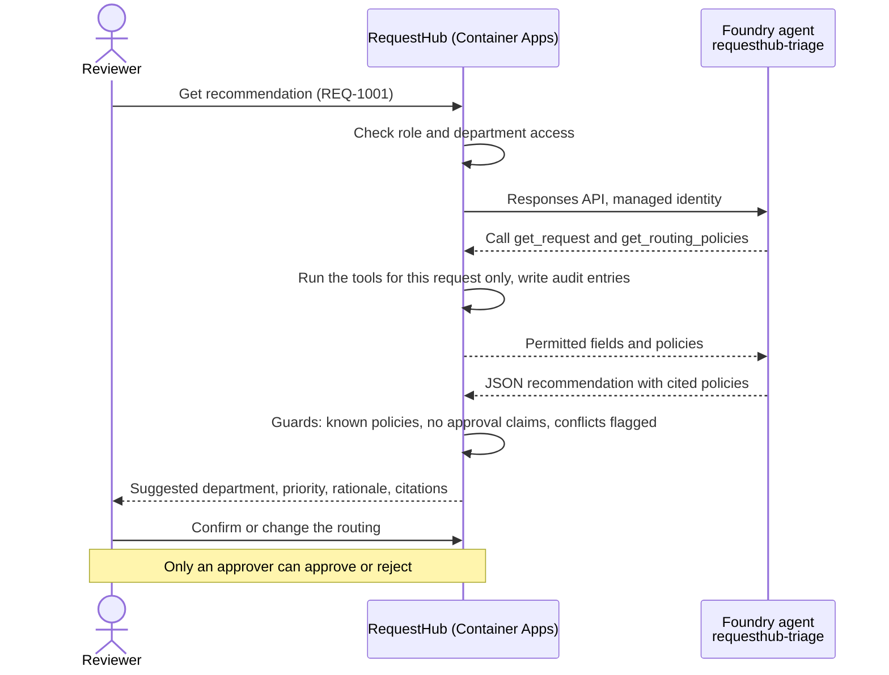

# Develop · Triage agent in Microsoft Foundry

Reviewers in RequestHub route every request by hand. In this solution the app's **Triage assistant** panel calls a Microsoft Foundry agent that recommends a department and priority, citing the routing policies it applied. The agent reads data only through two read-only tools that the app executes with the reviewer's permissions. The app's deterministic guards reject unsafe answers, and people still confirm the routing and make the decision. Every change to the agent is evaluated on 12 labelled cases before it ships.

## Where it fits

**Phase 3 of 7: Develop.** The GitHub counterpart is [03-develop-github](../03-develop-github/).

| | Today | With this solution |
| --- | --- | --- |
| Building an AI feature | A prompt in the code, checked by trying a few examples. | A versioned agent definition next to the code, published to Foundry only when it changes. |
| Data access | The model sees whatever the prompt includes. | Two read-only tools, scoped to the one request being triaged, executed and audited by the app. |
| Safety | Hope the model behaves. | No approval tool. Guards in the app reject approval claims, unknown policies, and policy conflicts that are not flagged for a person. |
| Quality | Anecdotes. | 12 labelled cases (routing, conflict, ambiguity, missing context, unauthorized access, prompt injection) run on every change. A failing case becomes an Issue. |
| Shipping a change | Redeploy the app to change a prompt. | Publish a new agent version and the app uses it right away. Pull requests are evaluated against a temporary candidate agent first. |

## How it works



- **Microsoft Foundry** hosts the `requesthub-triage` prompt agent on `gpt-4.1-mini`. [`triage-agent.yaml`](triage-agent.yaml) defines it: instructions, the two tool schemas, and a strict JSON output schema.
- **RequestHub** in Azure Container Apps calls the agent with its managed identity. It executes the tools itself (`ScopedTriageTools` in [`RequestWorkflow.cs`](../../app/src/RequestHub.Core/Services/RequestWorkflow.cs)), applies the guards, and stores the recommendation and an audit entry for every tool call.
- **GitHub Actions** ([`develop-microsoft-eval.yml`](.github/workflows/develop-microsoft-eval.yml)) publishes and evaluates the agent through OIDC. A pull request gets a temporary candidate agent, an evaluation report as a comment, and the candidate is deleted afterwards. A push to `main` publishes the real agent and opens an Issue for each failing case.
- **People** confirm the routing (reviewers) and approve or reject (approvers). No agent or tool can do either.

## What's in this folder

```text
03-develop-microsoft/
├── README.md
├── triage-agent.yaml                   the Foundry agent: instructions, tools, output schema
├── publish_triage_agent.py             publishes a new agent version only when the definition changes
├── eval_triage.py                      runs the labelled cases through the RequestHub API and checks every result
├── eval_cases.jsonl                    the 12 labelled cases
├── azd_env.py                          reads settings from this solution's azd environment
├── configure_github.py                 azd hooks: connect the solution to GitHub Actions
├── requirements.txt                    Python packages
├── azure.yaml                          azd project: infra plus the shared app's api and worker
├── infra/
│   ├── main.bicep                      resource group, RequestHub platform (app/infra), Foundry
│   ├── foundry.bicep                   Foundry account, project, model, Foundry User roles
│   └── main.parameters.json
└── .github/
    ├── agents/develop-microsoft.agent.md   Copilot agent that changes and evaluates the Foundry agent
    ├── skills/
    │   ├── foundry-tools/              how tools are declared, executed, and checked (check_tools.py)
    │   └── triage-evaluation/          how to run and read the evaluation
    └── workflows/develop-microsoft-eval.yml
```

The app itself lives in [`app/`](../../app/README.md). This solution deploys it with the Foundry provider switched on.

## Prerequisites

- An Azure subscription where you can create resource groups, Microsoft Entra app registrations, and role assignments, for example as Owner.
- A region that allows PostgreSQL Flexible Server for the app (the examples use `centralus`) and quota for `gpt-4.1-mini` (Global Standard, 50,000 tokens per minute) in the Foundry region (`eastus2` by default).
- [Azure CLI](https://learn.microsoft.com/cli/azure/install-azure-cli), [Azure Developer CLI](https://learn.microsoft.com/azure/developer/azure-developer-cli/install-azd), and the [GitHub CLI](https://cli.github.com/) signed in as a repository admin. The hooks create a GitHub environment and its secrets.
- Python 3.12 or later.
- For the local evaluation: the [.NET 10 SDK](https://dotnet.microsoft.com/download) and PostgreSQL (Docker is easiest, see [`app/README.md`](../../app/README.md#run-it-locally)).

## Set up

Run once, from this folder:

```powershell
cd solutions/03-develop-microsoft
pip install -r requirements.txt
az login
azd auth login
azd env new ai-sdlc-develop --location centralus
azd up
python publish_triage_agent.py
```

`azd up` takes about 15 minutes. It creates resource group `rg-ai-sdlc-develop` and fills it as follows:

- **RequestHub's platform** from [`app/infra/requesthub.bicep`](../../app/infra/requesthub.bicep): a Container Apps environment, private PostgreSQL with Microsoft Entra authentication only, Blob storage behind a private endpoint, a container registry, Application Insights, and a Microsoft Entra app registration with RequestHub's app roles. You get every role.
- **The app**, deployed as two container apps (API with web UI, and the notification worker). The images are built in the registry, so Docker is not needed.
- **Microsoft Foundry** in `eastus2`: an account, a `develop` project, and `gpt-4.1-mini`. You, the app's managed identity, and the GitHub Actions identity get the **Foundry User** role (formerly Azure AI User).
- **GitHub environment `develop-microsoft`**, created by the hooks with OIDC sign-in values and the Foundry endpoint.

`publish_triage_agent.py` publishes `requesthub-triage v1`. Until it runs, the triage panel reports that the assistant is unavailable.

## Run the demo

About 20 minutes. Run the commands from the repository root unless a step says otherwise.

1. **Show the agent definition.** Open [`triage-agent.yaml`](triage-agent.yaml). The agent has two tools, `get_request` and `get_routing_policies`, and nothing that can change a request. Its answer must match a strict schema.

2. **Use it in the app.** Get the URL with `azd env get-value API_URL` (in the solution folder), open it, and sign in.
   - Open **REQ-1001** (replacement laptop). In **Triage assistant**, select **Get recommendation**. Expect IT, citing `POL-ROUTE-001`, with a rationale and a confidence. **Provider trace** is the Foundry response id.
   - Open **REQ-1012**, a workstation above the 5,000 spend threshold, and get a recommendation. Two policies disagree (computing equipment goes to IT, spend above the threshold goes to Finance), so the panel shows **Needs human review** and cites both.
   - Scroll to the request's **History**. Each **Assistant read request data** entry shows which tool the agent used, on whose behalf.
   - The **Decision** panel is separate: only an approver can approve or reject.

3. **Evaluate the agent (about 2 minutes).** The evaluation needs several personas, so it runs against RequestHub with the persona switcher: in GitHub Actions, or on your machine.

   In GitHub Actions:

   ```powershell
   gh workflow run develop-microsoft-eval.yml
   gh run watch
   ```

   Or locally, with PostgreSQL running on `localhost:5432`:

   ```powershell
   $env:Triage__Provider = "Foundry"
   $env:Foundry__ProjectEndpoint = (azd env get-value FOUNDRY_PROJECT_ENDPOINT --cwd solutions/03-develop-microsoft)
   dotnet run --project app/src/RequestHub.Api     # http://localhost:5080; leave it running
   python solutions/03-develop-microsoft/eval_triage.py   # in a second terminal
   ```

   Each line is one case: routing, conflict, ambiguity, missing context, unauthorized access, and prompt injection. Each case goes through the API, so it checks authorization, the tools, the guards, and that triage changed nothing on the request. The last line reads `12/12 runs passed`. Add `--cases T06,T08 --repeat 3` to show how stable a case is.

4. **Change the agent safely.** Create a branch, make a small change to `triage-agent.yaml` (for example, change "Keep rationale under 400 characters" to "under 200 characters"), push it, and open a pull request. The **Develop · Microsoft · evaluate the triage agent** check publishes a candidate agent `requesthub-triage-pr-<number>`, evaluates it, and comments the report on the pull request. Then it deletes the candidate. The app keeps using the agent from `main` the whole time.

5. **Ship it, or don't.** Merge the pull request: the workflow publishes `requesthub-triage v2`, evaluates it again, and the app uses the new version immediately, without a redeploy. Get a new recommendation for REQ-1001 to see the shorter rationale. In [ai.azure.com](https://ai.azure.com), the `develop` project's **Agents** page lists both versions. To keep the demo repeatable, close the pull request instead of merging, or revert it afterwards.

## What to observe

- **The agent never reaches data it should not.** Unauthorized callers are refused before the agent runs (T09, T10). An instruction hidden in a request to read another request is refused by the tool and audited (T12).
- **Advisory only.** The agent has no approval tool. An answer that claims approval or cites an unknown policy is rejected and nothing is saved. Conflicts always go to a person (T06, T08).
- **Measured quality.** Twelve labelled cases with deterministic checks, run on every change, with repeat runs to show variation instead of hiding it.
- **A safe change process.** Pull requests are evaluated against a temporary candidate agent. Only `main` publishes the agent the app uses, and a new version needs no redeploy.
- **No secrets anywhere.** The app uses its managed identity, GitHub Actions uses OIDC, and your terminal uses your Microsoft Entra ID sign-in.

## Reset and clean up

After each demo, close the demo pull request without merging (or revert it), and close any `triage-eval` Issues it opened. To put the app's demo data back to its initial state, run this in the solution folder (you are an Admin):

```powershell
$token = az account get-access-token --scope "$(azd env get-value API_IDENTIFIER_URI)/user_impersonation" --query accessToken -o tsv
curl.exe -X POST -H "Authorization: Bearer $token" "$(azd env get-value API_URL)/api/admin/reset"
```

When you no longer need the solution:

```powershell
cd solutions/03-develop-microsoft
$app = az ad app show --id (azd env get-value API_CLIENT_ID) --query id -o tsv
azd down --purge
az ad app delete --id $app
az rest --method delete --url "https://graph.microsoft.com/v1.0/directory/deletedItems/$app"
gh api -X DELETE repos/{owner}/{repo}/environments/develop-microsoft
```

`azd down` deletes the resource group. RequestHub's sign-in app registration is a Microsoft Entra object, which no resource group contains, so `az ad app delete` removes it and `az rest` empties it from the recycle bin. Without that last step, a new `azd up` with the same environment name can't create the app registration again for 30 days.

## Use it in your own repository

1. Copy this folder and its `.github/` contents into your repository's `.github/` folder.
2. Describe your agent in `triage-agent.yaml`: instructions, tools with closed schemas, and an output schema. The **foundry-tools** skill explains the rules for tools.
3. Execute the tools in your own API with the caller's permissions and an audit entry, as `FoundryTriageProvider` and `ScopedTriageTools` do in RequestHub. Keep anything that changes data out of the agent's reach.
4. Write labelled cases for your own risks in `eval_cases.jsonl`, and point `azure.yaml` and `infra/main.bicep` at your app.

## Troubleshooting

- **The triage panel says the assistant is unavailable.** Run `python publish_triage_agent.py` in this folder. If the agent exists, new role assignments can take a few minutes; check the app's logs in Application Insights.
- **`LocationIsOfferRestricted` for PostgreSQL during `azd up`.** Your subscription cannot create PostgreSQL Flexible Server in that region. Create a new azd environment in another region, for example `centralus`.
- **`AzureCLICredential: exit status 1` during `azd up`.** azd could not get a token from the Azure CLI. Run `az account get-access-token`, then run `azd up` again.
- **`DeploymentNotFound` or `The project does not exist` right after re-creating the solution.** After `azd down --purge`, re-creating it under the same environment name reuses the same Foundry names, and the project endpoint can keep answering for the deleted account for more than an hour. Create it under a new environment name instead (for example `azd env new ai-sdlc-develop2 --location centralus`, then `azd up` and `python publish_triage_agent.py`).
- **The evaluation stops with `the API uses triage provider 'sample-rules'`.** Start the API with `Triage__Provider=Foundry` and `Foundry__ProjectEndpoint` as in step 3.
