# Test · Regression lab with GitHub Copilot

Defects that only show up under retries or simultaneous clicks slip through review: nobody wrote the test that would have caught them, and a green pull request doesn't say whether its new tests ever failed. This solution adds a test-first loop to your repository. A scenario file replays a reported defect against your running API, and a custom agent for the Copilot cloud agent commits failing regression tests first, then the fix. A GitHub Actions workflow proves that the tests fail at the tests-only commit and pass at the fix. When CI fails on the pull request, an agentic workflow explains each failure: a new test failing as intended, a regression, or a failure that isn't the change's. Copilot code review looks for what the tests miss, and an evidence report keeps the checks apart from the review comments, so a person decides with the proof in hand.

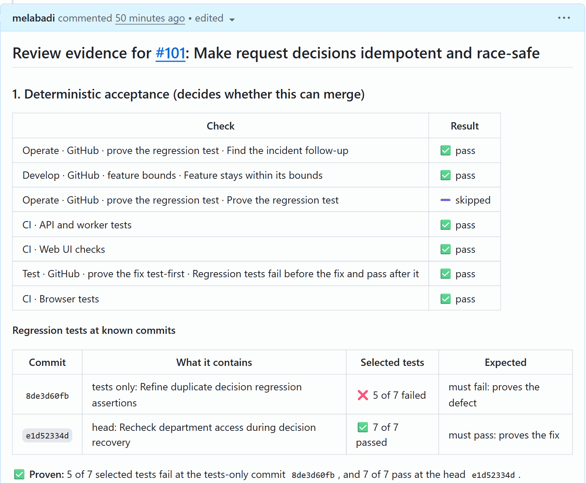

- **See it work:** [a real run on this repository](#see-it-work), step by step. A request that could be approved and then rejected was reproduced, tested with an eight-click race, fixed, and reviewed, with a screenshot and a link anyone can open for every step.
- **Add it to your repository:** [copy 19 files, adapt them to your code, and set them up once](#add-it-to-your-repository). The setup's commands took seconds when this README was checked, 5 to copy the files and 4 for the labels; the rest is a settings page, a token, a pull request, and the changes your stack needs.
- **Try it first in a copy of this repository:** [about 2 minutes to set up](#try-it-first-in-a-copy-of-this-repository), in the copy that the [root README](../../README.md#try-it-in-a-copy-of-this-repository) makes once for every solution. A run then needs about 22 minutes of Copilot and the checks working unattended.

## Why it matters

**Phase 4 of 7: Test.** Today a defect is usually fixed first and tested afterwards, if at all. Nobody sees whether the new test would have caught the defect, races are hard to reproduce by hand, and a green check with an empty review looks like a clean one. With this solution the order of the evidence is the point: the tests fail at one known commit and pass at the next, the checks are reported apart from the review comments, and a person decides with that proof in hand.

| | Today | With this solution |
| --- | --- | --- |
| Reproducing | Someone repeats the clicks from the bug report by hand, and races are hard to trigger. | A scenario file replays the report against the API, including eight parallel clicks, and lists the expectations that break. |
| Regression tests | Written after the fix, if at all. Nobody knows whether they would have caught the bug. | Copilot commits the failing tests on their own, then the fix in a separate commit. |
| A red CI run | Someone reads the log to find the failing test, then guesses whether the change caused it. | An agentic workflow reads the log, the diff, and main's latest CI result, sorts each failing test (a new test failing as intended, a regression, or a failure that also happens on main), and posts one comment and one label. |
| Review | A green check and a few comments. An empty review looks like a clean one. | Actions reruns the new tests at the tests-only commit (at least one must fail) and at the head (all must pass) and keeps both outputs. Comments are reported apart from the checks. |
| Decision | Implicit in the merge button. | A person approves the workflow runs, reads the tests, and approves or requests changes; the evidence comment records who decided. |

The value: a defect report becomes a proven, reviewable fix in under half an hour, and the reviewer gets evidence to check rather than a green mark to trust. The run in [See it work](#see-it-work), on 28 October 2026, measured:

- **8 minutes 46 seconds** from assigning the Issue to Copilot's fix, in a 13-minute session. The failing tests came first, committed 6 minutes after the Issue was filed.
- **5 of 7** selected tests failed at the tests-only commit, and **7 of 7** passed at the fix. Six were Copilot's new tests; the seventh was an existing test that the proof script of that day also picked up ([step 5](#5-the-proof-showed-the-tests-failing-first)). The proof took 1 minute 44 seconds.
- **One authorization gap** that no test covered, found by Copilot code review in 6 minutes. Copilot fixed it, with a new test, 7 minutes after a person asked, and the new commit passed the same gates.
- **23 minutes** from filing the Issue to a passing proof, 7 of them waiting for a person to approve the workflow runs.

The Microsoft counterpart, [04-test-microsoft](../04-test-microsoft/), load-tests the API with Azure Load Testing. The [Test combo](../../PRESENTING.md#test-copilot-proves-the-repair-azure-load-tests-the-same-commit) uses both on one change: Azure load-tests the very commit that this solution proves.

## How it works

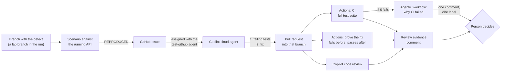

- **Copilot** runs the custom agent [`test-github`](.github/agents/test-github.agent.md) in the cloud agent. With the `failure-reproduction` skill it runs the Issue's scenario, writes integration tests that assert the expected behavior, commits them alone, fixes the code in a second commit, and reruns the tests, the `regression-validation` suites, and the scenario. Copilot code review then looks for what the tests miss.
- **GitHub Actions** runs [CI](../../.github/workflows/ci.yml) (the full test suite) and [`test-github-proof.yml`](.github/workflows/test-github-proof.yml), which reruns the tests the tests-only commit added at that commit and at the head, each in a clean worktree, and keeps both outputs. Its script comes from the base branch. GitHub still runs a pull request's own copy of the workflow files, so the evidence report flags a pull request that changes them, the skills they run, or `tools/`.
- **GitHub Agentic Workflows** runs [`test-github-ci-investigation.md`](.github/workflows/test-github-ci-investigation.md) when CI fails on a fix's pull request. First a script from the default branch, [`ci_failure_facts.py`](.github/skills/ci-investigation/ci_failure_facts.py), collects the facts: each failing test's message, file, and line, whether the pull request adds or changes that test, and whether main's latest CI run fails it too. Then Copilot follows the [`ci-investigation`](.github/skills/ci-investigation/SKILL.md) skill and sorts each failure into one of three classes: (a) a test the pull request adds, failing as intended, so the defect is reproduced; (b) an existing test that the change broke; or (c) a failure that also happens on main, or isn't a test. It posts one comment with each failure's log link and next step, and adds one label: `ci:defect-reproduced`, `ci:regression`, or `ci:infrastructure`. It reads; it can't rerun, push, or approve anything, and threat detection checks the comment and the label before they're applied: a run it flags applies nothing. The workflow is compiled with gh-aw v1.2.2, and [`test-github-checks.yml`](.github/workflows/test-github-checks.yml) fails if the committed lock file isn't what that version compiles.
- **A person** files the Issue, approves the workflow runs, reads the tests, and approves or requests changes. The `review-evidence` skill reports the checks apart from the comments and records who decided.

**Outside contributions.** On a public repository anyone can open an Issue with this solution's form, or a pull request from a fork. Neither starts Copilot: only people with write access can assign an Issue to Copilot or mention `@copilot`. The proof runs a fork's pull request into a `lab/test-*` branch once someone with write access approves the run: it runs that pull request's tests with a read-only token, no secrets, and no credentials left in the checkout, and takes the proof script from the base branch. A pull request can still change the workflow files GitHub runs for it, so the evidence report flags one that does. The evidence comment is posted with your token, so it never speaks for anyone else: only reviews from the owner, members, and collaborators count as the decision, and everything it quotes from GitHub is inert: it can't mention anyone (`@copilot` included) or refer to an Issue or a pull request, and it can't add a link, an image, or HTML. The CI failure investigation investigates only a failed CI run of a pull request from one of this repository's own branches, opened by the owner, a member, a collaborator, or Copilot; for any other run, including one from a fork's pull request with a workflow of its own named CI, its agent never starts. gh-aw also checks that whoever triggered the run has write access. The investigation's comment can't mention anyone or refer to an Issue or a pull request, and its links can only point at GitHub.

## See it work

This run took place on 28 October 2026, from 14:44 to 16:31 UTC, on `main` at [`79f9d2c`](https://github.com/melabadi/adept-assessment-northstars/commit/c6b8055ddf71f4d848045619273d664ddb09c57e). The repository's owner started it and took every person's step; Copilot and GitHub Actions did the rest. The defect report became Issue [#100](https://github.com/melabadi/adept-assessment-northstars/issues/100), and Copilot's work became pull request [#101](https://github.com/melabadi/adept-assessment-northstars/pull/101). Every link below opens without signing in. The workflow runs' summaries and logs need a GitHub sign-in and expire, so the screenshots show them, and [`evidence/`](evidence/) keeps both proofs. Every screenshot comes from this run, except the recorded approval in step 8.

| Step | When (UTC) | Who | How long |
| --- | --- | --- | --- |
| [1. The lab branch was rebuilt](#1-the-lab-branch-was-rebuilt-from-main) | 14:44 | Owner | seconds |
| [2. The scenario reproduced the defect](#2-the-scenario-reproduced-the-defect) | 14:48 | Owner | seconds per scenario run |
| [3. Copilot wrote the tests, then the fix](#3-copilot-committed-failing-tests-then-the-fix) | 14:44 to 14:59 | Owner, then Copilot | 13 min 24 s of Copilot's work |
| [4. A person approved the runs](#4-a-person-approved-the-workflow-runs) | 15:06 | Owner | 14 s |
| [5. The proof passed](#5-the-proof-showed-the-tests-failing-first) | 15:06 to 15:08 | GitHub Actions | 1 min 44 s |
| [6. Copilot code review](#6-copilot-code-review-found-a-gap-the-tests-missed) | 15:08 to 15:14 | Copilot | 6 min 14 s |
| [7. The evidence comment](#7-the-evidence-comment-kept-checks-apart-from-comments) | 15:22 | Owner | seconds |
| [8. The review loop](#8-a-person-asked-for-a-change-and-the-new-commit-passed-the-same-gates) | 15:22 to 16:04 | Owner, Copilot, GitHub Actions | 6 min 54 s from the request to Copilot's new commit |
| [9. Optional: Copilot CLI](#9-optional-copilot-cli-fixed-a-second-defect) | 15:23 to 15:41 | Owner, then Copilot CLI | 17 min 50 s |

Steps 1 and 3 ran first, so Copilot was already working while step 2 reproduced the defect.

### 1. The lab branch was rebuilt from main

The owner rebuilt `lab/test-duplicate-decision` from `main` plus [`lab/duplicate-decision.patch`](lab/duplicate-decision.patch), which removes the decision guards and the tests that cover them, and force-pushed it. The push landed at 14:44:20 UTC: [`df99c1b`](https://github.com/melabadi/adept-assessment-northstars/commit/df99c1b0e011fbe8d93178d5c1bde115e4357e50), one commit on top of `main`. The patch file stayed off the lab branch. Copilot could still read the code from before the defect commit, as an engineer would when a regression appears: what the run proves is the order of the evidence.

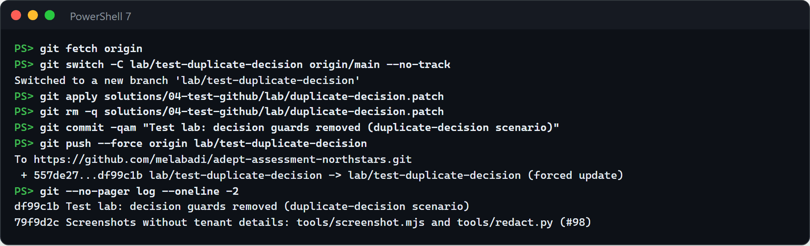

**What this shows:** the defect existed only on a lab branch built from that day's `main`, so `main` stayed healthy and the run can be repeated.

### 2. The scenario reproduced the defect

At 14:48 UTC, while Copilot worked on step 3, the owner replayed [`scenarios/duplicate-decision.json`](scenarios/duplicate-decision.json) with [`repro.py`](.github/skills/failure-reproduction/repro.py) against the API built from the lab branch: a retry with the same idempotency key, a second approver, and eight parallel clicks. Six of its nine steps failed:

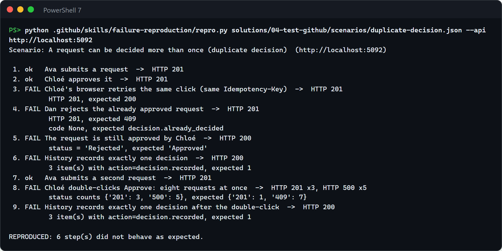

Against the API built from `main`, the same scenario passed every step, so it is a fair oracle:

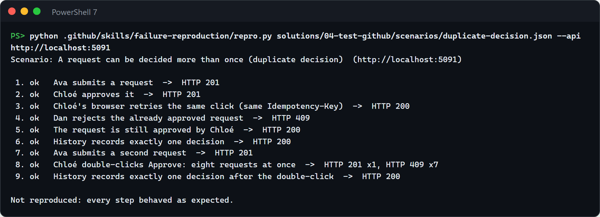

The two APIs ran side by side on ports 5092 and 5091, with `--api`, because the machine was shared. Each scenario run took seconds. This step ran on the owner's machine, so the screenshots are its record.

**What this shows:** a double-click of eight requests recorded three decisions and answered the rest with `500` (three `201`s and five `500`s; the split changes from run to run), where `main` returned one `201` and seven `409`s.

### 3. Copilot committed failing tests, then the fix

At 14:44:47 UTC the owner filed Issue [#100](https://github.com/melabadi/adept-assessment-northstars/issues/100) from [`duplicate-decision-issue.md`](duplicate-decision-issue.md). Five seconds later they assigned it to Copilot, with the `test-github` custom agent and the base branch `lab/test-duplicate-decision`. Copilot opened draft pull request [#101](https://github.com/melabadi/adept-assessment-northstars/pull/101) six seconds after the assignment:

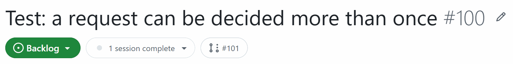

Copilot worked from 14:45:30 to 14:58:54 UTC, 13 minutes 24 seconds. It ran the scenario, committed the failing tests, then the fix, reran the tests, the regression suites, and the scenario, and ended with an evidence summary:

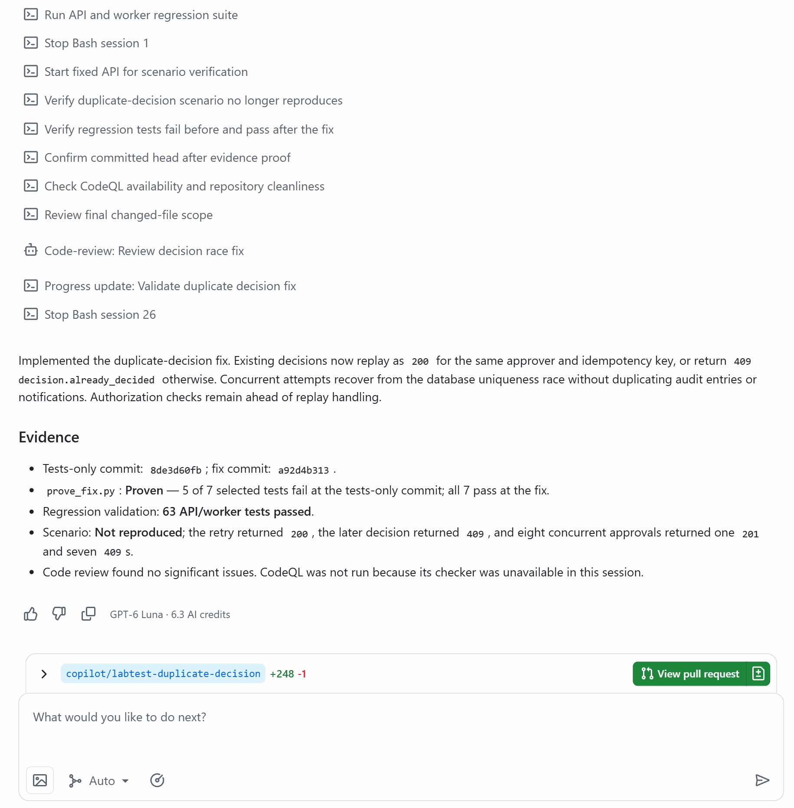

Its commits, in order (all on the pull request's [Commits](https://github.com/melabadi/adept-assessment-northstars/pull/101/commits) tab):

- [`9e550ce`](https://github.com/melabadi/adept-assessment-northstars/pull/101/commits/9e550ce8746775bcd63e64d4cabcb294c8938ff7) at 14:50:55, 6 minutes after the Issue: *Add failing regression tests for #100*, 116 new lines in `RequestLifecycleTests.cs`.
- [`8de3d60`](https://github.com/melabadi/adept-assessment-northstars/pull/101/commits/8de3d60fb425ca76d3d6bc3e94042fa9a02deb53) at 14:53:34: *Refine duplicate decision regression assertions*, tests only.
- [`a92d4b3`](https://github.com/melabadi/adept-assessment-northstars/pull/101/commits/a92d4b313e1eb202c6a80e2af50fa49883a59e23) at 14:53:38: the fix, 20 lines in `RequestWorkflow.cs`, under the previous commit's message.

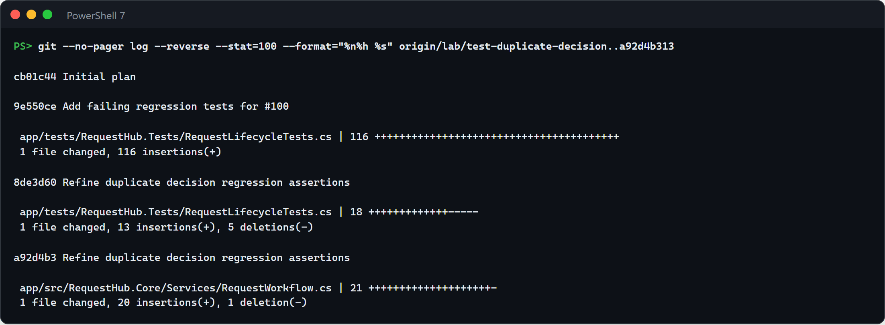

The tests-only commits include the [eight-click test](https://github.com/melabadi/adept-assessment-northstars/blob/8de3d60fb425ca76d3d6bc3e94042fa9a02deb53/app/tests/RequestHub.Tests/RequestLifecycleTests.cs#L114-L127):

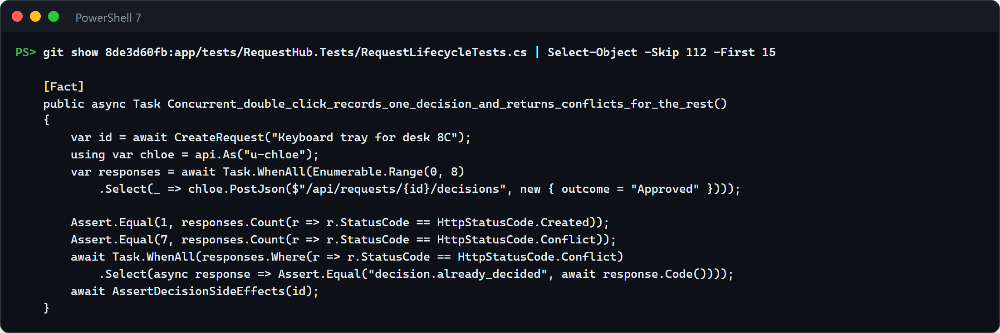

Copilot's output varies from run to run. In this one the fix reused the previous commit's message, and the evidence summary was in the session rather than in the pull request description. Neither matters to the gate in step 5: it reads what each commit changes, not what its message says.

**What this shows:** the tests landed in their own commits, touching only `app/tests/`, before any production code changed.

### 4. A person approved the workflow runs

Copilot's pushes started no workflow on their own: their runs waited for a person.

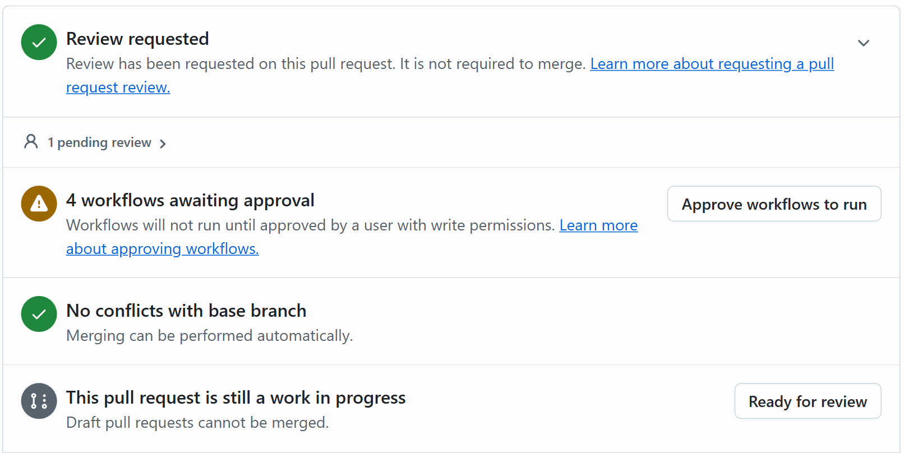

At 15:06 UTC, 7 minutes after Copilot finished, the owner started the eight waiting runs of Copilot's two pushes with code, the tests and then the fix, from a terminal with `gh run rerun`, within 14 seconds. The runs of the earlier push were cancelled, because each shares a concurrency group with its counterpart on the latest push. Nobody approved the one run on Copilot's first commit, *Initial plan*: the feature bounds check, which ran again on the later commits. It waited until the pull request closed.

**What this shows:** no workflow ran on Copilot's commits until a person approved it.

### 5. The proof showed the tests failing first

The proof check, [`test-github-proof.yml`](.github/workflows/test-github-proof.yml), selected the tests that the tests-only commits added or changed, and ran them in clean worktrees at the tests-only commit `8de3d60fb` and at the head `a92d4b313`. It ran from 15:06:29 to 15:08:13 UTC: 1 minute 44 seconds. CI's full test suite passed at 15:10:26, after 3 minutes 52 seconds.

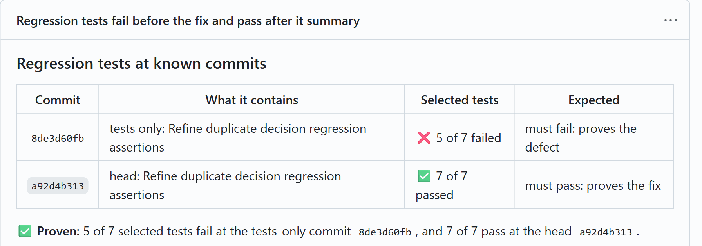

Below the table, the summary listed each failure at the tests-only commit in the tests' own words:

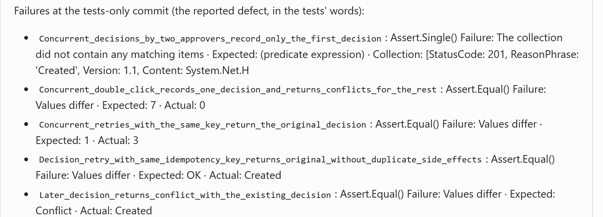

Two tests passed before the fix. Copilot's new `Requester_cannot_self_approve_after_another_approver_has_decided` guards a rule that already held: a requester can't decide their own request. `Search_treats_percent_and_underscore_as_literal_characters` was an existing test, the last in the file: the proof script of that day counted it as changed because Copilot added helper methods below it. [#135](https://github.com/melabadi/adept-assessment-northstars/pull/135) fixed that after the run: the script now ends each test where its method ends. The proof and both test reports are in [`evidence/proof-a92d4b313`](evidence/proof-a92d4b313/proof.md), copied from the run's artifact.

**What this shows:** the same tests failed at one known SHA, for the reasons the Issue describes, and passed at the next.

### 6. Copilot code review found a gap the tests missed

At 15:08:21 UTC the owner requested a review from Copilot. [Its review](https://github.com/melabadi/adept-assessment-northstars/pull/101#pullrequestreview-5685021802) arrived at 15:14:35, 6 minutes 14 seconds later: changes recommended, with [one high-severity finding](https://github.com/melabadi/adept-assessment-northstars/pull/101#discussion_r4402383848). If a request was rerouted to another department and decided while an approval was being saved, the recovery path could return that department's decision, comment included, to a caller who isn't allowed to see it.

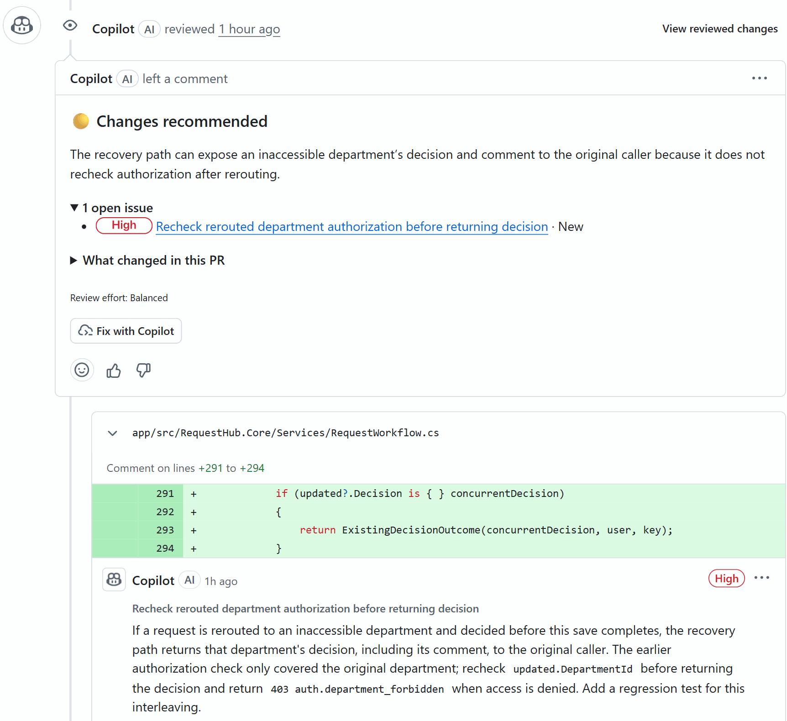

Copilot's own self-check in its session had found no issues.

**What this shows:** the review found an authorization gap that no test covered: a request rerouted between the access check and the save.

### 7. The evidence comment kept checks apart from comments

At 15:22:17 UTC the owner ran [`review_evidence.py`](.github/skills/review-evidence/review_evidence.py) `--pr 101 --comment` and posted [the evidence comment](https://github.com/melabadi/adept-assessment-northstars/pull/101#issuecomment-6473019762). Section 1, *Deterministic acceptance*, lists the checks and the proof at two known SHAs (the image at the top of this README): it decides. Section 2, *Review comments*, lists Copilot's finding: it informs. Section 3, *Reviewer decision*, stayed pending, because nobody had approved or requested changes.

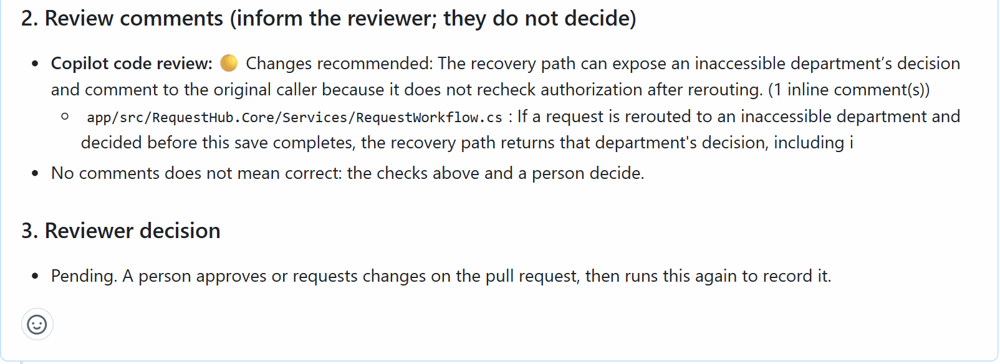

These images show the comment after step 8 updated it at 16:04 UTC, so the head is the review-loop commit `e1d52334d`.

**What this shows:** what decides (the checks and the proof) was kept apart from what informs (the review comments).

### 8. A person asked for a change, and the new commit passed the same gates

At 15:22:37 UTC the owner [asked Copilot](https://github.com/melabadi/adept-assessment-northstars/pull/101#issuecomment-6473028998), on the pull request, to address the review's finding:

```text
@copilot Please address the Copilot code review comment on `RequestWorkflow.cs`: in the concurrency recovery path, recheck department access for the reloaded request before returning its decision, and return `403 auth.department_forbidden` when access is denied. Add a regression test for this case. Give each new commit a message that says what it changes, and do not rewrite or squash the earlier commits.
```

Copilot started at 15:23:20 and pushed [`e1d5233`](https://github.com/melabadi/adept-assessment-northstars/pull/101/commits/e1d52334df6c372dcf44e7cec4965bfb180f54d5) at 15:29:31, 6 minutes 54 seconds after the request: the department check, and a deterministic race test in a new `DecisionRecoveryAuthorizationTests.cs`. It [replied](https://github.com/melabadi/adept-assessment-northstars/pull/101#issuecomment-6473266654) at 15:32:34 that all 64 API and worker tests passed.

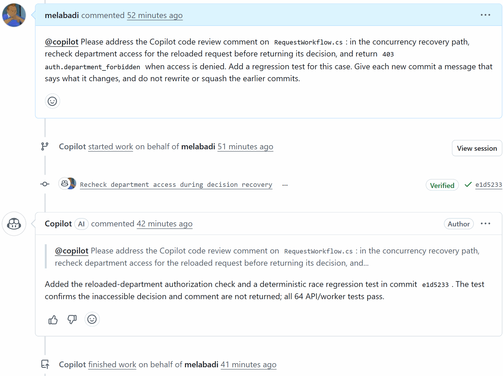

At 15:58 UTC the owner started the new commit's four waiting runs. The proof passed again in 1 minute 33 seconds, still 5 of 7 failing at `8de3d60fb` and now 7 of 7 passing at `e1d52334d` ([`evidence/proof-e1d52334d`](evidence/proof-e1d52334d/proof.md)), and CI passed in 2 minutes 49 seconds. At 16:04 the owner updated the evidence comment. Tests added after the fix are guards: CI runs them, and the proof keeps covering the tests committed before the fix.

The owner didn't record a GitHub review in this run, so the decision stayed pending. At 16:31 UTC they [closed the pull request without merging](https://github.com/melabadi/adept-assessment-northstars/pull/101#issuecomment-6474687761), as every run in this repository does, because the lab branch is rebuilt for the next one. In the run of 10 November 2026 (Issue [#299](https://github.com/melabadi/adept-assessment-northstars/issues/299), pull request [#300](https://github.com/melabadi/adept-assessment-northstars/pull/300)), the owner [approved](https://github.com/melabadi/adept-assessment-northstars/pull/300#pullrequestreview-5849409617) with a GitHub review, and [the evidence comment](https://github.com/melabadi/adept-assessment-northstars/pull/300#issuecomment-6779284427) recorded who decided:


**What this shows:** the reviewer's finding became code and a test within minutes and went through the same gates, while the decision stayed with a person.

### 9. Optional: Copilot CLI fixed a second defect

From 15:23:48 to 15:41:38 UTC, on the owner's machine, Copilot CLI ran the same `test-github` agent on a second defect: the lab build accepted a rejection whose comment was only spaces. Copilot reproduced it with [`scenarios/whitespace-rejection.json`](scenarios/whitespace-rejection.json) (`REPRODUCED: 2 step(s)`) and committed failing tests, then the fix. The session took 17 minutes 50 seconds and reported 25.48 AI credits. The local proof then selected the tests that the tests-only commits added:

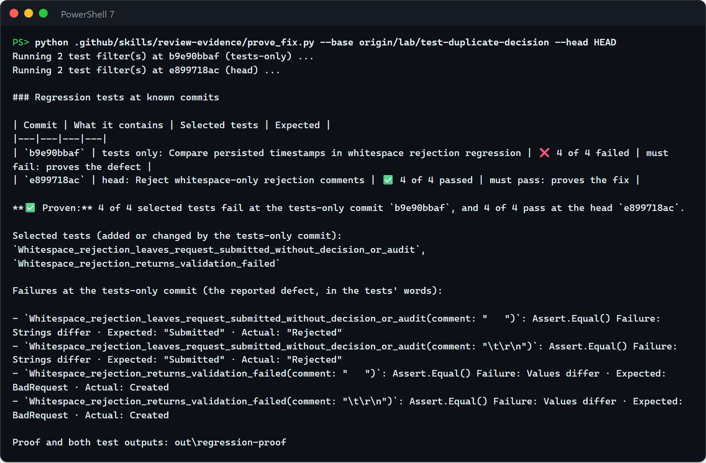

Four of four failed at the tests-only commit `b9e90bb` and passed at the fix `e899718`. These commits stayed on the owner's machine, so the screenshot is this step's record.

**What this shows:** the same skills and the same proof worked on a different defect, from the terminal, with no pull request.

## Results and value

**What the run left behind:**

- Issue [#100](https://github.com/melabadi/adept-assessment-northstars/issues/100), closed as not planned, and pull request [#101](https://github.com/melabadi/adept-assessment-northstars/pull/101), closed without merging: Copilot's five commits (its plan, two tests-only commits, the fix, and the review-loop commit), Copilot code review's finding, Copilot's reply, and the evidence comment.
- Two proofs, both *Proven*, in [`evidence/`](evidence/): the same 5 of 7 tests failed at `8de3d60fb`, and 7 of 7 passed at `a92d4b313` and again at `e1d52334d`.
- The person's decisions: approving Copilot's workflow runs twice, and asking Copilot for a change after the review. No GitHub review was recorded, so the evidence comment's decision stayed pending; step 8 shows how the 10 November run recorded an approval.

**What was measured:**

| Measure | Recorded run |
| --- | --- |
| Filing the Issue to Copilot's draft pull request | 11 s |
| Copilot's first session | 13 min 24 s and 6.3 AI credits, as its session page reported. Its first tests-only commit came 6 min 8 s after the Issue was filed, and the fix 8 min 46 s after the assignment |
| Waiting for a person to approve the workflow runs | 7 min 26 s |
| Proof | 1 min 44 s; 1 min 33 s after the review loop |
| CI, the full test suite | 3 min 52 s; 2 min 49 s after the review loop |
| Copilot code review | 6 min 14 s, one high-severity finding |
| Review loop: the request to Copilot's new commit | 6 min 54 s |
| Filing the Issue to the first passing proof | 23 min 26 s |
| GitHub-hosted runner time: every workflow the run started, Copilot's two sessions and its code review included | 42.8 min of job time; 57 min as billed in a private repository, where each job is rounded up to a whole minute |
| Optional Copilot CLI session (step 9) | 17 min 50 s, 25.48 AI credits |

**What a team gets:**

- **Time.** Copilot wrote the failing tests and the fix unattended. The person's part was filing the Issue, approving the workflow runs, asking for one change, and reading the evidence.
- **Risk removed.** A fix can't arrive without at least one test that failed first: the proof names the tests that failed, at a known SHA. Races are tested, not assumed: eight parallel clicks must produce exactly one `201`, in the scenario and in the tests. The code review caught an authorization gap before anyone merged.
- **Evidence a reviewer or auditor can follow.** The evidence comment on the pull request gives the proof's verdict at two known SHAs and keeps the review comments apart from the checks. The test reports at both SHAs are in the proof run's artifact; artifacts expire, so keep the ones you need, as [`evidence/`](evidence/) does here. Once a person submits a review, the comment records who decided.
- **People stay in charge.** Workflows on Copilot's pull request run only after a person approves them, a person decides on the change, and RequestHub's own rule is untouched: only approvers decide, never on their own request.

**The metric to track when you adopt it:** lead time from a defect report to a proven fix, from the Issue's creation to the first passing proof check on Copilot's pull request. Both timestamps are on GitHub. The recorded run measured 23 minutes 26 seconds, 7 minutes 26 seconds of them waiting for a person to approve the runs; the 10 November run measured 14 minutes 50 seconds. Track alongside it how many fixes arrive with tests that failed first (the proof's verdict), and how many review findings become a commit before merge. Compare both with similar defects fixed before you adopted it. A target such as "a proven fix within an hour of the report" is your team's goal, never a result to report.

## Add it to your repository

The files are written for RequestHub's stack: a .NET 10 API, xUnit v3 integration tests, and PostgreSQL. [What to copy and what to change](#what-to-copy-and-what-to-change) names each setting to adapt for yours. The commands are the ones this repository uses.

### Prerequisites

- **The tools every solution needs,** in the root README's [Before you start](../../README.md#before-you-start): GitHub CLI, PowerShell 7.4 or later, and Python 3.12 or later. This solution's scripts use only Python's standard library.
- **A paid GitHub Copilot plan** that lets you assign Issues to Copilot, with the Copilot cloud agent allowed in your repository. For a repository you own, turn it on in your account's Copilot settings, under **Features** (`github.com/settings/copilot/features`); in an organization, an owner allows it ([why Copilot may be missing from an Issue's assignees](https://docs.github.com/en/copilot/how-tos/use-copilot-agents/cloud-agent/troubleshoot-cloud-agent)). Copilot code review reviews the fix. To fix a defect from your terminal instead, as in the optional [step 9](#9-optional-copilot-cli-fixed-a-second-defect), install [GitHub Copilot CLI](https://docs.github.com/en/copilot/how-tos/copilot-cli/set-up-copilot-cli/install-copilot-cli).
- **A Copilot session on GitHub Actions.** Copilot runs your tests in its session, with the services that `copilot-setup-steps.yml` starts ([this repository's](../../.github/workflows/copilot-setup-steps.yml) starts PostgreSQL), and cloud sandboxes don't run setup steps ([Copilot's environments](https://docs.github.com/en/copilot/concepts/copilot-surfaces/copilot-on-github#comparison-of-github-actions-based-sessions-and-cloud-sandboxes)). Assigning the Issue started a GitHub Actions-based session in the recorded run and in the 10 November run; if you're offered a choice of environment, pick GitHub Actions.
- **An API you can run, and integration tests.** A scenario calls your API over HTTP, with a test sign-in, so you run the API on your machine and Copilot runs it in its session. CI and the proof run your integration tests on GitHub-hosted runners.
- **For the CI failure investigation:** a CI workflow that runs your tests on pull requests, and [GitHub Agentic Workflows](https://github.com/github/gh-aw) with its `gh aw` extension, to compile the workflow after you change it: `gh extension install github/gh-aw --pin v1.2.2`. Its Copilot engine authenticates with a `COPILOT_GITHUB_TOKEN` secret, a fine-grained personal access token with **Copilot Requests: Read** ([one-time step 6](#one-time-setup)). In an organization with a Copilot subscription and centralized billing, gh-aw recommends `copilot-requests: write` in the workflow's `permissions:` instead, with no token.

### What to copy and what to change

From the root of your repository, in PowerShell 7, copy the agent, the skills, the workflows, the issue form, and the unit tests:

```powershell
$src = Join-Path ([IO.Path]::GetTempPath()) 'ai-sdlc-04-test-github'
git clone --quiet --depth 1 https://github.com/melabadi/adept-assessment-northstars.git $src
New-Item -ItemType Directory -Force .github, tests | Out-Null
Copy-Item -Recurse -Force (Join-Path $src 'solutions/04-test-github/.github/*') .github
Copy-Item -Force (Join-Path $src 'solutions/04-test-github/tests/test_*.py') tests
Remove-Item -Recurse -Force $src
git status --short --untracked-files=all
```

What you should see: 19 new files, in 5 seconds when this README was checked; the other files in `.github/` and `tests/` stay. The scenarios, the lab patch, and the defect report stay behind, because they describe RequestHub's defect: use them as examples for yours. Then change what assumes RequestHub:

| File, under `.github/` | As shipped, for RequestHub | Change it to |
| --- | --- | --- |
| [`agents/test-github.agent.md`](.github/agents/test-github.agent.md) | How to start the API (`dotnet run --project app/src/RequestHub.Api`, port 5080), where the tests live (`app/tests/RequestHub.Tests/`: xUnit v3, `ApiFixture`, personas through `X-RequestHub-User`), how to run one test, and RequestHub's rules: approval authority, and the contract in `app/contracts/openapi.json` | Your start command and health URL, your test folder, framework, and fixtures, the command that runs one test, and the rules Copilot must never break in your code. Keep the order of the commits (the tests alone, then the fix) and the *Evidence* section. |
| [`skills/failure-reproduction/repro.py`](.github/skills/failure-reproduction/repro.py) | Development sign-in through the `X-RequestHub-User` header, and `--api` defaulting to `http://localhost:5080` | Your API's test sign-in and address. The scenario format stays. |
| [`skills/review-evidence/prove_fix.py`](.github/skills/review-evidence/prove_fix.py) | .NET and xUnit v3: `SOLUTION`, `DOTNET_TESTS`, `TEST_FILE`, `TEST_ATTRIBUTE`, `METHOD`, and `CLASS` find the tests a commit added, and `run_tests` runs them with `dotnet test`, whose xUnit v3 reporter writes a [CTRF](https://ctrf.io/) report | Your test folder, how a test method and its class start in your language, and a test command that runs the selected tests and writes a CTRF report. |
| [`skills/review-evidence/review_evidence.py`](.github/skills/review-evidence/review_evidence.py) | `CHECK_DEFINITIONS`: the folders that hold what this repository's workflows run (`.github/workflows/`, `.github/actions/`, `.github/skills/`, and `tools/`) | The folders that hold what yours run, so a pull request that changes them is flagged. `tests/test_review_evidence.py` expects these four: update it with yours. |
| [`skills/regression-validation/run_regression.py`](.github/skills/regression-validation/run_regression.py) | RequestHub's suites: the .NET build and tests, the web typecheck and unit tests, the contract check, and the Playwright tests with `--e2e` | Your suites. |
| [`skills/ci-investigation/ci_failure_facts.py`](.github/skills/ci-investigation/ci_failure_facts.py) | How a failure looks in the output of .NET's test platform with xUnit v3, Playwright, Vitest, and the C# and TypeScript compilers; `prove_fix.py`'s patterns tell whether the pull request adds or changes a test | How your test runners print a failure, if they print it differently. `tests/test_ci_investigation.py` has a sample of each format: add yours. |
| [`skills/contract-impact/`](.github/skills/contract-impact/) | An OpenAPI contract in `app/contracts/openapi.json` that may only grow | Your contract file, or delete the skill and its call in `run_regression.py`. |
| [`workflows/test-github-proof.yml`](.github/workflows/test-github-proof.yml) | Pull requests into `lab/test-**` that change `app/**`, a PostgreSQL service, and .NET 10 | The branches and paths of your fixes, your database service, and your toolchain: see [one-time step 3](#one-time-setup). |
| [`workflows/test-github-ci-investigation.md`](.github/workflows/test-github-ci-investigation.md) | Starts when the workflow named `CI`, in `.github/workflows/ci.yml`, fails on a pull request from a `copilot/**` or `fix/**` branch into a `lab/test-*` branch | Your CI workflow's name (`workflows:`) and file (`workflow_run.path` in the `if:`), the branches your fixes come from (`branches:`), and the branches they go into: `lab/test-` in the `if:` and `--base` in its step, for example `main`. Then compile it, in [one-time step 7](#one-time-setup). |
| [`workflows/test-github-checks.yml`](.github/workflows/test-github-checks.yml) | This solution's folder: it watches `solutions/04-test-github/**` and runs `solutions/04-test-github/tests`. It also compiles the CI failure investigation with the gh-aw version in `GH_AW_VERSION`, v1.2.2, and fails if the committed lock file differs | Watch `tests/**` and run `tests`. Keep `GH_AW_VERSION` at the version you compile with. |
| [`ISSUE_TEMPLATE/04-test-github-defect.yml`](.github/ISSUE_TEMPLATE/04-test-github-defect.yml) | The labels `ai-sdlc`, `phase:test`, and `bug` | Your labels, if you don't create these in [one-time step 4](#one-time-setup). |

### One-time setup

1. **Copy the files and make the changes above,** on a branch. What you should see: `python -m unittest discover -s tests` ends with `OK`. The unit tests run offline, with a fake `gh`, in a second or two.
2. **Give Copilot and the proof your test services.** Before Copilot starts, GitHub runs the job named `copilot-setup-steps` in `.github/workflows/copilot-setup-steps.yml`. Start your database there as a service and install your toolchain, as [this repository's](../../.github/workflows/copilot-setup-steps.yml) does for PostgreSQL and .NET, and give `test-github-proof.yml` the same service. What you should see: once the file is on your default branch, `gh workflow run copilot-setup-steps.yml` starts it (it needs a `workflow_dispatch` trigger, as this repository's has), and `gh run list --workflow copilot-setup-steps.yml --limit 1` then shows it `completed` with `success`.
3. **Point the proof at your fixes.** In `test-github-proof.yml`, set `branches` to the branches your fixes go into, for example `main`, and `paths` to your code. A pull request without a tests-only commit before its fix fails the proof, so if not every pull request into those branches is a fix, guard the job. [`develop-github-bounds.yml`](../../.github/workflows/develop-github-bounds.yml), from 03-develop-github, shows how: it looks up the Issues that a pull request closes and skips its checks when none carries its label. The same lookup with your defect label, for example `bug`, keeps the proof to fixes. To make the proof a gate, require its check, *Regression tests fail before the fix and pass after it*, in a ruleset on those branches. What you should see: after the merge in step 8, `gh workflow list` lists *Test · GitHub · prove the fix test-first* as `active`.
4. **Create the labels** that the issue form applies (`bug` comes with every new repository), and the three that the CI failure investigation chooses from:

   ```powershell
   gh label create ai-sdlc --color 1D76DB --description "AI-SDLC demo work" --force
   gh label create phase:test --color C5DEF5 --description "SDLC phase 4: Test" --force
   gh label create ci:defect-reproduced --color 0E8A16 --description "CI failure investigation: tests this pull request adds fail as intended" --force
   gh label create ci:regression --color B60205 --description "CI failure investigation: the change broke an existing test or check" --force
   gh label create ci:infrastructure --color FBCA04 --description "CI failure investigation: fails on main too, or the failure isn't a test" --force
   ```

   What you should see: `gh label list --search phase:test` prints `phase:test  SDLC phase 4: Test  #C5DEF5` on its first line, and `gh label list --search ci:` lists the three `ci:` labels. The search can take a few seconds to find a new label.
5. **Allow the Copilot cloud agent** in the repository, as in the [prerequisites](#prerequisites). What you should see: on any Issue, **Assignees** lists **Copilot**.
6. **Give the CI failure investigation access to Copilot.** Create a [fine-grained personal access token](https://github.com/settings/personal-access-tokens/new?name=COPILOT_GITHUB_TOKEN&description=GitHub+Agentic+Workflows+-+Copilot+engine+authentication&user_copilot_requests=read). Set the resource owner to your user account, and under **Account permissions** set **Copilot Requests** to **Read**. Nothing else is needed. Store it as a repository secret:

   ```powershell
   gh secret set COPILOT_GITHUB_TOKEN    # paste the token when prompted
   ```

   What you should see: `gh secret list` lists `COPILOT_GITHUB_TOKEN`. The investigations' AI credits count against the token owner's Copilot plan. In an organization with centralized Copilot billing, add `copilot-requests: write` under `permissions:` in the workflow's source instead, and compile it again. Without either, everything else works, and the investigation's run fails at `Validate COPILOT_GITHUB_TOKEN secret`.
7. **Compile the CI failure investigation** after you change its source. GitHub runs the compiled `.lock.yml`, not the `.md`:

   ```powershell
   gh extension install github/gh-aw --pin v1.2.2
   gh aw compile test-github-ci-investigation --strict
   ```

   What you should see: `✓ Compiled 1 workflow: 1 succeeded, 0 warnings`, after 3 seconds when this README was checked. Commit the `.lock.yml` with the `.md`: `test-github-checks.yml` compiles the source again with the version in `GH_AW_VERSION` and fails if the result differs. The lock file also records the frontmatter of every custom agent in `.github/agents/`, so compile again when an agent's frontmatter changes.
8. **Merge it into your default branch.** The cloud agent loads custom agents from the default branch, GitHub offers issue forms from it, and an agentic workflow that another workflow starts runs from it; skills and scripts come from the branch Copilot works on. What you should see:

   ```powershell
   gh api 'repos/{owner}/{repo}/contents/.github/agents/test-github.agent.md' --jq .path
   ```

   prints `.github/agents/test-github.agent.md`, **New issue** offers *Test: defect to fix test-first with Copilot*, and `gh workflow list` lists *Test · GitHub · agentic CI failure investigation*.

### Use it the first time

On your own defect, the steps are those of [See it work](#see-it-work), from step 2 on:

1. **Reproduce the defect.** Write the report as a scenario: who calls which endpoint, with what body, and what the correct answer is; `parallel` sends one call several times at once, for double-clicks and retries. [`repro.py`](.github/skills/failure-reproduction/repro.py) describes the format, and [`scenarios/duplicate-decision.json`](scenarios/duplicate-decision.json) is the run's. Run it against your API:

   ```powershell
   python .github/skills/failure-reproduction/repro.py <scenario.json> --api <your API's address>
   ```

   What you should see: it ends with `REPRODUCED` and lists the expectations the defect breaks, as in [step 2](#2-the-scenario-reproduced-the-defect).
2. **Hand it to Copilot.** File the Issue with the *Test: defect to fix test-first with Copilot* form, with the scenario and its output under *Reproduce*. Assign it to **Copilot** with the **test-github** agent and, as the base branch, the branch that has the defect: one the proof watches. From a terminal instead (replace `<issue>` and `<branch>`; it prints `Copilot` and your login):

   ```powershell
   $repo = gh repo view --json nameWithOwner -q .nameWithOwner
   @{ assignees = @('copilot-swe-agent[bot]'); agent_assignment = @{ target_repo = $repo; base_branch = '<branch>'; custom_agent = 'test-github' } } |
     ConvertTo-Json -Compress | gh api -X POST "repos/$repo/issues/<issue>/assignees" --input - --jq '.assignees[].login'
   ```

   What you should see: within seconds Copilot opens a draft pull request, and when its session ends, a tests-only commit comes before the fix, as in [step 3](#3-copilot-committed-failing-tests-then-the-fix).
3. **Approve its workflow runs:** select **Approve workflows to run** in the pull request's merge box, or start every waiting run of its latest commit from a terminal:

   ```powershell
   $head = gh pr view <pr> --json headRefOid -q .headRefOid
   gh run list --commit $head --json databaseId,conclusion -q '.[] | select(.conclusion == "action_required") | .databaseId' | ForEach-Object { gh run rerun $_ }
   ```

   See [step 4](#4-a-person-approved-the-workflow-runs).
4. **Read the proof:** `gh pr checks <pr> --watch`. What you should see: *Regression tests fail before the fix and pass after it* passes, and its summary lists each failure at the tests-only commit in the tests' own words, as in [step 5](#5-the-proof-showed-the-tests-failing-first).
5. **If CI fails, read why.** When CI fails on the pull request, the CI failure investigation adds one label and posts a comment headed *CI failure investigation*. For each failing test it gives the assertion message, the file and line, a link to the log, its class, and the next step. `ci:defect-reproduced` means every failure is a test that the pull request adds or changes, failing as intended, as on a tests-only commit: the fix should make it pass. `ci:regression` means the change broke a test or a check that passes on main: fix the code, not the test. `ci:infrastructure` means a failure also happens on main, or isn't a test: rerun the failed job. The comment explains; you decide.
6. **Ask Copilot for a code review:** select **Reviewers** > **Copilot** in the pull request, or run `gh pr edit <pr> --add-reviewer "@copilot"`. See [step 6](#6-copilot-code-review-found-a-gap-the-tests-missed).
7. **Post the evidence** on the pull request. Run it from your default branch, never from the pull request's branch: its copy of the script could leave out what the report must say.

   ```powershell
   python .github/skills/review-evidence/review_evidence.py --pr <pr> --comment
   ```

   Section 1 lists the checks and the proof: they decide. If the pull request changes where its checks are defined (anything under the folders in `CHECK_DEFINITIONS`), section 1 opens with a warning that lists those files, because its checks ran with its own version of its workflows: read them first. Section 2 lists the review comments: they inform. Section 3 records the decision: only reviews from the repository's owner, members, and collaborators count, and anyone else's review is listed as not counted, without its text. The comment is posted with your token, so everything it quotes from GitHub is inert: it can't mention anyone, which would start Copilot in your name, or refer to an Issue or a pull request, and it can't add a link, an image, or HTML. See [step 7](#7-the-evidence-comment-kept-checks-apart-from-comments).
8. **Decide.** Read the tests in the tests-only commit: do they assert what the Issue expects, including the concurrent case? If the review found a gap, ask `@copilot` on the pull request, as in [step 8](#8-a-person-asked-for-a-change-and-the-new-commit-passed-the-same-gates), approve the new commit's runs, and post the evidence again. Then approve or request changes as a GitHub review, and post the evidence once more, so it records who decided:

   ```powershell
   gh pr review <pr> --approve --body "<what you checked: the tests, the proof, the review>"
   python .github/skills/review-evidence/review_evidence.py --pr <pr> --comment
   ```

   Use `--request-changes` instead of `--approve` to send it back. Once you approve, merge the fix as you merge any change.

### What it costs

Setting it up uses no AI credits. Each defect fixed this way draws on your Copilot plan's AI credits, for the cloud agent's sessions and its code review, and on GitHub Actions. In the recorded run, Copilot's first session reported 6.3 AI credits, and the optional Copilot CLI session of step 9 reported 25.48. The run used 42.8 minutes of standard GitHub-hosted runners: 29.8 for Copilot's two sessions and its code review, 8.2 for CI, 3.1 for the proof, and 1.7 for this repository's other workflows. Those minutes are free in a public repository. In a private one they count against your plan's included usage: 57 minutes for the recorded run, because each job is rounded up to a whole minute. The length of your test suite changes the CI and proof minutes ([GitHub Actions billing](https://docs.github.com/en/billing/concepts/product-billing/github-actions), [Copilot billing](https://docs.github.com/en/copilot/concepts/billing-and-usage)).

The CI failure investigation runs only when CI fails on a fix's pull request. Its agent draws on the Copilot plan of the token's owner, and gh-aw stops it at 300 AI credits a run and 1,500 a day, the `max-ai-credits` and `max-daily-ai-credits` in its source; its threat detection has a separate cap, 400 by default. Its jobs run on standard GitHub-hosted runners.

## Try it first in a copy of this repository

Optional: the same solution on RequestHub, before you adapt anything. You repeat the run in [See it work](#see-it-work) in your own copy, and it costs what [What it costs](#what-it-costs) lists for the recorded run.

### Quick start

About 2 minutes, from the root of your copy of this repository: the [root README](../../README.md#try-it-in-a-copy-of-this-repository) makes that copy, once for every solution. You need the [prerequisites](#prerequisites); the copy already holds the files, and RequestHub is the API and the tests, so there is nothing to copy or change. In PowerShell 7, create the labels: the two the defect's Issue uses, and the three the CI failure investigation chooses from (4 seconds when this README was checked):

```powershell
gh label create ai-sdlc --color 1D76DB --description "AI-SDLC demo work" --force
gh label create phase:test --color C5DEF5 --description "SDLC phase 4: Test" --force
gh label create ci:defect-reproduced --color 0E8A16 --description "CI failure investigation: tests this pull request adds fail as intended" --force
gh label create ci:regression --color B60205 --description "CI failure investigation: the change broke an existing test or check" --force
gh label create ci:infrastructure --color FBCA04 --description "CI failure investigation: fails on main too, or the failure isn't a test" --force
```

Then allow the Copilot cloud agent in your copy, as in the [prerequisites](#prerequisites). For the CI failure investigation, also store a `COPILOT_GITHUB_TOKEN` secret, as in [one-time step 6](#one-time-setup); the rest works without it. What you should see: `gh repo view --json nameWithOwner -q .nameWithOwner` prints your copy, the repository that every `gh` command below acts on; `gh label list --search phase:test` prints `phase:test  SDLC phase 4: Test  #C5DEF5` on its first line, and `gh label list --search ci:` lists the three `ci:` labels; on any Issue in your copy, **Assignees** lists **Copilot**; `gh secret list` lists `COPILOT_GITHUB_TOKEN`, if you stored it; and

```powershell
gh api 'repos/{owner}/{repo}/contents/.github/agents/test-github.agent.md' --jq .path
```

prints `.github/agents/test-github.agent.md`. The skills, the workflows, and the issue form are active too, because the copy's root `.github/` folder mirrors this solution's.

Steps 2 and 9 run RequestHub on your machine, so they need the [.NET 10 SDK](https://dotnet.microsoft.com/download) and PostgreSQL on `localhost:5432` (user `requesthub`, password `devpass`); the [app README](../../app/README.md#run-it-locally) has a one-line Docker command. Start PostgreSQL, and build the API once:

```powershell
dotnet build app/src/RequestHub.Api
```

What you should see: the build succeeds with no errors. A cold restore and build took 19 seconds when this README was checked; after it, the API starts in seconds.

### The steps

The steps have the numbers of [See it work](#see-it-work), which shows what each one looks like. Your SHAs, test names, and counts will differ, because Copilot writes new tests every time. Steps 1 and 3 take the longest to finish, so run them first and do step 2 while Copilot works, as the recorded run did.

| Step | How long it took in the recorded run |
| --- | --- |
| 1. Rebuild the lab branch | seconds: the push landed 12 s after the commit |
| 2. Reproduce the defect | seconds per scenario run |
| 3. Hand the defect to Copilot | 5 s to assign it; Copilot's session took 13 min 24 s (between 11 and 31 minutes across six runs) |
| 4. Approve the workflow runs | 14 s to start eight runs |
| 5. Watch the proof | the proof 1 min 44 s, CI 3 min 52 s |
| 6. Ask Copilot for a code review | the review 6 min 14 s |
| 7. Assemble the evidence | seconds: the script took 9 s on pull request #101 when this README was checked |
| 8. Decide, with a review loop | Copilot 6 min 54 s to a new commit, then the proof 1 min 33 s and CI 2 min 49 s |
| 9. Optional: a second defect with Copilot CLI | 17 min 50 s |

1. **Rebuild the lab branch from `main`.** Do this before every run. The defect lives only on `lab/test-duplicate-decision`: `main` plus [`lab/duplicate-decision.patch`](lab/duplicate-decision.patch).

   ```powershell
   git fetch origin
   git switch -C lab/test-duplicate-decision origin/main --no-track
   git apply solutions/04-test-github/lab/duplicate-decision.patch
   git rm -q solutions/04-test-github/lab/duplicate-decision.patch
   git commit -qam "Test lab: decision guards removed (duplicate-decision scenario)"
   git push --force origin lab/test-duplicate-decision
   ```

   The push reports a forced update, or `[new branch]` on a new copy's first run: see [step 1](#1-the-lab-branch-was-rebuilt-from-main).

2. **Reproduce the defect.** Start the API from the lab branch in a second terminal, then run the scenario in the first:

   ```powershell
   dotnet run --project app/src/RequestHub.Api        # second terminal; http://localhost:5080
   python .github/skills/failure-reproduction/repro.py solutions/04-test-github/scenarios/duplicate-decision.json
   ```

   It ends with `REPRODUCED`. To check that the scenario is a fair oracle, run it against `main` too: stop the API (Ctrl+C), `git switch main`, start the API again, and rerun the scenario, which ends with `Not reproduced`. Switch back with `git switch lab/test-duplicate-decision`. See [step 2](#2-the-scenario-reproduced-the-defect).

3. **Hand the defect to Copilot.** Create the Issue from the defect report:

   ```powershell
   gh issue create --title "Test: a request can be decided more than once" --label ai-sdlc --label phase:test --label bug --body-file solutions/04-test-github/duplicate-decision-issue.md
   ```

   Open the Issue and assign it to **Copilot**. In the dialog, pick the **test-github** agent and the base branch **lab/test-duplicate-decision**. From a terminal instead (replace `<issue>`; it prints `Copilot` and your login):

   ```powershell
   $repo = gh repo view --json nameWithOwner -q .nameWithOwner
   @{ assignees = @('copilot-swe-agent[bot]'); agent_assignment = @{ target_repo = $repo; base_branch = 'lab/test-duplicate-decision'; custom_agent = 'test-github' } } |
     ConvertTo-Json -Compress | gh api -X POST "repos/$repo/issues/<issue>/assignees" --input - --jq '.assignees[].login'
   ```

   Within seconds Copilot opens a draft pull request. Select **View session** on it to watch Copilot work. When the session ends, list its commits, and open the tests-only commit's concurrent test with `git show <tests-only commit>:app/tests/RequestHub.Tests/RequestLifecycleTests.cs`:

   ```powershell
   git fetch origin
   # Copilot's branch name is at the top of the pull request
   git --no-pager log --reverse --stat=100 --format="%n%h %s" origin/lab/test-duplicate-decision..origin/copilot/labtest-duplicate-decision
   ```

   See [step 3](#3-copilot-committed-failing-tests-then-the-fix).

4. **Approve the workflow runs.** Select **Approve workflows to run** in the pull request's merge box. From a terminal instead, start every waiting run of the pull request's latest commit:

   ```powershell
   $head = gh pr view <pr> --json headRefOid -q .headRefOid
   gh run list --commit $head --json databaseId,conclusion -q '.[] | select(.conclusion == "action_required") | .databaseId' | ForEach-Object { gh run rerun $_ }
   ```

   The two to watch are **CI** and **Test · GitHub · prove the fix test-first**; checks from other solutions may run and pass or skip. See [step 4](#4-a-person-approved-the-workflow-runs).

5. **Watch the proof.** Open the **Regression tests fail before the fix and pass after it** check and its summary, or follow the checks from a terminal with `gh pr checks <pr> --watch`. See [step 5](#5-the-proof-showed-the-tests-failing-first).

6. **Ask Copilot for a code review.** In the pull request, select **Reviewers** > **Copilot**, or run `gh pr edit <pr> --add-reviewer "@copilot"`. You can do this right after step 4, so the review runs while the proof does. See [step 6](#6-copilot-code-review-found-a-gap-the-tests-missed).

7. **Assemble the evidence** and post it on the pull request. Run it from `main` or the lab branch, never from the pull request's branch:

   ```powershell
   python .github/skills/review-evidence/review_evidence.py --pr <pr> --comment
   ```

   [Use it the first time](#use-it-the-first-time), step 7, says what the report holds and why everything it quotes is inert. See [step 7](#7-the-evidence-comment-kept-checks-apart-from-comments).

8. **Decide.** Read the tests in the tests-only commit: do they assert what the Issue expects, including the concurrent case? If the review found a gap, ask Copilot on the pull request, as the recorded run did. Approve the new commit's workflow runs (step 4), then run step 7 again. When you are satisfied, approve or request changes as a GitHub review, and record it with step 7:

   ```powershell
   gh pr review <pr> --approve --body "<what you checked: the tests, the proof, the review>"
   python .github/skills/review-evidence/review_evidence.py --pr <pr> --comment
   ```

   Use `--request-changes` instead of `--approve` to send it back. Don't merge: the lab branch is rebuilt for every run. See [step 8](#8-a-person-asked-for-a-change-and-the-new-commit-passed-the-same-gates).

9. **Optional: a second defect with Copilot CLI.** The lab build also accepts a rejection whose comment is only spaces. Stop the API (Ctrl+C), so Copilot CLI can start its own, then:

   ```powershell
   git switch -c test/whitespace-rejection lab/test-duplicate-decision
   copilot --agent test-github --allow-all-tools -p "Fix this defect test-first. A rejection whose comment is only spaces is accepted; it must return 400 validation.failed and the request must stay Submitted. Scenario: solutions/04-test-github/scenarios/whitespace-rejection.json"
   python .github/skills/review-evidence/prove_fix.py --base origin/lab/test-duplicate-decision --head HEAD
   ```

   Copilot reproduces the defect, commits failing tests, then the fix, and the local proof runs the selected tests at the last tests-only commit and at the fix. See [step 9](#9-optional-copilot-cli-fixed-a-second-defect).

### Reset the copy for another run

```powershell
gh pr close <pr> --delete-branch --comment "Demo run: closed without merging."
gh issue close <issue> --reason "not planned"
git switch main
git branch -D test/whitespace-rejection    # if you ran step 9
```

Never merge Copilot's pull request in the copy: step 1 rebuilds the lab branch from `main` for the next run. What you should see: `gh pr list --base lab/test-duplicate-decision` prints nothing, and `gh issue list --label phase:test --state open` lists no Issue from the run.

## Clean up

**In your repository,** remove what you copied, the labels, the token, and the services you added to `copilot-setup-steps.yml` only for this solution. Two skills are shared: 03-develop-github uses `regression-validation` and `contract-impact`, and 02-design-github uses `contract-impact`.

```powershell
Remove-Item -Recurse -Force .github/agents/test-github.agent.md, .github/skills/failure-reproduction, .github/skills/review-evidence, .github/skills/ci-investigation, .github/workflows/test-github-proof.yml, .github/workflows/test-github-checks.yml, .github/workflows/test-github-ci-investigation.md, .github/workflows/test-github-ci-investigation.lock.yml, .github/ISSUE_TEMPLATE/04-test-github-defect.yml, tests/test_review_evidence.py, tests/test_ci_investigation.py
Remove-Item -Recurse -Force .github/skills/regression-validation, .github/skills/contract-impact    # unless another solution uses them
gh label delete phase:test --yes
gh label delete ci:defect-reproduced --yes
gh label delete ci:regression --yes
gh label delete ci:infrastructure --yes
gh label delete ai-sdlc --yes    # unless other Issues carry it
gh secret delete COPILOT_GITHUB_TOKEN    # unless another agentic workflow uses it
```

Then revoke the token: on GitHub, **Settings** → **Developer settings** → **Personal access tokens** → [**Fine-grained tokens**](https://github.com/settings/personal-access-tokens), delete `COPILOT_GITHUB_TOKEN`. The agentic workflows of [06-release-github](../06-release-github/) and [07-operate-github](../07-operate-github/) use the same secret: keep it if you use them.

**In the copy,** [reset it](#reset-the-copy-for-another-run), then delete the lab branch:

```powershell
git branch -D lab/test-duplicate-decision
git push origin --delete lab/test-duplicate-decision
```

The [root README](../../README.md#try-it-in-a-copy-of-this-repository) says how to delete the copy itself.

This solution creates no GitHub App or webhook, and apart from the CI failure investigation's token, no secret: you act with your own GitHub CLI sign-in, and its workflows with the token GitHub gives each run.

## What's in this folder

```text
04-test-github/
├── README.md
├── duplicate-decision-issue.md         the defect report: becomes the Issue Copilot receives
├── requirements.txt                    no packages needed: the scripts use the Python standard library
├── evidence/                           the recorded run's two proofs, copied from the workflow's artifacts
├── images/                             screenshots from the recorded run, used in this README
├── lab/duplicate-decision.patch        the defect: removes the decision guards and the tests that cover them
├── scenarios/
│   ├── duplicate-decision.json         the reported defect as data: a retry, a second approver, eight parallel clicks
│   └── whitespace-rejection.json       a second, smaller defect for the same procedure
├── tests/
│   ├── test_review_evidence.py         unit tests: the evidence report never speaks for anyone else (offline, fake gh)
│   └── test_ci_investigation.py        unit tests: the CI investigation's facts, and the runs it must leave alone (offline, fake gh)
└── .github/
    ├── agents/test-github.agent.md     the custom Copilot agent: reproduce, failing tests first, then the fix
    ├── skills/
    │   ├── failure-reproduction/       repro.py runs a scenario against a running API
    │   ├── review-evidence/            prove_fix.py (fails before, passes after) and review_evidence.py (the report)
    │   ├── ci-investigation/           ci_failure_facts.py collects a failed CI run's facts; SKILL.md sorts them into three classes
    │   ├── regression-validation/      runs the test suites that cover a change (shared with 03-develop-github)
    │   └── contract-impact/            additive-only API contract check that regression-validation calls (shared)
    ├── workflows/
    │   ├── test-github-proof.yml       proves the fix test-first on fix pull requests
    │   ├── test-github-ci-investigation.md         the agentic workflow: explains why CI failed on a fix's pull request
    │   ├── test-github-ci-investigation.lock.yml   what GitHub runs: compiled from the .md by gh-aw v1.2.2
    │   └── test-github-checks.yml      runs the unit tests, and checks the lock file, on pull requests that change this solution
    └── ISSUE_TEMPLATE/04-test-github-defect.yml
```

## Troubleshooting

- **No checks on Copilot's pull request.** Workflows on pull requests from the cloud agent wait for a person. Select **Approve workflows to run**, or run `gh run rerun <run-id>`.
- **The runs of an earlier commit show as cancelled.** Approving the waiting runs of several commits starts them together, and the newest run in each concurrency group cancels the older ones. Approve the latest commit's runs; the proof still tests the tests-only commit.
- **The feature bounds check on Copilot's *Initial plan* commit keeps waiting.** Nothing needs it: approve the latest commit's runs, which include the same check. When the pull request closes, GitHub marks the waiting run as failed, without running it.
- **The proof fails with *Not proven: no tests-only commit before the fix* on a pull request that isn't a fix.** The proof ran on a pull request into one of its `branches` that has no tests-only commit. Narrow `branches`, or guard the proof as in [one-time step 3](#one-time-setup).
- **The pull request description has no evidence.** Copilot sometimes writes its evidence summary only at the end of the session. Read it under **View session**, or ask `@copilot` to add it to the description.
- **Port 5080 or the `requesthub` database is already in use** (for example on a shared machine). Give the API its own: set `$env:ConnectionStrings__RequestHub = "Host=localhost;Port=5432;Database=rh_lab;Username=requesthub;Password=devpass"`, start it with `--urls http://localhost:5081`, and pass `--api http://localhost:5081` to `repro.py`. Tell Copilot CLI the same port and database in its prompt.
- **`error: cannot reach http://localhost:5080`.** The API is not running yet, or runs on another port.
- **`gh aw compile` fails with *Unknown properties: report-missing-data, report-missing-tool*.** Your gh-aw is older than the workflow: v0.92.0 printed this when this README was checked. `gh aw version` must print `v1.2.2`, the version in `test-github-checks.yml`. Run `gh extension remove gh-aw`, then `gh extension install github/gh-aw --pin v1.2.2`, and compile again.
- **`gh aw compile --strict` fails with *CTR-021: [workflow-run-scope] workflow_run lacks positive branch scope*.** Strict mode refuses `branches: ["**"]` and negative-only patterns under `on.workflow_run`. Name the branches your fixes come from, such as `copilot/**` for Copilot's and `fix/**` for your own.
