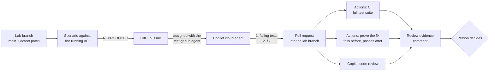

# Test · Regression lab with GitHub Copilot

Defects that only show up under retries or simultaneous clicks slip through review: nobody wrote the test that would have caught them, and a green pull request does not say whether its new test ever failed. In this solution a reported defect, a request that can be approved and rejected at the same time, is reproduced against a running API from a data-driven scenario. The Copilot cloud agent commits failing regression tests first, including an eight-click race, then the fix. GitHub Actions proves that the tests fail at the tests-only commit and pass at the head, Copilot code review adds comments, and a person decides.

## Where it fits

**Phase 4 of 7: Test and review.** The Microsoft counterpart is [04-test-microsoft](../04-test-microsoft/).

| | Today | With this solution |
| --- | --- | --- |
| Reproducing | Someone repeats the clicks from the bug report by hand and races are hard to trigger. | A scenario file replays the report against the API, including eight parallel clicks, and lists the expectations that break. |
| Regression tests | Written after the fix, if at all. Nobody knows whether they would have caught the bug. | Copilot commits the failing tests on their own, then the fix in a separate commit. |
| Review | A green check and a few comments. An empty review looks like a clean one. | Actions reruns the new tests at the tests-only commit (they must fail) and at the head (they must pass) and keeps both outputs. Comments are reported apart from the checks. |
| Decision | Implicit in the merge button. | A person approves or requests changes, and the evidence comment records who decided. |

## How it works



- **Copilot** runs the custom agent [`test-github`](.github/agents/test-github.agent.md) in the cloud agent. With the `failure-reproduction` skill it runs the Issue's scenario, writes integration tests that assert the expected behavior, commits them alone, fixes the code in a second commit, and reruns the tests, the `regression-validation` suites, and the scenario.
- **GitHub Actions** runs [CI](../../.github/workflows/ci.yml) (the full test suite) and [`test-github-proof.yml`](.github/workflows/test-github-proof.yml), which reruns the tests the tests-only commit added at that commit and at the head, each in a clean worktree, and keeps both outputs. Its script comes from the base branch, so the pull request cannot change how it is judged.
- **Copilot code review** comments on the change. The `review-evidence` skill reports those comments apart from the checks.
- **A person** approves the workflow runs, reads the tests, and approves or requests changes.

## What's in this folder

```text
04-test-github/
├── README.md
├── duplicate-decision-issue.md         the defect report: becomes the Issue Copilot receives
├── requirements.txt                    no packages needed: the scripts use the Python standard library
├── lab/duplicate-decision.patch        the defect: removes the decision guards and the tests that cover them
├── scenarios/
│   ├── duplicate-decision.json         the reported defect as data: a retry, a second approver, eight parallel clicks
│   └── whitespace-rejection.json       a second, smaller defect for the same procedure
└── .github/
    ├── agents/test-github.agent.md     the custom Copilot agent: reproduce, failing tests first, then the fix
    ├── skills/
    │   ├── failure-reproduction/       repro.py runs a scenario against a running API
    │   ├── review-evidence/            prove_fix.py (fails before, passes after) and review_evidence.py (the report)
    │   ├── regression-validation/      runs the test suites that cover a change (shared with 03-develop-github)
    │   └── contract-impact/            additive-only API contract check that regression-validation calls (shared)
    ├── workflows/test-github-proof.yml proves the fix test-first on fix pull requests
    └── ISSUE_TEMPLATE/04-test-github-defect.yml
```

## Prerequisites

- GitHub Copilot Business or Enterprise, with the **Copilot cloud agent** enabled for the repository. Copilot code review is used in step 6.
- [GitHub CLI](https://cli.github.com/), signed in with permission to push branches, create Issues, and approve workflow runs.
- [.NET 10 SDK](https://dotnet.microsoft.com/download) and PostgreSQL on `localhost:5432` (user `requesthub`, password `devpass`). The [app README](../../app/README.md#run-it-locally) has a one-line Docker command.
- Python 3.12 or later. [GitHub Copilot CLI](https://docs.github.com/copilot/how-tos/set-up/install-copilot-cli) for the optional step 9.

## Set up

Run once from the repository root:

```powershell
gh label create ai-sdlc --color 1D76DB --description "AI-SDLC demo work" --force
gh label create phase:test --color C5DEF5 --description "SDLC phase 4: Test" --force
```

The agent, skills, workflow, and issue template are already active because the repository's root `.github/` folder mirrors them. The cloud agent's environment, including the PostgreSQL service its tests need, comes from [`copilot-setup-steps.yml`](../../.github/workflows/copilot-setup-steps.yml).

## Run the demo

About 30 minutes, of which about 15 are Copilot working. If time is short, run steps 1 to 3 before the session.

1. **Rebuild the lab branch from `main`.** Do this before every run. The defect lives only on `lab/test-duplicate-decision`: today's `main` plus [`lab/duplicate-decision.patch`](lab/duplicate-decision.patch), which removes the decision guards and the tests that cover them. The patch file stays off the lab branch, so Copilot cannot simply reverse it.

   ```powershell
   git fetch origin
   git switch -C lab/test-duplicate-decision origin/main --no-track
   git apply solutions/04-test-github/lab/duplicate-decision.patch
   git rm -q solutions/04-test-github/lab/duplicate-decision.patch
   git commit -qam "Test lab: decision guards removed (duplicate-decision scenario)"
   git push --force origin lab/test-duplicate-decision
   ```

2. **Reproduce the defect.** Start the API from the lab branch in a second terminal, then run the scenario:

   ```powershell
   dotnet run --project app/src/RequestHub.Api        # second terminal; http://localhost:5080
   python .github/skills/failure-reproduction/repro.py solutions/04-test-github/scenarios/duplicate-decision.json
   ```

   You should see six failing steps. Point out step 8, the double-click (the split between `201` and `500` varies from run to run):

   ```text
    4. FAIL Dan rejects the already approved request  ->  HTTP 201
             HTTP 201, expected 409
             code None, expected decision.already_decided
    8. FAIL Chloé double-clicks Approve: eight requests at once  ->  HTTP 201 x3, HTTP 500 x5
             status counts {'201': 3, '500': 5}, expected {'201': 1, '409': 7}

   REPRODUCED: 6 step(s) did not behave as expected.
   ```

   The same scenario against `main` prints `Not reproduced: every step behaved as expected.`, so it is a fair oracle.

3. **Hand the defect to Copilot.** Create the Issue from the defect report:

   ```powershell
   gh issue create --title "Test: a request can be decided more than once" --label ai-sdlc --label phase:test --label bug --body-file solutions/04-test-github/duplicate-decision-issue.md
   ```

   Open the Issue and assign it to **Copilot**. In the dialog, pick the **test-github** agent and the base branch **lab/test-duplicate-decision**. From a terminal instead (replace `<issue>`):

   ```powershell
   $repo = gh repo view --json nameWithOwner -q .nameWithOwner
   @{ assignees = @('copilot-swe-agent[bot]'); agent_assignment = @{ target_repo = $repo; base_branch = 'lab/test-duplicate-decision'; custom_agent = 'test-github' } } |
     ConvertTo-Json -Compress | gh api -X POST "repos/$repo/issues/<issue>/assignees" --input -
   ```

   Copilot opens a draft pull request into the lab branch within a minute. Open it and select **View session** to watch it run the scenario, commit `Add failing regression tests for #<issue>`, then commit the fix and run the scenario again. It finishes in about 15 minutes and requests your review.

4. **Approve the workflow runs.** Workflows on Copilot's pull requests wait for a person. Select **Approve and run workflows** on the pull request, or re-run the waiting runs from a terminal with `gh run rerun <run-id>` (`gh run list --branch <copilot-branch>` shows the ids). The two to watch are **CI** and **Test · GitHub · prove the fix test-first**; checks from other solutions may run too.

5. **Watch the deterministic gate.** Open the **Regression tests fail before the fix and pass after it** check. Its summary shows the two runs at known SHAs and the failures in the tests' own words. From a rehearsal run:

   ```text
   | `e01bc29b4` | tests only: Add failing regression tests for #29          | ❌ 2 of 2 failed | must fail: proves the defect |
   | `0437e74be` | head: Fix first-wins decision retries and concurrency (#29) | ✅ 2 of 2 passed | must pass: proves the fix |

   ✅ Proven: 2 of 2 selected tests fail at the tests-only commit `e01bc29b4`, and 2 of 2 pass at the head `0437e74be`.
   - Concurrent_decisions_record_one_winner_without_server_errors_or_duplicate_effects: Expected: 7 · Actual: 0
   - Decision_retry_returns_original_and_conflicting_approver_cannot_replace_it: Expected: OK · Actual: Created
   ```

   The `regression-proof` artifact keeps both test outputs. Copilot chooses how many tests to write, so the counts change between runs. Tests that already pass before the fix are guards, for example "an existing decision does not bypass authorization".

6. **Ask Copilot for a code review.** In the pull request, select **Reviewers > Copilot**, or run `gh pr edit <pr> --add-reviewer "@copilot"`. Its review arrives within a few minutes. In the rehearsal it found no issues but said it *could not run the new concurrency tests*: the proof in step 5 did.

7. **Assemble the evidence** and post it on the pull request:

   ```powershell
   python .github/skills/review-evidence/review_evidence.py --pr <pr> --comment
   ```

   The comment has three sections: **Deterministic acceptance** (the checks and the proof at known SHAs) decides; **Review comments** (Copilot code review, people) informs, and says that no comments does not mean correct; **Reviewer decision** is still pending.

8. **Decide.** Read the tests in the tests-only commit: do they assert what the Issue expects, including the concurrent case? Approve or request changes as a GitHub review, then run step 7 again. The same comment now records who decided. Do not merge: the lab branch is rebuilt for every run.

9. **Optional: the same skill on a second defect (about 15 minutes).** The lab build also accepts a rejection whose comment is only spaces. Stop the API (Ctrl+C), so Copilot CLI can start its own, then:

   ```powershell
   git switch -c test/whitespace-rejection
   copilot --agent test-github --allow-all-tools -p "Fix this defect test-first. A rejection whose comment is only spaces is accepted; it must return 400 validation.failed and the request must stay Submitted. Scenario: solutions/04-test-github/scenarios/whitespace-rejection.json"
   python .github/skills/review-evidence/prove_fix.py --base origin/lab/test-duplicate-decision --head HEAD
   ```

   Copilot reproduces the defect with the scenario (`REPRODUCED: 2 step(s)`), commits a failing test, then the fix. The local proof prints `✅ Proven` with both commits.

## What to observe

- **Tests that failed first.** The proof shows the new tests failing at a known SHA for the reported reason (`Expected: Conflict · Actual: Created`) and passing at the head, with both outputs kept.
- **Concurrency is tested, not assumed.** Eight parallel clicks must produce exactly one `201`, in the scenario and in the tests.
- **One oracle before and after.** The scenario reproduces the defect on the lab build, and prints `Not reproduced` on `main` and after the fix.
- **Comments are not checks.** Copilot code review informs the reviewer, and it can say what it could not verify. The evidence comment lists it apart from the checks, and an empty review counts for nothing.
- **People stay in charge.** Workflows on Copilot's pull request run only after a person approves them, a person decides on the change, and RequestHub's own rule is untouched: only approvers decide, never on their own request.
- **Speed.** Minutes from a defect report to a proven, reviewable fix.

## Reset and clean up

```powershell
gh pr close <pr> --delete-branch --comment "Demo run: closed without merging."
gh issue close <issue> --reason "not planned"
git switch main
git branch -D test/whitespace-rejection    # if you ran step 9
```

Never merge Copilot's pull request. Step 1 rebuilds the lab branch from `main` for the next run.

## Use it in your own repository

1. Copy this folder's `.github/` contents into your repository's `.github/` folder. The cloud agent loads the custom agent profile from the default branch, so merge changes to the agent before you assign work. Skills and scripts come from the branch Copilot works on.
2. Point the scripts at your stack: the sign-in header and base URL in `repro.py`, the solution and test folder (`app/RequestHub.slnx`, `app/tests/`) and the xUnit attribute pattern in `prove_fix.py`, and the suites in `run_regression.py`.
3. Decide which pull requests need the proof. The workflow runs only on pull requests into `lab/test-**` branches, so it never touches other work. For fixes into `main`, change its `branches` filter, add an `if:` that recognizes a fix (for example a `bug` label), and make the check required in a ruleset.
4. Write a scenario for your next defect report, and make sure the Copilot cloud agent can run your tests (database services in `copilot-setup-steps.yml`).

## Troubleshooting

- **No checks on Copilot's pull request.** Workflows on pull requests from the cloud agent wait for a person. Select **Approve and run workflows**, or run `gh run rerun <run-id>`.
- **Port 5080 or the `requesthub` database is already in use** (for example on a shared machine). Give the API its own: set `$env:ConnectionStrings__RequestHub = "Host=localhost;Port=5432;Database=rh_lab;Username=requesthub;Password=devpass"`, start it with `--urls http://localhost:5081`, and pass `--api http://localhost:5081` to `repro.py`.
- **`error: cannot reach http://localhost:5080`.** The API is not running yet, or runs on another port.
