# Test · Regression lab with GitHub Copilot

Defects that only show up under retries or simultaneous clicks slip through review: nobody wrote the test that would have caught them, and a green pull request does not say whether its new test ever failed. In this solution a reported defect, a request that can be approved and rejected at the same time, is reproduced against a running API from a data-driven scenario. The Copilot cloud agent commits failing regression tests first, including an eight-click race, then the fix. GitHub Actions proves that the tests fail at the tests-only commit and pass at the head, Copilot code review adds comments, and a person decides.

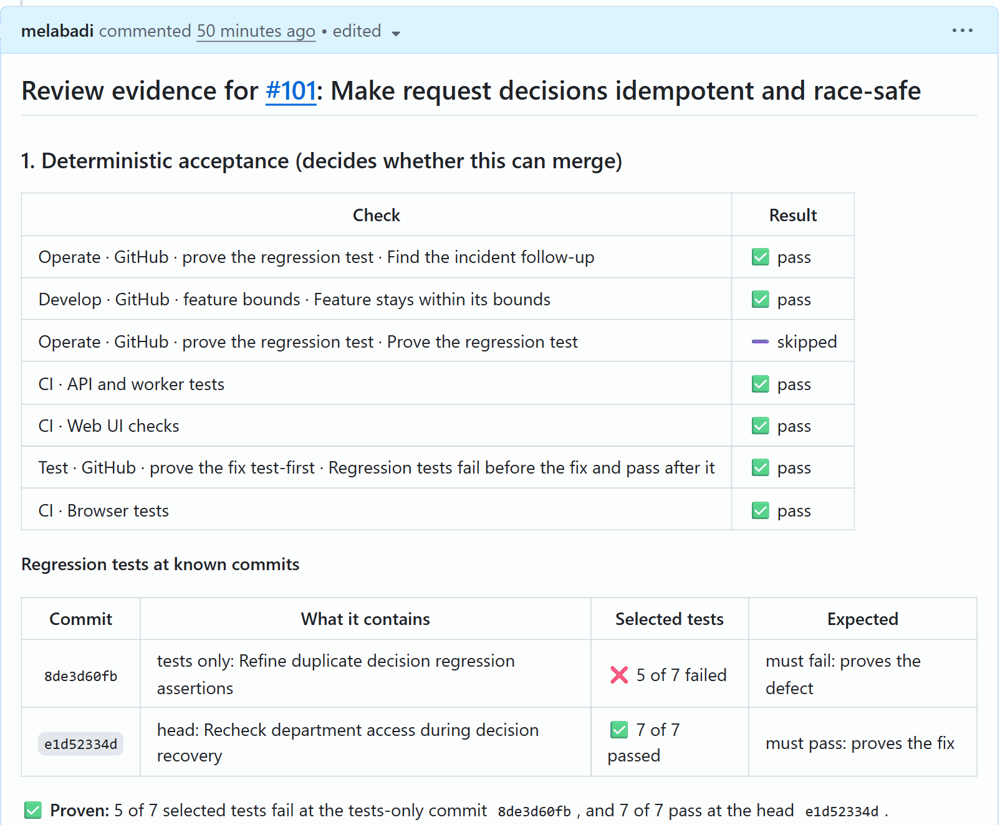

## Where it fits

**Phase 4 of 7: Test and review.** The Microsoft counterpart is [04-test-microsoft](../04-test-microsoft/).

| | Today | With this solution |
| --- | --- | --- |
| Reproducing | Someone repeats the clicks from the bug report by hand and races are hard to trigger. | A scenario file replays the report against the API, including eight parallel clicks, and lists the expectations that break. |
| Regression tests | Written after the fix, if at all. Nobody knows whether they would have caught the bug. | Copilot commits the failing tests on their own, then the fix in a separate commit. |
| Review | A green check and a few comments. An empty review looks like a clean one. | Actions reruns the new tests at the tests-only commit (they must fail) and at the head (they must pass) and keeps both outputs. Comments are reported apart from the checks. |
| Decision | Implicit in the merge button. | A person approves or requests changes, and the evidence comment records who decided. |

## How it works

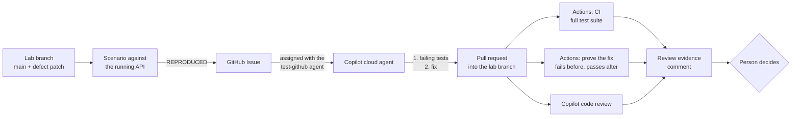

- **Copilot** runs the custom agent [`test-github`](.github/agents/test-github.agent.md) in the cloud agent. With the `failure-reproduction` skill it runs the Issue's scenario, writes integration tests that assert the expected behavior, commits them alone, fixes the code in a second commit, and reruns the tests, the `regression-validation` suites, and the scenario.
- **GitHub Actions** runs [CI](../../.github/workflows/ci.yml) (the full test suite) and [`test-github-proof.yml`](.github/workflows/test-github-proof.yml), which reruns the tests the tests-only commit added at that commit and at the head, each in a clean worktree, and keeps both outputs. Its script comes from the base branch, so the pull request cannot change how it is judged.
- **Copilot code review** comments on the change. The `review-evidence` skill reports those comments apart from the checks.
- **A person** approves the workflow runs, reads the tests, and approves or requests changes.

**Outside contributions.** On a public repository anyone can open an Issue with this solution's form, or a pull request from a fork. Neither starts Copilot: only people with write access can assign an Issue to Copilot or mention `@copilot`. The proof runs a fork's pull request into a `lab/test-*` branch once someone with write access approves the run: it runs that pull request's tests with a read-only token, no secrets, and no credentials left in the checkout, and takes the proof script from the base branch.

## What's in this folder

```text
04-test-github/
├── README.md
├── duplicate-decision-issue.md         the defect report: becomes the Issue Copilot receives
├── requirements.txt                    no packages needed: the scripts use the Python standard library
├── images/                             screenshots from a live run, used in this README
├── lab/duplicate-decision.patch        the defect: removes the decision guards and the tests that cover them
├── scenarios/
│   ├── duplicate-decision.json         the reported defect as data: a retry, a second approver, eight parallel clicks
│   └── whitespace-rejection.json       a second, smaller defect for the same procedure
└── .github/
    ├── agents/test-github.agent.md     the custom Copilot agent: reproduce, failing tests first, then the fix
    ├── skills/
    │   ├── failure-reproduction/       repro.py runs a scenario against a running API
    │   ├── review-evidence/            prove_fix.py (fails before, passes after) and review_evidence.py (the report)
    │   ├── regression-validation/      runs the test suites that cover a change (shared with 03-develop-github)
    │   └── contract-impact/            additive-only API contract check that regression-validation calls (shared)
    ├── workflows/test-github-proof.yml proves the fix test-first on fix pull requests
    └── ISSUE_TEMPLATE/04-test-github-defect.yml
```

## Prerequisites

- GitHub Copilot Business or Enterprise, with the **Copilot cloud agent** enabled for the repository. Copilot code review is used in step 6.
- [GitHub CLI](https://cli.github.com/), signed in with permission to push branches, create Issues, and approve workflow runs.
- [.NET 10 SDK](https://dotnet.microsoft.com/download) and PostgreSQL on `localhost:5432` (user `requesthub`, password `devpass`). The [app README](../../app/README.md#run-it-locally) has a one-line Docker command.
- Python 3.12 or later. [GitHub Copilot CLI](https://docs.github.com/copilot/how-tos/set-up/install-copilot-cli) for the optional step 9.

## Set up

Run once from the repository root:

```powershell
gh label create ai-sdlc --color 1D76DB --description "AI-SDLC demo work" --force
gh label create phase:test --color C5DEF5 --description "SDLC phase 4: Test" --force
gh label list --search phase:test
gh api 'repos/{owner}/{repo}/contents/.github/agents/test-github.agent.md' --jq .path
```

What you should see: `gh label list` shows `phase:test  SDLC phase 4: Test  #C5DEF5` on its first line, and the last command prints `.github/agents/test-github.agent.md`. That means the custom agent is on the default branch, which is where the cloud agent reads it. The skills, workflow, and issue template are active too, because the repository's root `.github/` folder mirrors them. The cloud agent's environment, including the PostgreSQL service its tests need, comes from [`copilot-setup-steps.yml`](../../.github/workflows/copilot-setup-steps.yml).

## Before each session

- [ ] **Confirm the starting state.** `gh pr list --base lab/test-duplicate-decision` prints nothing, and `gh issue list --label phase:test --state open` shows no Issue left over from an earlier run (this repository keeps Issue #5 from the first run on purpose, with its draft pull request #6 on a frozen copy of the lab branch). If either does, follow [Reset and clean up](#reset-and-clean-up) first.
- [ ] **Start the slow parts about 30 minutes early.** Run steps 1 and 3 before the audience arrives: Copilot needs 15 to 30 minutes, and its pull request is then ready to show. Build the API once (`dotnet build app/src/RequestHub.Api`) so step 2 starts in seconds. If you plan to show step 9, run it beforehand as well and keep its branch.
- [ ] **Open in advance.** Two PowerShell terminals at the repository root, on the lab branch (the second one runs the API). Browser tabs: the Issue, Copilot's pull request, its **View session** page, and the latest run of **Test · GitHub · prove the fix test-first** under **Actions**. In the editor: [`duplicate-decision-issue.md`](duplicate-decision-issue.md) and [`scenarios/duplicate-decision.json`](scenarios/duplicate-decision.json).
- [ ] **Plan the time.** About 20 minutes on stage when steps 1, 3, and 9 ran beforehand. The waiting times come from the live runs behind this README:

| Step | On stage | Waiting |
| --- | --- | --- |
| 1. Rebuild the lab branch | 1 min | |
| 2. Reproduce the defect | 2 min | |
| 3. Hand the defect to Copilot | 3 min | Copilot works 15 to 30 min |
| 4. Approve the workflow runs | 1 min | the proof takes about 2 min, CI about 4 min |
| 5. Watch the deterministic gate | 2 min | |
| 6. Ask Copilot for a code review | 2 min | the review arrives in 5 to 12 min |
| 7. Assemble the evidence | 2 min | |
| 8. Decide, with a review loop | 4 min | Copilot pushes in about 7 min, then the checks run again |
| 9. Optional: a second defect with Copilot CLI | 3 min | Copilot CLI works 12 to 18 min |

## Run the demo

The screenshots come from the live run with Issue #100 and pull request #101. Your SHAs, test names, and counts will differ, because Copilot writes new tests every time.

1. **Rebuild the lab branch from `main`.** Do this before every run. The defect lives only on `lab/test-duplicate-decision`: today's `main` plus [`lab/duplicate-decision.patch`](lab/duplicate-decision.patch), which removes the decision guards and the tests that cover them. The patch file stays off the lab branch. Copilot can still read the code from before the defect commit, as an engineer would when a regression appears; what the demo proves is the order of the evidence, a failing test at a known SHA and then the fix.

   ```powershell
   git fetch origin
   git switch -C lab/test-duplicate-decision origin/main --no-track
   git apply solutions/04-test-github/lab/duplicate-decision.patch
   git rm -q solutions/04-test-github/lab/duplicate-decision.patch
   git commit -qam "Test lab: decision guards removed (duplicate-decision scenario)"
   git push --force origin lab/test-duplicate-decision
   ```

   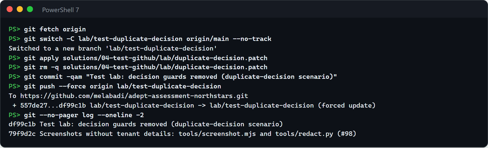

   *About 20 seconds.* **Point out:** the defect exists only on a lab branch built from today's `main`; `main` itself stays healthy.

2. **Reproduce the defect.** Start the API from the lab branch in the second terminal, then run the scenario in the first:

   ```powershell
   dotnet run --project app/src/RequestHub.Api        # second terminal; http://localhost:5080
   python .github/skills/failure-reproduction/repro.py solutions/04-test-github/scenarios/duplicate-decision.json
   ```

   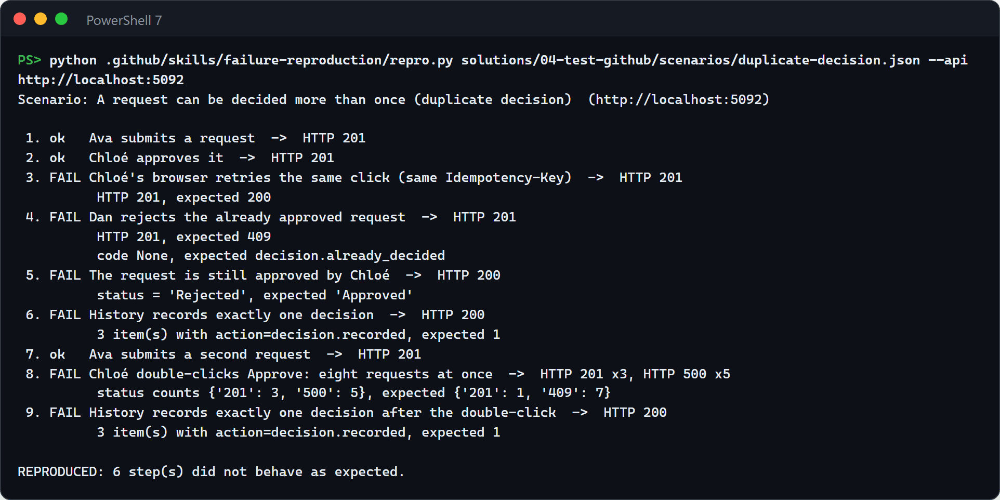

   To show that the scenario is a fair oracle, run it against `main` too: stop the API (Ctrl+C), `git switch main`, start the API again, and rerun the scenario. Every step passes. Switch back with `git switch lab/test-duplicate-decision` afterwards.

   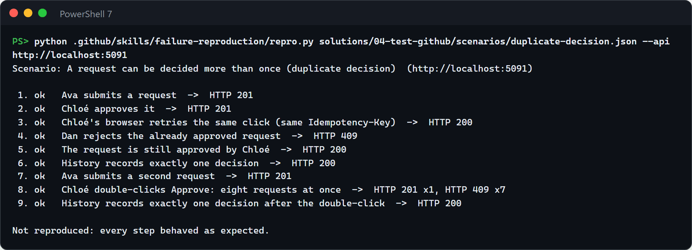

   The screenshots ran the lab and `main` APIs side by side on ports 5092 and 5091, with `--api`, because the machine was shared (see [Troubleshooting](#troubleshooting)). *About 2 minutes, of which the scenario takes 5 seconds.* **Point out:** step 8, a double-click of eight requests, records more than one decision and answers the rest with `500` (three and five in this run; the split changes from run to run); on `main` it returns one `201` and seven `409`.

3. **Hand the defect to Copilot.** Create the Issue from the defect report:

   ```powershell
   gh issue create --title "Test: a request can be decided more than once" --label ai-sdlc --label phase:test --label bug --body-file solutions/04-test-github/duplicate-decision-issue.md
   ```

   Open the Issue and assign it to **Copilot**. In the dialog, pick the **test-github** agent and the base branch **lab/test-duplicate-decision**. From a terminal instead (replace `<issue>`; it prints `Copilot` and your login):

   ```powershell
   $repo = gh repo view --json nameWithOwner -q .nameWithOwner
   @{ assignees = @('copilot-swe-agent[bot]'); agent_assignment = @{ target_repo = $repo; base_branch = 'lab/test-duplicate-decision'; custom_agent = 'test-github' } } |
     ConvertTo-Json -Compress | gh api -X POST "repos/$repo/issues/<issue>/assignees" --input - --jq '.assignees[].login'
   ```

   Within seconds Copilot appears under the Issue's **Assignees**, and the Issue links its session and a draft pull request into the lab branch:

   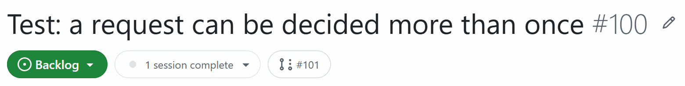

   Open the pull request and select **View session** to watch Copilot work: it runs the scenario, commits the failing tests, then commits the fix, reruns the tests, the regression suites, and the scenario, and ends with an evidence summary:

   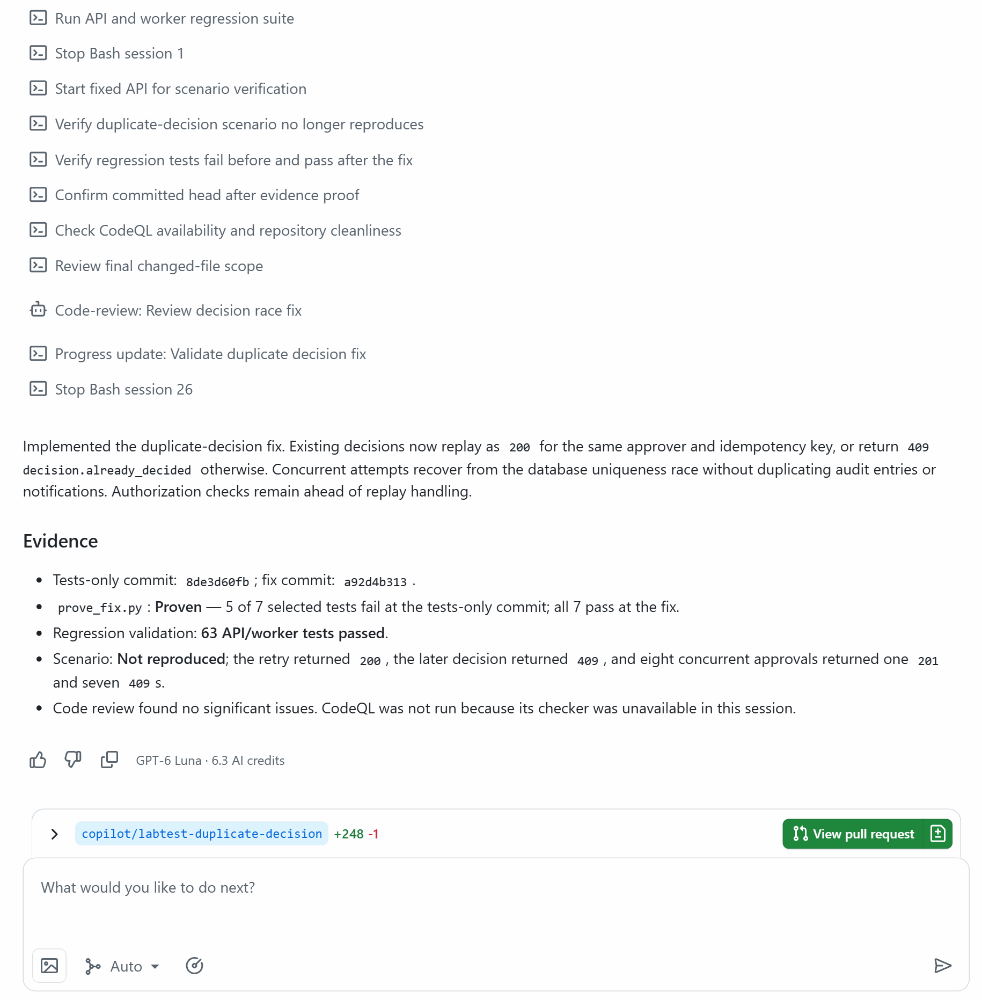

   When the session ends, look at the commits, on the pull request's **Commits** tab or in a terminal:

   ```powershell
   git fetch origin
   # Copilot's branch name is at the top of the pull request
   git --no-pager log --reverse --stat=100 --format="%n%h %s" origin/lab/test-duplicate-decision..origin/copilot/labtest-duplicate-decision
   ```

   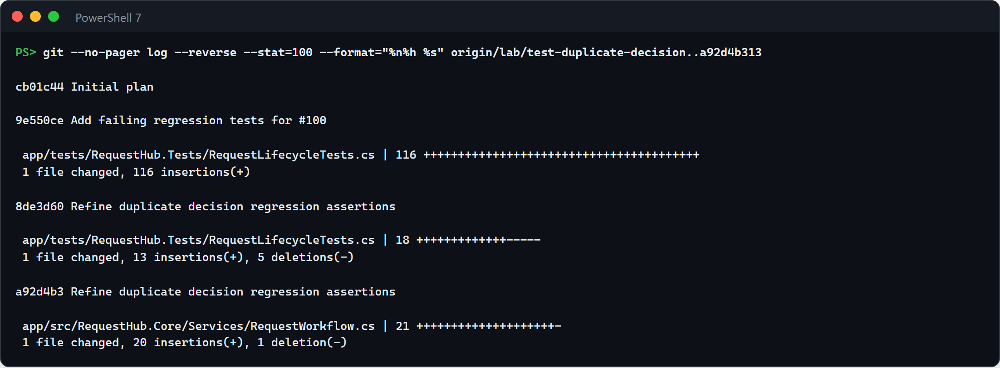

   Open the tests-only commit and find the concurrent test, for example with `git show <tests-only commit>:app/tests/RequestHub.Tests/RequestLifecycleTests.cs`:

   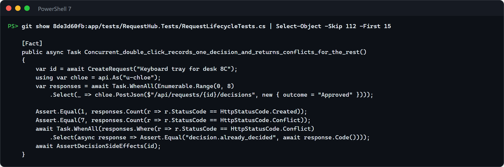

   *About 3 minutes on stage; Copilot worked 14 minutes in this run (its tests-only commit came after 6) and about 30 in another.* **Point out:** the tests landed in their own commits, touching only `app/tests/`, before any production code changed.

   Copilot's output varies between runs. In this one the fix commit reused the previous commit's message ("Refine duplicate decision regression assertions"), and the evidence summary appeared in the session rather than in the pull request description. Neither matters to the gate in step 5: it reads what each commit changes, not what its message says.

4. **Approve the workflow runs.** Workflows on Copilot's pull requests wait for a person:

   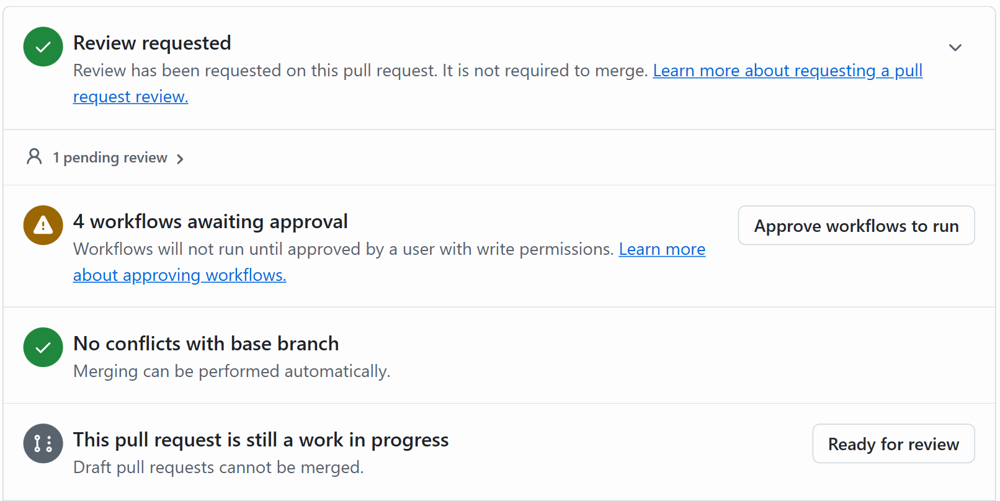

   Select **Approve workflows to run**, or re-run the waiting runs of the latest commit from a terminal with `gh run rerun <run-id>` (`gh run list --branch <copilot-branch>` shows the ids and commits). The two to watch are **CI** and **Test · GitHub · prove the fix test-first**; checks from other solutions may run and pass or skip. Runs that waited on an earlier commit are cancelled when the latest commit's runs start, because they share a concurrency group. *Under a minute; the proof then takes about 2 minutes and CI about 4.* **Point out:** nothing Copilot wrote runs in Actions until a person approves it.

5. **Watch the deterministic gate.** Open the **Regression tests fail before the fix and pass after it** check and its summary:

   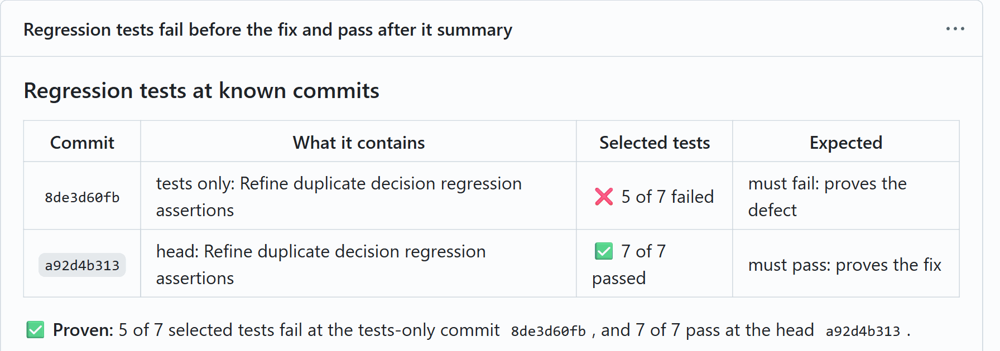

   Below the table, the summary lists each failure at the tests-only commit in the tests' own words:

   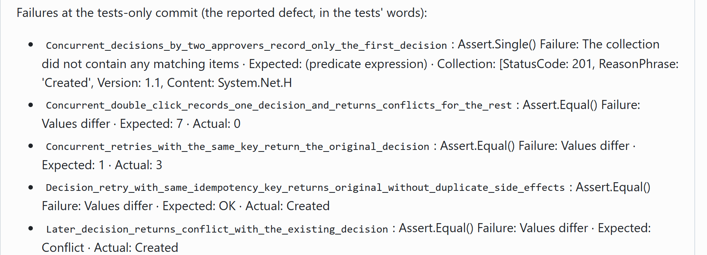

   The run's `regression-proof` artifact keeps both test outputs (console logs and CTRF reports). Tests that already pass before the fix are guards that protect existing behavior, such as a requester still being unable to approve their own request. *About 2 minutes.* **Point out:** the same tests fail at one known SHA, for the reasons the Issue describes, and pass at another.

6. **Ask Copilot for a code review.** In the pull request, select **Reviewers > Copilot**, or run `gh pr edit <pr> --add-reviewer "@copilot"`. You can do this right after step 4, so the review runs while you show the proof.

   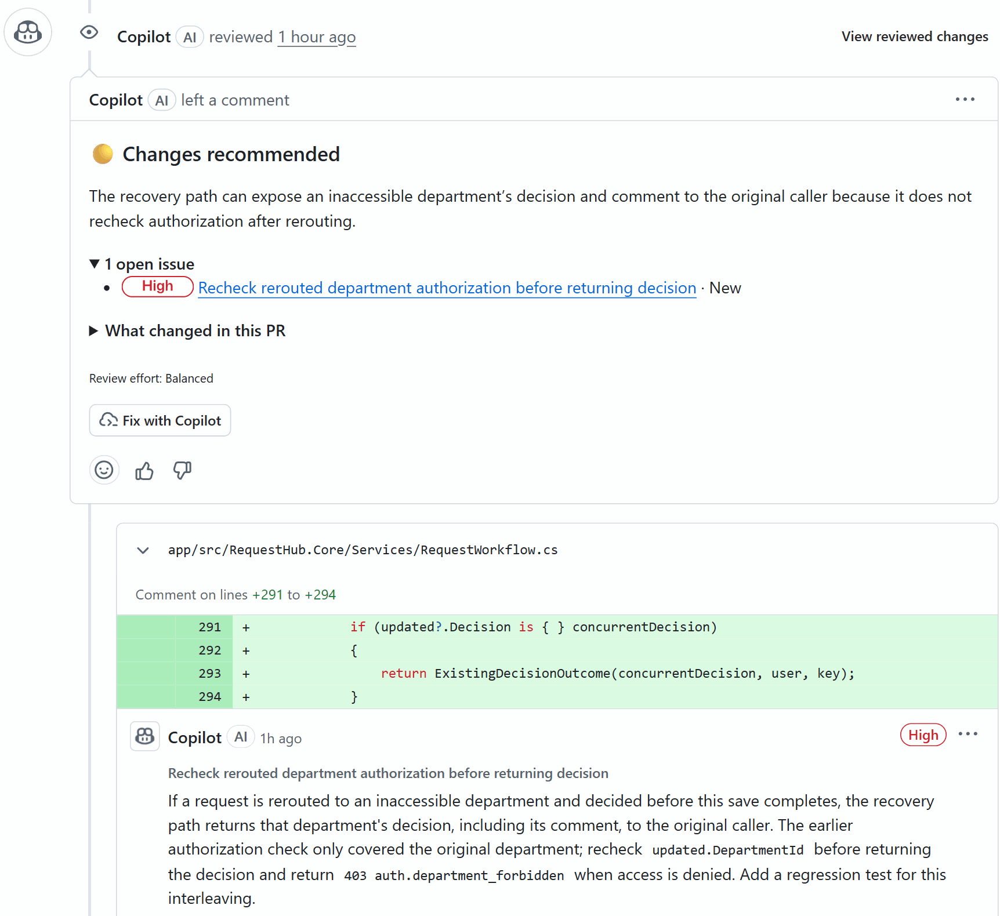

   *About 6 minutes in this run, up to 12 in others.* **Point out:** the review found an authorization gap that no test covered, a request rerouted to another department between the access check and the save. Copilot's own self-check in the session had found no issues. In earlier runs the review flagged a missing concurrent retry test, or found nothing and said it could not run the concurrency tests.

7. **Assemble the evidence** and post it on the pull request:

   ```powershell
   python .github/skills/review-evidence/review_evidence.py --pr <pr> --comment
   ```

   The comment has three sections. **Deterministic acceptance** (the checks, and the proof at known SHAs) decides; it is the image at the top of this README. **Review comments** (Copilot code review, people) informs. **Reviewer decision** stays pending until a person reviews:

   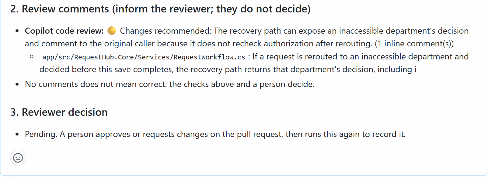

   These images show the comment after step 8 updated it, so the head is the review-loop commit. *About 20 seconds.* **Point out:** what decides (checks and proof) is kept apart from what informs (review comments).

8. **Decide.** Read the tests in the tests-only commit: do they assert what the Issue expects, including the concurrent case? If the review found a gap, ask Copilot on the pull request. This run used:

   ```text
   @copilot Please address the Copilot code review comment on `RequestWorkflow.cs`: in the concurrency recovery path, recheck department access for the reloaded request before returning its decision, and return `403 auth.department_forbidden` when access is denied. Add a regression test for this case. Give each new commit a message that says what it changes, and do not rewrite or squash the earlier commits.
   ```

   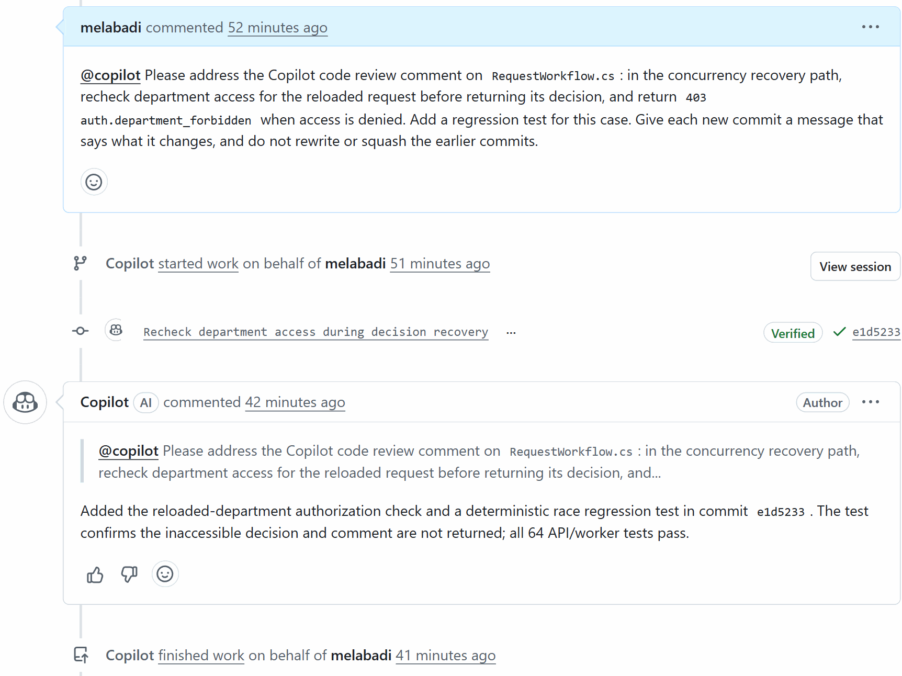

   Copilot pushed one commit with the check and a race test about 7 minutes later. Approve its workflow runs (step 4), then run step 7 again: the same comment now shows the new head, still proven. Tests added after the fix are guards: CI runs them, and the proof keeps covering the tests committed before the fix. When you are satisfied, approve or request changes as a GitHub review and run step 7 once more: the comment records who decided. Do not merge: the lab branch is rebuilt for every run. *About 4 minutes on stage, plus Copilot's 7 minutes and the checks.* **Point out:** the reviewer's finding became code and a test within minutes, and the new commit went through the same gates.

9. **Optional: the same skill on a second defect (about 15 minutes, best run beforehand).** The lab build also accepts a rejection whose comment is only spaces. Stop the API (Ctrl+C), so Copilot CLI can start its own, then:

   ```powershell
   git switch -c test/whitespace-rejection lab/test-duplicate-decision
   copilot --agent test-github --allow-all-tools -p "Fix this defect test-first. A rejection whose comment is only spaces is accepted; it must return 400 validation.failed and the request must stay Submitted. Scenario: solutions/04-test-github/scenarios/whitespace-rejection.json"
   python .github/skills/review-evidence/prove_fix.py --base origin/lab/test-duplicate-decision --head HEAD
   ```

   Copilot reproduces the defect with the scenario (`REPRODUCED: 2 step(s)`), commits failing tests, then the fix. The local proof selects the tests that the tests-only commits added, and runs them at the last tests-only commit and at the fix:

   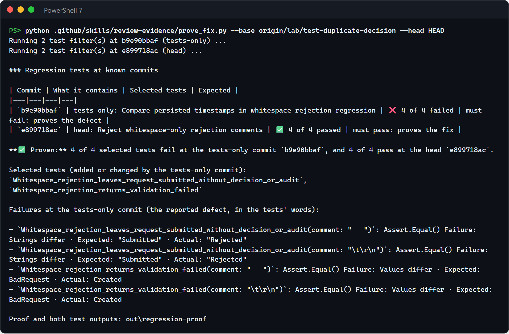

   *Copilot CLI took 12 to 18 minutes in our runs; the local proof about 3.* **Point out:** the same skills and the same proof work on a different defect, from the terminal, with no pull request.

## What to observe

- **Tests that failed first.** The proof shows the new tests failing at a known SHA for the reported reason (`Expected: Conflict · Actual: Created`) and passing at the head, with both outputs kept.
- **Concurrency is tested, not assumed.** Eight parallel clicks must produce exactly one `201`, in the scenario and in the tests.
- **One oracle before and after.** The scenario reproduces the defect on the lab build, and prints `Not reproduced` on `main` and after the fix.
- **Comments are not checks.** The checks prove what the tests cover. Copilot code review informs the reviewer: it can point at what the tests miss, such as an authorization gap in a recovery path or a concurrent retry with the same key, or say what it could not verify. The evidence comment lists it apart from the checks, and an empty review counts for nothing.
- **People stay in charge.** Workflows on Copilot's pull request run only after a person approves them, a person decides on the change, and RequestHub's own rule is untouched: only approvers decide, never on their own request.
- **Speed.** Minutes from a defect report to a proven, reviewable fix, and minutes from a review finding to a new commit.

## Reset and clean up

```powershell
gh pr close <pr> --delete-branch --comment "Demo run: closed without merging."
gh issue close <issue> --reason "not planned"
git switch main
git branch -D test/whitespace-rejection    # if you ran step 9
```

Never merge Copilot's pull request. Step 1 rebuilds the lab branch from `main` for the next run.

## Use it in your own repository

1. Copy this folder's `.github/` contents into your repository's `.github/` folder. The cloud agent loads the custom agent profile from the default branch, so merge changes to the agent before you assign work. Skills and scripts come from the branch Copilot works on.
2. Point the scripts at your stack: the sign-in header and base URL in `repro.py`, the solution and test folder (`app/RequestHub.slnx`, `app/tests/`) and the xUnit attribute pattern in `prove_fix.py`, and the suites in `run_regression.py`.
3. Decide which pull requests need the proof. The workflow runs only on pull requests into `lab/test-**` branches, so it never touches other work. For fixes into `main`, change its `branches` filter, add an `if:` that recognizes a fix (for example a `bug` label), and make the check required in a ruleset.
4. Write a scenario for your next defect report, and make sure the Copilot cloud agent can run your tests (database services in `copilot-setup-steps.yml`).

## Troubleshooting

- **No checks on Copilot's pull request.** Workflows on pull requests from the cloud agent wait for a person. Select **Approve workflows to run**, or run `gh run rerun <run-id>`.
- **The runs of an earlier commit show as cancelled.** Approving the waiting runs of several commits starts them together, and the newest run in each concurrency group cancels the older ones. Approve the latest commit's runs; the proof still tests the tests-only commit.
- **The pull request description has no evidence.** Copilot sometimes writes its evidence summary only at the end of the session. Read it under **View session**, or ask `@copilot` to add it to the description.
- **Port 5080 or the `requesthub` database is already in use** (for example on a shared machine). Give the API its own: set `$env:ConnectionStrings__RequestHub = "Host=localhost;Port=5432;Database=rh_lab;Username=requesthub;Password=devpass"`, start it with `--urls http://localhost:5081`, and pass `--api http://localhost:5081` to `repro.py`. Tell Copilot CLI the same port and database in its prompt.
- **`error: cannot reach http://localhost:5080`.** The API is not running yet, or runs on another port.
