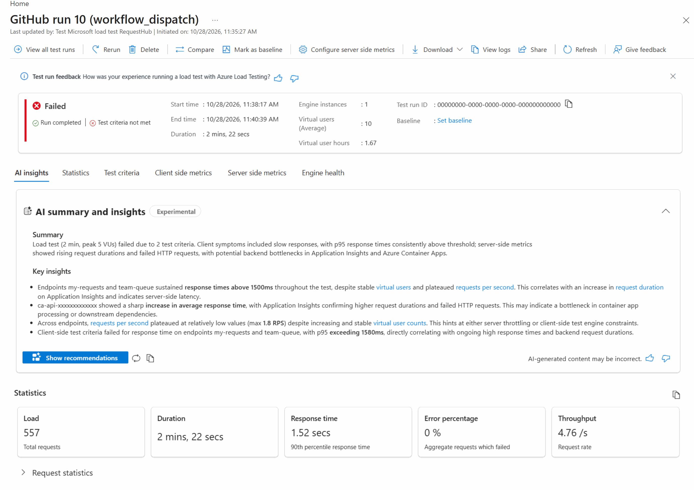
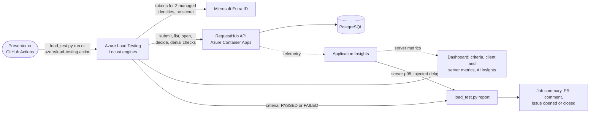
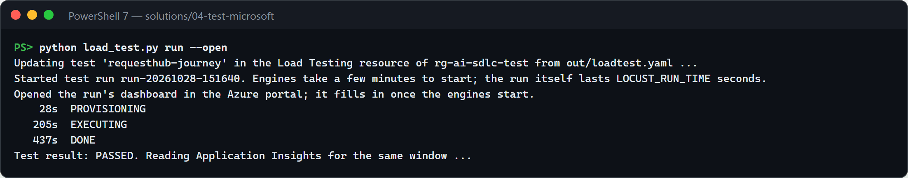
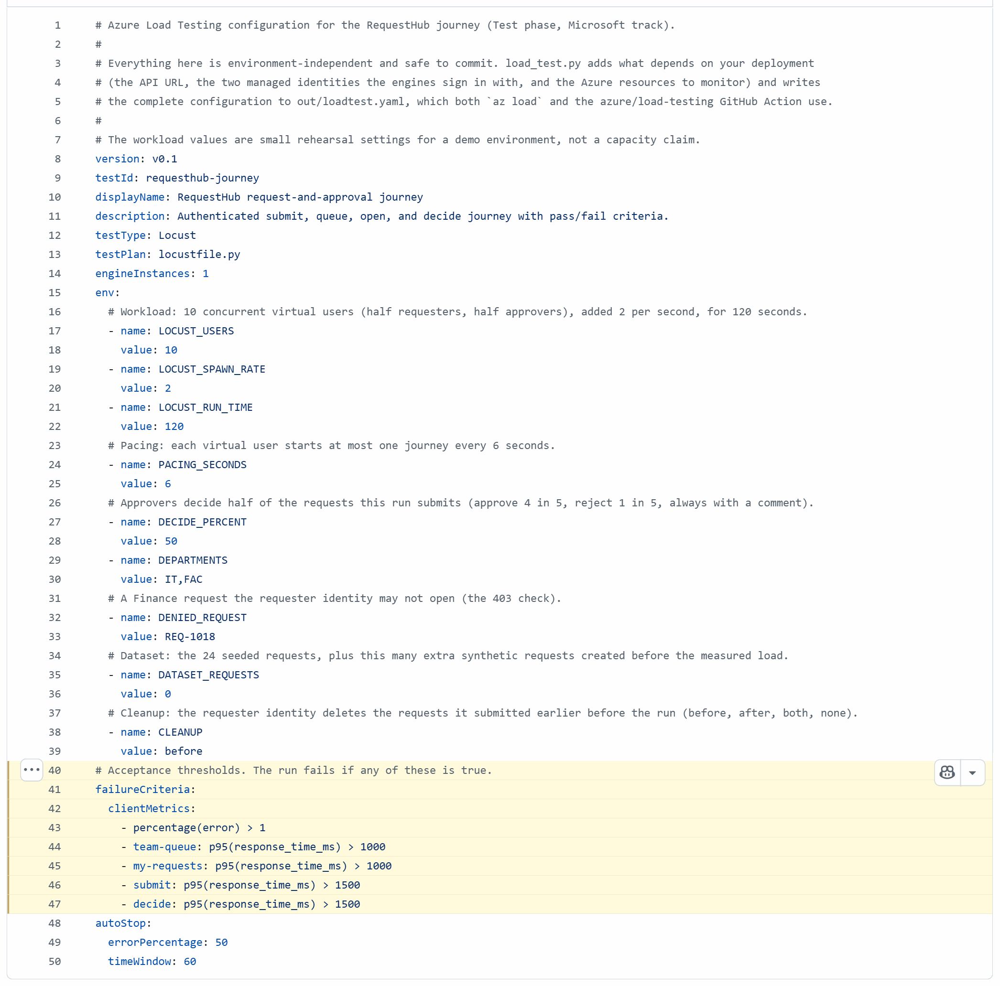
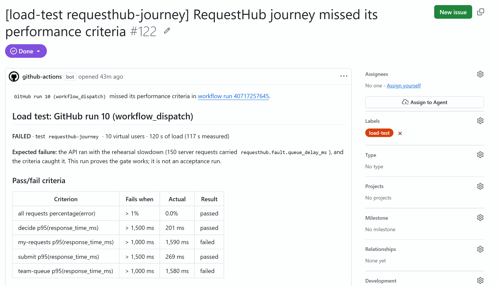
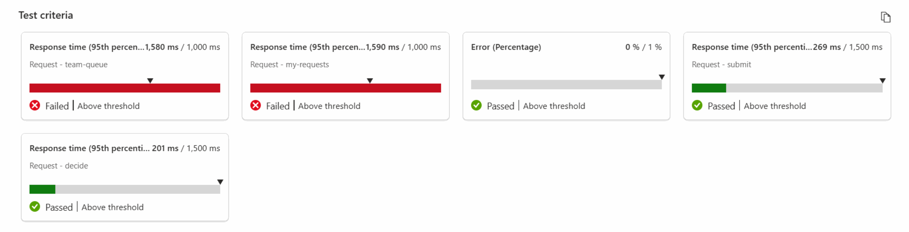
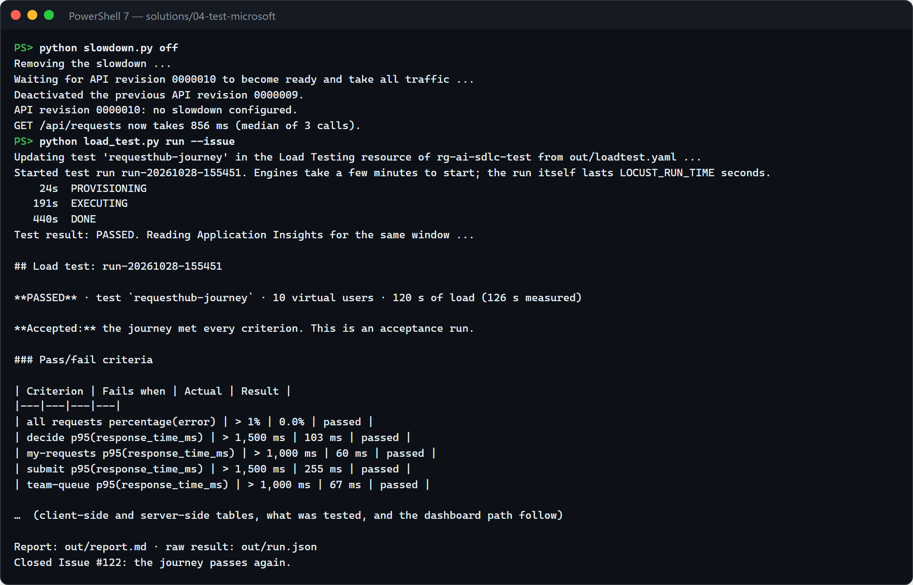
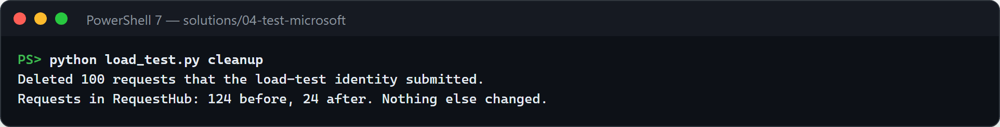

# Test · Performance lab with Azure Load Testing

Most teams find out how their app behaves under load in production, because a realistic load test is hard to set up, needs credentials, and produces charts nobody turns into a decision. In this solution, Azure Load Testing runs RequestHub's real request-and-approval journey, signed in as two managed identities, with explicit pass/fail criteria. A rehearsal slowdown on the deployed API shows the gate catching a regression: the run fails, the report shows the server-side cause next to the client results, the dashboard's AI insights summarize what went wrong, and a GitHub Issue tracks the failure until a passing run closes it. A GitHub Copilot agent and two skills change the scenario and explain results without ever relaxing a threshold to make a run pass.



## Where it fits

**Phase 4 of 7: Test.** The GitHub counterpart is [04-test-github](../04-test-github/), which proves a functional fix with a regression test. This solution proves service-level behavior under load.

| | Today | With this solution |
| --- | --- | --- |
| Performance evidence | Someone runs a load tool from a laptop before a big release, if at all. | A managed load test runs on demand and whenever the test changes, from a terminal or GitHub Actions. |
| Realism | Anonymous calls to a home page. | The real journey, signed in: submit a request, list "my requests" and the team queue, open a request, approve or reject. |
| Credentials | A test account's password or a long-lived token in a pipeline secret. | Two managed identities the test engines borrow during a run. No secret exists. |
| The decision | Someone eyeballs a chart. | Pass/fail criteria (p95 per request, error rate) turn the run into PASSED or FAILED. |
| Diagnosis | Load-tool numbers and app logs live in different places. | One report: each criterion with its actual value, client percentiles, and server-side telemetry for the same window. The dashboard adds an AI summary that correlates them. |
| Follow-up | A message in chat. | A failing run opens a GitHub Issue; the next passing run closes it. |
| Test data | Leftover records in a shared environment. | The load-test identity deletes its own requests before each run; the seeded data never changes. |

## How it works



- **Azure Load Testing** runs [`loadtest/locustfile.py`](loadtest/locustfile.py) on managed engines with the settings and criteria in [`loadtest/requesthub-journey.yaml`](loadtest/requesthub-journey.yaml). Its dashboard shows client and server metrics side by side, and its **AI summary and insights** (experimental) explain a run in plain language.
- **Two managed identities** sign the virtual users in. Requesters submit synthetic requests; approvers, a different identity, decide some of them, because RequestHub never lets anyone decide their own request. Both identities hold RequestHub app roles, and the API accepts them like any other caller.
- **RequestHub** enforces the same roles and department access as for people. Every few journeys the test also checks that an invalid token gets 401 and a request from another department gets 403.
- **GitHub Actions** ([`test-microsoft-load.yml`](.github/workflows/test-microsoft-load.yml)) signs in with OIDC and runs the test with the `azure/load-testing` action. The resource names it needs are environment secrets, so GitHub masks them in the log, and the report it posts names runs, not hosts. It can also rehearse a regression: inject the slowdown, run, remove it.
- **GitHub Copilot**: the `test-microsoft` agent with the **load-scenario** and **performance-analysis** skills changes the journey and explains results within guardrails that [`check_scenario.py`](.github/skills/load-scenario/check_scenario.py) enforces.
- **People** decide what a failure means and whether a release ships. The AI summary is a lead to check; the criteria are the verdict.

## What's in this folder

```text
04-test-microsoft/
├── README.md
├── images/                             screenshots from a live run of this demo
├── loadtest/
│   ├── locustfile.py                   the journey: requester and approver virtual users, sign-in, cleanup
│   └── requesthub-journey.yaml         workload settings and pass/fail criteria (no environment values)
├── load_test.py                        run the test, report on it, sync the Issue, clean up load-test data
├── slowdown.py                         demo helper: inject or remove the expiring slowdown on the deployed API
├── azd_env.py                          reads settings from this solution's azd environment
├── configure_github.py                 azd hooks: connect the solution to GitHub Actions
├── requirements.txt                    Python packages (Locust pinned to the engines' version)
├── azure.yaml                          azd project: infra plus the shared app's api and worker
├── infra/
│   ├── main.bicep                      resource group, RequestHub platform (app/infra), load testing
│   ├── loadtest-identities.bicep       the requester and approver identities
│   ├── loadtesting.bicep               Azure Load Testing, its roles, the identities' RequestHub app roles
│   └── main.parameters.json
└── .github/
    ├── agents/test-microsoft.agent.md  Copilot agent that changes, runs, and explains the load test
    ├── skills/
    │   ├── load-scenario/              how to change the scenario safely (check_scenario.py)
    │   └── performance-analysis/       how to read a result (queries.kql for Application Insights)
    └── workflows/test-microsoft-load.yml
```

The app lives in [`app/`](../../app/README.md). This solution deploys its own copy with two extra settings: the API accepts the load-test identities, and lets the requester identity delete the requests it submitted (`POST /api/admin/load-test/cleanup`).

## Prerequisites

- An Azure subscription where you can create resource groups, Microsoft Entra app registrations, and role assignments, for example as Owner.
- A region that allows PostgreSQL Flexible Server and Azure Load Testing (the examples use `centralus`).
- [Azure CLI](https://learn.microsoft.com/cli/azure/install-azure-cli) with the `load` and `application-insights` extensions, [Azure Developer CLI](https://learn.microsoft.com/azure/developer/azure-developer-cli/install-azd), and the [GitHub CLI](https://cli.github.com/) signed in as a repository admin. The hooks create a GitHub environment and its secrets.
- Python 3.12 or 3.13, and PowerShell 7 for the commands below.
- For a local run of the journey: the [.NET 10 SDK](https://dotnet.microsoft.com/download) and PostgreSQL (see [`app/README.md`](../../app/README.md#run-it-locally)).

## Set up

Run once, from this folder:

```powershell
cd solutions/04-test-microsoft
pip install -r requirements.txt
az extension add --name load --upgrade
az extension add --name application-insights --upgrade
az login
azd auth login
azd env new ai-sdlc-test --location centralus
azd up
```

`azd up` takes about 15 minutes and ends with `SUCCESS`. Between provisioning and deploying, its hook prints `GitHub environment 'test-microsoft' in <owner>/<repo>: 11 secrets, 1 variable set.` It creates resource group `rg-ai-sdlc-test` with:

- **RequestHub's platform** from [`app/infra/requesthub.bicep`](../../app/infra/requesthub.bicep) and **the app** (API with web UI, and the notification worker), built in the registry, so Docker is not needed. You get every RequestHub role.
- **Azure Load Testing** with two managed identities: `id-lt-requester-*` (RequestHub Requester) and `id-lt-approver-*` (RequestHub Approver). You and the GitHub Actions identity get **Load Test Contributor**; the Load Testing resource reads the app's metrics for its dashboard.
- **GitHub environment `test-microsoft`**, created by the hooks. It holds the OIDC sign-in values and every resource name the workflow reads as secrets; the resource group name is its only variable. The workflow's identity may also update the API container app (for the slowdown rehearsal) and read Application Insights.

To confirm the app and your access work, run `python load_test.py cleanup`. It prints `Requests in RequestHub: 24 before, 24 after`.

## Before each session

About 5 minutes, from `solutions/04-test-microsoft`.

1. **Confirm the starting state.**

   ```powershell
   azd env select ai-sdlc-test
   $pg = az postgres flexible-server list -g rg-ai-sdlc-test --query "[0].name" -o tsv
   az postgres flexible-server show -g rg-ai-sdlc-test -n $pg --query state -o tsv   # Ready
   python slowdown.py status                                                       # no slowdown configured
   python load_test.py cleanup                                                     # 24 before, 24 after
   gh issue list --label load-test --state open --json number --jq length          # 0
   ```

   

   - **The database is not `Ready`:** start it with `az postgres flexible-server start -g rg-ai-sdlc-test -n $pg`, which takes 3 to 5 minutes. A tenant policy can stop the server on a schedule, and the API then fails its readiness probe.
   - **A slowdown is configured:** run `python slowdown.py off` (about 3 minutes).
   - **Cleanup deletes requests:** an earlier session left its data behind. That's fine; the count after cleanup is what matters.
   - **A `load-test` Issue is open:** close it with `gh issue close <number>`, so step 5 opens a fresh one.

2. **Open in advance.** A PowerShell 7 terminal in this folder. In the browser, signed in: the Azure portal on resource group `rg-ai-sdlc-test` › the Load Testing resource › **Tests** › `requesthub-journey`, and the repository's **Actions** tab on **Test · Microsoft · load test RequestHub**. In your editor: [`loadtest/requesthub-journey.yaml`](loadtest/requesthub-journey.yaml), [`loadtest/locustfile.py`](loadtest/locustfile.py), and [`.github/workflows/test-microsoft-load.yml`](.github/workflows/test-microsoft-load.yml).

3. **Start early.** Every load test run takes about 12 minutes, most of it waiting. If time is short, start step 1 about 15 minutes before you begin and show its finished dashboard in step 2 instead of the live one. Start step 7 when you open questions.

   | Step | Takes | Where the time goes |
   | --- | --- | --- |
   | 1. Baseline run | about 12 minutes | 3 to start the engine, 2 of load, about 2 to finish, up to 5 for Application Insights |
   | 4. Slowdown on | about 3 minutes | a new API revision rolls out |
   | 5. Workflow run | about 13 minutes | the same run, from GitHub Actions |
   | 7. Slowdown off, passing run | about 15 minutes | 3 for the revision, 12 for the run |
   | 8. Cleanup | under 1 minute | |

   Live from start to finish, the demo takes about 50 minutes; with step 1 started early and step 7 during questions, about 30.

## Run the demo

Run the commands from `solutions/04-test-microsoft`.

### 1. Start the baseline run

*About 12 minutes. Go on to step 2 while it runs.*

```powershell
python load_test.py run --open
```

The script writes the test configuration for your deployment to `out/loadtest.yaml`, updates the test in Azure Load Testing, starts a run, opens its dashboard in your browser, and prints each state: `PROVISIONING`, then `EXECUTING` after about 3 minutes, then `DONE`.



**Point out:** no credential appears anywhere. The engines sign in as two managed identities that exist only for this test.

### 2. Show the test while the engine starts

*About 5 minutes.*

Open [`loadtest/requesthub-journey.yaml`](loadtest/requesthub-journey.yaml): 10 users, 2 minutes, one journey per user every 6 seconds, and five criteria, for example *team queue p95 above 1,000 ms fails the run*. Then [`loadtest/locustfile.py`](loadtest/locustfile.py): requester and approver virtual users, each signed in with a managed identity token.



Once the run is `EXECUTING`, switch to the dashboard that `--open` opened. Client-side metrics fill in every few seconds, with the API's server-side metrics below them; the criteria get their verdict when the run completes.


**Point out:** the pass/fail criteria are a few lines of YAML in the repository, reviewed in pull requests like any code.

### 3. Read the baseline

*About 2 minutes.*

When the run is done, the script reads Application Insights for the same window and prints the report, which it also saves in `out/report.md`. It says **PASSED** and *Accepted*. Every criterion is met, for example team queue p95 106 ms against 1,000 ms, with no errors in about 600 requests and the 401 and 403 checks behaving.


The dashboard shows the same verdict:


**Point out:** the report names the load, data, region, and compute next to the numbers, so nobody reads 10 users as a capacity claim.

### 4. Ship a slowdown

*About 3 minutes.*

```powershell
python slowdown.py on
```

This sets `Faults__QueueDelayMs=1500` and `Faults__ExpiresAtUtc` (30 minutes ahead) on the API, which rolls out a new revision. The script waits until the revision takes all traffic, then times three calls to the request list from your machine. That time includes your network, so look at the jump, not the absolute number.


**Point out:** the fault switches itself off when it expires, even if the demo is interrupted.

### 5. Let the pipeline catch it

*About 13 minutes.*

```powershell
gh workflow run test-microsoft-load.yml
gh run watch
```

While it runs, walk through [`.github/workflows/test-microsoft-load.yml`](.github/workflows/test-microsoft-load.yml): OIDC sign-in to Azure, the step that masks tenant and resource details before the load-test steps print anything, the `azure/load-testing` action, and the report step. The run fails on its criteria. Open it with `gh run view --web`: the job summary carries the report, labelled *Expected failure*.


The workflow also opens an Issue labelled `load-test`, with the same report and a link to the run. During the demo it shows **Open**; the screenshot below was taken after step 7 closed it, so it shows **Done**.



**Point out:** the report names the cause. Its first lines say 150 server requests carried the injected delay, and the server-side table further down the job summary shows that's every `GET /api/requests`. So the run is labelled an expected failure, not acceptance.

### 6. Read the failure in Azure Load Testing

*About 3 minutes.*

Open the run in the Azure portal: resource group `rg-ai-sdlc-test` › the Load Testing resource › **Tests** › `requesthub-journey` › **GitHub run N (workflow_dispatch)**. Or from the terminal, which also prints the report again:

```powershell
$id = az load test-run list --load-test-resource (azd env get-value LOAD_TEST_NAME) -g rg-ai-sdlc-test --test-id requesthub-journey --query "[0].testRunId" -o tsv
python load_test.py report --run-id $id --open
```

The dashboard can take a minute to draw its charts. Start with the criteria: the two list requests fail, and submit, decide, and the error rate pass.



Above the statistics, **AI summary and insights** (experimental) explains the failure. For this run, the summary was already there when the dashboard opened; if a run has none yet, select **Get insights** to generate it. It ties the slow list requests to longer request durations in Application Insights.


Scroll down for the client-side and server-side metrics of the same window.


The criteria and the metrics agree: only the two list requests are slow, the rest of the journey stays fast, and the server-side durations show the time is spent inside the API.

**Point out:** the AI summary is a lead, not a verdict; check each claim against the dashboard. "Peak 5 VUs" counts the users behind a single request (5 requesters or 5 approvers); the header shows 10 virtual users in total. The "failed HTTP requests" are the journey's deliberate 403 checks: Application Insights counts a 403 as failed, while the error percentage here is 0%, and the server-side table further down the step 5 job summary lists them under Denied (401/403), with 0 server errors.

### 7. Fix and confirm

*About 15 minutes: 3 for the revision, 12 for the run.*

```powershell
python slowdown.py off
python load_test.py run --issue
```



**Point out:** the Issue closes itself with the passing report; nobody had to remember to follow up.

### 8. Clean up the test data

*Under 1 minute.* Each run already deletes the previous run's requests before it starts. To remove the last run's requests too:

```powershell
python load_test.py cleanup
```



**Point out:** only load-test requests go, about 100 per run; the 24 seeded requests stay, and the audit log records every cleanup.

### Optional: rehearse from GitHub alone

Run the workflow with the **slowdown** input: `gh workflow run test-microsoft-load.yml -f slowdown=true`. It injects the slowdown, runs the test, and removes the slowdown even when the run fails. Pull requests that change the load test also run it and comment the report.

### Optional: change the journey on your machine

The same locustfile runs locally against a RequestHub with development sign-in, where personas replace the managed identities. Use it to try a change before it costs a cloud run. From the repository root, with PostgreSQL running:

```powershell
$env:Demo__LoadTestRequesterIds = "u-ben"      # lets the requester persona clean up its own requests
dotnet run --project app/src/RequestHub.Api    # http://localhost:5080; leave it running
```

In a second terminal:

```powershell
python .github/skills/load-scenario/check_scenario.py
cd solutions/04-test-microsoft
locust -f loadtest/locustfile.py --headless -u 4 -r 2 -t 1m -H http://localhost:5080
```

Expect `PASS` from the check, `Cleanup: deleted ... requests owned by u-ben`, and a results table with no failures. Then run it in Azure with `python load_test.py run`, or open a pull request: the workflow runs it against the deployed app and comments the report.

## What to observe

- **A real journey, signed in, with no secret.** The engines borrow two managed identities. The API applies the same roles and department checks as for people, and the denial checks prove it under load.
- **Pass/fail, not a chart.** The criteria are code, reviewed in pull requests. A slowdown of 1.5 seconds on one endpoint fails the run within minutes.
- **The cause is in the same report.** Client percentiles from Azure Load Testing and server percentiles from Application Insights for the same window, including how many requests carried the injected delay.
- **AI that explains, criteria that decide.** The dashboard's AI summary turns charts into a paragraph a team can act on. It's a lead to verify, as its "failed requests" (the deliberate 403 checks) show; the criteria give the verdict.
- **Honest evidence.** A failure during the rehearsal is labelled an expected failure, not acceptance. Every result names the load, data, region, and compute it ran on.
- **Follow-up without anyone remembering.** The Issue opens on the first failure, collects later failures, and closes itself on the next pass.
- **Nothing to leak.** Resource names live in environment secrets and are masked in logs; reports, job summaries, and Issues name runs, not hosts.

## Reset and clean up

After each demo, make sure the slowdown is off, the test data is gone, and no Issue is left open:

```powershell
python slowdown.py status     # "no slowdown configured", or run: python slowdown.py off
python load_test.py cleanup   # 24 after
gh issue list --label load-test --state open
```

Test runs stay in Azure Load Testing as history; the next session doesn't need them removed.

When you no longer need the solution, run this in the solution folder. `azd down` removes the resource group, but not the Microsoft Entra app registration RequestHub signs in with (Entra objects live outside resource groups), and a deleted app that is not purged stops the next `azd up` from creating it again:

```powershell
$app = az ad app show --id (azd env get-value API_CLIENT_ID) --query id -o tsv
azd down --purge
az ad app delete --id $app
az rest --method delete --url "https://graph.microsoft.com/v1.0/directory/deletedItems/$app"
gh api -X DELETE 'repos/{owner}/{repo}/environments/test-microsoft'
```

## Use it in your own repository

1. Copy `loadtest/`, `load_test.py`, `azd_env.py`, the skills, the agent, and the workflow. The [Azure Load Testing extension for Visual Studio Code](https://learn.microsoft.com/azure/app-testing/load-testing/quickstart-create-run-load-tests-from-visual-studio-code) can draft a first locustfile from an `.http` file or Postman collection with Copilot.
2. Describe your own journey in the locustfile. Name every request; the criteria refer to the names.
3. Set criteria from what your users need (a service level objective), not from what the first run measured. Run `python .github/skills/load-scenario/check_scenario.py` and adjust its guardrails to your environment.
4. Give the test its own identities with only the roles the journey needs, assign them to the Load Testing resource, and accept them in your API. If you test a production-like environment, keep the cleanup scoped to the identities' own data.
5. Point `load_test.py` at your resources through environment variables or your azd environment, and keep resource names in environment secrets. Run the workflow after each deployment.

## Troubleshooting

- **`AzureCLICredential: exit status 1` during `azd up`.** azd could not get a token from the Azure CLI. Run `az account get-access-token`, then run `azd up` again.
- **`Not a valid reference update` for `appRoleAssignedTo` during `azd up`.** Microsoft Graph had not seen the new identities yet. Run `azd provision` again.
- **The API times out or fails its readiness probe, and `slowdown.py status` or the cleanup cannot reach it.** The PostgreSQL server is stopped; a tenant policy can stop it on a schedule. Start it with `az postgres flexible-server start -g rg-ai-sdlc-test -n $pg` (3 to 5 minutes; `$pg` as in [Before each session](#before-each-session)).
- **Every request fails with 401 in the test run.** The API does not accept the identities yet. Run `azd deploy api`, which applies `LOAD_TEST_CLIENT_IDS` to the API's authentication settings.
- **`Cleanup refused (HTTP 403)` in the engine log.** The API is missing `Demo__LoadTestRequesterIds`. Run `azd deploy api`.
- **`No server-side telemetry for this window yet`.** Application Insights receives data a minute or two late. Run `python load_test.py report --run-id <id>` again.
- **A run stays in `PROVISIONING` far longer than the usual 3 minutes.** Azure Load Testing is waiting for engine capacity in the region; one of our runs waited 25 minutes and then ran normally. Wait, or stop the run in the Azure portal and start it again.
- **The run's dashboard shows only a spinner.** The portal draws the dashboard after the page loads, which took up to a minute in our sessions. Wait, or select **Refresh** on the run.
- **A button in RequestHub's web UI fails with HTTP 403 and no body.** The API was deployed before pull request #134, which lets the app's own origin post through Container Apps authentication. Run `azd deploy api` from an up-to-date `main`. The load test uses bearer tokens and is not affected.
