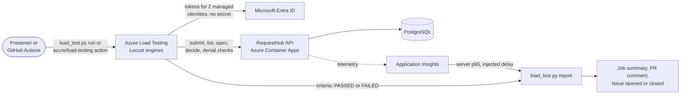

# Test · Performance lab with Azure Load Testing

Most teams find out how their app behaves under load in production, because a realistic load test is hard to set up, needs credentials, and produces charts nobody turns into a decision. In this solution, Azure Load Testing runs RequestHub's real request-and-approval journey, signed in as two managed identities, with explicit pass/fail criteria. A rehearsal slowdown on the deployed API shows the gate catching a regression: the run fails, the report shows the server-side cause next to the client results, and a GitHub Issue tracks it until a passing run closes it. A GitHub Copilot agent and two skills change the scenario and explain results without ever relaxing a threshold to make a run pass.

## Where it fits

**Phase 4 of 7: Test.** The GitHub counterpart is [04-test-github](../04-test-github/), which proves a functional fix with a regression test. This solution proves service-level behavior under load.

| | Today | With this solution |
| --- | --- | --- |
| Performance evidence | Someone runs a load tool from a laptop before a big release, if at all. | A managed load test runs on demand and whenever the test changes, from a terminal or GitHub Actions. |
| Realism | Anonymous calls to a home page. | The real journey, signed in: submit a request, list "my requests" and the team queue, open a request, approve or reject. |
| Credentials | A test account's password or a long-lived token in a pipeline secret. | Two managed identities the test engines borrow during a run. No secret exists. |
| The decision | Someone eyeballs a chart. | Pass/fail criteria (p95 per request, error rate) turn the run into PASSED or FAILED. |
| Diagnosis | Load-tool numbers and app logs live in different places. | One report: each criterion with its actual value, client percentiles, and server-side telemetry for the same window. |
| Follow-up | A message in chat. | A failing run opens a GitHub Issue; the next passing run closes it. |
| Test data | Leftover records in a shared environment. | The load-test identity deletes its own requests before each run; the seeded data never changes. |

## How it works



- **Azure Load Testing** runs [`loadtest/locustfile.py`](loadtest/locustfile.py) on managed engines with the settings and criteria in [`loadtest/requesthub-journey.yaml`](loadtest/requesthub-journey.yaml), and shows client and server metrics side by side.
- **Two managed identities** sign the virtual users in. Requesters submit synthetic requests; approvers, a different identity, decide some of them, because RequestHub never lets anyone decide their own request. Both are RequestHub app roles granted to the identities, accepted by the API like any other caller.
- **RequestHub** enforces the same roles and department access as for people. Every few journeys the test also checks that an invalid token gets 401 and a request from another department gets 403.
- **GitHub Actions** ([`test-microsoft-load.yml`](.github/workflows/test-microsoft-load.yml)) signs in with OIDC and runs the test with the `azure/load-testing` action. It can also rehearse a regression: inject the slowdown, run, remove it.
- **GitHub Copilot**: the `test-microsoft` agent with the **load-scenario** and **performance-analysis** skills changes the journey and explains results within guardrails that [`check_scenario.py`](.github/skills/load-scenario/check_scenario.py) enforces.
- **People** decide what a failure means and whether a release ships.

## What's in this folder

```text
04-test-microsoft/
├── README.md
├── loadtest/
│   ├── locustfile.py                   the journey: requester and approver virtual users, sign-in, cleanup
│   └── requesthub-journey.yaml         workload settings and pass/fail criteria (no environment values)
├── load_test.py                        run the test, report on it, sync the Issue, clean up load-test data
├── slowdown.py                         demo helper: inject or remove the expiring slowdown on the deployed API
├── azd_env.py                          reads settings from this solution's azd environment
├── configure_github.py                 azd hooks: connect the solution to GitHub Actions
├── requirements.txt                    Python packages (Locust pinned to the engines' version)
├── azure.yaml                          azd project: infra plus the shared app's api and worker
├── infra/
│   ├── main.bicep                      resource group, RequestHub platform (app/infra), load testing
│   ├── loadtest-identities.bicep       the requester and approver identities
│   ├── loadtesting.bicep               Azure Load Testing, its roles, the identities' RequestHub app roles
│   └── main.parameters.json
└── .github/
    ├── agents/test-microsoft.agent.md  Copilot agent that changes, runs, and explains the load test
    ├── skills/
    │   ├── load-scenario/              how to change the scenario safely (check_scenario.py)
    │   └── performance-analysis/       how to read a result (queries.kql for Application Insights)
    └── workflows/test-microsoft-load.yml
```

The app lives in [`app/`](../../app/README.md). This solution deploys its own copy with two extra settings: the API accepts the load-test identities, and lets the requester identity delete the requests it submitted (`POST /api/admin/load-test/cleanup`).

## Prerequisites

- An Azure subscription where you can create resource groups, Microsoft Entra app registrations, and role assignments, for example as Owner.
- A region that allows PostgreSQL Flexible Server and Azure Load Testing (the examples use `centralus`).
- [Azure CLI](https://learn.microsoft.com/cli/azure/install-azure-cli) with the `load` and `application-insights` extensions, [Azure Developer CLI](https://learn.microsoft.com/azure/developer/azure-developer-cli/install-azd), and the [GitHub CLI](https://cli.github.com/) signed in as a repository admin. The hooks create a GitHub environment and its secrets.
- Python 3.12 or 3.13.
- For a local run of the journey: the [.NET 10 SDK](https://dotnet.microsoft.com/download) and PostgreSQL (see [`app/README.md`](../../app/README.md#run-it-locally)).

## Set up

Run once, from this folder:

```powershell
cd solutions/04-test-microsoft
pip install -r requirements.txt
az extension add --name load --upgrade
az extension add --name application-insights --upgrade
az login
azd auth login
azd env new ai-sdlc-test --location centralus
azd up
```

`azd up` takes about 15 minutes. It creates resource group `rg-ai-sdlc-test` and fills it as follows:

- **RequestHub's platform** from [`app/infra/requesthub.bicep`](../../app/infra/requesthub.bicep) and **the app** (API with web UI, and the notification worker), built in the registry, so Docker is not needed. You get every RequestHub role.
- **Azure Load Testing** with two managed identities: `id-lt-requester-*` (RequestHub Requester) and `id-lt-approver-*` (RequestHub Approver). You and the GitHub Actions identity get **Load Test Contributor**; the Load Testing resource reads the app's metrics for its dashboard.
- **GitHub environment `test-microsoft`**, created by the hooks with OIDC sign-in values and the resource names the workflow reads. The workflow's identity may also update the API container app (for the slowdown rehearsal) and read Application Insights.

## Run the demo

About 40 minutes, most of it while runs execute. Each run takes about 10 minutes end to end: about 3 minutes for Azure Load Testing to start its engine, 2 minutes of load, and 3 to 5 minutes to collect the results and the server-side telemetry. Start each run first, then talk through the files and the live dashboard while it executes. Run the commands from `solutions/04-test-microsoft`.

1. **Start the baseline run.**

   ```powershell
   python load_test.py run
   ```

   The script points the test at your deployment, starts it, and prints each state: `PROVISIONING`, then `EXECUTING` after about 3 minutes, then `DONE`.

2. **Show the test while the engine starts.** Open [`loadtest/requesthub-journey.yaml`](loadtest/requesthub-journey.yaml): 10 users, 2 minutes, one journey per user every 6 seconds, and five criteria, for example *team queue p95 above 1,000 ms fails the run*. Then [`loadtest/locustfile.py`](loadtest/locustfile.py): requester and approver virtual users, each signed in with a managed identity token. No secret appears anywhere. Once the run is `EXECUTING`, open it in the Azure portal (Load Testing resource › **Tests** › `requesthub-journey`) to watch response times and the API's server metrics live.

3. **Read the baseline.** The report says **PASSED** and *Accepted*: every criterion met, with team queue p95 around 60 to 100 ms against a 1,000 ms limit, no errors in about 600 requests, and the 401 and 403 checks behaving. The server-side table from Application Insights shows the same operations, and the report names the tested load, dataset, region, and compute next to the numbers.

4. **Ship a slowdown (about 1.5 minutes).**

   ```powershell
   python slowdown.py on
   ```

   This sets `Faults__QueueDelayMs=1500` and `Faults__ExpiresAtUtc` (30 minutes ahead) on the API, which rolls out a new revision. The script waits until the revision takes all traffic, then times the request list: about 1.6 to 2.3 seconds now. The fault switches itself off when it expires, even if the demo is interrupted.

5. **Let the pipeline catch it (about 11 minutes).**

   ```powershell
   gh workflow run test-microsoft-load.yml
   gh run watch
   ```

   While it runs, open [`.github/workflows/test-microsoft-load.yml`](.github/workflows/test-microsoft-load.yml): OIDC sign-in, the `azure/load-testing` action, and the report step. The run fails on its criteria: team queue and "my requests" p95 about 1,600 ms. The job summary shows the report labelled *Expected failure*: every `GET /api/requests` in Application Insights carried the injected delay. An Issue labelled `load-test` opens with the report.

6. **Fix and confirm (about 12 minutes).**

   ```powershell
   python slowdown.py off
   python load_test.py run --issue
   ```

   The run passes again, and the Issue closes with the passing report.

7. **Clean up the test data (1 minute).** Each run already deletes the previous run's requests before it starts. To remove the last run's requests too:

   ```powershell
   python load_test.py cleanup
   ```

   It prints how many requests the requester identity had submitted (about 100 per run) and the request count before and after, for example 124 before and 24 after: only load-test requests go, the 24 seeded requests stay.

To rehearse the regression from GitHub alone, run the workflow with the **slowdown** input: `gh workflow run test-microsoft-load.yml -f slowdown=true`. It injects the slowdown, runs the test, and removes the slowdown even when the run fails.

### Change the journey on your machine

The same locustfile runs locally against a RequestHub with development sign-in, where personas replace the managed identities. Use it to try a change before it costs a cloud run. From the repository root, with PostgreSQL running:

```powershell
$env:Demo__LoadTestRequesterIds = "u-ben"      # lets the requester persona clean up its own requests
dotnet run --project app/src/RequestHub.Api    # http://localhost:5080; leave it running
```

In a second terminal:

```powershell
python .github/skills/load-scenario/check_scenario.py
cd solutions/04-test-microsoft
locust -f loadtest/locustfile.py --headless -u 4 -r 2 -t 1m -H http://localhost:5080
```

Expect `PASS` from the check, `Cleanup: deleted ... requests owned by u-ben`, and a results table with no failures. Then run it in Azure with `python load_test.py run`, or open a pull request: the workflow runs it against the deployed app and comments the report.

## What to observe

- **A real journey, signed in, with no secret.** The engines borrow two managed identities. The API applies the same roles and department checks as for people, and the denial checks prove it under load.
- **Pass/fail, not a chart.** The criteria are code, reviewed in pull requests. A slowdown of 1.5 seconds on one endpoint fails the run within minutes.
- **The cause is in the same report.** Client percentiles from Azure Load Testing and server percentiles from Application Insights for the same window, including how many requests carried the injected delay.
- **Honest evidence.** A failure during the rehearsal is labelled an expected failure, not acceptance. Every result names the load, data, region, and compute it ran on, so nobody reads 10 users as a capacity claim.
- **Follow-up without anyone remembering.** The Issue opens on the first failure, collects later failures, and closes itself on the next pass.
- **Clean test data.** The load-test identity can delete only its own requests, and every cleanup is written to the audit log.

## Reset and clean up

After each demo, make sure the slowdown is off and the test data is gone:

```powershell
python slowdown.py status     # "no slowdown configured", or run: python slowdown.py off
python load_test.py cleanup
```

Close any `load-test` Issue still open. When you no longer need the solution, run this in the solution folder. `azd down` removes the resource group, but not the Microsoft Entra app registration RequestHub signs in with (Entra objects live outside resource groups), and a deleted app that is not purged stops the next `azd up` from creating it again:

```powershell
$app = az ad app show --id (azd env get-value API_CLIENT_ID) --query id -o tsv
azd down --purge
az ad app delete --id $app
az rest --method delete --url "https://graph.microsoft.com/v1.0/directory/deletedItems/$app"
gh api -X DELETE 'repos/{owner}/{repo}/environments/test-microsoft'
```

## Use it in your own repository

1. Copy `loadtest/`, `load_test.py`, `azd_env.py`, the skills, the agent, and the workflow. The [Azure Load Testing extension for Visual Studio Code](https://learn.microsoft.com/azure/app-testing/load-testing/quickstart-create-run-load-tests-from-visual-studio-code) can draft a first locustfile from an `.http` file or Postman collection with Copilot.
2. Describe your own journey in the locustfile. Name every request; the criteria refer to the names.
3. Set criteria from what your users need (a service level objective), not from what the first run measured. Run `python .github/skills/load-scenario/check_scenario.py` and adjust its guardrails to your environment.
4. Give the test its own identities with only the roles the journey needs, assign them to the Load Testing resource, and accept them in your API. If you test a production-like environment, keep the cleanup scoped to the identities' own data.
5. Point `load_test.py` at your resources through environment variables or your azd environment, and run the workflow after each deployment.

## Troubleshooting

- **`AzureCLICredential: exit status 1` during `azd up`.** azd could not get a token from the Azure CLI. Run `az account get-access-token`, then run `azd up` again.
- **`Not a valid reference update` for `appRoleAssignedTo` during `azd up`.** Microsoft Graph had not seen the new identities yet. Run `azd provision` again.
- **Every request fails with 401 in the test run.** The API does not accept the identities yet. Run `azd deploy api`, which applies `LOAD_TEST_CLIENT_IDS` to the API's authentication settings.
- **`Cleanup refused (HTTP 403)` in the engine log.** The API is missing `Demo__LoadTestRequesterIds`. Run `azd deploy api`.
- **`No server-side telemetry for this window yet`.** Application Insights receives data a minute or two late. Run `python load_test.py report --run-id <id>` again.
- **A run stays in `PROVISIONING` far longer than the usual 3 minutes.** Azure Load Testing is waiting for engine capacity in the region; one of our runs waited 25 minutes and then ran normally. Wait, or stop the run in the Azure portal and start it again.
