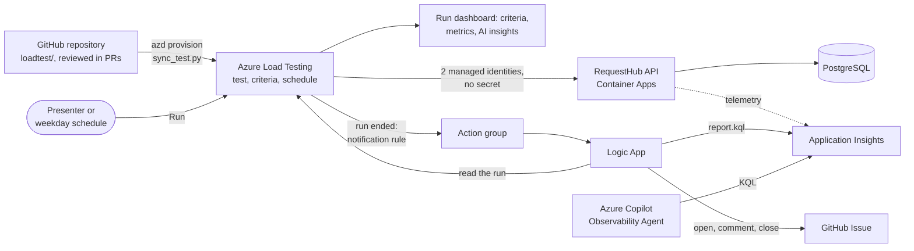
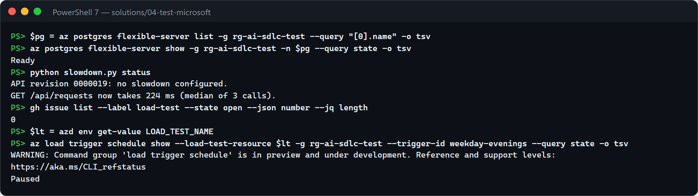
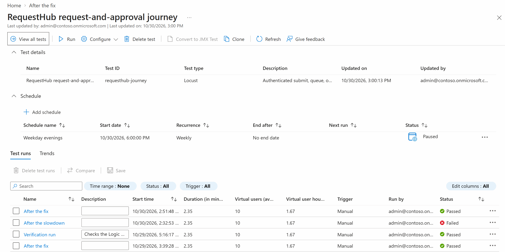
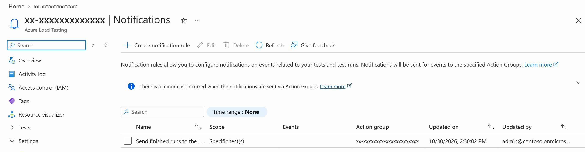
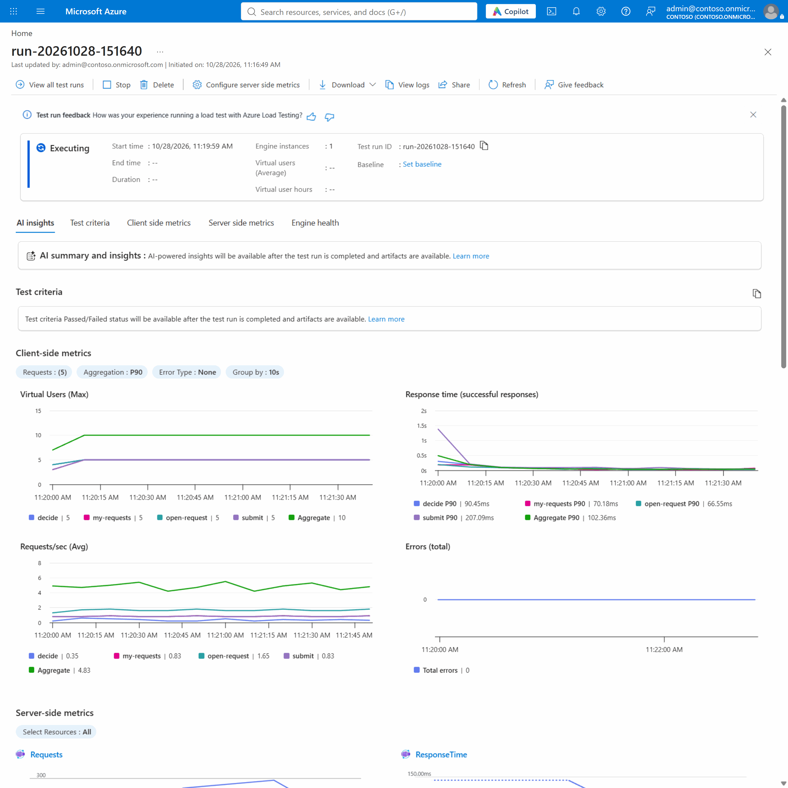
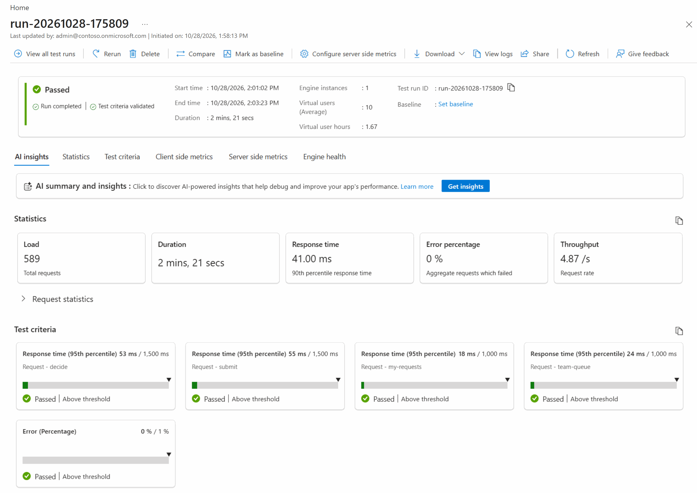
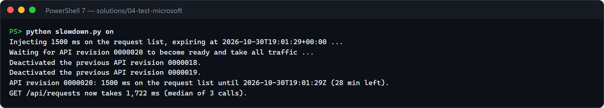
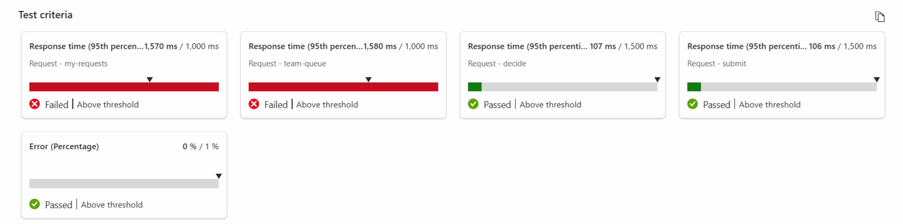
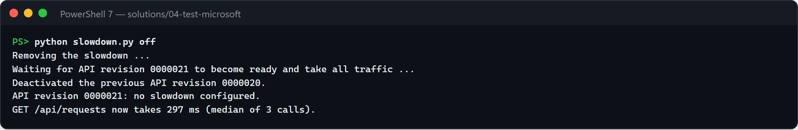

# Test · Performance lab with Azure Load Testing

Most teams find out how their app behaves under load in production: a realistic load test is hard to set up, needs credentials, and produces charts nobody turns into a decision. In this solution the test lives in the repository, where people review changes to it, and everything else happens in Azure. Azure Load Testing runs RequestHub's real request-and-approval journey, signed in as two managed identities, and judges each run against pass/fail criteria. A notification rule hands every finished run to a Logic App, which writes the report and opens or closes a GitHub Issue. Two AI tools in Azure help explain a failure: the run's AI insights, and the Azure Copilot Observability Agent, which answers questions about the API's telemetry. A rehearsal slowdown on the deployed API shows the whole loop, and shows why people still check what the AI says.


## Where it fits

**Phase 4 of 7: Test.** The GitHub counterpart is [04-test-github](../04-test-github/), where Copilot proves a functional fix with a regression test. This solution proves service-level behavior under load, with the AI and the orchestration in Azure. GitHub holds the code, the pull requests that change the test, and the Issues.

| | Today | With this solution |
| --- | --- | --- |
| Performance evidence | Someone runs a load tool from a laptop before a big release, if at all. | Azure Load Testing runs the journey on demand from the portal, or on a weekday schedule. |
| Realism | Anonymous calls to a home page. | The real journey, signed in: submit a request, list "my requests" and the team queue, open a request, approve or reject. |
| Credentials | A test account's password or a long-lived token in a pipeline secret. | Two managed identities the test engines borrow during a run. No secret exists. |
| The decision | Someone eyeballs a chart. | Pass/fail criteria (p95 per request, error rate) turn each run into Passed or Failed. |
| Follow-up | A message in chat. | Azure opens a GitHub Issue with the report; the next accepted run closes it. |
| Diagnosis | Load-tool numbers and app logs live in different places. | The run's dashboard shows client and server metrics side by side with an AI summary, the Observability Agent answers questions about the telemetry, and the report counts the requests that carried the injected delay. |
| Changing the test | A script on someone's laptop. | The journey and its criteria are files in the repository, reviewed in pull requests and applied with `azd provision`. |

## How it works



- **Azure Load Testing** runs [`loadtest/locustfile.py`](loadtest/locustfile.py) on managed engines with the settings and criteria in [`loadtest/requesthub-journey.yaml`](loadtest/requesthub-journey.yaml). Its run dashboard shows client and server metrics side by side and an experimental **AI summary and insights**. The test has a weekday schedule, created paused, and a notification rule that sends every finished run to an action group.
- **Two managed identities** sign the virtual users in. Requesters submit synthetic requests; approvers, a different identity, decide some of them, because RequestHub never lets anyone decide their own request. Each run deletes the requests it submitted, so the seeded data is all that remains.
- **RequestHub** enforces the same roles and department access as for people. Every few journeys the test also checks that an invalid token gets 401 and a request from another department gets 403. The API marks every request it slows down on purpose with the telemetry property `requesthub.fault.queue_delay_ms`.
- **A Logic App** ([`infra/logicapp.json`](infra/logicapp.json)), called by the action group, handles one run at a time with its own managed identity. It reads the run from Azure Load Testing (Load Test Reader), stops at once unless the run belongs to this test and ended in the last hour, and waits for the verdict. It waits until Application Insights has the run's last requests, then runs [`infra/report.kql`](infra/report.kql) on the API's telemetry (Log Analytics Reader) for the report and its verdict. Then it opens or comments on this test's GitHub Issue through GitHub's Issues API, with a fine-grained token a person created for this repository only. It closes the Issue only when a run that started after the Issue opened passes, and the report finds no injected delay.
- **The Azure Copilot Observability Agent**, in Application Insights › Logs, answers questions about the API's telemetry in plain language and runs the KQL itself.
- **GitHub** holds the code, the pull requests that change the test, and the Issues. No workflow, Copilot agent, or skill is involved.
- **People** decide what a failure means, check what the AI says against the evidence, and decide whether a release ships.

## What's in this folder

```text
04-test-microsoft/
├── README.md
├── images/                       screenshots from a live run of this demo
├── loadtest/
│   ├── locustfile.py             the journey: requester and approver virtual users, sign-in, cleanup
│   └── requesthub-journey.yaml   workload settings and pass/fail criteria (no environment values)
├── sync_test.py                  azd hooks: check the scenario, then copy the test, notification rule, and schedule into Azure
├── slowdown.py                   demo helper: inject or remove the expiring slowdown on the deployed API
├── azd_env.py                    reads settings from this solution's azd environment
├── requirements.txt              Python packages (Locust pinned to the engines' version)
├── azure.yaml                    azd project: infra plus the shared app's api and worker
└── infra/
    ├── main.bicep                resource group, RequestHub platform (app/infra), load testing, reporting
    ├── loadtest-identities.bicep the requester and approver identities
    ├── loadtesting.bicep         Azure Load Testing, its roles, the identities' RequestHub app roles
    ├── reporting.bicep           the Logic App, its action group, and its two read roles
    ├── logicapp.json             the Logic App workflow: wait for the verdict, build the report, post to GitHub
    ├── report.kql                the report: criteria, client and server tables, requests that carried the delay
    ├── bicepconfig.json          Microsoft Graph extension, for the app role assignments
    └── main.parameters.json
```

The app lives in [`app/`](../../app/README.md). This solution deploys its own copy with two extra settings: the API accepts the load-test identities, and lets the requester identity delete the requests it submitted (`POST /api/admin/load-test/cleanup`).

## Prerequisites

- An Azure subscription where you can create resource groups, Microsoft Entra app registrations, and role assignments, for example as Owner.
- A region that offers PostgreSQL Flexible Server, Azure Load Testing, and the Observability Agent (the examples use `centralus`).
- Access to Azure Copilot in your tenant, for the Observability Agent step.
- [Azure CLI](https://learn.microsoft.com/cli/azure/install-azure-cli) with the `load` extension (in preview; tested with 2.1.0), the [Azure Developer CLI](https://learn.microsoft.com/azure/developer/azure-developer-cli/install-azd), and the [GitHub CLI](https://cli.github.com/) for the Issue checks.
- A GitHub account that can open Issues in the repository, to create the token Azure posts with.
- Python 3.12 or later, and PowerShell 7 for the commands below.
- For a local run of the journey: the [.NET 10 SDK](https://dotnet.microsoft.com/download) and PostgreSQL (see [`app/README.md`](../../app/README.md#run-it-locally)).

While deployed, the resource group costs about $1 to $2 a day (Container Apps, PostgreSQL Burstable, Container Registry Basic, Log Analytics), plus about $0.25 per test run: Azure Load Testing bills at least 10 virtual users for 10 minutes per run (1.67 virtual user hours). The Logic App and the action group add a few cents a month.

## Set up

Run once, from this folder:

```powershell
cd solutions/04-test-microsoft
pip install -r requirements.txt
az extension add --name load --upgrade
az login
azd auth login
azd env new ai-sdlc-test --location centralus
azd up
```

`azd up` takes about 15 minutes and ends with `SUCCESS`. It creates resource group `rg-ai-sdlc-test` with:

- **RequestHub's platform** from [`app/infra/requesthub.bicep`](../../app/infra/requesthub.bicep) and **the app** (API with web UI, and the notification worker), built in the registry, so Docker is not needed. You get every RequestHub role.
- **Azure Load Testing** with two managed identities: `id-lt-requester-*` (RequestHub Requester) and `id-lt-approver-*` (RequestHub Approver). You get **Load Test Contributor**; the Load Testing resource reads the app's metrics for its dashboard.
- **The reporting path**: an action group and a Logic App, whose identity may read test runs and the API's telemetry.

Its postprovision hook, `python sync_test.py setup`, checks the scenario against the guardrails in [`sync_test.py`](sync_test.py) and copies it into Azure Load Testing. It prints:

```text
PASS loadtest/requesthub-journey.yaml: criteria name real requests, thresholds and workload within guardrails, ...
Test 'requesthub-journey': created from loadtest/ (rendered to out/loadtest.yaml).
Notification rule 'runs-to-github': created; every finished run goes to the Logic App, which reports it to GitHub.
Schedule 'weekday-evenings': created for weekdays at 22:00 UTC, and paused. ...
```

When a change to `loadtest/` merges, run `azd provision` (about 5 minutes), or only `python sync_test.py setup` (about a minute), to apply it. A change that breaks a guardrail stops there and never reaches Azure; run `python sync_test.py check` before you open the pull request.

### Let Azure post to GitHub (once, by a person)

The Logic App posts with a token that you create, for this repository only:

1. On GitHub, open **Settings › Developer settings › Personal access tokens › Fine-grained tokens › Generate new token**. Set the expiration (for example 90 days), the resource owner that owns this repository, **Repository access: Only select repositories** with this repository, and **Repository permissions › Issues: Read and write**. GitHub adds Metadata: Read-only on its own. Nothing else.
2. In this folder:

   ```powershell
   azd env set GITHUB_ISSUES_TOKEN (Read-Host -MaskInput 'GitHub token')
   azd provision
   ```

The token becomes a secure parameter of the Logic App: the Logic App's definition never returns it, and the actions that use it hide their inputs in the run history. Issues it opens show you as the author, and their text says that Azure wrote them. Until a token is set, the Logic App still builds every report, and its run history says *No GitHub token configured*. The Logic Apps GitHub connector isn't used because its sign-in asks for access to every repository and to the organization.

## Before each session

About 5 minutes, from `solutions/04-test-microsoft`.

1. **Confirm the starting state.**

   ```powershell
   azd env select ai-sdlc-test
   $pg = az postgres flexible-server list -g rg-ai-sdlc-test --query "[0].name" -o tsv
   az postgres flexible-server show -g rg-ai-sdlc-test -n $pg --query state -o tsv   # Ready
   python slowdown.py status                                                       # no slowdown configured
   gh issue list --label load-test --state open --json number --jq length          # 0
   $lt = azd env get-value LOAD_TEST_NAME
   az load trigger schedule show --load-test-resource $lt -g rg-ai-sdlc-test --trigger-id weekday-evenings --query state -o tsv   # Paused
   ```

   

   - **The database is not `Ready`:** start it with `az postgres flexible-server start -g rg-ai-sdlc-test -n $pg`, which takes 3 to 5 minutes. A tenant policy can stop the server on a schedule, and the API then fails its readiness probe.
   - **A slowdown is configured:** run `python slowdown.py off` (1 to 3 minutes).
   - **A `load-test` Issue is open:** close it with `gh issue close <number>`, so step 6 opens a fresh one.
   - **The token:** in the portal, open the Logic App (resource group `rg-ai-sdlc-test` › the Logic App › **Overview** › **Run history**). If its last run failed at a GitHub step, the token expired or was revoked: create a new one (see [Set up](#let-azure-post-to-github-once-by-a-person)).

2. **Open in advance.** In the browser, signed in: the Azure portal on resource group `rg-ai-sdlc-test` › the Load Testing resource › **Tests** › `requesthub-journey`; the Logic App's **Run history**; and the Application Insights resource › **Logs** with the **Agent** toggle on (close the Queries hub). The repository's Issues, filtered by the `load-test` label. A PowerShell 7 terminal in this folder. In your editor: [`loadtest/requesthub-journey.yaml`](loadtest/requesthub-journey.yaml) and [`loadtest/locustfile.py`](loadtest/locustfile.py).

3. **Start early.** A run reaches its verdict 8 to 9 minutes after you start it: about 3 to start the engine, 2 of load, and 3 to 4 to compute the results. The Logic App reports it about 2 minutes later. Start step 2 about 10 minutes before you show it, and start step 8 when you open questions.

   | Step | Takes | Where the time goes |
   | --- | --- | --- |
   | 2. Baseline run | 8 to 9 minutes | engine start, 2 minutes of load, results |
   | 4. Slowdown on | 1 to 3 minutes | a new API revision rolls out |
   | 5. Run again | 8 to 9 minutes | the same run |
   | 6. Issue opens | about 2 minutes after the verdict | the notification, the Logic App waits for the verdict and telemetry |
   | 7. AI explains | about 5 minutes | about a minute per question to the Observability Agent |
   | 8. Fix and confirm | about 12 minutes | 1 to 3 for the revision, 8 to 9 for the run, about 2 for the Issue to close |

   Live from start to finish, the demo takes about 45 minutes; with step 2 started early and step 8 during questions, about 30.

## Run the demo

Run the commands from `solutions/04-test-microsoft`.

### 1. Show the test in Azure

*About 2 minutes.*

In the Azure portal, open resource group `rg-ai-sdlc-test` › the Load Testing resource › **Tests** › `requesthub-journey`. The test is the Locust journey from the repository, with its schedule (weekdays, paused) and every run so far.



Then open **Settings › Notifications**: one rule sends every finished run of the test to an action group, which calls the Logic App.



In your editor, show [`loadtest/requesthub-journey.yaml`](loadtest/requesthub-journey.yaml): 10 users, 2 minutes, one journey per user every 6 seconds, and five criteria, for example *team queue p95 above 1,000 ms fails the run*.

**Point out:** the test is code in the repository, reviewed like any change, and `azd provision` applies it. From there, Azure runs it, judges it, and reports it. There is no pipeline to maintain.

### 2. Run the baseline

*8 to 9 minutes to the verdict. Go on to talk about the journey while it runs.*

On the test page, select **Run**, then **Run** on the confirmation pane. Or, from the terminal, give the run a name:

```powershell
$lt = azd env get-value LOAD_TEST_NAME
az load test-run create --load-test-resource $lt -g rg-ai-sdlc-test --test-id requesthub-journey `
  --test-run-id "baseline-$(Get-Date -Format yyyyMMdd-HHmmss)" --display-name "Baseline" --no-wait
```

Open the run from the test page. Its engine starts in about 3 minutes, then the client-side metrics fill in every few seconds, with the API's server-side metrics below them.



**Point out:** no credential appears anywhere. The engines sign in as two managed identities that exist only for this test, and RequestHub checks their roles like anyone else's.

### 3. Read the baseline

*About 1 minute.*

When the run completes, the dashboard shows the verdict: **Passed**, every criterion validated.



About 2 minutes later the Logic App reports the run too. With no Issue open, a passing run posts nothing.

**Point out:** the criteria give the verdict, not someone reading a chart.

### 4. Ship a slowdown

*1 to 3 minutes.*

```powershell
python slowdown.py on
```

This sets `Faults__QueueDelayMs=1500` and `Faults__ExpiresAtUtc` (30 minutes ahead) on the API, which rolls out a new revision. The script waits until the revision takes all traffic, calls the request list once to warm it up, then times three more calls from your machine. That time includes a network round trip, so look at the jump, not the absolute number.



**Point out:** the fault switches itself off when it expires, even if the demo is interrupted.

### 5. Run again: the gate fails

*8 to 9 minutes to the verdict.*

```powershell
az load test-run create --load-test-resource $lt -g rg-ai-sdlc-test --test-id requesthub-journey `
  --test-run-id "slowdown-$(Get-Date -Format yyyyMMdd-HHmmss)" --display-name "After the slowdown" --no-wait
```

The run completes with **Failed**: the two list requests miss their criteria, and submit, decide, and the error rate pass.



Scroll down for the client-side and server-side metrics of the same window.


**Point out:** the criteria isolate the regression to the two list requests while the rest of the journey stays fast.

### 6. Azure tells the team

*About 2 minutes after the verdict.*

Open the Logic App's **Run history** and select the newest run. Azure Load Testing's notification rule called the action group, which called the Logic App. The Logic App waited until the run had its verdict and Application Insights had the run's last requests. It built the report from the run and the API's telemetry, found no open Issue for this test, and opened one.


![Issue #180, which the Logic App opened: [load-test requesthub-journey] RequestHub journey missed its performance criteria, open with status Backlog and the load-test label. Its report: After the slowdown FAILED with 10 virtual users for 119 s; Expected failure, because 151 server requests carried requesthub.fault.queue_delay_ms; my-requests at 1,570 ms and team-queue at 1,580 ms failed their 1,000 ms limit, while the error rate, decide, and submit passed](images/06-issue-opened.png)

**Point out:** the report proves the cause. Its verdict says 151 server requests carried the injected delay, so it labels the run an expected failure, a rehearsal of the gate, not an acceptance run. The server-side counts run below the client's (151 against 198 list requests) because under load Application Insights keeps only a sample of the API's requests. The Issue names the run and the resource group, never a host name or an id.

### 7. AI explains, people verify

*About 5 minutes.*

Open the failed run's dashboard. For a failed run, the **AI summary and insights** usually appear on their own a minute or two after the verdict; if you see **Get insights**, select it. The AI reads the run's client-side and server-side metrics and writes a summary with key insights.

![The After the slowdown run with its experimental AI summary: a 2 minute, 5 virtual user run that failed 2 criteria, with prolonged latency spikes on team-queue and my-requests, and the root cause unclear due to missing server metrics. Its key insights: team-queue and my-requests well above 1,500 ms at the 95th percentile; denied-invalid-token, decide, and submit got faster as users ramped up; open-request, denied-other-department, and my-requests stayed fast; and the two denied checks' request rates oscillated](images/05-failed-run.png)

Then open the Application Insights resource › **Logs**, with the **Agent** toggle on, and ask the Observability Agent a neutral question: *Why was GET /api/requests slow in the last 30 minutes?* It reasons for about a minute, runs its own KQL, and answers with where the time went.

![The Observability Agent's answer to the neutral question, after 1.23 minutes: the slowdown was caused by a consistent 1.5 second queue delay before GET /api/requests was processed, not by the PostgreSQL dependency. Its evidence: 151 requests at a 1,537 ms 95th percentile in the busy 5 minutes; 155 slow requests carried requesthub.fault.queue_delay_ms, at 1,500 ms; the database's 467 calls had a 5.1 ms 95th percentile and no failures; no related exceptions. Next step: find what introduces the delay](images/07-agent-where.png)

In the run shown, the agent found the property that the API sets on every request it slows down on purpose, without being told about it. Its answers vary from run to run: in an earlier rehearsal, the same question blamed a burst of load. Whichever answer you get, check the lead against the telemetry: *In the last 30 minutes, how many GET /api/requests requests carried the custom dimension requesthub.fault.queue_delay_ms, and how did their duration compare with the requests that did not?*


**Point out:** the two AI tools read the same run differently, and the evidence on screen settles it.

- The run's summary calls the root cause unclear "due to missing server metrics", yet the server-side metrics are on the same dashboard (step 5). Its *5 VUs* counts the users per request (the run had 10), and it lists my-requests both among the slow requests and among the ones that stayed fast.
- The agent found the injected delay, and every number it gave matches our own KQL. Select **Reasoned for** to see the queries it ran. Its 155 requests cover 30 minutes, including the four timing calls from step 4; the 4 without the property are the timing calls from the starting-state check. The report's 151 count only the run's own window.

AI finds leads quickly; people check them, and the criteria and the report decide.

### 8. Fix and confirm

*About 12 minutes: 1 to 3 for the revision, 8 to 9 for the run, about 2 for the Issue to close.*

```powershell
python slowdown.py off
az load test-run create --load-test-resource $lt -g rg-ai-sdlc-test --test-id requesthub-journey `
  --test-run-id "fix-$(Get-Date -Format yyyyMMdd-HHmmss)" --display-name "After the fix" --no-wait
```



The run passes, and the report finds no injected delay. About 2 minutes later the Logic App comments on the Issue with the passing report and closes it.


**Point out:** nobody had to remember to follow up. The Issue opened on the failure and closed itself on the next accepted run. A run that passes while the slowdown is still on, or a replay of an older run, leaves it open.

### Optional: run it every weekday

Enable the schedule the setup created, so the journey runs every weekday evening and the Logic App reports every result:

```powershell
az load trigger schedule enable --load-test-resource $lt -g rg-ai-sdlc-test --trigger-id weekday-evenings
```

Only enable it while the environment stays up: a run against a stopped database fails, and Azure Load Testing disables a schedule after three consecutive failures. Pause it again with `az load trigger schedule pause`.

### Optional: compare two runs

On the test page, select the Baseline run and the failed run, then **Compare**: the dashboard overlays their client-side metrics.

### Optional: change the journey on your machine

The same locustfile runs locally against a RequestHub with development sign-in, where personas replace the managed identities. Use it to try a change before it costs a cloud run. From the repository root, with PostgreSQL running:

```powershell
$env:Demo__LoadTestRequesterIds = "u-ben"      # lets the requester persona clean up its own requests
dotnet run --project app/src/RequestHub.Api    # http://localhost:5080; leave it running
```

In a second terminal:

```powershell
cd solutions/04-test-microsoft
python sync_test.py check
locust -f loadtest/locustfile.py --headless -u 4 -r 2 -t 1m -H http://localhost:5080
```

Expect `PASS` from the check, `Cleanup: deleted ... requests owned by u-ben`, and a results table with no failures. Then open a pull request; after it merges, `azd provision` applies the change in Azure.

## What to observe

- **AI and orchestration in Azure.** Azure Load Testing runs and judges the test, a notification rule and a Logic App report it, and Azure's AI explains it. GitHub keeps the code, the reviews, and the Issue.
- **A real journey, signed in, with no secret.** The engines borrow two managed identities. The API applies the same roles and department checks as for people, and the denial checks prove it under load.
- **Pass/fail, not a chart.** The criteria are code, reviewed in pull requests. A slowdown of 1.5 seconds on one endpoint fails the run within minutes.
- **AI suggests, people verify.** The run's AI summary and the Observability Agent read the same run differently: the summary missed the server metrics on its own dashboard, and the agent found the injected delay, which it doesn't do every time. A lead checked against the telemetry, the criteria, and the report settle it.
- **Follow-up without anyone remembering.** The Issue opens on the first failure, collects later failures as comments, and closes itself on the next accepted run.
- **Least access.** The Logic App's identity can only read test runs and telemetry. Its GitHub token reaches one repository and only its Issues. The Issues name runs and the resource group, never hosts or ids.

## Reset and clean up

After each demo, make sure the slowdown is off and no Issue is left open:

```powershell
python slowdown.py status     # "no slowdown configured", or run: python slowdown.py off
gh issue list --label load-test --state open
```

Each run deletes the requests it submitted, before and after the load, so the 24 seeded requests are all that remains. Test runs stay in Azure Load Testing as history; the next session doesn't need them removed.

When you no longer need the solution, revoke the GitHub token (**Settings › Developer settings › Fine-grained tokens**), then run this in the solution folder. `azd down` removes the resource group, but not the Microsoft Entra app registration RequestHub signs in with (Entra objects live outside resource groups), and a deleted app that is not purged stops the next `azd up` from creating it again:

```powershell
$app = az ad app show --id (azd env get-value API_CLIENT_ID) --query id -o tsv
azd down --purge
az ad app delete --id $app
az rest --method delete --url "https://graph.microsoft.com/v1.0/directory/deletedItems/$app"
```

## Use it in your own repository

1. Copy `loadtest/`, `sync_test.py`, `azd_env.py`, and `infra/reporting.bicep`, `logicapp.json`, and `report.kql`. To start from a user journey rather than a script, Azure Load Testing's **Record and create scripts** records it in your browser and uses AI to suggest correlations and parameters for a JMeter test ([quickstart](https://learn.microsoft.com/azure/app-testing/load-testing/quickstart-create-run-load-tests-from-recording)).
2. Describe your own journey in the locustfile. Name every request; the criteria refer to the names.
3. Set criteria from what your users need (a service level objective), not from what the first run measured, and adjust the guardrails in `sync_test.py` to your environment.
4. Give the test its own identities with only the roles the journey needs, assign them to the Load Testing resource, and accept them in your API. If you test a production-like environment, keep the cleanup scoped to the identities' own data.
5. Adapt `report.kql` to your telemetry: replace `requesthub.fault.queue_delay_ms` with whatever your app records for the change you want to prove, for example a feature flag or a deployment marker.
6. Create the fine-grained token for your repository, and run `azd provision` after every change to `loadtest/` merges.

## Troubleshooting

- **`AzureCLICredential: exit status 1` during `azd up` or `azd provision`.** azd could not get a token from the Azure CLI. Run `az account get-access-token`, then run the command again.
- **`Not a valid reference update` for `appRoleAssignedTo` during `azd up`.** Microsoft Graph had not seen the new identities yet. Run `azd provision` again.
- **The API times out or fails its readiness probe, and runs fail with errors.** The PostgreSQL server is stopped; a tenant policy can stop it on a schedule. Start it with `az postgres flexible-server start -g rg-ai-sdlc-test -n $pg` (3 to 5 minutes; `$pg` as in [Before each session](#before-each-session)).
- **Every request fails with 401 in a run.** The API does not accept the identities yet. Run `azd deploy api`, which applies `LOAD_TEST_CLIENT_IDS` to the API's authentication settings.
- **`Cleanup refused (HTTP 403)` in the engine log** (the run's **View logs**). The API is missing `Demo__LoadTestRequesterIds`. Run `azd deploy api`.
- **A run stays in `PROVISIONING` far longer than the usual 3 minutes.** Azure Load Testing is waiting for engine capacity in the region; one of our runs waited 25 minutes and then ran normally. Wait, or stop the run and start it again.
- **No Issue appears after a failed run.** Open the Logic App's **Run history**. No run at all: the notification rule is missing; run `python sync_test.py setup`, then check **Settings › Notifications** on the Load Testing resource. A run that ends at *No GitHub token configured*: set the token. A run that fails at a GitHub step with 401: the token expired or was revoked; create a new one. A run that fails at *Stop when the run belongs to another test* or *Stop when the notification names no run*: the call didn't come from this test's notification rule. A run that fails at *Stop when the run is not recent*: the run ended more than an hour before the call, for example a resubmitted old run; replays never post.
- **The report says *Telemetry not available*.** Application Insights hadn't received the run's requests after about 8 minutes. Open the Logic App's run and select **Resubmit** a few minutes later, within an hour of the run's end.
- **The Issue stays open after a passing run.** Read the Logic App's comment on the Issue. *Passed with the slowdown on*: the fault was still active, so run `python slowdown.py off` and run the test again. *Telemetry not available*: resubmit later, as above. No comment at all: the run started before the Issue was opened, for example when two runs overlapped, so it says nothing about a fix.
- **`az load notification-rule` or `az load trigger` is not found.** Update the extension: `az extension add --name load --upgrade`.
- **The weekday schedule shows as disabled.** Three scheduled runs in a row failed, usually because the database was stopped. Start the database, then enable the schedule again.
- **The run's dashboard shows only a spinner.** The portal draws the dashboard after the page loads, which took up to a minute in our sessions. Wait, or select **Refresh** on the run.
- **A button in RequestHub's web UI fails with HTTP 403 and no body.** The API was deployed before pull request #134, which lets the app's own origin post through Container Apps authentication. Run `azd deploy api` from an up-to-date `main`. The load test uses bearer tokens and is not affected.
