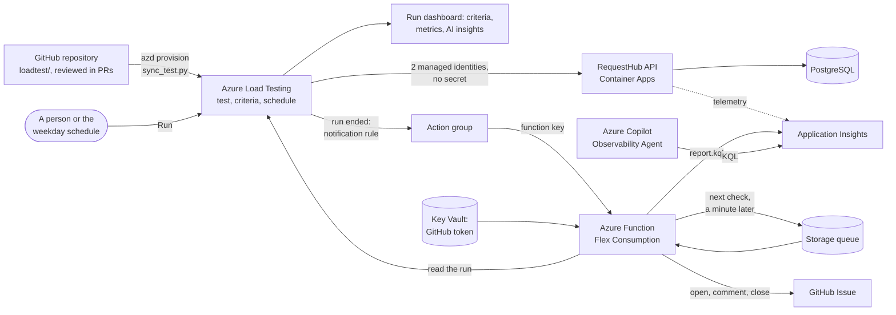
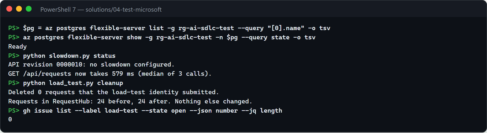
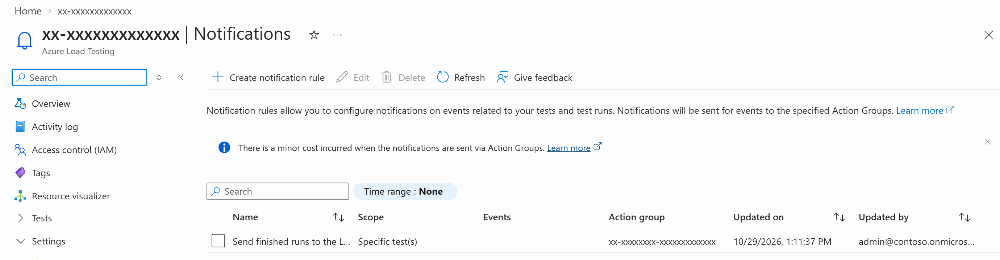
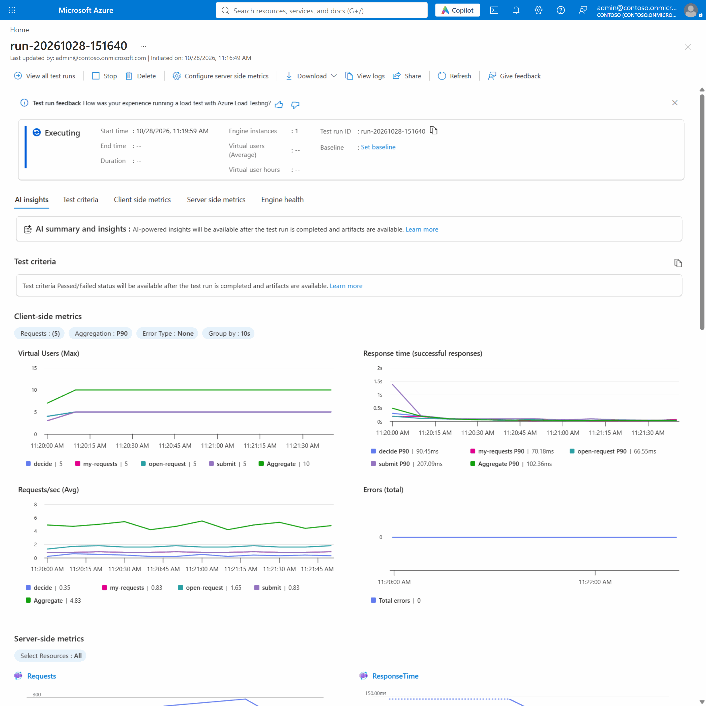
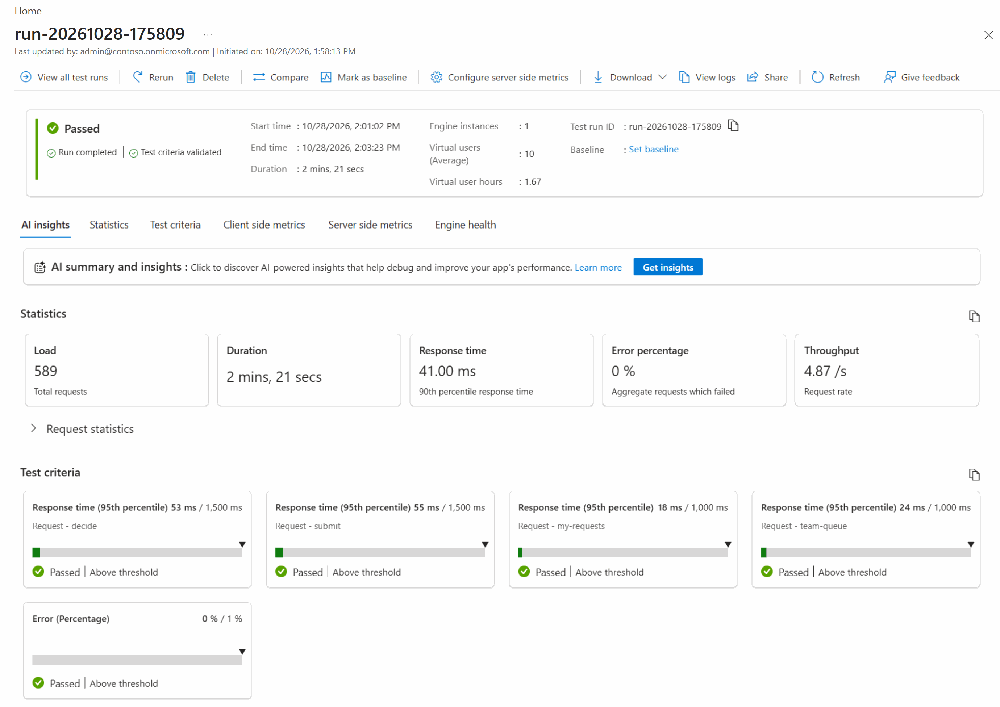
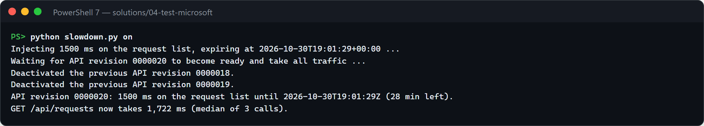
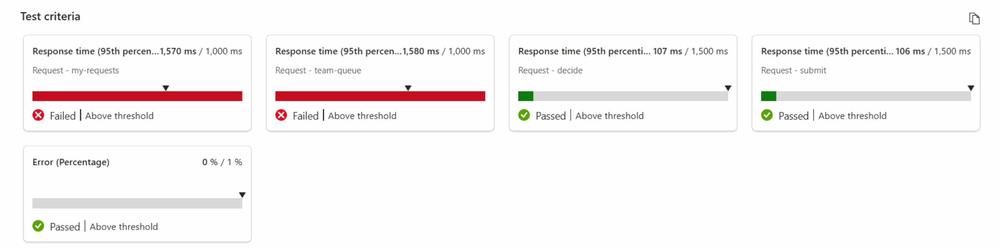
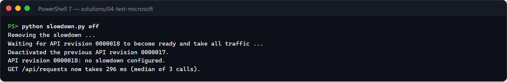

# Test · Performance lab with Azure Load Testing

Most teams find out how their app behaves under load in production: a realistic load test is hard to set up, needs credentials, and produces charts nobody turns into a decision. This solution adds a performance gate to your repository's workflow. The load test lives in the repository, where people review changes to it, and Azure does the rest. Azure Load Testing runs your app's real user journey, signed in as managed identities, and judges each run against pass/fail criteria. A notification rule hands every finished run to a Python Azure Function, which writes the report, opens a GitHub Issue when a run fails, and closes it when a later run passes. Two AI tools in Azure help explain a failure: the run's AI insights, and the Azure Copilot Observability Agent, which answers questions about your API's telemetry. People check what the AI says and decide what a failure means.


- **[See it work](#see-it-work):** a real run on RequestHub, this repository's sample app. A 1.5-second slowdown failed the gate, Azure opened an Issue that proves the cause, and the run after the fix closed it.
- **[Add it to your repository](#add-it-to-your-repository):** about 20 minutes of one-time setup in Azure and GitHub, once the journey and its criteria describe your app.
- **[Try it first in a copy of this repository](#try-it-first-in-a-copy-of-this-repository):** about 30 minutes to set it up on RequestHub, then about 45 minutes for the steps of See it work: 27 and 46 minutes in a fresh setup we timed.

## Why it matters

**Phase 4 of 7: Test.** The GitHub counterpart is [04-test-github](../04-test-github/), where Copilot proves a functional fix with a regression test. This solution proves service-level behavior under load, with the AI and the orchestration in Azure. GitHub holds the code, the pull requests that change the test, and the Issues. To load-test the commit that its counterpart proved, on one change, use both as in the [Test solution combo](../../PRESENTING.md#test-copilot-proves-the-repair-azure-load-tests-the-same-commit).

| | Today | With this solution |
| --- | --- | --- |
| Performance evidence | Someone runs a load tool from a laptop before a big release, if at all. | Azure Load Testing runs the journey on demand from the portal, or on a weekday schedule. |
| Realism | Anonymous calls to a home page. | The real journey, signed in: in RequestHub, submit a request, list "my requests" and the team queue, open a request, approve or reject. |
| Credentials | A test account's password or a long-lived token in a pipeline secret. | Two managed identities the test engines borrow during a run. No secret exists. |
| The decision | Someone eyeballs a chart. | Pass/fail criteria (p95 per request, error rate) turn each run into Passed or Failed. |
| Follow-up | A message in chat. | Azure opens a GitHub Issue with the report; the next accepted run closes it. |
| Diagnosis | Load-tool numbers and app logs live in different places. | The run's dashboard shows client and server metrics side by side with an AI summary, the Observability Agent answers questions about the telemetry, and the report counts the requests that carried the injected delay. |
| Changing the test | A script on someone's laptop. | The journey and its criteria are files in the repository, reviewed in pull requests and applied with `azd provision`. |

**The value:** a slow endpoint is caught by a gate, explained with evidence, and tracked in an Issue that closes itself once a run proves the fix, without anyone watching a chart or holding a credential. In [See it work](#see-it-work):

- A 1.5-second slowdown on the request list failed the gate on the first run after it shipped: the two list requests missed their 1,000 ms limit at 1,580 and 1,570 ms, and every other criterion passed.
- Azure opened a GitHub Issue that proves the cause 11 minutes 42 seconds after the slowdown went live, and 15 seconds after Azure Load Testing's notification.
- The run after the fix passed, and the Issue closed itself 10 minutes 44 seconds after that run started.
- Asked a precise question, the Observability Agent gave numbers that matched our own queries exactly.

## How it works



- **Azure Load Testing** runs [`loadtest/locustfile.py`](loadtest/locustfile.py) on managed engines with the settings and criteria in [`loadtest/requesthub-journey.yaml`](loadtest/requesthub-journey.yaml). Its run dashboard shows client and server metrics side by side and an experimental **AI summary and insights**. The test has a weekday schedule, created paused, and a notification rule that sends every finished run to an action group.
- **Two managed identities** sign the virtual users in. Requesters submit synthetic requests; approvers, a different identity, decide some of them, because RequestHub never lets anyone decide their own request. Each run deletes the requests it submitted, so the seeded data is all that remains.
- **RequestHub** enforces the same roles and department access as for people. Every few journeys the test also checks that an invalid token gets 401 and a request from another department gets 403. The API marks every request it slows down on purpose with the telemetry property `requesthub.fault.queue_delay_ms`.
- **A Python Azure Function** ([`function/`](function/), Flex Consumption, in its own virtual network) handles every notification with its own managed identity. The action group calls its HTTP route with a function key, which every `azd provision` renews on both sides together. The route reads the run from Azure Load Testing (Load Test Reader), accepts it only if it belongs to this test and ended in the last hour, so a replay or a forged call never posts, and answers at once. The function then waits without holding anything open: a check that finds no verdict yet, or Application Insights still without the run's last requests, queues the next check a minute later. When both are in, it runs [`report.kql`](function/reporter/report.kql) on the API's telemetry (Log Analytics Reader) for the report and its verdict, and posts through GitHub's Issues API, one report at a time. It opens this test's Issue or comments on it, and closes it only when a run that started after the Issue opened passes and the report finds no injected delay. The report names the run and the API revision that served it, from the telemetry. A candidate run, which [`candidate.py`](candidate.py) starts against a commit it deployed as its own revision, also names the commit, and the function comments its report on the GitHub Issue that the run names, passed or failed. Its GitHub token, a fine-grained token a person created for this repository only, is a Key Vault secret that only the function's identity can read. Every decision is plain Python with unit tests ([`test_reporter.py`](test_reporter.py)), which azd runs before every deploy.
- **The Azure Copilot Observability Agent**, in Application Insights › Logs, answers questions about the API's telemetry in plain language and runs the KQL itself.
- **GitHub** holds the code, the pull requests that change the test, and the Issues. No workflow, Copilot agent, or skill is involved.
- **People** decide what a failure means, check what the AI says against the evidence, and decide whether a release ships.

**Outside contributions.** Nothing here listens to GitHub. Azure Load Testing's action group calls the function, which acts only on its own Issue: open, labeled `load-test` (a label only people with triage access can apply), titled with the test's id, and opened by the owner, a member, or a collaborator. It reads its hidden run markers only in that Issue's body and in comments from those people, so an outsider's comment can't make a run look already reported. The one other place it posts is the Issue that a candidate run's description names: only people who may start load tests write that description, and the function comments only on an open Issue, never a pull request, that the owner, a member, or a collaborator opened. On a public repository, nobody outside it can start a test run or get a run reported, nobody outside it can stop a report, and the function never comments on or closes an Issue they open. `test_reporter.py` covers these checks.

## See it work

On 31 October 2026, from 04:18 to 05:00 UTC, the solution ran once, end to end, against the real services in resource group `rg-ai-sdlc-test` (Central US), on RequestHub, this repository's sample app. The operator was a GitHub Copilot agent session working for the repository owner: it ran each command in PowerShell 7 and asked the Observability Agent's questions in the portal, signed in to Azure and GitHub as the owner. Azure Load Testing, the function, and GitHub did the rest. The test was [`loadtest/`](loadtest/) as of commit [49e9cf0](https://github.com/melabadi/adept-assessment-northstars/commit/29a6873), unchanged since, and the function ran an early version of pull request [#229](https://github.com/melabadi/adept-assessment-northstars/pull/229) ([the code that ran](evidence/2026-10-31-recorded-run.md#the-code-that-ran)).

Every step links evidence that opens without signing in: Issue [#215](https://github.com/melabadi/adept-assessment-northstars/issues/215), where the function posted both reports, and [what Azure recorded](evidence/2026-10-31-recorded-run.md), exported from the run records, the function's log, and the API's telemetry. Times are UTC. The portal screenshots show the operator's local time, UTC−4: 12:22 AM is 04:22.

**The starting state, at 04:18:48.** The database was `Ready`, API revision `0000021` served the request list in 215 ms without a slowdown, no `load-test` Issue was open, and the weekday schedule was paused.



Evidence: [the terminal](evidence/2026-10-31-recorded-run.md#the-terminal).

### 1. The test came from the repository

*Done before the run, by `azd provision`.*

The test is two files: [`loadtest/requesthub-journey.yaml`](loadtest/requesthub-journey.yaml) and [`loadtest/locustfile.py`](loadtest/locustfile.py). They describe 10 virtual users for 2 minutes, one journey per user every 6 seconds, and five criteria, for example *team queue p95 above 1,000 ms fails the run*. The hook of `azd provision` checks them against the guardrails in [`sync_test.py`](sync_test.py) and copies them into Azure Load Testing as the test `requesthub-journey`, with a weekday schedule, paused, and a notification rule that sends every finished run to the function. Nobody configured the test in the portal. This screenshot was taken at the end of the run, so it already lists its three test runs.




Evidence: the two files in the repository, unchanged since commit [49e9cf0](https://github.com/melabadi/adept-assessment-northstars/commit/29a6873). Each run's record carries the same 10 virtual users and five criteria ([the test runs](evidence/2026-10-31-recorded-run.md#the-test-runs)).

**What this shows:** the test is code in the repository, reviewed like any change, and Azure runs, judges, and reports it without a pipeline to maintain.

### 2. The baseline ran

*04:19:09 to 04:24:03: the engine started in 2 minutes 51 seconds, then 2 minutes 3 seconds of load.*

The operator started the run `Baseline` from the terminal. Azure Load Testing started an engine, and from 04:22:00 to 04:24:03, 10 virtual users ran the journey, signed in as the two managed identities. The dashboard filled in every few seconds, with the API's server-side metrics below the client's.



Evidence: [the test runs](evidence/2026-10-31-recorded-run.md#the-test-runs).

**What this shows:** the engines signed in as two managed identities that exist only for the test, with no credential anywhere, and RequestHub checked their roles like anyone else's.

### 3. The baseline passed

*The verdict was in by 04:27:48, 8 minutes 39 seconds after the run started. The function's report followed 1 minute 59 seconds later.*

Azure Load Testing judged the run **Passed**, with all five criteria validated: 590 requests, a 29 ms 90th percentile, and no errors. Team-queue's 95th percentile, for example, was 22 ms against its 1,000 ms limit. At 04:29:33 the notification reached the function. Its report, at 04:29:47, accepted the run: 450 server requests, none with the injected delay. No Issue was open, so it posted nothing.



Evidence: [the test runs](evidence/2026-10-31-recorded-run.md#the-test-runs) and [the function's log](evidence/2026-10-31-recorded-run.md#the-functions-log).

**What this shows:** the criteria gave the verdict, not someone reading a chart, and a passing run made no noise.

### 4. A slowdown shipped

*1 minute 10 seconds, finished at 04:34:16.*

The operator ran `python slowdown.py on`. It set `Faults__QueueDelayMs=1500` and `Faults__ExpiresAtUtc` on the API, which rolled out revision `0000022` at 04:33:23, with 1,500 ms on the request list until 05:03:12. The script waited until the revision took all traffic, deactivated the previous one, and timed the request list from the operator's machine: 1,727 ms, up from 215 ms. That time includes a network round trip, so the jump matters, not the absolute number.



Evidence: [API revisions](evidence/2026-10-31-recorded-run.md#api-revisions) and [the terminal](evidence/2026-10-31-recorded-run.md#the-terminal).

**What this shows:** the injected slowdown switches itself off when it expires, so an interrupted test can't leave the API slow.

### 5. The gate failed

*04:34:45 to 04:42:03: the run was done, and had failed, 7 minutes 18 seconds after it started.*

The operator started `After the slowdown` 29 seconds after the slowdown went live. From 04:37:40 to 04:39:46 the same 10 users ran the same journey. The run **Failed**: my-requests at 1,580 ms and team-queue at 1,570 ms missed their 1,000 ms limit at the 95th percentile, while decide (106 ms), submit (171 ms), and the error rate (0 percent) passed.



Below the criteria, the dashboard showed the client and the server side by side: the list requests at about 1.5 seconds throughout, the rest of the journey fast, and the server far from its limits. The 10 failed server requests were the journey's deliberate checks that a requester can't open another department's request.


Evidence: [the test runs](evidence/2026-10-31-recorded-run.md#the-test-runs) and [the API's telemetry](evidence/2026-10-31-recorded-run.md#the-apis-telemetry), which lists the failed server requests.

**What this shows:** the criteria isolated the regression to the two list requests while the rest of the journey stayed fast.

### 6. Azure told the team

*15 seconds from Azure's notification at 04:45:43 to the Issue at 04:45:58: 11 minutes 42 seconds after the slowdown went live.*

At 04:45:43, 3 minutes 40 seconds after the run was done, Azure Load Testing's notification rule called the action group, which called the function. The function checked that the run belonged to this test and had just ended, queued it, and answered. Its queued step found the verdict, and the run's last requests in Application Insights, on its first check at 04:45:55. It built the report from the run and the API's telemetry: 150 server requests had carried the injected delay, so the verdict was an expected failure. No Issue was open for this test, so it opened [#215](https://github.com/melabadi/adept-assessment-northstars/issues/215). The report counts fewer list requests on the server than on the client (150 against 198), because Application Insights keeps only a sample of requests under load, and it says so. It names the run and the resource group, never a host name or a GUID.


![Issue #215, which the function opened: [load-test requesthub-journey] RequestHub journey missed its performance criteria, open, with the load-test label. Its report: After the slowdown FAILED with 10 virtual users for 126 s; Expected failure, because 150 server requests carried requesthub.fault.queue_delay_ms; my-requests at 1,580 ms and team-queue at 1,570 ms failed their 1,000 ms limit, while the error rate, decide, and submit passed](images/06-issue-opened.png)

Evidence: Issue [#215](https://github.com/melabadi/adept-assessment-northstars/issues/215) and [the function's log](evidence/2026-10-31-recorded-run.md#the-functions-log).

**What this shows:** the report proved the cause from the API's own telemetry, where every server-side list request carried the injected delay, so the function labeled the run an expected failure, not an acceptance run.

### 7. AI explained, and the telemetry confirmed it

*04:42:34 to 04:48:01: three questions to the Observability Agent, the first asked while the notification was still on its way.*

The failed run's dashboard showed an experimental **AI summary and insights**, written from the run's client-side and server-side metrics. It blamed server-side bottlenecks in the App container and found the database efficient, which the server metrics in step 5 support. But it read the journey's deliberate 403 checks as a spike in failed requests, and its *5 VUs* counts the users per request: the run had 10.

![The After the slowdown run with its experimental AI summary: a 2 minute, 5 virtual user run that failed 2 criteria, with prolonged slow responses and server-side bottlenecks, including spikes in HTTP request duration and average response time for the App container. Its key insights: team-queue and my-requests consistently above 1,500 ms; the API's request duration rose to 508 ms with a spike in failed requests during the ramp-up; the database kept stable connections and low CPU, so it was not the bottleneck; and submit, open-request, and denied-invalid-token got faster as the load stabilized](images/05-failed-run.png)

At 04:42:34 the operator asked the Observability Agent, in Application Insights › Logs, a neutral question: *Why was GET /api/requests slow in the last 30 minutes?* It reasoned for 1.23 minutes and ran its own KQL. It ruled out failures, the database, and resource pressure, but didn't find the injected delay.

![The Observability Agent's answer to the neutral question, after 1.23 minutes: 326 GET /api/requests requests in the last 30 minutes, none failed, 725 ms on average, a 1.51 second 95th percentile, and 155 over 1 second. The slow requests succeeded; the slowest, 2.41 seconds, shows repeated received-first-response waits; the database wasn't failing; CPU and memory weren't under pressure. Its bottom line: application or response-wait latency rather than backend failures or host saturation, with a deeper investigation as the next step](images/07-agent-where.png)

At 04:44:53 the operator asked it to check the hypothesis. Asked about *GET /api/requests*, it checked `GET /api/requests/{id}` instead and found no request with the property. At 04:46:47, asked again with the operation named exactly, it answered in 0.37 minutes: 155 requests carried `requesthub.fault.queue_delay_ms` and averaged 1,518.1 ms, against 6.9 ms for the 171 without it, about 220 times slower.


Afterwards, our own KQL over the same telemetry and the same 30-minute windows gave exactly the agent's numbers. Its 155 delayed requests are the 150 in the report's window, the 4 timing calls from step 4, and 1 that started less than a second after the run's recorded end. Its 171 others are the Baseline's 167 and the 4 timing calls of the starting-state check.

Evidence: [the API's telemetry](evidence/2026-10-31-recorded-run.md#the-apis-telemetry), with each query and its result.

**What this shows:** AI found leads within minutes, but its answers needed checking against the telemetry, and the criteria and the report decided, not the AI.

### 8. The fix closed the Issue

*04:48:37 to 05:00:29: about 12 minutes from the fix rolling out to the Issue closing.*

The operator ran `python slowdown.py off`, which rolled out revision `0000023` without the slowdown at 04:48:37; the request list took 296 ms. At 04:49:44 the operator started `After the fix`, which passed by 04:58:36, 8 minutes 51 seconds later: my-requests at 74 ms and team-queue at 73 ms, decide at 130 ms and submit at 256 ms, and no errors. At 05:00:17 the notification reached the function. Its report found no injected delay among 447 server requests, so it commented the passing report on #215 at 05:00:28 and closed the Issue at 05:00:29, 14 minutes 31 seconds after opening it. A run that passes while the slowdown is still on, or a replay of an older run, leaves the Issue open.




Evidence: [the closing comment](https://github.com/melabadi/adept-assessment-northstars/issues/215#issuecomment-6539313428), [the test runs](evidence/2026-10-31-recorded-run.md#the-test-runs), and [the function's log](evidence/2026-10-31-recorded-run.md#the-functions-log).

**What this shows:** nobody had to remember to follow up, because the Issue opened on the failure and closed itself on the next accepted run.

## Results and value

**What the run left behind.**

- Issue [#215](https://github.com/melabadi/adept-assessment-northstars/issues/215), which Azure opened and closed: the failing run's report, which proves the cause, and the passing run's report, which closed it as completed.
- Three runs in Azure Load Testing, two passed and one failed, kept as history with their criteria, metrics, and AI summary.
- [The evidence](evidence/2026-10-31-recorded-run.md) behind every number in [See it work](#see-it-work) and in these results: the run records, the function's log, the API revisions, and the telemetry queries.
- The decision, left to people: what a failure means, and whether the change ships. Here the slowdown was a test of the gate, so the decision was to remove it. The Issue closed on the next run's evidence, not on anyone's word.

**What was measured.**

| | In See it work |
| --- | --- |
| The list requests' 95th percentile (my-requests, team-queue) | 14 and 22 ms at the baseline, 1,580 and 1,570 ms with the slowdown, 74 and 73 ms after the fix |
| From the slowdown going live to the Issue that proves the cause | 11 minutes 42 seconds |
| From Azure's notification to the Issue | 15 seconds |
| From the start of the run after the fix to the Issue closing | 10 minutes 44 seconds |
| How long the Issue stayed open | 14 minutes 31 seconds |
| The whole sequence, from the starting-state check to the closed Issue | 41 minutes 41 seconds |
| The Observability Agent's numbers, checked with our own KQL | all equal, once the question named the operation exactly |

**What a team gets.**

- **Time saved.** Nobody runs a load tool, reads a chart to reach a verdict, or writes the follow-up. The criteria give the verdict, and the Issue opens and closes on its own, here 15 and about 12 seconds after Azure's notifications.
- **Risk removed.** A 1.5-second slowdown on one endpoint failed the gate on the first run after it shipped, before users would have met it. No password or token exists for the test to leak. The function's identity can only read test runs, the API's telemetry, and one Key Vault secret; its GitHub token reaches one repository's Issues, and only Key Vault holds it.
- **Evidence a reviewer or an auditor can follow.** The criteria are code, reviewed in pull requests. The Issue holds both reports and names the runs, and the runs stay in Azure Load Testing with their criteria and metrics.

**The metric to track when you adopt it:** performance regressions caught before release, and the time from a regression going live to the Issue that names it (11 minutes 42 seconds in See it work). Compare both with how such regressions surfaced before. A target is a goal you set, never a result.

## Add it to your repository

These are the steps that set the solution up on RequestHub, with what to change for your app. We have run them only on RequestHub: for your app, the commands stay the same, and the changes are the ones named below. Point your first runs at a test environment of your app, not at production.

### Prerequisites

- Your repository on GitHub, and the tools in the root README's [Before you start](../../README.md#before-you-start): the GitHub CLI, Python 3.12 or later, PowerShell 7, the Azure CLI, and the Azure Developer CLI.
- The Azure CLI's `load` extension, in preview (tested with 2.1.0), which step 1 of the setup installs.
- Your app's API, deployed in Azure, with:
  - Microsoft Entra ID sign-in with app roles: the journey signs in as managed identities that hold those roles. If your API signs in another way, change the sign-in in the locustfile.
  - Application Insights on a Log Analytics workspace, which the report queries.
  - A way for the test to delete what it creates, so each run leaves your data as it found it.
- An Azure subscription where you can create resource groups and role assignments, for example as Owner, in a region that offers Azure Load Testing, Azure Functions Flex Consumption, and the Observability Agent (we used `centralus`).
- A Microsoft Entra role that may assign your API's app roles to the test's identities, for example Cloud Application Administrator or Application Administrator: Bicep makes those assignments through Microsoft Graph.
- Access to Azure Copilot in your tenant, for the Observability Agent.

### What to copy and what to change

Copy this folder into your repository, for example as `perf/`, without `slowdown.py`, `candidate.py`, `test_candidate.py`, `evidence/`, and `images/`, which belong to RequestHub and to the run in [See it work](#see-it-work). Then change these files:

| File | What it does here | What to change for your app |
| --- | --- | --- |
| [`loadtest/locustfile.py`](loadtest/locustfile.py) | RequestHub's journey: requester and approver virtual users, their sign-in, and the cleanup | The requests your users make, each with a `name=`, which the criteria refer to. Keep the managed-identity sign-in (`managed_identity_token`). Replace the cleanup, which calls RequestHub's `POST /api/admin/load-test/cleanup`, with your own way to delete what the test created. |
| [`loadtest/requesthub-journey.yaml`](loadtest/requesthub-journey.yaml) | The test's id, workload, settings, and pass/fail criteria | Rename the file and its `testId`. Set the criteria from what your users need (a service level objective), not from what the first run measured. |
| [`sync_test.py`](sync_test.py) | Checks the scenario against guardrails, then copies it into Azure Load Testing with the deployment's values | `TEMPLATE`, the YAML's name. The guardrails: `REQUIRED_P95`, the requests every run must judge (RequestHub's `team-queue`, `submit`, and `decide`), and `LIMITS`. In `render_config()`, the settings the journey reads, and `appComponents`, the resources whose metrics the dashboard shows next to the client's (RequestHub's container app, Application Insights, and PostgreSQL). |
| [`infra/main.bicep`](infra/main.bicep) and [`main.parameters.json`](infra/main.parameters.json) | Deploys RequestHub's platform, the test's identities, Azure Load Testing, and the reporting function | Remove RequestHub's platform (`module app`) and the outputs it fed. Pass your API's app registration client id to `loadTesting` (`apiClientId`), your test's id to `reporting` (`testId`, now `requesthub-journey`), and the Log Analytics workspace behind your API's Application Insights (`logAnalyticsName`), read from the azd environment as `githubRepository` is. |
| [`infra/loadtesting.bicep`](infra/loadtesting.bicep) | Azure Load Testing, and the identities' app roles on RequestHub's API | The app role values the identities get (`RequestHub.Requester` and `RequestHub.Approver`). |
| [`infra/reporting.bicep`](infra/reporting.bicep) | The function, its network, storage, Key Vault, roles, and action group | It reads two resources that RequestHub's platform created in the same resource group: the workspace, and the blob private DNS zone. Create the zone here, as it creates the queue and vault zones. If your workspace is in another resource group, scope its `existing` reference and its Log Analytics Reader assignment there. |
| [`azure.yaml`](azure.yaml) | The azd project | Remove the `api` and `worker` services, which deploy RequestHub, and `test_candidate` from the `predeploy` hook. |
| [`function/reporter/report.kql`](function/reporter/report.kql) | The API's requests during a run, from `AppRequests` | The route filter (`Name has '/api/'`) and the injected-delay property (`requesthub.fault.queue_delay_ms`): count what your app records for the change you want to prove, for example a feature flag or a deployment marker. `AppVersion` names a Container Apps revision; on other hosts, the report leaves its revision line out. |
| [`function/reporter/report.py`](function/reporter/report.py), [`issues.py`](function/reporter/issues.py), and [`test_reporter.py`](test_reporter.py) | The report's verdicts, the Issue's title, and their tests | The verdicts' wording, which names RequestHub's slowdown, and the Issue's title (`RequestHub journey missed its performance criteria`). Update their tests to match. |

To find the requests your users make, Azure Load Testing's **Record and create scripts** records a journey in your browser and uses AI to suggest correlations and parameters for a JMeter test ([quickstart](https://learn.microsoft.com/azure/app-testing/load-testing/quickstart-create-run-load-tests-from-recording)). This solution's guardrails take Locust, so write the requests you recorded into the locustfile. Before you open the pull request, `python sync_test.py check` runs the guardrails on your machine.

### One-time setup

About 20 minutes, once the files describe your app. On RequestHub, provisioning the function's resources took 6 minutes 39 seconds, deploying the function 25 seconds, and the provision that stores the GitHub token 5 minutes 45 seconds. A fresh setup on 11 November 2026, which followed [Try it first in a copy of this repository](#try-it-first-in-a-copy-of-this-repository) in a new resource group, deployed RequestHub too, which took most of the time ([the evidence](evidence/2026-11-11-fresh-setup.md)):

| Step | Took |
| --- | --- |
| 1. Deploy: `pip install -r requirements.txt` | 1 minute 25 seconds, in a new virtual environment |
| 1. Deploy: `azd up` | 17 minutes 29 seconds, RequestHub included: its Container Apps environment took 5 minutes 47 seconds and its PostgreSQL server 7 minutes 44 seconds |
| 3. Let Azure post to GitHub: the token | a few minutes for a person on GitHub |
| 3. Let Azure post to GitHub: `azd provision` | 6 minutes 31 seconds |

#### 1. Deploy

From the root of your repository, set the values that `sync_test.py` reads for your API, then deploy:

```powershell
cd perf
pip install -r requirements.txt
az extension add --name load --upgrade
az login
azd auth login
azd env new <environment name> --subscription (az account show --query id -o tsv) --location <region>
azd env set API_URL <your API's base URL>
azd env set API_IDENTIFIER_URI <your API's application ID URI>
azd up
```

Set the other values your `main.bicep` and `render_config()` read the same way, for example your API's app registration client id and the names of its resources.

`--subscription` deploys to the subscription that `az` signed in to, where `sync_test.py`, `slowdown.py`, and the commands below look for the resources: `az account show` names it, and `az account set --subscription <name or id>` changes it. Without it, `azd up` asks you to pick one of your subscriptions. Run azd in the shell where `pip install` ran, with the same virtual environment active if you use one: its hooks run that `python`.

**What you should see:** before provisioning, azd records the repository where the function opens its Issues, from your clone's `origin` remote: `GITHUB_REPOSITORY: <owner>/<repository> (from the origin remote)`. After provisioning, `python sync_test.py setup` prints `PASS` for the guardrails, then creates the test, the notification rule, and the weekday schedule, paused, as in [What azd up creates](#what-azd-up-creates). A guardrail that fails stops the hook before anything reaches Azure Load Testing. azd then runs the function's unit tests, which end with `OK`, deploys the function, and ends with `SUCCESS`.

#### 2. Let your API accept the test's identities

`azd up` created two managed identities and gave them your API's app roles. Check the assignments, and get the identities' client ids:

```powershell
$sp = az ad sp show --id <your API's app registration client id> --query id -o tsv
az rest --method get --url "https://graph.microsoft.com/v1.0/servicePrincipals/$sp/appRoleAssignedTo" --query "value[?principalType=='ServicePrincipal'].principalDisplayName" -o tsv
azd env get-value LOAD_TEST_CLIENT_IDS
```

**What you should see:** the two identities, `id-lt-approver-*` and `id-lt-requester-*`, then their client ids, separated by a comma. Add both client ids to the client applications your API accepts tokens from, as RequestHub does in its Container Apps authentication ([`app/infra/api.bicep`](../../app/infra/api.bicep), `allowedApplications`), and let the requester identity delete what it creates.

#### 3. Let Azure post to GitHub

The function posts with a token that a person creates, for your repository only:

1. On GitHub, open **Settings › Developer settings › Personal access tokens › Fine-grained tokens › Generate new token**. Set the expiration (for example 90 days), the resource owner that owns the repository, **Repository access: Only select repositories** with that repository, and **Repository permissions › Issues: Read and write**. GitHub adds Metadata: Read-only on its own. Nothing else.
2. In the folder you copied:

   ```powershell
   azd env set GITHUB_ISSUES_TOKEN (Read-Host -MaskInput 'GitHub token')
   azd provision
   ```

**What you should see:** `azd provision` ends with `SUCCESS`. It writes the token into the solution's Key Vault as the secret `github-token`, through Azure Resource Manager. The vault has no public network access, no app setting or deployment output carries the token, and only the function's identity can read it, through the vault's private endpoint. Issues it opens show you as the author, and their text says that Azure wrote them. Use a person's token, as here, not a GitHub App's: the function trusts only Issues and comments from the owner, members, and collaborators, and GitHub reports a bot as none of them. Until a token is set, the function still builds every report, and its log says *No GitHub token configured*. To replace the token, run the same two commands; the next report reads the new secret.

### Use it the first time

Run the test once against your API:

```powershell
$lt = azd env get-value LOAD_TEST_NAME
$rg = azd env get-value AZURE_RESOURCE_GROUP
az load test-run create --load-test-resource $lt -g $rg --test-id <your test id> `
  --test-run-id "first-$(Get-Date -Format yyyyMMdd-HHmmss)" --display-name "First run" --no-wait
```

**What you should see:** in the Azure portal, open your resource group › the Load Testing resource › **Tests** › your test › the run. The engine starts, the client-side metrics fill in, then the verdict appears. On RequestHub, a 2-minute run reached its verdict 7 to 9 minutes after it started, and the function reported it 2 to 4 minutes after that. A passing run with no Issue open posts nothing: open the function app › **Overview** › `report_run` › **Invocations** to read its report. A failing run opens an Issue titled `[load-test <your test id>]`, with the `load-test` label.

Then make it part of your workflow:

- **Run it every weekday.** Enable the schedule that the setup created, so the journey runs every weekday evening and the function reports every result: `az load trigger schedule enable --load-test-resource $lt -g $rg --trigger-id weekday-evenings`. Only enable it while the environment stays up: Azure Load Testing disables a schedule after three consecutive failed runs. Pause it again with `az load trigger schedule pause`.
- **Change the journey in a pull request.** Try a change on your machine before it costs a cloud run: `python sync_test.py check`, then `locust -f loadtest/locustfile.py --headless -u 4 -r 2 -t 1m -H <a local instance of your API>`. The locustfile's local sign-in (`RH_AUTH=persona`) is RequestHub's development sign-in, so give it your API's. When the change merges, run `azd provision` (about 6 minutes) or only `python sync_test.py setup` (about a minute) to apply it. A change that breaks a guardrail stops there and never reaches Azure.
- **Keep the evidence of a run you want to show.** Export the run records, the function's log, and the queries behind your numbers with only the fields you need, as [`evidence/`](evidence/) does here, and check the export for host names, GUIDs, and e-mail addresses before you commit it. Application Insights keeps the telemetry only as long as your workspace's retention.

### What it costs

Your app bills as it already does. While deployed, the solution adds about $0.75 a day for the reporting function's three private endpoints and their DNS zones, and about $0.25 per short test run: Azure Load Testing bills at least 10 virtual users per engine for 10 minutes per run, so a 2-minute run like RequestHub's bills 1.67 virtual user hours. The function runs on demand, a few seconds per run, within Flex Consumption's monthly free grant; Key Vault and the action group add a few cents a month. Since 1 July 2026, the Observability Agent bills the work of each question in Azure Agent Credits, at $0.01 a credit; a chat question is its lowest-cost use ([its billing](https://learn.microsoft.com/azure/azure-monitor/aiops/observability-agent-billing)). The root README compares [what the Microsoft solutions cost](../../README.md#what-the-microsoft-solutions-cost).

## Try it first in a copy of this repository

Optional: the same solution on RequestHub, before you adapt anything. It needs the [prerequisites](#prerequisites), with RequestHub in place of your app, a region that also offers PostgreSQL Flexible Server, and permission to create Microsoft Entra app registrations: RequestHub signs in with its own. For a local run of the journey, you also need the [.NET 10 SDK](https://dotnet.microsoft.com/download) and PostgreSQL (see [`app/README.md`](../../app/README.md#run-it-locally)). In the copy, the other solutions' workflows also see this one's Issue: in our fresh setup, the Issue that step 6 opened started *Operate · GitHub · agentic incident triage*, which skipped every job, and the comment that closed it started *Design · GitHub · agentic design review*, which stopped after a 15-second check. No model ran.

### Quick start

From the root of your copy of the repository, which the root README's [Try it in a copy of this repository](../../README.md#try-it-in-a-copy-of-this-repository) makes once for every solution:

```powershell
cd solutions/04-test-microsoft
pip install -r requirements.txt
az extension add --name load --upgrade
az login
azd auth login
azd env new ai-sdlc-test --subscription (az account show --query id -o tsv) --location centralus
azd up
```

Then create a GitHub token for your copy, as in [Let Azure post to GitHub](#3-let-azure-post-to-github), and give it to Azure:

```powershell
azd env set GITHUB_ISSUES_TOKEN (Read-Host -MaskInput 'GitHub token')
azd provision
```

Allow about 30 minutes in all. In a fresh setup on 11 November 2026, `azd up` took 17 minutes 29 seconds and the second `azd provision` 6 minutes 31 seconds: 27 minutes 29 seconds from `pip install` to the end of that provision, with the token created meanwhile ([the evidence](evidence/2026-11-11-fresh-setup.md#timeline)). To check the result, follow [Check the starting state](#check-the-starting-state).

While deployed, the copy's resource group costs about $2 to $3 a day (Container Apps, PostgreSQL Burstable, Container Registry Basic, Log Analytics, and the reporting function's private endpoints, as in [What it costs](#what-it-costs)), plus about $0.25 per test run.

### What azd up creates

`azd up` ends with `SUCCESS`. It creates resource group `rg-ai-sdlc-test` with:

- **RequestHub's platform** from [`app/infra/requesthub.bicep`](../../app/infra/requesthub.bicep) and **the app** (API with web UI, and the notification worker), built in the registry, so Docker is not needed. You get every RequestHub role. Each subnet of RequestHub's virtual network has a network security group with Azure's default rules; a deployment from before 12 November 2026 gets them at its next `azd provision` ([what that changes](../../app/README.md#deploy-it-to-azure)).
- **Azure Load Testing** with two managed identities: `id-lt-requester-*` (RequestHub Requester) and `id-lt-approver-*` (RequestHub Approver). You get **Load Test Contributor**; the Load Testing resource reads the app's metrics for its dashboard.
- **The reporting path**: an action group, and a Python Azure Function (Flex Consumption) in its own virtual network, with private endpoints to its storage and to the Key Vault that holds the GitHub token. Its identity may read test runs, the API's telemetry, and that one secret. azd runs the function's unit tests before it deploys the function. Like RequestHub's, the function's network has a network security group with Azure's default rules on each subnet, and a deployment from before 12 November 2026 gets them at its next `azd provision` in the same way ([what that changes](../../app/README.md#deploy-it-to-azure)).

Its postprovision hook, `python sync_test.py setup`, checks the scenario against the guardrails in [`sync_test.py`](sync_test.py) and copies it into Azure Load Testing. It prints:

```text
PASS loadtest/requesthub-journey.yaml: criteria name real requests, thresholds and workload within guardrails, ...
Test 'requesthub-journey': created from loadtest/ (rendered to out/loadtest.yaml).
Notification rule 'runs-to-github': created; every finished run goes to the reporting function, which reports it to GitHub.
Schedule 'weekday-evenings': created for weekdays at 22:00 UTC, and paused. ...
```

### Check the starting state

About 5 minutes, from `solutions/04-test-microsoft`, before each run of the steps below; the commands took 27 seconds in a fresh setup. You should see what [See it work](#see-it-work) shows as its starting state.

```powershell
azd env select ai-sdlc-test
$pg = az postgres flexible-server list -g rg-ai-sdlc-test --query "[0].name" -o tsv
az postgres flexible-server show -g rg-ai-sdlc-test -n $pg --query state -o tsv   # Ready
python slowdown.py status                                                       # no slowdown configured
gh issue list --label load-test --state open --json number --jq length          # 0
$lt = azd env get-value LOAD_TEST_NAME
az load trigger schedule show --load-test-resource $lt -g rg-ai-sdlc-test --trigger-id weekday-evenings --query state -o tsv   # Paused
```

- **The database is not `Ready`:** start it with `az postgres flexible-server start -g rg-ai-sdlc-test -n $pg`, which takes 3 to 5 minutes. A tenant policy can stop the server on a schedule, and the API then fails its readiness probe.
- **A slowdown is configured:** run `python slowdown.py off` (1 to 3 minutes).
- **The API revision's name starts with `c`** (in the `slowdown.py status` line): a commit from [Optional: load-test one commit](#optional-load-test-one-commit) still serves the traffic. Run `python candidate.py restore` (about a minute).
- **A `load-test` Issue is open:** close it with `gh issue close <number>`, so step 6 opens a fresh one.
- **The token:** in the portal, open the function app (resource group `rg-ai-sdlc-test` › the Function App › **Overview** › `report_run` › **Invocations**). If its newest invocation failed with GitHub 401, the token expired or was revoked: create a new one (see [Let Azure post to GitHub](#3-let-azure-post-to-github)).

### How long each step takes

A run reaches its verdict 7 to 9 minutes after you start it: about 3 to start the engine, 2 of load, and 2 to 4 to compute the results. The function reports it 2 to 4 minutes later.

| Step | Takes | In See it work | In the fresh setup |
| --- | --- | --- | --- |
| 2. Baseline run | 7 to 9 minutes to the verdict | 8 minutes 39 seconds | 8 minutes 26 seconds |
| 4. Slowdown on | 1 to 3 minutes, while a new API revision rolls out | 1 minute 10 seconds | 1 minute 12 seconds |
| 5. Run again | 7 to 9 minutes to the verdict | 7 minutes 18 seconds | 8 minutes 42 seconds |
| 6. Issue opens | 2 to 4 minutes after the verdict | 3 minutes 55 seconds | 2 minutes 17 seconds |
| 7. AI explains | about 5 minutes, about a minute per question | 5 minutes 27 seconds for three questions | the AI insights within 3 minutes of the verdict, without a click; two questions, answered after 1.72 and 0.42 minutes |
| 8. Fix and confirm | about 12 minutes: the revision, the run, and the report | about 12 minutes | 11 minutes 49 seconds |

All eight steps take about 45 minutes: 41 minutes 41 seconds in See it work, and 46 minutes 11 seconds in a fresh setup on 11 November 2026, both from the starting-state check to the closed Issue ([the evidence](evidence/2026-11-11-fresh-setup.md#the-run)).

### 1. Open the test in Azure

*About 2 minutes. What you should see: [See it work, step 1](#1-the-test-came-from-the-repository).*

In the Azure portal, open resource group `rg-ai-sdlc-test` › the Load Testing resource › **Tests** › `requesthub-journey`: the Locust journey from the repository, its schedule (weekdays, paused), and every run so far. Then open **Settings › Notifications**: one rule sends every finished run of the test to an action group, which calls the reporting function. In your editor, open [`loadtest/requesthub-journey.yaml`](loadtest/requesthub-journey.yaml): 10 users, 2 minutes, one journey per user every 6 seconds, and five criteria.

### 2. Run the baseline

*7 to 9 minutes to the verdict. What you should see: [See it work, step 2](#2-the-baseline-ran).*

On the test page, select **Run**, then **Run** on the confirmation pane. Or, from the terminal, give the run a name:

```powershell
$lt = azd env get-value LOAD_TEST_NAME
az load test-run create --load-test-resource $lt -g rg-ai-sdlc-test --test-id requesthub-journey `
  --test-run-id "baseline-$(Get-Date -Format yyyyMMdd-HHmmss)" --display-name "Baseline" --no-wait
```

Open the run from the test page. Its engine starts in about 3 minutes, then the client-side metrics fill in every few seconds, with the API's server-side metrics below them.

### 3. Read the baseline

*About 1 minute. What you should see: [See it work, step 3](#3-the-baseline-passed).*

When the run completes, the dashboard shows the verdict: **Passed**, every criterion validated. About 2 minutes later the function reports the run too. With no Issue open, a passing run posts nothing.

### 4. Ship a slowdown

*1 to 3 minutes. What you should see: [See it work, step 4](#4-a-slowdown-shipped).*

```powershell
python slowdown.py on
```

This sets `Faults__QueueDelayMs=1500` and `Faults__ExpiresAtUtc` (30 minutes ahead) on the API, which rolls out a new revision. The script waits until the revision takes all traffic, calls the request list once to warm it up, then times three more calls from your machine.

### 5. Run again: the gate fails

*7 to 9 minutes to the verdict. What you should see: [See it work, step 5](#5-the-gate-failed).*

```powershell
az load test-run create --load-test-resource $lt -g rg-ai-sdlc-test --test-id requesthub-journey `
  --test-run-id "slowdown-$(Get-Date -Format yyyyMMdd-HHmmss)" --display-name "After the slowdown" --no-wait
```

The run completes with **Failed**: the two list requests miss their criteria, and submit, decide, and the error rate pass. Scroll down for the client-side and server-side metrics of the same window.

### 6. Azure tells the team

*2 to 4 minutes after the verdict. What you should see: [See it work, step 6](#6-azure-told-the-team).*

Open the function app (resource group `rg-ai-sdlc-test` › the Function App › **Overview** › `report_run` › **Invocations**) and select the newest invocation, then the Issue it opened:

```powershell
gh issue list --label load-test --state open
```

Today's report also names the run's id and the API revision that served it; both were added after the run in See it work.

### 7. AI explains, people verify

*About 5 minutes. What you should see: [See it work, step 7](#7-ai-explained-and-the-telemetry-confirmed-it).*

Open the failed run's dashboard. For a failed run, the **AI summary and insights** usually appear on their own a minute or two after the verdict; if you see **Get insights**, select it. Then open the Application Insights resource › **Logs**, with the **Agent** toggle on, and ask the Observability Agent a neutral question:

> Why was GET /api/requests slow in the last 30 minutes?

Its answers vary from run to run: in our runs, the same question found the property, blamed a burst of load, leaned toward the database, or, in See it work, ruled out the usual suspects without naming the cause. Whatever the answer, ask it to check the hypothesis, and name the operation exactly. Without the words in parentheses, the agent in See it work checked the wrong operation:

> In the last 30 minutes, how many requests named exactly GET /api/requests (the list, not GET /api/requests/{id}) carried the custom dimension requesthub.fault.queue_delay_ms, and how did their duration compare with the GET /api/requests requests that did not?

Select **Reasoned for** to see the queries it ran. To check its numbers, run the queries in [See it work's evidence](evidence/2026-10-31-recorded-run.md#the-apis-telemetry) with your own time window.

### 8. Fix and confirm

*About 12 minutes: 1 to 3 for the revision, 7 to 9 for the run, and 2 to 4 for the Issue to close. What you should see: [See it work, step 8](#8-the-fix-closed-the-issue).*

```powershell
python slowdown.py off
az load test-run create --load-test-resource $lt -g rg-ai-sdlc-test --test-id requesthub-journey `
  --test-run-id "fix-$(Get-Date -Format yyyyMMdd-HHmmss)" --display-name "After the fix" --no-wait
```

The run passes, and the report finds no injected delay. The function comments on the Issue with the passing report and closes it.

### Optional: compare two runs

On the test page, select the Baseline run and the failed run, then **Compare**: the dashboard overlays their client-side metrics.

### Optional: load-test one commit

*About 15 minutes: about 4 to build and deploy the commit, 8 to 9 to the verdict, and about 2 for the report.*

When a commit has already passed another check, for example a repair that [04-test-github](../04-test-github/) proves test-first, load-test that exact commit before anyone accepts it. [`candidate.py`](candidate.py) builds the commit's API image in the registry, with the commit baked in, deploys it as an API revision named after the commit, and starts a run that names both:

```powershell
$sha = gh pr view <pr> --json headRefOid -q .headRefOid   # or the full SHA of a commit on one of this repository's branches
python candidate.py deploy $sha
python candidate.py run --issue <issue>                   # the GitHub Issue that the commit fixes
```

`deploy` first checks that the commit is on a branch of this repository, and refuses it otherwise: GitHub also serves a fork's pull request commits through this repository, and a fork's code never reaches Azure. It then exports the commit's `app/` folder with `git archive`, builds `requesthub-api:<sha>` in Azure Container Registry (2 minutes 9 seconds in our run), deploys it as revision `c` plus the first 7 characters of the SHA, waits until that revision serves all traffic, deactivates the others, and checks that `/api/meta` reports the commit. `run` starts the journey as `candidate-<7 characters>-<time>`, with the description `Commit <sha> on API revision c<7 characters> for Issue #<issue>`.

The function's report names the run, the commit, and the revision, and checks the revision against the API's telemetry: *Every server request in the run's window came from that revision.* So one commit, one revision, and one run carry the same name, and the API's own telemetry confirms which revision served the load. A failing run still opens or comments on this test's Issue, as in step 6. Passed or failed, the function also comments its report on the Issue that the run names. Leave out `--issue` to report only as in steps 6 and 8. The [Test solution combo](../../PRESENTING.md#test-copilot-proves-the-repair-azure-load-tests-the-same-commit) shows an example.

When you're done, put the API back on its normal image: `python candidate.py restore` (about a minute).

### Optional: change the journey on your machine

The same locustfile runs locally against a RequestHub with development sign-in, where personas replace the managed identities. Use it to try a change before it costs a cloud run. From the repository root, with PostgreSQL running:

```powershell
$env:Demo__LoadTestRequesterIds = "u-ben"      # lets the requester persona clean up its own requests
dotnet run --project app/src/RequestHub.Api    # http://localhost:5080; leave it running
```

In a second terminal:

```powershell
cd solutions/04-test-microsoft
python sync_test.py check
locust -f loadtest/locustfile.py --headless -u 4 -r 2 -t 1m -H http://localhost:5080
```

Expect `PASS` from the check, `Cleanup: deleted ... requests owned by u-ben`, and a results table with no failures. Then open a pull request; after it merges, `azd provision` applies the change in Azure.

### Reset the copy for another run

Make sure the slowdown is off, the API runs its normal image, and no Issue is left open:

```powershell
python slowdown.py status     # "no slowdown configured", or run: python slowdown.py off
python candidate.py restore   # "Nothing to restore", or it puts the normal image back after a candidate
gh issue list --label load-test --state open
```

Each run deletes the requests it submitted, before and after the load, so the 24 seeded requests are all that remains. Test runs stay in Azure Load Testing as history; the next run doesn't need them removed.

## Clean up

When you no longer need the solution, revoke its GitHub token (**Settings › Developer settings › Fine-grained tokens**), then remove what azd deployed, from the solution's folder.

- **In your repository:** `azd down --purge --force` removes the solution's resource group, with the test's identities, Azure Load Testing and its runs, and the reporting function, and purges the function's Key Vault, so its name can be used again at once. Your app stays as it is: remove the identities' client ids from the client applications it accepts.
- **In the copy:** `azd down` doesn't remove the Microsoft Entra app registration that RequestHub signs in with (Entra objects live outside resource groups), and a deleted app that is not purged stops the next `azd up` from creating it again. Delete it and purge it, with its service principal, which Entra moves to its recycle bin with the app:

  ```powershell
  $app = az ad app show --id (azd env get-value API_CLIENT_ID) --query id -o tsv
  $sp = az ad sp show --id (azd env get-value API_CLIENT_ID) --query id -o tsv
  azd down --purge --force
  az ad app delete --id $app
  az rest --method delete --url "https://graph.microsoft.com/v1.0/directory/deletedItems/$app"
  az rest --method delete --url "https://graph.microsoft.com/v1.0/directory/deletedItems/$sp"
  ```

Without `--force`, `azd down` lists what it will delete and asks you to confirm; without a terminal to ask in, it stops there and deletes nothing. Then `azd env set GITHUB_ISSUES_TOKEN ''` removes the token from your local azd environment. Deleting the group also moves the service principals of its managed identities to Entra's recycle bin: in the copy, six of them, the test's two, RequestHub's two, and those of the Load Testing resource and the function. Entra refused to purge them in our fresh setup; it removes them after 30 days.

Allow about half an hour: `azd down --purge --force` took 27 minutes 14 seconds in our fresh setup, most of it for the Container Apps environment, and 31 minutes 45 seconds when we removed a second environment of this solution, before the reporting function existed. Afterwards nothing of the copy's environment was left in Azure, and in Microsoft Entra ID only those principals in the recycle bin ([the evidence](evidence/2026-11-11-fresh-setup.md#the-clean-up-and-what-is-left)).

## What's in this folder

```text
04-test-microsoft/
├── README.md
├── evidence/
│   ├── 2026-10-31-recorded-run.md  what Azure recorded during the run in See it work, exported for anyone to check
│   └── 2026-11-11-fresh-setup.md   a setup from scratch that followed only this README, timed step by step
├── images/                       screenshots of the run in See it work, and of the Test combo (combo-*)
├── loadtest/
│   ├── locustfile.py             the journey: requester and approver virtual users, sign-in, cleanup
│   └── requesthub-journey.yaml   workload settings and pass/fail criteria (no environment values)
├── function/                     the reporting function (Python 3.12, Flex Consumption)
│   ├── function_app.py           two thin functions: the action group's HTTP route and the queue of report steps
│   ├── reporter/
│   │   ├── flow.py               accept a notification, wait for the verdict and the telemetry, post the report
│   │   ├── report.py             the report, its six verdicts, and the build the run tested
│   │   ├── report.kql            the API's requests during the run, per operation, counting the injected delay and naming the revisions that served them
│   │   ├── issues.py             which Issue to open, comment on, or close
│   │   └── services.py           Azure Load Testing, Log Analytics, the queue, Key Vault, and GitHub
│   ├── host.json
│   └── requirements.txt
├── test_reporter.py              the function's offline unit tests; azd runs them before every deploy
├── sync_test.py                  azd hooks: check the scenario, then copy the test, notification rule, and schedule into Azure
├── slowdown.py                   RequestHub only: inject or remove an expiring slowdown on its API
├── candidate.py                  RequestHub only: deploy one commit as an API revision named after it, load-test it, and restore the API
├── test_candidate.py             candidate.py's offline unit tests; azd runs them before every deploy too
├── azd_env.py                    reads settings from this solution's azd environment
├── requirements.txt              Python packages (Locust pinned to the engines' version)
├── azure.yaml                    azd project: infra, the shared app's api and worker, and the reporter function
└── infra/
    ├── main.bicep                resource group, RequestHub platform (app/infra), load testing, reporting
    ├── loadtest-identities.bicep the requester and approver identities
    ├── loadtesting.bicep         Azure Load Testing, its roles, the identities' RequestHub app roles
    ├── reporting.bicep           the function app, its network, storage, Key Vault, roles, and action group
    ├── bicepconfig.json          Microsoft Graph extension, for the app role assignments
    └── main.parameters.json
```

RequestHub lives in [`app/`](../../app/README.md). In the copy, this solution deploys its own RequestHub with two extra settings: the API accepts the load-test identities, and lets the requester identity delete the requests it submitted (`POST /api/admin/load-test/cleanup`).

## Troubleshooting

- **`azd up` shows none of what its hooks print, not even the guardrails' `PASS`.** azd shows a hook that isn't `interactive` in a small pane that it clears once the hook succeeds. Since 11 November, this folder's [`azure.yaml`](azure.yaml) makes every hook interactive. With an older copy, `python sync_test.py check` prints the guardrails' verdict without changing anything in Azure, and `python sync_test.py setup` prints the rest as it applies the test again.
- **`AzureCLICredential: exit status 1` during `azd up` or `azd provision`.** azd could not get a token from the Azure CLI. Run `az account get-access-token`, then run the command again.
- **`Not a valid reference update` for `appRoleAssignedTo` during `azd up`.** Microsoft Graph had not seen the new identities yet. Run `azd provision` again.
- **`azd provision` fails with *Null change is not supported. Only compute related change is allowed, when the server is in stopped state*.** The PostgreSQL server is stopped. Start it (next item), then run `azd provision` again.
- **The API times out or fails its readiness probe, and runs fail with errors.** The PostgreSQL server is stopped; a tenant policy can stop it on a schedule. Start it with `az postgres flexible-server start -g rg-ai-sdlc-test -n $pg` (3 to 5 minutes; `$pg` as in [Check the starting state](#check-the-starting-state)).
- **Every request fails with 401 in a run.** The API does not accept the identities yet. In the copy, run `azd deploy api`, which applies `LOAD_TEST_CLIENT_IDS` to the API's authentication settings. In your repository, see [Let your API accept the test's identities](#2-let-your-api-accept-the-tests-identities).
- **`Cleanup refused (HTTP 403)` in the engine log** (the run's **View logs**). The API is missing `Demo__LoadTestRequesterIds`. Run `azd deploy api`.
- **A run stays in `PROVISIONING` far longer than the usual 3 minutes.** Azure Load Testing is waiting for engine capacity in the region; one of our runs waited 25 minutes and then ran normally. Wait, or stop the run and start it again.
- **No Issue appears after a failed run.** In the function app, open `test_run_ended` › **Invocations**. No invocation at all: the notification rule is missing, so run `python sync_test.py setup`, then check **Settings › Notifications** on the Load Testing resource; or the action group calls with a function key the function no longer accepts (a 401 the function never logs), for example after someone renewed the key in the portal, so run `azd provision`, which writes a new key to both. *Refused a notification* in its log: the call didn't come from this test's notification rule (403 or 404), or the run ended more than an hour before the call (410); replays never post. Then open `report_run` › **Invocations**: *No GitHub token configured* means no token is set; a failure with GitHub 401 means the token expired or was revoked, so create a new one. A failed step is retried up to five times.
- **The report says *Telemetry not available*.** Application Insights hadn't received the run's requests after about 8 minutes. A few minutes later, and within an hour of the run's end, send the run to the function again with `python sync_test.py report <test-run-id>`; the function comments on the Issue with the new report.
- **The Issue stays open after a passing run.** Read the function's comment on the Issue. *Passed with the slowdown on*: the fault was still active, so run `python slowdown.py off` and run the test again. *Telemetry not available*: send the run again, as above. No comment at all: the run started before the Issue was opened, for example when two runs overlapped, so it says nothing about a fix.
- **`az load notification-rule` or `az load trigger` is not found.** Update the extension: `az extension add --name load --upgrade`.
- **The weekday schedule shows as disabled.** Three scheduled runs in a row failed, usually because the database was stopped. Start the database, then enable the schedule again.
- **The run's dashboard shows only a spinner.** The portal draws the dashboard after the page loads, which took up to a minute in our runs. Wait, or select **Refresh** on the run.
- **A button in RequestHub's web UI fails with HTTP 403 and no body.** The API was deployed before pull request #134, which lets the app's own origin post through Container Apps authentication. Run `azd deploy api` from an up-to-date `main`. The load test uses bearer tokens and is not affected.
