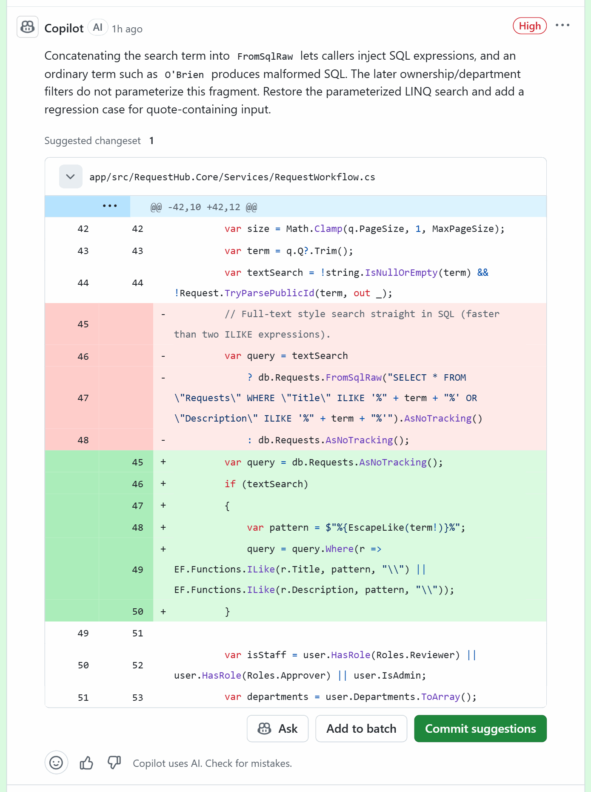
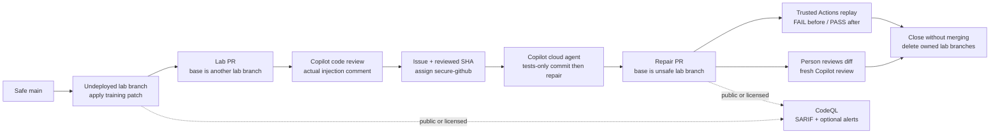
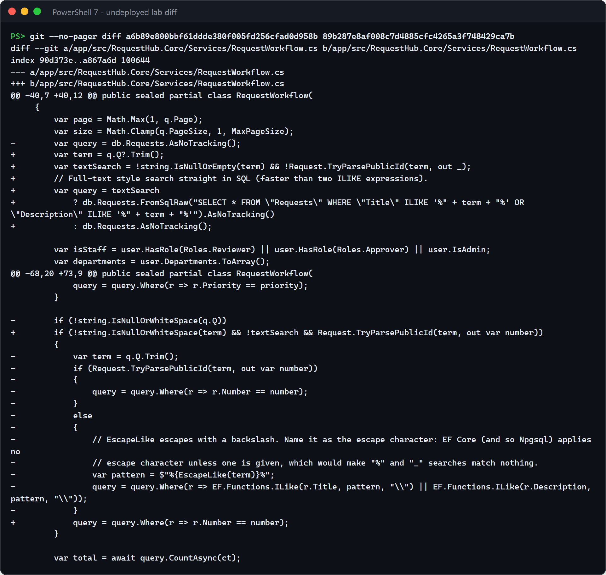
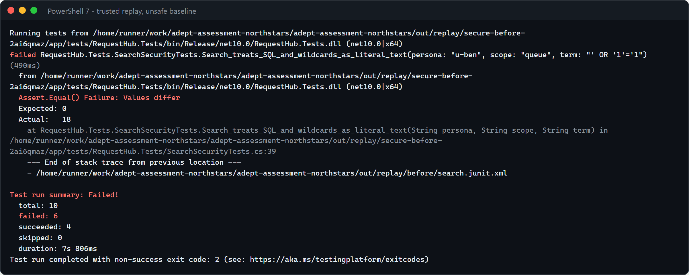
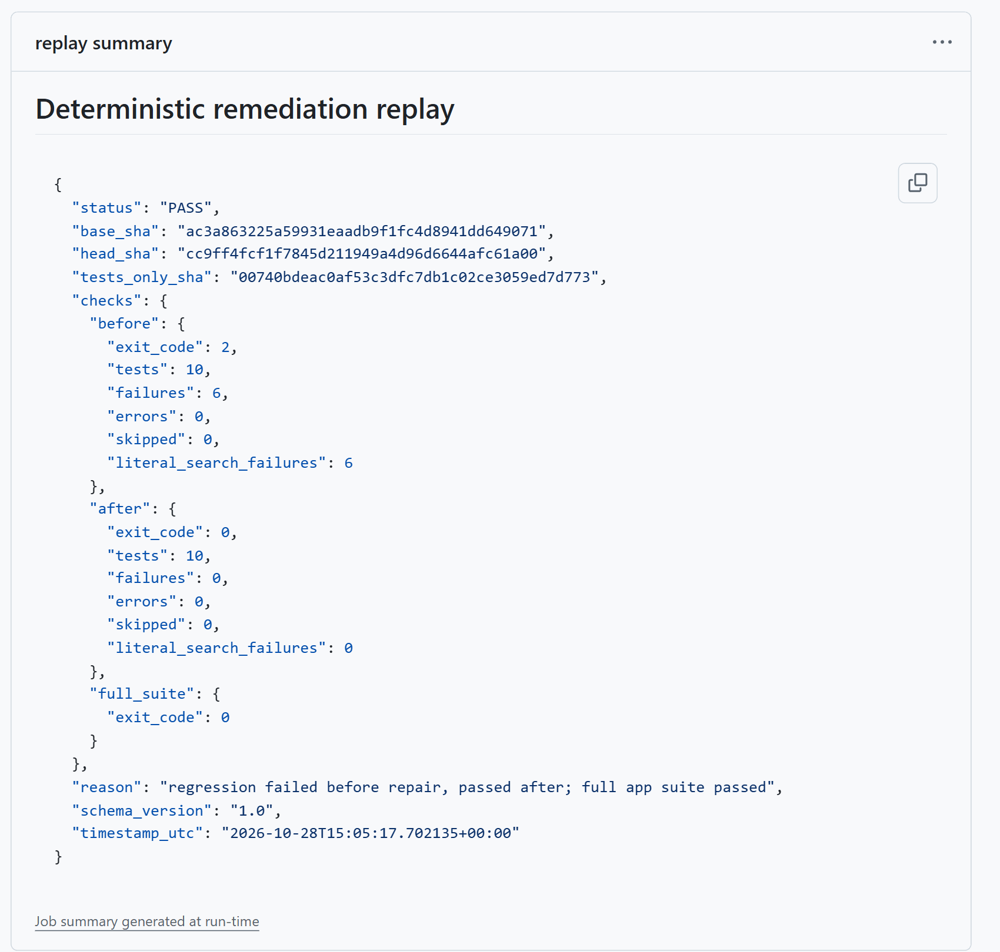
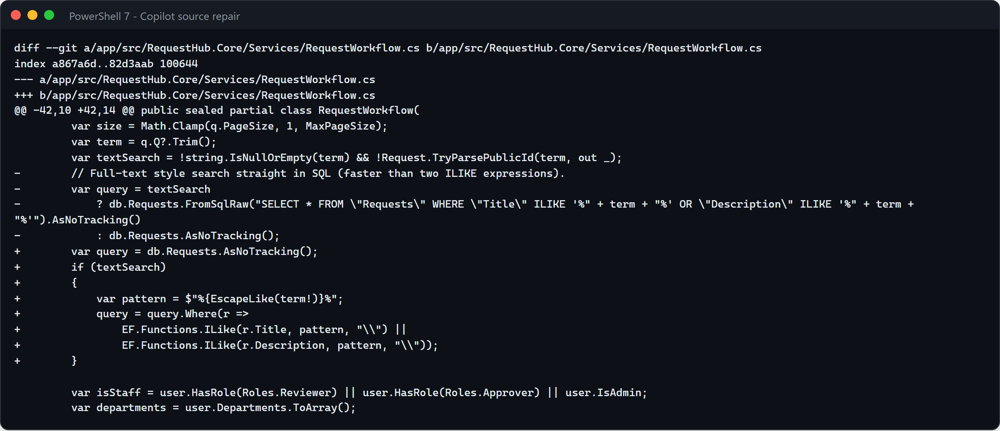
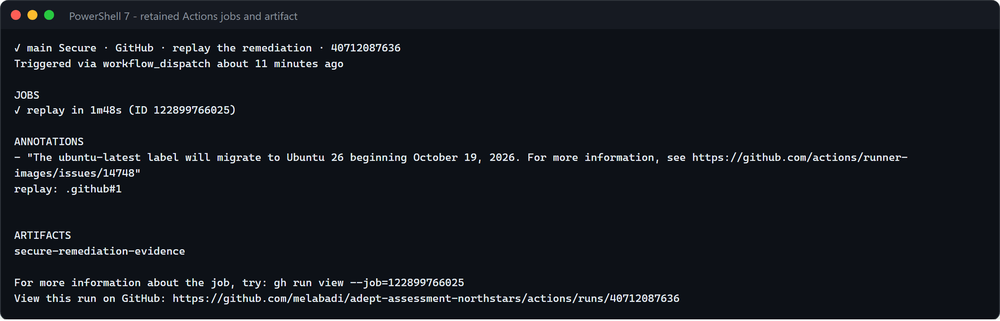

# Secure · Code security remediation with GitHub

Security findings are useful only when someone can turn them into a safe, verified repair. This solution adds a test-first security repair loop to your repository: **Copilot code review** identifies an injection on an **undeployed lab branch**, a custom **Copilot cloud agent** commits the failing regression before the fix, and **GitHub Actions** independently proves failure before and success after. A person reviews the result. CodeQL code scanning and Copilot Autofix are a separate optional path for public or appropriately licensed repositories; AI review is not code scanning, and neither a green review nor passing tests proves all vulnerabilities are absent.



- **See it work:** [the recorded RequestHub repair](#see-it-work), with its real finding, separate commits, six failures before and ten passes after.
- **Add it to your repository:** [copy the package, adapt its boundaries and tests, then enable it once](#add-it-to-your-repository). Allow a settings-and-merge step plus adaptation time for your stack; that work has not been timed in another codebase.
- **Try it first in a copy of this repository:** [the RequestHub exercise](#try-it-first-in-a-copy-of-this-repository), with no code adaptation or Azure deployment. Allow a few minutes for setup, then roughly 20–30 minutes for review, the agent and checks; the recorded timings below are observations, not guarantees.

## Why it matters

**Phase 5 of 7: Secure.** A security review often ends with a proposed fix and a green build, without showing that a test would have caught the original flaw. Here the finding becomes a regression that fails on a known unsafe commit, passes on the repaired commit, and stays alongside the repair for review.

| | Today | With this solution |
| --- | --- | --- |
| Detection | Someone notices unsafe data access in a manual review. | Copilot reviews the actual diff; where licensed, CodeQL can also trace input to a SQL sink. |
| Repair | A developer proposes escaping or filtering, with uncertain coverage. | Copilot commits the regression first, then uses a parameterized query in a separate commit. |
| Verification | A green build or an AI explanation is taken as proof. | Trusted Actions checks unchanged assertions, bounded source edits, failure before and success after. |
| Decision | Remediation and approval blur together. | A person reviews; training PRs never merge and business approval authority never changes. |

In the recorded run, Copilot identified the injection in **5 minutes 55 seconds**. Its tests-only commit preceded its source repair; the trusted replay took **1 minute 48 seconds**, with **6 of 10 failures before**, **10 of 10 passes after**, and **70 of 70 full-suite tests passing**. The value is a finding turned into a repair whose evidence a reviewer can check, not a claim of customer savings or compliance.

The [Microsoft counterpart](../05-secure-microsoft/) addresses deployed cloud posture. The [Secure combo](../../PRESENTING.md#secure-azure-finds-and-fixes-copilot-reviews-a-person-deploys) uses this solution's Copilot review instructions to review that posture fix before a person deploys it.

## How it works



- **Copilot code review** supplies advisory, nondeterministic detection. A real injection comment at the reviewed SHA counts; a completed review workflow alone does not. A missed injection is a failed detection, not a successful exercise.
- **The Copilot cloud agent**, using [`secure-github`](.github/agents/secure-github.agent.md), follows **finding-triage** and **verified-remediation**: preserve the reference regression, commit it alone, show failed assertions, then repair only the allowed method. This is not Copilot Autofix.
- **GitHub Actions** runs against real PostgreSQL in isolated runner databases, without Azure credentials. The manually dispatched replay takes its checker and regression reference from trusted `main`, checks the PR's same-repository lab boundary, and runs before, after and full-suite tests. An optional CodeQL workflow checks entitlement before downloading or executing CodeQL.
- **A person** requests the review, assigns the Issue, inspects the agent's changes before approving workflows, and decides whether the evidence is adequate. In the training exercise both PRs close without merging; no unsafe code reaches `main` or a deployment.

**Outside contributions.** Opening an Issue or a fork PR does not start Copilot: assignment and `@copilot` require write access. The scan starts only by manual dispatch. The replay starts by manual dispatch or a configured nightly schedule, and accepts only PRs from this repository's branches into `lab/secure-*`. Tooling checks on fork PRs use a read-only token and no secrets, subject to GitHub's approval rules.

## See it work

This run took place on **28 October 2026**, starting from safe `main` at [`79f9d2c`](https://github.com/melabadi/adept-assessment-northstars/commit/79f9d2c6b1b55a63ba26b063a63658fce6fd3a90). The repository owner created [lab PR #99](https://github.com/melabadi/adept-assessment-northstars/pull/99), requested Copilot review, and assigned [Issue #104](https://github.com/melabadi/adept-assessment-northstars/issues/104); Copilot produced [repair PR #105](https://github.com/melabadi/adept-assessment-northstars/pull/105). All six screenshots below came from this run. Its [public evidence comment](https://github.com/melabadi/adept-assessment-northstars/pull/105#issuecomment-6473071291) records the results and reset.

The public PRs, commits and files open without signing in. Actions job logs, summaries and artifact downloads require sign-in and expire, so screenshots show them here. The [committed evidence](evidence/) preserves a **later replay of these same commits**, completed on 1 November 2026, not an export of the screenshot run.

### 1. The unsafe query stayed on an undeployed lab branch

The owner created the lab PR at **14:41:43 UTC**, from [`lab/code-finding.patch`](lab/code-finding.patch) on top of safe `main`. The patch concatenated `q.Q` into `FromSqlRaw` in `ListAsync`. Existing role and department filters remained, but did not make SQL concatenation safe. The PR targeted another lab branch, never `main`; its unsafe SHA was [`ac3a863`](https://github.com/melabadi/adept-assessment-northstars/commit/ac3a863225a59931eaadb9f1fc4d8941dd649071). Lab preparation was not separately timed. Existing app CI also caught the lost literal-wildcard behavior; that failure was retained rather than weakening a check.



**What this shows:** the training defect existed only on an undeployed branch, with a lab-to-lab PR keeping unsafe code out of the default branch.

### 2. Copilot identified the injection

The owner requested Copilot review on [#99](https://github.com/melabadi/adept-assessment-northstars/pull/99). The review arrived at **14:47:38 UTC**, **5 minutes 55 seconds** after the PR was created. Its [inline finding](https://github.com/melabadi/adept-assessment-northstars/pull/99#discussion_r4402043838) identified untrusted input reaching the SQL sink, with a High badge and suggested parameterized query. This was real Copilot code review, not CodeQL scanning.


**What this shows:** the actual comment identified the input, unsafe composition and SQL sink at the lab's reviewed commit.

### 3. Copilot committed the failing regression before its repair

The owner assigned [#104](https://github.com/melabadi/adept-assessment-northstars/issues/104), including the real finding, reviewed SHA and same-run review export, to the `secure-github` agent on the unsafe lab branch. Copilot opened [#105](https://github.com/melabadi/adept-assessment-northstars/pull/105) at **14:48:30 UTC**. It committed the unchanged regression alone as [`00740bd`](https://github.com/melabadi/adept-assessment-northstars/pull/105/commits/00740bdeac0af53c3dfc7db1c02ce3059ed7d773) at **14:55:01**, then the source fix separately as [`cc9ff4f`](https://github.com/melabadi/adept-assessment-northstars/pull/105/commits/cc9ff4fcf1f7845d211949a4d96d6644afc61a00) at **14:56:11**. The session's work-start and work-finished events spanned **14:48:59–15:03:39**, **14 minutes 40 seconds** (rounded to 15 minutes in the evidence comment).



The image is the **before-repair output of the independent replay in step 4**, not a capture of Copilot's session. The [same assertions and failures](evidence/before-test.log) are retained from the later replay of these commits.

**What this shows:** Copilot's committed history kept the tests separate and earlier than the source repair, and real failed assertions established the defect.

### 4. A person approved execution and Actions independently verified the repair

The owner approved execution of the agent's PR workflows and dispatched the trusted replay from `main`. Its job ran **15:03:34–15:05:22 UTC**, **1 minute 48 seconds**. The [evidence comment](https://github.com/melabadi/adept-assessment-northstars/pull/105#issuecomment-6473071291) recorded **6 failures and 4 passes before**, **10 passes after**, zero errors or skips, and **70 of 70** full-suite tests passing. The before/after checker and reference came from `main`, not Copilot's PR.



The later snapshot's [`results.json`](evidence/results.json), [before JUnit](evidence/before/search.junit.xml), [after JUnit](evidence/after/search.junit.xml) and [full-suite log](evidence/after-full-suite.log) retain the same fail-before/pass-after outcome. A build failure, unreachable database, zero tests or skipped tests would have failed the gate.

**What this shows:** the identical regression failed against unsafe source and passed against the repair, followed by the full app suite, under trusted checks.

### 5. The repair replaced SQL composition without widening authorization

The [two-file repair](https://github.com/melabadi/adept-assessment-northstars/pull/105/files) added the regression and changed only `ListAsync`. Copilot replaced concatenated raw SQL with parameterized `ILike` predicates, preserving literal `%` and `_` searches with an explicit escape character and leaving the authorization filters intact. The source-fix timestamp was **14:56:11 UTC**; human diff-review time was not measured.



A follow-up AI review returned no inline issues, but explicitly could not access check runs or verify the replay evidence. The owner retained that limitation in the [evidence comment](https://github.com/melabadi/adept-assessment-northstars/pull/105#issuecomment-6473071291); it was not treated as a clean security assessment or human approval.

**What this shows:** the bounded repair removed SQL interpretation of search input while keeping literal search and access-scope behavior under regression tests.

### 6. The evidence remained and the lab was closed without merging

The owner linked the finding, commits and actual runs in the [public evidence comment](https://github.com/melabadi/adept-assessment-northstars/pull/105#issuecomment-6473071291), retained the replay artifact, closed #99 and #105 **without merging**, closed #104, and removed only this run's lab resources. Evidence collection and cleanup were not separately timed.



No CodeQL, Autofix, deployment or visibility change ran in this exercise: the repository was private and unlicensed for code scanning then. Its later public visibility does not retroactively prove the optional scanner path.

**What this shows:** the run left reviewable evidence and regression commits, not an unsafe merge, an automatic deployment or an unqualified AI success claim.

## Results and value

The run left a real [injection finding on #99](https://github.com/melabadi/adept-assessment-northstars/pull/99#discussion_r4402043838), [Copilot's tests-first repair on #105](https://github.com/melabadi/adept-assessment-northstars/pull/105/commits), six screenshots and a public [outcome record](https://github.com/melabadi/adept-assessment-northstars/pull/105#issuecomment-6473071291). Both PRs were closed, not merged: this was a defensive training exercise, not a production remediation approval.

| Measured in this run | Result | Value to a reviewer |
| --- | --- | --- |
| PR creation to detection | 5 min 55 s | An actual input-to-sink finding to inspect, rather than a generic AI summary |
| Cloud work-start to work-finished events | 14 min 40 s | Separate test and source commits with no correction to the supplied regression needed |
| Trusted replay job | 1 min 48 s | Six failures before, ten passes after and the full 70-test suite passing |
| PR creation to replay completion | 23 min 39 s | A traceable finding-to-verified-repair interval, including review and human steps, not a savings benchmark |

The [later committed replay snapshot](evidence/) is readable without a GitHub account and survives log expiration. No customer time savings, review completeness, CodeQL detection, Autofix success or compliance outcome was measured. **Track detection-to-independently-verified-repair time when you adopt this**, alongside missed detections, review rounds and the access-control cases the regression covers.

## Add it to your repository

This package is specialized for RequestHub's .NET 10, xUnit v3 and PostgreSQL stack. The integration below uses the same review, Issue assignment and replay commands as the optional copy exercise. Adapt the named files before using them with your code; this README does not claim that an untested adaptation works.

### Prerequisites

- The root README's [Before you start](../../README.md#before-you-start): Git, GitHub CLI, PowerShell 7.4+ and Python 3.12+. These Python scripts use only the standard library.
- **A paid GitHub Copilot plan** with code review and the cloud agent allowed for the repository, plus write access to request reviews, assign Issues, approve workflows and set repository variables. GitHub Enterprise alone does not grant Copilot or Code Security.
- **A Copilot session on GitHub Actions.** The agent runs your tests in its session, with the services that [`copilot-setup-steps.yml`](../../.github/workflows/copilot-setup-steps.yml) starts; here it starts PostgreSQL. Cloud sandboxes do not run setup steps, and cloud is the default where GitHub offers an environment choice: **choose GitHub Actions** ([environment comparison](https://docs.github.com/en/copilot/concepts/copilot-surfaces/copilot-on-github#comparison-of-github-actions-based-sessions-and-cloud-sandboxes)).
- Actions enabled and a person available to approve the agent's PR workflows after inspecting the changes. The custom agent and trusted checker must reach the default branch before assignment.
- Integration tests and disposable database access in both the agent's setup and replay runner. A local API is not needed for this exercise. Optional local replay requires .NET 10 and PostgreSQL as in the [app README](../../app/README.md); `ApiFixture` creates isolated databases and `REQUESTHUB_TEST_PG` selects another test server.
- Deployment rules that exclude **both `lab/secure-*` and `copilot/*`**. Check every release/deployment workflow before introducing the training patch; never dispatch deployments from those refs.

### What to copy and what to change

From your repository's root, obtain the package in a separate local source clone. The commands below copy the solution assets and merge its `.github` contents into your repository's root `.github`. Review any filename collision before copying; do not overwrite existing customizations.

```powershell
$src = Join-Path ([IO.Path]::GetTempPath()) "ai-sdlc-secure-$(Get-Date -Format yyyyMMddHHmmss)"
git clone --quiet --depth 1 https://github.com/melabadi/adept-assessment-northstars.git $src
New-Item -ItemType Directory -Force solutions, .github | Out-Null
Copy-Item -Recurse (Join-Path $src 'solutions\05-secure-github') solutions
Copy-Item -Recurse -Force (Join-Path $src 'solutions\05-secure-github\.github\*') .github
git status --short --untracked-files=all
```

What you should see: `solutions\05-secure-github` plus its agents, skills, workflows, instructions and Issue form under root `.github`. GitHub reads **root `.github`**, not the nested source copy. The source clone remains at `$src` for comparing setup examples; remove that exact clone when finished.

| Real file | What to adapt for your code |
| --- | --- |
| [`.github/agents/secure-github.agent.md`](.github/agents/secure-github.agent.md) and both [`SKILL.md` procedures](.github/skills/verified-remediation/SKILL.md) | Your source/test paths, business invariants, test commands and boundaries. Keep tests-first commits, no automatic approval and no deployment. |
| [`lab/code-finding.patch`](lab/code-finding.patch), [`regression/SearchSecurityTests.cs`](regression/SearchSecurityTests.cs), [`remediate-task.md`](remediate-task.md) | A small, undeployed defect and a behavior-based oracle for your app, including negative authorization cases. Never apply the RequestHub patch to unrelated code. |
| [`finding_triage.py`](.github/skills/finding-triage/finding_triage.py) | `SOURCE`, the expected scanner rule/path and your actual finding evidence. Preserve fail-closed entitlement checks. |
| [`verify_remediation.py`](.github/skills/verified-remediation/verify_remediation.py) | `TEST`, `WORKFLOW`, the `ListAsync` method boundary, `app/RequestHub.slnx`, the selected test name/runner and exactly-ten-case expectation. Preserve identical assertions, real assertion failure, no skips/errors and full-suite success. |
| [`secure-github-verify.yml`](.github/workflows/secure-github-verify.yml) | SDK, PostgreSQL service, checker path and default-branch guard (`main` here). Keep read-only permissions, same-repository/lab checks and trusted default-branch execution. |
| [`secure-github-checks.yml`](.github/workflows/secure-github-checks.yml) | Paths, unit-test discovery and patch applicability. Its `python tools/sync_solutions.py --check` step is this demo repository's mirror mechanism: remove that step in a repository without mirrors, or copy and maintain that mechanism deliberately. |
| [`secure-github-scan.yml`](.github/workflows/secure-github-scan.yml) | Optional CodeQL C# build, source path and rule; keep entitlement preflight. Leave it unused if your repository is not eligible. |
| [`replay_setup.py`](replay_setup.py) and [`tests/test_security_tools.py`](tests/test_security_tools.py) | RequestHub paths, reference repair construction and checks for your adapted workflow. Do not replay #105 in another repository: PR numbers belong to their own repository. |
| Shared [`.github/workflows/copilot-setup-steps.yml`](../../.github/workflows/copilot-setup-steps.yml) and your existing CI | Merge the needed database, SDK and restore steps into your setup job named `copilot-setup-steps`; do not replace unrelated setup. Its web and all-solution dependency steps are RequestHub-specific. CI must cover your repaired behavior. |
| Your root `.github/copilot-instructions.md` | The agent reads this file. Create or update it with your build/test commands, authorization invariants and no-deployment lab rules; preserve your existing repository instructions. |
| [`secure-github-posture-review.instructions.md`](.github/instructions/secure-github-posture-review.instructions.md) | This is for the Microsoft counterpart's Bicep fix. Set `applyTo` to your infrastructure folder, or omit it if you do not use that combo. |

If you retain nested source copies, keep the root files in sync with them. Workflow action pins should stay pinned; replace application assumptions, not the security gates.

### One-time setup

1. **Adapt and validate locally, then merge the package.** In this repository the checks are:

   ```powershell
   python -m unittest discover -s solutions\05-secure-github\tests -v
   git apply --check --ignore-space-change solutions\05-secure-github\lab\code-finding.patch
   ```

   Run your adapted equivalents and your normal CI. Expected: parser/guard tests pass, the patch applies to safe source without changing it, and CI passes. Merge through your normal human-reviewed PR; do not assign an agent that only exists on an unmerged branch.

2. **Enable Copilot and create the Issue labels.** Allow the cloud agent and code review in account/organization settings; choose an Actions-based agent session. Then:

   ```powershell
   gh label create ai-sdlc --color 1D76DB --description "AI-SDLC demo work" --force
   gh label create phase:secure --color C5DEF5 --description "SDLC phase 5: Secure" --force
   $repo = gh repo view --json nameWithOwner -q .nameWithOwner
   gh api "repos/$repo/contents/.github/agents/secure-github.agent.md" --jq .path
   ```

   Expected: `$repo` is **your** repository, the final command prints `.github/agents/secure-github.agent.md`, and Issues offer Copilot as an assignee. Recheck deployment exclusions before first use.

3. **Choose whether to enable the nightly replay.** It is optional and independent of a fresh AI run. Once your adapted reference repair is valid:

   ```powershell
   python solutions\05-secure-github\replay_setup.py
   python solutions\05-secure-github\replay_setup.py --status
   ```

   Expected: the script creates or reuses a closed reference repair PR on three `lab/secure-replay*` branches and sets `SECURE_REPLAY_PR` to **its number**. It uses `[skip ci]` commits, not Copilot; it is reference data, not evidence of an AI repair. Alternatively, after first use, run `--adopt <your repair PR>` to replay an actual repair. With no variable, schedules skip and do not send nightly setup failures. Manual dispatch without a variable or `pr` input still fails with setup guidance.

### First use

Follow the [six numbered commands below](#try-it-first-in-a-copy-of-this-repository), replacing the RequestHub patch, regression and source paths with your adapted ones. Create a lab-to-lab PR, obtain an actual injection finding at its immutable SHA, assign that evidence to `secure-github`, approve workflows only after inspecting changes, and dispatch the trusted replay from the default branch. Require failed assertions before, all cases passing after, and full-suite success. Request a fresh review of the repair; retain any access limitation or missed detection.

For training, close without merging and reset only owned lab resources. For a real production flaw, use your normal security response and human-reviewed release process instead of copying the training cleanup decision.

### Nightly replay and lasting evidence

[`secure-github-verify.yml`](.github/workflows/secure-github-verify.yml) requests **midnight Eastern** (`America/New_York`), 05:00 UTC in winter and 04:00 UTC in summer. It runs from the default branch, replays `SECURE_REPLAY_PR`, and fetches immutable commits from the PR record even after lab branches are deleted. Here the variable is 105; in your repository it must name your own repair PR. Manual dispatch can override it with `-f pr=<number>`.

The replay creates no Issue, PR, review or agent session and needs no new token or secret. Permissions are read-only, executions share a concurrency group, and it never pushes, commits or comments; it cannot start a release candidate through a nightly commit. The timeout is 30 minutes. The [snapshot execution](evidence/) took about **84 seconds**; that was a later replay, not the screenshot job's 1m48s.

Open [the workflow's runs](https://github.com/melabadi/adept-assessment-northstars/actions/workflows/secure-github-verify.yml) for recent executions. Job logs and artifacts require sign-in and expire after **90 days** here; the [one-time committed snapshot](evidence/) remains readable without sign-in. It is historical evidence, not an automatically updated nightly result. Export and privacy-check evidence you want to retain in your own repository.

GitHub may delay or drop scheduled runs. In public repositories it disables schedules after **60 days without repository activity**. Resume via **Actions → Secure · GitHub · replay the remediation → Enable workflow**; use **… → Disable workflow** to stop it. The workflow never manufactures repository activity to avoid the pause.

### What it costs

A paid GitHub Copilot plan and applicable repository policy are required for reviews and agent sessions. Each requested review and cloud-agent task consumes the usage charged by your current plan/model; retries and follow-up work add usage. Billable AI usage was not measured for this run. Check [Copilot billing and usage](https://docs.github.com/en/copilot/concepts/billing-and-usage) and your spending limit before repeating it.

Actions supplies the agent environment and replay runner. Standard GitHub-hosted runners are free for public repositories; private repositories draw on their plan's included compute allowance and then billed usage. Copilot execution compute is separate from AI usage; check the current [compute billing rules](https://docs.github.com/en/billing/concepts/product-billing/cloud-and-local-sandboxes) as well as the Copilot plan. The recorded replay used one job for 1m48s, plus separate CI and agent work; it is not a measured total bill. The nightly deterministic replay consumes **no Copilot requests or AI credits**. No Azure resource or credential is needed.

### Optional: CodeQL and Autofix when public or licensed

The Copilot path above was verified live; CodeQL/Autofix detection of this patch was **not verified by that run**. Do not make a private repository public for the exercise or treat artifact-only mode as a license workaround. Public repositories can use code scanning; a private repository needs eligible organization ownership/plan and GitHub Code Security enabled. GitHub Enterprise alone is insufficient.

1. In **Settings → Code security**, enable the applicable features. For this advanced workflow leave CodeQL default setup disabled; do not run competing configurations. To use default setup instead, select **Code scanning → Set up → Default**, choose C# and use its supported branch coverage.
   On a licensed private organization repository with no analysis yet, a read-only probe may see 404 and cannot inspect admin-only settings. Bootstrap one default-setup scan of safe `main`, wait for completion, then disable default setup before using this advanced workflow. A 404 is not permission to bypass preflight or proof of no license.
2. Before assigning the repair, dispatch the unsafe lab scan:

   ```powershell
   gh workflow run secure-github-scan.yml --ref main -f target_ref=$lab -f expect=present -f publish_alerts=true
   gh run list --workflow secure-github-scan.yml --limit 3
   ```

   Require successful preflight, real C# analysis, and `cs/sql-injection` at `app/src/RequestHub.Core/Services/RequestWorkflow.cs` in **secure-codeql-evidence**, with the correct scanned SHA. No matching finding means detection failed. `publish_alerts=false` retains SARIF without uploading alerts but still requires entitlement.
3. With upload enabled, open **Security and quality → Code scanning**, select the lab branch and follow the real alert's data flow. Inspect a Copilot Autofix suggestion only if offered for that supported alert. An unavailable suggestion is BLOCKED, not PASS; **Fix with Copilot** on an AI review comment is not CodeQL Autofix. Agentic Autofix for backlog alerts is default-branch-only, whereas this training flaw stays off the default branch.
4. After the repair and passing replay:

   ```powershell
   gh workflow run secure-github-scan.yml --ref main -f target_ref=$branch -f expect=absent -f publish_alerts=true
   ```

   Require successful analysis, zero matching injection findings, matching repair SHA and successful upload if requested. Skipped jobs or absent SARIF are not clean scans. Retain immutable before/after artifacts and report other findings separately.

Secret scanning, push-protection detection, dependency review and Dependabot are separate products, not proven by this injection lab. No secret is introduced; secret detection is **NOT_RUN**, not PASS. Use the supported, licensed test procedure separately, never an active credential or a custom dummy pattern passed off as provider detection.

## Try it first in a copy of this repository

Optional: try the same workflow on RequestHub before adapting anything. Make your copy once using the root README's [Try it in a copy of this repository](../../README.md#try-it-in-a-copy-of-this-repository). From that copy's root, use the [prerequisites](#prerequisites), allow Copilot, **choose an Actions-based session**, and run the label/repository checks in [One-time setup](#one-time-setup). The files are already mirrored into root `.github`, so there is nothing to copy. Setup is a few commands plus account settings; no local API, database or Azure deployment is needed.

Confirm `git status --short` is empty, the repository printed by `gh repo view` is your copy, and release/deployment workflows exclude the lab and agent refs. Check for unfinished work with `gh pr list --state open`, `gh issue list --label phase:secure --state open` and `git ls-remote --heads origin 'lab/secure-*'`; do not close or delete someone else's work. The optional `lab/secure-replay*` branches belong to the nightly reference and stay.

Use your new run's numbers below, not #99/#105. These commands create two temporary lab branches and a repair branch, never a PR into `main`. Steps match [See it work](#see-it-work); timings are planning allowances unless explicitly measured there.

### 1. Prepare the undeployed lab

Allow about a minute for branch/PR creation; preparation was not separately timed in the recorded run.

```powershell
git fetch origin main
$repo = gh repo view --json nameWithOwner -q .nameWithOwner
$run = Get-Date -Format "yyyyMMdd-HHmmss"
$clean = "lab/secure-base-$run"
$lab = "lab/secure-$run"
git push origin "origin/main:refs/heads/$clean"
git worktree add -b $lab "out\secure-$run" origin/main
Push-Location "out\secure-$run"
git apply --check --ignore-space-change solutions\05-secure-github\lab\code-finding.patch
git apply --ignore-space-change solutions\05-secure-github\lab\code-finding.patch
git add app/src/RequestHub.Core/Services/RequestWorkflow.cs
git commit -m "Secure lab: intentionally unsafe search, never deploy or merge"
git push -u origin $lab
$unsafe = git rev-parse HEAD
$url = gh pr create --base $clean --head $lab --title "Secure lab: review the unsafe search" `
  --body "Defensive training only. Undeployed lab. Review the search data flow and injection risk. NEVER merge or deploy."
$labPr = $url.Split('/')[-1]
Pop-Location
```

Expected: a lab-to-lab PR whose diff adds concatenated `FromSqlRaw` in `ListAsync`. A red baseline CI run is expected for lost literal-wildcard behavior, not a reason to weaken tests.

### 2. Request the real Copilot finding

In **Reviewers**, request **Copilot**, using Balanced effort when available, or:

```powershell
'{"reviewers":["copilot-pull-request-reviewer[bot]"]}' |
  gh api -X POST "repos/$repo/pulls/$labPr/requested_reviewers" --input - > $null
gh api "repos/$repo/pulls/$labPr/comments" --jq '.[] | {html_url,commit_id,path,line,body}'
```

Allow several minutes; the recorded detection took **5m55s**. Copy the actual injection comment URL into `$finding` and verify its `commit_id` equals `$unsafe`. A review summary or completed job is insufficient. If it misses the injection, retain that failed detection and stop; do not substitute the historical finding.

### 3. Assign the evidenced task to Copilot

```powershell
$finding = "<actual injection review comment URL>"
$task = Get-Content solutions\05-secure-github\remediate-task.md -Raw
$task += "`n`nDetection: Copilot code review`nFinding: $finding`nReviewed SHA: $unsafe`nLab PR: $url`nBase: $lab`n"
$review = gh api "repos/$repo/pulls/$labPr/comments" --jq '.[] | {html_url,commit_id,path,line,body,author:.user.login}'
$task += "`nAuthenticated same-run review export:`n$review`n"
$issueUrl = $task | gh issue create --title "Secure: parameterize the lab search, tests first" `
  --body-file - --label ai-sdlc --label phase:secure
$issue = $issueUrl.Split('/')[-1]
@{ assignees = @('copilot-swe-agent[bot]'); agent_assignment = @{
    target_repo = $repo; base_branch = $lab; custom_agent = 'secure-github'
} } | ConvertTo-Json | gh api -X POST "repos/$repo/issues/$issue/assignees" --input - > $null
gh pr list --base $lab --json number,url,headRefName
```

If GitHub offers an environment choice, choose **GitHub Actions**, not the default cloud sandbox. In the UI choose agent **secure-github** and base **lab/secure-RUN**, never `main`. The API above is the assignment used by this solution; check that the resulting session actually runs setup steps. Allow 20–30 minutes or more for setup/queues; recorded session events spanned **14m40s**. Inspect the tests-only commit, failed assertions and separate source fix. Record the repair PR number as `$repair`; compilation failure is not proof of injection.

### 4. Approve execution and independently verify

Inspect the diff before approving the agent's workflows. Use **Approve and run workflows**, or rerun waiting runs as a maintainer:

```powershell
$repair = Read-Host 'Repair PR number'
$branch = gh pr view $repair --json headRefName -q .headRefName
gh run list --branch $branch --status action_required --json databaseId -q '.[].databaseId' |
  ForEach-Object { gh run rerun $_ }
gh workflow run secure-github-verify.yml --ref main -f pr=$repair
gh run list --workflow secure-github-verify.yml --limit 3
```

The recorded replay job took **1m48s**, plus any queue time. Expected: failed regression before, all ten cases passing after, no skipped/error cases, full suite passing. Download **secure-remediation-evidence** and inspect `results.json` and both JUnit files. A green build alone is insufficient.

### 5. Review the bounded repair

Allow 2–3 minutes for the diff, plus several minutes for advisory AI review; human review time was not measured in the recorded run.

```powershell
gh pr diff $repair
'{"reviewers":["copilot-pull-request-reviewer[bot]"]}' |
  gh api -X POST "repos/$repo/pulls/$repair/requested_reviewers" --input - > $null
```

Expected: only the new regression and edits inside `ListAsync`; parameterization, explicit LIKE escaping and unchanged access filters. Check requester, reviewer, admin, public-id and cross-department cases. Retain review access limitations and comments separately from deterministic results. **Do not merge either training PR.** To claim scanner remediation, also complete the [optional CodeQL before/after scans](#optional-codeql-and-autofix-when-public-or-licensed); no scanner result is assumed.

### 6. Retain the result and reset the copy

Allow about 2 minutes to collect links and logs; evidence collection was not separately timed in the recorded run.

```powershell
gh run list --workflow secure-github-verify.yml --limit 3
$replayRun = Read-Host 'Replay run number'
gh run download $replayRun --name secure-remediation-evidence --dir "out\secure-evidence-$run"
gh pr view $labPr --json url,state
gh pr view $repair --json url,state
```

Keep the finding URL, both PRs, immutable SHAs, times and test counts. Distinguish AI review from deterministic acceptance; record misses, failures and blocked licensing honestly. Download artifacts before retention expires. Privacy-check any export before publishing it; do not publish account details or PR metadata wholesale.

Reset with [Clean up](#clean-up) after the agent finishes. Confirm both PRs are **Closed**, not **Merged**, and only your temporary lab refs are gone. A new timestamp and clean `origin/main` allow another exercise. To retain this repair for nightly verification, first run `python solutions\05-secure-github\replay_setup.py --adopt $repair`; adopting does not merge or deploy it.

## Clean up

Wait for the cloud agent to finish. Close only your run's PRs and Issue, without merging, then remove its exact branches and worktree:

```powershell
gh pr close $repair --comment "Security exercise complete; deliberately not merged." --delete-branch
gh pr close $labPr --comment "Unsafe training branch; never merge or deploy."
gh issue close $issue --reason "not planned"
git push origin --delete $lab $clean
git worktree remove "out\secure-$run"
git branch -D $lab
```

Verify **Closed**, not **Merged**, and that your refs no longer appear in `git ls-remote --heads origin 'lab/secure-*'`. Keep downloaded evidence. Do not remove another user's branches, worktrees, databases or artifacts. If Windows rejects long build paths, use `git -c core.longpaths=true worktree remove "out\secure-$run"` for that exact owned worktree.

To remove the optional nightly reference too:

```powershell
python solutions\05-secure-github\replay_setup.py --cleanup
```

It closes the owned reference PR, deletes its three `lab/secure-replay*` branches and removes `SECURE_REPLAY_PR`; it never deletes an adopted repair PR. Unconfigured nightly jobs then skip. Disable the workflow in Actions if you want no scheduled runs at all. No Azure resource or new credential was created, so no additional token needs revoking.

## What's in this folder

```text
05-secure-github/
├── README.md
├── images/                                real review, regression, repair and Actions screenshots
├── evidence/                              one later replay snapshot, readable without signing in
├── requirements.txt                       standard library only; nothing to install
├── remediate-task.md                       acceptance criteria for the remediation Issue
├── lab/code-finding.patch                  unsafe query, stored as data only on main
├── regression/SearchSecurityTests.cs       identical regression before and after repair
├── replay_setup.py                        once per repository: configure the nightly repair PR
├── tests/test_security_tools.py            parser/guard tests, not live-demo evidence
└── .github/
    ├── agents/secure-github.agent.md
    ├── instructions/secure-github-posture-review.instructions.md
    │                                      review the Microsoft counterpart's infrastructure fix
    ├── skills/
    │   ├── finding-triage/                 evidence procedure, entitlement and SARIF reporter
    │   └── verified-remediation/           bounded two-snapshot replay with JUnit evidence
    ├── workflows/
    │   ├── secure-github-checks.yml        tooling checks and patch applicability
    │   ├── secure-github-verify.yml        trusted manual/nightly replay
    │   └── secure-github-scan.yml          optional public/licensed CodeQL scan
    └── ISSUE_TEMPLATE/05-secure-github-remediate.yml
```

GitHub reads the synchronized root `.github/` files. Shared app CI and `copilot-setup-steps.yml` supply the wider tests and agent environment. The patch and regression reference are outside app projects: no unsafe C# from this package is compiled on `main`.

## Troubleshooting

- **CodeQL preflight BLOCKED / alerts API 403:** expected without entitlement. Use Copilot review, not disabled upload as a workaround. A licensed private repository's initial 404 can need the safe bootstrap described above.
- **No workflows on Copilot's PR:** approve them in the PR or use `gh run rerun <id>` as a maintainer.
- **Copilot review cannot read check runs:** it may report no inline issues while saying it could not verify evidence. Supply actual replay/CI links, inspect independently, and retain the limitation. An empty review is not acceptance.
- **No custom agent:** merge the package onto the default branch before assigning the Issue.
- **Cloud agent cannot read the private review with `gh`:** the profile enables built-in read-only `github` tools; the Issue also carries an authenticated same-run review export. Retain its actual URL, author, SHA and body. Never put a personal token in the task.
- **No tests-only commit / altered regression:** ask Copilot to meet the Issue criteria. The checker refuses a history that cannot establish a committed pre-fix failure.
- **A literal `%` search returns a legitimate record:** synthetic descriptions include `95%`. The regression derives exact literal matches from independently fetched, authorized details; it must not assume every punctuation search returns zero.
- **Local database collisions:** the fixture creates unique databases. Do not reset a shared database; `REQUESTHUB_TEST_PG` selects another server/account with create-database permission.
- **Replay output already exists:** choose a new `--out` directory; evidence is never silently overwritten.
- **Runner exits without JUnit:** retain the log. With .NET 10's test platform, absolute `--results-directory` belongs before `--`, not among forwarded runner options. The supplied checker handles this.
- **Replay says it is not set up:** run `replay_setup.py` once, `--adopt` your own repair, or provide a valid `pr` input. An unconfigured schedule skips; a manual run without either setting fails deliberately.

### Product references

Availability and licensing are separate from the recorded results; recheck current policy before adoption:
[Copilot review](https://docs.github.com/en/copilot/how-tos/use-copilot-agents/use-code-review),
[CodeQL CLI availability](https://docs.github.com/en/code-security/concepts/code-scanning/codeql/codeql-cli),
[CodeQL terms](https://github.com/github/codeql-cli-binaries/blob/main/LICENSE.md),
[code scanning](https://docs.github.com/en/code-security/concepts/code-scanning/code-scanning),
[`cs/sql-injection`](https://codeql.github.com/codeql-query-help/csharp/cs-sql-injection/),
[Autofix limitations](https://docs.github.com/en/code-security/responsible-use/security-and-quality-ai-features),
[agentic Autofix prerequisites](https://docs.github.com/en/code-security/how-tos/manage-security-alerts/manage-code-scanning-alerts/resolve-alerts),
[secret scanning](https://docs.github.com/en/code-security/concepts/secret-security/secret-scanning).
