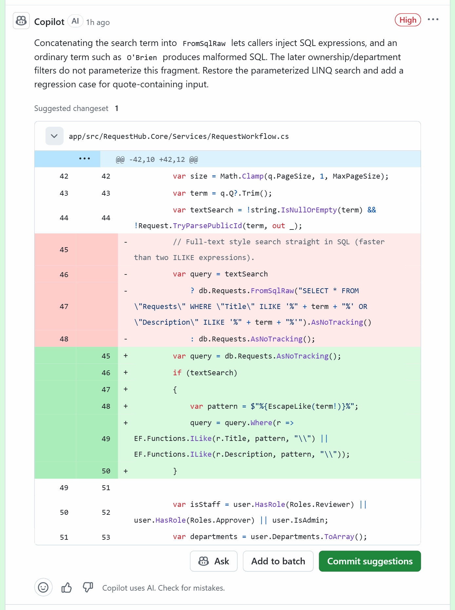
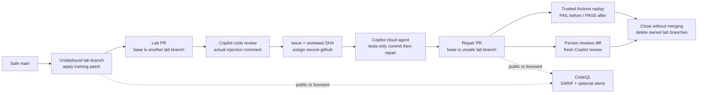
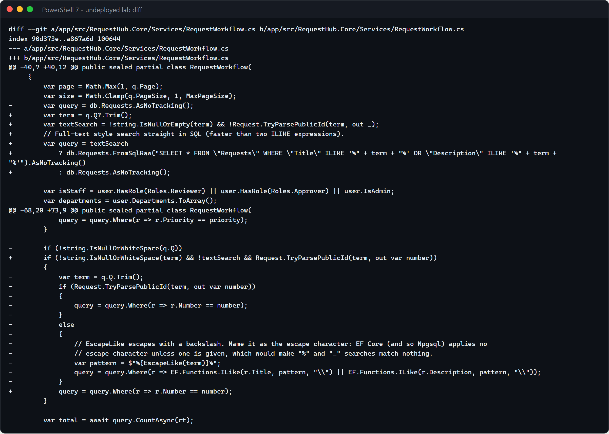
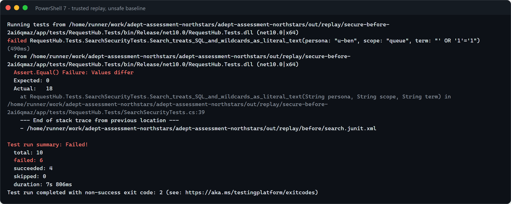
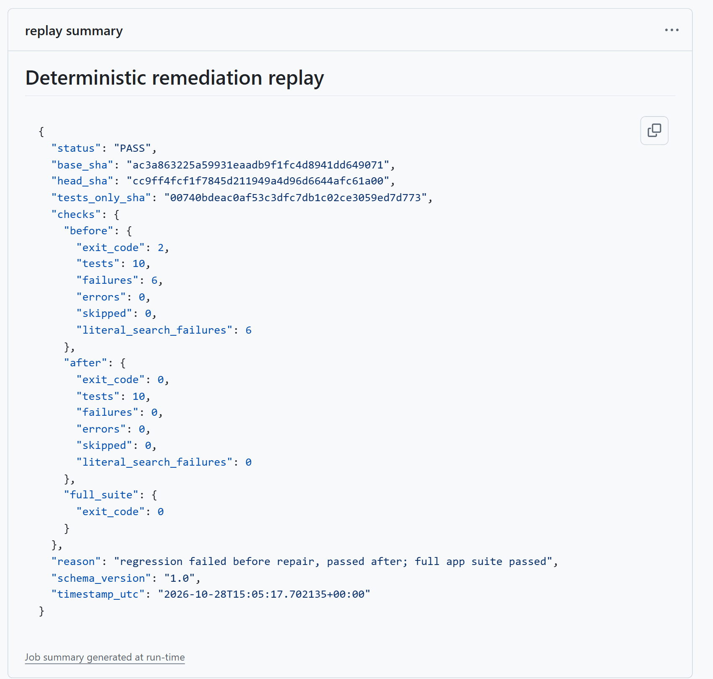
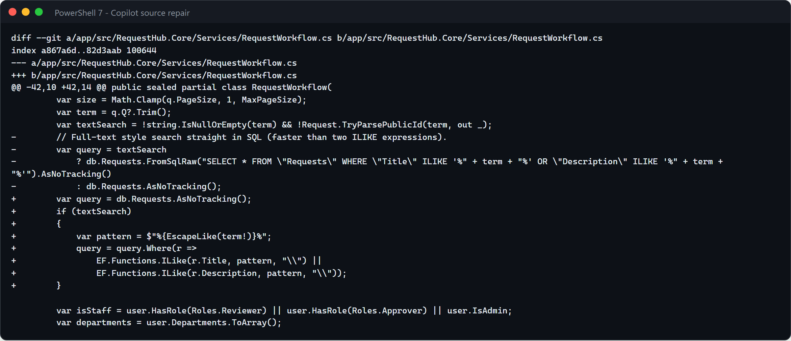
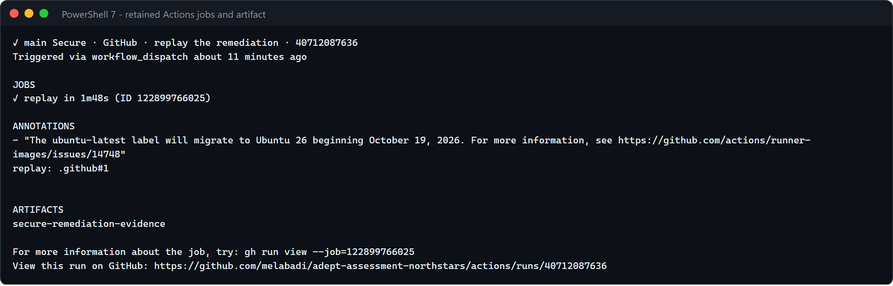

# Secure · Code security remediation with GitHub

Security findings are useful only when someone can turn them into a safe, verified repair. This solution puts a
deliberately unsafe RequestHub search query on an **undeployed lab branch**, asks **Copilot code review** to identify
the injection, and assigns the finding to a custom **Copilot cloud agent**. The agent commits a failing regression
first, then repairs the query. Actions independently replays both commits; a person reviews the result.
**CodeQL code scanning and Copilot Autofix are a separate optional path for public or appropriately licensed repositories.**
AI review is not code scanning, and a passing review does not prove a vulnerability is absent.



## Where it fits

**Phase 5 of 7: Secure.** The [Microsoft counterpart](../05-secure-microsoft/) addresses deployed cloud posture.
This solution addresses source-code risk, without deploying the training defect.

| | Today | With this solution |
| --- | --- | --- |
| Detection | Someone notices unsafe data access during a manual review. | Request a real Copilot review; where licensed, CodeQL also identifies a source-to-sink path. |
| Repair | A developer proposes an escape or filter, with uncertain coverage. | Copilot uses the existing parameterized query pattern and commits the regression before the fix. |
| Verification | A green build or an AI explanation is taken as proof. | Trusted Actions checks unchanged tests, bounded source edits, a real failure before, and success after. |
| Decision | Remediation and approval blur together. | A person reviews; the lab PRs never merge and RequestHub approval authority never changes. |

## How it works



**Copilot code review** is the live detection surface on a private personal repository with Copilot enabled.
It is advisory and nondeterministic: if it misses the injection, record a failed detection, not a successful demo.
The custom agent [`secure-github`](.github/agents/secure-github.agent.md) uses **finding-triage** to interpret actual
evidence and **verified-remediation** to prove the repair. It is not Copilot Autofix.
**Actions** executes tests against real PostgreSQL in isolated runner databases, without Azure credentials.
The optional CodeQL workflow checks entitlement **before** downloading or running CodeQL, then records actual SARIF.

**Outside contributions.** On a public repository anyone can open an Issue with this solution's form, or a pull request
from a fork. Neither starts Copilot: only people with write access can assign an Issue to Copilot or mention `@copilot`.
The CodeQL scan and the remediation replay start only by hand (`workflow_dispatch`, which needs write access), and the
replay accepts only pull requests from this repository's branches into `lab/secure-*`. The tooling checks run on a fork's
pull request with a read-only token and no secrets, once someone with write access approves the run.

## What's in this folder

```text
05-secure-github/
├── README.md
├── images/                                real review, regression, repair and Actions screenshots
├── evidence/                              committed replay snapshot, readable without signing in
├── requirements.txt                       standard library only; nothing to install
├── remediate-task.md                      acceptance criteria copied into the remediation Issue
├── lab/code-finding.patch                 deliberately unsafe query, stored as data only on main
├── regression/SearchSecurityTests.cs      identical regression used before and after repair
├── tests/test_security_tools.py           parser/guard unit tests, NOT demo evidence
└── .github/
    ├── agents/secure-github.agent.md
    ├── skills/
    │   ├── finding-triage/                evidence procedure, entitlement and SARIF reporter
    │   └── verified-remediation/          bounded two-snapshot replay with JUnit evidence
    ├── workflows/
    │   ├── secure-github-checks.yml       package checks and patch applicability
    │   ├── secure-github-verify.yml       trusted replay, dispatched from main
    │   └── secure-github-scan.yml         CodeQL scan, public/licensed only
    └── ISSUE_TEMPLATE/05-secure-github-remediate.yml
```

GitHub reads the synchronized root `.github/` copies. This solution also uses the shared app CI and cloud-agent
setup workflow. No unsafe C# is compiled on `main`: the patch and regression reference are outside the app projects.

## Prerequisites

- GitHub CLI (`gh auth login`), Git, and write access to this repository.
- A Copilot plan with **code review** and **cloud agent** enabled for this repository. Check current plan and
  organization policy; GitHub Enterprise alone does not grant Copilot or Code Security.
- The custom agent on the **default branch** before assigning an Issue.
- Actions enabled. A maintainer must approve workflows on the cloud agent's PR.
- Optional local replay: Python 3.12+, .NET 10 SDK and PostgreSQL, as in [app/README.md](../../app/README.md).
  `ApiFixture` creates a unique database per test class. Use `REQUESTHUB_TEST_PG` to select a different server,
  not `ConnectionStrings__RequestHub` (the fixture supplies that itself).

| Capability | Private personal repository | Public repository / licensed organization |
| --- | --- | --- |
| Copilot review and cloud-agent repair | Available with the applicable Copilot plan and repository access | Same prerequisites |
| Actions tests, JUnit and artifacts | Available; consumes Actions usage | Available |
| CodeQL analysis, including artifact-only mode | **Blocked** without Code Security; disabling upload does not remove licensing requirements | Public: available. Private: organization-owned, eligible plan, Code Security enabled |
| Code scanning alerts / CodeQL default setup | Blocked here | Enable code scanning; choose default setup OR this advanced workflow |
| Copilot Autofix | Blocked here | Requires supported CodeQL alert and enabled feature; no separate Copilot subscription required |
| Secret scanning / push protection | Not demonstrated; private use requires applicable Secret Protection entitlement | Enable available features in repository security settings; detection **NOT_RUN** in this lab |
| Dependabot alerts | Available; independent of this injection lab | Available |
| Dependency review | Not part of this lab; private use requires Code Security | Available for public / appropriately licensed repositories |

These are separate products. Do not equate an AI review comment, SARIF artifact, code scanning alert, or Dependabot alert.

## Set up

From the repository root, PowerShell:

```powershell
gh label create ai-sdlc --color 1D76DB --description "AI-SDLC demo work" --force
gh label create phase:secure --color C5DEF5 --description "SDLC phase 5: Secure" --force
$repo = gh repo view --json nameWithOwner -q .nameWithOwner
```

No Azure provisioning, access-policy changes, package installation or deployment is needed.
Before preparing a lab in an adopter's repo, check that **all deployment/release workflows exclude `lab/secure-*`
and `copilot/*`**. Do not dispatch any deployment from those refs. In this repository, app CI only builds/tests,
and release-candidate preflight requires `main`; the security workflows never deploy.

## Before each session

- Confirm the previous run's lab and repair PRs are closed **without merging**, its Issue is closed, and its temporary
  branches are gone. Use `gh pr list --state open`, `gh issue list --label phase:secure --state open` and
  `git ls-remote --heads origin 'lab/secure-*'`; do not close or delete another presenter's work.
- Fetch `origin/main`, confirm a clean worktree with `git status --short`, and verify that the default branch contains
  the `secure-github` agent, the regression reference and `secure-github-verify.yml`. The lab must start from safe
  `main`, not a previous unsafe or repaired branch.
- Open the solution README, `lab/code-finding.patch`, the lab PR's **Files changed**, the repair PR's **Commits** and
  **View session**, and the Actions page. Keep a PowerShell 7 terminal at the repository root with `gh` already signed
  in. Do not display `gh auth token`, environment-variable dumps or account-settings pages.
- Start the real detection and cloud repair early, retaining their current-run links for the presentation.
  The screenshot run took **5m55s for detection**, **15 minutes for cloud execution**, and **1m48s for trusted replay**.
  These are observations, not SLAs; allow 30–45 minutes of preparation and about 15 minutes of presentation.
- Check Actions usage/runner availability and your ability to approve workflows on the Copilot PR. Do not start a
  local API or reset a shared database: the hosted verification supplies its own PostgreSQL service.
- Keep CodeQL and Autofix disabled on an unlicensed private repository. The live path is Copilot review followed by
  cloud-agent repair and deterministic tests. Capture only the current run's evidence; never substitute an old PASS.

## Run the demo

Allow about 15 minutes presenting, with the cloud agent started beforehand. Its runtime varies; measure it rather
than promising a fixed duration. Commands below create two temporary lab branches and two PRs, never targeting `main`.
The screenshots show the real run of [lab PR #99](https://github.com/melabadi/adept-assessment-northstars/pull/99),
[repair PR #105](https://github.com/melabadi/adept-assessment-northstars/pull/105) and
[replay workflow runs](https://github.com/melabadi/adept-assessment-northstars/actions/workflows/secure-github-verify.yml).
The [committed evidence snapshot](evidence/) preserves the actual failed and passing tests without requiring sign-in.
Use your new run's numbers in the commands, not those historical examples.

1. **Prepare the undeployed lab.** Use a clean worktree so no unrelated app edits enter the exercise.

   ```powershell
   git fetch origin main
   $run = Get-Date -Format "yyyyMMdd-HHmmss"
   $clean = "lab/secure-base-$run"
   $lab = "lab/secure-$run"
   git push origin "origin/main:refs/heads/$clean"
   git worktree add -b $lab "out\secure-$run" origin/main
   Push-Location "out\secure-$run"
   git apply --check --ignore-space-change solutions/05-secure-github/lab/code-finding.patch
   git apply --ignore-space-change solutions/05-secure-github/lab/code-finding.patch
   git add app/src/RequestHub.Core/Services/RequestWorkflow.cs
   git commit -m "Secure lab: intentionally unsafe search, never deploy or merge"
   git push -u origin $lab
   $unsafe = git rev-parse HEAD
   $url = gh pr create --base $clean --head $lab --title "Secure lab: review the unsafe search" `
     --body "Defensive training only. Undeployed lab. Review the search data flow and injection risk. NEVER merge or deploy."
   $labPr = $url.Split('/')[-1]
   Pop-Location
   ```

   Show the diff: `q.Q` reaches a concatenated `FromSqlRaw` call in `ListAsync`. Existing role/department
   filters are still applied, but they do not make SQL concatenation safe. Current app CI already catches the lost
   wildcard escaping; the supplied security regression adds explicit injection, quote and authorization-scope cases.
   A red lab CI run is expected, not a reason to weaken the checks.

   **Timing:** about 1 minute to create and push the lab; ordinary CI runs separately.
   **Point out:** the unsafe implementation exists only on an undeployed lab branch, and the PR targets another lab
   branch rather than `main`.

   

2. **Ask Copilot to find it.** In the lab PR's **Reviewers**, request **Copilot** (use Balanced effort when available).
   Or use the documented review-request API:

   ```powershell
   '{"reviewers":["copilot-pull-request-reviewer[bot]"]}' |
     gh api -X POST "repos/$repo/pulls/$labPr/requested_reviewers" --input - > $null
   gh api "repos/$repo/pulls/$labPr/comments" --jq '.[] | {html_url,commit_id,path,line,body}'
   ```

   Wait for the actual review. Read the comment that identifies SQL injection and copy **that comment's URL** into
   `$finding`. Verify its `commit_id` is `$unsafe`. A workflow run or a generic review summary alone is not detection.
   If Copilot misses it, stop and retain the result as FAIL. This step is **AI code review**, not CodeQL scanning.

   **Timing:** several minutes; the screenshot run's detection took 5m55s.
   **Point out:** the actual inline finding identifies untrusted input reaching the SQL sink at the reviewed SHA;
   a green review workflow alone would not demonstrate detection.

   

3. **Create and assign the remediation Issue.** Append real evidence to the supplied task:

   ```powershell
   $finding = "<actual injection review comment URL>"
   $task = Get-Content solutions/05-secure-github/remediate-task.md -Raw
   $task += "`n`nDetection: Copilot code review`nFinding: $finding`nReviewed SHA: $unsafe`nLab PR: $url`nBase: $lab`n"
   $review = gh api "repos/$repo/pulls/$labPr/comments" --jq '.[] | {html_url,commit_id,path,line,body,author:.user.login}'
   $task += "`nAuthenticated same-run review export:`n$review`n"
   $issueUrl = $task | gh issue create --title "Secure: parameterize the lab search, tests first" `
     --body-file - --label ai-sdlc --label phase:secure
   $issue = $issueUrl.Split('/')[-1]
   @{ assignees = @('copilot-swe-agent[bot]'); agent_assignment = @{
       target_repo = $repo; base_branch = $lab; custom_agent = 'secure-github'
   } } | ConvertTo-Json | gh api -X POST "repos/$repo/issues/$issue/assignees" --input - > $null
   gh pr list --base $lab --json number,url,headRefName
   ```

   In the UI choose agent **secure-github** and base **lab/secure-RUN**, never `main`.
   Open **View session** in Copilot's repair PR. Look for its tests-only commit, actual failed assertions,
   parameterized LINQ/EF repair and separate fix commit. Copy the repair PR number into `$repair`.

   **Timing:** assignment takes under a minute; the screenshot run's cloud execution took 15 minutes. Allow 20–30
   minutes or more when environment setup or runner queues are slow.
   **Point out:** the agent must preserve the supplied regression, commit it before the source repair and show real
   assertion failures. A build error is not proof of the injection.

   

   This is the before-repair log downloaded from the trusted replay in step 4, not a simulated terminal failure.

4. **Approve execution, then independently verify.** Review the changed files before approving workflows.
   Select **Approve and run workflows**, or rerun the waiting run as a maintainer:

   ```powershell
   $repair = <repair PR number>
   $branch = gh pr view $repair --json headRefName -q .headRefName
   gh run list --branch $branch --status action_required --json databaseId -q '.[].databaseId' |
     ForEach-Object { gh run rerun $_ }
   gh workflow run secure-github-verify.yml --ref main -f pr=$repair
   gh run list --workflow secure-github-verify.yml --limit 3
   ```

   Open the new run. The job summary must say **regression failed before repair, passed after; full app suite passed**.
   Download **secure-remediation-evidence**: `results.json` contains base, tests-only and head SHAs, exit codes and
   counts; `before/search.junit.xml` contains real failed assertions; `after/search.junit.xml` has ten passing cases.
   Build failure, unreachable PostgreSQL, zero tests and skipped tests all fail the gate.
   The checker and reference regression come from `main`, not Copilot's branch. It permits only a new test plus
   edits inside `ListAsync`, preserving approval methods and all other source.

   **Timing:** the screenshot run's replay job took 1m48s; runner queuing is additional.
   **Point out:** trusted code and tests come from `main`, not the agent's PR. The same regression must fail on unsafe
   source and pass on repaired source, followed by the full app suite.

   

5. **Review the repair.** Inspect the two-file diff. Parameterization prevents SQL interpretation; `EscapeLike`
   preserves literal `%` and `_` searches. Confirm requester, reviewer, admin, public-id and cross-department cases.
   Request a fresh Copilot review on the repair PR using the same API as step 2 with `$repair` instead of `$labPr`.
   Its comments are advisory; the replay and app CI remain the deterministic evidence. **Do not merge either PR.**
   On a public/licensed repo, also require the optional clean CodeQL rescan below before claiming scanner remediation.

   **Timing:** allow 2–3 minutes to inspect the small diff; a fresh AI review may take several more minutes.
   **Point out:** the SQL command no longer contains concatenated input. Explicit LIKE escaping preserves literal
   punctuation searches, and unchanged authorization filters still constrain the result.

   

6. **Keep the evidence.** Link both PRs, the injection comment, Issue, replay run, artifact and exact SHAs in a comment
   on the solution's delivery PR. Record UTC start/end times for detection, assignment and verified repair.
   Report review findings separately from deterministic results and mark CodeQL/Autofix BLOCKED when unlicensed.
   Retain downloaded artifacts before GitHub's retention window expires; a closed PR preserves discussion, not artifacts forever.

   **Timing:** about 2 minutes to collect links, download artifacts and record the result.
   **Point out:** AI comments and deterministic acceptance are separate evidence. Report missed detection, timeout,
   failed tests or blocked licensing explicitly rather than calling every completed workflow a PASS.

   

## Nightly replay and lasting evidence

The replay workflow runs at **midnight Eastern** (`America/New_York`): 05:00 UTC in winter and 04:00 UTC in summer.
It runs from the default branch and replays the recorded repair **PR #105** against real PostgreSQL.
It fetches the commits from the PR record, so the deleted lab branches do not need to be recreated.
Manual dispatch still accepts another same-repository repair PR targeting `lab/secure-*`.

This is a deterministic replay, **not a new Copilot demo**: no new Issue, PR, review, agent session, token or secret.
Permissions remain read-only, runs share a concurrency group, and the workflow never pushes, commits or comments.
In particular, it cannot trigger a release candidate through a nightly commit. The job timeout remains 30 minutes;
the recorded execution took about 84 seconds. Standard public-repository Actions runners are free; this replay
consumes no Copilot premium requests or AI credits.

Open [the workflow's runs](https://github.com/melabadi/adept-assessment-northstars/actions/workflows/secure-github-verify.yml)
for recent results. GitHub requires sign-in to view job logs or download artifacts; here those expire after **90 days**.
The [one-time committed snapshot](evidence/) contains `results.json`, before/after test logs, the full-suite log and
both JUnit files. Anyone can read it without signing in, and it does not expire with Actions retention.
The snapshot is historical evidence, not an automatically updated nightly result.

GitHub can delay or drop scheduled runs during high load, so midnight is the requested time, not a guarantee.
In public repositories, schedules are automatically disabled after **60 days without repository activity**.
To resume, open **Actions → Secure · GitHub · replay the remediation → Enable workflow**.
To stop nightly runs, use the same workflow's **… → Disable workflow**; re-enable it when wanted.
The workflow intentionally never manufactures repository activity to avoid that pause.

## Optional: CodeQL and Autofix when public or licensed

Do **not** make a private repository public just for this command. The owner makes that decision separately.
For a private repository, an organization on an eligible plan must enable GitHub Code Security; this personal
private repository cannot use the CLI as a loophole.

1. In **Settings → Code security**, enable the applicable features. For this advanced workflow, leave **CodeQL default
   setup disabled** (or disable it first); do not run two competing CodeQL configurations.
   To adopt default setup instead, select **Code scanning → Set up → Default**, choose C#, and use its supported
   branch coverage. This lab's explicitly dispatched branch scans use the advanced workflow below.
   On a licensed private organization repository with no previous analysis, a read-only token may receive
   404 from the alerts endpoint and cannot see admin-only security settings. Bootstrap one default-setup scan
   of safe `main`, wait for it to finish, then disable default setup before using this advanced workflow.
   A 404 is not permission to bypass preflight or proof that a license is absent.
2. Before assigning the repair, run the real scan on the unsafe lab:

   ```powershell
   gh workflow run secure-github-scan.yml --ref main -f target_ref=$lab -f expect=present -f publish_alerts=true
   gh run list --workflow secure-github-scan.yml --limit 3
   ```

   Preflight must pass; then CodeQL analyzes the actual C# build. Require `cs/sql-injection` at
   `app/src/RequestHub.Core/Services/RequestWorkflow.cs` in **secure-codeql-evidence**, with the correct scanned SHA.
   Detection of this particular patch is not assumed: no matching query result means FAIL, even if CodeQL ran successfully.
   `publish_alerts=false` keeps actual SARIF plus the job summary without uploading alerts, **but still requires entitlement**.
3. With upload enabled, open **Security and quality → Code scanning**, select the lab branch and actual alert.
   Follow the data-flow path. If **Copilot Autofix** offers a suggestion for this alert, inspect it; do not
   auto-apply or merge it. If the surface/query does not offer a fix, record Autofix BLOCKED and use the explicit
   cloud-agent path. Do not label **Fix with Copilot** on an AI review comment as CodeQL Autofix.
   Agentic Autofix for backlog alerts is default-branch-only; this lab deliberately keeps its unsafe code off that branch.
4. After the repair and successful replay, rescan the exact repair branch:

   ```powershell
   gh workflow run secure-github-scan.yml --ref main -f target_ref=$branch -f expect=absent -f publish_alerts=true
   ```

   Require a successful scan, zero matching injection findings, matching repair SHA and successful upload if requested.
   A skipped/blocked job or absent SARIF is never a clean scan. Compare immutable before/after artifacts; branch-specific
   alert history is not a substitute for the clean rescan. Record other findings separately.

No secret is introduced in either path. Secret scanning and push-protection detection are **NOT_RUN**, not PASS.
If adopting Secret Protection, enable the licensed settings and use GitHub's then-current supported test procedure
in a separate exercise. Never create an active credential or misrepresent a custom dummy pattern as provider detection.

## What to observe

- **Detection quality:** did the actual review identify the input, sink and unsafe composition, rather than only naming SQL?
- **Evidence quality:** the same ten regression cases fail on the original code and pass after. No changed assertions or hand-written scanner output.
- **Preserved behavior:** ordinary search and public IDs still work; requester and department visibility stay enforced.
- **Bounded autonomy:** Copilot writes the repair, Actions proves the specified behavior, a person reviews. No deployments or automatic merges.
- **Impact:** measure detection-to-verified-repair time, review rounds and recurrence-test coverage. Do not infer customer savings or compliance.

## Reset and clean up

Wait until the cloud agent has finished. Close only the PRs and Issue created for this run, without merging:

```powershell
gh pr close $repair --comment "Security demo complete; deliberately not merged." --delete-branch
gh pr close $labPr --comment "Unsafe training branch; never merge or deploy."
gh issue close $issue --reason "not planned"
git push origin --delete $lab $clean
git worktree remove "out\secure-$run"
git branch -D $lab
```

If Windows rejects removal because build output paths are too long, use
`git -c core.longpaths=true worktree remove "out\secure-$run"` for that exact owned worktree.
Confirm both PRs show **Closed**, not **Merged**, and the remote lab refs no longer appear in `git ls-remote`.
Do not delete the downloaded evidence when resetting the demo.

Keep the evidence on the delivery PR. The next run uses a new timestamp and clean `origin/main`, so no existing
branch or Issue is overwritten. Do not delete another session's branches, worktrees, databases or artifacts.

## Use it in your own repository

Copy this folder's `.github/` files into your root `.github/`. Keep workflow/action pins, replace RequestHub paths,
test commands and the API fixture with your own, and write a **small, undeployed** training patch.
Update `SOURCE`, `TEST`, `WORKFLOW`, method boundaries and the ten-case expectation in the two Python tools.
Replace the supplied regression with assertions for your actual behavior and negative authorization cases.
Require detection before remediation and keep tests-only and fix commits separate. Never place the training defect
on the default branch. Configure branch rulesets so deployment workflows cannot run lab refs.

For tooling changes, run:

```powershell
python -m unittest discover -s solutions/05-secure-github/tests -v
python tools/sync_solutions.py
python tools/sync_solutions.py --check
git apply --check --ignore-space-change solutions/05-secure-github/lab/code-finding.patch
```

## Troubleshooting

- **CodeQL preflight BLOCKED / alerts API 403:** expected on an unlicensed private repo. Use the Copilot review path;
  enable neither CodeQL nor upload as a workaround. Resume after public visibility or licensed organization enablement.
- **No workflows on Copilot's PR:** approve them in the PR or use `gh run rerun <id>` as a maintainer.
- **Copilot review cannot read check runs:** the review may report no inline issues while explicitly saying it could
  not verify the evidence. Supply the actual replay and CI links, inspect them independently, and retain that access
  limitation. Do not equate an empty review with acceptance or claim the agent verified checks it could not read.
- **No custom agent:** merge the solution package onto the default branch before assigning the Issue.
- **Cloud agent cannot read the private review with `gh`:** the profile explicitly enables built-in read-only
  `github` tools. The Issue also carries an authenticated same-run review export; retain its actual URL, author,
  SHA and body. Do not copy a personal access token into the task or confuse CodeQL entitlement with review access.
- **No tests-only commit / altered regression:** ask Copilot to meet the Issue criteria; the replay intentionally refuses
  a repair whose pre-fix failure cannot be established from its committed history.
- **A literal `%` search returns a legitimate record:** synthetic descriptions include `95%`. The regression derives
  the exact expected literal matches from independently fetched, authorized request details; it must not assume
  that every punctuation search returns zero. This still catches wildcard expansion, including extra matches.
- **Local database collisions:** the test fixture already uses unique databases. Do not reset the shared `requesthub`
  database. Use `REQUESTHUB_TEST_PG` only to select another server/account with create-database permission.
- **Replay output already exists:** choose a new `--out` directory; evidence is never silently overwritten.
- **Runner exits without JUnit:** retain the test log. With .NET 10's testing platform, the absolute
  `--results-directory` is a `dotnet test` option and belongs before `--`, not among forwarded runner options.
  The supplied replay command handles this and uses per-command Git long-path support for Windows cleanup.

## Product references

Verified against official documentation on **2026-10-27**. Recheck availability before adopting:
[Copilot review and its REST request](https://docs.github.com/en/copilot/how-tos/use-copilot-agents/use-code-review),
[CodeQL CLI availability](https://docs.github.com/en/code-security/concepts/code-scanning/codeql/codeql-cli),
[CodeQL terms](https://github.com/github/codeql-cli-binaries/blob/main/LICENSE.md),
[code scanning](https://docs.github.com/en/code-security/concepts/code-scanning/code-scanning),
[`cs/sql-injection`](https://codeql.github.com/codeql-query-help/csharp/cs-sql-injection/),
[Autofix capabilities and limitations](https://docs.github.com/en/code-security/responsible-use/security-and-quality-ai-features),
[agentic Autofix prerequisites](https://docs.github.com/en/code-security/how-tos/manage-security-alerts/manage-code-scanning-alerts/resolve-alerts),
[secret scanning](https://docs.github.com/en/code-security/concepts/secret-security/secret-scanning).
