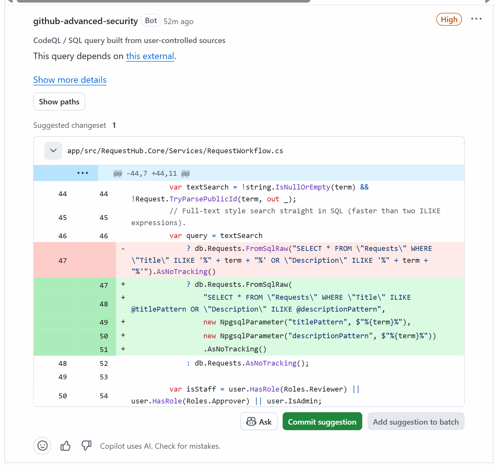
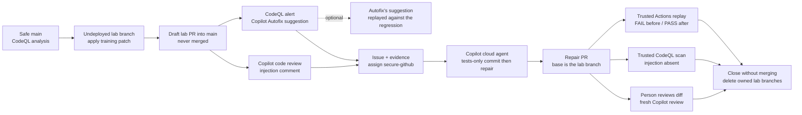
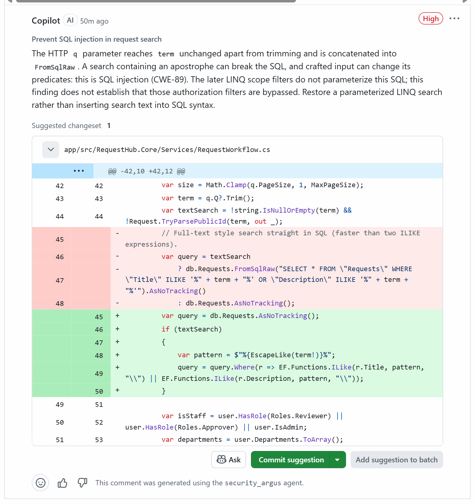
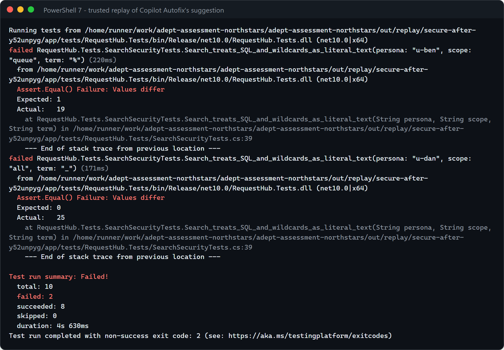
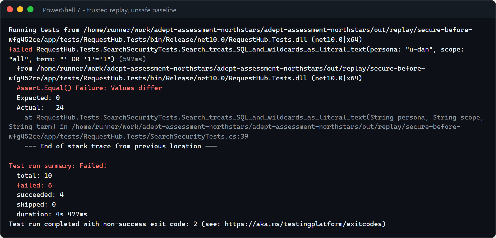
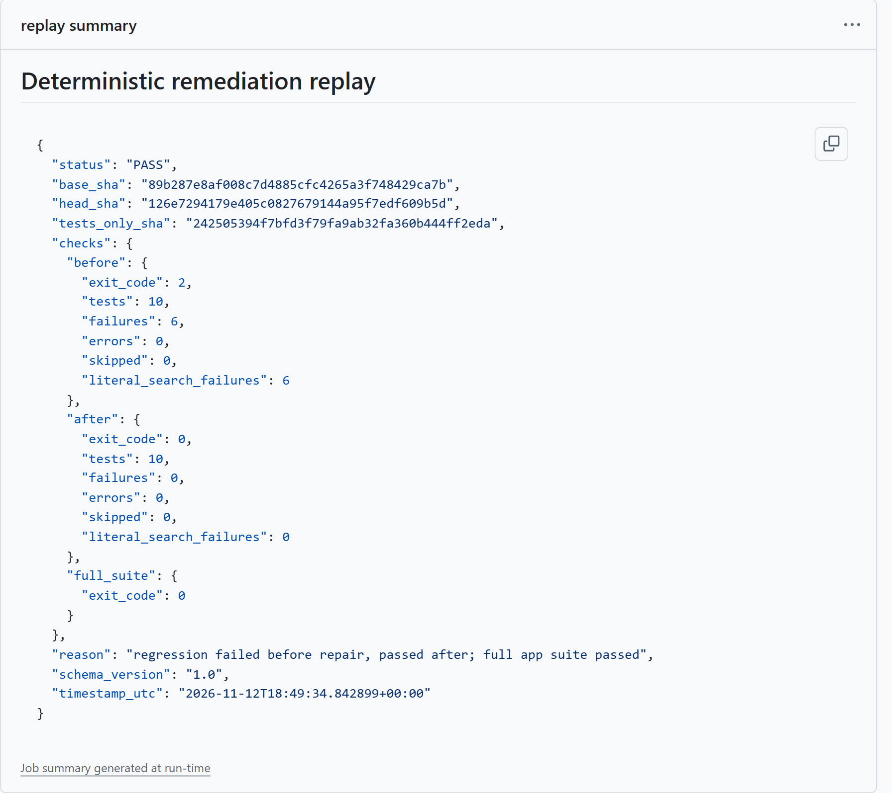
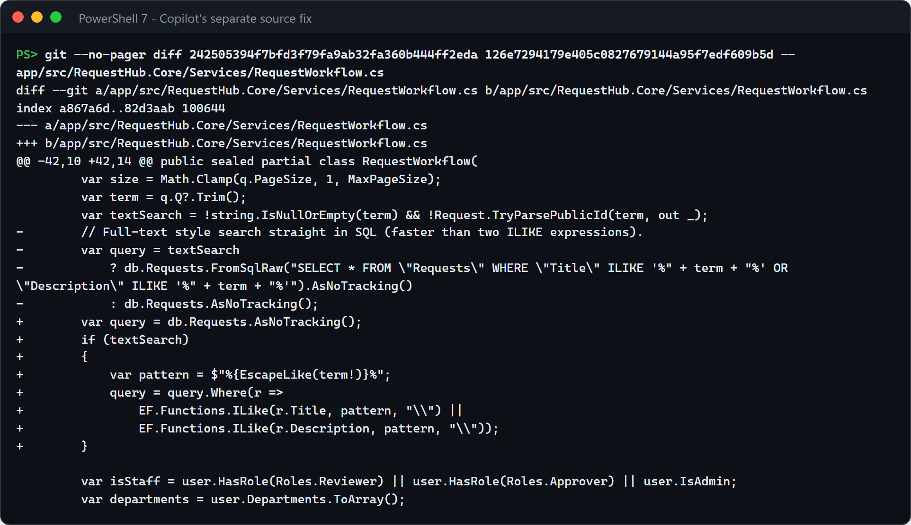
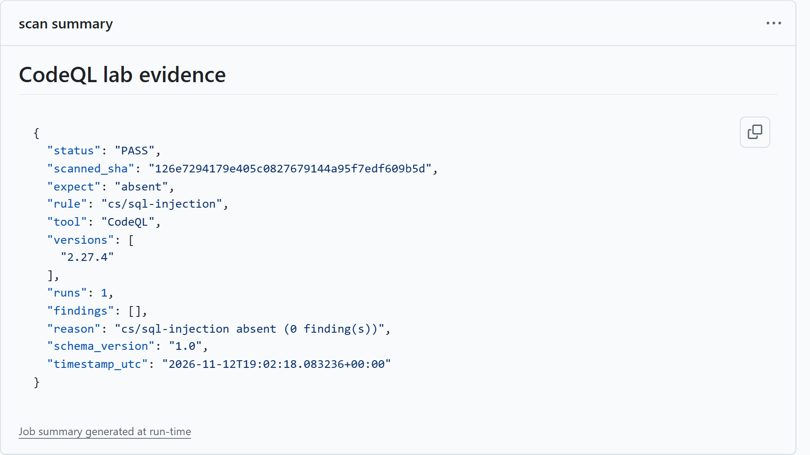
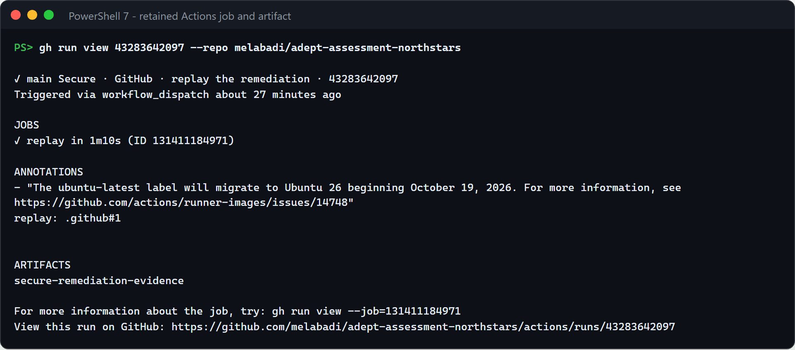

# Secure · Code security remediation with GitHub

Security findings are useful only when someone can turn them into a safe, verified repair. This solution adds a test-first security repair loop to your repository. An unsafe change is proposed to `main` as a **draft pull request from an undeployed lab branch**. **CodeQL code scanning** traces the request's search input into the SQL query and flags the injection on the pull request, where **Copilot Autofix** suggests a fix, and **Copilot code review** flags it too. A custom **Copilot cloud agent** commits the failing regression before its repair, **GitHub Actions** independently proves failure before and success after, and CodeQL confirms the injection is gone. A person reviews the result. AI review isn't code scanning, an Autofix suggestion isn't a verified repair, and neither a clean scan nor passing tests proves that all vulnerabilities are absent.



- **See it work:** [the recorded RequestHub repair](#see-it-work): CodeQL's alert and Autofix's suggestion within 2 minutes, that suggestion checked against the regression, Copilot's separate test and fix commits, six failures before and ten passes after.
- **Add it to your repository:** [copy the package, adapt its boundaries, models and tests, then enable it once](#add-it-to-your-repository). Allow a settings-and-merge step plus adaptation time for your stack; that work has not been timed in another codebase.
- **Try it first in a copy of this repository:** [the RequestHub exercise](#try-it-first-in-a-copy-of-this-repository), with no code adaptation or Azure deployment. Allow a few minutes for setup, then roughly 30–40 minutes for scanning, review, the agent and checks; the recorded timings below are observations, not guarantees.

## Why it matters

**Phase 5 of 7: Secure.** A security review often ends with a proposed fix and a green build, without showing that a test would have caught the original flaw. Here the finding becomes a regression that fails on a known unsafe commit, passes on the repaired commit, and stays alongside the repair for review. The same regression checks a suggested fix before anyone trusts it.

| | Today | With this solution |
| --- | --- | --- |
| Detection | Someone notices unsafe data access in a manual review. | CodeQL traces the search input to the SQL query on the pull request; Copilot reviews the actual diff. |
| Suggestion | A developer researches a fix. | Copilot Autofix suggests a change on the alert; the regression shows whether it's enough. |
| Repair | A developer proposes escaping or filtering, with uncertain coverage. | Copilot commits the regression first, then uses a parameterized query in a separate commit. |
| Verification | A green build or an AI explanation is taken as proof. | Trusted Actions checks unchanged assertions, bounded source edits, failure before and success after; a trusted CodeQL scan finds the injection gone. |
| Decision | Remediation and approval blur together. | A person reviews; training pull requests never merge and business approval authority never changes. |

In the recorded run, CodeQL flagged the injection and Autofix suggested a fix **1 minute 50 seconds** after the pull request opened; Copilot code review flagged it after **6 minutes 34 seconds**. Autofix's suggestion removed the injection, but **2 of 10** regression cases still failed: `%` and `_` searched as wildcards. The cloud agent worked **10 minutes 5 seconds** and committed its tests before its repair; the trusted replay took **1 minute 10 seconds**, with **6 of 10 failures before**, **10 of 10 passes after** and **77 of 77** full-suite tests passing; and a trusted CodeQL scan found no injection in the repair. The value is a finding turned into a repair whose evidence a reviewer can check, not a claim of customer savings or compliance.

The [Microsoft counterpart](../05-secure-microsoft/) addresses deployed cloud posture. The [Secure combo](../../PRESENTING.md#secure-azure-finds-and-fixes-copilot-reviews-a-person-deploys) uses this solution's Copilot review instructions to review that posture fix before a person deploys it.

## How it works



- **CodeQL code scanning** supplies deterministic detection. [`secure-github-scan.yml`](.github/workflows/secure-github-scan.yml) analyzes every push to `main` or a `lab/secure-*` branch, and every pull request into one of them that changes the app, with the `security-extended` queries. Code scanning compares a pull request's analysis with its base branch's and flags new alerts on the pull request, with the data flow from source to sink. RequestHub passes its API handlers to `MapGet` and `MapPost` by method name, which CodeQL's C# extractor can't resolve, so a [model pack](.github/codeql/extensions/requesthub-endpoints/models/ApiEndpoints.model.yml) declares which handler parameters carry request input. Without it, CodeQL sees no API input and finds nothing.
- **Copilot Autofix** suggests a code change for a supported CodeQL alert, on the pull request. It's on by default wherever CodeQL runs. A suggestion is input to weigh: the supplied regression and the trusted replay decide.
- **Copilot code review** supplies advisory, nondeterministic detection. A real injection comment at the reviewed SHA counts; a completed review workflow alone does not.
- **The Copilot cloud agent**, using [`secure-github`](.github/agents/secure-github.agent.md), follows **finding-triage** and **verified-remediation**: preserve the reference regression, commit it alone, show failed assertions, then repair only the allowed method. This is Copilot-assisted remediation, not Copilot Autofix.
- **GitHub Actions** runs against real PostgreSQL in isolated runner databases, without Azure credentials. The manually dispatched replay takes its checker and regression reference from trusted `main`, checks the pull request's same-repository lab boundary, and runs before, after and full-suite tests. A scan dispatched from `main` checks one branch with `main`'s checker and models and an explicit expectation. Every scan checks entitlement before CodeQL runs.
- **A person** opens the lab's pull request as a draft, assigns the Issue, inspects the agent's changes before approving workflows, and decides whether the evidence is adequate. In the training exercise every pull request closes without merging; no unsafe code reaches `main` or a deployment.

**A draft that never merges.** The lab's pull request targets `main`, as a real change would, so code scanning compares it with `main`'s analysis. It stays a draft, which GitHub can't merge. Copilot opens its repair on top of it, so GitHub treats the two as a [stack](https://docs.github.com/en/pull-requests/get-started/about-stacked-prs): checks and code scanning on the repair run as if it targeted `main`, and merging the repair would merge the lab beneath it. Both close without merging.

**Outside contributions.** Opening an Issue or a fork's pull request doesn't start Copilot: assignment and `@copilot` require write access. A fork's pull request starts no scan. A scan or replay dispatch starts only from `main`, and the replay accepts only pull requests from this repository's branches into `lab/secure-*`. Tooling checks on fork pull requests use a read-only token and no secrets, subject to GitHub's approval rules.

## See it work

This run took place on **12 November 2026**, starting from safe `main` at [`a6b89e8`](https://github.com/melabadi/adept-assessment-northstars/commit/a6b89e800bbf61ddde380f005fd256cfad0d958b). The repository owner opened [draft lab PR #386](https://github.com/melabadi/adept-assessment-northstars/pull/386), where CodeQL, Copilot Autofix and Copilot code review commented; checked Autofix's suggestion in [#391](https://github.com/melabadi/adept-assessment-northstars/pull/391); and assigned [Issue #388](https://github.com/melabadi/adept-assessment-northstars/issues/388), for which Copilot produced [repair PR #389](https://github.com/melabadi/adept-assessment-northstars/pull/389). All nine screenshots below came from this run. Its [public evidence comment](https://github.com/melabadi/adept-assessment-northstars/pull/389#issuecomment-6833777757) records the results and reset.

The public pull requests, commits and files open without signing in. Code scanning alert pages, Actions job logs, summaries and artifact downloads require sign-in, and logs expire, so screenshots show them here. The [committed evidence](evidence/) keeps this run's replay results, CodeQL findings and the replay of Autofix's suggestion.

### 1. The unsafe change went to main as a draft pull request

The owner opened draft #386 at **18:18:08 UTC**, from [`lab/code-finding.patch`](lab/code-finding.patch) on top of `main`, as unsafe commit [`89b287e`](https://github.com/melabadi/adept-assessment-northstars/commit/89b287e8af008c7d4885cfc4265a3f748429ca7b). The patch concatenates `q.Q` into `FromSqlRaw` in `ListAsync`. Existing role and department filters remained, but didn't make SQL concatenation safe. A draft can't be merged, and the branch was never deployed. Lab preparation wasn't separately timed. The app's CI also failed, on the existing test that searches for `%` and `_` as literal characters; that failure was kept rather than weakening a check.


**What this shows:** the training defect existed only on an undeployed branch, in a pull request GitHub can't merge.

### 2. CodeQL flagged the injection, and Copilot Autofix suggested a fix

CodeQL analyzed the pull request from **18:18:10 to 18:20:12 UTC**. At **18:19:58**, **1 minute 50 seconds** after the pull request opened, code scanning posted its [alert](https://github.com/melabadi/adept-assessment-northstars/pull/386#discussion_r4554527130): *SQL query built from user-controlled sources* (`cs/sql-injection`), High, at `RequestWorkflow.cs:47`. The pull request's CodeQL check failed with *1 new alert including 1 high severity security vulnerability*. **Show paths** traces the alert in 11 steps, from the `q` parameter of `ListRequests`, which the model pack declares as remote input, through `RequestQuery.Q` to `FromSqlRaw`. The alert came with Copilot Autofix's suggested change: the same raw SQL, with the search pattern bound as two `NpgsqlParameter` values. The scan's own check of the finding, kept in [`codeql/lab-pull-request.json`](evidence/codeql/lab-pull-request.json), recorded `cs/sql-injection present (1 finding(s))` in the pull request's merge commit.


**What this shows:** a deterministic, traced finding and an AI fix suggestion, both on the pull request.

### 3. Copilot code review flagged it too, including what Autofix missed

The owner requested Copilot's review when the pull request opened; it arrived at **18:24:42 UTC**, **6 minutes 34 seconds** later. Its [High finding](https://github.com/melabadi/adept-assessment-northstars/pull/386#discussion_r4554577499) traced the HTTP `q` parameter into `FromSqlRaw` and suggested restoring the parameterized `ILike` search with `EscapeLike`. A [Medium finding](https://github.com/melabadi/adept-assessment-northstars/pull/386#discussion_r4554577586) added that the patch also removed literal escaping of `%` and `_`. This was Copilot code review, not CodeQL.



**What this shows:** a second, independent finding at the reviewed commit, which also named a behavior change the scanner doesn't look for.

### 4. The regression showed that Autofix's suggestion wasn't enough

The owner checked Autofix's suggestion as written, in [#391](https://github.com/melabadi/adept-assessment-northstars/pull/391) into the lab branch: the supplied regression in its own commit, [`90d27c3`](https://github.com/melabadi/adept-assessment-northstars/pull/391/commits/90d27c30334bbc39fbee2f279f2ecd1e8a74d397), then the suggested change, [`ea73d33`](https://github.com/melabadi/adept-assessment-northstars/pull/391/commits/ea73d339b3be0a9d74c247dd634fe13d42ece231). CodeQL found no injection in it. The trusted replay (job **18:38:52–18:40:05 UTC**) still failed: the four injection cases passed, but a literal `%` search returned 19 records instead of 1, and `_` returned 25 instead of 0. Its [after-test log](evidence/autofix/after-test.log) and [JUnit report](evidence/autofix/after/search.junit.xml) are kept.



**What this shows:** a clean scan isn't correct behavior. The regression decides, not the suggestion.

### 5. Copilot committed the failing regression before its repair

The owner created [#388](https://github.com/melabadi/adept-assessment-northstars/issues/388) from [`remediate-task.md`](remediate-task.md), with Copilot's finding and reviewed SHA, the CodeQL alert, scan run and scanned SHA, Autofix's suggested change (pasted: the API doesn't return it) and a same-run review export. At **18:36:44 UTC** the owner assigned it to the `secure-github` agent on the lab branch. Copilot opened [#389](https://github.com/melabadi/adept-assessment-northstars/pull/389) at **18:36:51**. It committed the unchanged regression alone as [`2425053`](https://github.com/melabadi/adept-assessment-northstars/pull/389/commits/242505394f7bfd3f79fa9ab32fa360b444ff2eda) at **18:41:34**, then the source fix separately as [`126e729`](https://github.com/melabadi/adept-assessment-northstars/pull/389/commits/126e7294179e405c0827679144a95f7edf609b5d) at **18:42:35**. The session's work-start and work-finished events spanned **18:37:25–18:47:30**, **10 minutes 5 seconds**.



The image is the **before-repair output of the independent replay in step 6**, not a capture of Copilot's session. [`before-test.log`](evidence/before-test.log) keeps all six failures, including a search for `quote'` that broke the SQL and returned a server error.

**What this shows:** Copilot's committed history kept the tests separate and earlier than the source repair, and real failed assertions established the defect.

### 6. A person approved execution and Actions independently verified the repair

The owner inspected the diff, approved the repair's workflow runs at **18:48:10 UTC** and dispatched the trusted replay from `main`. Its job ran **18:48:27–18:49:37 UTC**, **1 minute 10 seconds**: **6 failures and 4 passes before**, **10 passes after**, zero errors or skips, and **77 of 77** full-suite tests passing. The before/after checker and reference came from `main`, not Copilot's pull request.



The run's [`results.json`](evidence/results.json), [before JUnit](evidence/before/search.junit.xml), [after JUnit](evidence/after/search.junit.xml) and [full-suite log](evidence/after-full-suite.log) are kept. A build failure, unreachable database, zero tests or skipped tests would have failed the gate.

**What this shows:** the identical regression failed against unsafe source and passed against the repair, followed by the full app suite, under trusted checks.

### 7. The repair restored parameterized, literal search

The [two-file repair](https://github.com/melabadi/adept-assessment-northstars/pull/389/files) added the regression and changed only `ListAsync`. Copilot replaced the raw SQL with parameterized `EF.Functions.ILike` predicates, escaping `%` and `_` with `EscapeLike` and an explicit escape character, and left the authorization filters intact. Human diff-review time wasn't measured.



A fresh Copilot review, requested at 19:02:54 and posted at **19:07:41 UTC**, found no open issues, and said that it couldn't verify the replay or the CodeQL rescan itself. The owner kept that limitation in the [evidence comment](https://github.com/melabadi/adept-assessment-northstars/pull/389#issuecomment-6833777757); it wasn't treated as a clean security assessment or a human approval.

**What this shows:** the bounded repair removed SQL interpretation of search input while keeping literal search and access scope under regression tests.

### 8. CodeQL no longer found the injection

The repair's own CodeQL check reported *No new alerts in code changed by this pull request*. Because #389 is stacked on #386, GitHub analyzed it as if it targeted `main` and compared it with `main`'s analysis. For the same reason, the workflow's check of the expected result read `main` as the base and was skipped in this run; the workflow now reads the pull request's own base, a change that hasn't run on a stacked repair yet. The owner also dispatched the scan from `main` against the repair's head, `126e729`, with `expect=absent`. It ran **18:59:54–19:02:23 UTC** with `main`'s checker and models and found `cs/sql-injection` **absent** ([`codeql/repair.json`](evidence/codeql/repair.json)).



**What this shows:** the scanner that found the injection no longer finds it in the repair, checked from trusted `main`.

### 9. The evidence remained and the lab was closed without merging

The owner linked the findings, commits and runs in the [public evidence comment](https://github.com/melabadi/adept-assessment-northstars/pull/389#issuecomment-6833777757), kept the run's artifacts in [`evidence/`](evidence/), closed #389, #391 and #386 **without merging**, closed #388, and removed only this run's lab branches. With `replay_setup.py --adopt 389`, the nightly replay now replays this repair; its first run from the repository variable passed at 19:32 UTC, after the branches were gone. Evidence collection and cleanup weren't separately timed.



**What this shows:** the run left reviewable evidence and regression commits, not an unsafe merge, an automatic deployment or an unqualified AI success claim.

## Results and value

The run left a real [CodeQL alert with Autofix's suggestion](https://github.com/melabadi/adept-assessment-northstars/pull/386#discussion_r4554527130) and [Copilot finding](https://github.com/melabadi/adept-assessment-northstars/pull/386#discussion_r4554577499) on #386, the [replay of Autofix's suggestion](https://github.com/melabadi/adept-assessment-northstars/pull/391) on #391, [Copilot's tests-first repair](https://github.com/melabadi/adept-assessment-northstars/pull/389/commits) on #389, nine screenshots and a public [outcome record](https://github.com/melabadi/adept-assessment-northstars/pull/389#issuecomment-6833777757). Every pull request was closed, not merged: this was a defensive training exercise, not a production remediation approval.

| Measured in this run | Result | Value to a reviewer |
| --- | --- | --- |
| Pull request opened to CodeQL alert and Autofix suggestion | 1 min 50 s | A traced, deterministic finding and a fix to weigh, on the pull request |
| Pull request opened to Copilot review | 6 min 34 s | A second finding, which also named the lost wildcard escaping |
| Autofix's suggestion, replayed | Injection gone; 2 of 10 cases failed | Proof that a suggestion and a clean scan aren't acceptance |
| Cloud agent work-start to work-finished | 10 min 5 s | Separate test and source commits, with no correction to the supplied regression needed |
| Trusted replay job | 1 min 10 s | Six failures before, ten passes after and the full 77-test suite passing |
| Trusted CodeQL scan of the repair | 2 min 29 s | The injection absent at the repair's head |
| Pull request opened to replay completion | 31 min 29 s | A traceable finding-to-verified-repair interval, including review and human steps, not a savings benchmark |

The [committed evidence](evidence/) is readable without a GitHub account and survives log expiration. No customer time savings, review completeness, Autofix success rate or compliance outcome was measured. **Track detection-to-independently-verified-repair time when you adopt this**, alongside missed detections, review rounds, how often a suggested fix passes the regression, and the access-control cases the regression covers.

## Add it to your repository

This package is specialized for RequestHub's .NET 10, xUnit v3 and PostgreSQL stack. The integration below uses the same scan, review, Issue assignment and replay commands as the optional copy exercise. Adapt the named files before using them with your code; this README does not claim that an untested adaptation works.

### Prerequisites

- The root README's [Before you start](../../README.md#before-you-start): Git, GitHub CLI, PowerShell 7.4+ and Python 3.12+. These Python scripts use only the standard library.
- **Code scanning with CodeQL:** a public repository, or a private or internal repository owned by an organization with **GitHub Code Security**. GitHub Enterprise alone is insufficient. Copilot Autofix is on by default wherever CodeQL runs. Without code scanning, the Copilot review path still works, and the scan's preflight stops before CodeQL runs.
- **A paid GitHub Copilot plan** with code review and the cloud agent allowed for the repository, plus write access to request reviews, assign Issues, approve workflows and set repository variables. GitHub Enterprise alone does not grant Copilot or Code Security.
- **A Copilot session on GitHub Actions.** The agent runs your tests in its session, with the services that [`copilot-setup-steps.yml`](../../.github/workflows/copilot-setup-steps.yml) starts; here it starts PostgreSQL. Cloud sandboxes do not run setup steps, and cloud is the default where GitHub offers an environment choice: **choose GitHub Actions** ([environment comparison](https://docs.github.com/en/copilot/concepts/copilot-surfaces/copilot-on-github#comparison-of-github-actions-based-sessions-and-cloud-sandboxes)).
- Actions enabled and a person available to approve the agent's pull request workflows after inspecting the changes. The custom agent, the trusted checker and the scan workflow must reach the default branch before first use.
- Integration tests and disposable database access in both the agent's setup and replay runner. A local API is not needed for this exercise. Optional local replay requires .NET 10 and PostgreSQL as in the [app README](../../app/README.md); `ApiFixture` creates isolated databases and `REQUESTHUB_TEST_PG` selects another test server.
- Deployment rules that exclude **both `lab/secure-*` and `copilot/*`**. Check every release/deployment workflow before introducing the training patch; never dispatch deployments from those refs, and never mark the lab's draft pull request ready for review.

### What to copy and what to change

From your repository's root, obtain the package in a separate local source clone. The commands below copy the solution assets and merge its `.github` contents into your repository's root `.github`. Review any filename collision before copying; do not overwrite existing customizations.

```powershell
$src = Join-Path ([IO.Path]::GetTempPath()) "ai-sdlc-secure-$(Get-Date -Format yyyyMMddHHmmss)"
git clone --quiet --depth 1 https://github.com/melabadi/adept-assessment-northstars.git $src
New-Item -ItemType Directory -Force solutions, .github | Out-Null
Copy-Item -Recurse (Join-Path $src 'solutions\05-secure-github') solutions
Copy-Item -Recurse -Force (Join-Path $src 'solutions\05-secure-github\.github\*') .github
git status --short --untracked-files=all
```

What you should see: `solutions\05-secure-github` plus its agents, skills, workflows, CodeQL models, instructions and Issue form under root `.github`. GitHub reads **root `.github`**, not the nested source copy. The source clone remains at `$src` for comparing setup examples; remove that exact clone when finished.

| Real file | What to adapt for your code |
| --- | --- |
| [`.github/agents/secure-github.agent.md`](.github/agents/secure-github.agent.md) and both [`SKILL.md` procedures](.github/skills/verified-remediation/SKILL.md) | Your source/test paths, business invariants, test commands and boundaries. Keep tests-first commits, no automatic approval and no deployment. |
| [`lab/code-finding.patch`](lab/code-finding.patch), [`regression/SearchSecurityTests.cs`](regression/SearchSecurityTests.cs), [`remediate-task.md`](remediate-task.md) | A small, undeployed defect and a behavior-based oracle for your app, including negative authorization cases. Never apply the RequestHub patch to unrelated code. |
| [`secure-github-scan.yml`](.github/workflows/secure-github-scan.yml) | The default branch (`main` here), the C# build command, the paths filter and the query suite. Keep the entitlement preflight, the checker and models from the default branch for dispatches, the fork exclusion, and leave CodeQL default setup off: this is the advanced setup. |
| [`.github/codeql/extensions/requesthub-endpoints/`](.github/codeql/extensions/requesthub-endpoints/models/ApiEndpoints.model.yml) | One row per handler that takes request input, if your handlers are method names passed to `Map*`. CodeQL already sees lambdas and MVC controller actions; drop the pack if it sees your inputs without it. |
| [`finding_triage.py`](.github/skills/finding-triage/finding_triage.py) | `SOURCE`, the expected scanner rule/path and your actual finding evidence. Preserve fail-closed entitlement checks. |
| [`verify_remediation.py`](.github/skills/verified-remediation/verify_remediation.py) | `TEST`, `WORKFLOW`, the `ListAsync` method boundary, `app/RequestHub.slnx`, the selected test name/runner and exactly-ten-case expectation. Preserve identical assertions, real assertion failure, no skips/errors and full-suite success. |
| [`secure-github-verify.yml`](.github/workflows/secure-github-verify.yml) | SDK, PostgreSQL service, checker path and default-branch guard (`main` here). Keep read-only permissions, same-repository/lab checks and trusted default-branch execution. |
| [`secure-github-checks.yml`](.github/workflows/secure-github-checks.yml) | Paths, unit-test discovery and patch applicability. Its `python tools/sync_solutions.py --check` step is this demo repository's mirror mechanism: remove that step in a repository without mirrors, or copy and maintain that mechanism deliberately. |
| [`replay_setup.py`](replay_setup.py) and [`tests/test_security_tools.py`](tests/test_security_tools.py) | RequestHub paths, reference repair construction, the endpoint-model check and the checks for your adapted workflows. Do not replay #389 in another repository: pull request numbers belong to their own repository. |
| Shared [`.github/workflows/copilot-setup-steps.yml`](../../.github/workflows/copilot-setup-steps.yml) and your existing CI | Merge the needed database, SDK and restore steps into your setup job named `copilot-setup-steps`; do not replace unrelated setup. Its web and all-solution dependency steps are RequestHub-specific. CI must cover your repaired behavior. |
| Your root `.github/copilot-instructions.md` | The agent reads this file. Create or update it with your build/test commands, authorization invariants and no-deployment lab rules; preserve your existing repository instructions. |
| [`secure-github-posture-review.instructions.md`](.github/instructions/secure-github-posture-review.instructions.md) | This is for the Microsoft counterpart's Bicep fix. Set `applyTo` to your infrastructure folder, or omit it if you do not use that combo. |

If you retain nested source copies, keep the root files in sync with them. Workflow action pins should stay pinned; replace application assumptions, not the security gates.

### One-time setup

1. **Adapt and validate locally, then merge the package.** In this repository the checks are:

   ```powershell
   python -m unittest discover -s solutions\05-secure-github\tests -v
   git apply --check --ignore-space-change solutions\05-secure-github\lab\code-finding.patch
   ```

   Run your adapted equivalents and your normal CI. Expected: the parser, guard, workflow-rule and endpoint-model tests pass, the patch applies to safe source without changing it, and CI passes. Merge through your normal human-reviewed pull request; do not assign an agent that only exists on an unmerged branch. The push to the default branch then runs the first CodeQL analysis: **Security and quality → Code scanning** shows it, with no alert on safe code.

2. **Enable Copilot, check code scanning and create the Issue labels.** Allow the cloud agent and code review in account/organization settings; choose an Actions-based agent session. In **Settings → Advanced Security**, leave CodeQL default setup off and keep **Copilot Autofix** on. Then:

   ```powershell
   gh label create ai-sdlc --color 1D76DB --description "AI-SDLC demo work" --force
   gh label create phase:secure --color C5DEF5 --description "SDLC phase 5: Secure" --force
   $repo = gh repo view --json nameWithOwner -q .nameWithOwner
   gh api "repos/$repo/contents/.github/agents/secure-github.agent.md" --jq .path
   gh api "repos/$repo/code-scanning/analyses?ref=refs/heads/main&per_page=1" --jq '.[0] | {tool: .tool.name, category, results_count}'
   ```

   Expected: `$repo` is **your** repository, the agent path prints, Issues offer Copilot as an assignee, and the latest analysis of `main` is CodeQL's, category `secure-github-csharp`, with 0 results. Recheck deployment exclusions before first use.

3. **Choose whether to enable the nightly replay.** It is optional and independent of a fresh AI run. Once your adapted reference repair is valid:

   ```powershell
   python solutions\05-secure-github\replay_setup.py
   python solutions\05-secure-github\replay_setup.py --status
   ```

   Expected: the script creates or reuses a closed reference repair pull request on three `lab/secure-replay*` branches and sets `SECURE_REPLAY_PR` to **its number**. It uses `[skip ci]` commits, not Copilot; it is reference data, not evidence of an AI repair. Alternatively, after first use, run `--adopt <your repair PR>` to replay an actual repair. With no variable, schedules skip and do not send nightly setup failures. Manual dispatch without a variable or `pr` input still fails with setup guidance.

### First use

Follow the [nine numbered steps below](#try-it-first-in-a-copy-of-this-repository), replacing the RequestHub patch, regression, models and source paths with your adapted ones. Open the lab change as a draft pull request into your default branch, read CodeQL's alert, Autofix's suggestion and an actual review finding at its immutable SHA, optionally replay Autofix's suggestion, assign that evidence to `secure-github`, approve workflows only after inspecting changes, and dispatch the trusted replay and scan from the default branch. Require failed assertions before, all cases passing after, full-suite success and the injection absent. Request a fresh review of the repair; retain any access limitation or missed detection.

For training, close without merging and reset only owned lab resources. For a real production flaw, use your normal security response and human-reviewed release process instead of copying the training cleanup decision.

### Nightly replay and lasting evidence

[`secure-github-verify.yml`](.github/workflows/secure-github-verify.yml) requests **midnight Eastern** (`America/New_York`), 05:00 UTC in winter and 04:00 UTC in summer. It runs from the default branch, replays `SECURE_REPLAY_PR`, and fetches immutable commits from the pull request record even after lab branches are deleted. Here the variable is 389, the recorded run's repair; in your repository it must name your own repair pull request. Manual dispatch can override it with `-f pr=<number>`.

The replay creates no Issue, pull request, review or agent session and needs no new token or secret. Permissions are read-only, executions share a concurrency group, and it never pushes, commits or comments; it cannot start a release candidate through a nightly commit. The timeout is 30 minutes. In the recorded run the replay job took **1 minute 10 seconds**, and the first replay of #389 from the variable took 1 minute 46 seconds.

Open [the workflow's runs](https://github.com/melabadi/adept-assessment-northstars/actions/workflows/secure-github-verify.yml) for recent executions. Job logs and artifacts require sign-in and expire after **90 days** here; the [committed evidence](evidence/) remains readable without sign-in. It is historical evidence, not an automatically updated nightly result. Export and privacy-check evidence you want to retain in your own repository.

GitHub may delay or drop scheduled runs. In public repositories it disables schedules after **60 days without repository activity**. Resume via **Actions → Secure · GitHub · replay the remediation → Enable workflow**; use **… → Disable workflow** to stop it. The workflow never manufactures repository activity to avoid the pause.

### What it costs

A paid GitHub Copilot plan and applicable repository policy are required for reviews and agent sessions. Each requested review and cloud-agent task consumes the usage charged by your current plan/model; retries and follow-up work add usage. Billable AI usage was not measured for this run. Check [Copilot billing and usage](https://docs.github.com/en/copilot/concepts/billing-and-usage) and your spending limit before repeating it.

Code scanning with CodeQL is free on public repositories; private repositories need GitHub Code Security. Copilot Autofix's suggestions don't consume AI credits; agentic autofix, which this solution doesn't use, does. Each CodeQL analysis is one Actions run of two jobs, entitlement and scan, about 2 minutes here: one per push to `main` or a lab branch, and one per pull request update into them that changes the app.

Actions supplies the agent environment, the scans and the replay runner. Standard GitHub-hosted runners are free for public repositories; private repositories draw on their plan's included compute allowance and then billed usage. Copilot execution compute is separate from AI usage; check the current [compute billing rules](https://docs.github.com/en/billing/concepts/product-billing/cloud-and-local-sandboxes) as well as the Copilot plan. The recorded replay used one job for 1m10s, plus separate scans, CI and agent work; it is not a measured total bill. The nightly deterministic replay consumes **no Copilot requests or AI credits**. No Azure resource or credential is needed.

### Code scanning and Copilot Autofix

The scan workflow uploads every push's and pull request's analysis to code scanning, under the category `secure-github-csharp`. On a pull request, code scanning shows the alerts that its base branch's analysis doesn't have, as annotations and as a failing **CodeQL** check, and Copilot Autofix attaches a suggested change to each supported new alert. On a pull request from or into a lab branch, the workflow also checks the expected result with [`finding_triage.py`](.github/skills/finding-triage/finding_triage.py), from the default branch: the lab's pull request must show `cs/sql-injection`, and a repair must not. Its `secure-codeql-evidence` artifact keeps the SARIF and the check's JSON.

- **The model pack.** CodeQL picks up [`.github/codeql/extensions/requesthub-endpoints`](.github/codeql/extensions/requesthub-endpoints/codeql-pack.yml) by itself, in default and advanced setup. Each row marks a handler's request-bound parameters as remote input, by position; `EndpointModelTests` fails when a handler's parameters and the rows disagree.
- **Autofix's suggestion** shows on the pull request page, under the alert comment, with **Commit suggestion**. Don't commit it on the lab's pull request: the lab must stay unsafe for the repair. The comment's API body doesn't include the suggestion, and the REST autofix endpoints only cover alerts on the default branch; copy the change from the page.
- **A trusted scan** checks one branch from the default branch, with an explicit expectation. A dispatch uploads nothing unless asked:

  ```powershell
  gh workflow run secure-github-scan.yml --ref main -f target_ref=<branch> -f expect=absent
  ```

  Require a successful preflight, real C# analysis, the expected `cs/sql-injection` state at `app/src/RequestHub.Core/Services/RequestWorkflow.cs` in **secure-codeql-evidence**, and the right scanned SHA. Skipped jobs or absent SARIF are not clean scans. `publish_alerts=true` uploads a dispatch's results to code scanning too.

**Agentic autofix** is a separate feature: it assigns alerts on the default branch to Copilot, which opens a draft pull request, and it consumes AI credits. This training flaw never reaches the default branch, so it doesn't apply here.

Secret scanning, push-protection detection, dependency review and Dependabot are separate products, not proven by this injection lab. No secret is introduced; secret detection is **NOT_RUN**, not PASS. Use the supported, licensed test procedure separately, never an active credential or a custom dummy pattern passed off as provider detection.

## Try it first in a copy of this repository

Optional: try the same workflow on RequestHub before adapting anything. Make your copy once using the root README's [Try it in a copy of this repository](../../README.md#try-it-in-a-copy-of-this-repository). From that copy's root, use the [prerequisites](#prerequisites), allow Copilot, **choose an Actions-based session**, and run the checks in [One-time setup](#one-time-setup). The files are already mirrored into root `.github`, so there is nothing to copy. Setup is a few commands plus account settings; no local API, database or Azure deployment is needed.

Confirm `git status --short` is empty, the repository printed by `gh repo view` is your copy, and release/deployment workflows exclude the lab and agent refs. Check for unfinished work with `gh pr list --state open`, `gh issue list --label phase:secure --state open` and `git ls-remote --heads origin 'lab/secure-*'`; do not close or delete someone else's work. The optional `lab/secure-replay*` branches belong to the nightly reference and stay.

Use your new run's numbers below, not #386/#389. These commands create a temporary lab branch with a draft pull request into `main` that is never merged, an optional branch for Autofix's suggestion, and Copilot's repair branch. Steps match [See it work](#see-it-work); timings are planning allowances unless explicitly measured there.

### 1. Open the undeployed lab as a draft pull request

Allow about a minute; lab preparation was not separately timed in the recorded run.

```powershell
git fetch origin main
$repo = gh repo view --json nameWithOwner -q .nameWithOwner
$run = Get-Date -Format "yyyyMMdd-HHmmss"
$lab = "lab/secure-$run"
git worktree add -b $lab "out\secure-$run" origin/main
Push-Location "out\secure-$run"
git apply --check --ignore-space-change solutions\05-secure-github\lab\code-finding.patch
git apply --ignore-space-change solutions\05-secure-github\lab\code-finding.patch
git add app/src/RequestHub.Core/Services/RequestWorkflow.cs
git commit -m "Secure lab: intentionally unsafe search, never deploy or merge"
git push -u origin $lab
$unsafe = git rev-parse HEAD
$url = gh pr create --draft --base main --head $lab --title "Secure lab: review the unsafe search (never merge)" `
  --body "Defensive training only. Undeployed lab. Review the search data flow and injection risk. NEVER merge or deploy; it stays a draft, which can't be merged."
$labPr = $url.Split('/')[-1]
Pop-Location
```

Expected: a draft pull request into `main` whose diff adds concatenated `FromSqlRaw` in `ListAsync`. A red CI run is expected for the lost literal-wildcard behavior, not a reason to weaken tests. Never mark it ready for review.

### 2. Read CodeQL's alert and Autofix's suggestion

Allow about 2 minutes: in the recorded run, the alert and Autofix's suggestion arrived **1 minute 50 seconds** after the pull request opened.

```powershell
gh pr checks $labPr
gh api "repos/$repo/code-scanning/alerts?ref=refs/pull/$labPr/merge" `
  --jq '.[] | {number, rule: .rule.id, severity: .rule.security_severity_level, path: .most_recent_instance.location.path, line: .most_recent_instance.location.start_line}'
gh api "repos/$repo/pulls/$labPr/comments" --jq '.[] | select(.user.login == "github-advanced-security[bot]") | .html_url'
$scanRun = gh run list --workflow secure-github-scan.yml --branch $lab --event pull_request --limit 1 --json databaseId -q '.[0].databaseId'
gh run download $scanRun --name secure-codeql-evidence --dir "out\secure-scan-$run"
Get-Content "out\secure-scan-$run\finding.json"
```

Expected: the **CodeQL** check fails with 1 new high-severity alert, `cs/sql-injection` at `app/src/RequestHub.Core/Services/RequestWorkflow.cs` line 47, and `finding.json` says `PASS` with `cs/sql-injection present (1 finding(s))` and the scanned merge commit. Open the alert comment's URL: **Show paths** traces the search input from `ListRequests` to `FromSqlRaw`, and Autofix's suggested change sits below it. Note the comment URL as `$alert` and the run's URL as `$scan`. No alert means detection failed: see [Troubleshooting](#troubleshooting), and don't substitute this run's finding.

### 3. Request the real Copilot finding

In **Reviewers**, request **Copilot**, using Balanced effort when available, or:

```powershell
'{"reviewers":["copilot-pull-request-reviewer[bot]"]}' |
  gh api -X POST "repos/$repo/pulls/$labPr/requested_reviewers" --input - > $null
gh api "repos/$repo/pulls/$labPr/comments" --jq '.[] | select(.user.login == "Copilot") | {html_url,commit_id,path,line,body}'
```

Allow several minutes; the recorded review took **6 minutes 34 seconds**. Copy the actual injection comment URL into `$finding` and verify its `commit_id` equals `$unsafe`. A review summary or completed job is insufficient. If it misses the injection, retain that failed detection; CodeQL's alert can still carry the Issue.

### 4. Optional: replay Autofix's suggestion against the regression

Allow about 5 minutes. The replay's job took **1 minute 13 seconds** in the recorded run.

```powershell
$check = "$lab-autofix"
git worktree add -b $check "out\secure-$run-autofix" $unsafe
Copy-Item solutions\05-secure-github\regression\SearchSecurityTests.cs "out\secure-$run-autofix\app\tests\RequestHub.Tests\SearchSecurityTests.cs"
Push-Location "out\secure-$run-autofix"
git add app/tests/RequestHub.Tests/SearchSecurityTests.cs
git commit -m "Add the supplied search security regression (tests only)"
```

Copy Autofix's suggested change from the pull request page into `app/src/RequestHub.Core/Services/RequestWorkflow.cs`, exactly as suggested, then:

```powershell
git commit -am "Apply Copilot Autofix's suggested fix"
git push -u origin $check
$autofixPr = (gh pr create --draft --base $lab --head $check --title "Secure lab: replay Copilot Autofix's suggestion (never merge)" `
  --body "Defensive training only. NEVER merge or deploy.").Split('/')[-1]
Pop-Location
gh workflow run secure-github-verify.yml --ref main -f pr=$autofixPr
```

Expected in the recorded run: the pull request's CodeQL scan found the injection absent, and the replay failed with *Regression still fails after repair*: the `%` and `_` cases. Autofix's suggestion can differ from run to run; record what yours does, and download **secure-remediation-evidence** to keep it.

### 5. Assign the evidenced task to Copilot

```powershell
$finding = "<Copilot's injection comment URL>"
$alert = "<code scanning alert comment URL>"
$scan = "<CodeQL scan run URL>"
$scanned = (Get-Content "out\secure-scan-$run\finding.json" | ConvertFrom-Json).scanned_sha
$task = Get-Content solutions\05-secure-github\remediate-task.md -Raw
$task += "`n`nDetection: Copilot code review and CodeQL code scanning`nFinding: $finding`nReviewed SHA: $unsafe`nCodeQL alert: $alert`nCodeQL scan: $scan`nScanned SHA: $scanned`nCopilot Autofix suggestion: $alert`nLab PR: $url`nBase: $lab`n"
if (Test-Path "out\secure-$run-autofix") {
  $suggested = git -C "out\secure-$run-autofix" diff HEAD~1 HEAD -- app/src/RequestHub.Core/Services/RequestWorkflow.cs | Out-String
  $task += "`nCopilot Autofix suggested this change, copied from the pull request page:`n" + '```diff' + "`n$suggested" + '```' + "`n"
}
$review = gh api "repos/$repo/pulls/$labPr/comments" --jq '.[] | {html_url,commit_id,path,line,body,author:.user.login}'
$task += "`nAuthenticated same-run review export:`n$review`n"
$issueUrl = $task | gh issue create --title "Secure: parameterize the lab search, tests first" `
  --body-file - --label ai-sdlc --label phase:secure
$issue = $issueUrl.Split('/')[-1]
@{ assignees = @('copilot-swe-agent[bot]'); agent_assignment = @{
    target_repo = $repo; base_branch = $lab; custom_agent = 'secure-github'
} } | ConvertTo-Json | gh api -X POST "repos/$repo/issues/$issue/assignees" --input - > $null
gh pr list --base $lab --json number,url,headRefName
```

Without step 4, paste Autofix's suggested change into the Issue by hand: the API doesn't return it. If GitHub offers an environment choice, choose **GitHub Actions**, not the default cloud sandbox. In the UI choose agent **secure-github** and base **lab/secure-RUN**, never `main`. The API above is the assignment used by this solution; check that the resulting session actually runs setup steps. Allow 15–30 minutes for setup and queues; recorded session events spanned **10 minutes 5 seconds**. Inspect the tests-only commit, failed assertions and separate source fix. Record the repair pull request's number as `$repair`; compilation failure is not proof of injection.

### 6. Approve execution and independently verify

Inspect the diff before approving the agent's workflows. Use **Approve and run workflows**, or rerun the waiting runs of the head commit as a maintainer:

```powershell
$repair = Read-Host 'Repair PR number'
$branch = gh pr view $repair --json headRefName -q .headRefName
$head = gh pr view $repair --json headRefOid -q .headRefOid
gh run list --commit $head --status action_required --json databaseId -q '.[].databaseId' |
  ForEach-Object { gh run rerun $_ }
gh workflow run secure-github-verify.yml --ref main -f pr=$repair
gh run list --workflow secure-github-verify.yml --limit 3
```

The recorded replay job took **1 minute 10 seconds**, plus any queue time. Expected: failed regression before, all ten cases passing after, no skipped/error cases, full suite passing. Download **secure-remediation-evidence** and inspect `results.json` and both JUnit files. A green build alone is insufficient.

### 7. Review the bounded repair

Allow 2–3 minutes for the diff, plus about 5 minutes for the advisory AI review; human review time was not measured in the recorded run.

```powershell
gh pr diff $repair
'{"reviewers":["copilot-pull-request-reviewer[bot]"]}' |
  gh api -X POST "repos/$repo/pulls/$repair/requested_reviewers" --input - > $null
```

Expected: only the new regression and edits inside `ListAsync`; parameterization, explicit LIKE escaping and unchanged access filters. Check requester, reviewer, admin, public-id and cross-department cases. Retain review access limitations and comments separately from deterministic results. **Do not merge any training pull request.**

### 8. Check that CodeQL no longer finds the injection

Allow about 3 minutes; the recorded trusted scan took **2 minutes 29 seconds**.

```powershell
gh pr checks $repair
gh workflow run secure-github-scan.yml --ref main -f target_ref=$branch -f expect=absent
gh run list --workflow secure-github-scan.yml --event workflow_dispatch --limit 3
```

Expected: the repair's **CodeQL** check reports no new alerts, compared with `main`'s analysis because the repair is stacked on the lab's pull request, and the trusted scan's summary says `cs/sql-injection absent (0 finding(s))` at the repair's head SHA.

### 9. Retain the result and reset the copy

Allow about 2 minutes to collect links and logs; evidence collection was not separately timed in the recorded run.

```powershell
gh run list --workflow secure-github-verify.yml --limit 3
$replayRun = Read-Host 'Replay run number'
gh run download $replayRun --name secure-remediation-evidence --dir "out\secure-evidence-$run"
gh pr view $labPr --json url,state
gh pr view $repair --json url,state
```

Keep the alert and finding URLs, all pull requests, immutable SHAs, times and test counts. Distinguish AI review and AI suggestions from deterministic acceptance; record misses, failures and blocked licensing honestly. Download artifacts before retention expires. Privacy-check any export before publishing it; do not publish account details or pull request metadata wholesale.

Reset with [Clean up](#clean-up) after the agent finishes. Confirm every pull request is **Closed**, not **Merged**, and only your temporary lab refs are gone. A new timestamp and clean `origin/main` allow another exercise. To retain this repair for nightly verification, first run `python solutions\05-secure-github\replay_setup.py --adopt $repair`; adopting does not merge or deploy it.

## Clean up

Wait for the cloud agent to finish. Close only your run's pull requests and Issue, without merging, the repair first (it's stacked on the lab's pull request), then remove its exact branches and worktrees:

```powershell
gh pr close $repair --comment "Security exercise complete; deliberately not merged." --delete-branch
if ($autofixPr) { gh pr close $autofixPr --comment "Autofix's suggestion replayed; deliberately not merged." --delete-branch }
gh pr close $labPr --comment "Unsafe training branch; never merge or deploy."
gh issue close $issue --reason "not planned"
git push origin --delete $lab
git worktree remove "out\secure-$run"
if (Test-Path "out\secure-$run-autofix") { git worktree remove "out\secure-$run-autofix"; git branch -D "$lab-autofix" }
git branch -D $lab
```

Verify **Closed**, not **Merged**, and that your refs no longer appear in `git ls-remote --heads origin 'lab/secure-*'`. The lab's code scanning alert stays listed for its deleted branch and pull request only; it isn't on `main`, so `main` shows no open alert. Keep downloaded evidence. Do not remove another user's branches, worktrees, databases or artifacts. If Windows rejects long build paths, use `git -c core.longpaths=true worktree remove "out\secure-$run"` for that exact owned worktree.

To remove the optional nightly reference too:

```powershell
python solutions\05-secure-github\replay_setup.py --cleanup
```

It closes the owned reference pull request, deletes its three `lab/secure-replay*` branches and removes `SECURE_REPLAY_PR`; it never deletes an adopted repair pull request. Unconfigured nightly jobs then skip. Disable the workflow in Actions if you want no scheduled runs at all. No Azure resource or new credential was created, so no additional token needs revoking.

## What's in this folder

```text
05-secure-github/
├── README.md
├── images/                                real scan, review, regression, repair and Actions screenshots
├── evidence/                              this run's replay, CodeQL and Autofix results, readable without signing in
├── requirements.txt                       standard library only; nothing to install
├── remediate-task.md                      acceptance criteria for the remediation Issue
├── lab/code-finding.patch                 unsafe query, stored as data only on main
├── regression/SearchSecurityTests.cs      identical regression before and after repair
├── replay_setup.py                        once per repository: configure the nightly repair pull request
├── tests/test_security_tools.py           parser, guard, workflow-rule and endpoint-model tests, not live-demo evidence
└── .github/
    ├── agents/secure-github.agent.md
    ├── codeql/extensions/requesthub-endpoints/
    │                                      CodeQL model pack: which API handler parameters carry request input
    ├── instructions/secure-github-posture-review.instructions.md
    │                                      review the Microsoft counterpart's infrastructure fix
    ├── skills/
    │   ├── finding-triage/                evidence procedure, entitlement and SARIF reporter
    │   └── verified-remediation/          bounded two-snapshot replay with JUnit evidence
    ├── workflows/
    │   ├── secure-github-checks.yml       tooling checks and patch applicability
    │   ├── secure-github-verify.yml       trusted manual/nightly replay
    │   └── secure-github-scan.yml         CodeQL on main, lab branches and pull requests into them
    └── ISSUE_TEMPLATE/05-secure-github-remediate.yml
```

GitHub reads the synchronized root `.github/` files, including the CodeQL model pack. Shared app CI and `copilot-setup-steps.yml` supply the wider tests and agent environment. The patch and regression reference are outside app projects: no unsafe C# from this package is compiled on `main`.

## Troubleshooting

- **CodeQL finds no injection, or no alert at all:** check that the analysis used the model pack: its SARIF lists `generated/extension-pack` among the tool's extensions. Without it, CodeQL's C# extractor drops every `MapGet` or `MapPost` call whose handler is a method name ("Failed to resolve name" in the extraction diagnostics) and sees no API input: an earlier lab pull request of the same day, [#380](https://github.com/melabadi/adept-assessment-northstars/pull/380), got zero findings that way. `EndpointModelTests` fails when a handler's request parameters and the model rows disagree.
- **No Autofix suggestion in the API:** the suggested change shows on the pull request page, under the alert comment. The comment's API body doesn't include it, and the REST autofix endpoints cover only alerts on the default branch: they answer 404 for a lab alert. If the page shows a note instead, the query isn't supported or the suggestion failed; push another commit to retry.
- **The repair's CodeQL check compares with `main`:** Copilot's repair is stacked on the lab's pull request, and GitHub runs a stacked pull request's checks and code scanning as if it targeted the stack's base. Use the trusted scan in step 8 for the expected result. Merging the repair would merge the lab beneath it; the lab's draft blocks that, and both close without merging.
- **Approving the agent's workflows reran older commits:** approve only the head commit's runs, as step 6 does with `--commit $head`. Rerunning an older CI run cancels the head's, since they share a concurrency group.
- **CodeQL preflight BLOCKED / alerts API 403:** expected without entitlement. Use the Copilot review path, not disabled upload as a workaround. Never change visibility or buy/enable a product without the owner's decision.
- **No workflows on Copilot's pull request:** approve them in the pull request or use `gh run rerun <id>` as a maintainer.
- **Copilot review cannot read check runs:** it may report no inline issues while saying it could not verify evidence. Supply actual replay/CI links, inspect independently, and retain the limitation. An empty review is not acceptance.
- **No custom agent:** merge the package onto the default branch before assigning the Issue.
- **Cloud agent cannot read the private review with `gh`:** the profile enables built-in read-only `github` tools; the Issue also carries an authenticated same-run review export. Retain its actual URL, author, SHA and body. Never put a personal token in the task.
- **No tests-only commit / altered regression:** ask Copilot to meet the Issue criteria. The checker refuses a history that cannot establish a committed pre-fix failure.
- **A literal `%` search returns a legitimate record:** synthetic descriptions include `95%`. The regression derives exact literal matches from independently fetched, authorized details; it must not assume every punctuation search returns zero.
- **Local database collisions:** the fixture creates unique databases. Do not reset a shared database; `REQUESTHUB_TEST_PG` selects another server/account with create-database permission.
- **Replay output already exists:** choose a new `--out` directory; evidence is never silently overwritten.
- **Runner exits without JUnit:** retain the log. With .NET 10's test platform, absolute `--results-directory` belongs before `--`, not among forwarded runner options. The supplied checker handles this.
- **Replay says it is not set up:** run `replay_setup.py` once, `--adopt` your own repair, or provide a valid `pr` input. An unconfigured schedule skips; a manual run without either setting fails deliberately.

### Product references

Availability and licensing are separate from the recorded results; recheck current policy before adoption:
[Copilot review](https://docs.github.com/en/copilot/how-tos/use-copilot-agents/use-code-review),
[code scanning](https://docs.github.com/en/code-security/concepts/code-scanning/code-scanning),
[alerts in pull requests](https://docs.github.com/en/code-security/how-tos/manage-security-alerts/manage-code-scanning-alerts/triage-alerts-in-pull-requests),
[CodeQL model packs](https://docs.github.com/en/code-security/reference/code-scanning/workflow-configuration-options#codeql-model-packs),
[`cs/sql-injection`](https://codeql.github.com/codeql-query-help/csharp/cs-sql-injection/),
[Copilot Autofix](https://docs.github.com/en/code-security/concepts/code-scanning/autofix-for-code-scanning),
[Autofix limitations](https://docs.github.com/en/code-security/responsible-use/security-and-quality-ai-features),
[stacked pull requests](https://docs.github.com/en/pull-requests/reference/stacked-pull-requests),
[CodeQL CLI availability](https://docs.github.com/en/code-security/concepts/code-scanning/codeql/codeql-cli),
[CodeQL terms](https://github.com/github/codeql-cli-binaries/blob/main/LICENSE.md),
[secret scanning](https://docs.github.com/en/code-security/concepts/secret-security/secret-scanning).
