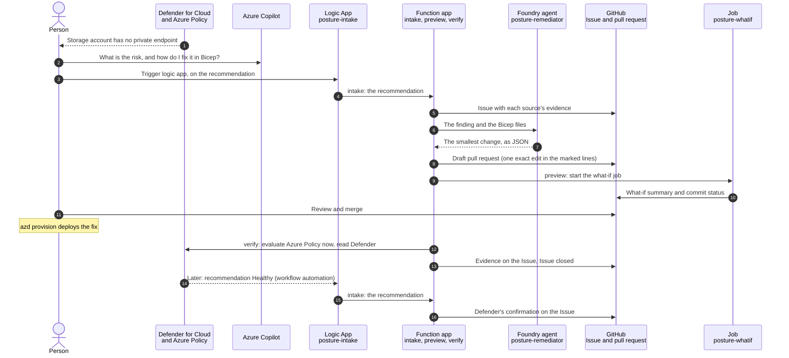
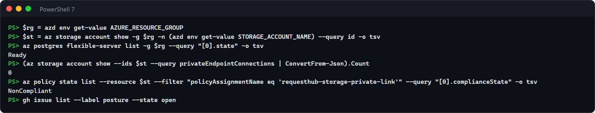
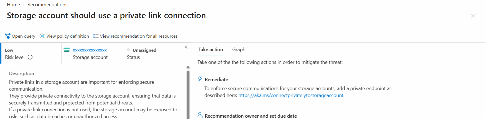
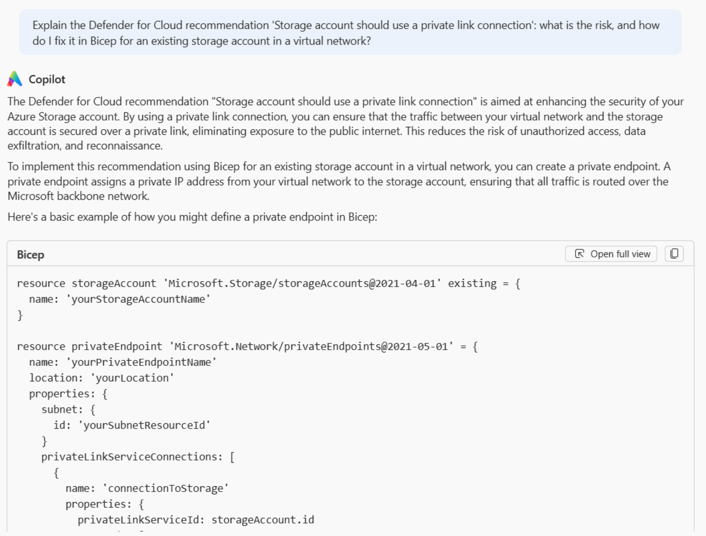
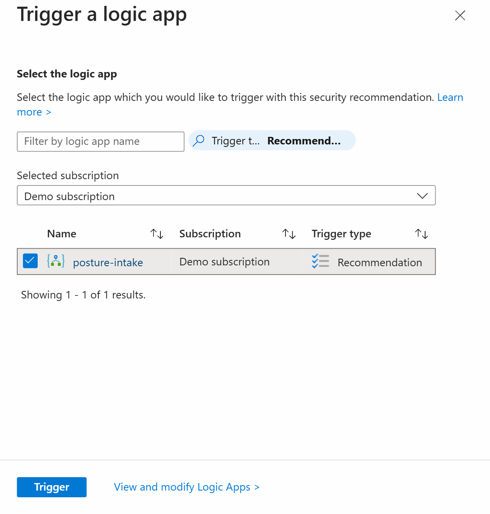
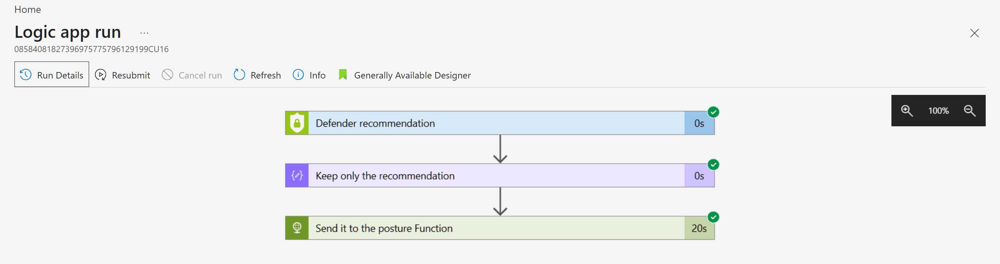
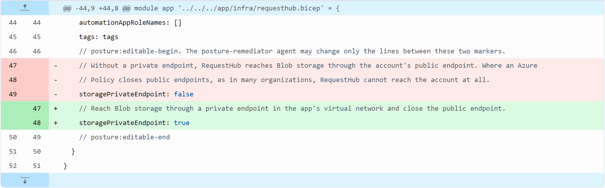
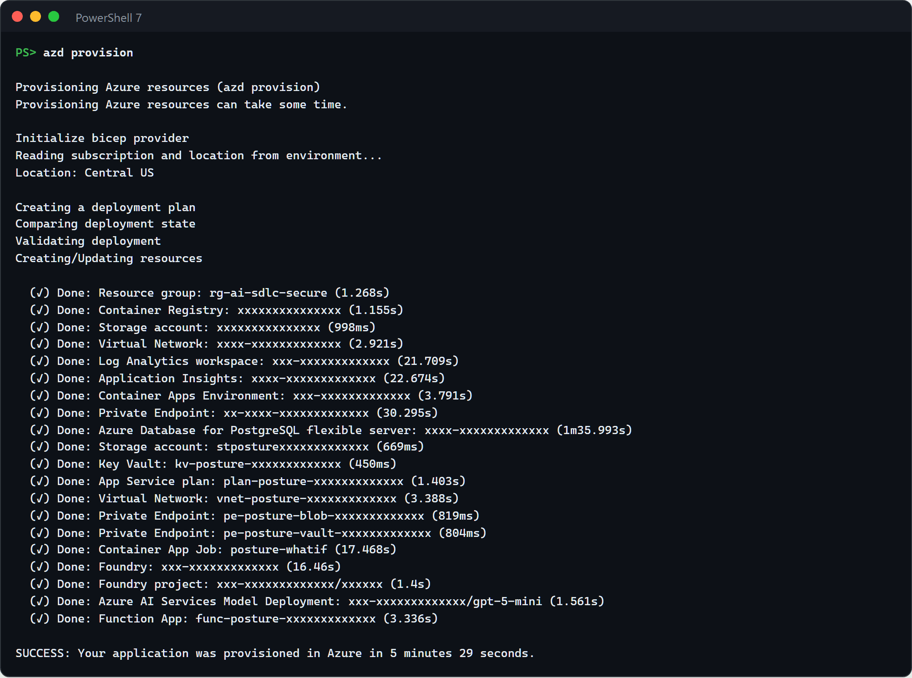
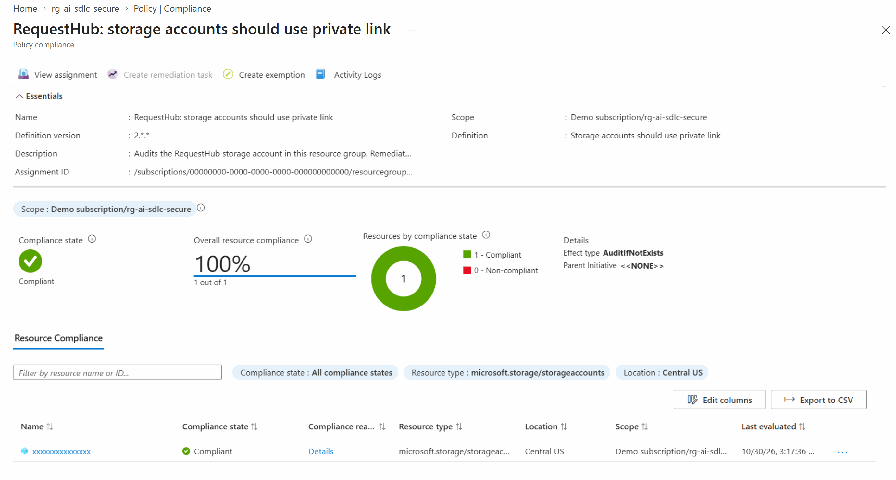

# Secure · Cloud posture remediation with Defender for Cloud, Azure Copilot, and Microsoft Foundry

Cloud misconfigurations are usually found by one team in a security portal and fixed by another team in code, if they are fixed at all. This solution connects the two in your repository's workflow. When Microsoft Defender for Cloud and Azure Policy flag a resource, one click on the recommendation hands it to an Azure Function. The Function files a GitHub Issue with each source's evidence, asks a Microsoft Foundry agent for the smallest fix to your Bicep, checks the answer, and opens it as a draft pull request. A what-if preview that runs in Azure lists what the fix would change before anyone deploys it. A person reviews, merges, and deploys the fix, and the Function then records the evidence on the Issue and closes it. Azure Copilot explains the finding in the portal. GitHub holds only the code, the Issue, and the pull request: the AI and the automation run in Azure.


- **[See it work](#see-it-work):** a real run on RequestHub, this repository's sample app. Defender for Cloud flagged its attachment storage, which had no private endpoint. After one click, the Issue appeared 5 seconds after the trigger, the agent's one-value fix 11 seconds later, and Azure's preview passed at 92 seconds. Once the fix was deployed, the Function verified it and closed the Issue.
- **[Add it to your repository](#add-it-to-your-repository):** about 30 minutes of one-time setup in Azure and GitHub, once the files describe your app, then up to a day for Defender for Cloud to assess new resources.
- **[Try it first in a copy of this repository](#try-it-first-in-a-copy-of-this-repository):** about 30 minutes to set it up on RequestHub and up to a day for Defender for Cloud's first assessment, then about 25 minutes for the steps of See it work. In a fresh setup we timed, the setup took 25 minutes, Defender for Cloud's first assessment 6 hours 20 minutes more, and the steps 15 minutes from the click to the verified fix.

## Why it matters

**Phase 5 of 7: Secure.** The GitHub counterpart is [05-secure-github](../05-secure-github/), where GitHub Copilot finds and fixes a flaw in the source code. This solution finds misconfigurations in the deployed cloud resources and fixes them in the infrastructure code, with the AI and the orchestration in Azure. GitHub holds the code, the Issue, and the pull request. To have GitHub Copilot review this solution's fix before a person deploys it, use both as in the [Secure solution combo](../../PRESENTING.md#secure-azure-finds-and-fixes-copilot-reviews-a-person-deploys).

| | Today | With this solution |
| --- | --- | --- |
| Finding | A Defender for Cloud recommendation waits in a portal the app team never opens. | One click on the recommendation files a GitHub Issue with each source's evidence: the live configuration, Azure Policy, and Defender for Cloud. A second click reuses the Issue. |
| Understanding | Someone searches the documentation for what the recommendation means. | Azure Copilot explains the risk and the fix next to the recommendation. |
| Fix | Someone changes the setting in the portal, and the next deployment reverts it. | A Foundry agent drafts the smallest change to the team's Bicep. The Function accepts only one exact edit inside the lines the team marked for posture fixes, and opens it as a draft pull request. |
| Blast radius | "It should be fine." | A what-if preview lists every resource the pull request creates or modifies, and fails on anything unexpected. |
| Done | The ticket closes when someone says so. | After deployment, the Function records the live configuration and Azure Policy's result on the Issue, then closes it. Defender's slower confirmation follows. |
| Access | Shared keys or a broad service principal. | Managed identities that can read, preview, and start a Policy evaluation but cannot deploy, and a GitHub token for one repository, kept in Key Vault. |

**The value:** a finding in a security portal becomes a reviewed, previewed change to the team's own Bicep, and the Issue closes only on evidence that Azure reports after the deployment. Nobody copies the finding into a ticket, writes the fix by hand, or declares it done. In [See it work](#see-it-work):

- The Issue appeared 5 seconds after the trigger, and the agent's draft pull request 11 seconds later: one value, `storagePrivateEndpoint: true`, between the lines the team marked for posture fixes.
- Azure's what-if preview passed 92 seconds after the trigger: four changes, each of an expected type, and nothing else.
- After `azd provision` deployed the merged fix in 5 minutes 29 seconds, the Function's `verify` recorded the private endpoint and Azure Policy's `Compliant` on the Issue and closed it, 75 seconds after it was started. Attachment uploads, which had failed with HTTP 500, worked.
- Earlier that morning, the agent's answer to a first trigger changed text outside the marked lines. The Function refused it and opened nothing.

## How it works



- **Azure Policy and Microsoft Defender for Cloud** find the problem. This solution assigns the built-in definition *Storage accounts should use private link* (version 2, AuditIfNotExists) to its own resource group. Azure Policy is the fast signal: an on-demand evaluation takes minutes. Defender for Cloud reports the same control through the Microsoft cloud security benchmark, on its own schedule: its first assessment of a new storage account took about 20 hours here and 6 hours 20 minutes in a fresh setup on 12 November 2026, and a change can take from about 30 minutes to a day to show.
- **Azure Copilot** (formerly Copilot in Azure) explains the recommendation and writes example Bicep in the portal's chat. It has no API, so it helps the person reading the finding, not the automation.
- **The Logic App `posture-intake`** ([`logic/intake.json`](infra/logic/intake.json)) is there because Defender for Cloud sends a recommendation only to a Logic App: from **Trigger logic app**, and from its workflow automation. It has three steps and no other logic: Defender's trigger; *Keep only the recommendation* (the resource, the recommendation's name, its status, and the time); and *Send it to the posture Function*, with a token for its own managed identity, which has no role anywhere. It runs one recommendation at a time. When the Function answers 503 (not yet, or another intake is running), its retry policy sends the recommendation again every minute, up to 12 times.
- **The Function app** ([`function/`](function/), Python on the Flex Consumption plan) does the work, in three functions. It runs in its own virtual network and reaches its storage account and Key Vault only through private endpoints, because the tenant this was built in forces public network access off on both.
  - **`intake`** accepts a call only from the Logic App's identity, and handles one at a time. It reads the recommendation's current status and text from Azure with its own managed identity, along with the storage account and Azure Policy's results: it does not trust the event it was sent. When the event reports Healthy before Azure's API does, it asks the Logic App to send it again, for up to 10 minutes. If the account already has an approved private endpoint, Defender has only not caught up with a deployed fix, and it stops. Otherwise, with the GitHub token, it files the Issue, or reuses the open one. It sends the finding, the solution's Bicep file, and the module that file uses to the Foundry agent, and checks the answer before it uses it ([`checks.py`](function/posture/checks.py)). The edit must replace text that occurs exactly once, at most 2,000 characters each way, and leave everything outside the lines marked `posture:editable` in [`resources.bicep`](infra/resources.bicep) byte for byte as it was, marker lines included. In the edited file, every line between the markers must be a `//` comment or exactly `storagePrivateEndpoint: true` or `false`, so roles, other settings, and new resources cannot slip in; the agent's texts must also name no protected setting. Only then does it create a branch, commit the checked file, open a draft pull request, and start the preview. An answer that fails a check becomes a comment on the Issue that lists why.
  - **`preview`** receives the repository webhook's `pull_request` events, signed with a secret that only GitHub and the Function's Key Vault hold. It drops a pull request whose branch is in a fork, or whose author is not the repository's owner, a member, or a collaborator. From any other it takes only the number, reads the pull request from GitHub's API and checks the same again, skips it if it does not change this solution's `infra/`, sets the commit status `posture/what-if` to pending, and starts the Container Apps job `posture-whatif` as it is defined. It previews each commit once, so when the webhook reports the pull request that `intake` just opened, it does not start the job again. The job runs [`whatif.py`](whatif.py) with `--pending`: it previews every open pull request whose head commit has that pending status, checks each one again, comments a summary on the pull request, and sets the final commit status. So the Function can start the job, but cannot change what the job runs.
  - **`verify`** runs every hour, or when you start it. Once the storage account has an approved private endpoint, it waits up to 20 minutes for this solution's assignment to report the account compliant, and starts an Azure Policy evaluation if it does not yet. It then records each source's answer on the Issue and closes it; if Azure Policy has not caught up, the next run tries again. Defender's own confirmation arrives later: when the recommendation turns Healthy, the workflow automation `posture-defender-healthy` sends it through `posture-intake`, and `intake` records it on the Issue.
- **The Foundry agent `posture-remediator`** is a prompt agent on `gpt-6-luna` in the solution's own Foundry project. Its instructions, [`posture-remediator.md`](posture-remediator.md), tell it to prefer an existing module parameter, change one block and the comment above it, and never weaken a control. A strict JSON schema shapes its answer. The azd hook [`remediation_agent.py`](remediation_agent.py) publishes a new version whenever the definition changes.
- **A person** creates the GitHub token, reviews and merges the pull request, deploys it with `azd provision`, and decides when the work is done.
- **GitHub** holds the code, the Issue, the pull request, and one webhook. No GitHub Actions workflow, Copilot agent, or skill takes part.

**Least privilege.** Three managed identities, none with write access to resources, policy assignments, or exemptions, so none can deploy the fix:
- The Function app's own identity has Reader and Policy Enrollments Contributor on the resource group, Foundry User on the Foundry account, Container Apps Jobs Operator on the job, Storage Blob Data Owner on its own storage account (its code package and host state), and Key Vault Secrets User on its own vault. It starts the job as it is defined: Azure requires write access on a job to override its template at start.
- The job's identity has Reader and Policy Enrollments Contributor on the resource group.
- The Logic App's identity has no role at all: its token only proves to the Function who is calling.

Policy Enrollments Contributor is the smallest built-in role that can query compliance, start a Policy evaluation, and run what-if. It also allows attestations, deployments (which still need write access to every resource they create or change), and remediation tasks, which run with the identity of a DeployIfNotExists or Modify policy assignment, inherited ones included, and can change the resources it covers. The GitHub token reaches this repository only, with four permissions (see [Create the GitHub token](#1-create-the-github-token)).

**A pull request's Bicep is untrusted input.** Bicep's `load*` functions, `readEnvironmentVariable`, extension statements, and module paths can read files on the machine that compiles a template, including the process environment that holds the token, or fetch code from a registry. So the job runs `whatif.py` from the default branch, never code from the pull request, and takes `bicepconfig.json` and the parameters file from the default branch too. Before compiling, it refuses a template that names one of those functions anywhere, even in a comment; references a registry module or a path outside `solutions/05-secure-microsoft/infra/` and `app/infra/`; uses an extension other than the alias the default branch's `bicepconfig.json` declares; or contains a carriage return outside a line ending, where Bicep would end a comment. It restores only that declared extension, then compiles with `--no-restore`, so nothing the pull request names is fetched. The token never reaches the processes that compile or preview the template: it is removed from their environment and erased from the job's initial environment block, which `/proc` would otherwise show them. The comment lists only change kinds, resource types, and masked names, in code spans that a name from the pull request cannot break out of: never raw what-if output, property values, or compiler messages. `test_whatif_checks.py` covers these cases.

**Outside contributions reach nothing in Azure.** On a public repository anyone can open a pull request, from a fork or from a branch of this repository, and comment. The webhook still reports every pull request, signed with the webhook secret. `preview` drops the delivery of a fork's pull request, or of one opened by anyone outside the repository, before it calls GitHub or Azure. For any other it decides again from GitHub's API: it starts the what-if job, and writes the commit status, only for a pull request whose branch is in this repository and whose `author_association` is `OWNER`, `MEMBER`, or `COLLABORATOR`. `whatif.py` checks the same again before it reads anything from the pull request, in case someone starts the job by hand. `intake` counts only this repository's branches when it looks for an existing fix, so a fork that names its branch `posture/issue-<number>-…` cannot pass for one. The Function counts a marker (the finding's on an Issue, `posture:defender-confirmed` and `posture:verified` on comments) only from the owner, a member, or a collaborator. A call to `intake` without the Logic App's token, or a delivery without a valid signature, gets HTTP 401. Defender for Cloud, the hourly schedule, and a person start the other runs; nobody outside the repository can. `test_function.py` and `test_whatif_checks.py` cover these checks.

**The finding means different things in different subscriptions,** and the Issue says which applies. Where an organization-wide Azure Policy closes the public endpoints of storage accounts, as in the subscription this was built in, an account without a private endpoint is unreachable: attachment uploads fail with HTTP 500. Elsewhere, it is reachable from the internet, and only authentication protects the attachments.

Nothing the automation posts identifies your deployment. The Issue, the pull request, and the comments name the resource group, this solution's policy assignment, and resource types. A policy assignment inherited from a management group or the subscription belongs to your organization's governance, so it appears only as `management group assignment` or `subscription assignment`; `test_policy_names.py` checks this. Resource names appear with their random token masked as `…` (for example `st…`), and GUIDs never appear.

## See it work

On 31 October 2026, from 05:12 to 05:43 UTC, the solution ran once, end to end, against the real services in resource group `rg-ai-sdlc-secure` (Central US), on RequestHub, this repository's sample app. The operator was a GitHub Copilot agent session working for the repository owner, signed in to Azure and GitHub as the owner. It selected **Trigger logic app** in the Azure portal, in a browser it drove, and ran each command in PowerShell 7. The owner had asked for the run end to end, so the operator also took the decision that belongs to a person: it merged the fix and deployed it. The automation ran an early version of pull request [#228](https://github.com/melabadi/adept-assessment-northstars/pull/228) ([the code that ran](evidence/2026-10-31-recorded-run.md#the-code-that-ran)), and the agent's fix is commit [b1207ad](https://github.com/melabadi/adept-assessment-northstars/commit/b1207ad).

Every step links evidence that opens without signing in: Issue [#223](https://github.com/melabadi/adept-assessment-northstars/issues/223) and pull request [#224](https://github.com/melabadi/adept-assessment-northstars/pull/224), which the automation created, and [what Azure recorded](evidence/2026-10-31-recorded-run.md), exported from the Logic App's run history, the Function's log, the job's executions, and the Activity log. Times are UTC. The portal screenshots show the operator's local time, UTC−4: 1:43 AM is 05:43.

**The starting state, at 05:12:44.** The tenant's automation had stopped RequestHub's PostgreSQL server at 05:10, and the operator started it again, which took 2 minutes. The checks then showed the database `Ready`, no private endpoint on RequestHub's storage account, the solution's Azure Policy assignment `NonCompliant` for that account, and no open posture Issue. At 05:13:31, an attachment upload through RequestHub's API failed with HTTP 500: in this subscription, an organization-wide Azure Policy closes storage accounts' public endpoints, so without a private endpoint, RequestHub couldn't reach its own storage.



Evidence: [the terminal](evidence/2026-10-31-recorded-run.md#the-terminal) and [the API's requests](evidence/2026-10-31-recorded-run.md#the-functions-log-and-the-apis-requests).

### 1. Defender for Cloud and Azure Policy flagged the storage account

*Before the run: Defender for Cloud had reported the account Unhealthy since 28 October at 09:06, and Azure Policy's last evaluation, at 04:46, had found it non-compliant.*

Defender for Cloud's recommendation *Storage account should use a private link connection* listed RequestHub's attachment storage account, with its remediation: add a private endpoint. The recommendation's risk level, Low, is Defender CSPM's rating of this account in its context (internet exposure, sensitive data, lateral movement, attack paths): it found no risk factors or attack paths here. The Issue in step 4 reports the recommendation's severity, Medium, which is Microsoft's fixed rating of the recommendation itself. The solution's Azure Policy assignment, *RequestHub: storage accounts should use private link*, reported the same account non-compliant; the other account it audits, the posture Function's own, was compliant.



The Defender for Cloud screenshot comes from an earlier run of the same recommendation, captured for pull request [#164](https://github.com/melabadi/adept-assessment-northstars/pull/164) (merged on 29 October); the account's status hadn't changed since 28 October. The Azure Policy screenshot was taken at 04:43, before the 04:46 evaluation.


Evidence: the table in Issue [#223](https://github.com/melabadi/adept-assessment-northstars/issues/223), which the Function wrote from both sources at 05:22: Defender for Cloud `Unhealthy` since 28 October 09:06, and Azure Policy `NonCompliant`, as evaluated at 04:46.

**What this shows:** two services flagged the same resource, and neither said where in the team's code the fix belongs: Defender links to general guidance, and the policy, which only audits, offers no remediation task.

### 2. Azure Copilot explained the risk

*Not part of this run: from the earlier run captured for pull request #164.*

In that run, the operator selected **Copilot** in the portal's top bar and asked:

> Explain the Defender for Cloud recommendation 'Storage account should use a private link connection': what is the risk, and how do I fix it in Bicep for an existing storage account in a virtual network?

Copilot explained the risk (unauthorized access, data exfiltration, and reconnaissance) and that a private endpoint fixes it, then wrote a generic private endpoint in Bicep, with placeholder names such as `yourStorageAccountName`. Its words differ each time.



Evidence: the screenshot. Azure Copilot keeps no record that others can open.

**What this shows:** Azure Copilot helps a person understand a finding in the portal, but it doesn't know the team's Bicep; the Foundry agent in step 4 does.

### 3. One click handed the finding to Azure

*05:22:25.7 to 05:22:47.0: the Logic App run took 21.3 seconds, 20.3 of them waiting for the Function.*

On the recommendation's page, the operator selected **Take action** > **Trigger logic app**, then `posture-intake` and **Trigger**. The Logic App `posture-intake` ran its three steps: Defender for Cloud's trigger; *Keep only the recommendation*, which keeps the resource, the recommendation's name, its status, and the time; and *Send it to the posture Function*. The Function answered `{"issue":223,"filed":true,"agentAttempts":1,"result":"drafted a fix","pullRequest":224,"previewStarted":true}`, the output of that last step.



The pane's screenshot comes from the earlier run captured for #164.



Evidence: [the Logic App runs](evidence/2026-10-31-recorded-run.md#the-logic-app-runs), with the Function's answer.

**What this shows:** one click in the security team's own tool started the engineering work, and the Logic App only passed the recommendation on, because Defender for Cloud can call nothing else.

### 4. The Function filed the Issue, and the agent drafted the fix

*05:22:31: Issue #223, 5 seconds after the trigger. 05:22:42: draft pull request #224, 11 seconds later, from the agent's first answer.*

The Function `intake` read the recommendation again from Azure, with the storage account and Azure Policy's results: it doesn't trust the event it is sent. It filed Issue [#223](https://github.com/melabadi/adept-assessment-northstars/issues/223), labelled `posture`. Its table has one row per source: the live configuration, each Azure Policy assignment (an inherited one by its scope only), and Defender for Cloud with the recommendation's severity. Below the table, it says where to fix the finding and when the work is done.


Then `intake` sent the finding, [`infra/resources.bicep`](infra/resources.bicep), and the module that file uses to the Foundry agent `posture-remediator`, version 6, on `gpt-5-mini`. It checked the answer before using it: one edit between the `posture:editable` markers, where only a `//` comment or `storagePrivateEndpoint: true` or `false` may stand, and the rest of the file unchanged, byte for byte. The first answer passed. The Function created the branch `posture/issue-223-10310522`, committed the edited file as b1207ad, and opened draft pull request [#224](https://github.com/melabadi/adept-assessment-northstars/pull/224). Its description says what changes and why, lists the expected resource changes and the risks, and refers to the Issue without closing it. At 05:22:46 the Function linked the pull request on the Issue.





Since 11 November 2026, the agent runs on `gpt-6-luna`: in [its validation run](evidence/2026-11-11-model-refresh.md), a replay of this run's trigger through the updated Function, it drafted the same one-value fix on its first try, in pull request [#336](https://github.com/melabadi/adept-assessment-northstars/pull/336), which was closed without merging.

The morning's first trigger, at 05:14, had filed Issue [#222](https://github.com/melabadi/adept-assessment-northstars/issues/222). The agent's answer then changed text outside the marked lines, so the Function refused it, opened nothing, and commented why on the Issue. Before the run shown, the operator deployed a Function that asks again when an answer fails, up to three times, telling the agent why, against the same checks, and closed #222 as not planned.

Evidence: Issue #223, pull request #224 and [its diff](https://github.com/melabadi/adept-assessment-northstars/pull/224/files), [the Function's comment on the Issue](https://github.com/melabadi/adept-assessment-northstars/issues/223#issuecomment-6539517088), Issue #222, and [the Function's log](evidence/2026-10-31-recorded-run.md#the-functions-log-and-the-apis-requests).

**What this shows:** a portal finding became a tracked Issue and a one-value change to the team's own Bicep in 16 seconds, and the Function's checks, not the model, decided what reached the repository.

### 5. Azure previewed the fix

*05:22:44 to 05:23:58: the commit status `posture/what-if` went from pending to success 92 seconds after the trigger. The job ran for 76 seconds.*

As it opened the pull request, the Function set the commit status `posture/what-if` on b1207ad to pending and started the Container Apps job `posture-whatif`. The job ran Azure's what-if of the pull request's Bicep against the deployed resource group, with [`whatif.py`](whatif.py) from `main`, never code from the pull request. Its comment on the pull request listed four changes, each of an expected type: the private endpoint, its DNS zone group, a link from the private DNS zone to RequestHub's virtual network, and the virtual network, modified with a new subnet. It left out ten resources with differences that what-if reports on every run, named one resource that what-if can't preview, and ended with **PASS**. The agent's description had expected a new private DNS zone; the preview showed none, because the zone already existed for the posture Function's own storage. The webhook's delivery for the new pull request reached the Function too, which found the commit already being previewed and started nothing.


Evidence: [the preview comment](https://github.com/melabadi/adept-assessment-northstars/pull/224#issuecomment-6539527624), the commit statuses with their times in [GitHub's API](https://api.github.com/repos/melabadi/adept-assessment-northstars/commits/b1207ad/statuses), and [the job's executions](evidence/2026-10-31-recorded-run.md#the-what-if-jobs-executions).

**What this shows:** before anything was deployed, the preview listed every resource the change would create or modify, and it, not the agent, said what a deployment would do.

### 6. The fix was merged and deployed

*05:35:05 to 05:41:05: ready for review, merged 4 seconds later, then `azd provision` for 5 minutes 29 seconds.*

At 05:35:05 the operator marked #224 ready for review, and at 05:35:09 merged it as [0d03f96](https://github.com/melabadi/adept-assessment-northstars/commit/53d9015). The 11 minutes between the preview and the merge went to capturing the screenshots of steps 3 to 5. From 05:35:36, in the solution folder on `main`, `azd provision` deployed the fix: RequestHub's private endpoint `pe-blob-…` existed at 05:36:39, and its DNS zone link at 05:37:27. Azure Policy evaluated the account compliant at 05:38, on its own.



Evidence: the merge commit 0d03f96, the timeline of pull request #224, and [the Activity log](evidence/2026-10-31-recorded-run.md#the-activity-log).

**What this shows:** the deployment ran from a terminal with a person's sign-in; the automation's identities can find, preview, and verify a fix, but have no right to deploy one.

### 7. The Function verified the fix and closed the Issue

*05:42:05 to 05:43:21: the evidence came 75 seconds after the operator started `verify`, and the Issue closed a second later.*

`verify` runs every hour; at 05:42:05 the operator started it at once, with the `az rest` command in [step 7 of the copy's steps](#7-verify). It ran for 72 seconds. It found an approved private endpoint on the storage account, started an Azure Policy evaluation at 05:42:13, and once this solution's assignment reported the account `Compliant`, read each source and commented the evidence on #223 at 05:43:20: one approved private endpoint; both Azure Policy assignments `Compliant`, as evaluated at 05:38; and Defender for Cloud still `Unhealthy`, not reassessed since the fix. At 05:43:21 it closed #223 as completed. At 05:46:32, an attachment uploaded through RequestHub's API returned HTTP 201, and its download returned the same content.




Evidence: [the verification comment](https://github.com/melabadi/adept-assessment-northstars/issues/223#issuecomment-6539692968), Issue #223, closed, and [the Function's log and the API's requests](evidence/2026-10-31-recorded-run.md#the-functions-log-and-the-apis-requests).

**What this shows:** the Issue closed on evidence that Azure reported after the deployment, not when the pull request merged.

**Not observed: Defender for Cloud's confirmation.** Defender for Cloud reassesses on its own schedule, from about 30 minutes to a day after a change. When it reports the account Healthy, its workflow automation `posture-defender-healthy` sends the recommendation through `posture-intake`, and `intake` records Defender's confirmation on the Issue. In this run, Defender hadn't reassessed by 05:46, when the operator began to reset the demo with revert pull request [#226](https://github.com/melabadi/adept-assessment-northstars/pull/226), so no confirmation came.

## Results and value

**What the run left behind.**

- Issue [#223](https://github.com/melabadi/adept-assessment-northstars/issues/223), which the Function filed and closed: each source's finding, the link to the fix, and [the verification evidence](https://github.com/melabadi/adept-assessment-northstars/issues/223#issuecomment-6539692968).
- Pull request [#224](https://github.com/melabadi/adept-assessment-northstars/pull/224), merged as [0d03f96](https://github.com/melabadi/adept-assessment-northstars/commit/53d9015): the agent's one-value change, its description, and [Azure's what-if preview](https://github.com/melabadi/adept-assessment-northstars/pull/224#issuecomment-6539527624), with the success status on its commit.
- Issue [#222](https://github.com/melabadi/adept-assessment-northstars/issues/222), from the first trigger: the agent's refused answer and the reason, closed as not planned.
- [The evidence](evidence/2026-10-31-recorded-run.md) behind the times in [See it work](#see-it-work) and in these results: the Logic App's runs, the Function's log, the job's executions, the Activity log, and the terminal.
- The decisions, all taken with a person's account: to merge and deploy the fix, here by the operator for the owner, and to close #222. After the run, revert pull request [#226](https://github.com/melabadi/adept-assessment-northstars/pull/226) removed the fix, to stage the finding again.

**What was measured.**

| | In See it work |
| --- | --- |
| From the trigger to the Issue | 5 seconds |
| From the trigger to the agent's draft pull request | 16 seconds, from the agent's first answer |
| From the trigger to the preview's PASS | 92 seconds; the job ran for 76 |
| The Logic App run | 21.3 seconds, 20.3 of them in the Function |
| The deployment, `azd provision` | 5 minutes 29 seconds |
| From starting `verify` to the evidence on the Issue | 75 seconds |
| How long the Issue stayed open | 20 minutes 50 seconds, 11 minutes of them spent capturing screenshots before the merge |
| Attachment uploads through the API | HTTP 500 before the fix, HTTP 201 after it |
| The agent's answers that passed the Function's checks | 1 of the 2 that morning: the first trigger's answer was refused |
| Defender for Cloud | still `Unhealthy` at the end: it hadn't reassessed |

**What a team gets.**

- **Time saved.** Nobody copies a finding into a ticket, looks for where the resource is defined, writes the Bicep by hand, or gathers the proof that it's fixed. The Issue, the draft fix, and its preview were there 92 seconds after the trigger, and the evidence 75 seconds after `verify` started.
- **Risk removed.** The fix is code, reviewed and previewed like any change, so the next deployment keeps it instead of reverting a portal edit. The agent can change only the lines the team marked, and the preview lists every resource a deployment would touch before anyone deploys. The automation can't deploy, its GitHub token reaches one repository and stays in Key Vault, and pull requests from outside the repository reach nothing in Azure.
- **Evidence a reviewer or an auditor can follow.** The Issue holds each source's finding and, after the deployment, each source's result. The pull request holds the change, the preview, and its status on the same commit.

**The metric to track when you adopt it:** time from finding to verified fix, from the posture Issue's creation to its close by `verify` (`gh issue view <number> --json createdAt,closedAt`), alongside the share of the agent's drafts that pass the Function's checks and the preview. It was 20 minutes 50 seconds in See it work, screenshots included. Compare both with how similar findings were fixed before. A target is a goal you set, never a result.

## Add it to your repository

These are the steps that set the solution up on RequestHub, with what to change for your app. We have run them only on RequestHub: for your app, the commands stay the same, and the changes are the ones named below. Point it at a test environment of your app first.

The solution fixes one control: a storage account without a private endpoint, which the built-in policy *Storage accounts should use private link* and Defender for Cloud's recommendation *Storage account should use a private link connection* both report. For your app's storage account, keep the control and change the files below. For another control, also change how the Function decides that a fix is deployed: it counts the storage account's approved private endpoints (`approved_private_endpoints` in [`checks.py`](function/posture/checks.py), used by [`flows.py`](function/posture/flows.py)).

### Prerequisites

- Your repository on GitHub, with admin rights on it, because the setup creates a webhook, and the tools in the root README's [Before you start](../../README.md#before-you-start): the GitHub CLI, Python 3.12 or later, PowerShell 7, the Azure CLI (2.76 or later), and the Azure Developer CLI.
- Your app's Azure resources in Bicep, deployed with `azd` into one resource group, with the fix available as a module parameter, as RequestHub's [`requesthub.bicep`](../../app/infra/requesthub.bicep) offers `storagePrivateEndpoint`. The agent changes that one value; the module does the rest.
- An Azure subscription where you can create resource groups, role assignments, and policy assignments, for example as Owner. Owner also covers **Trigger logic app**, which needs Security Admin on the resource group and the right to run the Logic App. The solution registers no app of its own in Microsoft Entra ID, but when it publishes the agent, Foundry creates an agent identity blueprint there, an app registration that you own, and an agent identity: [Clean up](#clean-up) removes them.
- Microsoft Defender for Cloud with the Microsoft cloud security benchmark assigned, the default for Azure subscriptions. The free foundational CSPM includes the recommendation, **Trigger logic app**, and workflow automation. With the paid Defender CSPM plan, as in See it work, the portal also rates each recommendation's risk level.
- Azure Copilot, which the Azure portal offers unless your tenant's administrators turned it off.
- A region with Azure Functions on the Flex Consumption plan, Microsoft Foundry, and Global Standard quota for `gpt-6-luna` (50,000 tokens per minute). We used `centralus`. `az cognitiveservices usage list --location centralus --query "[?name.value=='OpenAI.GlobalStandard.gpt-6-luna']" -o table` shows your quota there, in thousands of tokens per minute: `Limit` minus `CurrentValue` must be at least 50.
- A GitHub account that can create a fine-grained personal access token for the repository.

### What to copy and what to change

Copy this folder into your repository, for example as `posture/`, without `evidence/` and `images/`, which belong to the run in [See it work](#see-it-work). It needs nothing in `.github/`. Then change these files:

| File | What it does here | What to change for your app |
| --- | --- | --- |
| [`infra/resources.bicep`](infra/resources.bicep) | RequestHub's platform (`module app`) and the Azure Policy assignment `requesthub-storage-private-link`. It is the one file a fix changes, and the preview runs what-if on it alone. | Replace `module app` with your app's Bicep. Keep the outputs that `main.bicep` passes to the automation: `automationIdentityName` (an identity for the what-if job, with Reader and Policy Enrollments Contributor on the resource group), `containerAppsEnvironmentName` (where the job runs), `storageAccountId` (the audited account), `policyAssignmentName`, and `appInsightsConnectionString`. RequestHub's module creates the identity, the Container Apps environment, and Application Insights; create them here if your app has none. Put only the lines the agent may change between `// posture:editable-begin` and `// posture:editable-end`, and keep roles and policy assignments outside them. |
| [`infra/main.bicep`](infra/main.bicep) | The resource group, then `resources.bicep` and `automation.bicep`, and the outputs that azd and the scripts read | Remove the outputs that deploy RequestHub and sign in to it: the container registry, the app's identity, PostgreSQL, the API, the worker, and the API's app registration. |
| [`infra/automation.bicep`](infra/automation.bicep) | The Foundry project, model, and agent; the what-if job; the Function app with its network, storage, and Key Vault; the Logic App; the Defender for Cloud workflow automation; and their roles | In the Function's app settings: `POSTURE_EDITABLE_PATH` (your editable file), `POSTURE_MODULE_PATH` (the module it uses), and `POSTURE_INFRA_PREFIX` (the folder whose pull requests get a preview). The path of `whatif.py` in the job's bootstrap script, `jobBootstrap`. If your fix creates a private DNS zone that the Function's network also uses, as `privatelink.blob.core.windows.net` here, give it the same name and tags in both modules. For another control, `privateLinkPolicyDefinition` (the built-in policy) and `privateLinkAssessment` (Defender for Cloud's assessment key: `az security assessment list --query "[?displayName=='<recommendation>'].name" -o tsv`). |
| [`whatif.py`](whatif.py) | The preview and its untrusted-Bicep check, run by the job | `SOLUTION_INFRA` and `APP_INFRA`, the only folders a pull request's Bicep may reference (`ENTRY` and `PARAMETERS` follow from them), and `DEFAULT_EXPECT`, the resource types a fix may change. |
| [`posture-remediator.md`](posture-remediator.md) and [`remediation_agent.py`](remediation_agent.py) | The agent's instructions, which `azd provision` publishes when they change; `remediation_agent.py try` tries the agent on your checkout | Rewrite the instructions for your files and rules. In `remediation_agent.py`: `EDITABLE` and `READ_ONLY`, the files the agent sees, and, for another control, `ASSESSMENT` and `POLICY_DEFINITION`. |
| [`function/posture/checks.py`](function/posture/checks.py) | Who the Function acts for, and the checks of the agent's edit | `ALLOWED_LINES`, the only lines the edited region may hold besides comments, and `PROTECTED`, the setting names the agent's texts must never contain. |
| [`function/posture/messages.py`](function/posture/messages.py) | The Issue, the pull request, the comments, and the agent's input | The titles and texts, which describe RequestHub's attachment storage. |
| [`test_edit_checks.py`](test_edit_checks.py), [`test_function.py`](test_function.py), [`test_policy_names.py`](test_policy_names.py), [`test_whatif_checks.py`](test_whatif_checks.py) | Offline tests, which azd runs before every deploy | `SHIPPED_REGION` at the top of `test_edit_checks.py`: your editable lines as you ship them, before any fix. Then update the tests that name RequestHub's files and texts. |
| [`azure.yaml`](azure.yaml) | The azd project and its hooks | Remove the `api` and `worker` services, which deploy RequestHub. |

Before you open the pull request that adds the folder, run the offline tests in it: `python -m unittest test_edit_checks.py test_function.py test_policy_names.py test_whatif_checks.py`.

### One-time setup

About 30 minutes, once the files describe your app, then up to a day before Defender for Cloud assesses resources it hasn't seen. On RequestHub, adding the posture Function to a running deployment took 7 minutes 6 seconds, and each later `azd provision` took 5 to 6 minutes. A fresh setup on 12 November 2026, which followed [Try it first in a copy of this repository](#try-it-first-in-a-copy-of-this-repository) in a new resource group, deployed RequestHub too, which took most of the time ([the evidence](evidence/2026-11-12-fresh-setup.md)):

| Step | Took |
| --- | --- |
| 2. Deploy: `pip install -r requirements.txt` | 1 minute 49 seconds, in a new virtual environment |
| 2. Deploy: `azd up` | 20 minutes 21 seconds, RequestHub included: provisioning took 18 minutes 11 seconds, 15 minutes 42 seconds of it for RequestHub's Container Apps environment. It then stopped while publishing an image ([Troubleshooting](#troubleshooting)), and `azd deploy` finished the deployment in 3 minutes 7 seconds |
| 2. Deploy: `azd provision`, for a token stored after `azd up` | 6 minutes 14 seconds |
| 3. Check that Azure sees the finding | seconds for the commands, 24 seconds for `remediation_agent.py try`, and 6 hours 20 minutes, after the storage account was created, for Defender for Cloud's first assessment |

#### 1. Create the GitHub token

A person does this; nothing in the solution can. On GitHub, open your **Settings** > **Developer settings** > **Personal access tokens** > **Fine-grained tokens** > **Generate new token**:

- **Resource owner**: the repository's owner. **Expiration**: as long as you need, for example 90 days.
- **Repository access**: **Only select repositories**, then your repository.
- **Permissions**: **Commit statuses**, **Contents**, **Issues**, and **Pull requests**, each set to **Read and write**. GitHub adds **Metadata** (read-only).

The Function uses it to file the Issue, create the branch, commit the fix, open the pull request, set the pending commit status, comment, and close the Issue. The job uses it to read the pull request's files, comment, and set the final commit status.

**What you should see:** GitHub shows the token once: copy it for the next step. Use a person's token, as here, not a GitHub App's: the automation trusts only Issues and comments from the owner, members, and collaborators, and GitHub reports a bot as none of them.

#### 2. Deploy

From the folder you copied:

```powershell
cd posture
pip install -r requirements.txt
az login
azd auth login
azd env new <environment name> --subscription (az account show --query id -o tsv) --location <region>
azd env set POSTURE_GITHUB_TOKEN (Read-Host -MaskInput 'GitHub token')
azd up
```

`Read-Host -MaskInput` keeps the token off the screen and out of your PowerShell history. `--subscription` deploys to the subscription that `az` signed in to, where the hooks and the commands below look for the resources: `az account show` names it, and `az account set --subscription <name or id>` changes it. Without it, `azd up` asks you to pick one of your subscriptions. Run azd in the shell where `pip install` ran, with the same virtual environment active if you use one: its hooks run that `python`.

**What you should see:** the hooks name the repository, from your clone's `origin` remote, and print what they did:

```text
GitHub repository: <owner>/<repository>
Generated the webhook secret (POSTURE_WEBHOOK_SECRET in the azd environment).
Foundry agent posture-remediator: published version 1.
Webhook <id> in <owner>/<repository>: pull_request events → the Function's preview route (created).
```

azd runs the offline tests before it deploys the Function: they print the messages of the cases they check, failures they provoke on purpose included, then `Ran 109 tests` and `OK (skipped=1)`; the skipped test needs Linux. azd ends with `SUCCESS`. The repository's **Settings** > **Webhooks** lists the new webhook. A later `azd provision` prints the repository line, `Foundry agent posture-remediator v1 is up to date.` while the agent's definition is unchanged, and the webhook line with `(updated)`.

**Where the token is stored.** In your local azd environment file, `.azure/<environment name>/.env` in the solution's folder, which git ignores, next to the webhook secret. In the Function's Key Vault, which Azure Resource Manager writes but never returns, and which only the Function's identity reads, through its private endpoint. In the job, as a secret. The Logic App never sees it. Anyone who can read the job's secrets, or give themselves a role on the vault, can use the token, so keep write access to the resource group as narrow as write access to the repository. To rotate the token, run the `azd env set` line again, then `azd provision`.

Without the token, `azd up` still deploys everything and warns you. The Function then answers HTTP 409, and the job fails at its first GitHub call, until you set the token and run `azd provision` again: 6 minutes 14 seconds in our fresh setup, where the token was created during `azd up`.

#### 3. Check that Azure sees the finding

Defender for Cloud can take up to 24 hours to assess a new resource. Then, from the same folder:

```powershell
$rg = azd env get-value AZURE_RESOURCE_GROUP
$st = az storage account show -g $rg -n (azd env get-value STORAGE_ACCOUNT_NAME) --query id -o tsv
(az storage account show --ids $st --query privateEndpointConnections | ConvertFrom-Json).Count
az policy state list --resource $st --filter "policyAssignmentName eq '$(azd env get-value POLICY_ASSIGNMENT_NAME)'" --query "[0].complianceState" -o tsv
az security assessment show -n cdc78c07-02b0-4af0-1cb2-cb7c672a8b0a --assessed-resource-id $st --query status.code -o tsv --only-show-errors
python remediation_agent.py try
```

**What you should see:** for an account without a private endpoint, `0`, `NonCompliant`, and `Unhealthy`. No Azure Policy state yet means Azure Policy hasn't evaluated the account: run `az policy state trigger-scan -g $rg`, which takes 2 to 15 minutes. An error that the assessment is not found means Defender for Cloud hasn't assessed the account yet. Then `remediation_agent.py try` sends the agent the document the Function would send, checks the answer with the Function's own code, and prints it as a diff, ending with `OK: the Function intake would apply this change and open it as a draft pull request.` It changes nothing.

### Use it the first time

When Defender for Cloud reports the recommendation for your storage account:

1. In the Azure portal, open **Microsoft Defender for Cloud** > **Recommendations**, open *Storage account should use a private link connection*, and select the account. Select **Take action** > **Trigger logic app**, then `posture-intake` and **Trigger**.

   **What you should see:** in the Logic App `posture-intake`, **Overview** > **Runs history**, a run that succeeds in about 20 seconds. On GitHub, a posture Issue, and a draft pull request from the agent whose commit status `posture/what-if` turns from pending to success, with the preview's comment, 1 to 2 minutes after the trigger. If the agent's answers fail the checks three times, the Issue gets a comment that lists why, and no pull request opens.

2. Review the change and the preview, mark the pull request ready, and merge it. Then deploy it from an up-to-date `main`: `git switch main`, `git pull`, and `azd provision`.
3. `verify` runs every hour. To run it now:

   ```powershell
   az rest --method post --url "/subscriptions/{subscriptionId}/resourceGroups/$(azd env get-value AZURE_RESOURCE_GROUP)/providers/Microsoft.Web/sites/$(azd env get-value POSTURE_FUNCTION_NAME)/hostruntime/admin/functions/verify?api-version=2024-04-01" --body '{}'
   ```

   **What you should see:** within about 15 minutes, depending on Azure Policy, the evidence on the Issue, and the Issue closed. Later, when Defender for Cloud reports the account Healthy, its workflow automation adds Defender's confirmation to the same Issue.

Then keep it in your workflow:

- **One storage account per deployment.** The Function acts on the account in `storageAccountId`, and ignores a click on any other resource's recommendation.
- **Keep the evidence you need.** The Issue and the pull request stay on GitHub. Azure's records of the runs expire (after 90 days here), so export what you want to keep, as [`evidence/`](evidence/) does for See it work, and check the export for host names, GUIDs, and e-mail addresses before you commit it.
- **Keep the model current.** The agent runs on `gpt-6-luna` version 2026-09-22, which Azure retires on 11 March 2028. To change the model, set `modelName` and `modelVersion` in [`infra/automation.bicep`](infra/automation.bicep) and run `azd provision`, which deploys the model and publishes a new agent version on it. Then run `python remediation_agent.py try` a few times, and delete the old deployment, as in the [model refresh](evidence/2026-11-11-model-refresh.md) that moved this agent from `gpt-5-mini`.

### What it costs

Your app bills as it already does. While deployed, the solution adds about $16 a month for the posture Function's two private endpoints and their private DNS zones, and a private link fix adds your app's own private endpoint, about $7 a month. The rest bills per use: the Function on Flex Consumption, the Logic App's runs, the what-if job's executions, and the agent's `gpt-6-luna` tokens in Foundry, about $0.0008 per answer here (6,786 input and 271 output tokens, at $0.10 and $0.50 per million). Defender for Cloud's foundational CSPM is free; the Defender CSPM plan, which rates risk levels, bills per resource. Where your subscription has Defender CSPM or Defender for Storage on, as ours does, they also bill the posture Function's storage account, and in the copy RequestHub's storage account and PostgreSQL server: at list prices, $0.007 an hour per resource for Defender CSPM, and $0.0134 an hour per storage account for Defender for Storage. The root README compares [what the Microsoft solutions cost](../../README.md#what-the-microsoft-solutions-cost).

## Try it first in a copy of this repository

Optional: the same solution on RequestHub, before you adapt anything. It needs the [prerequisites](#prerequisites), with RequestHub in place of your app, a region that also offers PostgreSQL Flexible Server, and permission to create Microsoft Entra app registrations: RequestHub signs in with its own. In the copy, the other solutions' workflows also see this one's Issue, pull request, and comments. In our fresh setup, the Issue started *Operate · GitHub · agentic incident triage*, which skipped every job; each comment on the Issue or the pull request started *Design · GitHub · agentic design review*, which stopped after a 10 to 18-second check; and the pull request ran *Repository checks* and *Develop · GitHub · feature bounds*, and its merge *Repository checks*, which all passed. No model ran in GitHub.

### Quick start

Work from the root of your copy of the repository, which the root README's [Try it in a copy of this repository](../../README.md#try-it-in-a-copy-of-this-repository) makes once for every solution. Create a GitHub token for your copy, as in [Create the GitHub token](#1-create-the-github-token), then:

```powershell
cd solutions/05-secure-microsoft
pip install -r requirements.txt
az login
azd auth login
azd env new ai-sdlc-secure --subscription (az account show --query id -o tsv) --location centralus
azd env set POSTURE_GITHUB_TOKEN (Read-Host -MaskInput 'GitHub token')
azd up
```

Allow about 30 minutes, most of it for `azd up`. In a fresh setup on 12 November 2026, the commands took 25 minutes 18 seconds: `pip install` 1 minute 49 seconds, and `azd up` 20 minutes 21 seconds, which stopped while publishing the API's image, then `azd deploy` 3 minutes 7 seconds ([the evidence](evidence/2026-11-12-fresh-setup.md#timeline)). `azd up` prints what [Deploy](#2-deploy) shows. Then wait up to a day before step 1: Defender for Cloud can take that long to assess the new storage account, and the Function files work only while Defender reports it `Unhealthy`. Its first assessment came 6 hours 20 minutes after the storage account was created, in our fresh setup.

While deployed, the copy's resource group bills by the hour for RequestHub's platform (Container Apps, PostgreSQL, a container registry, and Log Analytics) and for the posture Function's private endpoints, as in [What it costs](#what-it-costs).

### What azd up creates

Resource group `rg-ai-sdlc-secure`, with:

- **RequestHub's platform** from [`app/infra/requesthub.bicep`](../../app/infra/requesthub.bicep): private PostgreSQL, Blob storage, a container registry, monitoring, a Container Apps environment, and a Microsoft Entra app registration with RequestHub's app roles (you get every role). Storage is deployed **without a private endpoint**: that is the finding.
- **The app**, as two container apps: the API with the web UI, and the notification worker.
- **The Azure Policy assignment** `requesthub-storage-private-link`, on this resource group only.
- **The posture automation**: a Microsoft Foundry account with the project `secure`, the model deployment `gpt-6-luna`, and the agent `posture-remediator`; the Function app `func-posture-…` on the Flex Consumption plan, with its own virtual network, storage account, and Key Vault, the last two reached through private endpoints; the Logic App `posture-intake`; the Container Apps job `posture-whatif`; and the Defender for Cloud connection and workflow automation `posture-defender-healthy`.
- **Three managed identities**, with the roles listed under **Least privilege** in [How it works](#how-it-works). None has GitHub federation, registry push, or a RequestHub app role.

Outside the resource group, in Microsoft Entra ID, live RequestHub's app registration and, from the moment the postprovision hook publishes the agent, the agent identity blueprint that Foundry creates for `posture-remediator`, an app registration that you own, and its agent identity. `azd down` removes none of them: [Clean up](#clean-up) does.

In GitHub, it creates one webhook that sends `pull_request` events to the Function's `preview` route, signed with the webhook secret that the preprovision hook generated. The hook passes the secret to `gh` on standard input and never prints it or the URL.

### Check the starting state

About 5 minutes, from `solutions/05-secure-microsoft`, before each run of the steps below; the commands took 17 and 22 seconds in our fresh setup. You should see what [See it work](#see-it-work) shows as its starting state:

```powershell
azd env select ai-sdlc-secure
$rg = azd env get-value AZURE_RESOURCE_GROUP
$st = az storage account show -g $rg -n (azd env get-value STORAGE_ACCOUNT_NAME) --query id -o tsv
az postgres flexible-server list -g $rg --query "[0].state" -o tsv
(az storage account show --ids $st --query privateEndpointConnections | ConvertFrom-Json).Count
az policy state list --resource $st --filter "policyAssignmentName eq 'requesthub-storage-private-link'" --query "[0].complianceState" -o tsv
gh issue list --label posture --state open
az security assessment show -n cdc78c07-02b0-4af0-1cb2-cb7c672a8b0a --assessed-resource-id $st --query status.code -o tsv --only-show-errors
```

You want `Ready`, `0`, `NonCompliant`, no open Issue, and `Unhealthy`. The checks look at RequestHub's storage account only: the posture Function's own storage account and Key Vault have private endpoints of their own.

- **The database is `Stopped`.** A tenant policy can stop PostgreSQL servers on a schedule, as one did before See it work, and again about 3 hours after `azd up` created the server in our fresh setup. Then the app times out, and the what-if preview and `azd provision` fail with `ServerStoppedError`. Start the server; it takes 2 to 5 minutes (2 minutes 8 seconds in our fresh setup):

  ```powershell
  az postgres flexible-server start -g $rg -n (az postgres flexible-server list -g $rg --query "[0].name" -o tsv)
  ```

- **RequestHub's storage account has a private endpoint, or a posture Issue is open.** The last run wasn't reset: follow [Reset the copy for another run](#reset-the-copy-for-another-run).
- **Azure Policy still says `Compliant` after a reset.** It hasn't evaluated the account since. Run `az policy state trigger-scan -g $rg`, which takes 2 to 15 minutes.
- **Defender for Cloud says `Healthy`.** It confirmed the last run's fix and hasn't reassessed since the reset, which can take up to a day. The Function reads this status from Azure, so until then `intake` records a confirmation instead of filing work. An error that the assessment is not found means Defender hasn't assessed the account yet: up to 24 hours after setup.

Then check the token and your sign-ins:

```powershell
$token = azd env get-value POSTURE_GITHUB_TOKEN
$repo = gh repo view --json nameWithOwner -q .nameWithOwner
(Invoke-RestMethod "https://api.github.com/repos/$repo" -Headers @{ Authorization = "Bearer $token" }).full_name
az account get-access-token --query expiresOn -o tsv
gh auth status
```

The third line prints the repository's name, read with the automation's token and nothing else. An error that the key `POSTURE_GITHUB_TOKEN` is not found means the token was never stored; `401` (Bad credentials) means it expired or was revoked. Either way, create a new one, store it with `azd env set`, and run `azd provision`. Also make sure your clone is on an up-to-date `main` (`git switch main`, then `git pull`), because `azd provision` deploys your local copy.

### How long each step takes

| Step | Takes | In See it work | In the fresh setup |
| --- | --- | --- | --- |
| 1. Open the finding | about 2 minutes | | the Recommendations page about 25 seconds to load, the account's recommendation seconds more |
| 2. Ask Azure Copilot | about 2 minutes | not part of the run | not run: the session's browser tool couldn't type into Copilot's chat |
| 3. Trigger the automation | about a minute | the Logic App run took 21.3 seconds | the Logic App run took 81 seconds: Azure Resource Manager failed the Function's first try, and the Logic App sent the recommendation again a minute later |
| 4. Read the Issue and the pull request | about 3 minutes, while the preview runs | the Issue 5 seconds after the trigger, the pull request 16 | the Issue 67 seconds after the trigger, the pull request 76 |
| 5. Wait for the preview | 1 to 2 minutes after the trigger | PASS 92 seconds after the trigger | PASS 2 minutes 53 seconds after the trigger; the job ran 97 seconds |
| 6. Review, merge, and deploy | 5 to 7 minutes | `azd provision` took 5 minutes 29 seconds | 6 minutes 43 seconds; `azd provision` took 6 minutes 12 seconds |
| 7. Verify | 1 to 15 minutes, depending on Azure Policy | 75 seconds | 2 minutes 40 seconds |
| Later: Defender for Cloud confirms | 30 minutes to a day | not observed | not observed: still `Unhealthy` two hours after the deployment, when we stopped waiting |

The seven steps take about 25 minutes. In See it work, the Issue stayed open 20 minutes 50 seconds, 11 minutes of them spent capturing screenshots. In a fresh setup on 12 November 2026, it stayed open 13 minutes 36 seconds, and the fix was verified 14 minutes 43 seconds after the click ([the evidence](evidence/2026-11-12-fresh-setup.md#the-run)).

### 1. Open the finding

*About 2 minutes. What you should see: [See it work, step 1](#1-defender-for-cloud-and-azure-policy-flagged-the-storage-account).*

In the Azure portal, open **Microsoft Defender for Cloud** > **Recommendations**, search for *private link*, open *Storage account should use a private link connection*, and select the storage account. The page can take a minute to load the first time. Then open **Policy** > **Compliance** > *RequestHub: storage accounts should use private link*.

Optional: open the app (`azd env get-value API_URL`), open any request, and attach a file. Where an organization-wide policy closes storage accounts' public endpoints, the upload fails.

### 2. Ask Azure Copilot

*About 2 minutes. What you should see: [See it work, step 2](#2-azure-copilot-explained-the-risk).*

Select **Copilot** in the portal's top bar and ask:

> Explain the Defender for Cloud recommendation 'Storage account should use a private link connection': what is the risk, and how do I fix it in Bicep for an existing storage account in a virtual network?

Copilot's answer differs each time.

### 3. Trigger the automation

*About a minute. What you should see: [See it work, step 3](#3-one-click-handed-the-finding-to-azure).*

On the recommendation's page, open **Take action** and select **Trigger logic app**. Select `posture-intake`, then **Trigger**. Then open the Logic App `posture-intake` > **Overview** > **Runs history**: a run appears within seconds and succeeds in about 20 seconds. Open it, and select *Send it to the posture Function* to read the Function's answer.

- **The pane lists more than one `posture-intake`.** It lists the Logic Apps in the selected subscription that a recommendation can trigger, one per environment of this solution, by name and subscription only. Point at a name: its link's address names the resource group. Select only the one in yours. In our fresh setup, the pane listed two: this environment's, and another environment's in the same subscription.
- **The run takes over a minute.** When one of the Function's calls to Azure or GitHub fails, it answers HTTP 502, and the Logic App's retry policy sends the recommendation again a minute later, up to 12 times. In our fresh setup, the first try met a transient Azure Resource Manager error (`InvalidGatewayCertificate`), and the second drafted the fix: the run took 81 seconds. *Send it to the posture Function* lists each try.

### 4. Read the Issue and the pull request

*About 3 minutes, while the preview of step 5 runs. What you should see: [See it work, step 4](#4-the-function-filed-the-issue-and-the-agent-drafted-the-fix).*

```powershell
gh issue list --label posture --state open
gh pr list --state open --json number,title,headRefName --jq '.[] | select(.headRefName | startswith("posture/")) | "#\(.number) \(.title)"'
gh pr diff <pull request number>
```

In the Foundry portal ([ai.azure.com](https://ai.azure.com)), open the solution's project > **Build** > **Agents** > `posture-remediator` for the agent's version, model, and instructions.

### 5. Wait for the preview

*1 to 2 minutes after the trigger. What you should see: [See it work, step 5](#5-azure-previewed-the-fix).*

```powershell
$pr = <pull request number>
$sha = gh pr view $pr --json headRefOid -q .headRefOid
gh api "repos/{owner}/{repo}/commits/$sha/status" --jq '.statuses[] | "\(.context): \(.state), \(.description)"'
```

`posture/what-if` reads `pending` while the job runs, then `success` with `PASS`, and the job's comment is on the pull request. In the Azure portal, the Container Apps job `posture-whatif` > **Execution history** lists the job's runs.

### 6. Review, merge, and deploy

*5 to 7 minutes. What you should see: [See it work, step 6](#6-the-fix-was-merged-and-deployed).*

Review the change and the preview, then mark the pull request ready and merge it, on GitHub or from the terminal. Then deploy it from an up-to-date `main`, because `azd provision` deploys your local copy:

```powershell
gh pr ready $pr
gh pr merge $pr --squash --delete-branch
git switch main
git pull
azd provision
```

### 7. Verify

*1 to 15 minutes, depending on Azure Policy. What you should see: [See it work, step 7](#7-the-function-verified-the-fix-and-closed-the-issue).*

`verify` runs every hour. To run it now:

```powershell
az rest --method post --url "/subscriptions/{subscriptionId}/resourceGroups/$(azd env get-value AZURE_RESOURCE_GROUP)/providers/Microsoft.Web/sites/$(azd env get-value POSTURE_FUNCTION_NAME)/hostruntime/admin/functions/verify?api-version=2024-04-01" --body '{}'
```

The command returns at once, without output, and needs Contributor or Owner on the Function app. `verify` checks that the storage account has an approved private endpoint. If Azure Policy doesn't report this solution's assignment `Compliant` yet, it starts an evaluation and checks again every 30 seconds, for up to 20 minutes. It then comments the evidence on the Issue and closes it: `gh issue view <issue number> --comments`. When the hourly run is already waiting for Azure Policy, both runs comment the evidence: in our fresh setup, the hourly run had started during `azd provision`, and the Issue got two identical comments, 5 seconds apart.

Optional: attach a file to a request in the app. The upload now works, through the private endpoint.

### Later: Defender for Cloud confirms

*30 minutes to a day.* Nothing to run: when Defender for Cloud reports the account Healthy, its workflow automation `posture-defender-healthy` sends the recommendation to `posture-intake`, and `intake` comments on the Issue. The reset removes the fix it would confirm, so wait for it before you reset if you want it on the Issue.

### Reset the copy for another run

About 20 minutes, most of it waiting, to put the finding back:

1. Revert the fix: run `gh pr revert <pull request number>`, then merge the revert pull request. The webhook previews it too: the subnet goes away, and the private endpoint, its DNS zone link, and the DNS zone are listed as left in place, because incremental deployments never delete. After See it work, the revert's preview passed with one expected change, and after our fresh setup too, 84 seconds after the revert pull request opened.
2. Remove RequestHub's private endpoint and its link to the DNS zone, then deploy `main` again:

   ```powershell
   git switch main
   git pull                                   # azd provision deploys your local copy, so get the revert first
   $rg = azd env get-value AZURE_RESOURCE_GROUP
   $st = az storage account show -g $rg -n (azd env get-value STORAGE_ACCOUNT_NAME) --query id -o tsv
   az network private-endpoint delete --ids (az storage account show --ids $st --query "privateEndpointConnections[0].privateEndpoint.id" -o tsv)
   az network private-dns link vnet delete -g $rg -z privatelink.blob.core.windows.net -n vnet-link --yes
   azd provision
   ```

   Incremental deployments never delete resources, so you remove the private endpoint before `azd provision` removes its subnet. Keep the DNS zone `privatelink.blob.core.windows.net`: the posture Function reaches its own storage through it (its link is `posture-link`). The storage account keeps its closed public endpoint and its Deny rule; only the private path goes away, so attachments fail again until the fix is reapplied. After See it work, this `azd provision` took 5 minutes 23 seconds.
3. Run `az policy state trigger-scan -g $rg` (2 to 15 minutes; 7 minutes 38 seconds after See it work), until [Check the starting state](#check-the-starting-state) shows `NonCompliant`.
4. On GitHub, delete the branches of the two merged pull requests, if merging didn't. `verify` already closed the Issue.
5. Before the next run, wait until Defender for Cloud reports the account `Unhealthy` again. If it confirmed the fix, that can take up to a day after the reset.

To clear files you attached in the app, reset its demo data (you are an Admin):

```powershell
$token = az account get-access-token --scope "$(azd env get-value API_IDENTIFIER_URI)/user_impersonation" --query accessToken -o tsv
curl.exe -X POST -H "Authorization: Bearer $token" "$(azd env get-value API_URL)/api/admin/reset"
```

## Clean up

When you no longer need the solution, run these steps from its folder, in your repository or in the copy, while you still have its azd environment:

1. Remove the agent's identities in Microsoft Entra ID, which `azd down` leaves behind. When the postprovision hook published `posture-remediator`, Foundry created an agent identity blueprint for it, an app registration owned by whoever ran `azd up`, and an agent identity under it ([agent identities in Foundry](https://learn.microsoft.com/azure/foundry/agents/concepts/agent-identity)). Run these lines as that person, before `azd down`, which forgets the project's endpoint that they read the names from:

   ```powershell
   $project = [uri](azd env get-value FOUNDRY_PROJECT_ENDPOINT)
   $prefix = "$($project.Host.Split('.')[0])-$($project.Segments[-1])-"
   az ad sp list --display-name $prefix -o json | ConvertFrom-Json | Where-Object displayName -like "$prefix*-AgentIdentity" | ForEach-Object { az rest --method delete --url "https://graph.microsoft.com/v1.0/servicePrincipals/$($_.id)" }
   az ad app list --display-name $prefix -o json | ConvertFrom-Json | Where-Object displayName -like "$prefix*-AgentIdentityBlueprint" | ForEach-Object { az ad app delete --id $_.id }
   ```

   The first two lines give the Foundry account's and the project's names, so the patterns match names such as `aif-<token>-secure-posture-remediator-AgentIdentity`, where the `*` stands for the agent's name. They leave out the project's shared pair, `aif-<token>-secure-AgentIdentityBlueprint` and `aif-<token>-secure-AgentIdentity`, which Foundry also creates, owned by the project's managed identity alone: it needs nothing from you, because Foundry removes it with the project, which `azd down` deletes. The agent identity goes first: deleting the blueprint deletes its principal, and would delete the agent identity too, but only hours or days later ([agent identity deletion](https://learn.microsoft.com/entra/agent-id/concept-agent-identity-deletion)). Entra keeps what they delete in its recycle bin for 30 days, and the blueprint's principal can't be purged from it.
2. **In the copy:** read the ids of RequestHub's Microsoft Entra app registration and of its service principal, which step 4 deletes:

   ```powershell
   $app = az ad app show --id (azd env get-value API_CLIENT_ID) --query id -o tsv
   $sp = az ad sp show --id (azd env get-value API_CLIENT_ID) --query id -o tsv
   ```

3. `azd down --purge --force`. Its predown hook deletes the webhook first; then azd removes the resource group and purges the Foundry account, the Key Vault, and the Log Analytics workspace, so their names can be used again at once. Without `--force`, azd lists what it will delete and asks you to confirm, after the predown hook has deleted the webhook: without a terminal to ask in, it stops there, and if you answer no, `azd provision` connects GitHub again. The resource group goes with everything in it, so if `resources.bicep` deploys your app there, move your app out first. It took 35 minutes 53 seconds in our fresh setup, most of it for RequestHub's Container Apps environment.
4. **In the copy:** delete RequestHub's app registration and purge it, with its service principal, which Entra moves to its recycle bin with the app. Resource groups don't contain Entra objects, and a deleted app that is not purged stops the next `azd up` from creating it again for 30 days.

   ```powershell
   az ad app delete --id $app
   az rest --method delete --url "https://graph.microsoft.com/v1.0/directory/deletedItems/$app"
   az rest --method delete --url "https://graph.microsoft.com/v1.0/directory/deletedItems/$sp"
   ```

5. `azd env remove ai-sdlc-secure --force`, with your environment's name, deletes the local azd environment, including its copies of the token and the webhook secret. Then delete the token on GitHub (**Settings** > **Developer settings** > **Personal access tokens** > **Fine-grained tokens**).

Deleting the resource group also moves the service principals of its managed identities to Entra's recycle bin: in the copy, six of them, those of the posture Function app, the Foundry account and its project, the Logic App, the what-if job, and RequestHub's container apps. Entra refused to purge such principals in the fresh setups of [04-test-microsoft](../04-test-microsoft/evidence/2026-11-11-fresh-setup.md#the-clean-up-and-what-is-left) and [06-release-microsoft](../06-release-microsoft/evidence/2026-11-12-fresh-setup.md#the-clean-up-and-what-is-left); it removes them after 30 days. After these steps, nothing of the solution is left in Azure, and in Microsoft Entra ID only what its recycle bin keeps ([the evidence](evidence/2026-11-12-fresh-setup.md#the-clean-up-and-what-is-left)). On GitHub, the posture Issues and pull requests stay, and so does the `posture` label.

## What's in this folder

```text
05-secure-microsoft/
├── README.md
├── evidence/
│   ├── 2026-10-31-recorded-run.md  what Azure recorded during the run in See it work, exported for anyone to check
│   ├── 2026-11-11-model-refresh.md the move to gpt-6-luna: before-and-after tries, a replay through the Function, and the cost
│   └── 2026-11-12-fresh-setup.md   a setup from scratch that followed only this README, timed step by step
├── images/                       screenshots of the run in See it work, and of the Secure combo (combo-*)
├── azure.yaml                    azd project: infra, the shared app's api and worker, the posture Function, and the hooks
├── infra/
│   ├── main.bicep                resource group, then resources.bicep and automation.bicep
│   ├── resources.bicep           RequestHub's platform without a private endpoint, and the Policy assignment: the file a fix changes
│   ├── automation.bicep          the posture automation: Foundry project and model, the what-if job, the Function app with its
│   │                             network, storage, and Key Vault, and the Logic App
│   ├── logic/
│   │   └── intake.json           Logic App posture-intake (three steps), and the Defender workflow automation posture-defender-healthy
│   └── main.parameters.json
├── function/                     the posture Function app (Python, Flex Consumption)
│   ├── function_app.py           the functions intake, preview, and verify
│   ├── host.json
│   ├── requirements.txt
│   └── posture/
│       ├── checks.py             who the automation acts for, and the checks of the agent's edit (no I/O)
│       ├── messages.py           the Issue, the pull request, the comments, and the agent's input (no I/O)
│       ├── flows.py              intake, preview, and verify, step by step
│       ├── clients.py            Azure Resource Manager, Foundry, Key Vault, and GitHub calls
│       ├── auth.py               intake accepts only the Logic App's managed identity
│       └── config.py             the app settings
├── posture-remediator.md         the Foundry agent's instructions
├── remediation_agent.py          publishes the agent (azd hook); `try` runs it against your checkout, with the Function's checks
├── test_edit_checks.py           offline tests of the checks the Function applies to the agent's edit
├── test_function.py              offline tests of the Function: who it acts for (forks, outside authors) and the three flows
├── test_policy_names.py          offline tests that the Issue, the agent, and the evidence name only this solution's policy assignment
├── test_whatif_checks.py         offline tests of the preview's pull request gate, untrusted-Bicep check, and comment sanitizing
├── whatif.py                     the what-if preview and its untrusted-Bicep check, run by the job or on your checkout
├── configure_github.py           azd hooks: finds the repository, generates the webhook secret, creates and removes the webhook
├── azd_env.py                    reads settings from this solution's azd environment
└── requirements.txt              Python packages for remediation_agent.py
```

There is no `.github/` folder: the solution ships no workflow, agent, or skill. The private endpoint itself is implemented in the shared module [`app/infra/requesthub.bicep`](../../app/infra/requesthub.bicep) (parameter `storagePrivateEndpoint`, on by default). This solution turns it off to stage the finding.

## Troubleshooting

- **`azd up` shows none of what its hooks print, not even the repository's name.** azd shows a hook that isn't `interactive` in a small pane that it clears once the hook succeeds. Since 12 November 2026, this folder's [`azure.yaml`](azure.yaml) makes every hook interactive. With an older copy, check what the hooks did instead: `azd env get-value GITHUB_REPOSITORY` names the repository, the repository's **Settings** > **Webhooks** lists the webhook, and the Foundry portal lists the agent's versions.
- **`azd up` or `azd deploy` fails while publishing `api` or `worker`, with `BlobNotFound` for a `rawtext.log`.** azd asked the container registry for the log of an image build that was still waiting in the registry's queue, and gave up at once. The build itself goes on, and in `azd up` the provisioning before it is complete. Run `azd deploy`, which builds the images again and deploys the three services: 3 minutes 7 seconds in our fresh setup ([the evidence](evidence/2026-11-12-fresh-setup.md)).
- **`AzureCLICredential: exit status 1` during `azd up`, `azd deploy`, or `azd provision`.** azd could not get a token from the Azure CLI, which happens when other Azure CLI sessions run at the same time. Run `az account get-access-token`, then run the command again.
- **`azd up` fails in the postprovision hook with `ModuleNotFoundError`.** The hook runs `python remediation_agent.py publish` with the first Python on your PATH. Run `pip install -r requirements.txt` with that Python, or activate the virtual environment you installed it in, then run `azd provision`.
- **A `posture-intake` run fails at *Send it to the posture Function*.** Open the step: its output is the Function's answer. HTTP 409 means the GitHub token is not in Key Vault; HTTP 502 with `GitHub answered HTTP 401` means it expired or was revoked. Create a new one ([Create the GitHub token](#1-create-the-github-token)), store it with `azd env set POSTURE_GITHUB_TOKEN (Read-Host -MaskInput 'GitHub token')`, and run `azd provision`. HTTP 404 right after the first `azd provision` of a new environment means the Function's code is not deployed yet: run `azd deploy posture`.
- **The agent's proposal was not applied.** The Issue has a comment that lists why. The Function already asked the agent up to three times, telling it why each answer failed; the checks don't change. Trigger the recommendation again, or tighten the instructions in `posture-remediator.md` and try them with `python remediation_agent.py try`.
- **`posture/what-if` stays pending after an `azd provision`, and the `posture-whatif` job's execution failed.** The job reads its GitHub token from a secret that `azd provision` sets from the azd environment. When `POSTURE_GITHUB_TOKEN` is missing there, for example in a new clone, provision sets that secret to `not-set`, and the job's console log in Log Analytics ends with `HTTP Error 401: Unauthorized`. The Function keeps working, because it reads Key Vault, which provision writes only when it has a token. Store the token with `azd env set POSTURE_GITHUB_TOKEN (Read-Host -MaskInput 'GitHub token')`, run `azd provision` again, then start the job: `az containerapp job start -g (azd env get-value AZURE_RESOURCE_GROUP) -n posture-whatif`. It previews every open pull request whose head is still pending.
- **A push to the pull request starts no preview.** In the repository's **Settings** > **Webhooks**, open the posture webhook's **Recent Deliveries**. HTTP 401 `invalid signature` means the webhook's secret and Key Vault's differ: run `azd provision`, whose hooks set both from the azd environment. Each azd environment generates its own secret, so a provision from another clone's environment replaces both: deliveries during that provision, between its deployment and its postprovision hook, can get 401, as one did during the [model refresh](evidence/2026-11-11-model-refresh.md). Use **Redeliver** on them afterwards. A delivery that timed out after 10 seconds reached a Function that was starting; it can still have started the preview.
- **The commit status `posture/what-if` says the preview could not start in Azure.** In RequestHub's Application Insights, open **Logs** and run `traces | where message has "JobStartOverrideAuthorizationFailed"`. A match means the deployment predates the job's `--pending` mode: the Function started the job with a template override, which Azure now allows only with write access on the job, and the Function's identity has none. Run `azd provision`, then `azd deploy posture`, from an up-to-date `main`. Then update the pull request, for example edit its description: the Function previews a commit again when its last preview ended in error.
- **`verify` adds nothing to the Issue.** The `az rest` command only starts it. Its result is in RequestHub's Application Insights: open **Logs** and run `traces | where message startswith "verify"`. *Not fixed yet* means the storage account has no approved private endpoint: run `azd provision` on an up-to-date `main`. *Does not report the storage account compliant yet* means Azure Policy took longer than 20 minutes: start `verify` again, or let the next hourly run try.
- **The token check in [Check the starting state](#check-the-starting-state) returns 401 right after you stored a new token.** An `azd provision` or `azd up` that was already running when you stored it rewrote `.azure/ai-sdlc-secure/.env` with the old value when it finished. Store the token again once no azd command is running in this folder, then run `azd provision`.
- **Defender for Cloud still reports the account Healthy after a reset.** Defender reassesses on its own schedule, up to a day after the reset. The Function reads the recommendation's status from Azure, not from the click, so until then `intake` records Defender's confirmation instead of filing work. Wait until [Check the starting state](#check-the-starting-state) shows `Unhealthy` before you trigger again.
- **The commit status `posture/what-if` says a stopped PostgreSQL server blocks what-if, `azd provision` fails with `ServerStoppedError`, or the app times out.** The PostgreSQL server was stopped, for example by a tenant policy on a schedule. Start it as in [Check the starting state](#check-the-starting-state); it takes 2 to 5 minutes. Then update the pull request, for example edit its description: the Function previews a commit again when its last preview ended in error.
- **A button in the app fails with HTTP 403 and no body.** The deployment predates [#134](https://github.com/melabadi/adept-assessment-northstars/pull/134), the shared module's fix for browser requests behind Container Apps authentication. Run `azd deploy api` in this folder from an up-to-date `main`.
- **A storage setting in your Bicep is ignored after deployment.** An organization-wide Azure Policy with a Modify effect can rewrite storage settings, such as shared key access or public network access, at deployment time. Run `az policy state list --resource <storage account id>` and look for `modify` in `policyDefinitionAction`. This solution uses private link because such a policy cannot fix it for you.
- **Attachments fail with HTTP 500 before the fix.** Expected where policy closes public storage endpoints: the API's Blob request is refused with `403 AuthorizationFailure`. The fix is what makes uploads work.
- **The Defender for Cloud recommendation page stays on "Loading…".** The page sometimes needs a minute after you sign in. Wait, or reload it.
- **Defender for Cloud has no assessment for the account.** New resources can take up to 24 hours to appear. Wait a day after `azd up`.
