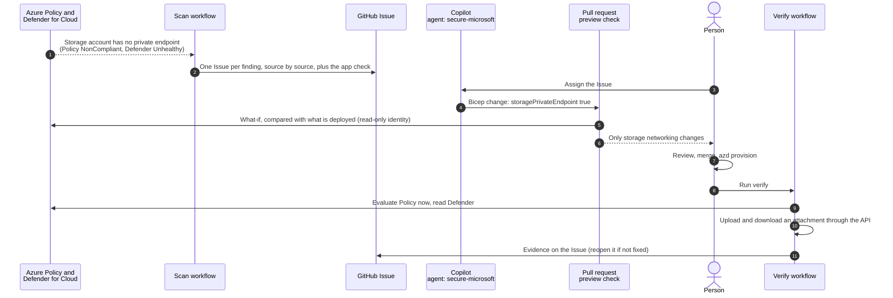
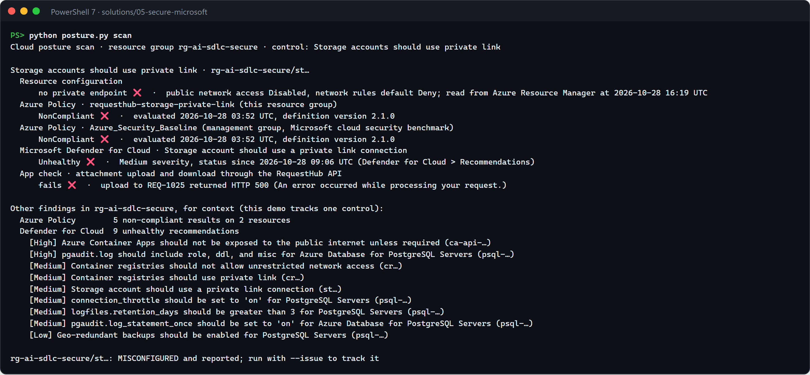
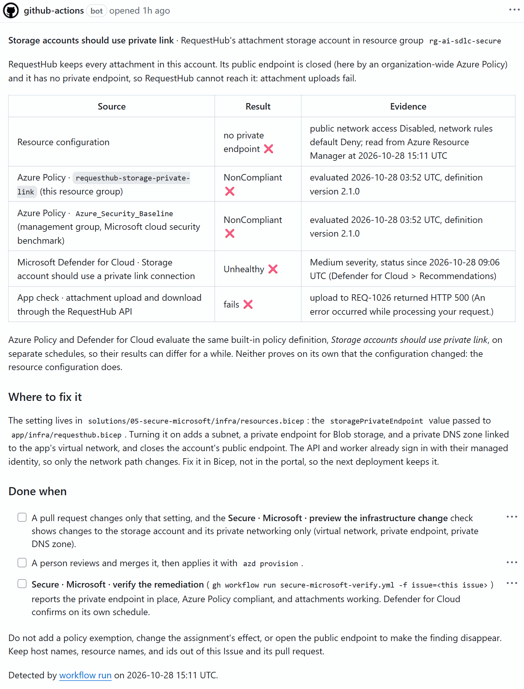
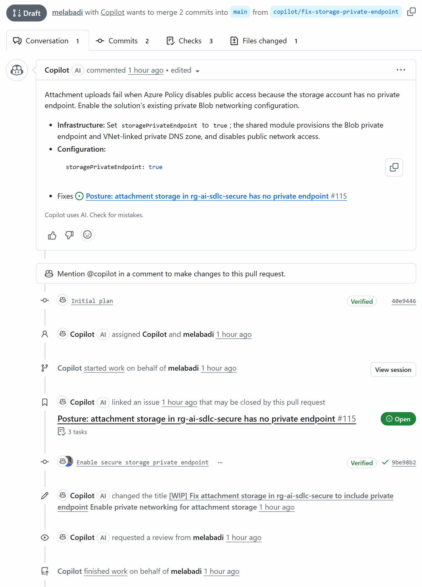
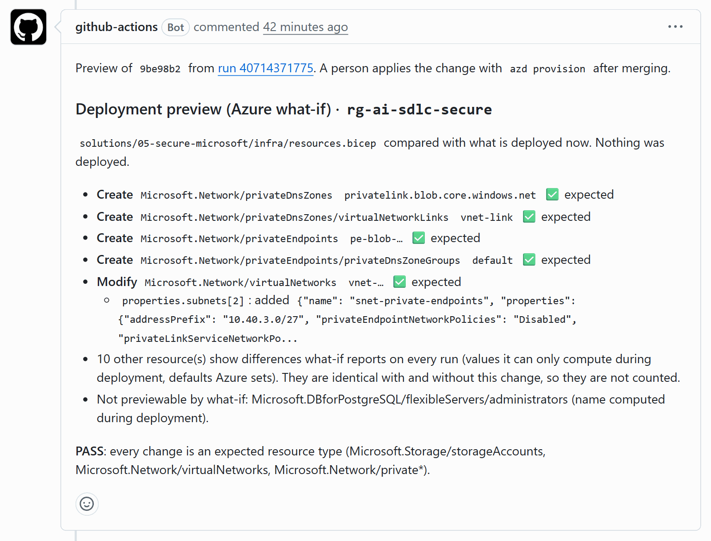
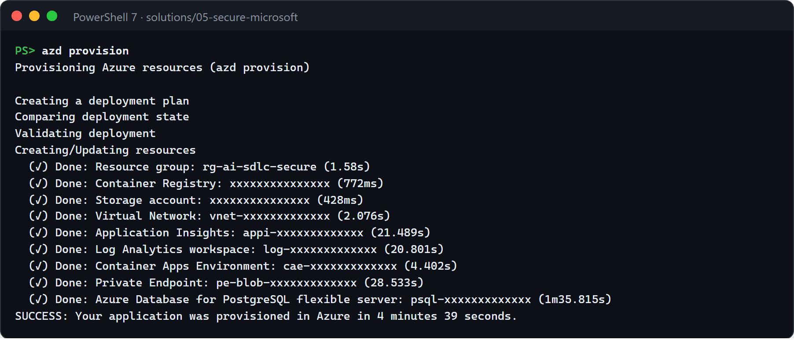
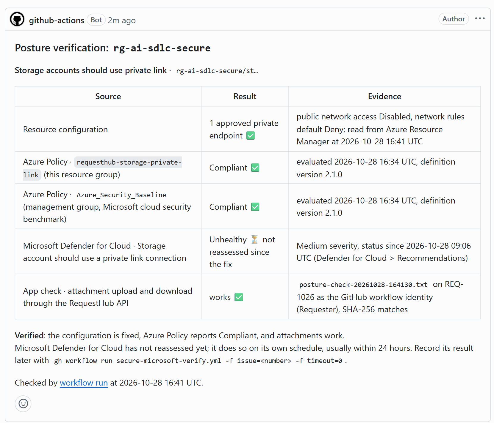
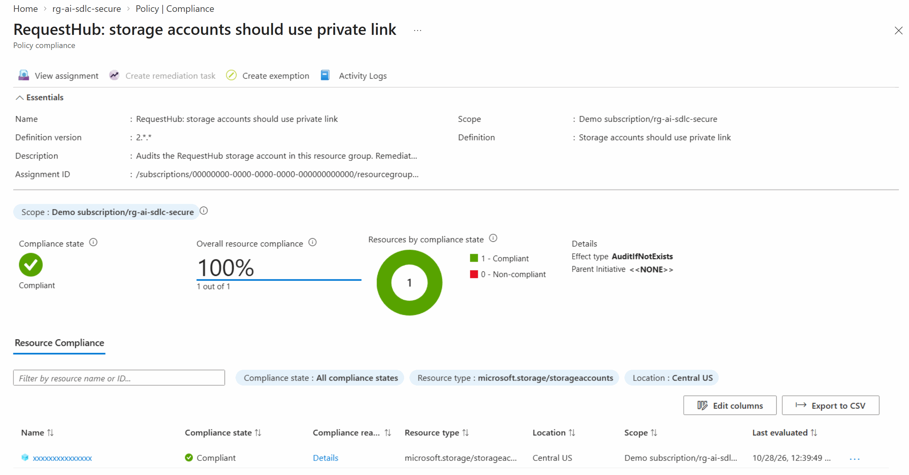
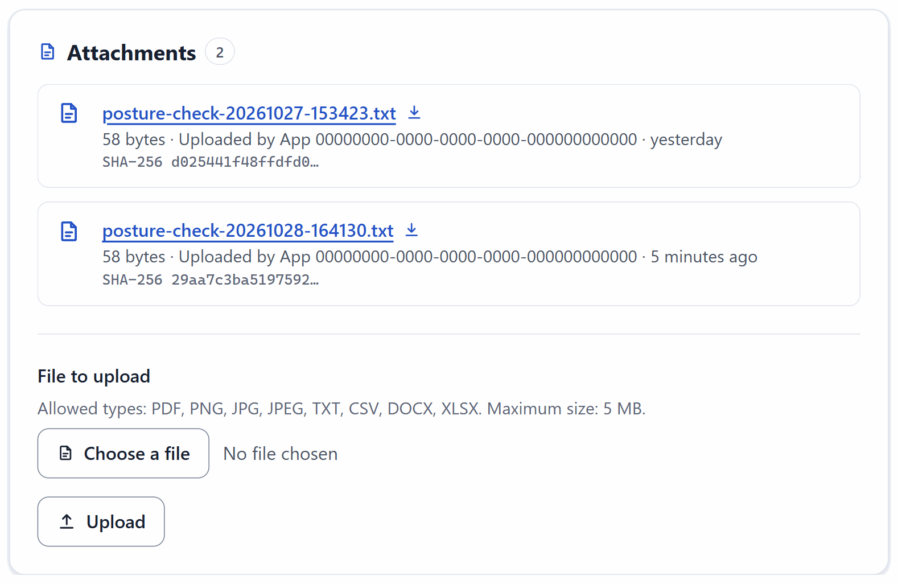

# Secure · Cloud posture remediation with Defender for Cloud and Azure Policy

Cloud misconfigurations are usually found by one team in a security portal and fixed by another team in code, if they are fixed at all. In this solution, Azure Policy and Microsoft Defender for Cloud flag a real misconfiguration on RequestHub's attachment storage: it has no private endpoint. A scan turns the finding into one tracked GitHub Issue, with the evidence from each source kept apart. Copilot fixes it in Bicep, and an Azure what-if preview on the pull request proves the change touches only storage networking. After a person applies it, a verification run queries both services again and proves that attachments work.


## Where it fits

**Phase 5 of 7: Secure.** The GitHub counterpart is [05-secure-github](../05-secure-github/). It finds flaws in the source code; this one finds them in the deployed cloud resources.

| | Today | With this solution |
| --- | --- | --- |
| Finding | A Defender recommendation waits in a portal the app team never opens. | A scan turns Azure Policy and Defender for Cloud results into one GitHub Issue, deduplicated, with each source's evidence and where to fix it. |
| Fix | Someone changes the setting in the portal, and the next deployment reverts it. | A one-line Bicep change, drafted by Copilot and reviewed in a pull request. |
| Blast radius | "It should be fine." | An Azure what-if preview on the pull request lists every resource the change creates or modifies, and fails on anything unexpected. |
| Done | The ticket closes when someone says so. | A verification run records the evidence: the live configuration, Azure Policy, and an attachment round trip through the app. Defender's slower confirmation is reported as pending until it arrives. |
| Access | Shared keys or a broad service principal. | GitHub OIDC with an identity that can read, preview, and start a Policy evaluation, but cannot deploy anything. |

## How it works



- **Azure Policy** is the fast signal. This solution assigns the built-in definition *Storage accounts should use private link* (version 2, AuditIfNotExists) to its own resource group. An on-demand evaluation takes minutes.
- **Microsoft Defender for Cloud** is the slow signal. It reports the same control through the Microsoft cloud security benchmark and reassesses on its own schedule: its first assessment of a new storage account took about 20 hours here, and a change can take from about 30 minutes to a day to show.
- **GitHub Actions** signs in through OIDC as an identity with two roles on the resource group: Reader, and Policy Enrollments Contributor, which lets it query compliance, start an evaluation, and run what-if. In the app it has only the Requester role, for the attachment check. It cannot change any resource or policy, push an image, or approve a request. [`secure-microsoft-scan.yml`](.github/workflows/secure-microsoft-scan.yml) files the Issue, [`secure-microsoft-preview.yml`](.github/workflows/secure-microsoft-preview.yml) previews every pull request that changes the infrastructure, and [`secure-microsoft-verify.yml`](.github/workflows/secure-microsoft-verify.yml) verifies the fix.
- **Copilot** runs the custom agent [`secure-microsoft`](.github/agents/secure-microsoft.agent.md) with two skills: `cloud-posture` (read and verify findings) and `infrastructure-remediation` (fix in Bicep, preview with what-if).
- **A person** reviews and merges the pull request, applies it with `azd provision`, and decides when the work is done.

The finding means different things in different subscriptions, and the scan's app check shows which applies. Where an organization-wide Azure Policy closes the public endpoints of storage accounts, as in the subscription this was built in, an account without a private endpoint is unreachable: attachment uploads fail with HTTP 500. Elsewhere, it is reachable from the internet, and only authentication protects the attachments.

Nothing the solution posts identifies your deployment. The scripts show the random token in resource names, and any GUID, as `…` (for example `st…` and `pe-blob-…`) in their console output, Issues, comments, run summaries, and artifacts, and the workflows read the API's URL from environment secrets, which GitHub masks in logs.

## What's in this folder

```text
05-secure-microsoft/
├── README.md
├── posture.py                          scan: findings by source, app check, deduplicated Issue; verify: re-query and close
├── azd_env.py                          reads settings from this solution's azd environment
├── configure_github.py                 azd hooks: connect the solution to GitHub Actions (secrets and variables)
├── azure.yaml                          azd project: infra plus the shared app's api and worker
├── infra/
│   ├── main.bicep                      resource group, then resources.bicep
│   ├── resources.bicep                 RequestHub platform (app/infra) without a private endpoint, and the Policy assignment
│   └── main.parameters.json
├── images/                             screenshots of a real run, used below
└── .github/
    ├── agents/secure-microsoft.agent.md     Copilot agent that remediates posture Issues in Bicep
    ├── skills/
    │   ├── cloud-posture/                    how to read, triage, and verify findings from each source
    │   └── infrastructure-remediation/       fix in Bicep and preview with what-if (whatif.py)
    └── workflows/
        ├── secure-microsoft-scan.yml         scan and file the Issue (manual)
        ├── secure-microsoft-preview.yml      what-if on every pull request that changes infra/
        └── secure-microsoft-verify.yml       verify after deployment (manual)
```

The private endpoint itself is implemented in the shared module [`app/infra/requesthub.bicep`](../../app/infra/requesthub.bicep) (parameter `storagePrivateEndpoint`, on by default). This solution turns it off to stage the finding.

## Prerequisites

- An Azure subscription where you can create resource groups, Microsoft Entra app registrations, role assignments, and policy assignments, for example as Owner.
- Microsoft Defender for Cloud with the Microsoft cloud security benchmark assigned. That is the default for Azure subscriptions, and the free foundational CSPM is enough; with the paid Defender CSPM plan, as in the screenshots, the portal also rates each recommendation's risk level.
- A region that allows PostgreSQL Flexible Server for the app. The examples use `centralus`.
- [Azure CLI](https://learn.microsoft.com/cli/azure/install-azure-cli) 2.76 or later, [Azure Developer CLI](https://learn.microsoft.com/azure/developer/azure-developer-cli/install-azd), and the [GitHub CLI](https://cli.github.com/) signed in as a repository admin. The hooks create a GitHub environment and its secrets.
- [PowerShell 7](https://learn.microsoft.com/powershell/scripting/install/installing-powershell) (`pwsh`) for the commands below, and Python 3.12 or later. The scripts use only the standard library.
- GitHub Copilot with the **Copilot cloud agent** enabled for the repository, for step 3. Copilot CLI works too.

## Set up

Run once, from this folder, **at least a day before you present**:

```powershell
cd solutions/05-secure-microsoft
az login
azd auth login
azd env new ai-sdlc-secure --location centralus
azd up
```

`azd up` takes about 15 minutes. It worked when it ends with `SUCCESS` and the postprovision hook printed `GitHub environment 'secure-microsoft' in <owner>/<repo>: 6 secrets, 5 variables set`. It creates resource group `rg-ai-sdlc-secure` with:

- **RequestHub's platform** from [`app/infra/requesthub.bicep`](../../app/infra/requesthub.bicep): private PostgreSQL, Blob storage, a container registry, monitoring, a Container Apps environment, and a Microsoft Entra app registration with RequestHub's app roles (you get every role). Storage is deployed **without a private endpoint**: that is the finding.
- **The app**, as two container apps (API with web UI, and the notification worker).
- **The Azure Policy assignment** `requesthub-storage-private-link`, on this resource group only.
- **The GitHub identity**, trusted only by this repository's `secure-microsoft` environment. It has Reader and Policy Enrollments Contributor on the resource group and the Requester role in the app, and nothing else.
- **GitHub environment `secure-microsoft`**, created by the hooks. Its secrets are the Azure sign-in values (`AZURE_CLIENT_ID`, `AZURE_TENANT_ID`, `AZURE_SUBSCRIPTION_ID`), your object id for the preview (`AZURE_PRINCIPAL_ID`), and the API's URL and identifier (`API_URL`, `API_IDENTIFIER_URI`). They are secrets because GitHub masks secrets in logs, while it prints variables in every step's environment listing. Its variables are documented names that identify nothing: the resource group, the environment name and region, and the policy assignment. None of these values is a password.

Azure Policy evaluates the new storage account within about 30 minutes. Defender for Cloud can take up to 24 hours to assess it, which is why you set up the day before. The next section shows how to check that both have.

## Before each session

Allow 15 minutes, most of it waiting. Run the commands in the solution folder (`cd solutions/05-secure-microsoft`).

1. **The database is running.** A tenant policy can stop PostgreSQL servers on a schedule; the app then times out and fails its readiness probe.

   ```powershell
   $rg = azd env get-value AZURE_RESOURCE_GROUP
   $db = az postgres flexible-server list -g $rg --query "[0].name" -o tsv
   az postgres flexible-server show -g $rg -n $db --query state -o tsv     # Ready
   az postgres flexible-server start -g $rg -n $db                         # only if it is Stopped: 3 to 5 minutes
   ```

2. **The demo is in its starting state.** Run the scan (about 1.5 minutes):

   ```powershell
   python posture.py scan
   ```

   

   You want every row red: `no private endpoint ❌`, Azure Policy `NonCompliant ❌` for both assignments, Defender for Cloud `Unhealthy ❌`, and the app check `fails ❌`. If Azure Policy still says `Compliant` (it has not re-evaluated since a reset), run `python posture.py scan --refresh`, which waits for a fresh evaluation (2 to 10 minutes). If Defender says `not assessed yet ⏳`, or still `Healthy` from the last run, the demo still works with Azure Policy: every report shows each source's own answer, and the configuration row is the ground truth.

3. **Nothing is left over from the last run.** `gh issue list --label posture --state open` and `gh pr list --search "storagePrivateEndpoint in:body"` return nothing; close what they list. Your clone is on an up-to-date `main` (`git switch main`, `git pull`), because `azd provision` deploys your local copy.

4. **Your sign-ins are fresh.** `az account get-access-token --query expiresOn` and `gh auth status` both succeed.

5. **Open these tabs** (the portal pages take up to a minute to load the first time):
   - Azure portal: **Microsoft Defender for Cloud** > **Recommendations**, search *private link*, open *Storage account should use a private link connection*.
   - Azure portal: **Policy** > **Compliance**, open *RequestHub: storage accounts should use private link*.
   - GitHub: the repository's **Issues** and **Actions** tabs.
   - A PowerShell 7 terminal at the repository root.

6. **Start the slow parts early, and plan the timing.** The demo takes about 30 minutes; nearly half is waiting:

   | Step | Takes | While you wait |
   | --- | --- | --- |
   | 1. Show the finding | 2 minutes | |
   | 2. Scan and file the Issue | 1 minute | |
   | 3. Copilot opens the fix | 6 to 20 minutes | Walk through the Issue, the policy assignment in [`resources.bicep`](infra/resources.bicep), and the agent's rules. |
   | 4. Preview check | 1 to 2 minutes | |
   | 5. Merge and apply | 5 to 7 minutes | Explain least privilege: the workflows could not have deployed this. |
   | 6. Verify | 3 to 15 minutes | Show the attachment in the app. |
   | Later: Defender confirms | 30 minutes to a day | Record it before you reset, or skip it. |

   Copilot is the long pole. In a 15-minute slot, run steps 2 and 3 before the audience arrives, start at step 1, and then pick up Copilot's finished pull request.

## Run the demo

Run the commands from the repository root unless a step says otherwise.

1. **Show the finding where security teams see it** (2 minutes). In the Defender for Cloud tab, the recommendation lists the storage account, with a remediation: add a private endpoint.

   

   **Point out:** *Risk level: Low* is not the *Medium* severity that the scan, the Issue, and the verification comment report. Severity is Microsoft's fixed rating of the recommendation. Risk level is Defender CSPM's rating of this account in its context (internet exposure, sensitive data, lateral movement, attack paths): it found no risk factors or attack paths here and rated it Low. Without the Defender CSPM plan, risk level reads *Not evaluated*.

   In the Policy tab, the solution's assignment reports the same storage account non-compliant.

   

   Optional: open the app (`azd env get-value API_URL` in the solution folder), open any request, and attach a file. Where public endpoints are closed by policy, the upload fails.

   **Point out:** both services flag the storage account, and neither says where the fix belongs: Defender links to general guidance, and Policy, which only audits here, offers no remediation task.

2. **Turn it into engineering work** (about 1 minute).

   ```powershell
   gh workflow run secure-microsoft-scan.yml
   gh run watch
   ```

   The run opens an Issue titled *Posture: attachment storage in rg-ai-sdlc-secure has no private endpoint*, labelled `posture`. Its table has one row per source: the live resource configuration, each Azure Policy assignment, Defender for Cloud, and the app check. Below it: where to fix it, and when the work is done. Run the workflow again and it comments on the same Issue instead of opening a second one.

   

   **Point out:** the evidence stays separated by source, and the Issue says where the fix lives: one Bicep value, not a portal setting.

3. **Hand it to Copilot** (6 to 20 minutes, mostly waiting; 6 minutes in the run shown). In the Issue, open **Assignees**, choose **Copilot**, pick the **secure-microsoft** agent, keep the base branch `main`, and assign. Or from a terminal:

   ```powershell
   $repo = gh repo view --json nameWithOwner -q .nameWithOwner
   $issue = <issue number>
   @{ assignees = @('copilot-swe-agent[bot]'); agent_assignment = @{ target_repo = $repo; base_branch = 'main'; custom_agent = 'secure-microsoft' } } |
     ConvertTo-Json | gh api -X POST "repos/$repo/issues/$issue/assignees" --input -
   ```

   A draft pull request appears within seconds. When Copilot finishes, it has changed one line in `infra/resources.bicep` (`storagePrivateEndpoint: true`), rewritten the comment above it to say what the private endpoint does, and linked the Issue.

   

   **Point out:** Copilot's description names the one value it changed, `storagePrivateEndpoint: true`, and links the Issue it fixes.

4. **Preview before anyone deploys** (1 to 2 minutes). Workflows on Copilot's pull requests wait for a person: select **Approve and run workflows**, or approve the runs for the pull request's latest commit from a terminal:

   ```powershell
   $sha = gh pr view <pull request number> --json headRefOid -q .headRefOid
   gh run list --commit $sha --status action_required --json databaseId -q '.[].databaseId' | ForEach-Object { gh run rerun $_ }
   ```

   The **Secure · Microsoft · preview the infrastructure change** check comments a what-if preview on the pull request: a private DNS zone and its link, the private endpoint and its DNS zone group, and a new subnet in the virtual network. Right after `azd up`, it also lists the storage account's network rules (`defaultAction: Allow → Deny`); after a reset they already deny. It ends with **PASS**. The pull request's timeline also says the branch was *deployed to secure-microsoft*: GitHub records a deployment whenever a job uses an environment's sign-in values. Nothing was deployed to Azure.

   

   **Point out:** before anything is deployed, the comment lists each resource the change creates or modifies, all of them expected, and ends with PASS. The ten other resources are what-if's recurring noise: the check also previews the deployed template, and they are identical in both.

5. **Review, merge, apply** (5 to 7 minutes). Review the change, mark the pull request ready, and merge it. Then apply it:

   ```powershell
   git pull
   cd solutions/05-secure-microsoft
   azd provision
   ```

   

   **Point out:** the change is deployed from your own terminal with `azd provision`, and the private endpoint is in its output.

6. **Verify** (3 to 15 minutes, depending on when Azure Policy re-evaluates; 4 minutes in the run shown).

   ```powershell
   gh workflow run secure-microsoft-verify.yml -f issue=<issue number>
   gh run watch
   ```

   The run starts an Azure Policy evaluation, waits for this solution's assignment to report Compliant, and then uploads and downloads an attachment through the API. It comments the evidence on the Issue: an approved private endpoint, both Policy assignments `Compliant ✅`, the app check `works ✅`, and Defender for Cloud `Unhealthy ⏳ not reassessed since the fix`. Copilot's pull request closed the Issue when it merged; the verify run reopens it if the fix is not actually in place.

   

   Show the same result in the portal and in the app: the Policy tab now reports the storage account compliant, and the request named in the app check row (for example REQ-1026, *Posture check: attachment round trip*) holds the file the check uploaded through the private endpoint.

   

   

   **Point out:** the verification comment keeps one row per source. The configuration, both Policy assignments, and the app check confirm the fix, and Defender for Cloud's row says it has not reassessed yet.

**Later: Defender for Cloud confirms** (30 minutes to a day; it had not reassessed 70 minutes after the fix in the run shown). Before you reset, run `gh workflow run secure-microsoft-verify.yml -f issue=<issue number> -f timeout=0`. Once Defender has reassessed the account, its row reads `Healthy ✅`, and the run records that on the Issue.

## What to observe

- **Two sources, two clocks.** Azure Policy and Defender for Cloud evaluate the same policy definition but report at different times. The tools never merge their answers or claim a source confirmed something it has not, and the resource configuration is the ground truth.
- **A finding becomes engineering work.** One deduplicated Issue holds the evidence, the impact on users, where to fix it, and what done means.
- **The fix is code.** A one-line Bicep change that Copilot drafts with its reasoning, reviewed like any other change. The next deployment cannot undo it.
- **The blast radius is known before deployment.** The preview lists exactly what the change creates and modifies, and fails if it touches anything else.
- **Least privilege.** The automation can find, preview, and verify, but cannot deploy. A person applies the change.
- **Verified by evidence, not by the diff.** Merging the pull request is not the end. The verification run shows Azure Policy Compliant and an attachment round trip on the Issue, and reopens the Issue if the fix is not really in place.
- **No secrets, and no identifiers.** GitHub Actions uses OIDC, the app uses its managed identity, and you use your own Microsoft Entra ID sign-in. Nothing the solution posts names your resources or your tenant.

## Reset and clean up

To run the demo again, put the finding back (about 15 minutes, most of it waiting). If you want Defender for Cloud's confirmation on the Issue (*Later* in [Run the demo](#run-the-demo)), record it first: the reset removes the fix it would confirm.

1. Revert the remediation: run `gh pr revert <pull request number>` (or select **Revert** on the merged pull request), and merge the revert pull request when its checks pass (about 2 minutes). You opened it, so its workflows run without approval. Its preview shows the subnet going away, and lists the private endpoint and DNS zone as left in place, because incremental deployments never delete.
2. Remove the private endpoint and its DNS zone, then apply `main` again:

   ```powershell
   git switch main
   git pull                                   # azd provision deploys your local copy, so get the revert first
   cd solutions/05-secure-microsoft
   $rg = azd env get-value AZURE_RESOURCE_GROUP
   az network private-endpoint delete -g $rg -n (az network private-endpoint list -g $rg --query "[0].name" -o tsv)
   az network private-dns link vnet delete -g $rg -z privatelink.blob.core.windows.net -n vnet-link --yes
   az network private-dns zone delete -g $rg -n privatelink.blob.core.windows.net --yes
   azd provision
   ```

   Incremental deployments never delete resources, so you remove the private endpoint before `azd provision` removes its subnet. The storage account keeps its closed public endpoint and its Deny rule. Only the private path goes away, so attachments fail again until the fix is reapplied.
3. Run `python posture.py scan --refresh` until Azure Policy reports `NonCompliant` again (one run, 2 to 10 minutes); until then it shows a stale `Compliant` next to the configuration ❌. Defender for Cloud follows on its own schedule: if it confirmed the fix, it can keep saying `Healthy` for up to a day.

To clear the posture check requests the app check created, reset the app's demo data (you are an Admin):

```powershell
$token = az account get-access-token --scope "$(azd env get-value API_IDENTIFIER_URI)/user_impersonation" --query accessToken -o tsv
curl.exe -X POST -H "Authorization: Bearer $token" "$(azd env get-value API_URL)/api/admin/reset"
```

When you no longer need the solution, run this in the solution folder:

```powershell
cd solutions/05-secure-microsoft
$app = az ad app show --id (azd env get-value API_CLIENT_ID) --query id -o tsv
azd down --purge
az ad app delete --id $app
az rest --method delete --url "https://graph.microsoft.com/v1.0/directory/deletedItems/$app"
gh api -X DELETE 'repos/{owner}/{repo}/environments/secure-microsoft'
```

`azd down` removes the resource group, but not RequestHub's Microsoft Entra app registration, because resource groups do not contain Entra objects. The last two `az` commands delete it and purge it; a deleted app that is not purged blocks the next `azd up` from creating it again.

## Use it in your own repository

1. Copy this folder, and copy its `.github/` contents into your repository's `.github/` folder.
2. In `infra/resources.bicep`, compose your own app's Bicep and assign the built-in policy for the control you care about.
3. In `posture.py`, describe the control in `CONTROL`: its policy definition, resource type, a function that judges the live resource, and where the fix belongs. Defender for Cloud recommendations are matched through the same policy definition, so there is no assessment id to look up.
4. Keep the GitHub identity at Reader and Policy Enrollments Contributor on the resource group, with no registry push and only the app roles its checks need (`automationCanPushImages` and `automationAppRoleNames` in `infra/resources.bicep`). Set `--expect` in `secure-microsoft-preview.yml` to the resource types your fixes may touch.
5. Publish values that name your resources (URLs, host names) as environment secrets, as `configure_github.py` does, and keep the scripts' masking: Issues and pull request comments are readable by everyone who can read the repository.
6. To scan on a schedule, add a `schedule` trigger to `secure-microsoft-scan.yml`. The Issue stays deduplicated.

## Troubleshooting

- **`AzureCLICredential: exit status 1` during `azd up`, `azd deploy`, or `azd provision`.** azd could not get a token from the Azure CLI, which happens when other Azure CLI sessions run at the same time. Run `az account get-access-token`, then run the command again.
- **The app times out, or the verify run's app check fails with a timeout.** The PostgreSQL server was stopped, for example by a tenant policy on a schedule. Start it as in [Before each session](#before-each-session); it takes 3 to 5 minutes.
- **A button in the app fails with HTTP 403 and no body.** The deployment predates [#134](https://github.com/melabadi/adept-assessment-northstars/pull/134), the shared module's fix for browser requests behind Container Apps authentication. Run `azd deploy api` in this folder from an up-to-date `main`.
- **A storage setting in your Bicep is ignored after deployment.** An organization-wide Azure Policy with a Modify effect can rewrite storage settings, such as shared key access or public network access, at deployment time. Run `az policy state list --resource <storage account id>` and look for `modify` in `policyDefinitionAction`. This solution uses private link because such a policy cannot fix it for you.
- **Attachments fail with HTTP 500 before the fix.** Expected where policy closes public storage endpoints: the API's Blob request is refused with `403 AuthorizationFailure`. The fix is what makes uploads work.
- **The Defender recommendation page stays on "Loading…".** The blade sometimes needs a minute after you sign in. Wait, or reload it.
- **Defender for Cloud says `not assessed yet`.** New resources can take up to 24 hours to appear. Deploy the day before.
- **No checks on Copilot's pull request.** Workflows on pull requests from the cloud agent wait for a person. Select **Approve and run workflows**. Approve only the runs for the latest commit: approving an older commit's runs as well can make GitHub cancel one of the new ones.
