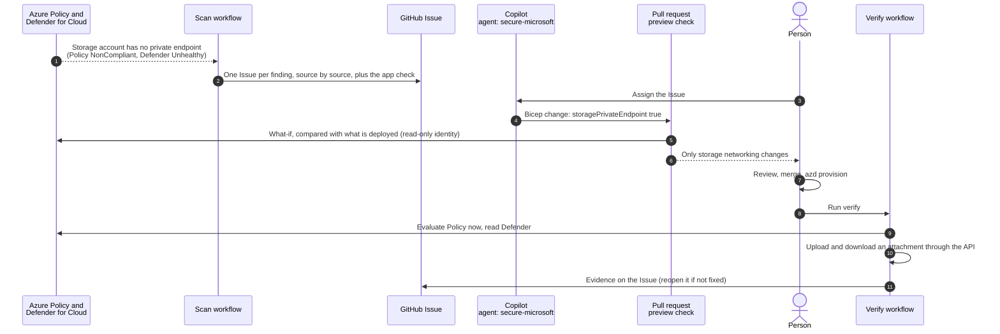

# Secure · Cloud posture remediation with Defender for Cloud and Azure Policy

Cloud misconfigurations are usually found by one team in a security portal and fixed by another team in code, if they are fixed at all. In this solution, Azure Policy and Microsoft Defender for Cloud flag a real misconfiguration on RequestHub's attachment storage: it has no private endpoint. A scan turns the finding into one tracked GitHub Issue, with the evidence from each source kept apart. Copilot fixes it in Bicep, and an Azure what-if preview on the pull request proves the change touches only storage networking. After a person applies it, a verification run queries both services again and proves that attachments work.

## Where it fits

**Phase 5 of 7: Secure.** The GitHub counterpart is [05-secure-github](../05-secure-github/). It finds flaws in the source code; this one finds them in the deployed cloud resources.

| | Today | With this solution |
| --- | --- | --- |
| Finding | A Defender recommendation waits in a portal the app team never opens. | A scan turns Azure Policy and Defender for Cloud results into one GitHub Issue, deduplicated, with each source's evidence and where to fix it. |
| Fix | Someone changes the setting in the portal, and the next deployment reverts it. | A one-line Bicep change, drafted by Copilot and reviewed in a pull request. |
| Blast radius | "It should be fine." | An Azure what-if preview on the pull request lists every resource the change creates or modifies, and fails on anything unexpected. |
| Done | The ticket closes when someone says so. | A verification run records the evidence: the live configuration, Azure Policy, and an attachment round trip through the app. Defender's slower confirmation is reported as pending until it arrives. |
| Access | Shared keys or a broad service principal. | GitHub OIDC with an identity that can read, preview, and start a Policy evaluation, but cannot deploy anything. |

## How it works



- **Azure Policy** is the fast signal. This solution assigns the built-in definition *Storage accounts should use private link* (version 2, AuditIfNotExists) to its own resource group. An on-demand evaluation takes minutes.
- **Microsoft Defender for Cloud** is the slow signal. It reports the same control through the Microsoft cloud security benchmark and reassesses on its own schedule, usually within 24 hours.
- **GitHub Actions** signs in through OIDC as an identity with two roles on the resource group: Reader, and Policy Enrollments Contributor, which lets it query compliance, start an evaluation, and run what-if. In the app it has only the Requester role, for the attachment check. It cannot change any resource or policy, push an image, or approve a request. [`secure-microsoft-scan.yml`](.github/workflows/secure-microsoft-scan.yml) files the Issue, [`secure-microsoft-preview.yml`](.github/workflows/secure-microsoft-preview.yml) previews every pull request that changes the infrastructure, and [`secure-microsoft-verify.yml`](.github/workflows/secure-microsoft-verify.yml) verifies the fix.
- **Copilot** runs the custom agent [`secure-microsoft`](.github/agents/secure-microsoft.agent.md) with two skills: `cloud-posture` (read and verify findings) and `infrastructure-remediation` (fix in Bicep, preview with what-if).
- **A person** reviews and merges the pull request, applies it with `azd provision`, and decides when the work is done.

The finding means different things in different subscriptions, and the scan's app check shows which applies. Where an organization-wide Azure Policy closes the public endpoints of storage accounts, as in the subscription this was built in, an account without a private endpoint is unreachable: attachment uploads fail with HTTP 500. Elsewhere, it is reachable from the internet, and only authentication protects the attachments.

## What's in this folder

```text
05-secure-microsoft/
├── README.md
├── posture.py                          scan: findings by source, app check, deduplicated Issue; verify: re-query and close
├── azd_env.py                          reads settings from this solution's azd environment
├── configure_github.py                 azd hooks: connect the solution to GitHub Actions
├── azure.yaml                          azd project: infra plus the shared app's api and worker
├── infra/
│   ├── main.bicep                      resource group, then resources.bicep
│   ├── resources.bicep                 RequestHub platform (app/infra) without a private endpoint, and the Policy assignment
│   └── main.parameters.json
└── .github/
    ├── agents/secure-microsoft.agent.md     Copilot agent that remediates posture Issues in Bicep
    ├── skills/
    │   ├── cloud-posture/                    how to read, triage, and verify findings from each source
    │   └── infrastructure-remediation/       fix in Bicep and preview with what-if (whatif.py)
    └── workflows/
        ├── secure-microsoft-scan.yml         scan and file the Issue (manual)
        ├── secure-microsoft-preview.yml      what-if on every pull request that changes infra/
        └── secure-microsoft-verify.yml       verify after deployment (manual)
```

The private endpoint itself is implemented in the shared module [`app/infra/requesthub.bicep`](../../app/infra/requesthub.bicep) (parameter `storagePrivateEndpoint`, on by default). This solution turns it off to stage the finding.

## Prerequisites

- An Azure subscription where you can create resource groups, Microsoft Entra app registrations, role assignments, and policy assignments, for example as Owner.
- Microsoft Defender for Cloud with the Microsoft cloud security benchmark assigned. That is the default for Azure subscriptions, and the free foundational CSPM is enough.
- A region that allows PostgreSQL Flexible Server for the app. The examples use `centralus`.
- [Azure CLI](https://learn.microsoft.com/cli/azure/install-azure-cli) 2.76 or later, [Azure Developer CLI](https://learn.microsoft.com/azure/developer/azure-developer-cli/install-azd), and the [GitHub CLI](https://cli.github.com/) signed in as a repository admin. The hooks create a GitHub environment and its secrets.
- Python 3.12 or later. The scripts use only the standard library.
- GitHub Copilot with the **Copilot cloud agent** enabled for the repository, for step 3. Copilot CLI works too.

## Set up

Run once, from this folder, **at least a day before you present**:

```powershell
cd solutions/05-secure-microsoft
az login
azd auth login
azd env new ai-sdlc-secure --location centralus
azd up
```

`azd up` takes about 15 minutes. It creates resource group `rg-ai-sdlc-secure` with:

- **RequestHub's platform** from [`app/infra/requesthub.bicep`](../../app/infra/requesthub.bicep): private PostgreSQL, Blob storage, a container registry, monitoring, a Container Apps environment, and a Microsoft Entra app registration with RequestHub's app roles (you get every role). Storage is deployed **without a private endpoint**: that is the finding.
- **The app**, as two container apps (API with web UI, and the notification worker).
- **The Azure Policy assignment** `requesthub-storage-private-link`, on this resource group only.
- **The GitHub identity**, trusted only by this repository's `secure-microsoft` environment. It has Reader and Policy Enrollments Contributor on the resource group and the Requester role in the app, and nothing else.
- **GitHub environment `secure-microsoft`**, created by the hooks: secrets `AZURE_CLIENT_ID`, `AZURE_TENANT_ID`, `AZURE_SUBSCRIPTION_ID`, and `AZURE_PRINCIPAL_ID`, and variables for the resource group, the deployment parameters, and the API. None of them is a password.

Azure Policy evaluates the new storage account within about 30 minutes. Defender for Cloud can take up to 24 hours to assess it, which is why you set up the day before. Check that you are ready:

```powershell
python posture.py scan
```

Ready looks like: configuration `no private endpoint ❌`, Azure Policy `NonCompliant ❌`, and Defender for Cloud `Unhealthy ❌`. If Defender still says `not assessed yet ⏳`, the demo still works with Azure Policy alone, and every report says honestly that Defender has not assessed the account yet.

## Run the demo

About 30 minutes, much of it waiting for Copilot and Azure. Run the commands from the repository root unless a step says otherwise.

1. **Show the finding where security teams see it** (2 minutes). In the [Azure portal](https://portal.azure.com):
   - **Microsoft Defender for Cloud** > **Recommendations**, search for *private link*, and open *Storage account should use a private link connection*. The storage account in `rg-ai-sdlc-secure` is listed as unhealthy.
   - **Policy** > **Compliance**, open *RequestHub: storage accounts should use private link*. The storage account is non-compliant.
   - Optional: open the app (`azd env get-value API_URL` in the solution folder), open a request, and attach a file. Where public endpoints are closed by policy, the upload fails.

2. **Turn it into engineering work** (2 minutes).

   ```powershell
   gh workflow run secure-microsoft-scan.yml
   gh run watch
   ```

   The run opens an Issue titled *Posture: storage account st… has no private endpoint*. Its table has one row per source: the resource configuration, each Azure Policy assignment, Defender for Cloud with the assessment id, and the app check. It also says where to fix it and when the work is done. Run the workflow again: it comments on the same Issue instead of opening a second one.

3. **Hand it to Copilot** (about 20 minutes, mostly waiting). In the Issue, open **Assignees**, choose **Copilot**, pick the **secure-microsoft** agent, keep the base branch `main`, and assign. Or from a terminal:

   ```powershell
   $repo = gh repo view --json nameWithOwner -q .nameWithOwner
   $issue = <issue number>
   @{ assignees = @('copilot-swe-agent[bot]'); agent_assignment = @{ target_repo = $repo; base_branch = 'main'; custom_agent = 'secure-microsoft' } } |
     ConvertTo-Json | gh api -X POST "repos/$repo/issues/$issue/assignees" --input -
   ```

   A draft pull request appears within seconds. When Copilot finishes, it changes one line in `infra/resources.bicep` (`storagePrivateEndpoint: true`) and rewrites the comment above it to say why the change is safe: the app signs in to storage with its managed identity, and the private DNS zone is linked to the app's virtual network.

4. **Preview before anyone deploys** (2 minutes). Workflows on Copilot's pull requests wait for a person: select **Approve and run workflows**, or approve the runs for the pull request's latest commit from a terminal:

   ```powershell
   $sha = gh pr view <pull request number> --json headRefOid -q .headRefOid
   gh run list --commit $sha --status action_required --json databaseId -q '.[].databaseId' | ForEach-Object { gh run rerun $_ }
   ```

   The **Secure · Microsoft · preview the infrastructure change** check comments a what-if preview on the pull request: a private DNS zone and its link, the private endpoint and its DNS zone group, a new subnet, and the storage account's network rules (`defaultAction: Allow → Deny`). It ends with **PASS**. Point out the line about other resources: what-if always reports some differences it cannot resolve, and the script previews the deployed template too, so they are not counted.

5. **Review, merge, apply** (about 6 minutes). Review the change, mark the pull request ready, and merge it. Then apply it:

   ```powershell
   git pull
   cd solutions/05-secure-microsoft
   azd provision
   ```

6. **Verify** (2 to 15 minutes, depending on when Azure Policy re-evaluates).

   ```powershell
   gh workflow run secure-microsoft-verify.yml -f issue=<issue number>
   gh run watch
   ```

   The run starts an Azure Policy evaluation, waits for this solution's assignment to report Compliant, and then uploads and downloads an attachment through the API. It comments the evidence on the Issue: configuration ✅, Azure Policy `Compliant ✅`, app check `works ✅`, and Defender for Cloud `Unhealthy ⏳ not reassessed since the fix`. Copilot's pull request already closed the Issue when it merged. Verify closes it if it is still open, and reopens it if the fix is not actually in place.

7. **Let Defender confirm** (the next day). Run `gh workflow run secure-microsoft-verify.yml -f issue=<issue number> -f timeout=0`. Defender for Cloud now reports `Healthy ✅`, and the run records it on the Issue.

## What to observe

- **Two sources, two clocks.** Azure Policy and Defender for Cloud evaluate the same policy definition but report at different times. The tools never merge their answers or claim a source confirmed something it has not, and the resource configuration is the ground truth.
- **A finding becomes engineering work.** One deduplicated Issue holds the evidence, the impact on users, where to fix it, and what done means.
- **The fix is code.** A one-line Bicep change that Copilot drafts with its reasoning, reviewed like any other change. The next deployment cannot undo it.
- **The blast radius is known before deployment.** The preview lists exactly what the change creates and modifies, and fails if it touches anything else.
- **Least privilege.** The automation can find, preview, and verify, but cannot deploy. A person applies the change.
- **Verified by evidence, not by the diff.** Merging the pull request is not the end. The verification run shows Azure Policy Compliant and an attachment round trip on the Issue, and reopens the Issue if the fix is not really in place.
- **No secrets anywhere.** GitHub Actions uses OIDC, the app uses its managed identity, and you use your own Microsoft Entra ID sign-in.

## Reset and clean up

To run the demo again, put the finding back:

1. Revert the remediation: run `gh pr revert <pull request number>` (or select **Revert** on the merged pull request), then merge the revert pull request. Its preview shows the subnet going away, and lists the private endpoint and DNS zone as left in place, because incremental deployments never delete.
2. Remove the private endpoint and its DNS zone, then apply `main` again:

   ```powershell
   cd solutions/05-secure-microsoft
   $rg = azd env get-value AZURE_RESOURCE_GROUP
   az network private-endpoint delete -g $rg -n (az network private-endpoint list -g $rg --query "[0].name" -o tsv)
   az network private-dns link vnet delete -g $rg -z privatelink.blob.core.windows.net -n vnet-link --yes
   az network private-dns zone delete -g $rg -n privatelink.blob.core.windows.net --yes
   azd provision
   ```

   Incremental deployments never delete resources, so you remove the private endpoint before `azd provision` removes its subnet. The storage account keeps its closed public endpoint and its Deny rule. Only the private path goes away, so attachments fail again until the fix is reapplied. Azure Policy reports the finding again within about 30 minutes; until then the scan shows the configuration ❌ next to a stale Compliant result and files nothing. Run `python posture.py scan --refresh` to re-evaluate now. Defender for Cloud follows within 24 hours.

To clear the posture check requests the app check created, reset the app's demo data (you are an Admin):

```powershell
$token = az account get-access-token --scope "$(azd env get-value API_IDENTIFIER_URI)/user_impersonation" --query accessToken -o tsv
curl.exe -X POST -H "Authorization: Bearer $token" "$(azd env get-value API_URL)/api/admin/reset"
```

When you no longer need the solution, run this in the solution folder:

```powershell
cd solutions/05-secure-microsoft
$app = az ad app show --id (azd env get-value API_CLIENT_ID) --query id -o tsv
azd down --purge
az ad app delete --id $app
az rest --method delete --url "https://graph.microsoft.com/v1.0/directory/deletedItems/$app"
gh api -X DELETE 'repos/{owner}/{repo}/environments/secure-microsoft'
```

`azd down` removes the resource group, but not RequestHub's Microsoft Entra app registration, because resource groups do not contain Entra objects. The last two `az` commands delete it and purge it; a deleted app that is not purged blocks the next `azd up` from creating it again.

## Use it in your own repository

1. Copy this folder, and copy its `.github/` contents into your repository's `.github/` folder.
2. In `infra/resources.bicep`, compose your own app's Bicep and assign the built-in policy for the control you care about.
3. In `posture.py`, describe the control in `CONTROL`: its policy definition, resource type, a function that judges the live resource, and where the fix belongs. Defender for Cloud recommendations are matched through the same policy definition, so there is no assessment id to look up.
4. Keep the GitHub identity at Reader and Policy Enrollments Contributor on the resource group, with no registry push and only the app roles its checks need (`automationCanPushImages` and `automationAppRoleNames` in `infra/resources.bicep`). Set `--expect` in `secure-microsoft-preview.yml` to the resource types your fixes may touch.
5. To scan on a schedule, add a `schedule` trigger to `secure-microsoft-scan.yml`. The Issue stays deduplicated.

## Troubleshooting

- **`AzureCLICredential: exit status 1` during `azd up`, `azd deploy`, or `azd provision`.** azd could not get a token from the Azure CLI, which happens when other Azure CLI sessions run at the same time. Run `az account get-access-token`, then run the command again.
- **A storage setting in your Bicep is ignored after deployment.** An organization-wide Azure Policy with a Modify effect can rewrite storage settings, such as shared key access or public network access, at deployment time. Run `az policy state list --resource <storage account id>` and look for `modify` in `policyDefinitionAction`. This solution uses private link because such a policy cannot fix it for you.
- **Attachments fail with HTTP 500 before the fix.** Expected where policy closes public storage endpoints: the API's Blob request is refused with `403 AuthorizationFailure`. The fix is what makes uploads work.
- **Defender for Cloud says `not assessed yet`.** New resources can take up to 24 hours to appear. Deploy the day before.
- **No checks on Copilot's pull request.** Workflows on pull requests from the cloud agent wait for a person. Select **Approve and run workflows**.
