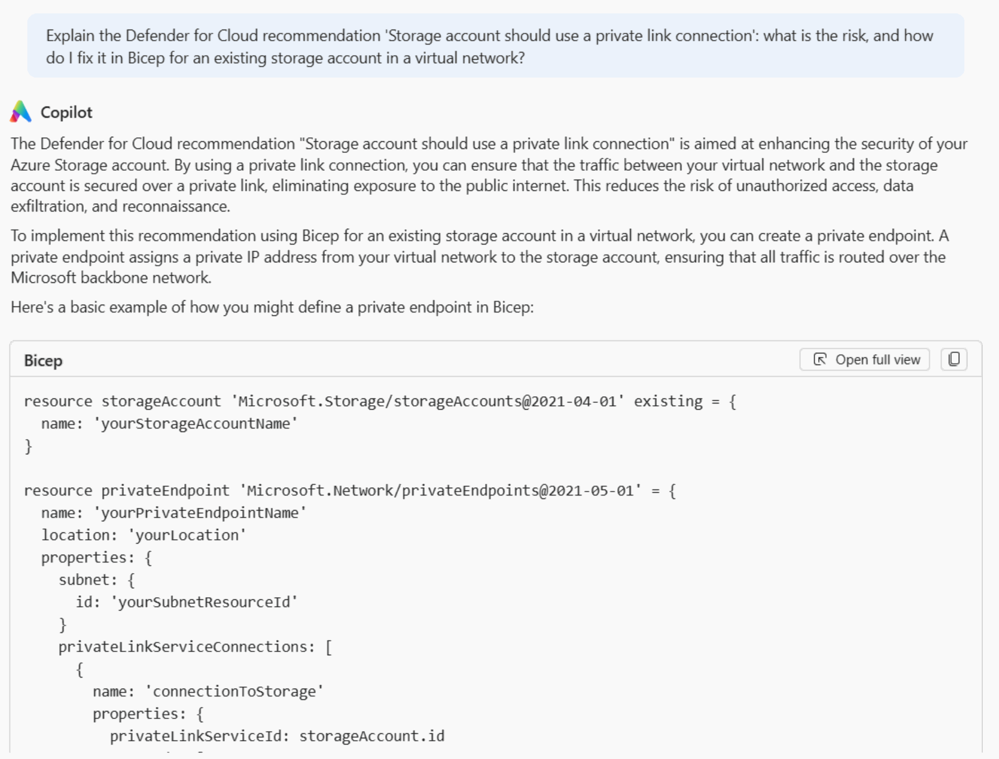
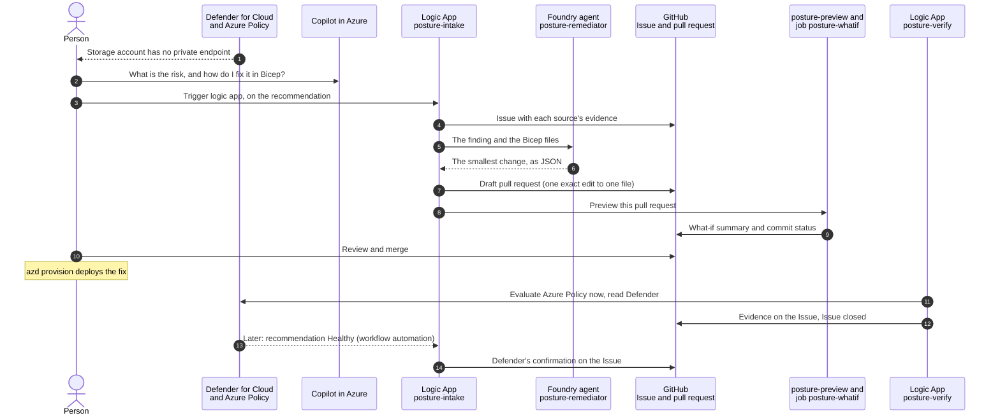
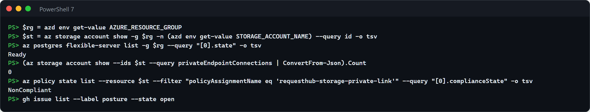
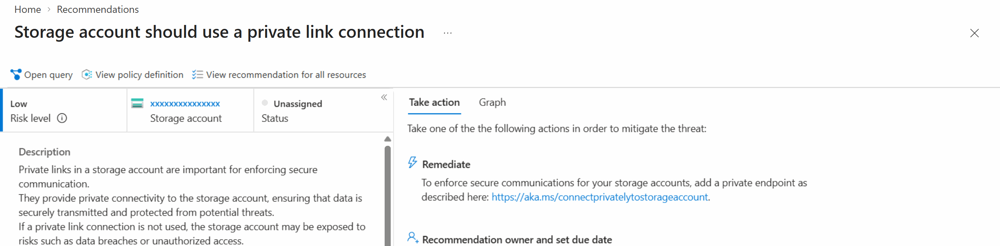
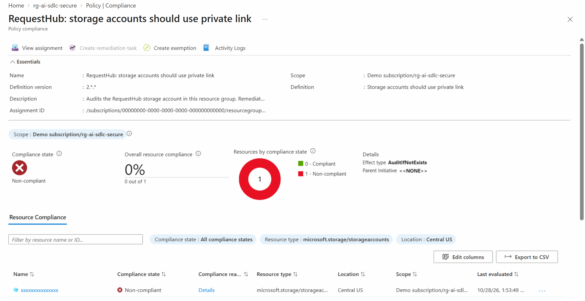
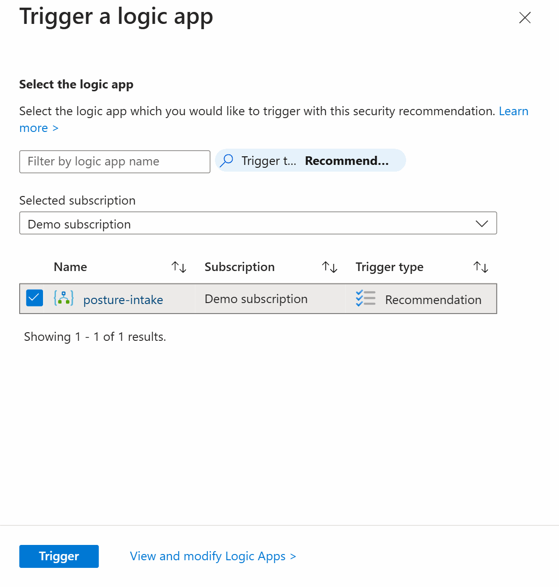
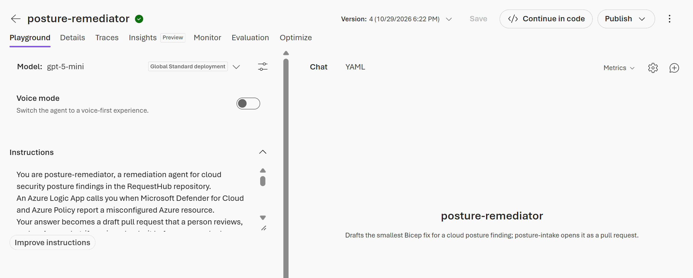

# Secure · Cloud posture remediation with Defender for Cloud, Copilot in Azure, and Microsoft Foundry

Cloud misconfigurations are usually found by one team in a security portal and fixed by another team in code, if they are fixed at all. In this solution, Azure Policy and Microsoft Defender for Cloud flag a real misconfiguration on RequestHub's attachment storage: it has no private endpoint. Copilot in Azure explains the risk in the portal. One click on the recommendation starts an Azure Logic App that files a GitHub Issue with each source's evidence, asks a Microsoft Foundry agent for the smallest Bicep fix, checks the answer, and opens it as a draft pull request. A what-if preview that runs in Azure shows that the fix changes only storage networking. A person reviews, merges, and deploys it, and another Logic App records the evidence on the Issue. GitHub holds only the code, the Issue, and the pull request: the AI and the automation run in Azure.



## Where it fits

**Phase 5 of 7: Secure.** The GitHub counterpart is [05-secure-github](../05-secure-github/), which finds flaws in the source code with GitHub Copilot. This one finds them in the deployed cloud resources, with AI that runs in Azure.

| | Today | With this solution |
| --- | --- | --- |
| Finding | A Defender recommendation waits in a portal the app team never opens. | One click on the recommendation files a GitHub Issue with each source's evidence: the live configuration, Azure Policy, and Defender for Cloud. A second click reuses the Issue. |
| Understanding | Someone searches the documentation for what the recommendation means. | Copilot in Azure explains the risk and the fix next to the recommendation. |
| Fix | Someone changes the setting in the portal, and the next deployment reverts it. | A Foundry agent drafts the smallest change to the team's Bicep. The Logic App accepts only one exact edit to one file and opens it as a draft pull request. |
| Blast radius | "It should be fine." | A what-if preview lists every resource the pull request creates or modifies, and fails on anything unexpected. |
| Done | The ticket closes when someone says so. | After deployment, a Logic App records the live configuration and Azure Policy's result on the Issue, then closes it. Defender's slower confirmation follows. |
| Access | Shared keys or a broad service principal. | A managed identity that can read, preview, and start a Policy evaluation but cannot deploy, and a GitHub token for this repository only. |

## How it works



- **Azure Policy and Microsoft Defender for Cloud** find the problem. This solution assigns the built-in definition *Storage accounts should use private link* (version 2, AuditIfNotExists) to its own resource group. Azure Policy is the fast signal: an on-demand evaluation takes minutes. Defender for Cloud reports the same control through the Microsoft cloud security benchmark, on its own schedule: its first assessment of a new storage account took about 20 hours here, and a change can take from about 30 minutes to a day to show.
- **Copilot in Azure** explains the recommendation and writes example Bicep in the portal's chat. It has no API, so it helps the presenter, not the automation.
- **The Logic App `posture-intake`** ([`logic/intake.json`](infra/logic/intake.json)) runs when a person selects **Trigger logic app** on the recommendation. With its managed identity, it reads the storage account and Azure Policy's results. With the GitHub token, it files the Issue, or reuses the open one. It sends the finding, the solution's Bicep file, and the module that file uses to the Foundry agent, and checks the answer: a change, to the one editable file, replacing text that occurs exactly once. Only then does it create a branch, commit the change, open a draft pull request, and start the preview. An answer that fails the check becomes a comment on the Issue instead.
- **The Foundry agent `posture-remediator`** is a prompt agent on `gpt-5-mini` in the solution's own Foundry project. Its instructions, [`posture-remediator.md`](posture-remediator.md), tell it to prefer an existing module parameter, change one block and the comment above it, and never weaken a control. A strict JSON schema shapes its answer. The azd hook [`remediation_agent.py`](remediation_agent.py) publishes a new version whenever the definition changes.
- **The Logic App `posture-preview` and the Container Apps job `posture-whatif`** preview a pull request. `posture-intake` starts the preview as soon as it opens a pull request, and a repository webhook starts it on every later push. The Logic App takes only the pull request number from the webhook's payload, reads the pull request from GitHub's API, skips pull requests that do not change this solution's `infra/`, and starts the job. It previews each commit once, so when the webhook reports the pull request `posture-intake` just opened, that second run stops without starting the job. The job runs [`whatif.py`](whatif.py), comments a summary on the pull request, and sets the commit status `posture/what-if`.
- **The Logic App `posture-verify`** ([`logic/verify.json`](infra/logic/verify.json)) runs every hour, or when you run it. Once the storage account has an approved private endpoint, it starts an Azure Policy evaluation and waits up to 20 minutes for this solution's assignment to report the account compliant. It then records each source's answer on the Issue and closes it; if Azure Policy has not caught up, the next run tries again. Defender's own confirmation arrives later: the workflow automation `posture-defender-healthy` sends the recommendation to `posture-intake` when it turns Healthy, and `posture-intake` records it on the Issue.
- **A person** creates the GitHub token, reviews and merges the pull request, deploys it with `azd provision`, and decides when the work is done.
- **GitHub** holds the code, the Issue, the pull request, and one webhook. No GitHub Actions workflow, Copilot agent, or skill takes part.

**Least privilege.** The Logic Apps and the job share one user-assigned managed identity. It has Reader and Policy Enrollments Contributor on the resource group (read, query compliance, start a Policy evaluation, run what-if), Foundry User on the Foundry account, and Container Apps Jobs Operator on the job. It cannot change a resource, a policy assignment, or an exemption, so nothing in Azure can deploy the fix. The GitHub token reaches this repository only, with four permissions (see [Set up](#set-up)).

**A pull request's Bicep is untrusted input.** Bicep's `load*` functions, `readEnvironmentVariable`, and module paths can read files on the machine that compiles a template, including the process environment that holds the token. So the job runs `whatif.py` from the default branch, never code from the pull request. Before compiling, it refuses a template that calls one of those functions, references a registry module, or reaches a path outside `solutions/05-secure-microsoft/infra/` and `app/infra/`. The token never reaches the processes that compile or preview the template, and the comment lists only change kinds, resource types, and masked names: never raw what-if output, property values, or compiler messages.

**The finding means different things in different subscriptions,** and the Issue says which applies. Where an organization-wide Azure Policy closes the public endpoints of storage accounts, as in the subscription this was built in, an account without a private endpoint is unreachable: attachment uploads fail with HTTP 500. Elsewhere, it is reachable from the internet, and only authentication protects the attachments.

Nothing the automation posts identifies your deployment. The Issue, the pull request, and the comments name the resource group, the policy assignments, and resource types. Resource names appear with their random token masked as `…` (for example `st…`), and GUIDs never appear.

## What's in this folder

```text
05-secure-microsoft/
├── README.md
├── azure.yaml                    azd project: infra, the shared app's api and worker, and the hooks
├── infra/
│   ├── main.bicep                resource group, then resources.bicep and automation.bicep
│   ├── resources.bicep           RequestHub's platform without a private endpoint, and the Policy assignment: the file a fix changes
│   ├── automation.bicep          the posture automation: Foundry project and model, the what-if job, the Logic Apps
│   ├── logic/
│   │   ├── intake.json           Logic App posture-intake, and the Defender workflow automation posture-defender-healthy
│   │   ├── preview.json          Logic App posture-preview: starts the what-if job for a pull request
│   │   └── verify.json           Logic App posture-verify: records the evidence after deployment
│   └── main.parameters.json
├── posture-remediator.md         the Foundry agent's instructions
├── remediation_agent.py          publishes the agent (azd hook); `try` runs it against your checkout
├── whatif.py                     the what-if preview and its untrusted-Bicep check, run by the job or on your checkout
├── configure_github.py           azd hooks: finds the repository, creates and removes the webhook
├── azd_env.py                    reads settings from this solution's azd environment
├── requirements.txt              Python packages for remediation_agent.py
└── images/                       screenshots of a real run, used below
```

There is no `.github/` folder: the solution ships no workflow, agent, or skill. The private endpoint itself is implemented in the shared module [`app/infra/requesthub.bicep`](../../app/infra/requesthub.bicep) (parameter `storagePrivateEndpoint`, on by default). This solution turns it off to stage the finding.

## Prerequisites

- An Azure subscription where you can create resource groups, Microsoft Entra app registrations, role assignments, and policy assignments, for example as Owner. Owner also covers **Trigger logic app**, which needs Security Admin on the resource group and the right to run the Logic App.
- Microsoft Defender for Cloud with the Microsoft cloud security benchmark assigned, the default for Azure subscriptions. The free foundational CSPM includes the recommendation, **Trigger logic app**, and workflow automation. With the paid Defender CSPM plan, as in the screenshots, the portal also rates each recommendation's risk level.
- Copilot in Azure, which the Azure portal offers unless your tenant's administrators turned it off.
- A region with PostgreSQL Flexible Server, Microsoft Foundry, and Global Standard quota for `gpt-5-mini` (50,000 tokens per minute). The examples use `centralus`.
- Admin rights on the GitHub repository, because the setup creates a webhook, and a GitHub account that can create a fine-grained personal access token for it.
- [Azure CLI](https://learn.microsoft.com/cli/azure/install-azure-cli) 2.76 or later, [Azure Developer CLI](https://learn.microsoft.com/azure/developer/azure-developer-cli/install-azd), the [GitHub CLI](https://cli.github.com/) signed in (`gh auth login`), [PowerShell 7](https://learn.microsoft.com/powershell/scripting/install/installing-powershell) (`pwsh`), and Python 3.12 or later.

## Set up

Do this once, **at least a day before you present**: Defender for Cloud can take up to 24 hours to assess a new storage account.

1. **Create the GitHub token.** A person does this; nothing in the solution can. On GitHub, open your **Settings** > **Developer settings** > **Personal access tokens** > **Fine-grained tokens** > **Generate new token**:
   - **Resource owner**: the repository's owner. **Expiration**: long enough to cover your sessions, for example 90 days.
   - **Repository access**: **Only select repositories**, then this repository.
   - **Permissions**: **Commit statuses**, **Contents**, **Issues**, and **Pull requests**, each set to **Read and write**. GitHub adds **Metadata** (read-only).

   The Logic Apps use it to file the Issue, create the branch, commit the fix, open the pull request, comment, and close the Issue. The job uses it to read the pull request's files, comment, and set the commit status. Copy the token: GitHub shows it only once.

2. **Deploy** from this folder (about 20 minutes):

   ```powershell
   cd solutions/05-secure-microsoft
   pip install -r requirements.txt
   az login
   azd auth login
   azd env new ai-sdlc-secure --location centralus
   azd env set POSTURE_GITHUB_TOKEN (Read-Host -MaskInput 'GitHub token')
   azd up
   ```

   `Read-Host -MaskInput` keeps the token off the screen and out of your PowerShell history. It worked when `azd up` ends with `SUCCESS` and its postprovision hook printed:

   ```text
   Foundry agent posture-remediator: published version 1.
   Webhook <id> in <owner>/<repo>: pull_request events → Logic App posture-preview (created).
   ```

`azd up` creates resource group `rg-ai-sdlc-secure` with:

- **RequestHub's platform** from [`app/infra/requesthub.bicep`](../../app/infra/requesthub.bicep): private PostgreSQL, Blob storage, a container registry, monitoring, a Container Apps environment, and a Microsoft Entra app registration with RequestHub's app roles (you get every role). Storage is deployed **without a private endpoint**: that is the finding.
- **The app**, as two container apps: the API with the web UI, and the notification worker.
- **The Azure Policy assignment** `requesthub-storage-private-link`, on this resource group only.
- **The posture automation**: a Microsoft Foundry account with the project `secure`, the model deployment `gpt-5-mini`, and the agent `posture-remediator`; the Logic Apps `posture-intake`, `posture-preview`, and `posture-verify`; the Container Apps job `posture-whatif`; and the Defender for Cloud connection and workflow automation `posture-defender-healthy`.
- **The automation identity**, with the roles listed under [Least privilege](#how-it-works). It has no GitHub federation, no registry push, and no RequestHub app role.

In GitHub, it creates one webhook that sends `pull_request` events to `posture-preview`. The webhook's URL carries the Logic App's signature, so the hook reads it from Azure each time and never prints it.

**Where the token is stored.** In your local azd environment file, `.azure/ai-sdlc-secure/.env` in this folder, which git ignores. In each Logic App as a secure parameter, which Azure never returns when someone reads the Logic App. In the job as a secret. Every Logic App action that sends it has secure inputs, so run history does not show it either. There is no Key Vault: the subscription this was built in forces Key Vault public access off, and Consumption Logic Apps cannot reach a private vault. Anyone who can change the resource group's Logic Apps or read the job's secrets can use the token, so keep write access to the resource group as narrow as write access to the repository. To rotate the token, run the `azd env set` line again, then `azd provision`. [Clean up](#reset-and-clean-up) deletes it.

Without the token, `azd up` still deploys everything and warns you. The Logic Apps then stop at their first GitHub call with HTTP 401, until you set the token and run `azd provision` again.

## Before each session

Allow 15 minutes, most of it for the portal pages to load. Run the commands in the solution folder (`cd solutions/05-secure-microsoft`).

1. **Check the starting state** (1 minute):

   ```powershell
   $rg = azd env get-value AZURE_RESOURCE_GROUP
   az postgres flexible-server list -g $rg --query "[0].state" -o tsv
   (az network private-endpoint list -g $rg | ConvertFrom-Json).Count
   az policy state list -g $rg --filter "policyAssignmentName eq 'requesthub-storage-private-link'" --query "[0].complianceState" -o tsv
   gh issue list --label posture --state open
   ```

   

   You want `Ready`, `0`, `NonCompliant`, and no open Issue.
   - **The database is `Stopped`.** A tenant policy can stop PostgreSQL servers on a schedule, and the app then times out. Start it; it takes 3 to 5 minutes:

     ```powershell
     az postgres flexible-server start -g $rg -n (az postgres flexible-server list -g $rg --query "[0].name" -o tsv)
     ```

   - **A private endpoint is left, or an Issue is open.** The last run was not reset: follow [Reset](#reset-and-clean-up).
   - **Azure Policy still says `Compliant` after a reset.** It has not re-evaluated yet. Run `az policy state trigger-scan -g $rg`, which takes 2 to 10 minutes.

2. **Defender for Cloud still reports the account Unhealthy** (1 minute):

   ```powershell
   $st = az storage account show -g $rg -n (azd env get-value STORAGE_ACCOUNT_NAME) --query id -o tsv
   az security assessment show -n cdc78c07-02b0-4af0-1cb2-cb7c672a8b0a --assessed-resource-id $st --query status.code -o tsv --only-show-errors
   ```

   You want `Unhealthy`. `Healthy` means Defender confirmed the last run's fix and has not reassessed since the reset, which can take up to a day. **Trigger logic app** then sends *Healthy*, and `posture-intake` only records a confirmation. Reset at least a day before you present, or use the fallback in [Troubleshooting](#troubleshooting). An error that the assessment is not found means Defender has not assessed the account yet: up to 24 hours after setup.

3. **The token and your sign-ins work** (1 minute):

   ```powershell
   $token = azd env get-value POSTURE_GITHUB_TOKEN
   $repo = gh repo view --json nameWithOwner -q .nameWithOwner
   (Invoke-RestMethod "https://api.github.com/repos/$repo" -Headers @{ Authorization = "Bearer $token" }).full_name
   az account get-access-token --query expiresOn -o tsv
   gh auth status
   ```

   The third line prints the repository's name, read with the automation's token and nothing else. An error that the key `POSTURE_GITHUB_TOKEN` is not found means the token was never stored; `401` (Bad credentials) means it expired or was revoked. Either way, create a new one ([Set up](#set-up), step 1), store it with `azd env set`, and run `azd provision`. Also make sure your clone is on an up-to-date `main` (`git switch main`, then `git pull`), because `azd provision` deploys your local copy.

4. **Open these tabs** (the portal pages can take a minute to load the first time):
   - Azure portal: **Microsoft Defender for Cloud** > **Recommendations**. Search for *private link*, open *Storage account should use a private link connection*, and select the storage account.
   - Azure portal: **Policy** > **Compliance**. Open *RequestHub: storage accounts should use private link*.
   - Azure portal: the Logic App `posture-intake`, **Overview** > **Runs history**.
   - Foundry portal ([ai.azure.com](https://ai.azure.com)): the solution's project, **Build** > **Agents** > **posture-remediator**.
   - GitHub: the repository's **Issues** and **Pull requests** tabs.
   - PowerShell 7 in the solution folder.

5. **Plan the timing.** The demo takes about 30 minutes; a third of it is waiting:

   | Step | Takes | While you wait |
   | --- | --- | --- |
   | 1. Show the finding | 2 minutes | |
   | 2. Ask Copilot in Azure | 2 minutes | |
   | 3. Trigger the automation | 1 to 2 minutes | Open the run and walk through its steps. |
   | 4. Read the Issue and the pull request | 3 minutes | |
   | 5. Preview | 2 to 4 minutes | Explain why the preview never runs the pull request's code. |
   | 6. Merge and apply | 5 to 7 minutes | Explain least privilege: the automation could not have deployed this. |
   | 7. Verify | 3 to 15 minutes | Attach a file in the app (optional). |
   | Later: Defender confirms | 30 minutes to a day | Nothing to do: workflow automation records it. |

   In a 15-minute slot, run steps 3 to 5 before the audience arrives, show steps 1 and 2 live, and then walk through the Issue, the pull request, and its preview.

## Run the demo

Run the commands in the solution folder.

1. **Show the finding where security teams see it** (2 minutes). In the Defender for Cloud tab, the recommendation lists the storage account, with a remediation: add a private endpoint.

   

   **Point out:** *Risk level: Low* is not the *Medium* severity that the Issue reports in step 4. Severity is Microsoft's fixed rating of the recommendation. Risk level is Defender CSPM's rating of this account in its context (internet exposure, sensitive data, lateral movement, attack paths): it found no risk factors or attack paths here and rated it Low. Without the Defender CSPM plan, risk level reads *Not evaluated*.

   In the Policy tab, the solution's assignment reports the same storage account non-compliant.

   

   Optional: open the app (`azd env get-value API_URL`), open any request, and attach a file. Where public endpoints are closed by policy, the upload fails.

   **Point out:** both services flag the storage account, and neither says where the fix belongs: Defender links to general guidance, and Policy, which only audits here, offers no remediation task.

2. **Ask Copilot in Azure what it means** (2 minutes). Select **Copilot** in the portal's top bar and ask:

   > Explain the Defender for Cloud recommendation 'Storage account should use a private link connection': what is the risk, and how do I fix it in Bicep for an existing storage account in a virtual network?

   Copilot answers in about 20 seconds, in different words each time.

   

   **Point out:** Copilot explains the risk and writes a generic private endpoint with placeholder names such as `yourStorageAccountName`. It does not know this repository's Bicep; the Foundry agent does, next.

3. **Hand the finding to the automation** (1 to 2 minutes). Back on the recommendation's page, open **Take action** and select **Trigger logic app**. Select `posture-intake`, then **Trigger**.

   

   In the `posture-intake` tab, refresh **Runs history**: a run appears within seconds and succeeds in about a minute. Open it to walk through its steps: the storage account and Azure Policy read with the managed identity, the Issue, the call to the Foundry agent, the check of its answer, the branch, the commit, the pull request, and the preview it starts.

   **Point out:** the pane offers `posture-intake` because its trigger type is *Recommendation*: one click hands this finding to the automation.

4. **Read the Issue and the agent's pull request** (3 minutes). In GitHub, the Issue *Posture: attachment storage in rg-ai-sdlc-secure has no private endpoint*, labelled `posture`, has a table with one row per source: the live configuration, each Azure Policy assignment, and Defender for Cloud with the recommendation's severity. Below it: where to fix it, and when the work is done. A comment links the draft pull request.

   The draft pull request changes one value in `infra/resources.bicep`, `storagePrivateEndpoint: true`, and the comment above it. Its description says what changes and why, lists the expected resource changes and the risks, and refers to the Issue without closing it.

   In the Foundry portal tab, show the agent that drafted it: a versioned definition with its model and the instructions from [`posture-remediator.md`](posture-remediator.md).

   

   **Point out:** the agent that drafted the fix is a versioned definition, version 1 on `gpt-5-mini`, with instructions written for this repository.

5. **Preview before anyone deploys** (2 to 4 minutes, in Azure). On the pull request, the commit status `posture/what-if` turns from pending to success, and the `posture-whatif` job comments the preview: a private DNS zone and its link, the private endpoint and its DNS zone group, and a new subnet in the virtual network. It ends with **PASS**. To watch it in Azure, open the Container Apps job `posture-whatif` > **Execution history**.

   **Point out:** before anything is deployed, the comment lists each resource the change creates or modifies, all of them expected, and ends with PASS.

6. **Review, merge, apply** (5 to 7 minutes). Review the change, mark the pull request **Ready for review**, and merge it. Then deploy it from your terminal:

   ```powershell
   git switch main
   git pull
   azd provision
   ```

   **Point out:** a person deploys the fix from their own terminal; the automation identity cannot.

7. **Verify** (3 to 15 minutes, depending on Azure Policy). In the Logic App `posture-verify`, select **Overview** > **Run** > **Run**, or from the terminal:

   ```powershell
   az rest --method post --url "/subscriptions/{subscriptionId}/resourceGroups/$(azd env get-value AZURE_RESOURCE_GROUP)/providers/Microsoft.Logic/workflows/posture-verify/triggers/Every_hour/run?api-version=2019-05-01"
   ```

   The run starts an Azure Policy evaluation and waits until this solution's assignment reports Compliant. It then comments the evidence on the Issue and closes it: one approved private endpoint, the Azure Policy assignments `Compliant ✅`, and Defender for Cloud `Unhealthy ⏳ not reassessed since the fix`. In the Policy tab, the storage account is now compliant. Optional: attach a file to a request in the app; the upload works through the private endpoint.

   **Point out:** the Issue closes on evidence, not on the merge, and Defender for Cloud's row says honestly that it has not reassessed yet.

**Later: Defender for Cloud confirms** (30 minutes to a day). When Defender reassesses the account as Healthy, its workflow automation `posture-defender-healthy` sends the recommendation to `posture-intake`, which comments on the Issue that Defender for Cloud now reports the storage account Healthy. There is nothing to run, but the reset removes the fix it would confirm, so wait for it before you reset if you want it on the Issue.

## What to observe

- **Two sources, two clocks.** Azure Policy and Defender for Cloud evaluate the same policy definition but report at different times. The Issue and the evidence keep one row per source, and the resource configuration is the ground truth.
- **AI where it helps, rules where it matters.** Copilot in Azure explains the finding to a person. The Foundry agent drafts the change in the team's own Bicep. Deterministic checks decide: the Logic App accepts one exact edit to one file, the what-if preview proves the blast radius, and a person merges and deploys.
- **A finding becomes engineering work.** One Issue holds the evidence, where to fix it, and what done means, and a second trigger reuses it.
- **The fix is code**, reviewed like any other change, so the next deployment keeps it.
- **Untrusted input stays untrusted.** The preview never runs the pull request's code, refuses Bicep that could read the machine it compiles on, and posts only a sanitized summary.
- **Least privilege.** The automation can find, preview, and verify, but cannot deploy. Its GitHub token reaches one repository.
- **Done means verified.** Merging does not close the Issue; the evidence does.
- **It runs in Azure.** Logic Apps, a Foundry agent, and a Container Apps job do the work. GitHub holds the code, the Issue, and the pull request.

## Reset and clean up

To run the demo again, put the finding back (about 15 minutes, most of it waiting):

1. Revert the fix: run `gh pr revert <pull request number>`, then merge the revert pull request. The webhook previews it too: the subnet goes away, and the private endpoint and its DNS zone are listed as left in place, because incremental deployments never delete.
2. Remove the private endpoint and its DNS zone, then deploy `main` again:

   ```powershell
   git switch main
   git pull                                   # azd provision deploys your local copy, so get the revert first
   $rg = azd env get-value AZURE_RESOURCE_GROUP
   az network private-endpoint delete -g $rg -n (az network private-endpoint list -g $rg --query "[0].name" -o tsv)
   az network private-dns link vnet delete -g $rg -z privatelink.blob.core.windows.net -n vnet-link --yes
   az network private-dns zone delete -g $rg -n privatelink.blob.core.windows.net --yes
   azd provision
   ```

   Incremental deployments never delete resources, so you remove the private endpoint before `azd provision` removes its subnet. The storage account keeps its closed public endpoint and its Deny rule; only the private path goes away, so attachments fail again until the fix is reapplied.
3. Run `az policy state trigger-scan -g $rg` (2 to 10 minutes), until the starting-state check in [Before each session](#before-each-session) shows `NonCompliant`. Defender for Cloud follows on its own schedule: if it confirmed the fix, it can keep saying `Healthy` for up to a day.
4. On GitHub, delete the branches of the two merged pull requests (**Delete branch** on each). `posture-verify` already closed the Issue.

To clear files you attached in the app, reset its demo data (you are an Admin):

```powershell
$token = az account get-access-token --scope "$(azd env get-value API_IDENTIFIER_URI)/user_impersonation" --query accessToken -o tsv
curl.exe -X POST -H "Authorization: Bearer $token" "$(azd env get-value API_URL)/api/admin/reset"
```

When you no longer need the solution, run this in the solution folder, then delete the token on GitHub (**Settings** > **Developer settings** > **Personal access tokens** > **Fine-grained tokens**):

```powershell
$app = az ad app show --id (azd env get-value API_CLIENT_ID) --query id -o tsv
azd down --purge
az ad app delete --id $app
az rest --method delete --url "https://graph.microsoft.com/v1.0/directory/deletedItems/$app"
azd env remove ai-sdlc-secure --force
```

`azd down` first runs the predown hook, which deletes the webhook, then removes the resource group and purges the Foundry account. It leaves RequestHub's Microsoft Entra app registration, because resource groups do not contain Entra objects: the two `az` commands after it delete and purge it, because a deleted app that is not purged blocks the next `azd up` from creating it again for 30 days. `azd env remove` deletes the local azd environment, including its copy of the token.

## Use it in your own repository

1. Copy this folder. It needs nothing in `.github/`.
2. In `infra/resources.bicep`, compose your own app's Bicep and assign the built-in policy for the control you care about.
3. In `infra/automation.bicep`, set the control: `privateLinkPolicyDefinition`, and `privateLinkAssessment`, the Defender for Cloud assessment key of the matching recommendation (`az security assessment list --query "[?displayName=='<recommendation>'].name" -o tsv`). Then set the file the agent may edit (`editablePath`), the module it reads (`modulePath`), the folder the preview watches (`infraPrefix`), and the path of `whatif.py` in the job's bootstrap script. Set the same values at the top of `remediation_agent.py` and `whatif.py`, and in `whatif.py`, list in `DEFAULT_EXPECT` the resource types your fixes may touch.
4. Rewrite `posture-remediator.md` for your files and rules. Try it on your checkout with `python remediation_agent.py try` before `azd provision` publishes it as a new version.
5. Adapt the Issue's title and text in `infra/logic/intake.json` to your control.
6. Keep the identity at Reader and Policy Enrollments Contributor on the resource group, and the token at four permissions on your repository only.

## Troubleshooting

- **`AzureCLICredential: exit status 1` during `azd up`, `azd deploy`, or `azd provision`.** azd could not get a token from the Azure CLI, which happens when other Azure CLI sessions run at the same time. Run `az account get-access-token`, then run the command again.
- **`azd up` fails in the postprovision hook with `ModuleNotFoundError`.** The hook runs `python remediation_agent.py publish` with the first Python on your PATH. Run `pip install -r requirements.txt` with that Python, or activate the virtual environment you installed it in, then run `azd provision`.
- **A `posture-intake` run fails with `Unauthorized` (HTTP 401) at its first GitHub call.** The token is missing or expired. Create a new one ([Set up](#set-up), step 1), store it with `azd env set POSTURE_GITHUB_TOKEN (Read-Host -MaskInput 'GitHub token')`, and run `azd provision`.
- **Defender for Cloud reports the account Healthy, but the fix was reset.** Defender reassesses on its own schedule, so **Trigger logic app** sends *Healthy* for up to a day after a reset. To present anyway, open the last successful *Unhealthy* run in the `posture-intake` **Runs history** and select **Resubmit**: it replays that recorded Defender event against the live configuration and Azure Policy, and opens a new Issue and pull request. Say so to the audience.
- **The app times out, or its readiness probe fails.** The PostgreSQL server was stopped, for example by a tenant policy on a schedule. Start it as in [Before each session](#before-each-session); it takes 3 to 5 minutes.
- **A button in the app fails with HTTP 403 and no body.** The deployment predates [#134](https://github.com/melabadi/adept-assessment-northstars/pull/134), the shared module's fix for browser requests behind Container Apps authentication. Run `azd deploy api` in this folder from an up-to-date `main`.
- **A storage setting in your Bicep is ignored after deployment.** An organization-wide Azure Policy with a Modify effect can rewrite storage settings, such as shared key access or public network access, at deployment time. Run `az policy state list --resource <storage account id>` and look for `modify` in `policyDefinitionAction`. This solution uses private link because such a policy cannot fix it for you.
- **Attachments fail with HTTP 500 before the fix.** Expected where policy closes public storage endpoints: the API's Blob request is refused with `403 AuthorizationFailure`. The fix is what makes uploads work.
- **The Defender recommendation page stays on "Loading…".** The blade sometimes needs a minute after you sign in. Wait, or reload it.
- **Defender for Cloud has no assessment for the account.** New resources can take up to 24 hours to appear. Deploy the day before.
