# Release · Release evidence on GitHub

A release is often approved on trust: test results are pasted somewhere after the fact, the image that ships is a rebuild of the one that was tested, the notes are written from memory, and the approval is a thumbs-up in a chat. This solution adds a gated release to your repository. A GitHub Actions workflow runs your tests, then starts the exact container images it will ship and tests them too, and attaches every test report, SBOM, and checksum to a draft release. Copilot, in an agentic workflow, appends a plain-language summary for the approver and can change nothing else. A person approves by starting a second workflow, which checks the evidence again, publishes the release from an environment that only accepts your default branch, and records in the release who approved which evidence.

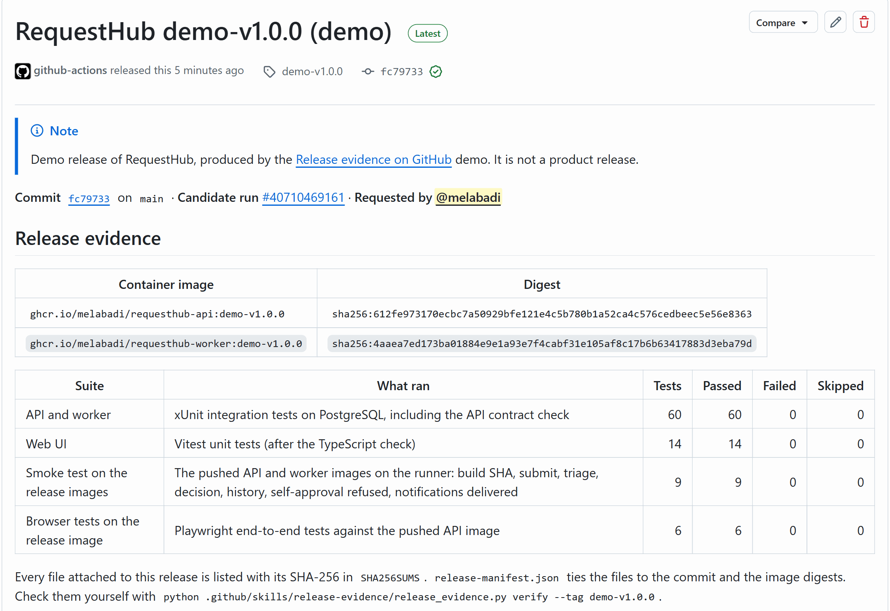

- **See it work:** [a real run on this repository](#see-it-work), step by step. Version 1.0.0 went from **Run workflow** to a draft release with its evidence in 3 minutes 25 seconds, and with Copilot's summary in 7 minutes 48 seconds. Two attempts to approve it the wrong way were refused, and the approval published it in 50 seconds.
- **Add it to your repository:** [copy 18 files, adapt the build and test jobs to your code, and set it up once](#add-it-to-your-repository). The setup's commands took seconds when this README was checked: 9 to copy the files, 5 to recompile Copilot's summary, and 3 for the unit tests. The rest is two `gh api` calls for the environment, a settings page for reviewers, a token for Copilot's summary, a pull request, and the changes your build and tests need.
- **Try it first in a copy of this repository:** [a few minutes to set up](#try-it-first-in-a-copy-of-this-repository), in the copy that the [root README](../../README.md) makes once for every solution. A run then takes 6 to 13 minutes of GitHub Actions and Copilot working unattended, and about a minute to approve.

## Why it matters

**Phase 6 of 7: Release.** Today the evidence for a release is gathered after the decision, if at all: nobody can say which tests ran against the image that shipped, and the approval lives in a chat thread. With this solution the evidence comes first and stays with the release. The smoke and browser tests run against the images that will ship and the other suites on the same commit, every report is attached with its checksum, Copilot summarizes it all for the approver, and the approval is recorded in the release next to the evidence it approved.

| | Today | With this solution |
| --- | --- | --- |
| Evidence | Someone pastes test results into a wiki page after the fact. | The candidate workflow attaches every test report, SBOM, and checksum to a draft release built from one commit. |
| What ships | "The build from Tuesday", rebuilt for production. | The image digests that passed the smoke and browser tests. Each image reports the commit it was built from. |
| Release notes | Written from memory the night before. | GitHub lists the merged pull requests. Copilot adds a labeled summary with the risks to check. |
| Approval | A thumbs-up in chat. | A person starts the approval workflow. It checks the evidence again and writes an approval record into the release. |
| Failures | Someone digs through logs. | The gate stops the release with the reason, and Copilot explains the failure from the run's log and test reports. |

The value: a release that a reviewer can check rather than trust, ready for a decision minutes after someone asks for it, with an approval that names the exact evidence it approved. The run in [See it work](#see-it-work), on 28 October 2026, measured:

- **3 minutes 25 seconds** from **Run workflow** to a draft release with 11 evidence files. 60 API and worker tests, 14 web UI tests, 9 smoke tests, and 6 browser tests passed, the last two suites against the images that were pushed.
- **7 minutes 48 seconds** from **Run workflow** to Copilot's summary on the draft. Its run started 3 seconds after the candidate finished, and threat detection checked the summary before it was applied. It used 15.79 AI credits.
- **Two refusals.** An approval from another branch was stopped by the environment in 22 seconds, and an approval after one report was edited was stopped by its checksum in 16 seconds.
- **50 seconds** from starting the approval to the published release, after 10 of 10 checks, with an approval record that names the approver, their note, and the SHA-256 of the manifest they approved.

The Microsoft counterpart, [06-release-microsoft](../06-release-microsoft/), rolls a build out on Azure Container Apps through a candidate revision that a person promotes. The [Release combo](../../PRESENTING.md#release-github-tests-one-image-azure-stages-that-digest-a-person-decides) uses both on one change: Azure stages and promotes the very image digest that this solution tested.

## How it works

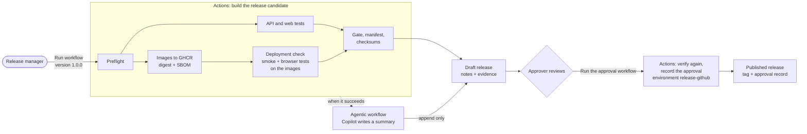

- **GitHub Actions** does everything that decides. [`release-github-candidate.yml`](.github/workflows/release-github-candidate.yml) runs preflight and the API and web tests, builds and pushes the images, starts them on the runner for a smoke test and the browser tests, gates on every report, and creates the draft release. [`release-github-approve.yml`](.github/workflows/release-github-approve.yml) verifies the draft, records the approval, and publishes it.
- **GitHub Copilot** advises. The agentic workflow [`release-github-summary.md`](.github/workflows/release-github-summary.md) ([GitHub Agentic Workflows](https://github.github.io/gh-aw/), public preview) runs Copilot with read-only tools, and the only change it can make is to append a summary to the draft. The custom agent [`release-github`](.github/agents/release-github.agent.md) starts and watches candidates, briefs the approver, and explains failed runs, from Copilot CLI or Visual Studio Code. It works with your GitHub sign-in, so its instructions, not its permissions, keep it from approving or publishing: it hands you the approval command instead.
- **A person** chooses the version, reviews the draft, and approves by starting the approval workflow.
- **The `release-github` environment** only accepts runs from the default branch. Where your plan offers required reviewers, a reviewer must also approve the publish job before it starts, and the approval record lists that review.

**Outside contributions start nothing here.** The candidate and approval workflows run only when someone with write access starts them (`workflow_dispatch`). The AI summary runs with `COPILOT_GITHUB_TOKEN` and can append to a release, so it starts only after a candidate run that a person dispatched in this repository: a fork's pull request can add a workflow with the candidate's name on a branch named `main`, and its runs start no job of the summary. gh-aw also checks that the actor has write access. The checks in [`release-github-checks.yml`](.github/workflows/release-github-checks.yml) run on pull requests that change this solution, forks included, with a read-only token and no secrets.

**Text from outside your team can reach Copilot.** The draft's notes list the merged pull requests by title, and Copilot's summary draws on those pull requests and the Issues they reference. In the agentic workflow that is contained: Copilot has read-only tools, threat detection checks what it writes, and it can only append. The `release-github` agent then reads the draft with a shell and your sign-in. With `--allow-all-tools`, as this README's commands and the recorded run use it, Copilot CLI runs any command you could, without asking first ([security considerations](https://docs.github.com/en/copilot/concepts/copilot-surfaces/copilot-cli#security-considerations)). In a repository that takes outside contributions, start it interactively instead, with `copilot --agent release-github`, ask the same question, and approve each command it proposes.

### What the gate checks

| When | Check |
| --- | --- |
| Preflight | The version looks like `X.Y.Z` and is higher than the last demo release; the run is on `main`; the `release-github` environment exists and restricts deployments. It also reports who can approve. |
| Before the draft | Every suite (API and worker, web UI, smoke, browser) has a report, ran tests, and has no failures. Both images were built from the commit. |
| Before publishing | Every asset matches `SHA256SUMS`; test counts recounted from the reports match the manifest; the commit is on `main`; the candidate run succeeded; both image digests exist in the registry; the approver is an admin or maintainer and not a bot. |
| After publishing | The new tag points to the tested commit, and `approval-record.json` approves this exact manifest. |

## See it work

This run took place on 28 October 2026, from 14:53 to 16:46 UTC, on `main` at [`fc79733`](https://github.com/melabadi/adept-assessment-northstars/commit/fc79733f46f2fdafff8282c12858707711383a94). The repository's owner started it and took every person's step; GitHub Actions and Copilot did the rest. The repository was private then, on GitHub Pro, where an environment can restrict branches but can't have required reviewers, so the person who started the approval workflow was the approver. The repository is public now, and its `release-github` environment also has a required reviewer.

Every link below opens without signing in: each run's page shows its jobs, their durations, and its annotations. The runs' logs and summaries need a GitHub sign-in, the draft release was visible only to people with write access, and the owner deleted the release and its tag after the run, as [resetting the copy](#reset-the-copy-for-another-run) does, so the screenshots show them. [`evidence/2026-10-28-recorded-run.md`](evidence/2026-10-28-recorded-run.md) keeps the run's timeline, Copilot's summary as it wrote it, and the two Copilot CLI sessions. Every screenshot comes from this run.

| Step | When (UTC) | Who | How long |
| --- | --- | --- | --- |
| [1. The owner started the release candidate](#1-the-owner-started-the-release-candidate) | 14:53 | Owner | seconds |
| [2. Actions tested the release images and drafted the release](#2-actions-tested-the-release-images-and-drafted-the-release) | 14:53 to 14:57 | GitHub Actions | 3 min 25 s |
| [3. Copilot appended a summary for the approver](#3-copilot-appended-a-summary-for-the-approver) | 14:57 to 15:02 | Copilot, in GitHub Actions | 4 min 52 s |
| [4. The owner reviewed the draft, with a brief from Copilot](#4-the-owner-reviewed-the-draft-with-a-brief-from-copilot) | 16:21 to 16:25 for the brief | Owner, then Copilot CLI | 3 min 38 s for the brief |
| [5. An approval from another branch was refused](#5-an-approval-from-another-branch-was-refused) | 16:26 | Owner, then GitHub Actions | 22 s |
| [6. An approval after tampering was refused, and Copilot explained why](#6-an-approval-after-tampering-was-refused-and-copilot-explained-why) | 16:32 to 16:36 | Owner, GitHub Actions, then Copilot CLI | 16 s, then 1 min 18 s |
| [7. The approval checked everything again and published the release](#7-the-approval-checked-everything-again-and-published-the-release) | 16:36 to 16:37 | Owner, then GitHub Actions | 59 s |
| [8. The release carried its approval record](#8-the-release-carried-its-approval-record) | 16:46 for the check | Owner | seconds |

Steps 5 and 6 tried to approve the release the wrong way, on purpose. Between steps 3 and 4 the owner read the draft and captured these screenshots, so the time between them isn't review time.

### 1. The owner started the release candidate

At 14:53:49 UTC the owner started **Release · GitHub · build the release candidate** from the **Actions** tab, on `main`, with version `1.0.0`: [run 40710469161](https://github.com/melabadi/adept-assessment-northstars/actions/runs/40710469161).

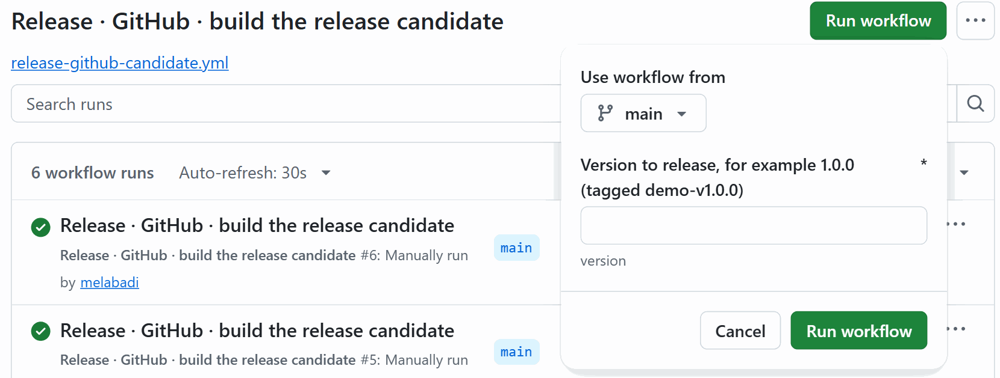

The version is the only input. Releases in this repository are demo releases, tagged `demo-vX.Y.Z`, so this run would produce `demo-v1.0.0`.

**What this shows:** a release candidate started from one input, on `main`, and could produce nothing but a draft.

### 2. Actions tested the release images and drafted the release

The candidate, [run 40710469161](https://github.com/melabadi/adept-assessment-northstars/actions/runs/40710469161), took 3 minutes 25 seconds. Preflight came first, in 8 seconds. Then, in parallel, the API and worker tests (1 minute 26 seconds), the web UI tests (36 seconds), and the API and worker images (1 minute 20 seconds and 51 seconds). The deployment check on the pushed images followed (1 minute 30 seconds), and the draft last (15 seconds).

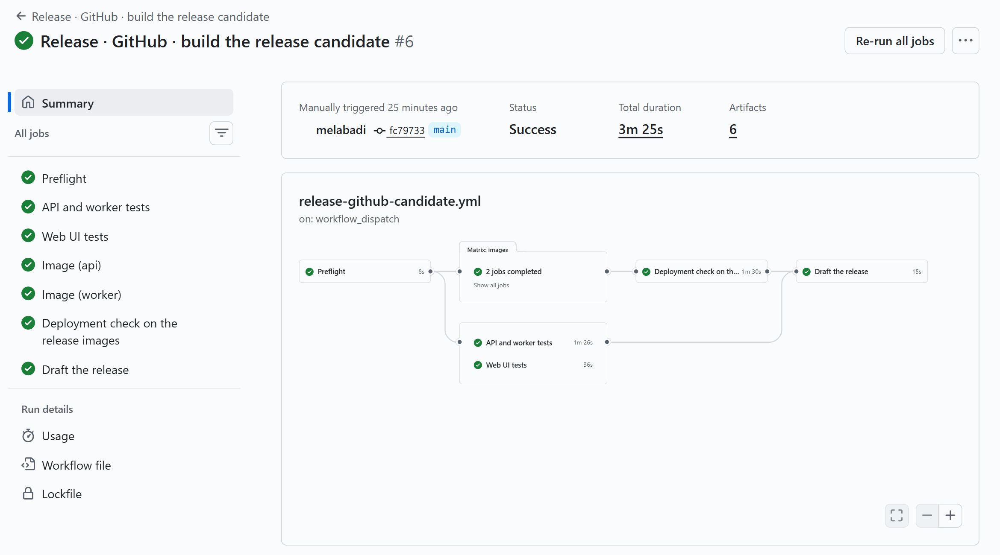

Preflight checked the version, the branch, and the environment, and reported who would approve: on the private repository of that day, the person who runs the approval workflow.

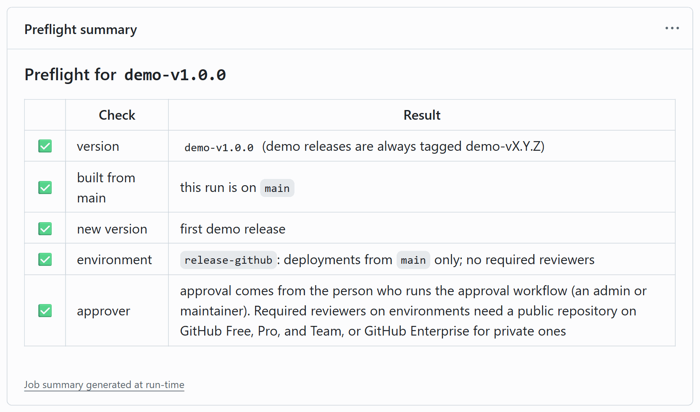

The image jobs pushed both images to GitHub Container Registry and recorded their digests and SBOMs. The deployment check started the two images by digest on the runner and ran the smoke test against them: nine checks of the business flow, including that the image reports the commit it was built from (`build_matches_commit`) and that a requester can't approve their own request (`self_approval_refused`). The Playwright browser tests then ran against the same API image.

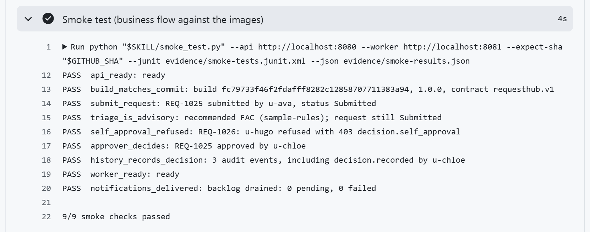

The last job gated on the four reports and created the draft release, *RequestHub demo-v1.0.0 (demo)*, with 11 files attached:

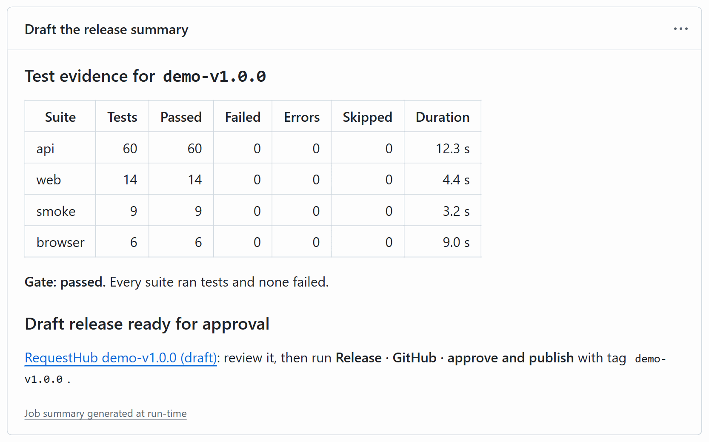

**What this shows:** the smoke and browser tests that gated the release ran against the exact images that would ship, the other suites on the same commit, and every report went into the draft with its checksum.

### 3. Copilot appended a summary for the approver

At 14:57:17 UTC, 3 seconds after the candidate finished, its success started **Release · GitHub · AI release summary**: [run 40711045694](https://github.com/melabadi/adept-assessment-northstars/actions/runs/40711045694), 4 minutes 52 seconds. Its agent job (1 minute 46 seconds) downloaded the candidate's evidence and the release's commits and gave them to Copilot, with read-only GitHub tools. At 14:59:36 Copilot asked to append its summary to the draft. Threat detection (1 minute 22 seconds) checked the request, and only then did the `safe_outputs` job apply it, at 15:01:37.

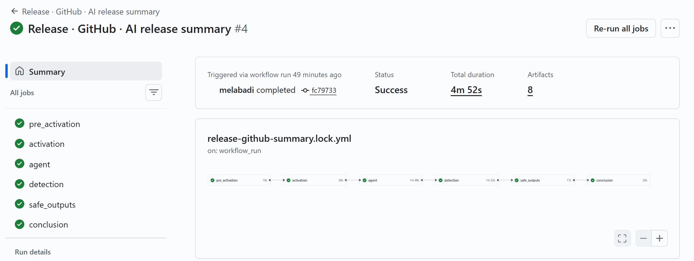

The agent job's summary listed one request, `update_release`:

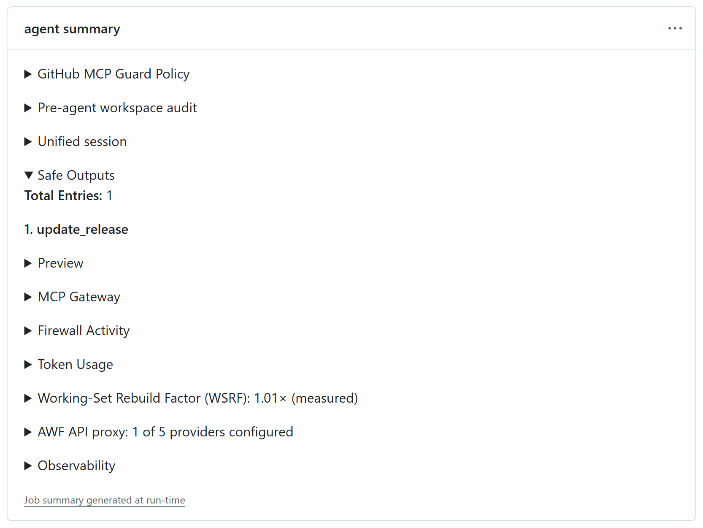

Copilot used 15.28 AI credits and threat detection 0.52, as the run's usage records show ([evidence](evidence/2026-10-28-recorded-run.md#what-copilot-used)). After the update, GitHub listed the draft as `untagged-…`, because an update that leaves out a draft's tag name removes it. The draft kept its title, which is how the approval workflow found it, and publishing set the tag again.

**What this shows:** Copilot's only write was one append to the draft, checked before it was applied; it couldn't change the evidence, approve, or publish.

### 4. The owner reviewed the draft, with a brief from Copilot

The draft opened with its evidence: the commit, the candidate run, the two image digests, the four suites with their counts, and **Approval: ⏳ waiting**.

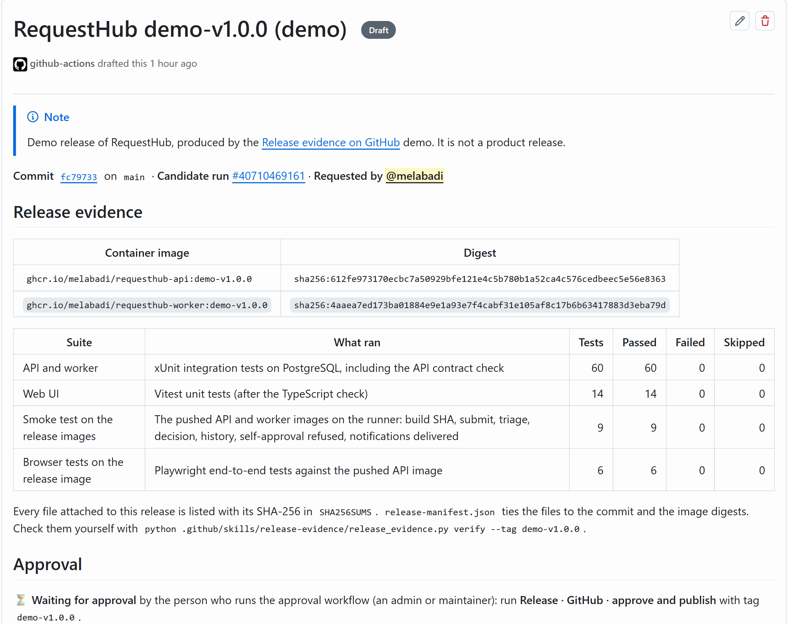

Copilot's section came below GitHub's list of merged pull requests, labeled as an AI summary ([its text](evidence/2026-10-28-recorded-run.md#copilots-summary-as-it-wrote-it)). Its numbers matched the evidence above it. Its evidence line, which follows the prompt's template, says that all four suites passed "on images built from fc79733"; only the smoke and browser tests ran on the images, and the other two on the same commit's source. It named what to check: the first release's database migrations and API contract, which it said it hadn't inspected in detail, a change to search, and infrastructure changes made and reverted. It found no instructions aimed at automation in the pull requests it read.

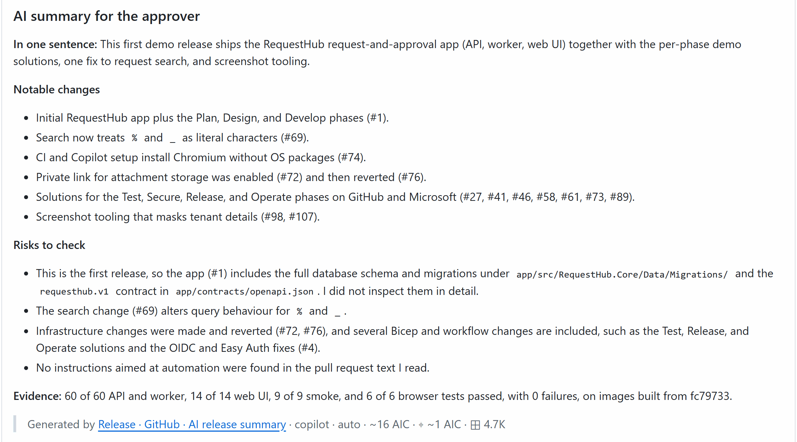

The 11 files: `release-manifest.json`, `SHA256SUMS`, `test-summary.json`, the four JUnit reports, `smoke-results.json`, two SBOMs, and `whats-changed.md`.

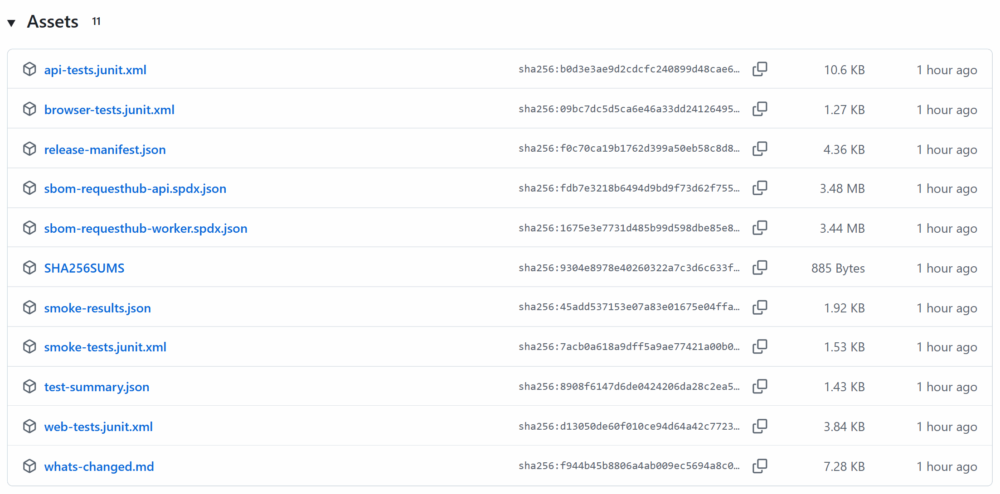

From 16:21 to 16:25 UTC the owner asked the `release-github` agent in Copilot CLI for a brief. It verified the draft with `release_evidence.py verify`: 7 checks passed, 0 failed, and 2 were skipped, the images, because the local token couldn't read packages, and the approval record, still pending. It listed the commit, the digests, and the test counts, named what a person should review, and ended with the approval command for the owner to run. It took 3 minutes 38 seconds and 8.48 AI credits ([the session](evidence/2026-10-28-recorded-run.md#the-brief-before-the-approval)).

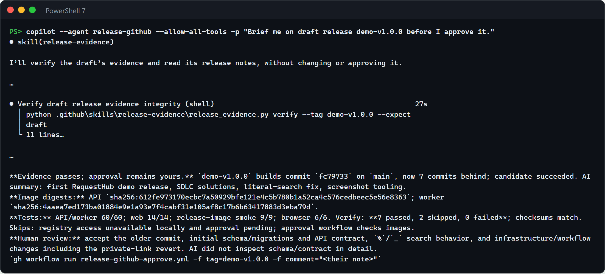

The brief says the commit was 7 commits behind `main`; that count grows as `main` moves.

**What this shows:** the approver had the evidence, Copilot's summary, and an independent check of the draft, and Copilot handed the decision back.

### 5. An approval from another branch was refused

At 16:26:28 UTC the owner pushed `main` to a branch named `demo/not-main` and started the approval workflow from it: [run 40725978777](https://github.com/melabadi/adept-assessment-northstars/actions/runs/40725978777), 22 seconds. **Verify the evidence** passed in 15 seconds. **Record the approval and publish** never got a runner: the environment refused it, as the run page's annotation says, and nothing was published. The owner then deleted the branch.

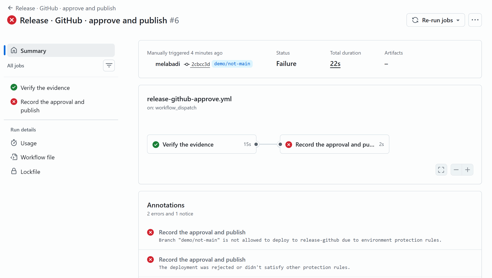

**What this shows:** the evidence was intact and the release was still refused: the environment, not the workflow's own code, decided which branch could publish.

### 6. An approval after tampering was refused, and Copilot explained why

The owner downloaded `browser-tests.junit.xml` from the draft, added one XML comment to it, uploaded it back in its place, and started the approval from `main` at 16:32:46 UTC: [run 40727011991](https://github.com/melabadi/adept-assessment-northstars/actions/runs/40727011991), 16 seconds. Verify refused it after 11 seconds, and the publish job was skipped. The run page shows which job failed; the reason is in the run's summary:

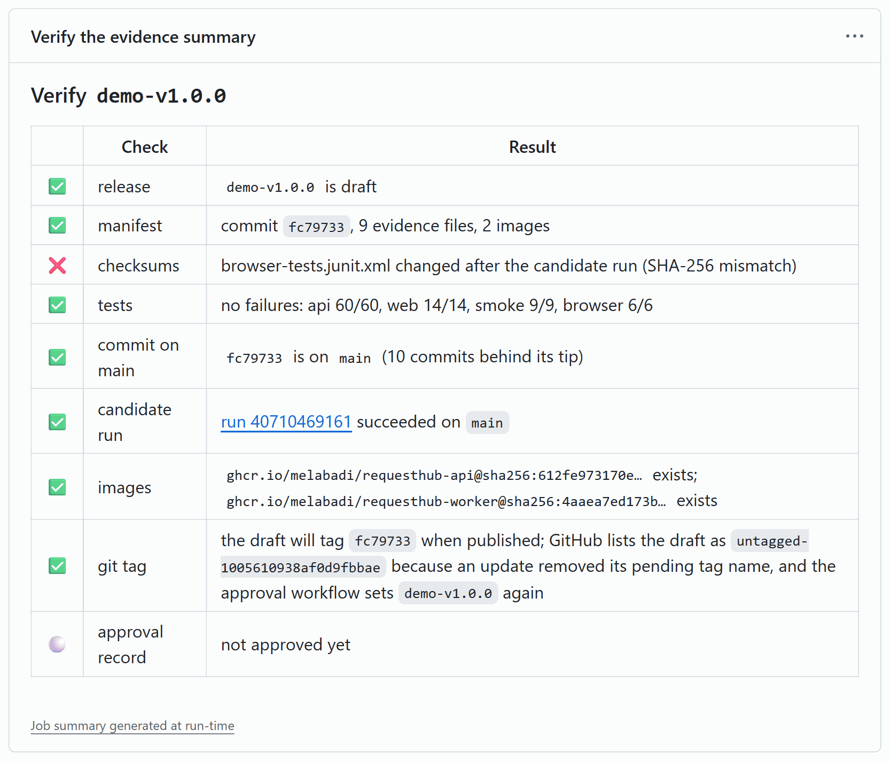

From 16:34 to 16:36 UTC the owner asked the agent why the run failed. It digested the run with the `workflow-investigation` skill, quoted the failed check, called it an evidence-integrity failure rather than a failed browser test, and advised comparing the file with the original rather than updating its checksum. It took 1 minute 18 seconds and 5.67 AI credits ([the session](evidence/2026-10-28-recorded-run.md#why-the-approval-failed)).

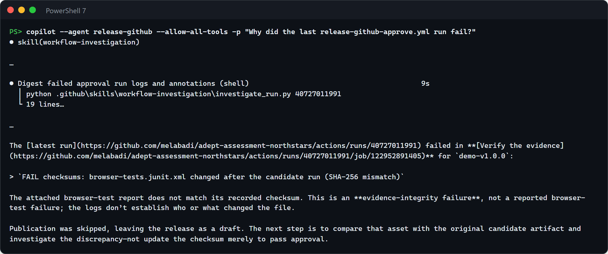

The owner then uploaded the original report again.

**What this shows:** one added line in one report stopped the release, and Copilot explained the refusal from the run's own log without suggesting a way around it.

### 7. The approval checked everything again and published the release

At 16:36:54 UTC the owner started **Release · GitHub · approve and publish** from `main`, with tag `demo-v1.0.0` and the note *Evidence and AI summary reviewed in the release review.*: [run 40727695904](https://github.com/melabadi/adept-assessment-northstars/actions/runs/40727695904), 59 seconds. **Verify the evidence** took 17 seconds, and **Record the approval and publish**, in the `release-github` environment, 35. It repeated the evidence checks, then checked the person: an admin, and the same person who had requested the release, which was allowed because self-approval wasn't prevented. At 16:37:39 it recorded the approval, and by 16:37:44, 50 seconds after the owner started it, it had attached `approval-record.json` and published the release, which created the tag at the tested commit. It then checked the published release.

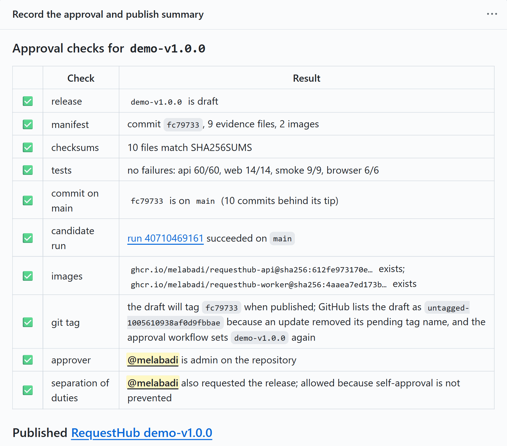

The workflow ran on `main` at `41984ec`, because `main` had moved on since the candidate; the tag went on `fc79733`, which the checks confirmed is on `main`.

**What this shows:** the approval repeated every check of the evidence before it checked the person, and only then published.

### 8. The release carried its approval record

The published release kept the evidence and Copilot's summary. Its **Approval** section said who approved, with the note, the environment's rules, the 10 checks, and the SHA-256 of the manifest that was approved. The release had 14 assets: the candidate's 11 files, `approval-record.json`, and GitHub's two source archives.

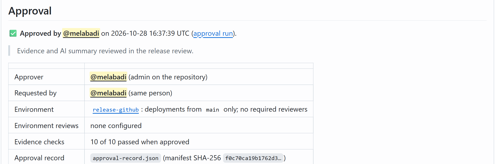

The environment's deployment history listed the successful deployment from `main` and the refused attempt from `demo/not-main`:

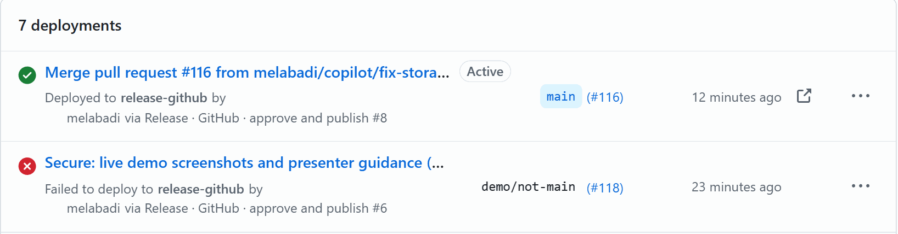

At 16:46 UTC the owner checked the published release from a terminal, as anyone with access can ([the output](evidence/2026-10-28-recorded-run.md#the-check-of-the-published-release)). 8 checks passed, and 1 was skipped: the images, because the local token couldn't read packages. The approval workflow had checked both images with its own token.

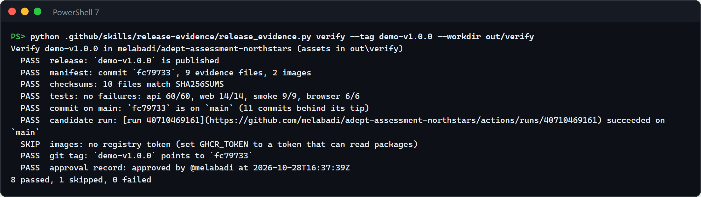

**What this shows:** the approval became part of the release, tied to the exact manifest that was approved, and anyone with access could check it again.

## Results and value

**What the run left behind:**

- The published release `demo-v1.0.0`, tagged at `fc79733`: the evidence, Copilot's summary, and the approval record, in 14 assets. The owner deleted the release and its tag after the run so that the version could be used again; the screenshots and [`evidence/`](evidence/2026-10-28-recorded-run.md) keep them.
- The API and worker images in GitHub Container Registry, named in the manifest by their digests, `sha256:612fe973…` and `sha256:4aaea7ed…`, with an SBOM each.
- Five workflow runs, each with its jobs and their durations on its page: the candidate, Copilot's summary, and three approval runs.
- The person's decisions: the version to release, and the approval with its note, recorded in the release and in the environment's deployment history, next to the attempt from another branch. The approval after tampering never reached the environment; its run records the refusal.

**What was measured:**

| Measure | Recorded run |
| --- | --- |
| **Run workflow** to a draft release with its evidence | 3 min 25 s |
| The tests on the pushed images | smoke 9 of 9 in 3.2 s, browser 6 of 6 in 9.0 s |
| The other suites | API and worker 60 of 60 in 12.3 s, web UI 14 of 14 in 4.4 s |
| Copilot's summary run | 4 min 52 s, starting 3 s after the candidate; 15.79 AI credits, 15.28 for the summary and 0.52 for threat detection |
| **Run workflow** to Copilot's summary on the draft | 7 min 48 s |
| Optional brief from Copilot CLI before approving | 3 min 38 s, 8.48 AI credits |
| Approval from another branch, refused | 22 s |
| Approval after one report was edited, refused | 16 s; Copilot CLI's explanation 1 min 18 s, 5.67 AI credits |
| Starting the approval to the published release | 50 s, after 10 of 10 checks; the run ended 9 s later, after checking the published release |
| GitHub-hosted runner time, all five runs | 11.9 min of job time; 22 min as billed in a private repository, where each job is rounded up to a whole minute |

**What a team gets:**

- **Time.** A release candidate with every report attached and a summary written for the approver, under 8 minutes after someone asks for it, unattended. After the decision, the release is published in under a minute.
- **Risk removed.** The smoke and browser tests that gate a release run against the images that ship, by digest, and each image reports the commit it was built from. A missing report, a failed or empty suite, an edited file, or an approval from another branch stops the release, with the reason in the run.
- **Evidence a reviewer or auditor can follow.** The commit, the image digests, the test reports with their checksums, and the manifest's SHA-256 in the approval record, all in the release itself. `verify` checks the whole chain again, at any time.
- **People stay in charge.** Copilot can only append a labeled summary to a draft. Only a person starting the approval workflow publishes, and where your plan offers required reviewers, a reviewer approves first. The agent hands you the approval command rather than running it.

**The metric to track when you adopt it:** lead time from a release candidate to a published release, from the candidate run's start (`gh run view <run id> --json createdAt`) to the release's publication (`gh release view <tag> --json publishedAt`). Both are on GitHub. The recorded run took 1 hour 44 minutes, but it isn't a baseline: the workflows took 7 minutes 48 seconds to a draft with Copilot's summary and 50 seconds from the approval's start to publication, and the time between went to these screenshots, Copilot's brief, and the two refused attempts. Track alongside it how many approvals are refused, and by which check, and how many published releases `verify` can't confirm; that should stay at zero. Compare both with releases from before you adopted it. A target such as "a release ready for a decision within 15 minutes of the request" is your team's goal, never a result to report.

## Add it to your repository

The files are written for RequestHub's stack: a .NET 10 API and worker with PostgreSQL, a React web UI, two Dockerfiles, and Playwright browser tests. [What to copy and what to change](#what-to-copy-and-what-to-change) names each setting to adapt for yours. The commands are the ones this repository uses.

### Prerequisites

- **The tools every solution needs,** in the root README's [Before you start](../../README.md#before-you-start): GitHub CLI signed in with the `workflow` scope, PowerShell 7.4 or later, and Python 3.12 or later. This solution's scripts use only Python's standard library.
- **GitHub Actions and GitHub Container Registry.** The candidate pushes your images to `ghcr.io` with the workflow's own token. GitHub creates them as private packages, even in a public repository.
- **An environment that can restrict branches:** any public repository, or a private one on GitHub Pro, Team, or Enterprise. A required reviewer on it needs a public repository on GitHub Free, Pro, or Team, or GitHub Enterprise for a private one ([deployment protection rules](https://docs.github.com/en/actions/reference/workflows-and-actions/deployments-and-environments#deployment-protection-rules)).
- **A paid GitHub Copilot plan, for the AI parts only.** Copilot's summary is a [GitHub Agentic Workflow](https://github.github.io/gh-aw/) (public preview); to change its prompt, you recompile it with the `gh aw` extension. The custom agent runs in [GitHub Copilot CLI](https://docs.github.com/en/copilot/how-tos/copilot-cli/set-up-copilot-cli/install-copilot-cli) or Visual Studio Code. The candidate and the approval need no Copilot.
- **Container images and test reports.** Your release is built as container images, and each of your test suites can write a JUnit XML report.

### What to copy and what to change

From the root of your repository, in PowerShell 7, copy the agent, the skills, the workflows, and the unit tests:

```powershell
$src = Join-Path ([IO.Path]::GetTempPath()) 'ai-sdlc-06-release-github'
git clone --quiet --depth 1 https://github.com/melabadi/adept-assessment-northstars.git $src
New-Item -ItemType Directory -Force .github, tests | Out-Null
Copy-Item -Recurse -Force (Join-Path $src 'solutions/06-release-github/.github/*') .github
Copy-Item -Recurse -Force (Join-Path $src 'solutions/06-release-github/tests/*') tests
Remove-Item -Recurse -Force $src
git status --short --untracked-files=all
```

What you should see: 18 new files, in 9 seconds when this README was checked; the other files in `.github/` and `tests/` stay. Then change what assumes RequestHub:

| File, under `.github/` unless named | As shipped, for RequestHub | Change it to |
| --- | --- | --- |
| [`workflows/release-github-candidate.yml`](.github/workflows/release-github-candidate.yml) | `api-tests` builds `app/RequestHub.slnx` with .NET 10 and a PostgreSQL 16 service; `web-tests` runs the web UI's Vitest tests with Node 22. The `images` matrix builds `app/Dockerfile` and `app/Dockerfile.worker` as `requesthub-api` and `requesthub-worker`, passing the commit as `BUILD_SHA`. `acceptance` starts both images by digest with RequestHub's settings and runs the smoke and Playwright tests against them. `release` gates on the four JUnit reports and titles the draft `RequestHub $TAG (demo)` | Your build and test jobs, each uploading one JUnit report as an `evidence-*` artifact; your Dockerfiles, image names, and the build argument that bakes the commit into the image; how to start your images on the runner and test them; and your release title |
| [`skills/release-evidence/release_evidence.py`](.github/skills/release-evidence/release_evidence.py) | `TAG_PREFIX` and `TAG_RE` (`demo-vX.Y.Z`); `RELEASE_TITLE`, the candidate's title; `SUITES` (four suites and their report names); `SERVICES` (`api`, `worker`); `ENVIRONMENT` (`release-github`); the default branch `main`; and the release notes' first line, which calls the release a RequestHub demo and links `SOLUTION_PATH` | Your tag format, for example `v`; the same title as the candidate's `--title`, which the approval uses to find a draft; your suites and services; your default branch; and your own first line |
| [`skills/release-evidence/smoke_test.py`](.github/skills/release-evidence/smoke_test.py) | RequestHub's business flow through its development sign-in header: submit, triage, decide, read the history, a refused self-approval, the notifications delivered, and the build the image reports | Checks of your own flow against your image, including that it reports the commit it was built from (`--expect-sha`) |
| [`workflows/release-github-summary.md`](.github/workflows/release-github-summary.md) | `on.workflow_run` starts it after a successful *Release · GitHub · build the release candidate* on `main` (`branches: [main]`). The prompt names RequestHub, `demo-vX.Y.Z`, and the paths of RequestHub's migrations and API contract | Your default branch in `branches`, with `workflows` kept equal to the candidate's `name:`; your product, tag format, and the paths a reviewer should check. Then recompile it ([one-time step 1](#one-time-setup)), and never edit the `.lock.yml` by hand |
| [`workflows/release-github-checks.yml`](.github/workflows/release-github-checks.yml) | Watches `solutions/06-release-github/**` and runs `solutions/06-release-github/tests` | Watch `tests/**` and run `tests` |
| `tests/test_release_tooling.py` | `demo-v` tags and the branch `main` | Your tag format and default branch |
| [`agents/release-github.agent.md`](.github/agents/release-github.agent.md) and [`skills/release-evidence/SKILL.md`](.github/skills/release-evidence/SKILL.md) | RequestHub, this repository's solution folder, `main`, `demo-v<X.Y.Z>`, and the release title | Your product, default branch, tag format, and title |

[`release-github-approve.yml`](.github/workflows/release-github-approve.yml) needs no change unless you rename the environment, and then `ENVIRONMENT` too. [`summarize_tests.py`](.github/skills/release-evidence/summarize_tests.py) reads any JUnit report, and [`investigate_run.py`](.github/skills/workflow-investigation/investigate_run.py) digests any failed run: keep them as they are.

### One-time setup

1. **Copy the files and make the changes above,** on a branch. Recompile Copilot's summary if you changed `release-github-summary.md`, with the gh-aw version that `release-github-checks.yml` pins, then run the unit tests:

   ```powershell
   gh extension install github/gh-aw --pin v0.93.5
   gh aw compile release-github-summary --strict
   python -m unittest discover -s tests
   ```

   What you should see: the compiler prints `✓ Compiled 1 workflow: 1 succeeded, 0 warnings` and rewrites `release-github-summary.lock.yml`. It also marks lock files as generated in `.gitattributes`, and records the action versions it pinned in `.github/aw/actions-lock.json`. The unit tests end with `OK`: 25 tests, offline, in about 2 seconds when this README was checked. If another version of gh-aw is installed, run `gh extension remove gh-aw` first.
2. **Create the `release-github` environment,** limited to your default branch, so that only runs from it can publish. Replace `main` with your default branch if it differs:

   ```powershell
   gh api -X PUT 'repos/{owner}/{repo}/environments/release-github' -F 'deployment_branch_policy[protected_branches]=false' -F 'deployment_branch_policy[custom_branch_policies]=true'
   gh api -X POST 'repos/{owner}/{repo}/environments/release-github/deployment-branch-policies' -f name=main -f type=branch
   ```

   What you should see: the first command prints the environment with `"deployment_branch_policy":{"custom_branch_policies":true,"protected_branches":false}`, the second `"name":"main","type":"branch"`, and **Settings** → **Environments** → **release-github** allows one branch:

   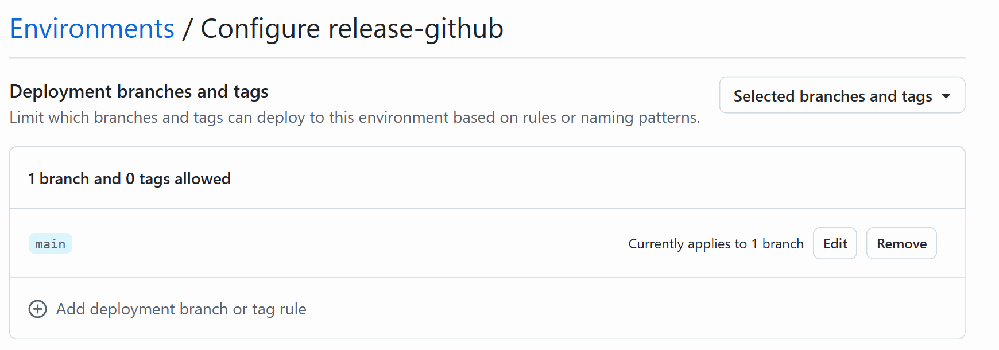

3. **Add a required reviewer, if your plan offers them** (see the [prerequisites](#prerequisites)). In **Settings** → **Environments** → **release-github**, select **Required reviewers**, add a person or a team, and select **Save protection rules**. With two or more people, also select **Prevent self-review**, so that whoever starts an approval can't also approve its deployment, and clear **Allow administrators to bypass configured protection rules**. What you should see:

   ```powershell
   gh api 'repos/{owner}/{repo}/environments/release-github' --jq '[.protection_rules[].type]'
   ```

   prints `["branch_policy","required_reviewers"]`. Without required reviewers, the person who starts the approval workflow is the approver. To keep someone from approving a release they requested, set `gh variable set RELEASE_GITHUB_PREVENT_SELF_APPROVAL --body true`.
4. **Give Copilot's summary a token.** In a personal repository, GitHub Agentic Workflows authenticates Copilot with a fine-grained personal access token. [Create one](https://github.com/settings/personal-access-tokens/new?name=COPILOT_GITHUB_TOKEN&description=GitHub+Agentic+Workflows+-+Copilot+engine+authentication&user_copilot_requests=read) with your account as the resource owner and **Copilot Requests: Read**, then store it:

   ```powershell
   gh secret set COPILOT_GITHUB_TOKEN    # paste the token when prompted
   ```

   What you should see: `gh secret list` lists `COPILOT_GITHUB_TOKEN`. In an organization with Copilot and centralized billing, you can add `copilot-requests: write` to the summary workflow's permissions instead and recompile; then no token is needed. Without either, everything else works: the summary's run fails at `Validate COPILOT_GITHUB_TOKEN secret`, and the draft has no AI section.
5. **Merge it into your default branch.** GitHub offers **Run workflow** only for workflows on the default branch, and Copilot's summary only follows candidate runs on it. What you should see:

   ```powershell
   gh workflow list --json name --jq '.[].name | select(startswith("Release · GitHub"))'
   ```

   prints the four workflows: *build the release candidate*, *check the release tooling*, *approve and publish*, and *AI release summary*.
6. **Optional: make published releases tamper-proof.** Turn on [immutable releases](https://docs.github.com/code-security/concepts/supply-chain-security/immutable-releases) (**Settings** → **General** → **Releases**): the approval workflow attaches everything before it publishes, so nothing needs to change afterwards. The tag of a published release can't be used again then, so publish a new version rather than deleting one. Where [artifact attestations](https://docs.github.com/actions/concepts/security/artifact-attestations) are available (public repositories, or GitHub Enterprise Cloud for private ones), add `actions/attest` to the image jobs, so that anyone can check an image's origin with `gh attestation verify`.

### Use it the first time

The steps are those of [See it work](#see-it-work). Replace `demo-v1.0.0` with your tag format.

1. **Start a release candidate** from **Actions** → **Release · GitHub · build the release candidate** → **Run workflow**, or:

   ```powershell
   gh workflow run release-github-candidate.yml -f version=1.0.0
   ```

   What you should see: the jobs of [step 2](#2-actions-tested-the-release-images-and-drafted-the-release) finish, and the last one's summary links the draft release.
2. **Read the draft** once Copilot's summary has run, about 5 minutes later, as in [step 4](#4-the-owner-reviewed-the-draft-with-a-brief-from-copilot). To have Copilot brief you first:

   ```powershell
   copilot --agent release-github --allow-all-tools -p "Brief me on draft release demo-v1.0.0 before I approve it."
   ```

   In a repository that takes outside contributions, run it interactively instead, as [How it works](#how-it-works) explains.

3. **Approve,** if the evidence holds, from **Actions** → **Release · GitHub · approve and publish** → **Run workflow**, or:

   ```powershell
   gh workflow run release-github-approve.yml -f tag=demo-v1.0.0 -f comment="<what you checked>"
   ```

   With a required reviewer, the publish job waits for one: in the run, select **Review deployments**, then **release-github**, then **Approve and deploy** ([reviewing deployments](https://docs.github.com/en/actions/how-tos/deploy/configure-and-manage-deployments/review-deployments)). What you should see: when the run finishes, the release is published with its approval record, as in [step 8](#8-the-release-carried-its-approval-record).
4. **If a run fails,** ask Copilot why, as in [step 6](#6-an-approval-after-tampering-was-refused-and-copilot-explained-why):

   ```powershell
   copilot --agent release-github --allow-all-tools -p "Why did the last release-github-approve.yml run fail?"
   ```

   Fix the cause and build a new candidate. Never change a checksum, a test, or a check to make a release pass.
5. **Check a published release** with `python .github/skills/release-evidence/release_evidence.py verify --tag demo-v1.0.0 --expect published`. The image check is skipped unless `GHCR_TOKEN` holds a token that can read packages: run `gh auth refresh -s read:packages`, then `$env:GHCR_TOKEN = gh auth token`.

### What it costs

Setting it up uses no AI credits. Each release uses GitHub Actions for the candidate and the approval, and the Copilot plan of the token's owner for Copilot's summary: 15.79 AI credits in the recorded run, 15.28 for the summary and 0.52 for threat detection. The optional Copilot CLI sessions use the plan of whoever runs them: 8.48 AI credits for the brief and 5.67 for the explanation. The five runs used 11.9 minutes of standard GitHub-hosted runners: 6.1 for the candidate, 4.5 for Copilot's summary, and 1.3 for the three approval runs. Those minutes are free in a public repository. In a private one they count against your plan's included minutes: 22 minutes for the recorded run, because each job is rounded up to a whole minute. Your own build and test suites change the candidate's minutes. Container registry storage and bandwidth are currently free, and the runs' artifacts count against your Actions storage in a private repository until they expire ([GitHub Actions billing](https://docs.github.com/en/billing/concepts/product-billing/github-actions), [GitHub Packages billing](https://docs.github.com/en/billing/concepts/product-billing/github-packages), [Copilot billing](https://docs.github.com/en/copilot/concepts/billing-and-usage)).

## Try it first in a copy of this repository

Optional: the same solution on RequestHub, before you adapt anything. You repeat the run in [See it work](#see-it-work) in your own copy, and it costs what [What it costs](#what-it-costs) lists for the recorded run.

### Quick start

A few minutes, from the root of your copy of this repository: the [root README](../../README.md#try-it-in-a-copy-of-this-repository) makes that copy, once for every solution. You need the [prerequisites](#prerequisites). The copy already holds the files, and its root `.github/` folder mirrors this solution's, so there is nothing to copy or change. In PowerShell 7:

1. **Create the environment,** as in [one-time step 2](#one-time-setup):

   ```powershell
   gh api -X PUT 'repos/{owner}/{repo}/environments/release-github' -F 'deployment_branch_policy[protected_branches]=false' -F 'deployment_branch_policy[custom_branch_policies]=true'
   gh api -X POST 'repos/{owner}/{repo}/environments/release-github/deployment-branch-policies' -f name=main -f type=branch
   ```

2. **In a public copy, add yourself as a required reviewer,** as in [one-time step 3](#one-time-setup). A private copy on GitHub Free, Pro, or Team can't have one: there, the person who starts the approval workflow is the approver.
3. **Give Copilot's summary its token,** as in [one-time step 4](#one-time-setup), or skip it: every step except 3 works without it.

What you should see:

```powershell
gh repo view --json nameWithOwner -q .nameWithOwner
gh release list --limit 5
gh api 'repos/{owner}/{repo}/environments/release-github/deployment-branch-policies' --jq '.branch_policies[].name'
gh secret list
```

The first command prints your copy, the repository that every `gh` command below acts on. The next three print no release, `main`, and `COPILOT_GITHUB_TOKEN`, with any other secrets your copy has:

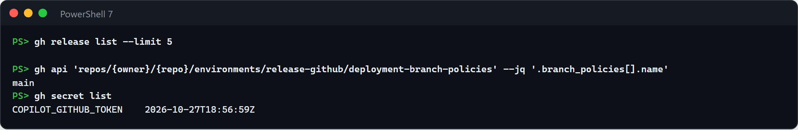

### The steps

The steps have the numbers of [See it work](#see-it-work), which shows what each one looks like. Your run ids, digests, and times will differ, and so will Copilot's summary.

| Step | How long it took in the recorded run |
| --- | --- |
| 1. Start the release candidate | seconds |
| 2. Watch the candidate | 3 min 25 s (between 2 min 33 s and 7 min 4 s across seven runs from `main`) |
| 3. Watch Copilot's summary | 4 min 52 s, starting 3 s after the candidate (between 3 min 59 s and 6 min 9 s across six runs) |
| 4. Review the draft, optionally with a brief from Copilot | 3 min 38 s for the brief |
| 5. Try to approve from another branch | 22 s |
| 6. Optional: tamper with the evidence, try to approve, and ask Copilot why | 16 s, then 1 min 18 s for Copilot's explanation |
| 7. Approve and publish | 59 s for the run, which published the release after 50 s (runs took between 50 and 59 s across three approvals) |
| 8. Check the result | seconds |

1. **Start the release candidate.** Use a version higher than any earlier `demo-v*` release; preflight refuses others.

   ```powershell
   $before = gh run list --workflow release-github-candidate.yml --limit 1 --json databaseId --jq '.[0].databaseId // 0'
   gh workflow run release-github-candidate.yml -f version=1.0.0
   ```

   The first command notes the newest earlier run, so that step 2 finds yours. See [step 1](#1-the-owner-started-the-release-candidate).

2. **Watch the candidate,** then open its page for the jobs' summaries: preflight, the deployment check, and the link to the draft.

   ```powershell
   do { Start-Sleep 3; $run = gh run list --workflow release-github-candidate.yml --limit 1 --json databaseId --jq ".[] | select(.databaseId > $before) | .databaseId" } until ($run)
   gh run watch $run
   gh run view $run --web
   ```

   See [step 2](#2-actions-tested-the-release-images-and-drafted-the-release).

3. **Watch Copilot's summary.** It starts by itself within seconds of the candidate's success; if the candidate failed, it doesn't start, so press Ctrl+C.

   ```powershell
   do { Start-Sleep 3; $ai = gh run list --workflow release-github-summary.lock.yml --limit 1 --json databaseId --jq ".[] | select(.databaseId > $run) | .databaseId" } until ($ai)
   gh run watch $ai
   ```

   Without the token, it fails at `Validate COPILOT_GITHUB_TOKEN secret`; carry on with step 4. See [step 3](#3-copilot-appended-a-summary-for-the-approver).

4. **Review the draft.** After Copilot's update, GitHub lists the draft as `untagged-…`, so find it by its title. The last command, the brief, is optional; [How it works](#how-it-works) says when to run it interactively instead.

   ```powershell
   $draft = gh release list --json tagName,name --jq '.[] | select(.name == "RequestHub demo-v1.0.0 (demo)") | .tagName'
   gh release view $draft --web
   copilot --agent release-github --allow-all-tools -p "Brief me on draft release demo-v1.0.0 before I approve it."
   ```

   See [step 4](#4-the-owner-reviewed-the-draft-with-a-brief-from-copilot).

5. **Try to approve from another branch.**

   ```powershell
   git fetch origin main
   git push origin origin/main:refs/heads/demo/not-main
   gh workflow run release-github-approve.yml --ref demo/not-main -f tag=demo-v1.0.0
   ```

   About 20 seconds later the run has failed: the evidence verifies, and the environment refuses **Record the approval and publish**. Then delete the branch with `git push origin --delete demo/not-main`. See [step 5](#5-an-approval-from-another-branch-was-refused).

6. **Optional: tamper with the evidence, try to approve, and ask Copilot why it failed.**

   ```powershell
   $draft = gh release list --json tagName,name --jq '.[] | select(.name == "RequestHub demo-v1.0.0 (demo)") | .tagName'
   gh release download $draft -p browser-tests.junit.xml -D out/original --clobber
   Copy-Item out/original/browser-tests.junit.xml out/browser-tests.junit.xml
   Add-Content out/browser-tests.junit.xml '<!-- edited after the tests ran -->'
   gh release upload $draft out/browser-tests.junit.xml --clobber
   gh workflow run release-github-approve.yml -f tag=demo-v1.0.0
   ```

   About 20 seconds later verify has refused it. Ask Copilot why, then put the original back, so that the evidence verifies again:

   ```powershell
   copilot --agent release-github --allow-all-tools -p "Why did the last release-github-approve.yml run fail?"
   gh release upload $draft out/original/browser-tests.junit.xml --clobber
   ```

   See [step 6](#6-an-approval-after-tampering-was-refused-and-copilot-explained-why).

7. **Approve and publish.**

   ```powershell
   $before = gh run list --workflow release-github-approve.yml --limit 1 --json databaseId --jq '.[0].databaseId // 0'
   gh workflow run release-github-approve.yml -f tag=demo-v1.0.0 -f comment="Evidence and AI summary reviewed."
   do { Start-Sleep 3; $approval = gh run list --workflow release-github-approve.yml --limit 1 --json databaseId --jq ".[] | select(.databaseId > $before) | .databaseId" } until ($approval)
   gh run watch $approval
   ```

   With a required reviewer, the publish job waits for you: open the run from **Actions**, select **Review deployments**, then **release-github**, then **Approve and deploy**, and `gh run watch` carries on. See [step 7](#7-the-approval-checked-everything-again-and-published-the-release).

8. **Check the result.**

   ```powershell
   gh release view demo-v1.0.0 --web
   python .github/skills/release-evidence/release_evidence.py verify --tag demo-v1.0.0 --expect published
   ```

   The release shows its **Approval** section; the repository's **Deployments** → **release-github** lists the approval and step 5's attempt from another branch (step 6's never reached the environment); and verify passes, with the image check skipped unless `GHCR_TOKEN` holds a token that can read packages. See [step 8](#8-the-release-carried-its-approval-record).

### Reset the copy for another run

Delete the demo releases and their tags, so that the same version can be used again. Drafts go first; they have no tag yet.

```powershell
gh release list --limit 100 --json tagName,name,isDraft --jq '.[] | select(.isDraft and (.name | startswith("RequestHub demo-v"))) | .tagName' | ForEach-Object { gh release delete $_ --yes }
gh release list --limit 100 --json tagName --jq '.[] | select(.tagName | startswith("demo-v")) | .tagName' | ForEach-Object { gh release delete $_ --cleanup-tag --yes }
```

What you should see: `gh release list` and `git ls-remote --tags origin 'demo-v*'` print nothing. If step 5 left `demo/not-main`, delete it with `git push origin --delete demo/not-main`. The images stay in GitHub Container Registry, under your account's **Packages**, and the next run with the same version moves their tag. With immutable releases on, a published tag can't be used again: choose a higher version instead.

## Clean up

**In your repository,** remove what you copied, the environment, and the secret:

```powershell
Remove-Item -Recurse -Force .github/agents/release-github.agent.md, .github/skills/release-evidence, .github/skills/workflow-investigation, .github/workflows/release-github-*, tests/test_release_tooling.py
Remove-Item -Force tests/fixtures/empty.junit.xml, tests/fixtures/failing.junit.xml, tests/fixtures/playwright.junit.xml, tests/fixtures/vitest.junit.xml, tests/fixtures/xunit.junit.xml
gh api -X DELETE 'repos/{owner}/{repo}/environments/release-github'
gh secret delete COPILOT_GITHUB_TOKEN    # unless another agentic workflow uses it
gh variable delete RELEASE_GITHUB_PREVENT_SELF_APPROVAL    # if you set it
```

Your published releases and their tags stay: they are your release history. To delete the images, run `gh auth refresh -s read:packages,delete:packages`, then delete the packages under **Packages** on your profile or organization. Then revoke the token: on GitHub, **Settings** → **Developer settings** → **Personal access tokens** → [**Fine-grained tokens**](https://github.com/settings/personal-access-tokens), delete `COPILOT_GITHUB_TOKEN`. [07-operate-github](../07-operate-github/)'s agentic workflow uses the same secret: keep both if you use it.

**In the copy,** [reset it](#reset-the-copy-for-another-run), then remove the environment, the secret, the images, and the token as above. The [root README](../../README.md) says how to delete the copy itself.

## What's in this folder

```text
06-release-github/
├── README.md
├── requirements.txt                       no packages: the scripts use the Python standard library
├── evidence/2026-10-28-recorded-run.md    the recorded run: timeline, Copilot's summary as it wrote it, the Copilot CLI sessions
├── images/                                screenshots from the recorded run, used in this README
├── tests/                                 unit tests for the scripts, with small JUnit fixtures (offline, fake GitHub API)
└── .github/
    ├── agents/release-github.agent.md     the custom Copilot agent: starts candidates, briefs the approver, explains failed runs
    ├── skills/
    │   ├── release-evidence/              preflight, test gate, smoke test, manifest, verify, approval record
    │   └── workflow-investigation/        digest of a failed run: failed steps, error lines, failing tests
    └── workflows/
        ├── release-github-candidate.yml   build, test, deployment check, draft release
        ├── release-github-approve.yml     verify, record the approval, publish
        ├── release-github-summary.md      agentic workflow source: the AI summary for the approver
        ├── release-github-summary.lock.yml  compiled by gh-aw v0.93.5; never edit by hand
        └── release-github-checks.yml      pull requests: script tests, lock file up to date
```

## Troubleshooting

- **`Failed to create the environment protection rule. Please ensure the billing plan supports the required reviewers protection rule` (HTTP 422).** Required reviewers need a public repository on GitHub Free, Pro, and Team. Keep the environment's branch rule ([one-time step 2](#one-time-setup)); the person who starts the approval workflow is the approver.
- **Copilot's summary fails at `Validate COPILOT_GITHUB_TOKEN secret`.** The secret is missing, or it is an OAuth token (`gho_…`) instead of a fine-grained token. Create it as in [one-time step 4](#one-time-setup). The candidate and the approval don't depend on it.
- **`gh release view`, `download`, or `upload` with `demo-v1.0.0` says `release not found`, but the draft exists.** Copilot's summary updated the draft, and GitHub removed its pending tag name. `gh release list` shows it as `untagged-…`: use that name, or look it up by its title as in [step 4 of the copy](#the-steps). The approval workflow finds it by its title and sets the tag when it publishes.
- **`verify` shows `images: SKIP` on your machine.** Your token can't read packages, so the local check proves nothing either way. Run `gh auth refresh -s read:packages`, then `$env:GHCR_TOKEN = gh auth token`. The approval workflow always checks the images with its own token.
- **`gh workflow run` answers that the workflow was not found.** Workflows started from **Run workflow** run from the default branch: merge them first ([one-time step 5](#one-time-setup)).
- **The lock-file check fails after you recompile.** Your gh-aw isn't the pinned version: `gh aw version` must print `v0.93.5`, the version in `release-github-checks.yml`. When this README was checked, v0.92.0 compiled a different lock file from the same source. Run `gh extension remove gh-aw`, then `gh extension install github/gh-aw --pin v0.93.5`, and compile again.
