# Release · Release evidence on GitHub

Getting a release out the door usually means chasing test results, writing notes from memory, and approving in a chat thread nobody can find later. In this solution a gated GitHub Actions workflow builds a RequestHub release candidate, tests the exact container images it will ship, and attaches every piece of evidence to a draft release. Copilot adds a plain-language summary for the approver. A person approves, and the approval is recorded inside the release next to the evidence it approved.

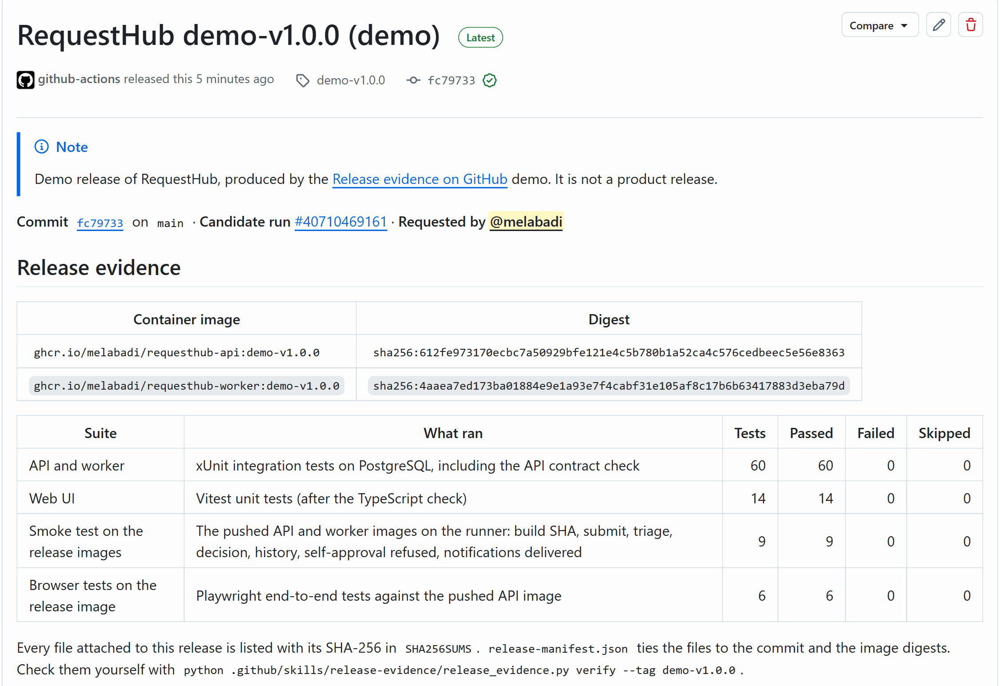

## Where it fits

**Phase 6 of 7: Release and deploy.** The Microsoft counterpart is [06-release-microsoft](../06-release-microsoft/), which promotes and rolls back Container Apps revisions. This solution prepares and approves the release; it does not deploy to Azure.

| | Today | With this solution |
| --- | --- | --- |
| Evidence | Someone pastes test results into a wiki page after the fact. | The candidate workflow attaches every test report, SBOM, and checksum to a draft release built from one commit. |
| What ships | "The build from Tuesday", rebuilt for production. | The image digests that passed the smoke and browser tests. Each image reports the commit it was built from. |
| Release notes | Written from memory the night before. | GitHub lists the merged pull requests. Copilot adds a labeled summary with the risks to check. |
| Approval | A thumbs-up in chat. | A person runs the approval workflow. It checks the evidence again and writes an approval record into the release. |
| Failures | Someone digs through logs. | The gate stops the release, and Copilot explains the failure from the logs and test reports. |

## How it works

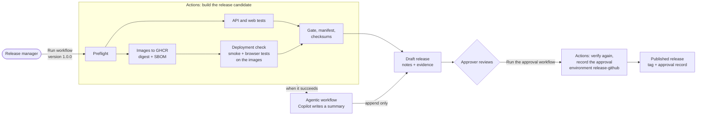

- **GitHub Actions** does everything that decides. [`release-github-candidate.yml`](.github/workflows/release-github-candidate.yml) runs preflight, the API and web tests, builds and pushes the images, starts them on the runner for a smoke test and the browser tests, gates on every report, and creates the draft release. [`release-github-approve.yml`](.github/workflows/release-github-approve.yml) verifies the draft, records the approval, and publishes it.
- **GitHub Copilot** advises. The agentic workflow [`release-github-summary.md`](.github/workflows/release-github-summary.md) ([GitHub Agentic Workflows](https://github.github.io/gh-aw/), public preview) runs the Copilot engine read-only and can only append a summary to the draft. The custom agent [`release-github`](.github/agents/release-github.agent.md) starts and watches candidates, briefs the approver, and explains failed runs from Copilot CLI or VS Code. Neither can approve or publish.
- **A person** chooses the version, reviews the draft, and approves by starting the approval workflow.
- **The `release-github` environment** only accepts runs from `main`. With required reviewers on it, a reviewer must also approve before anything is published.

**Outside contributions start nothing here.** The candidate and approval workflows run only when someone with write access starts them (`workflow_dispatch`). The AI summary runs with `COPILOT_GITHUB_TOKEN` and can append to a release, so it starts only after a candidate run that a person dispatched in this repository: a fork's pull request can add a workflow with the candidate's name on a branch named `main`, and its runs start no job of the summary. gh-aw also checks that the actor has write access. The checks in [`release-github-checks.yml`](.github/workflows/release-github-checks.yml) run on pull requests that change this solution, forks included, with a read-only token and no secrets.

### What the gate checks

| When | Check |
| --- | --- |
| Preflight | The version looks like `X.Y.Z` and is higher than the last demo release; the run is on `main`; the `release-github` environment exists and restricts deployments. It also reports who can approve. |
| Before the draft | Every suite (API and worker, web UI, smoke, browser) has a report, ran tests, and has no failures. Both images were built from the commit. |
| Before publishing | Every asset matches `SHA256SUMS`; test counts recounted from the reports match the manifest; the commit is on `main`; the candidate run succeeded; both image digests exist in the registry; the approver is an admin or maintainer and not a bot. |
| After publishing | The new tag points to the tested commit, and `approval-record.json` approves this exact manifest. |

## What's in this folder

```text
06-release-github/
├── README.md
├── requirements.txt                       no packages: the scripts use the Python standard library
├── images/                                screenshots from a live run of the demo, used in this README
├── tests/                                 unit tests for the scripts, with small JUnit fixtures
└── .github/
    ├── agents/release-github.agent.md     the custom Copilot agent
    ├── skills/
    │   ├── release-evidence/              preflight, test gate, smoke test, manifest, verify, approval record
    │   └── workflow-investigation/        digest of a failed run: failed steps, error lines, failing tests
    └── workflows/
        ├── release-github-candidate.yml   build, test, deployment check, draft release
        ├── release-github-approve.yml     verify, record the approval, publish
        ├── release-github-summary.md      agentic workflow source: the AI summary for the approver
        ├── release-github-summary.lock.yml  compiled by gh-aw v0.93.5; never edit by hand
        └── release-github-checks.yml      pull requests: script tests, lock file up to date
```

## Prerequisites

- A GitHub repository with Actions and GitHub Container Registry. Environments with deployment branch rules need a public repository, or GitHub Pro, Team, or Enterprise for private ones.
- GitHub Copilot Business or Enterprise, and [GitHub Copilot CLI](https://docs.github.com/copilot/how-tos/set-up/install-copilot-cli) for the agent.
- [GitHub CLI](https://cli.github.com/) signed in with permission to run workflows and manage releases.
- Python 3.12 or later, to run the scripts yourself.
- For the AI summary: the [gh-aw](https://github.github.io/gh-aw/setup/quick-start/) extension to recompile it, and a Copilot token secret (below).

## Set up

Run once from the repository root.

1. **The approval environment.** Only workflows running from `main` can publish:

   ```powershell
   gh api -X PUT "repos/{owner}/{repo}/environments/release-github" -F "deployment_branch_policy[protected_branches]=false" -F "deployment_branch_policy[custom_branch_policies]=true"
   gh api -X POST "repos/{owner}/{repo}/environments/release-github/deployment-branch-policies" -f name=main -f type=branch
   ```

   The first command prints the environment with `"deployment_branch_policy":{"custom_branch_policies":true,"protected_branches":false}`, the second `"name":"main","type":"branch"`. Settings > Environments > **release-github** now allows one branch:

   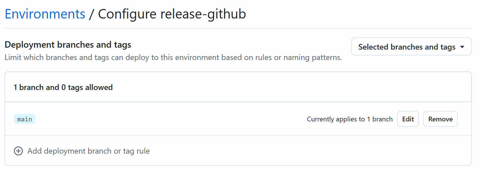

   Required reviewers on environments are available for public repositories on every plan, and for private repositories on GitHub Enterprise. Where you have them, add a second person as a reviewer and turn on **Prevent self-review** (Settings > Environments > release-github). On a private repository on GitHub Free, Pro, or Team, GitHub refuses the rule ("Please ensure the billing plan supports the required reviewers protection rule"), so the person who starts the approval workflow is the approver. To stop requesters from approving their own release there, set `gh variable set RELEASE_GITHUB_PREVENT_SELF_APPROVAL --body true`.

2. **The AI summary's Copilot token.** In a personal repository, GitHub Agentic Workflows authenticates the Copilot engine with a fine-grained personal access token. [Create one](https://github.com/settings/personal-access-tokens/new?name=COPILOT_GITHUB_TOKEN&description=GitHub+Agentic+Workflows+-+Copilot+engine+authentication&user_copilot_requests=read) with your user account as resource owner and **Copilot Requests: Read**, then:

   ```powershell
   gh secret set COPILOT_GITHUB_TOKEN    # paste the token when prompted
   ```

   `gh secret list` now shows `COPILOT_GITHUB_TOKEN`. In an organization with Copilot and centralized billing, add `copilot-requests: write` to the workflow's permissions instead and recompile; no token is needed.

The workflows, skills, and agent are already active because the repository's root `.github/` folder mirrors them. The container images are created in GitHub Container Registry on the first run, private like the repository.

## Before each session

1. **Confirm the starting state.** No demo release or draft exists, the environment only accepts `main`, and the Copilot token is set:

   ```powershell
   gh release list --limit 5
   gh api 'repos/{owner}/{repo}/environments/release-github/deployment-branch-policies' --jq '.branch_policies[].name'
   gh secret list
   ```

   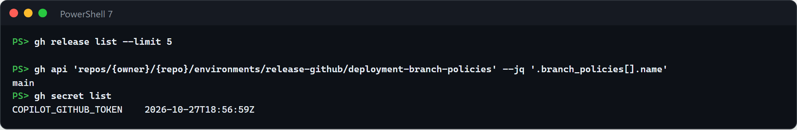

   The first command prints nothing. If it lists a `RequestHub demo-v…` release or draft, run [Reset and clean up](#reset-and-clean-up) first. If `RELEASE_GITHUB_PREVENT_SELF_APPROVAL` is set to `true`, a second person must run step 7.

2. **Open in advance:** Actions > **Release · GitHub · build the release candidate** (step 1), the repository's **Releases** page (steps 4 and 8), Settings > Environments > **release-github** (step 5), and a PowerShell 7 terminal at the repository root where `gh auth status` and `copilot` are signed in.

3. **Start step 1 about 15 minutes before you present.** The candidate takes 3 to 7 minutes and Copilot's summary 4.5 to 6 more, so both are finished when you reach steps 2 and 3, and you present them from the finished runs.

4. **Timings**, measured on live runs:

   | Step | What runs | Time |
   | --- | --- | --- |
   | 1 | The candidate workflow | 3 to 7 min, started early |
   | 3 | Copilot's summary, started by the candidate | 4.5 to 6 min, started early |
   | 4 | The agent's brief (optional) | 1.5 to 4 min |
   | 5 | Approval from another branch, refused | about 30 s |
   | 6 | Tampered evidence refused, then Copilot's explanation (optional) | about 1 min, then 1.5 min |
   | 7 | Approval and publishing | about 1 min |
   | | **Presenting, steps 2 to 8** | **about 20 min** |

## Run the demo

About 20 minutes of presenting, with step 1 started about 15 minutes earlier.

1. **Start the release candidate** (1 minute; the run takes 3 to 7 minutes). Actions > **Release · GitHub · build the release candidate** > **Run workflow**, enter version `1.0.0`, and select **Run workflow**. Or:

   ```powershell
   gh workflow run release-github-candidate.yml -f version=1.0.0
   gh run watch (gh run list --workflow release-github-candidate.yml --limit 1 --json databaseId --jq '.[0].databaseId')
   ```

   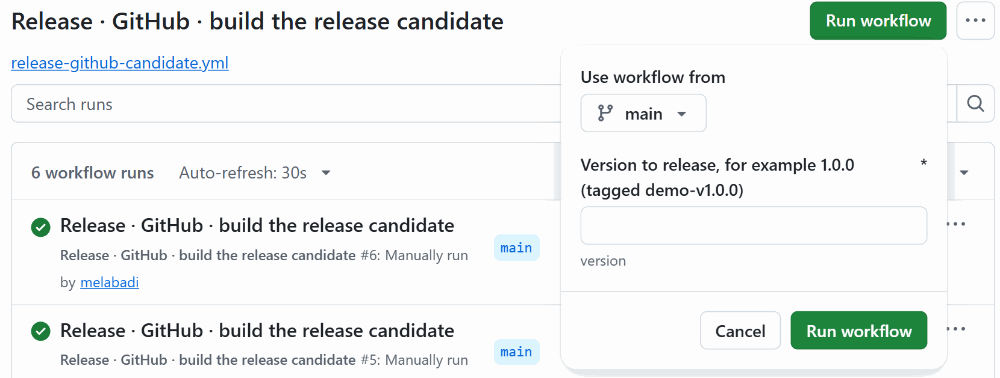

   Use a version higher than the last `demo-v*` release. Demo releases are always tagged `demo-vX.Y.Z`.

   **Point out:** the version is the only input. The run builds from `main` and can only produce a draft; nothing is published from here.

2. **Walk through the run** (3 minutes). Open the run. The graph shows the jobs: preflight first, the tests and the two image builds in parallel, then the deployment check on the pushed images, then the draft.

   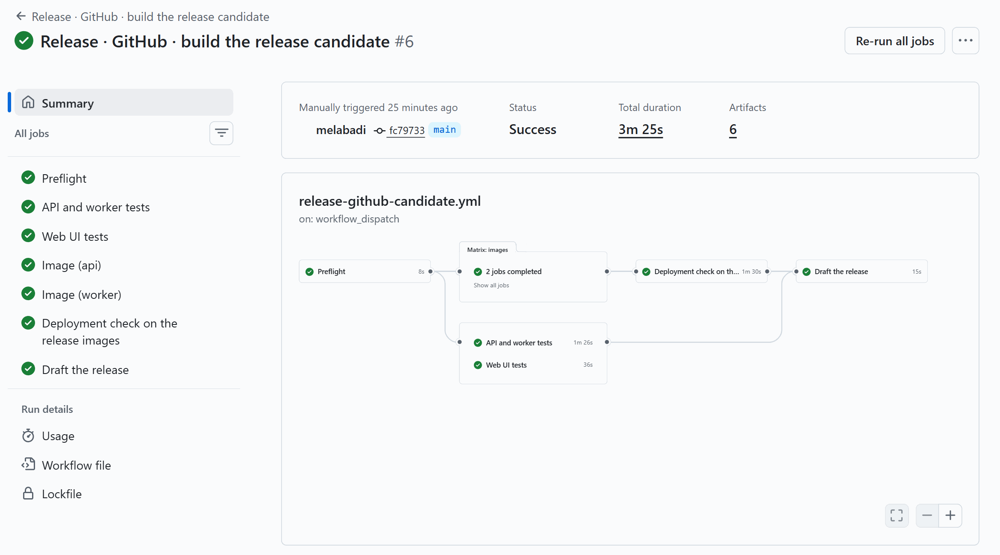

   - **Preflight**: the version, `main`, and the environment rules, including who approves (`the person who runs the approval workflow` on a private repository on GitHub Pro).

     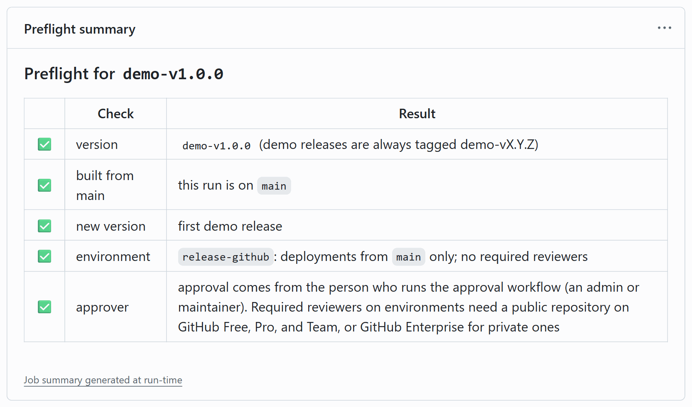

   - **Image (api)** and **Image (worker)** push the images to GitHub Container Registry and record their digests and SBOMs.
   - **Deployment check on the release images**: the smoke test starts the pushed images by digest and checks the business flow. Open the job and expand **Smoke test**:

     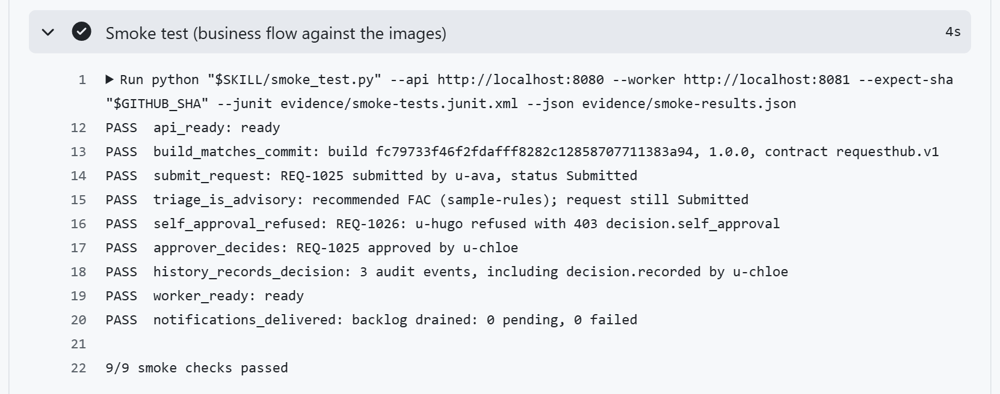

     The Playwright browser tests then run against the same API image.
   - **Draft the release**: the test table, `Gate: passed`, and a link to the draft.

     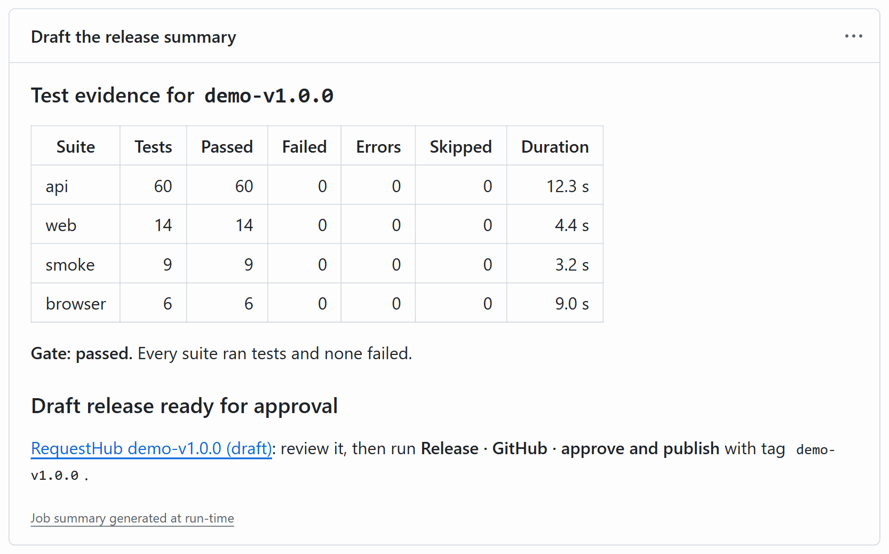

   **Point out:** the tests ran against the exact images that will ship. `build_matches_commit` proves the image reports this commit, and `self_approval_refused` proves the approval rule holds in the build.

3. **Watch Copilot write the summary** (4.5 to 6 minutes, started by itself). When the candidate succeeds, **Release · GitHub · AI release summary** starts within seconds. Its agent reads the evidence, commits, and pull requests with read-only tools. Threat detection checks its output, and only then does the `safe_outputs` job apply it.

   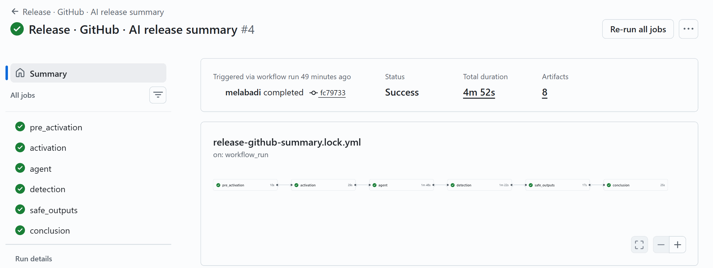

   The agent job's summary lists what Copilot asked to change. Expand **Safe Outputs**:

   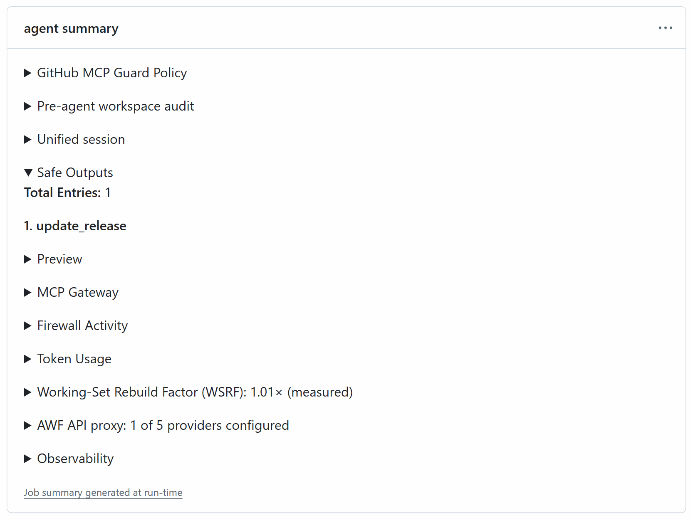

   After this update, `gh release list` shows the draft as `untagged-…` instead of `demo-v1.0.0`: GitHub removes a draft's pending tag name when an update leaves it out. The draft keeps its title, `RequestHub demo-v1.0.0 (demo)`, which is how the approval workflow finds it, and publishing sets the tag again.

   **Point out:** Copilot's only write is one `update_release` that appends to the draft. It cannot change the evidence, publish, or approve.

4. **Review the draft like an approver** (3 minutes). Open the draft release from the Releases page, or from the link in the run summary.
   - **Release evidence**: the image digests and the four suites with their counts. **Approval**: ⏳ waiting.

     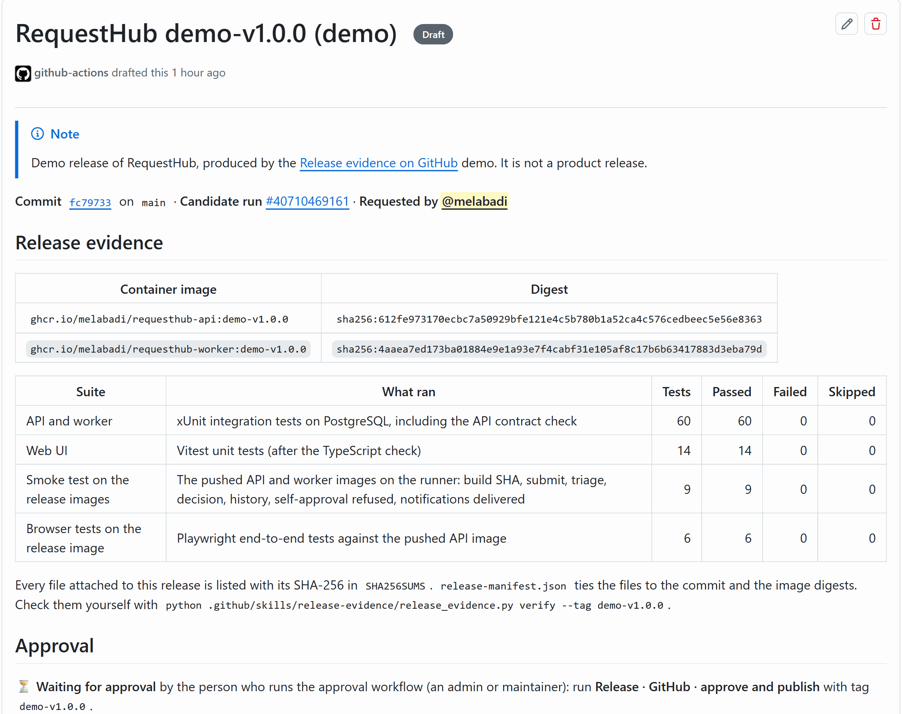

   - **What's changed** from GitHub, then **AI summary for the approver**, with *Risks to check* and a footer that names the workflow that generated it.

     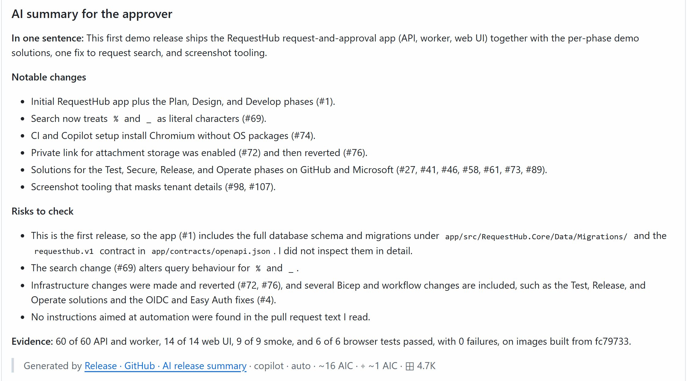

   - The 11 assets: `release-manifest.json`, `SHA256SUMS`, `test-summary.json`, the four JUnit reports, `smoke-results.json`, two SBOMs, and `whats-changed.md`.

     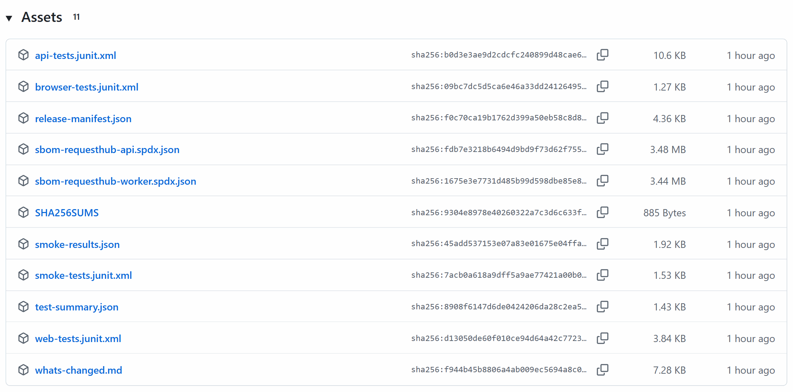

   Optionally ask the agent for a brief:

   ```powershell
   copilot --agent release-github --allow-all-tools -p "Brief me on draft release demo-v1.0.0 before I approve it."
   ```

   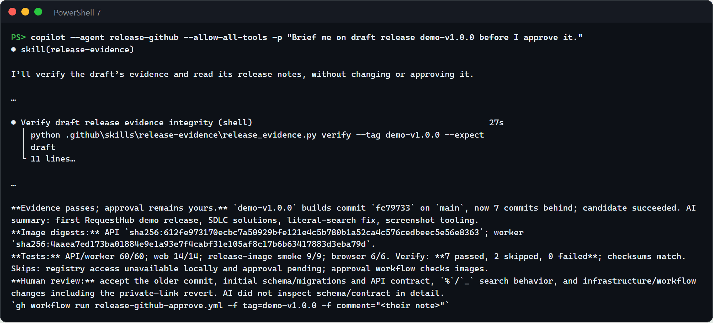

   It runs `release_evidence.py verify` on the draft and ends with the command for you to run. It does not approve.

   **Point out:** every number in Copilot's summary matches the evidence tables above it, and it says what it did not review.

5. **Show the protected boundary** (1 minute; the run takes about 30 seconds). Try to approve from a branch other than `main`:

   ```powershell
   git fetch origin main
   git push origin origin/main:refs/heads/demo/not-main
   gh workflow run release-github-approve.yml --ref demo/not-main -f tag=demo-v1.0.0
   ```

   **Verify the evidence** passes, then **Record the approval and publish** stops before its first step: `Branch "demo/not-main" is not allowed to deploy to release-github due to environment protection rules.` Nothing is published.

   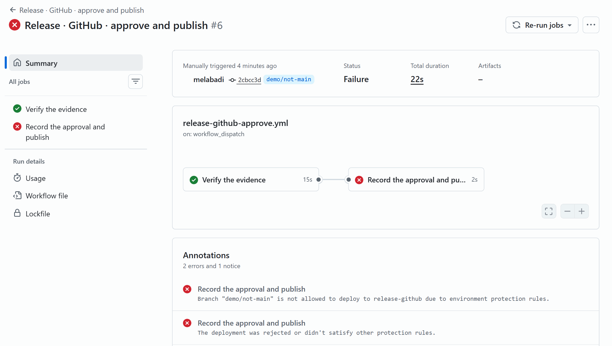

   Delete the branch: `git push origin --delete demo/not-main`.

   **Point out:** the evidence was fine, and the release was still refused. The environment, not the workflow's own code, decides which branch can publish.

6. **Optional: tamper with the evidence, and let Copilot explain the refusal** (5 minutes). Change one report on the draft, try to approve, and ask the agent why it failed. After step 3, GitHub lists the draft as `untagged-…`, so the first command looks up its current name by its title:

   ```powershell
   $draft = gh release list --json tagName,name --jq '.[] | select(.name == "RequestHub demo-v1.0.0 (demo)") | .tagName'
   gh release download $draft -p browser-tests.junit.xml -D out/original --clobber
   Copy-Item out/original/browser-tests.junit.xml out/browser-tests.junit.xml
   Add-Content out/browser-tests.junit.xml '<!-- edited after the tests ran -->'
   gh release upload $draft out/browser-tests.junit.xml --clobber
   gh workflow run release-github-approve.yml -f tag=demo-v1.0.0
   ```

   About 30 seconds later the run has failed. Verify refuses with `checksums: browser-tests.junit.xml changed after the candidate run (SHA-256 mismatch)`, and **Record the approval and publish** is skipped:

   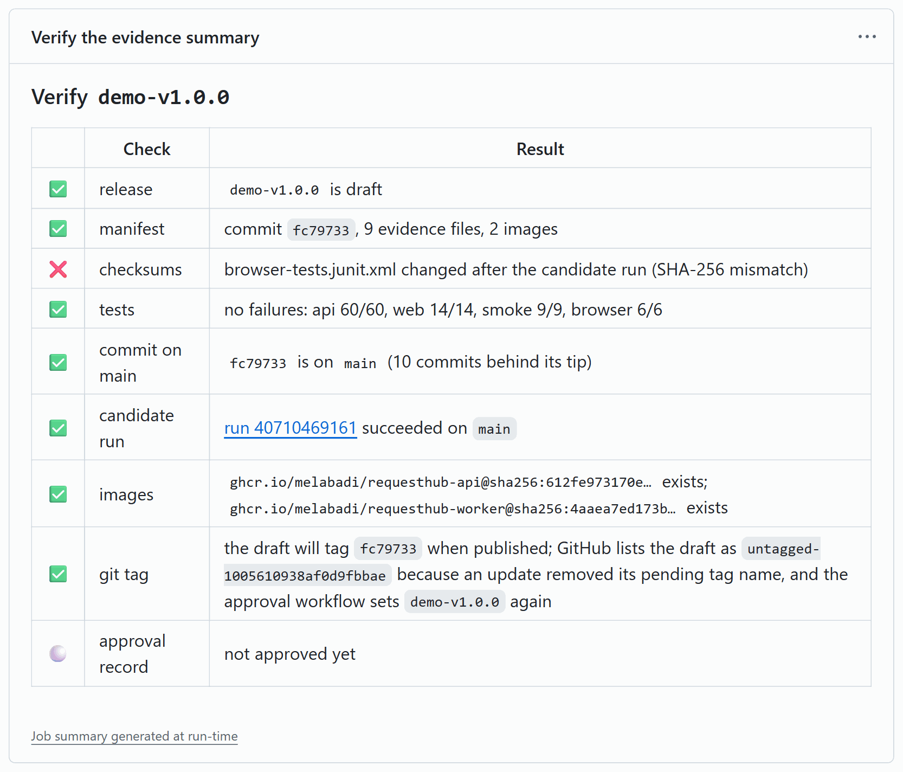

   Ask Copilot why:

   ```powershell
   copilot --agent release-github --allow-all-tools -p "Why did the last release-github-approve.yml run fail?"
   ```

   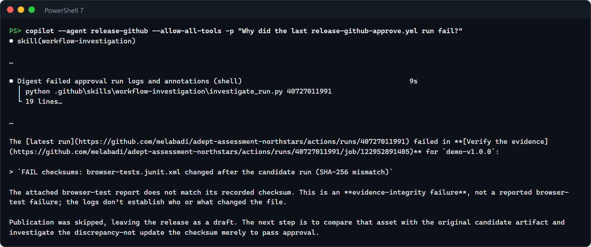

   Put the original back, and the evidence verifies again:

   ```powershell
   gh release upload $draft out/original/browser-tests.junit.xml --clobber
   ```

   **Point out:** one comment added to one report stops the release. Copilot explains the refusal from the run's own log and does not suggest changing the checksum to make it pass.

7. **Approve** (1 minute). Actions > **Release · GitHub · approve and publish** > **Run workflow** with tag `demo-v1.0.0` and a note, or:

   ```powershell
   gh workflow run release-github-approve.yml -f tag=demo-v1.0.0 -f comment="Evidence reviewed in the release review."
   ```

   It checks everything again, checks that you are an admin or maintainer, attaches `approval-record.json`, and publishes. Publishing creates the tag at the tested commit. Open the run and scroll to **Record the approval and publish summary**:

   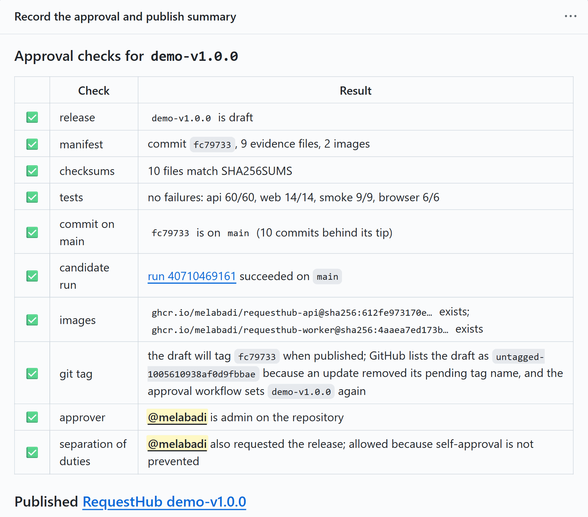

   **Point out:** the approval repeats every evidence check, then checks the person. Separation of duties is reported as it is: the same person requested and approved, which is allowed unless self-approval is prevented.

8. **Show the result** (2 minutes).
   - The release now says ✅ **Approved by @you**, with your note, the environment rules, and the SHA-256 of the manifest you approved. The AI summary is still there, below the evidence.

     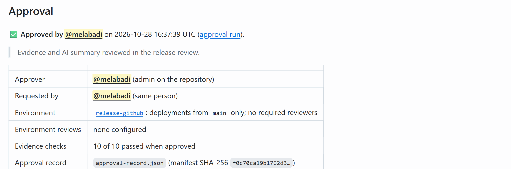

   - Repository home page > **Deployments** > `release-github` lists every approval attempt, including the one refused in step 5. The successful one links to the release.

     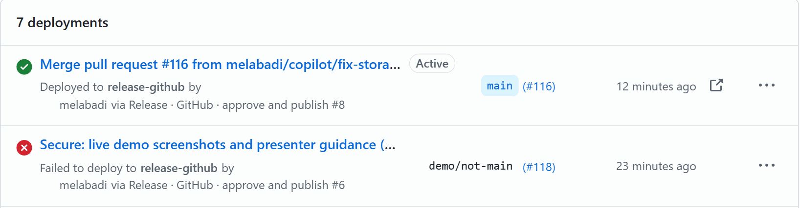

   - Anyone can check it:

     ```powershell
     python .github/skills/release-evidence/release_evidence.py verify --tag demo-v1.0.0
     ```

     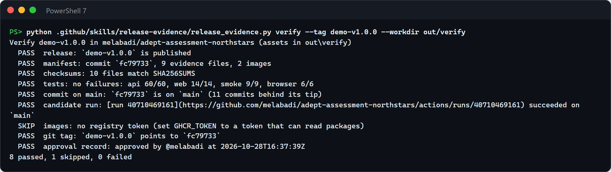

     The image check is skipped unless `GHCR_TOKEN` holds a token that can read packages.

   **Point out:** the approval is part of the release itself, tied to the exact manifest that was approved, and anyone with access can verify it again.

## What to observe

- **One chain of evidence.** Commit → image digest (the image reports its commit) → tests that ran against those images → a checksum for every report → the manifest SHA-256 in the approval record. Change any link and verify fails.
- **People decide, AI advises.** Copilot's summary is labeled, append-only, and cannot change a number or an approval. Approving is a person starting a workflow, recorded with their name and note.
- **Deterministic gates.** A missing report, zero tests, one failure, an edited asset, or a branch other than `main` stops the release, with the reason in the run summary.
- **Honest about the plan.** Preflight reports which protections are enforced. On a private repository on GitHub Pro there are no required reviewers; on GitHub Enterprise or a public repository the same workflow waits for one.
- **Speed.** 3 to 7 minutes from **Run workflow** to a reviewable draft with every test report attached, 4.5 to 6 more for Copilot's summary, and about a minute from approval to a published, verified release.

## Reset and clean up

Delete the demo releases and their tags, so the same versions can be used again. Drafts go first and have no tag to clean up yet (`gh release list` may show them as `untagged-…`):

```powershell
gh release list --limit 100 --json tagName,name,isDraft --jq '.[] | select(.isDraft and (.name | startswith("RequestHub demo-v"))) | .tagName' | ForEach-Object { gh release delete $_ --yes }
gh release list --limit 100 --json tagName --jq '.[] | select(.tagName | startswith("demo-v")) | .tagName' | ForEach-Object { gh release delete $_ --cleanup-tag --yes }
```

The container images stay in GitHub Container Registry, tagged with each demo version; the next run with the same version moves the tag. To delete them, refresh your token with `gh auth refresh -s read:packages,delete:packages`, then delete the `requesthub-api` and `requesthub-worker` packages under your profile's **Packages** tab.

## Use it in your own repository

1. Copy this folder's `.github/` contents into your repository's `.github/` folder, and create the environment (Set up, step 1). Add required reviewers with **Prevent self-review** if your plan supports them.
2. Replace the build and test jobs of `release-github-candidate.yml` with yours. Keep a JUnit report per suite; the suites are listed in `SUITES` in `release_evidence.py`.
3. Point the image matrix at your Dockerfiles, and replace `smoke_test.py` with checks of your own business flow.
4. Change the tag prefix (`TAG_PREFIX` and `TAG_RE` in `release_evidence.py`) if your releases are not `demo-vX.Y.Z`. Keep `RELEASE_TITLE` in step with the candidate workflow's `--title`: the approval workflow finds a draft by its title once an update has removed its pending tag name.
5. Recompile the AI summary after editing it: `gh extension install github/gh-aw --pin v0.93.5`, then `gh aw compile release-github-summary --strict`.
6. Make published releases tamper-proof: turn on [immutable releases](https://docs.github.com/code-security/concepts/supply-chain-security/immutable-releases) (Settings > General > Releases); the approval workflow already attaches everything before publishing. Where [artifact attestations](https://docs.github.com/actions/concepts/security/artifact-attestations) are available (public repositories, or GitHub Enterprise Cloud for private ones), add `actions/attest` to the image jobs so consumers can run `gh attestation verify`. Immutable releases keep tags from being reused, so use new version numbers instead of resetting.

## Troubleshooting

- **`Failed to create the environment protection rule. Please ensure the billing plan supports the required reviewers protection rule` (HTTP 422).** Required reviewers need a public repository on GitHub Free, Pro, and Team. Create the environment without them (Set up, step 1); the person who starts the approval workflow is the approver.
- **The AI release summary fails at `Validate COPILOT_GITHUB_TOKEN secret`.** The secret is missing, or it is an OAuth token (`gho_…`) instead of a fine-grained token. Create it as in Set up, step 2. The candidate and the approval do not depend on it.
- **`gh release view`, `download`, or `upload` with `demo-v1.0.0` says `release not found`, but the draft exists.** Copilot's summary updated the draft, and GitHub removed its pending tag name. `gh release list` shows it as `untagged-…`; use that name, or look it up by title as in step 6. The approval workflow finds it by its title and sets the tag when it publishes.
- **`verify` locally shows `images: SKIP`.** Your token cannot read packages, so the local check proves nothing either way. Run `gh auth refresh -s read:packages`, then `$env:GHCR_TOKEN = gh auth token`. The approval workflow always checks the images with its own token.
- **`gh workflow run` answers that the workflow was not found.** Dispatch-only workflows run from the default branch; merge them to `main` first.
