# Release · Safe rollout on Azure Container Apps

Most release incidents start the same way: a new build replaces the one users are on, and users find the problem. In this solution, Azure runs the release and a person makes the call. Azure Container Registry builds each commit of `main` once. The image push starts a release job through Event Grid and an Azure Function, and the job adds the build to Azure Container Apps as a **candidate revision with no traffic**, then tests it on its own URL. The release manager reads the result in an Azure Monitor workbook and decides: promote or abort. A bad build never receives a user request, and Azure Copilot helps the release manager understand why it failed. Rolling back is one traffic change to the previous revision, which is still running. GitHub only holds the code and the pull requests.

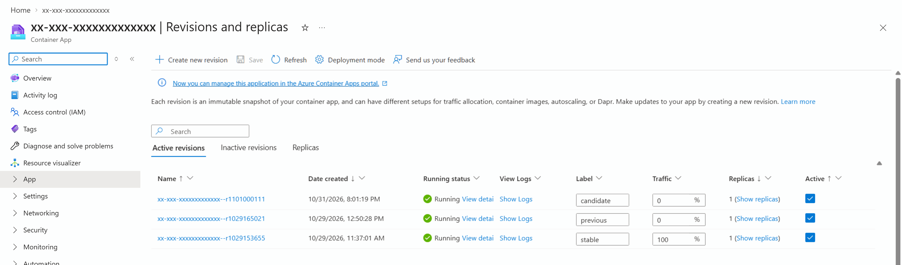

## Where it fits

**Phase 6 of 7: Release.** The GitHub counterpart is [06-release-github](../06-release-github/): release evidence and approval on GitHub. This solution covers how a new build reaches users on Azure, with the release orchestrated in Azure itself.

| | Today | With this solution |
| --- | --- | --- |
| Starting a release | Someone runs a pipeline, on a build agent that holds credentials for production. | Azure starts it: the registry builds the commit, and the image push starts the release job. No build agent, and GitHub holds no Azure credential. |
| Deploying | The new build replaces the running one; users are the first real test. | The build runs beside the current one as a candidate with 0% of traffic. |
| Checking | "The deployment succeeded" means the container started. | The platform's readiness probe, then the API used the way people use it, on the candidate's own URL, then a bake period. |
| Deciding | A chat message says "looks good", or nobody decides at all. | The release manager reads every check in a workbook, then runs **promote** or **abort**. Azure records who did. |
| A bad build | It reaches users. | It never gets traffic. The gate fails within about a minute and a half, records why, and removes the candidate. |
| Understanding a failure | Someone digs through logs. | Ask Azure Copilot in the portal; the workbook shows what the gate read from the failing revision. |
| Rolling back | Rebuild or redeploy the old version while users wait. | One traffic change to the previous revision, still running: 13 to 16 seconds, then the same checks. |

## How it works

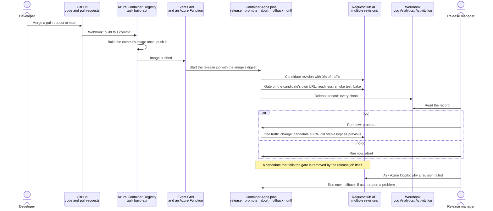

- **Azure Container Registry** builds each commit of `main` once, with an [ACR task](acr-build.yaml) that GitHub's webhook starts. A person creates the task once, with a fine-grained token limited to this repository. Only commits to `main` start it, never a pull request: a pull request trigger would build a fork's code too, and every push starts a release. `preflight.py` fails if the task has one.
- **Event Grid and an Azure Function** are the trigger. A push of `requesthub-api:<commit>` reaches the [release trigger](trigger/function_app.py), a Python function on the Flex Consumption plan, which starts the release job with the image's digest. Its managed identity may start that job and nothing else. It checks every event first, in [plain Python](trigger/release_trigger.py) with [unit tests](test_trigger.py): from this registry, an image push, the API's registry host and repository, a `sha256` digest, and a tag that is a commit. An event that fails a check starts nothing, and the invocation fails with the name of each failed check, in the function's **Invocations** and in Application Insights. The function has its own small virtual network: it reaches its storage, which a policy keeps off the internet, through a private endpoint.
- **Container Apps jobs** run [`release.py`](release.py), one job per step, all from one image. They run as the release identity, a managed identity with three roles: Container Apps Contributor and Container Apps Jobs Reader on the resource group, and AcrPull on the registry. One step runs at a time, first come, first served: a release waits for the steps that started before it, and any other step refuses while an earlier one runs. A pushed image starts at most one release: Event Grid delivers each event at least once, and when a push of the same image starts the release job again, the later execution finds the earlier one in the job's execution history and releases nothing. The earlier execution owns that image, whether it released the build or not. A release whose gate fails removes its own candidate right away, even while another step waits. When the gate passes, it records its verdict on the app (a tag naming the revision, its image digest, and how long it baked). Promote moves traffic only to the candidate and image that verdict names, after the standard 60-second bake, and only within 24 hours.
- **Azure Container Apps** runs the API in multiple-revision mode. Revisions get **labels** with their own URLs (`https://<app>---candidate.<domain>`), and traffic weights decide which revision users reach. The readiness probe (`/health/ready`) is the platform's verdict on each revision.
- **Azure Monitor** keeps the evidence. Each step writes its release record to Log Analytics, and the [workbook](infra/release-records.workbook.json) shows the records, who started each step (from the Activity log), and every traffic change (from Azure Resource Graph).
- **Azure Copilot** (formerly Copilot in Azure) answers the release manager's questions about a failing revision, in the portal, in plain language.
- **People** merge, read the record, decide go or no-go, and roll back. The gate is deterministic; no AI promotes, aborts, or rolls back.

**Outside contributions reach nothing in Azure.** On a public repository anyone can open an Issue or a pull request, from a fork too, and comment. None of that starts a build or a release: the only thing GitHub sends Azure is the build task's webhook for pushes, and only a push to `main` (a merge by someone with write access) starts a build. The registry, Event Grid, and the jobs are reachable only from Azure, and the trigger function answers only calls with its Event Grid key, which Event Grid reads from Azure itself. No GitHub Actions workflow takes part.

## What's in this folder

```text
06-release-microsoft/
├── README.md
├── release.py                       the release steps: release, drill, deploy, gate, promote, abort, rollback, verify, status, watch
├── test_release.py                  unit tests for the release's safety rules; they need no Azure access
├── test_trigger.py                  unit tests for the release trigger: what reaches the release job, and what never does
├── preflight.py                     checks the setup and the starting state before each session
├── azd_env.py                       reads settings from this solution's azd environment
├── Dockerfile                       the release jobs' image: Python and release.py
├── .dockerignore
├── acr-build.yaml                   ACR task: build the API for a commit of main, push requesthub-api:<commit> and :main
├── requirements.txt                 no third-party packages: standard library and the Azure CLI
├── azure.yaml                       azd project: infra, the shared app's api and worker, the release jobs, and the trigger
├── trigger/                         the release trigger, an Azure Function (Python, Flex Consumption)
│   ├── function_app.py              release_on_push: Event Grid calls it for each pushed build
│   ├── release_trigger.py           its logic in plain Python: check the event, start the release job with the digest
│   ├── host.json
│   ├── .funcignore
│   └── requirements.txt             azure-functions only
├── images/                          screenshots for this README, captured from a live run
└── infra/
    ├── main.bicep                   resource group, RequestHub's platform (app/infra), the release identity's roles
    ├── main.parameters.json
    ├── release.bicep                Event Grid on the registry, the trigger's function app with its network and storage, the workbook, AcrPull for the jobs
    ├── release-on-push.bicep        Event Grid's subscription to the function, deployed after the function's code
    ├── release-records.workbook.json   the "RequestHub release records" workbook
    ├── jobs.bicep                   the five release jobs, and the trigger's right to start the release job
    └── jobs.parameters.json
```

The app is [`app/`](../../app/README.md). Its API module, [`app/infra/api.bicep`](../../app/infra/api.bicep), runs in multiple-revision mode with startup, liveness, and readiness probes. Its fault switch `Faults:FailReadiness` (with a mandatory expiry) makes a revision's readiness probe fail, which is how the demo rehearses a bad release.

## Prerequisites

- An Azure subscription where you can create resource groups, Microsoft Entra app registrations, and role assignments, for example as Owner.
- A region that allows PostgreSQL Flexible Server for your subscription (the examples use `centralus`).
- [Azure CLI](https://learn.microsoft.com/cli/azure/install-azure-cli), [Azure Developer CLI](https://learn.microsoft.com/azure/developer/azure-developer-cli/install-azd), Git, and Python 3.12 or later. Docker is not needed: Azure Container Registry builds every image.
- Admin rights on your copy of this repository on GitHub, to create the build task's token, and the [GitHub CLI](https://cli.github.com/) to read the repository's URL.
- The Azure portal with Azure Copilot, which is on by default; an administrator can [limit who uses it](https://learn.microsoft.com/azure/copilot/manage-access).

## Set up

1. **Deploy** from this folder:

   ```powershell
   cd solutions/06-release-microsoft
   az login
   azd auth login
   azd env new ai-sdlc-release --location centralus
   azd up
   ```

   `azd up` takes about 18 minutes: RequestHub's platform took 13 in our runs, and the release adds the trigger function (about 2 minutes to create, 1 to deploy), the jobs' 30-second image build, and a few small resources. It creates resource group `rg-ai-sdlc-release` with:

   - **RequestHub's platform** from [`app/infra/requesthub.bicep`](../../app/infra/requesthub.bicep): Container Apps environment, private PostgreSQL with Microsoft Entra authentication only, Blob storage reached through a private endpoint, a container registry, Log Analytics and Application Insights, and a Microsoft Entra app registration with RequestHub's app roles. You get every role.
   - **The app**, deployed once by azd: the API (multiple-revision mode) and the notification worker. This first revision reports build `local`.
   - **The release**: five Container Apps jobs (`release`, `promote`, `abort`, `rollback`, `drill`) running this folder's image; the release trigger function, with its own virtual network and a storage account reached through a private endpoint; an Event Grid subscription on the registry that sends every push of `requesthub-api:<tag>`, except `:main`, to the function; and the **RequestHub release records** workbook. Event Grid accepts only a function that is already deployed, so azd deploys every service first, then connects Event Grid to the function in the project's `postdeploy` hook. Its `predeploy` hook runs the unit tests: a change that breaks a safety rule never reaches Azure.
   - **The release identity** the jobs run as, with Container Apps Contributor and Container Apps Jobs Reader on the resource group and AcrPull on the registry. It can't push images or assign roles.

   **Cost.** About $120 a month while deployed, measured in our subscription: Log Analytics about $50 (the API's telemetry, health probes included), Container Apps about $35 (the stable and previous revisions both stay running), two private endpoints about $15 (the app's storage and the trigger's), PostgreSQL about $13, and the registry about $7. While the database is stopped, every readiness probe logs an error and Log Analytics costs nearer $85 a month. The trigger function, Event Grid, and the release jobs cost cents: they run only when a build is pushed or a person starts a step.

2. **Check it:** `python preflight.py`. Every line should read `PASS`, except **Build**, which warns until you create the build task in the next step.

   

3. **Create the build task** (once, about 5 minutes). A person with admin rights on the repository does this; it is the only GitHub access Azure gets.
   1. In GitHub, open **Settings** → **Developer settings** → **Personal access tokens** → **Fine-grained tokens** → **Generate new token**. Name it `ACR Tasks · RequestHub release builds`, choose an expiration (30 days is enough for a demo), and under **Repository access** select **Only select repositories** and this repository. Under **Repository permissions**, set **Contents** to **Read-only**, **Commit statuses** to **Read-only**, and **Webhooks** to **Read and write**; GitHub adds **Metadata: Read-only** itself. That is the set ACR accepted in our setup. ACR clones the repository with the token, and creates the webhook that tells it about commits to `main`.
   2. Create the task, pasting the token when asked:

      ```powershell
      $registry = azd env get-value AZURE_CONTAINER_REGISTRY_NAME
      $repo = gh repo view --json url --jq .url
      $token = Read-Host -MaskInput 'Fine-grained token for this repository'
      az acr task create --registry $registry --name build-api --context "$repo.git#main" `
        --file solutions/06-release-microsoft/acr-build.yaml --git-access-token $token `
        --commit-trigger-enabled true --pull-request-trigger-enabled false --base-image-trigger-enabled false --output none
      Remove-Variable token
      ```

   3. Run `python preflight.py` again. **Build** now reads `build-api builds every commit to main`. It fails if the task can be started by a pull request: keep `--pull-request-trigger-enabled false`.

   From now on, every commit to `main` is built once and released as a candidate: in our run, a merge became a gated candidate 4 min 26 s later. To pause that, for example on a day with many merges, turn the trigger off and start builds yourself (step 2 of *Run the demo*).

   Azure CLI 2.91 can't change a task's source trigger: `az acr task update` fails with "Object of type set is not JSON serializable", even to change only the trigger's status or its token. So change the task through Azure Resource Manager with `Update-BuildTask`. Define it once in each terminal, in this folder; defining it changes nothing:

   ```powershell
   $taskUrl = "https://management.azure.com$(az acr task show --registry (azd env get-value AZURE_CONTAINER_REGISTRY_NAME) --name build-api --query id -o tsv)?api-version=2019-06-01-preview"
   function Update-BuildTask($properties) {
     $arm = @{ Authorization = "Bearer $(az account get-access-token --query accessToken -o tsv)" }
     $body = @{ properties = $properties } | ConvertTo-Json -Depth 8
     $task = Invoke-RestMethod -Method Patch -Uri $taskUrl -Headers $arm -ContentType 'application/json' -Body $body
     "commit trigger: $($task.properties.trigger.sourceTriggers.status)"
   }
   ```

   Then turn the commit trigger off:

   ```powershell
   Update-BuildTask @{ trigger = @{ sourceTriggers = @(@{ name = 'defaultSourceTriggerName'; status = 'Disabled' }) } }
   ```

   Or back on:

   ```powershell
   Update-BuildTask @{ trigger = @{ sourceTriggers = @(@{ name = 'defaultSourceTriggerName'; status = 'Enabled' }) } }
   ```

   Each call prints the trigger's new state, for example `commit trigger: Disabled`.

   Before the token expires, give the task a new one, pasting it when asked. Define `Update-BuildTask` first, as above. The token goes to Azure in the request body, never on a command line:

   ```powershell
   $token = Read-Host -MaskInput 'New fine-grained token for this repository'
   Update-BuildTask @{
     step = @{ type = 'FileTask'; contextAccessToken = $token }
     trigger = @{ sourceTriggers = @(@{ name = 'defaultSourceTriggerName'; sourceRepository = @{ sourceControlAuthProperties = @{ tokenType = 'PAT'; token = $token } } }) }
   }
   Remove-Variable token
   ```

**Without the build task**, build an export of `main` with `az acr build`. The push starts the release exactly the same way:

```powershell
git fetch origin main
$sha = git rev-parse origin/main
$src = New-Item -ItemType Directory -Force (Join-Path ([IO.Path]::GetTempPath()) "requesthub-$sha")
git archive $sha app | tar -x -C $src
az acr build --registry (azd env get-value AZURE_CONTAINER_REGISTRY_NAME) --image "requesthub-api:$sha" --image requesthub-api:main `
  --build-arg "BUILD_SHA=$sha" --file "$src/app/Dockerfile" --no-logs "$src/app"
```

After this first deployment, ship the API only through the release: running `azd deploy api` again replaces the stable revision without a gate. To change the release itself (`release.py`), run `azd deploy release`; to change the trigger (`trigger/`), run `azd deploy trigger`.

## Before each session

Allow 10 minutes before the audience arrives, more if the database was stopped.

1. **Check the setup:** `python preflight.py`. Every line should read `PASS`.
   - **Database** says `Stopped`: a tenant policy can stop PostgreSQL servers on a schedule, and then every revision fails readiness, so the gate would fail for the wrong reason. Start it, then run the preflight again after 3 to 5 minutes:

     ```powershell
     $rg = azd env get-value AZURE_RESOURCE_GROUP
     az postgres flexible-server start -g $rg -n (az postgres flexible-server list -g $rg --query "[0].name" -o tsv)
     ```

   - **Build** must read `build-api builds every commit to main`: the commit trigger is on, so merging in step 2 of *Run the demo* starts the release. If it says the trigger is off, define `Update-BuildTask` first (*Set up*, step 3), then turn the trigger on with it; or plan to start the build by hand in that step.

2. **Confirm the starting state:** `python release.py status --limit 4` lists active revisions first. Expect one revision labelled `stable` with 100% of traffic, possibly one labelled `previous`, no `candidate`, and no release step running.

   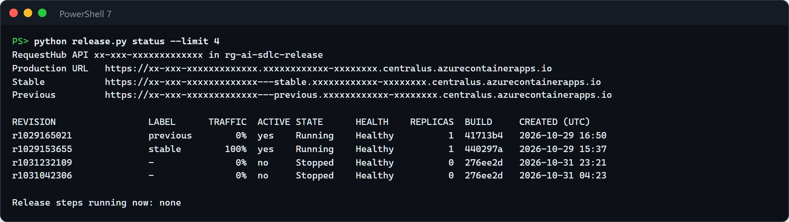

   - A `candidate` is waiting from an earlier run: run the abort job (**Run now** on its page, or the terminal command in step 3).
   - The stable revision already runs the newest commit of `main` (its **BUILD** column), because the last session ended there: run the rollback job, so the release shows a visible change. A build that already serves users is not released again.

3. **Open in advance**, in the Azure portal (`azd env get-value` gives each name):
   - The API container app (`API_APP_NAME`) → **Application** → **Revisions and replicas**. The blade can take a minute to load in a new tab; keep it open and select **Refresh** during the demo.
   - The release job (`SERVICE_RELEASE_NAME`) → **Execution history**. The other jobs share its name with `release` replaced by `promote`, `abort`, `rollback`, or `drill`; open each one's **Overview**, where **Run now** starts it.
   - The workbook: resource group `rg-ai-sdlc-release` → **RequestHub release records**.
   - The trigger function (`RELEASE_TRIGGER_NAME`) → **release_on_push** → **Invocations**.
   - RequestHub (`API_URL`), signed in. Use the production URL in the browser: label URLs can't complete sign-in.

   To start a step from a terminal instead of **Run now**, in this folder:

   ```powershell
   $rg = azd env get-value AZURE_RESOURCE_GROUP
   $job = @{}; 'release', 'promote', 'abort', 'rollback', 'drill' | ForEach-Object { $job[$_] = (azd env get-value SERVICE_RELEASE_NAME) -replace '^caj-release-', "caj-$_-" }
   az containerapp job start -g $rg -n $job.promote --query name -o tsv
   ```

4. **Start the users' view two minutes early**, in a terminal you keep visible: `python release.py watch`. It calls the production URL every second and prints the status and the build it gets, plus a line whenever Azure's traffic changes.

**Timings** from our run: step 1, 1 minute; step 2, about 4 minutes (a 1 min 50 s build, then a 2 min 24 s release job); step 3, about 3 minutes (the promote job took 58 seconds); step 4, about 3 minutes (2 min 22 s); step 5, about 2 minutes; step 6, about 1 minute (45 seconds); step 7, 2 minutes. About 16 minutes of running time; plan 20 with discussion.

## Run the demo

Commands run from this folder.

1. **Where we are (1 minute).** Show `python release.py status --limit 4` (the screenshot in *Before each session*) and the portal's **Revisions and replicas** blade.

   **Point out:** users get the `stable` revision; `previous` is still running with 0% of traffic, ready for an instant rollback. Only the release jobs, in Azure, change this.

2. **Ship a build (about 4 minutes).** Merge a pull request to `main`. With the commit trigger off, start the build yourself for the newest commit of `main`. `--context` pins the build to that commit, even if `main` moves on meanwhile: ACR clones it with the task's stored token and tags the image with it:

   ```powershell
   git fetch origin main
   $sha = git rev-parse origin/main
   $repo = gh repo view --json url --jq .url
   az acr task run --registry (azd env get-value AZURE_CONTAINER_REGISTRY_NAME) --name build-api `
     --context "$repo.git#$sha" --set "commit=$sha" --no-logs
   ```

   Azure takes it from there:

   - The registry builds `requesthub-api:<commit>` once and pushes it (1 min 50 s in our run).
   - Event Grid delivers the push to the trigger function, which checks it and starts the release job: in our run, the function ran 2 s after the push and took under a second. Its **Invocations** list one row per push:

     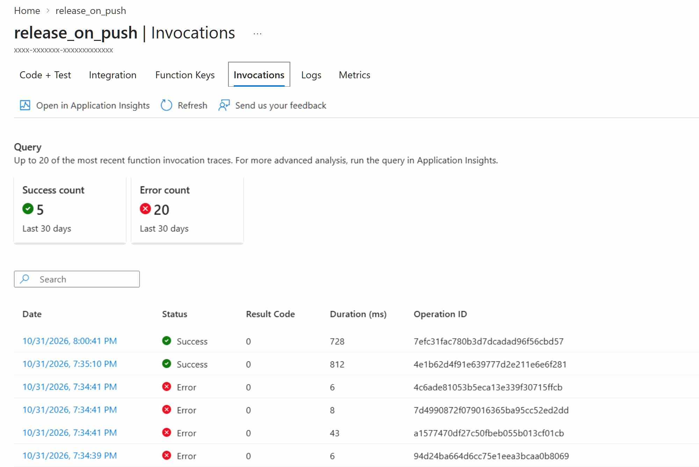

     A successful invocation logs the build and the execution it started, then the event's id, and names no host or resource: `Started release execution <suffix> for build <commit>, image sha256:<12 hex>, event "<id>"`. An event that fails a check starts nothing: its invocation fails and names the check. The errors above are events we forged to test the function, for example one whose tag isn't a commit:

     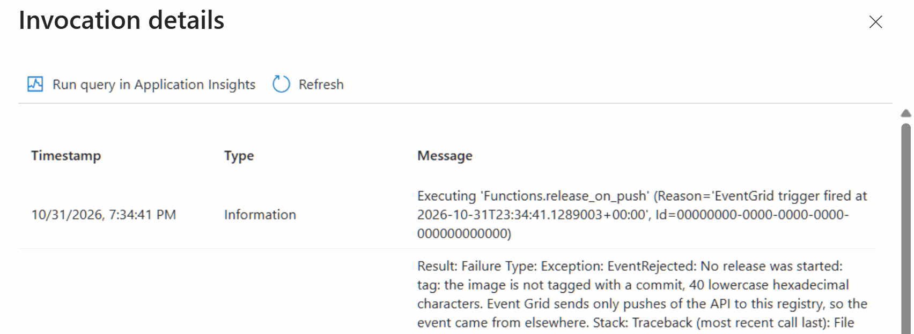

   - The release job adds the candidate and gates it. In its **Execution history**, our run took 2 min 24 s.

     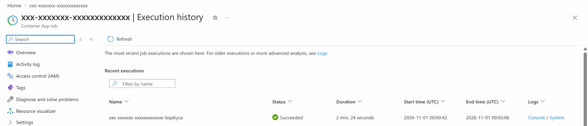

   - Select **Refresh** in the **Revisions and replicas** blade: the new revision has the label `candidate` and 0% of traffic, as in the screenshot at the top of this page. To show the build it runs, open `https://<app>---candidate.<domain>/api/meta` in the browser.

   **Point out:** nobody ran a pipeline. The image push started the release in Azure, and the new build runs on its own URL while every user stays on the old one.

3. **Read the record, then go (about 3 minutes).** Open the workbook. **Release steps** lists every step of every job; select the release job's `gate` row. The checks below it show what the gate did on the candidate's own URL: readiness, build provenance, sign-in, submit, safe retry, read, attachment, approval guard, history, and a 60-second bake.

   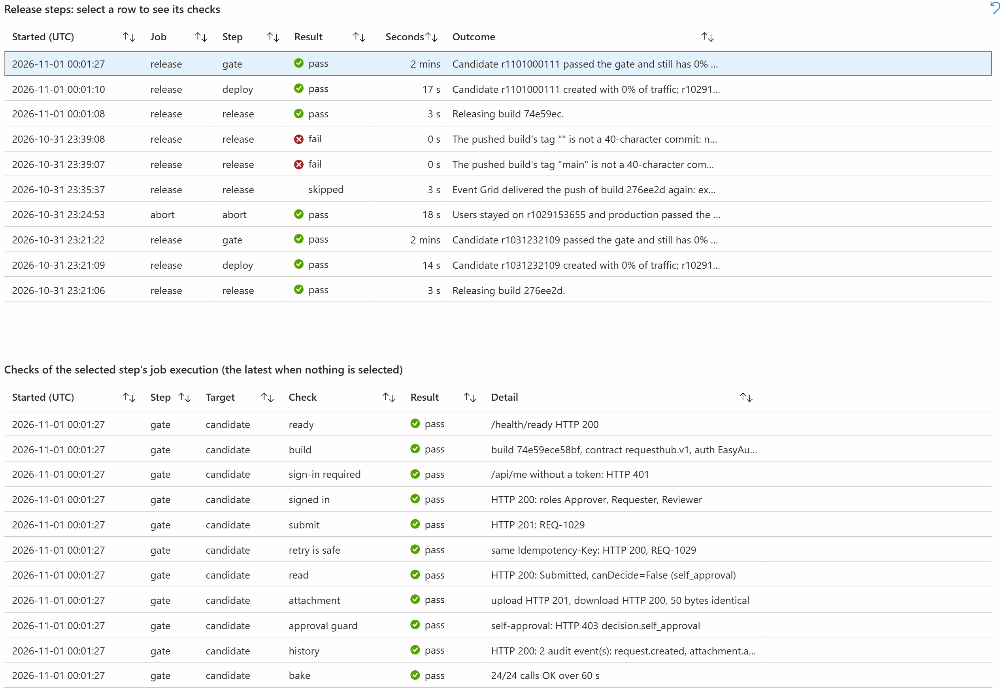

   Then the go: open the promote job and select **Run now**, or `az containerapp job start -g $rg -n $job.promote`.

   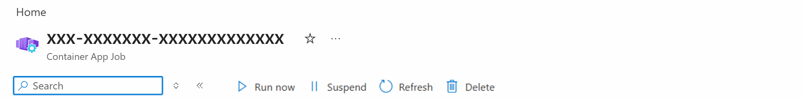

   The promote job checks that the gate passed this candidate and this image, checks the candidate again on its own URL, moves 100% of traffic to it in one change (13 seconds in our run), and verifies production. The job took 58 seconds. Select **Refresh** in the portal:

   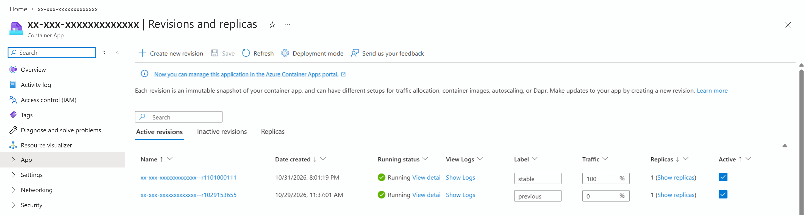

   **Point out:** the gate is deterministic, and the decision is a person's. The release waits until someone runs promote or abort, and Azure records who did (step 7).

4. **Rehearse a bad release (about 3 minutes).** Open the drill job and select **Run now**. It deploys the stable build again as the candidate, with a setting that makes its readiness probe fail for 30 minutes. Select **Refresh** in the portal: the candidate stays **Activating** with 0% of traffic.

   

   The gate fails 79 seconds after the candidate was created, records what it read from the candidate's live logs, removes the candidate, and checks production. The drill job succeeds because the gate caught the fault; it took 2 min 22 s. In the workbook, select the drill's `gate` row:

   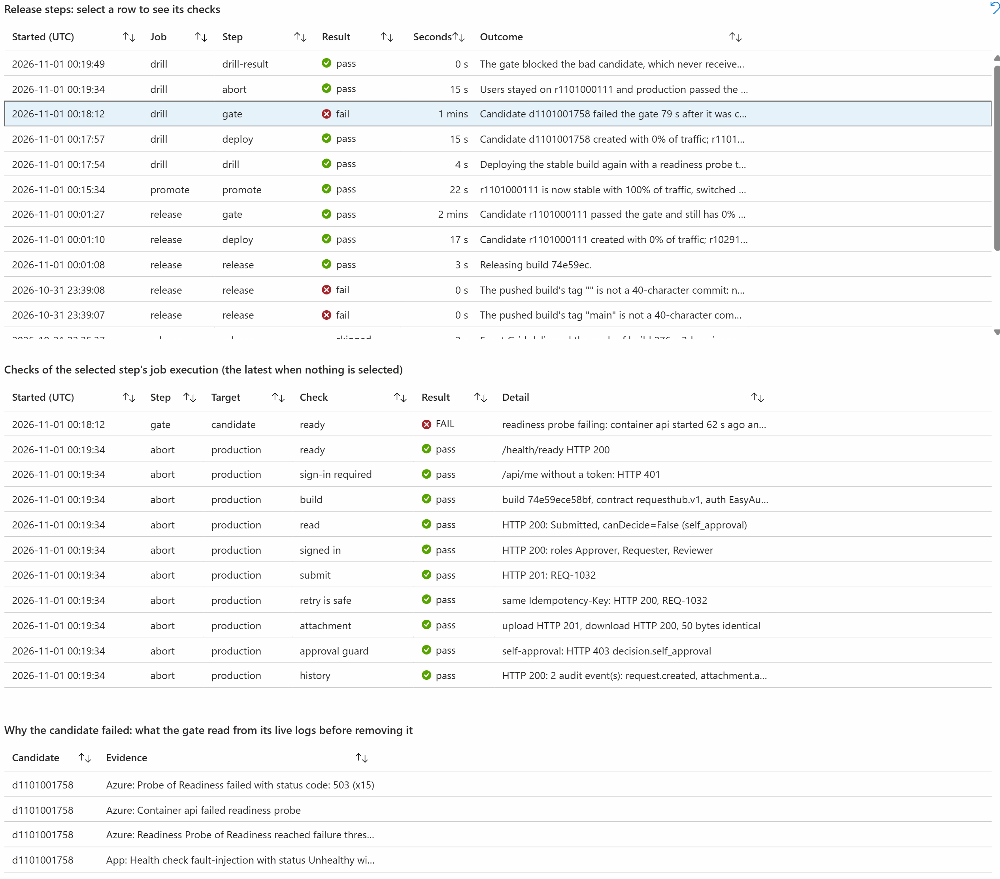

   **Point out:** the bad build never received a user request, and the record says why it failed, in Azure's words and the app's own.

5. **Ask Azure Copilot (about 2 minutes).** In the portal, on the container app, select **Copilot** in the top bar and ask:

   ```text
   In a few sentences: why did revision <suffix> of my container app never become ready, and did it receive any traffic?
   ```

   Use the drill candidate's suffix, for example `d1101001758`. When Copilot asks whether it has the right resource, select **Yes**.

   

   In our runs, Copilot answered from general knowledge: what a revision that never becomes ready usually means, that it "typically" gets no traffic, and where to look next; once, it asked for the error message instead. It did not say what the revision's logs or probes reported. The specific cause is in the workbook (step 4): Azure's probe failures, and the app's health check naming the injected fault.

   **Point out:** AI helps the release manager understand and choose the next check, in plain language; it changes nothing. The facts come from Azure's own records.

6. **Roll back (about 1 minute).** Suppose users report a problem with the build promoted in step 3: open the rollback job and select **Run now**. It makes one traffic change to the previous revision, which is still running (16 seconds in our run), then checks production. Nothing is rebuilt or redeployed. The job took 45 seconds. Select **Refresh** in the portal: the older revision is `stable` again, and the newer one stays warm as `previous`. Running the rollback again rolls forward.

   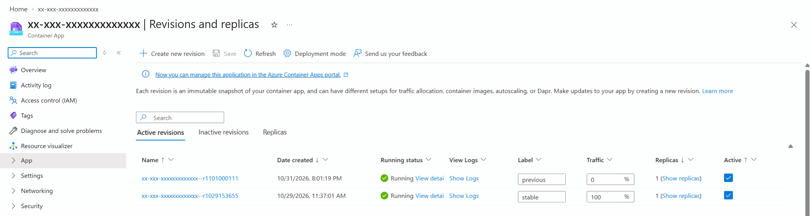

   The `watch` terminal shows what users saw, here during a second run of steps 2 to 6. This excerpt keeps every traffic change and the calls around each build switch; the summary line counts every call.

   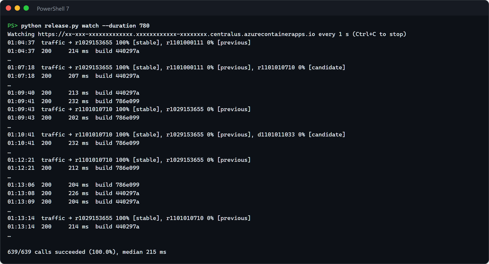

   **Point out:** across the release, the promotion, the drill, and the rollback, every call succeeded, and the build changed only when a person moved traffic.

7. **Show who did what (2 minutes).** Scroll to the bottom of the workbook: who started each step, from the Activity log; the traffic now; and every traffic change, from Azure Resource Graph.

   

   Resource Graph's change history can list one change twice, a minute or so apart, as it does for this rollback; the Activity log shows that it was started once.

   **Point out:** the person's go and no-go are on the record, kept by Azure itself rather than by the release script. The release job shows the trigger function's managed identity, because a pushed build started it.

Every step also runs from a terminal signed in with `az login`, for example `python release.py promote`, `python release.py drill`, or `python release.py rollback`. Prefer the jobs in a demo: they keep the records and the decisions in Azure.

## What to observe

- **Azure runs the release.** In our runs, a new commit of `main` became a gated candidate waiting for a go about 4 minutes after its build started: ACR built and pushed it in 1 min 50 s, Event Grid and the trigger function started the release job 2 s after the push, and the job took 2 min 15 s to 2 min 24 s. With the commit trigger on, ACR starts the build within seconds of the merge (3 s in our test). No build agent was involved, and GitHub holds no Azure credential.
- **Users never meet an untested build.** The candidate runs with 0% of traffic until a person promotes it. The `watch` terminal counted 639 of 639 successful calls during a whole run (the build, the release, the promotion, the drill, and the rollback); the build changed only at the promotion and the rollback.
- **The gate checks behavior, not just "it started".** Readiness comes from the platform and covers the database. The smoke test then submits a request, retries it safely, reads it back, attaches a file and downloads the same bytes (Blob storage, which readiness does not check), confirms the requester cannot approve it (`decision.self_approval`), and reads its audit history, on the candidate's own URL.
- **Provenance you can verify.** One image per commit, released by digest. The release job reads the commit baked into the image, and the gate fails if `/api/meta` reports a different one.
- **People decide, and Azure records it.** Promote, abort, rollback, and drill are started by a person, and the Activity log names them; releases are started by the trigger's managed identity. Promote acts only on the gate's verdict for that exact candidate and image. One step runs at a time: in our tests, a promote started during a release refused with "A release step is running".
- **AI explains; it doesn't act.** Azure Copilot gave the release manager a plain-language explanation and next checks. Its answer was general, so the gate's recorded evidence is what pins the cause: keep both in the conversation.
- **Recovery is a traffic change, not a redeploy.** Promotion and rollback each switched traffic in 13 to 16 seconds, with the same checks afterwards.
- **Least privilege.** The trigger function can start the release job and nothing else, and it reads and writes only its own storage. The release identity manages container apps, reads job executions, and pulls images; it can't push images or assign roles. The build task's token can read this repository's contents and manage its webhooks, nothing else.
- **What a rollback does not undo.** Every revision shares one PostgreSQL database, and a candidate runs its database migrations when it starts, even without traffic. Keep migrations backward compatible so the previous revision keeps working. A revision switch is not a database rollback.

## Reset and clean up

The demo ends rolled back, so it is ready to run again: the next release brings the newer build back. If a candidate is waiting, run the abort job. To end on the newer build instead, run the rollback job once more; it swaps `stable` and `previous`. Revisions you no longer need stay inactive (Container Apps keeps the last 10).

To put the app's demo data back to its initial state, including the requests named `Release check <revision>` that every smoke test creates (you are an Admin):

```powershell
$token = az account get-access-token --scope "$(azd env get-value API_IDENTIFIER_URI)/user_impersonation" --query accessToken -o tsv
curl.exe -X POST -H "Authorization: Bearer $token" "$(azd env get-value API_URL)/api/admin/reset"
```

The reset empties the database; the smoke tests' small attachment files stay in the storage account until you remove the solution.

When you no longer need the solution:

```powershell
$app = az ad app show --id (azd env get-value API_CLIENT_ID) --query id -o tsv
azd down --purge
az ad app delete --id $app
az rest --method delete --url "https://graph.microsoft.com/v1.0/directory/deletedItems/$app"
```

`azd down` deletes the resource group, with the registry, the build task, the jobs, the trigger function and its network and storage, and the workbook. RequestHub's sign-in app registration is a Microsoft Entra object, which no resource group contains, so `az ad app delete` removes it and `az rest` empties it from the recycle bin. Without that last step, a new `azd up` with the same environment name can't create the app registration again for 30 days.

In GitHub, delete the build task's token (**Settings** → **Developer settings** → **Fine-grained tokens**), and in the repository's **Settings** → **Webhooks**, delete the webhook the task created, if it is still there.

## Use it in your own repository

1. **Prepare the app.** Run it in multiple-revision mode with an HTTP readiness probe that checks its dependencies (as [`app/infra/api.bicep`](../../app/infra/api.bicep) does), and expose its build commit on an anonymous endpoint.
2. **Copy** this folder's `release.py`, `test_release.py`, `test_trigger.py`, `preflight.py`, `azd_env.py`, `Dockerfile`, `.dockerignore`, `acr-build.yaml`, the `trigger/` folder, the `release` and `trigger` services and the hooks of `azure.yaml`, and `infra/` files except `main.bicep`. Compose `release.bicep` in your own Bicep, with the outputs the postdeploy hook reads, as [`infra/main.bicep`](infra/main.bicep) does. Then change:
   - in `release.py`, `CONTAINER` and `REPOSITORY` to your container and image names, and the RequestHub calls in `smoke()` to your own critical journeys. Keep them idempotent, keep at least one check that proves a business rule, and add one for every dependency your readiness probe does not cover (here, Blob storage);
   - in `acr-build.yaml`, the image name, the Dockerfile, and the build context;
   - in `release.bicep`, the `repository` variable to your image name: the Event Grid filter and the function's check both use it. The trigger's network links to the app's private DNS zone for Blob storage; if your platform has none, declare the zone in `release.bicep` instead.

   After each change to `release.py` or `trigger/`, run `python -m unittest -v` in the folder: the tests check the safety rules without Azure. Then run `azd deploy release` or `azd deploy trigger`.
3. **Grant the least access.** The jobs' identity needs Container Apps Contributor and Container Apps Jobs Reader on the app's resource group and AcrPull on the registry, plus whatever your smoke test signs in to. The trigger function's identity needs Container Apps Jobs Operator on the release job only (`jobs.bicep` grants it) and Storage Blob Data Owner on its own storage account (`release.bicep`).
4. **Create the build task** with a fine-grained token for your repository, as in *Set up*, and run the preflight.
5. **Releases that change configuration.** `deploy` copies the stable revision's configuration and changes only the image, so a release changes one thing. If a release must also change settings, deploy the candidate from your Bicep with traffic pinned to the stable revision.
6. **Background workers** that do not serve traffic can stay in single-revision mode and update after the API is promoted.
7. **Keep revision suffixes free of hyphens.** Azure's system logs cut a revision name at the first hyphen of its suffix, which breaks log queries by revision.

## Troubleshooting

- **The app times out, or every revision fails readiness and the gate fails before its smoke test.** The PostgreSQL server was stopped; a tenant policy can stop it on a schedule. The preflight's **Database** line shows it. Start it as in *Before each session* (3 to 5 minutes).
- **The release job ends with "already serves users: nothing to release".** The pushed build is the one users have, for example a second build of the same commit. Nothing is wrong. To show a change, run the rollback job first, or run the release job yourself to release the newest build (`requesthub-api:main`).
- **The release job ends with "Execution … already got a push of this image".** Event Grid delivers each event at least once, so now and then one push starts the release job twice; pushing the same image again, for example with `az acr import`, does too. The later execution finds the earlier one in the job's execution history and releases nothing: the earlier one owns that image. The message names it and how it ended. Open it in the release job's **Execution history** if it failed, and to release the build after a failure or an abort, run the release job yourself.
- **A pushed build starts no release job.** Open the trigger function → **release_on_push** → **Invocations**, or run the preflight. A failed invocation names each check the event failed, or the call Azure refused with its HTTP status and error code (for example `Could not start the release job: HTTP 403 AuthorizationFailed`), and Event Grid delivers a failed event again, up to five times in an hour. No invocation at all means Event Grid isn't connected to the function: run `azd deploy trigger`, after which azd connects it.
- **The preflight fails: "Logic App logic-release-…, the earlier trigger, still exists", or another role assignment may start the release job.** An environment deployed before the trigger became a function keeps the Logic App, because `azd provision` adds and updates resources but deletes none, and its Jobs Operator role on the release job. Run the commands the preflight prints: they delete the Logic App and that role assignment.
- **A step refuses with "A release step is running".** One step runs at a time. Wait for the running one to finish (a release takes about 2.5 minutes), then start the step again. Any execution that hasn't succeeded, failed, or stopped counts as running. An execution stuck in another state stops counting once its job's time limit (30 minutes for release and drill, 15 for the others) plus 15 minutes has passed.
- **Promote refuses: "the gate has not passed it", or the verdict is for another candidate or image, older than 24 hours, or from a gate with a bake shorter than 60 seconds.** Promote moves traffic only to a candidate the gate passed with the standard bake, as recorded on the app. `python release.py gate --bake 0` from a terminal is fine for trying things out, but promote won't accept it. Run the release job again: it gates the build again.
- **A step is missing from the workbook.** Log Analytics shows a release record about a minute after the step writes it, and the Activity log can take a few minutes more. Select the time range again, or **Refresh**.
- **`az acr build` of a working copy fails with long paths.** It uploads `app/web/node_modules` too. Build an export of the commit with `git archive`, as in *Set up*.
- **`az acr build` stops with `UnicodeEncodeError` when its output is redirected to a file.** The build itself continues in Azure. Add `--no-logs`, and follow the build with `az acr task list-runs --registry <registry> --top 1`.
- **Signing in on a label URL fails with `AADSTS50011`.** Only the production URL is registered for sign-in. The gate calls the API with a token, and `/api/meta` and `/health/*` are anonymous, so show a candidate with `https://<app>---candidate.<domain>/api/meta`.
- **A button in RequestHub fails with HTTP 403 and no body.** You are on a revision label URL, which has a different origin, or the deployment predates [#134](https://github.com/melabadi/adept-assessment-northstars/pull/134). Use the production URL; for an older deployment, run `azd deploy api` from `main`. That deploy replaces the stable revision and clears the labels; the next release labels them again.
- **Attachment uploads return HTTP 500 and the gate's `attachment` check fails, while every revision is ready.** An Azure Policy disabled public network access on the storage account. The shared module reaches Blob storage through a private endpoint by default; run `azd provision` in this folder to add it to an environment created before that change (about 5 minutes; revisions and traffic are not touched).
- **`LocationIsOfferRestricted` for PostgreSQL during `azd up`.** Your subscription cannot create PostgreSQL Flexible Server in that region. Create a new azd environment in another region, for example `centralus`.
- **`az acr task update` fails with "Object of type set is not JSON serializable".** Azure CLI 2.91 can't update a task's source trigger, so the command fails even when it only changes the token or turns the trigger on or off. Define `Update-BuildTask` first (*Set up*, step 3), then change the task with it. `az acr task create`, `show`, `run`, and `list-runs` work.
