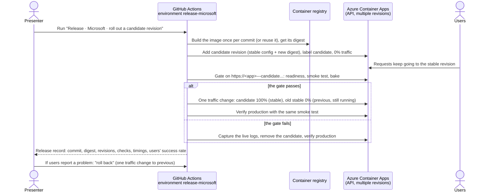

# Release · Safe rollout on Azure Container Apps

Most release incidents start the same way: a new build replaces the one users are on, and users find the problem. In this solution a new build of RequestHub never replaces the running revision. GitHub Actions builds the image once and adds it to Azure Container Apps as a **candidate revision with no traffic**. A gate checks the candidate on its own URL: readiness, a smoke test that submits and reads a request, attaches a file, and confirms nobody can approve their own request, and a bake period. Only then does one atomic change move the traffic. A candidate that fails never receives a user request; it is removed automatically, and the release record quotes Azure's and the app's own explanation. The previous revision stays warm, so a rollback takes seconds. A GitHub Copilot agent with two skills runs the preflight, reads release records, diagnoses failed revisions, and recovers.

## Where it fits

**Phase 6 of 7: Release.** The GitHub counterpart is [06-release-github](../06-release-github/): release evidence and approval on GitHub. This solution focuses on the runtime: how the new build reaches users on Azure.

| | Today | With this solution |
| --- | --- | --- |
| Deploying | The new build replaces the running one; users are the first real test. | The build runs beside the current one as a candidate with 0% of traffic until it passes the gate. |
| Checking | "The deployment succeeded" means the container started. | The platform's readiness probe, then the API used the way people use it, on the candidate's own URL, then a bake period. |
| Artifacts | Each environment rebuilds; nobody can say which commit is running. | One image per commit, deployed by digest. `/api/meta` reports the commit baked into the image, and the gate checks it. |
| A bad build | It reaches users, or the pipeline says "deployed" while the platform quietly keeps the old version and nobody knows why. | The candidate never gets traffic. The gate fails within about two minutes, records why, and removes the candidate. |
| Rolling back | Rebuild or redeploy the old version while users wait. | One traffic change to the previous revision, still running: about 15 seconds, then the same checks. |
| Evidence | Scattered logs and chat messages. | One release record per run: commit, digest, revisions, every check, timings, and what users saw. |
| Access | A stored service principal secret with Contributor. | GitHub OIDC, no secret. The release identity holds two roles: Container Apps Contributor on the resource group and AcrPush on the registry. |

## How it works



- **Azure Container Apps** runs the API in multiple-revision mode. Revisions get **labels** with their own URLs (`https://<app>---candidate.<domain>`), and traffic weights decide which revision users reach. The readiness probe (`/health/ready`) is the platform's verdict on each revision.
- **GitHub Actions** ([`release-microsoft-rollout.yml`](.github/workflows/release-microsoft-rollout.yml), [`release-microsoft-rollback.yml`](.github/workflows/release-microsoft-rollback.yml)) signs in to Azure with OIDC and runs the steps as separate jobs, so the run graph shows the release: build, candidate, then promote or abort, then the record. A pull request that changes the release tooling rehearses a release against the real environment without moving traffic.
- **[`release.py`](release.py)** is the release logic, the same from a workflow or a terminal: `deploy`, `gate`, `promote`, `abort`, `rollback`, `verify`, `status`, `watch`, and `record`. It talks to Azure Resource Manager directly (API version `2025-07-01`) so that each traffic change is one atomic update.
- **GitHub Copilot**: the [`release-microsoft`](.github/agents/release-microsoft.agent.md) agent uses the [azure-deployment](.github/skills/azure-deployment/SKILL.md) skill (preflight, release) and the [deployment-recovery](.github/skills/deployment-recovery/SKILL.md) skill (diagnose, abort, roll back). It never promotes past a failed gate or weakens a check.
- **People** decide to release, choose what to ship, watch the users' view, and decide to roll back.

## What's in this folder

```text
06-release-microsoft/
├── README.md
├── release.py                          the release: deploy, gate, promote, abort, rollback, verify, status, watch, record
├── azd_env.py                          reads settings from this solution's azd environment
├── configure_github.py                 azd hooks: create the GitHub environment and its OIDC values
├── requirements.txt                    no third-party packages: standard library and the Azure CLI
├── azure.yaml                          azd project: infra plus the shared app's api and worker
├── infra/
│   ├── main.bicep                      resource group, RequestHub platform (app/infra), release identity's role
│   └── main.parameters.json
└── .github/
    ├── agents/release-microsoft.agent.md   Copilot agent that releases, diagnoses, and recovers
    ├── skills/
    │   ├── azure-deployment/           how to release through candidates; preflight.py checks the setup
    │   └── deployment-recovery/        how to diagnose and recover; diagnose.py reads Azure's evidence
    └── workflows/
        ├── release-microsoft-rollout.yml    build once, candidate, gate, promote or abort, release record
        └── release-microsoft-rollback.yml   one traffic change back to the previous revision, then verify
```

The app is [`app/`](../../app/README.md). Its API module, [`app/infra/api.bicep`](../../app/infra/api.bicep), already runs in multiple-revision mode with startup, liveness, and readiness probes. Its fault switch `Faults:FailReadiness` (with a mandatory expiry) makes a revision's readiness probe fail, which is how the demo produces a bad release.

## Prerequisites

- An Azure subscription where you can create resource groups, Microsoft Entra app registrations, and role assignments, for example as Owner.
- A region that allows PostgreSQL Flexible Server for your subscription (the examples use `centralus`).
- [Azure CLI](https://learn.microsoft.com/cli/azure/install-azure-cli), [Azure Developer CLI](https://learn.microsoft.com/azure/developer/azure-developer-cli/install-azd), and the [GitHub CLI](https://cli.github.com/) signed in as a repository admin. The hooks create a GitHub environment and its secrets.
- Python 3.12 or later. Docker is not needed: images are built in Azure Container Registry or on the GitHub runner.
- Optional: [GitHub Copilot CLI](https://docs.github.com/copilot/how-tos/set-up/install-copilot-cli) to ask the `release-microsoft` agent.

## Set up

Run once, from this folder:

```powershell
cd solutions/06-release-microsoft
az login
azd auth login
azd env new ai-sdlc-release --location centralus
azd up
python ../../.github/skills/azure-deployment/preflight.py
```

`azd up` took about 13 minutes in our runs. It creates resource group `rg-ai-sdlc-release` with:

- **RequestHub's platform** from [`app/infra/requesthub.bicep`](../../app/infra/requesthub.bicep): Container Apps environment, private PostgreSQL with Microsoft Entra authentication only, Blob storage reached through a private endpoint (its public endpoint is closed), a container registry, Application Insights, and a Microsoft Entra app registration with RequestHub's app roles. You get every role.
- **The app**, deployed once by azd: the API (multiple-revision mode) and the notification worker. This first revision reports build `local`.
- **The release identity** used by GitHub Actions through OIDC, with **Container Apps Contributor** on the resource group and **AcrPush** on the registry. Nothing else.
- **GitHub environment `release-microsoft`** with the sign-in values (secrets) and the app's names (variables), created by the hooks.

The preflight should end with `12 passed, 0 warnings, 0 failed`. After this first deployment, ship the API through the release workflow; running `azd deploy` again replaces the stable revision without a gate.

## Run the demo

About 20 minutes. Commands run from this folder unless they start with `gh`.

**Before the audience.** Open three things side by side:

- The Azure portal: the API container app (`azd env get-value API_APP_NAME`) → **Application** → **Revisions and replicas**. It lists each revision with its **Traffic** and **Label**.
- A terminal with the users' view: `python release.py watch`. It calls the production URL every second and prints the status and the build it gets, plus a line whenever Azure's traffic changes.
- The app in a browser: `azd env get-value API_URL`, signed in. The header shows the environment and build.

1. **Where we are.** `python release.py status` shows one revision with 100% of traffic. The first time, it has no label yet and its build is `local`: azd deployed it from a workstation. The first release labels it.

2. **Release a good build (about 5 minutes).** In GitHub, open **Actions** → **Release · Microsoft · roll out a candidate revision** → **Run workflow** (fault `none`). Or:

   ```powershell
   gh workflow run release-microsoft-rollout.yml
   gh run watch
   ```

   - **Build the image once**: builds `requesthub-api:<commit>` on the runner (about 90 seconds) and pushes it. Later runs for the same commit reuse it by digest in seconds.
   - **Deploy the candidate and gate it**: refresh the portal. A revision `run<number>` appears with the label `candidate` and 0% traffic. Open `https://<app>---candidate.<domain>/api/meta` to show its build. The gate reports the candidate ready about 30 seconds after it was created, then ten checks on the candidate's URL and a 60-second bake. The `watch` terminal still shows the old build: no user has reached the candidate.
   - **Promote**: one traffic change, about 15 seconds. The `watch` terminal switches to the new build without a single failed call. The portal shows the new revision at 100% (`stable`) and the old one at 0% (`previous`, still running).
   - **Release record**: the run's summary shows the commit, the image digest, each step with timings, every check, and what users saw during each step.

3. **Release a bad build (about 4 minutes).** Run the same workflow with fault `fail-readiness`:

   ```powershell
   gh workflow run release-microsoft-rollout.yml -f fault=fail-readiness
   gh run watch
   ```

   The candidate reuses the same image, with a setting that makes its readiness probe fail for 30 minutes. In the portal it stays **Activating** with 0% traffic, and its URL does not answer. The gate fails about 80 seconds after the candidate was created and quotes the evidence it captured from the live logs:

   ```text
   Azure: Probe of Readiness failed with status code: 503 (x15)
   Azure: Readiness Probe of Readiness reached failure threshold 3, changing status to Failure.
   App: Health check fault-injection with status Unhealthy with message 'Fault injection: readiness intentionally failing (Faults:FailReadiness).'
   ```

   **Promote** is skipped. **Remove the candidate** deactivates it and runs the smoke test on production. The `watch` terminal shows no failed call and no build change: users never saw the bad build.

4. **Ask Copilot what happened (optional, about 2 minutes).** From the repository root:

   ```powershell
   copilot --agent release-microsoft --allow-tool='shell(gh:*)' --allow-tool='shell(python:*)' --allow-tool='shell(az:*)' --deny-tool='write' -p "The last Release · Microsoft rollout failed. Explain why from its release record and Azure, whether users were affected, and the next step. Change nothing."
   ```

   The agent loads its deployment-recovery skill, reads the run, and checks Azure. In our run it answered that the candidate had the `fail-readiness` fault, Azure reported readiness HTTP 503, the gate blocked it after 80 seconds, users were unaffected (75/75 production calls succeeded), and the next step is a fresh rollout, never promoting the failed candidate. The flags let it run `gh`, `python`, and `az` without prompting and forbid file edits; in an interactive session, approve its commands as it asks.

5. **Roll back (about 2 minutes).** Suppose users report a problem with the build released in step 2:

   ```powershell
   gh workflow run release-microsoft-rollback.yml
   gh run watch
   ```

   One traffic change, about 15 seconds, to the previous revision, which is still running. Then the same smoke test on production. The `watch` terminal switches back to the previous build without a failed call. Nothing was rebuilt or redeployed.

6. **Show the evidence.** Each run has a **release-record** artifact (Markdown and JSON). The repository's **Deployments** page lists the `release-microsoft` environment's runs. In the portal, the container app's **Activity log** shows each change, made by the release identity. In the app, the requests named `Release check ...` are the ones the gate submitted, each with a small `release-check.txt` attachment; their history shows the creation and the attachment, and no decision, because the API refused the self-approval.

To drive a release from a terminal instead, build with `az acr build`, then run the steps yourself:

```powershell
$sha = git rev-parse HEAD
az acr build --registry (azd env get-value AZURE_CONTAINER_REGISTRY_NAME) --image "requesthub-api:$sha" --build-arg "BUILD_SHA=$sha" --file ../../app/Dockerfile ../../app
python release.py deploy --image "$(azd env get-value AZURE_CONTAINER_REGISTRY_ENDPOINT)/requesthub-api:$sha" --commit $sha
python release.py gate
python release.py promote        # or: python release.py abort
python release.py verify
python release.py record         # writes out/release/release-record.md
```

## What to observe

- **Users never meet an untested build.** The candidate runs with 0% of traffic until it passes the gate. While we ran a release, a bad release, and a rollback from GitHub Actions, the `watch` terminal recorded 575 of 575 successful calls, and its build changed only at the promotion and the rollback.
- **The gate checks behavior, not just "it started".** Readiness comes from the platform and only covers the database; the smoke test then submits a request, retries it safely, reads it back, attaches a file and downloads the same bytes (Blob storage), confirms the requester cannot approve it (`decision.self_approval`), and reads its audit history, on the candidate's own URL. The attachment check exists because an Azure Policy once closed the storage account's public endpoint: every revision stayed "ready" while uploads failed.
- **Provenance you can verify.** One image per commit, deployed by digest. The commit is baked into the image, and the gate fails if `/api/meta` reports a different one. The release record links commit, digest, revision, and the build users received.
- **A bad build is caught and explained, not just held back.** Container Apps never routes users to a revision that is not ready; that is the platform's first line of defense. The release builds on it: the gate fails within about two minutes, captures Azure's probe failures and the app's own health-check message, and removes the candidate, so the run is red with a reason instead of "deployed". It also catches what readiness cannot see: a wrong build, or a business rule broken on a revision that starts fine.
- **Recovery is a traffic change, not a redeploy.** Promotion and rollback each took about 15 seconds in our runs, with the same verification afterwards.
- **Least privilege and no secrets.** GitHub signs in with OIDC; the release identity can manage container apps and push images, nothing more.
- **What a rollback does not undo.** Every revision shares one PostgreSQL database, and a candidate runs its database migrations when it starts, even without traffic. Keep migrations backward compatible so the previous revision keeps working. A revision switch is not a database rollback.

## Reset and clean up

The demo ends rolled back, so it is ready to run again: the next rollout shows the same change. To end on the new build instead, run the rollback workflow once more; it swaps `stable` and `previous`. Revisions you no longer need stay inactive (Container Apps keeps the last 10).

To put the app's demo data back to its initial state, including removing the gate's `Release check` requests (you are an Admin):

```powershell
$token = az account get-access-token --scope "$(azd env get-value API_IDENTIFIER_URI)/user_impersonation" --query accessToken -o tsv
curl.exe -X POST -H "Authorization: Bearer $token" "$(azd env get-value API_URL)/api/admin/reset"
```

When you no longer need the solution:

```powershell
$app = az ad app show --id (azd env get-value API_CLIENT_ID) --query id -o tsv
azd down --purge
az ad app delete --id $app
az rest --method delete --url "https://graph.microsoft.com/v1.0/directory/deletedItems/$app"
gh api -X DELETE repos/{owner}/{repo}/environments/release-microsoft
```

`azd down` deletes the resource group. RequestHub's sign-in app registration is a Microsoft Entra object, which no resource group contains, so `az ad app delete` removes it and `az rest` empties it from the recycle bin. Without that last step, a new `azd up` with the same environment name can't create the app registration again for 30 days.

## Use it in your own repository

1. **Prepare the app.** Run it in multiple-revision mode with an HTTP readiness probe that checks its dependencies (as [`app/infra/api.bicep`](../../app/infra/api.bicep) does), and expose its build commit on an anonymous endpoint.
2. **Copy** `release.py`, `azd_env.py`, and the `.github/` folder of this solution into your repository. Set `CONTAINER` in `release.py` to your container name and replace the RequestHub calls in `smoke()` with your own critical journeys. Keep them idempotent, keep at least one check that proves a business rule, and add one for every dependency your readiness probe does not cover (here, Blob storage).
3. **Grant two roles** to the identity your workflows use: Container Apps Contributor on the app's resource group and AcrPush on the registry, with a federated credential for your GitHub environment. Run the preflight.
4. **Put a person before promotion** if your plan allows it: required reviewers on GitHub environments in private repositories need GitHub Enterprise. Use a second environment for the `promote` job so building and gating stay automatic.
5. **Releases that change configuration.** `deploy` copies the stable revision's configuration and changes only the image, so a release changes one thing. If a release must also change settings, deploy the candidate from your Bicep with traffic pinned to the stable revision.
6. **Ship continuously** by adding a `push` trigger on `main`. Background workers that do not serve traffic can stay in single-revision mode and update after the API is promoted.
7. **Keep revision suffixes free of hyphens.** Azure's system logs cut a revision name at the first hyphen of its suffix, which breaks log queries by revision.

## Troubleshooting

- **Signing in on a label URL fails with `AADSTS50011`.** Only the production URL is registered for sign-in. The gate calls the API with a token, and `/api/meta` and `/health/*` are anonymous, so show a candidate with `https://<app>---candidate.<domain>/api/meta`.
- **`Traffic is split` from `deploy`.** An earlier release stopped halfway. Finish it with `promote`, `abort`, or `rollback`, then release again.
- **Attachment uploads return HTTP 500 and the gate's `attachment` check fails, while every revision is ready.** An Azure Policy disabled public network access on the storage account. The shared module reaches Blob storage through a private endpoint by default; run `azd provision` in this folder to add it to an environment created before that change (about 5 minutes; revisions and traffic are not touched).
- **`LocationIsOfferRestricted` for PostgreSQL during `azd up`.** Your subscription cannot create PostgreSQL Flexible Server in that region. Create a new azd environment in another region, for example `centralus`.
- **Azure CLI commands take 30 seconds or more on Windows.** Several tools sharing one Azure CLI token cache slow it down. The release steps still work; each one needs a few CLI calls.
