# Release · Safe rollout on Azure Container Apps

Most release incidents start the same way: a new build replaces the one users are on, and users find the problem. In this solution a new build of RequestHub never replaces the running revision. GitHub Actions builds the image once and adds it to Azure Container Apps as a **candidate revision with no traffic**. A gate checks the candidate on its own URL: readiness, a smoke test that submits and reads a request, attaches a file, and confirms nobody can approve their own request, and a bake period. Only then does one atomic change move the traffic. A candidate that fails never receives a user request; it is removed automatically, and the release record quotes Azure's and the app's own explanation. The previous revision stays warm, so a rollback takes seconds. A GitHub Copilot agent with two skills runs the preflight, reads release records, diagnoses failed revisions, and recovers.


## Where it fits

**Phase 6 of 7: Release.** The GitHub counterpart is [06-release-github](../06-release-github/): release evidence and approval on GitHub. This solution focuses on the runtime: how the new build reaches users on Azure.

| | Today | With this solution |
| --- | --- | --- |
| Deploying | The new build replaces the running one; users are the first real test. | The build runs beside the current one as a candidate with 0% of traffic until it passes the gate. |
| Checking | "The deployment succeeded" means the container started. | The platform's readiness probe, then the API used the way people use it, on the candidate's own URL, then a bake period. |
| Artifacts | Each environment rebuilds; nobody can say which commit is running. | One image per commit, deployed by digest. `/api/meta` reports the commit baked into the image, and the gate checks it. |
| A bad build | It reaches users, or the pipeline says "deployed" while the platform quietly keeps the old version and nobody knows why. | The candidate never gets traffic. The gate fails within about a minute and a half, records why, and removes the candidate. |
| Rolling back | Rebuild or redeploy the old version while users wait. | One traffic change to the previous revision, still running: about 15 seconds, then the same checks. |
| Evidence | Scattered logs and chat messages. | One release record per run: commit, digest, revisions, every check, timings, and what users saw. |
| Access | A stored service principal secret with Contributor. | GitHub OIDC, no secret. The release identity holds two roles: Container Apps Contributor on the resource group and AcrPush on the registry. |

## How it works


- **Azure Container Apps** runs the API in multiple-revision mode. Revisions get **labels** with their own URLs (`https://<app>---candidate.<domain>`), and traffic weights decide which revision users reach. The readiness probe (`/health/ready`) is the platform's verdict on each revision.
- **GitHub Actions** ([`release-microsoft-rollout.yml`](.github/workflows/release-microsoft-rollout.yml), [`release-microsoft-rollback.yml`](.github/workflows/release-microsoft-rollback.yml)) signs in to Azure with OIDC and runs the steps as separate jobs, so the run graph shows the release: build, candidate, then promote or abort, then the record. A pull request that changes the release tooling rehearses a release against the real environment without moving traffic. Nothing a run publishes names your resources: the app's name, its API identifier, and the registry are environment secrets, which GitHub masks in logs and job summaries, and release records use placeholders such as `{app}` and name revisions by their suffix.
- **[`release.py`](release.py)** is the release logic, the same from a workflow or a terminal: `deploy`, `gate`, `promote`, `abort`, `rollback`, `verify`, `status`, `watch`, and `record`. It talks to Azure Resource Manager directly (API version `2025-07-01`) so that each traffic change is one atomic update.
- **GitHub Copilot**: the [`release-microsoft`](.github/agents/release-microsoft.agent.md) agent uses the [azure-deployment](.github/skills/azure-deployment/SKILL.md) skill (preflight, release) and the [deployment-recovery](.github/skills/deployment-recovery/SKILL.md) skill (diagnose, abort, roll back). It can also load other skills in the repository, such as workflow-investigation from 06-release-github to read a failed run. It never promotes past a failed gate or weakens a check.
- **People** decide to release, choose what to ship, watch the users' view, and decide to roll back.

## What's in this folder

```text
06-release-microsoft/
├── README.md
├── release.py                          the release: deploy, gate, promote, abort, rollback, verify, status, watch, record
├── azd_env.py                          reads settings from this solution's azd environment
├── configure_github.py                 azd hooks: create the GitHub environment, its OIDC values, and its secrets
├── requirements.txt                    no third-party packages: standard library and the Azure CLI
├── azure.yaml                          azd project: infra plus the shared app's api and worker
├── images/                             screenshots for this README, captured from a live run
├── infra/
│   ├── main.bicep                      resource group, RequestHub platform (app/infra), release identity's role
│   └── main.parameters.json
└── .github/
    ├── agents/release-microsoft.agent.md   Copilot agent that releases, diagnoses, and recovers
    ├── skills/
    │   ├── azure-deployment/           how to release through candidates; preflight.py checks the setup
    │   └── deployment-recovery/        how to diagnose and recover; diagnose.py reads Azure's evidence
    └── workflows/
        ├── release-microsoft-rollout.yml    build once, candidate, gate, promote or abort, release record
        └── release-microsoft-rollback.yml   one traffic change back to the previous revision, then verify
```

The app is [`app/`](../../app/README.md). Its API module, [`app/infra/api.bicep`](../../app/infra/api.bicep), already runs in multiple-revision mode with startup, liveness, and readiness probes. Its fault switch `Faults:FailReadiness` (with a mandatory expiry) makes a revision's readiness probe fail, which is how the demo produces a bad release.

## Prerequisites

- An Azure subscription where you can create resource groups, Microsoft Entra app registrations, and role assignments, for example as Owner.
- A region that allows PostgreSQL Flexible Server for your subscription (the examples use `centralus`).
- [Azure CLI](https://learn.microsoft.com/cli/azure/install-azure-cli), [Azure Developer CLI](https://learn.microsoft.com/azure/developer/azure-developer-cli/install-azd), and the [GitHub CLI](https://cli.github.com/) signed in as a repository admin. The hooks create a GitHub environment and its secrets.
- Python 3.12 or later. Docker is not needed: images are built in Azure Container Registry or on the GitHub runner.
- Optional: [GitHub Copilot CLI](https://docs.github.com/copilot/how-tos/set-up/install-copilot-cli) to ask the `release-microsoft` agent.

## Set up

Run once, from this folder:

```powershell
cd solutions/06-release-microsoft
az login
azd auth login
azd env new ai-sdlc-release --location centralus
azd up
python ../../.github/skills/azure-deployment/preflight.py
```

`azd up` took about 13 minutes in our runs. It creates resource group `rg-ai-sdlc-release` with:

- **RequestHub's platform** from [`app/infra/requesthub.bicep`](../../app/infra/requesthub.bicep): Container Apps environment, private PostgreSQL with Microsoft Entra authentication only, Blob storage reached through a private endpoint (its public endpoint is closed), a container registry, Application Insights, and a Microsoft Entra app registration with RequestHub's app roles. You get every role.
- **The app**, deployed once by azd: the API (multiple-revision mode) and the notification worker. This first revision reports build `local`.
- **The release identity** used by GitHub Actions through OIDC, with **Container Apps Contributor** on the resource group and **AcrPush** on the registry. Nothing else.
- **GitHub environment `release-microsoft`**, created by the hooks. It holds the Azure sign-in values and every value that names a deployed resource (the app's name, its API identifier, the registry) as secrets, so GitHub masks them wherever they appear, and the resource group as its only variable.

The preflight checks all of it, including that the database is running and production answers:

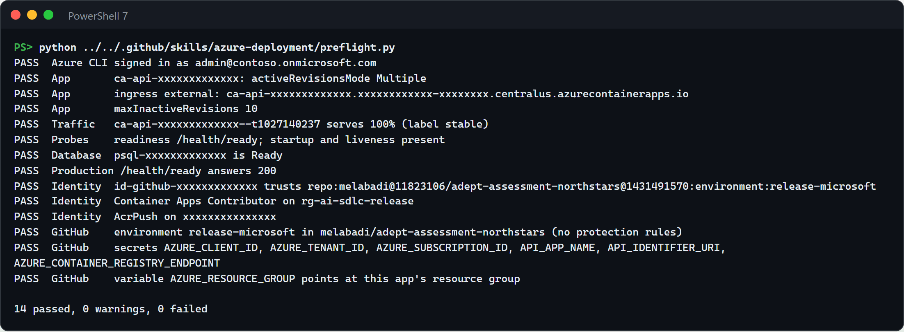

After this first deployment, ship the API through the release workflow; running `azd deploy` again replaces the stable revision without a gate.

## Before each session

Allow 10 minutes before the audience arrives, more if the database was stopped.

1. **Check the setup and the database.** Run the preflight from this folder:

   ```powershell
   python ../../.github/skills/azure-deployment/preflight.py
   ```

   Every line should read `PASS`. A tenant policy can stop PostgreSQL servers on a schedule; then every revision fails readiness and the gate would fail for the wrong reason. If the **Database** line says `Stopped`, start the server and run the preflight again after 3 to 5 minutes:

   ```powershell
   $rg = azd env get-value AZURE_RESOURCE_GROUP
   az postgres flexible-server start -g $rg -n (az postgres flexible-server list -g $rg --query "[0].name" -o tsv)
   ```

2. **Confirm the starting state.** `python release.py status --limit 4` lists active revisions first. Expect one revision labelled `stable` with 100% of traffic, possibly one labelled `previous`, and no `candidate`.

   

   - A `candidate` is left over from an interrupted release: `python release.py abort`.
   - The stable revision already runs the commit you are about to release (its **BUILD** column), because the last session ended released: run `gh workflow run release-microsoft-rollback.yml` so the release shows a visible change.

3. **Open in advance:**
   - The Azure portal on the API container app (`azd env get-value API_APP_NAME`) → **Application** → **Revisions and replicas**. The blade can take a minute or two to load in a new tab; keep it open and select **Refresh** during the demo.
   - GitHub: **Actions** → **Release · Microsoft · roll out a candidate revision**.
   - RequestHub (`azd env get-value API_URL`), signed in. Use the production URL in the browser: label URLs can't complete sign-in.
   - A terminal at the repository root, signed in to Copilot CLI, for step 4.

4. **Start the users' view two minutes early**, in a terminal you keep visible: `python release.py watch`. It calls the production URL every second and prints the status and the build it gets, plus a line whenever Azure's traffic changes.

**Timings** from our run: step 1, 1 minute; step 2, about 5 minutes (4 min 25 s, including a 74-second image build); step 3, about 4 minutes; step 4, about 3 minutes; step 5, under a minute (49 s); step 6, 2 minutes. About 15 minutes of running time; plan 20 with discussion.

## Run the demo

Commands run from this folder unless they start with `gh` or `copilot`.

1. **Where we are (1 minute).** Show `python release.py status --limit 4` (the screenshot in *Before each session*) and the portal's **Revisions and replicas** blade.

   **Point out:** users get the `stable` revision; `previous` is still running with 0% of traffic, ready for an instant rollback.

2. **Release a good build (about 5 minutes).** In GitHub, open **Actions** → **Release · Microsoft · roll out a candidate revision** → **Run workflow**, keep fault `none` and the 60-second bake, and select **Run workflow**. Or: `gh workflow run release-microsoft-rollout.yml`, then `gh run watch`.

   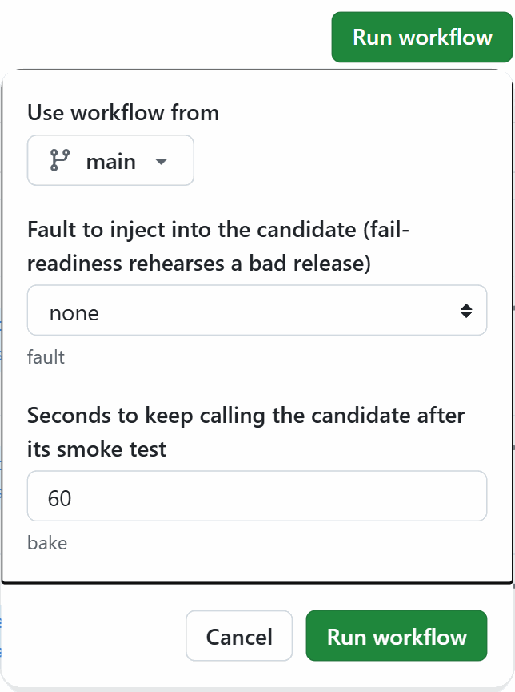

   - **Build the image once** (about 75 seconds): builds `requesthub-api:<commit>` on the runner and pushes it. A later run for the same commit reuses it by digest in seconds.
   - **Deploy the candidate and gate it** (about 2 minutes): select **Refresh** in the portal. The new revision appears with the label `candidate` and 0% traffic, as in the screenshot at the top of this page. Open `https://<app>---candidate.<domain>/api/meta` in the browser to show the build it runs. The gate reports the candidate ready about 30 seconds after it was created, then runs nine more checks on the candidate's own URL and a 60-second bake:

     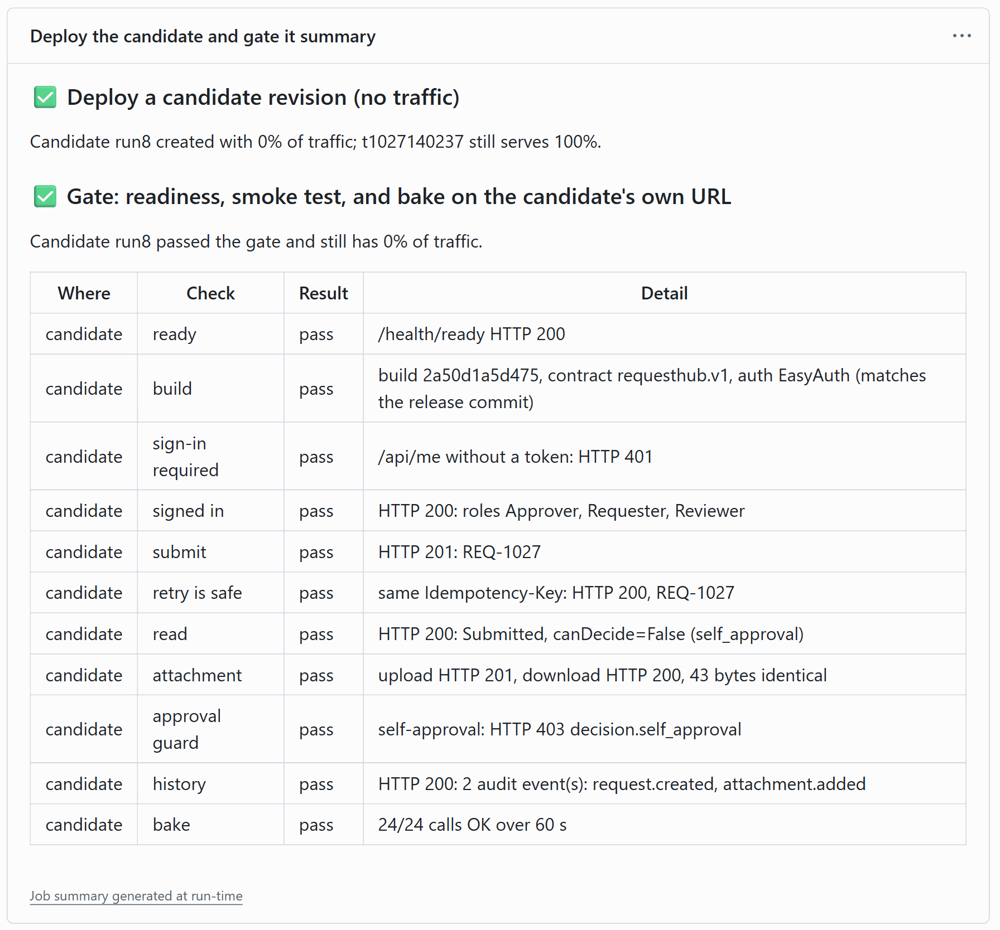

   - **Promote to 100% of traffic** (41 seconds in our run): one traffic change, which took 14 seconds, then the same smoke test on production. Select **Refresh** in the portal: the new revision is now `stable` with 100%, and the old one is `previous` with 0%, still running.

     

   - **Release record** (13 seconds): the run page shows the jobs in order. Below the graph, the job summaries give the image digest, every check, and what users saw during each step; the run's **release-record** artifact holds the same record.

     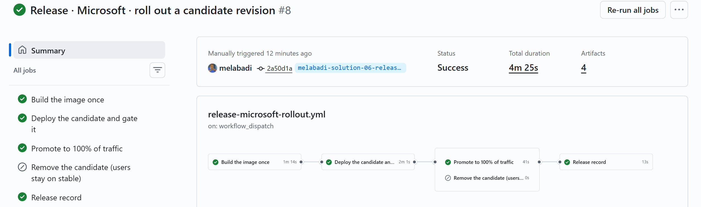

   **Point out:** the gate used the candidate exactly as people use the app, on its own URL, while every user stayed on the old build: the `watch` terminal shows the build change only at the promotion.

3. **Release a bad build (about 4 minutes).** Run the same workflow with fault `fail-readiness`, or `gh workflow run release-microsoft-rollout.yml -f fault=fail-readiness`. The candidate gets a setting that makes its readiness probe fail for 30 minutes. Select **Refresh** in the portal: it stays **Activating** with 0% traffic.

   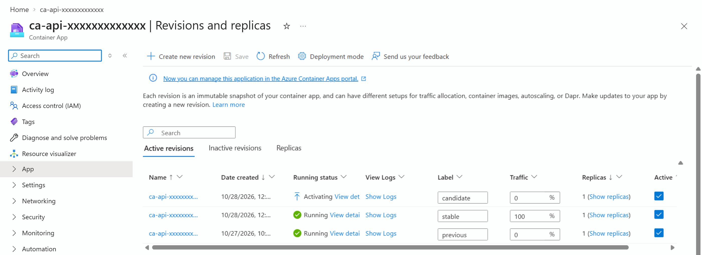

   The gate fails about a minute and a half after the candidate was created (84 seconds in our run) and quotes the evidence it read from the candidate's live logs before removing it:

   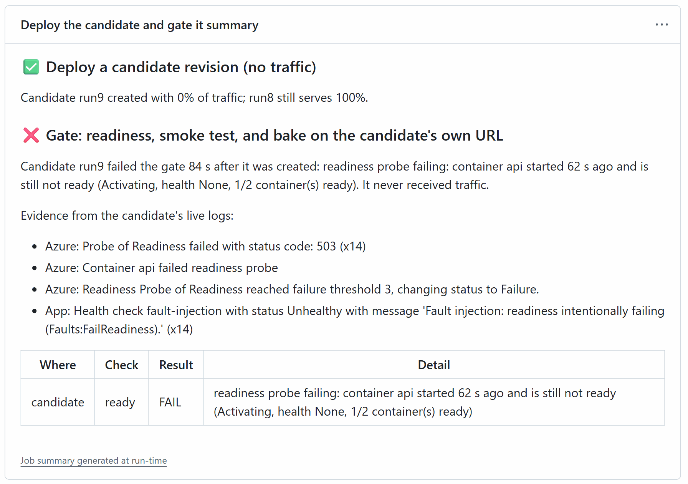

   **Promote** is skipped. **Remove the candidate** deactivates it and runs the smoke test on production.

   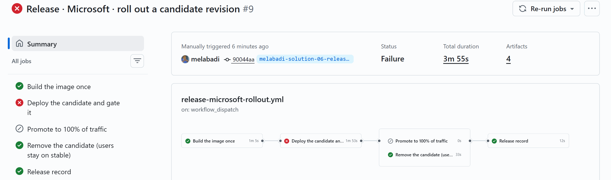

   **Point out:** the run is red with a reason, not "deployed": Azure's probe failures and the app's own health-check message, captured before the candidate was removed. Users never saw the bad build.

4. **Ask Copilot what happened (about 3 minutes).** From the repository root:

   ```powershell
   copilot --agent release-microsoft --allow-tool='shell(gh:*)' --allow-tool='shell(python:*)' --allow-tool='shell(az:*)' --deny-tool='write' -p "The last Release · Microsoft rollout failed. Explain why from its release record and Azure, whether users were affected, and the next step. Change nothing."
   ```

   The flags let it run `gh`, `python`, and `az` without prompting and forbid file edits. In an interactive session, approve its commands as it asks. The agent can load any skill in the repository's `.github/skills/`: here it chose this solution's deployment-recovery and workflow-investigation from [06-release-github](../06-release-github/), which reads failed runs.

   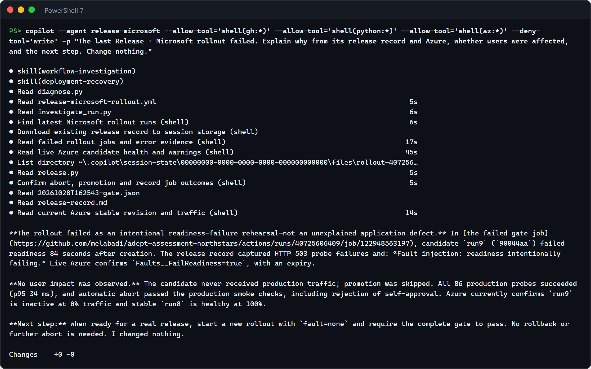

   **Point out:** the agent read the release record and checked Azure itself, separated the cause (a fault injected on purpose) from the impact (none), and changed nothing.

5. **Roll back (under a minute).** Suppose users report a problem with the build released in step 2: `gh workflow run release-microsoft-rollback.yml`, then `gh run watch`. One traffic change to the previous revision, which is still running, then the same smoke test on production. Nothing is rebuilt or redeployed.

   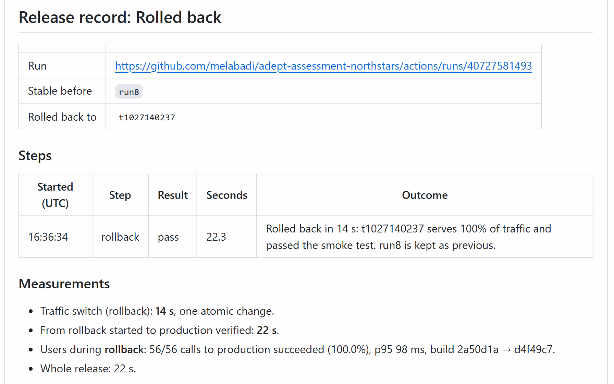

   Select **Refresh** in the portal: the older revision is `stable` again, and the newer one stays warm as `previous`. Running the rollback again rolls forward.

   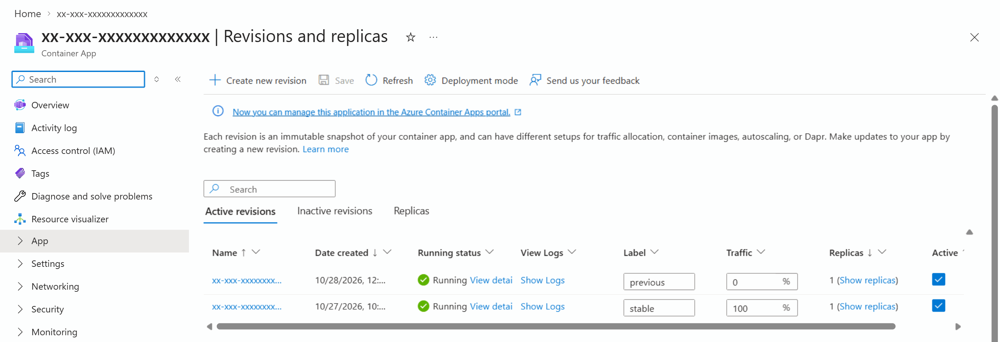

   The `watch` terminal shows what users saw across the whole demo. This excerpt keeps every traffic change, the calls around each build switch, and the 3 calls that failed; the last line counts every call.

   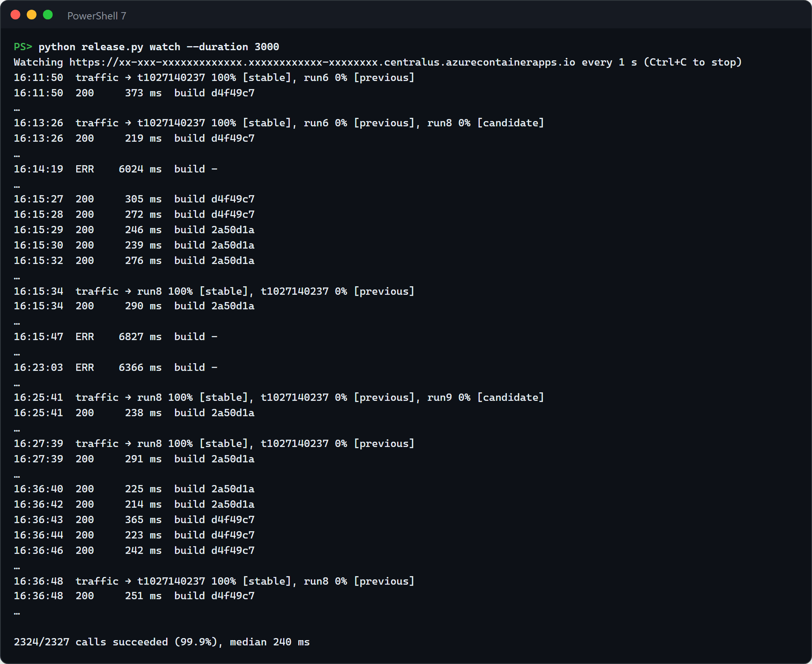

   The 3 failed calls got no answer within the 5-second timeout: one during the gate, one shortly after the promotion, and one with no release running. The app's telemetry shows that the first and the last never reached it, and that it answered every call it did receive in about a millisecond. They were lost on the network path between the laptop and the app; we have not pinned down where. The workflow's own probes, which run on GitHub, saw no failure.

   **Point out:** the rollback took one traffic change and 14 seconds, because promotion kept the old revision running.

6. **Show the evidence (2 minutes).** Each run has a **release-record** artifact (Markdown and JSON) and the same record on its summary page. The repository's **Deployments** page lists the `release-microsoft` environment's runs. In the portal, the container app's **Activity log** shows each change, made by the release identity. In RequestHub, open one of the requests named `Release check <revision>`. Every smoke test creates one: the gate on the candidate, and the production check after a promotion, an abort, or a rollback. In a workflow it signs in as the release identity, shown as `App` and its id. Each request has a small `release-check.txt` attachment, and its history shows no decision, because the API refused the self-approval.

   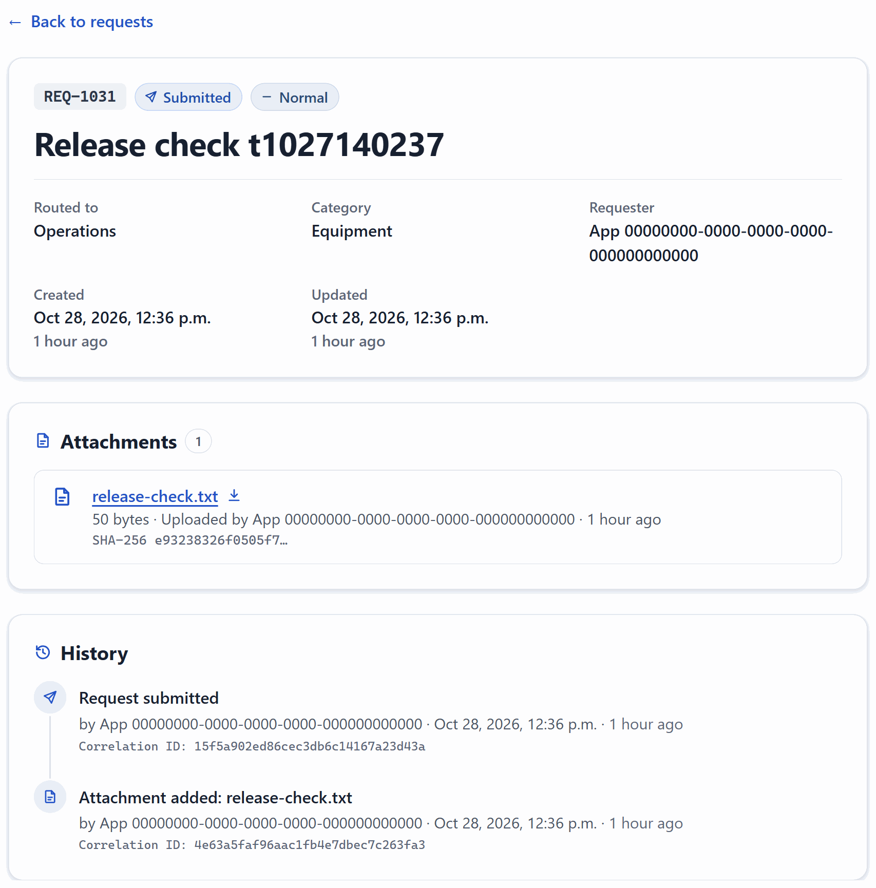

   **Point out:** the evidence is in the tools people already use (the run, the portal, the app), and what the run publishes names none of your resources: records use placeholders and revision suffixes.

To drive a release from a terminal instead, build with `az acr build`, then run the steps yourself:

```powershell
$sha = git rev-parse HEAD
az acr build --registry (azd env get-value AZURE_CONTAINER_REGISTRY_NAME) --image "requesthub-api:$sha" --build-arg "BUILD_SHA=$sha" --file ../../app/Dockerfile ../../app
python release.py deploy --image "$(azd env get-value AZURE_CONTAINER_REGISTRY_ENDPOINT)/requesthub-api:$sha" --commit $sha
python release.py gate
python release.py promote        # or: python release.py abort
python release.py verify
python release.py record         # writes out/release/release-record.md
```

## What to observe

- **Users never meet an untested build.** The candidate runs with 0% of traffic until it passes the gate. During our release, bad release, and rollback, the workflow's own probes recorded every production call as successful (86 of 86 during each gate, 58 of 58 during the promotion, 56 of 56 during the rollback). The app logged no server error on any revision users reached; its only failed requests were the smoke tests' intentional self-approval attempts (HTTP 403) and the bad candidate's own readiness probe. The presenter's `watch` terminal saw the build change only at the promotion and the rollback, and counted 2,324 of 2,327 calls as successful: the other 3 got no answer on the network path to the app (step 5).
- **The gate checks behavior, not just "it started".** Readiness comes from the platform and only covers the database; the smoke test then submits a request, retries it safely, reads it back, attaches a file and downloads the same bytes (Blob storage), confirms the requester cannot approve it (`decision.self_approval`), and reads its audit history, on the candidate's own URL. The attachment check exists because an Azure Policy once closed the storage account's public endpoint: every revision stayed "ready" while uploads failed.
- **Provenance you can verify.** One image per commit, deployed by digest. The commit is baked into the image, and the gate fails if `/api/meta` reports a different one. The release record links commit, digest, revision, and the build users received.
- **A bad build is caught and explained, not just held back.** Container Apps never routes users to a revision that is not ready; that is the platform's first line of defense. The release builds on it: the gate failed 84 seconds after the candidate was created, captured Azure's probe failures and the app's own health-check message, and removed the candidate, so the run is red with a reason instead of "deployed". It also catches what readiness cannot see: a wrong build, or a business rule broken on a revision that starts fine.
- **Recovery is a traffic change, not a redeploy.** Promotion and rollback each took 14 seconds in our runs, with the same verification afterwards.
- **Least privilege, no secrets, nothing exposed.** GitHub signs in with OIDC; the release identity can manage container apps and push images, nothing more. Logs, job summaries, artifacts, and pull request comments never show host names, resource names with their unique token, or ids.
- **What a rollback does not undo.** Every revision shares one PostgreSQL database, and a candidate runs its database migrations when it starts, even without traffic. Keep migrations backward compatible so the previous revision keeps working. A revision switch is not a database rollback.

## Reset and clean up

The demo ends rolled back, so it is ready to run again: the next rollout shows the same change. To end on the new build instead, run the rollback workflow once more; it swaps `stable` and `previous`. Revisions you no longer need stay inactive (Container Apps keeps the last 10).

To put the app's demo data back to its initial state, including removing the gate's `Release check` requests (you are an Admin):

```powershell
$token = az account get-access-token --scope "$(azd env get-value API_IDENTIFIER_URI)/user_impersonation" --query accessToken -o tsv
curl.exe -X POST -H "Authorization: Bearer $token" "$(azd env get-value API_URL)/api/admin/reset"
```

The reset empties the database; the gate's small attachment files stay in the storage account until you remove the solution.

When you no longer need the solution:

```powershell
$app = az ad app show --id (azd env get-value API_CLIENT_ID) --query id -o tsv
azd down --purge
az ad app delete --id $app
az rest --method delete --url "https://graph.microsoft.com/v1.0/directory/deletedItems/$app"
gh api -X DELETE 'repos/{owner}/{repo}/environments/release-microsoft'
```

`azd down` deletes the resource group. RequestHub's sign-in app registration is a Microsoft Entra object, which no resource group contains, so `az ad app delete` removes it and `az rest` empties it from the recycle bin. Without that last step, a new `azd up` with the same environment name can't create the app registration again for 30 days.

## Use it in your own repository

1. **Prepare the app.** Run it in multiple-revision mode with an HTTP readiness probe that checks its dependencies (as [`app/infra/api.bicep`](../../app/infra/api.bicep) does), and expose its build commit on an anonymous endpoint.
2. **Copy** `release.py`, `azd_env.py`, `configure_github.py`, and the `.github/` folder of this solution into your repository. Set `CONTAINER` in `release.py` to your container name and replace the RequestHub calls in `smoke()` with your own critical journeys. Keep them idempotent, keep at least one check that proves a business rule, and add one for every dependency your readiness probe does not cover (here, Blob storage).
3. **Grant two roles** to the identity your workflows use: Container Apps Contributor on the app's resource group and AcrPush on the registry, with a federated credential for your GitHub environment. Store every value that names a resource as an environment secret, not a variable: workflow logs print variables. Run the preflight.
4. **Put a person before promotion** if your plan allows it: required reviewers on GitHub environments in private repositories need GitHub Enterprise. Use a second environment for the `promote` job so building and gating stay automatic.
5. **Releases that change configuration.** `deploy` copies the stable revision's configuration and changes only the image, so a release changes one thing. If a release must also change settings, deploy the candidate from your Bicep with traffic pinned to the stable revision.
6. **Ship continuously** by adding a `push` trigger on `main`. Background workers that do not serve traffic can stay in single-revision mode and update after the API is promoted.
7. **Keep revision suffixes free of hyphens.** Azure's system logs cut a revision name at the first hyphen of its suffix, which breaks log queries by revision.

## Troubleshooting

- **The app times out, or every revision fails readiness and the gate fails before its smoke test.** The PostgreSQL server was stopped; a tenant policy can stop it on a schedule. The preflight's **Database** line shows it. Start it as in *Before each session* (3 to 5 minutes).
- **`watch` prints an occasional `ERR` line.** A call from your machine got no answer within 5 seconds. In our run, 3 of 2,327 calls did, while the app answered every call it received in about a millisecond and the workflow's probes from GitHub saw no failure. Isolated `ERR` lines, with or without a release running, point at the network between your machine and the app.
- **Signing in on a label URL fails with `AADSTS50011`.** Only the production URL is registered for sign-in. The gate calls the API with a token, and `/api/meta` and `/health/*` are anonymous, so show a candidate with `https://<app>---candidate.<domain>/api/meta`.
- **A button in RequestHub fails with HTTP 403 and no body.** You are on a revision label URL, which has a different origin, or the deployment predates [#134](https://github.com/melabadi/adept-assessment-northstars/pull/134). Use the production URL; for an older deployment, run `azd deploy api` from `main`. That deploy replaces the stable revision and clears the labels; the next release labels them again.
- **`Traffic is split` from `deploy`.** An earlier release stopped halfway. Finish it with `promote`, `abort`, or `rollback`, then release again.
- **The preflight warns that variables name your resources.** The GitHub environment was created by an earlier version of this solution. Run `python configure_github.py publish` in this folder: it publishes those values as secrets and deletes the variables.
- **Attachment uploads return HTTP 500 and the gate's `attachment` check fails, while every revision is ready.** An Azure Policy disabled public network access on the storage account. The shared module reaches Blob storage through a private endpoint by default; run `azd provision` in this folder to add it to an environment created before that change (about 5 minutes; revisions and traffic are not touched).
- **`LocationIsOfferRestricted` for PostgreSQL during `azd up`.** Your subscription cannot create PostgreSQL Flexible Server in that region. Create a new azd environment in another region, for example `centralus`.
- **Azure CLI commands take 30 seconds or more on Windows.** Several tools sharing one Azure CLI token cache slow it down. The release steps still work; each one needs a few CLI calls.
