# Release · Safe rollout on Azure Container Apps

Most release incidents start the same way: a new build replaces the one users are on, and users find the problem. This solution adds a safe rollout to your repository's workflow: Azure runs the release, and a person makes the call. Azure Container Registry builds each commit of `main` once. The image push reaches a Python Azure Function through Event Grid, and the function starts a release job: Azure Container Apps runs the build beside the current one as a **candidate revision with no traffic**, and the job tests it on its own URL the way people use the API. The release manager reads every check in an Azure Monitor workbook and decides: promote or abort. A bad build never receives a user request, Azure Copilot helps explain a failure in plain language, and a rollback is one traffic change to the previous revision, which is still running. GitHub holds only the code and the pull requests.


- **[Install it in your repository](#install-it-in-your-repository):** about 15 minutes of one-time setup in Azure and GitHub, once your API runs on Container Apps in multiple-revision mode and the release's smoke test uses your API. [Getting started](#getting-started) lists the commands in order.
- **[Files to edit to tweak it](#files-to-edit-to-tweak-it):** the release's smoke test, the build, your app's platform in the Bicep, and the gate's timings.
- **[See it work](#see-it-work):** a real run on RequestHub, this repository's sample app. A commit of `main` became a tested candidate 4 minutes 10 seconds after its build started, and the promote job moved all traffic to it in one change. A rehearsed bad release failed the gate 79 seconds after it was created, without receiving a user request, and a rollback moved traffic back in 16 seconds.
- **[Try it first in a copy of this repository](#try-it-first-in-a-copy-of-this-repository):** about 20 minutes to set it up on RequestHub, then about 15 minutes for the steps of See it work: 17 and 14 minutes in a fresh setup we timed, without Azure Copilot's step.

## Technologies used

| Technology | What it does here |
| --- | --- |
| [Azure Container Apps](https://learn.microsoft.com/azure/container-apps/revisions), in multiple-revision mode | Runs the new build as a candidate revision with 0% of traffic, beside the stable one, on its own label URL; one traffic change promotes it, and one rolls back |
| [Container Apps jobs](https://learn.microsoft.com/azure/container-apps/jobs) | Five jobs, from one image, run the steps: release, promote, abort, rollback, and drill |
| [Azure Container Registry tasks](https://learn.microsoft.com/azure/container-registry/container-registry-tasks-overview) | Build each commit of `main` once, started by GitHub's webhook |
| [Event Grid](https://learn.microsoft.com/azure/event-grid/overview) | Delivers each push of the API's image to the release trigger |
| [Azure Functions](https://learn.microsoft.com/azure/azure-functions/flex-consumption-plan), on the Flex Consumption plan, in Python | The release trigger: checks each push, then starts the release job with the image's digest |
| [Azure Monitor](https://learn.microsoft.com/azure/azure-monitor/visualize/workbooks-overview): Log Analytics and a workbook | Keep each step's release record, and show it with who started each step, from the Activity log, and every traffic change, from Azure Resource Graph |
| [Azure Copilot](https://learn.microsoft.com/azure/copilot/overview) | Answers the release manager's questions about a failing revision, in the portal |
| Managed identities and Microsoft Entra ID | The jobs run as the release identity, which the smoke test signs in with; the trigger function may start the release job and nothing else |
| [Azure Developer CLI](https://learn.microsoft.com/azure/developer/azure-developer-cli/) and [Bicep](https://learn.microsoft.com/azure/azure-resource-manager/bicep/overview) | Deploy the release with `azd up`, whose hooks run the unit tests and connect Event Grid to the function |
| GitHub: a [fine-grained personal access token](https://docs.github.com/en/authentication/keeping-your-account-and-data-secure/managing-your-personal-access-tokens) and a [webhook](https://docs.github.com/en/webhooks/about-webhooks) | The build task clones the repository with the token, and the webhook tells it about commits to `main`. Nothing runs in GitHub Actions |
| Python 3.12 and PowerShell 7 | The scripts, which use only Python's standard library (the trigger adds `azure-functions`), and the commands in this README |

The shipped files are RequestHub's: its API's image, `requesthub-api`, built from `app/Dockerfile`; its platform, from `app/infra`; and a smoke test of its business flow. [Files to edit to tweak it](#files-to-edit-to-tweak-it) names what to change for yours.

## What it does and how it works

### What it does

**Phase 6 of 7: Release.** The GitHub counterpart is [06-release-github](../06-release-github/): release evidence and approval on GitHub. This solution covers how a new build reaches users on Azure, with the release orchestrated in Azure itself. To release the exact image whose test evidence GitHub recorded, instead of a build of its own, use both, as in the [Release solution combo](../../PRESENTING.md#release-github-tests-one-image-azure-stages-that-digest-a-person-decides).

| | Today | With this solution |
| --- | --- | --- |
| Starting a release | Someone runs a pipeline, on a build agent that holds credentials for production. | Azure starts it: the registry builds the commit, and the image push starts the release job. No build agent, and GitHub holds no Azure credential. |
| Deploying | The new build replaces the running one; users are the first real test. | The build runs beside the current one as a candidate with 0% of traffic. |
| Checking | "The deployment succeeded" means the container started. | The platform's readiness probe, then the API used the way people use it, on the candidate's own URL, then a bake period. |
| Deciding | A chat message says "looks good", or nobody decides at all. | The release manager reads every check in a workbook, then runs **promote** or **abort**. Azure records who did. |
| A bad build | It reaches users. | It never gets traffic. The gate fails it within about a minute and a half, records why, and removes it. |
| Understanding a failure | Someone digs through logs. | Azure Copilot answers questions in the portal, in plain language, and the workbook shows what the gate read from the failing revision. |
| Rolling back | Rebuild or redeploy the old version while users wait. | One traffic change to the previous revision, still running, then the same checks. |

**The value:** every build is tested where it will run before any user reaches it, a person decides with the evidence in front of them, and recovery takes seconds, with no build agent and no Azure credential in GitHub. [Results and value](#results-and-value) has what the recorded run measured.

### How it works

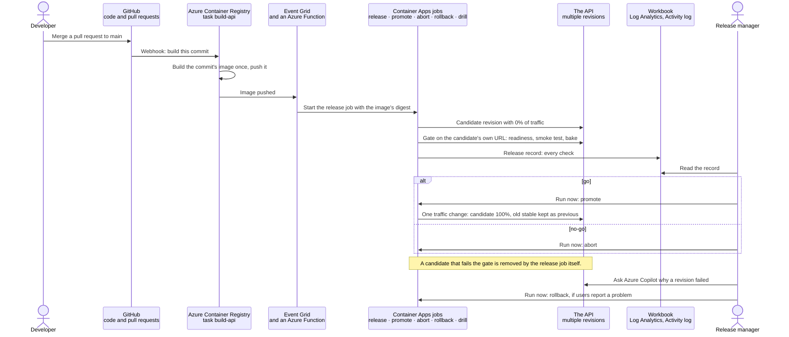

- **Azure Container Registry** builds each commit of `main` once, with an [ACR task](acr-build.yaml) that GitHub's webhook starts. A person creates the task once, with a fine-grained token limited to the repository. Only commits to `main` start it, never a pull request: a pull request trigger would build a fork's code too, and every push starts a release. `preflight.py` fails if the task has one.
- **Event Grid and an Azure Function** are the trigger. A push of `requesthub-api:<commit>` reaches the [release trigger](trigger/function_app.py), a Python function on the Flex Consumption plan, which starts the release job with the image's digest. Its managed identity may start that job, and only that job. Azure requires write permission on a job to start it with settings of its own, such as the digest, so the identity holds Container Apps Jobs Contributor on the release job. The function checks every event first, in [plain Python](trigger/release_trigger.py) with [unit tests](test_trigger.py): from this registry, an image push, the API's registry host and repository, a `sha256` digest, and a tag that is a commit. An event that fails a check starts nothing, and the invocation fails with the name of each failed check, in the function's **Invocations** and in Application Insights. The function has its own small virtual network: it reaches its storage, which a policy keeps off the internet, through a private endpoint.
- **Container Apps jobs** run [`release.py`](release.py), one job per step, all from one image. They run as the release identity, a managed identity with three roles: Container Apps Contributor and Container Apps Jobs Reader on the resource group, and AcrPull on the registry. One step runs at a time, first come, first served: a release waits for the steps that started before it, and any other step refuses while an earlier one runs. A pushed image starts at most one release: Event Grid delivers each event at least once, and when a push of the same image starts the release job again, the later execution finds the earlier one in the job's execution history and releases nothing. The earlier execution owns that image, whether it released the build or not. A release whose gate fails removes its own candidate right away, even while another step waits. When the gate passes, it records its verdict on the app (a tag naming the revision, its image digest, and how long it baked). Promote moves traffic only to the candidate and image that verdict names, after the standard 60-second bake, and only within 24 hours.
- **Azure Container Apps** runs the API in multiple-revision mode. Revisions get **labels** with their own URLs (`https://<app>---candidate.<domain>`), and traffic weights decide which revision users reach. The readiness probe (`/health/ready`) is the platform's verdict on each revision.
- **Azure Monitor** keeps the evidence. Each step writes its release record to Log Analytics, and the [workbook](infra/release-records.workbook.json) shows the records, who started each step (from the Activity log), and every traffic change (from Azure Resource Graph).
- **Azure Copilot** (formerly Copilot in Azure) answers the release manager's questions about a failing revision, in the portal, in plain language.
- **People** merge, read the record, decide go or no-go, and roll back. The gate is deterministic, and nothing in the solution, AI or not, promotes, aborts, or rolls back on its own.

**Outside contributions reach nothing in Azure.** On a public repository anyone can open an Issue or a pull request, from a fork too, and comment. None of that starts a build or a release: the only thing GitHub sends Azure is the build task's webhook for pushes, and only a push to `main` (a merge by someone with write access) starts a build. The registry, Event Grid, and the jobs are reachable only from Azure, and the trigger function answers only calls with its Event Grid key, which Event Grid reads from Azure itself. No GitHub Actions workflow takes part.

## Install it in your repository

These are the steps that set the solution up on RequestHub. We have run them only on RequestHub: for your app, the commands stay the same, and [Files to edit to tweak it](#files-to-edit-to-tweak-it) names the changes. Try your first releases on a test environment of your app. [Getting started](#getting-started) lists the commands in order, and the sections after it explain each step and what you should see.

### Prerequisites

- Your repository on GitHub, and the tools in the root README's [Before you start](../../README.md#before-you-start): the GitHub CLI, Python 3.12 or later, PowerShell 7, the Azure CLI, and the Azure Developer CLI. Docker is not needed: Azure Container Registry builds every image.
- Admin rights on the repository, to create the build task's token.
- Your app's API on Azure Container Apps, with its image in an Azure container registry, and:
  - multiple-revision mode (`activeRevisionsMode: Multiple`) with ingress, so that revisions get labels and traffic weights;
  - an HTTP readiness probe that checks what a request needs, such as the database, as RequestHub's `/health/ready` does in [`app/infra/api.bicep`](../../app/infra/api.bicep);
  - an anonymous endpoint that reports the commit the image was built from, as RequestHub's `/api/meta` does from the `BUILD_SHA` build argument;
  - Microsoft Entra ID sign-in, which the smoke test uses with the jobs' managed identity: if your API signs in another way, change `api_token()` in `release.py`;
  - a Log Analytics workspace behind its Container Apps environment, which keeps the jobs' release records.
- An Azure subscription where you can create resources and role assignments in your app's resource group, for example as Owner.
- Azure Copilot in the Azure portal, which is on by default; an administrator can [limit who uses it](https://learn.microsoft.com/azure/copilot/manage-access).

### Getting started

From the root of your repository, in PowerShell 7. Each step links to its details and to what you should see.

1. **Check the tools.** `gh auth status` must say you're logged in to github.com, Python must be 3.12 or later, and PowerShell 7.4 or later; the Azure CLI and the Azure Developer CLI print their versions ([Prerequisites](#prerequisites)).

   ```powershell
   gh --version; gh auth status
   python --version; $PSVersionTable.PSVersion.ToString()
   "az: " + (az version | ConvertFrom-Json).'azure-cli'; azd version
   ```

2. **Copy the folder on a new branch,** here as `release/`, without the evidence and the screenshots. The copy adds the licence that must travel with the files and a `.gitignore` for what the scripts and tests write, and prints the commit it copied from: keep it to [take updates later](../../README.md#take-updates-later).

   ```powershell
   git switch -c add-safe-rollout
   $dest = 'release'
   $src = Join-Path ([IO.Path]::GetTempPath()) 'ai-sdlc-06-release-microsoft'
   git clone --quiet --depth 1 https://github.com/melabadi/adept-assessment-northstars.git $src
   "Copying from ai-sdlc commit $(git -C $src rev-parse --short HEAD)"
   $from = Join-Path $src 'solutions/06-release-microsoft'
   Remove-Item -Recurse -Force (Join-Path $from 'evidence'), (Join-Path $from 'images')
   New-Item -ItemType Directory -Force $dest | Out-Null
   Copy-Item -Recurse -Force (Join-Path $from '*') $dest
   Copy-Item -Force (Join-Path $src 'LICENSE') $dest
   Set-Content (Join-Path $dest '.gitignore') '__pycache__/', '.venv/', 'out/'
   Remove-Item -Recurse -Force $src
   git status --short --untracked-files=all
   ```

   What you should see: the commit, then 25 new files under `release/`, in 7 to 10 seconds when this README was checked. GitHub reads a repository's own licence only from its root, so yours doesn't change. The folder can sit anywhere in your repository: nothing in it depends on its place but the paths to RequestHub's `app/` in `infra/main.bicep` and `azure.yaml`, which step 3 replaces with your app's, and [one-time step 3](#3-let-azure-build-every-commit-of-main) finds `acr-build.yaml` wherever it is.

3. **Edit the files for your code,** as [Files to edit to tweak it](#files-to-edit-to-tweak-it) lists. Then, from the folder, run the offline tests, which azd also runs before every deploy:

   ```powershell
   cd release
   python -m unittest -v
   ```

   They end with `OK`. The copy's `.gitignore` keeps the `__pycache__/` folders they write out of git.

4. **Set it up once,** from the folder: deploy, then check the setup ([Deploy](#1-deploy) and [Check the setup](#2-check-the-setup)):

   ```powershell
   az login
   azd auth login
   azd env new <environment name> --subscription (az account show --query id -o tsv) --location <region>
   azd env set API_APP_NAME <your API's container app>   # and every other value your main.bicep reads
   azd up
   python preflight.py
   ```

   `azd up` ends with `SUCCESS`, and every line of the preflight reads `PASS`, except **Build**, which warns until step 5 creates the build task. Meanwhile, create the build task's token on GitHub ([one-time step 3](#3-let-azure-build-every-commit-of-main)).

5. **Merge it into your default branch,** then let Azure build every commit of it: the build task reads `acr-build.yaml` from `main` ([one-time step 3](#3-let-azure-build-every-commit-of-main)). Replace `<commit>` with the one step 2 printed:

   ```powershell
   git add .
   git commit -m "Add 06-release-microsoft from ai-sdlc <commit>"
   git push -u origin add-safe-rollout
   gh pr create --fill
   ```

   azd keeps its environment out of git. Merge the pull request as you merge any change. Then, from the folder, create the build task, pasting the token when asked:

   ```powershell
   $registry = azd env get-value AZURE_CONTAINER_REGISTRY_NAME
   $repo = gh repo view --json url --jq .url
   $token = Read-Host -MaskInput 'Fine-grained token for this repository'
   az acr task create --registry $registry --name build-api --context "$repo.git#main" `
     --file (git ls-files --full-name acr-build.yaml) --git-access-token $token `
     --commit-trigger-enabled true --pull-request-trigger-enabled false --base-image-trigger-enabled false --output none
   Remove-Variable token
   ```

   `python preflight.py` then reads `PASS  Build  build-api builds every commit to main`.

6. **Use it on your next merge to `main`.** The registry builds the merge commit, and its push starts the release job. When the candidate waits for a person, read the release job's `gate` row in the workbook **RequestHub release records**, then run the promote job for a go or the abort job for a no-go ([Use it the first time](#use-it-the-first-time)). For a go, from the folder:

   ```powershell
   $rg = azd env get-value AZURE_RESOURCE_GROUP
   $job = @{}; 'release', 'promote', 'abort', 'rollback', 'drill' | ForEach-Object { $job[$_] = (azd env get-value SERVICE_RELEASE_NAME) -replace '^caj-release-', "caj-$_-" }
   az containerapp job start -g $rg -n $job.promote --query name -o tsv
   ```

### One-time setup

About 15 minutes, once the files describe your app. On RequestHub, the `azd provision` that added the trigger function's resources to the running platform took 5 minutes 38 seconds, and deploying the jobs and the trigger took about a minute each. Creating the build task takes a few minutes. A fresh setup on 12 November 2026, which followed [Try it first in a copy of this repository](#try-it-first-in-a-copy-of-this-repository) in a new resource group, deployed RequestHub too, which took most of the time ([the evidence](evidence/2026-11-12-fresh-setup.md)):

| Step | Took |
| --- | --- |
| 1. Deploy: `azd up` | 15 minutes 34 seconds, RequestHub included: its Container Apps environment took 6 minutes 34 seconds and its PostgreSQL server 6 minutes 40 seconds, side by side, and azd counted 10 minutes 33 seconds of provisioning and 4 minutes 47 seconds of deploying |
| 2. Check the setup: `python preflight.py` | 1 minute 16 seconds: 18 checks passed, and **Build** warned |
| 3. Let Azure build every commit of main: the token | a few minutes for a person on GitHub |
| 3. Let Azure build every commit of main: `az acr task create` and the lines before it | 6 seconds; the preflight then took 1 minute 14 seconds and passed all 19 checks |

#### 1. Deploy

From the folder you copied, give azd the values your `main.bicep` reads for your app, then deploy:

```powershell
cd release
az login
azd auth login
azd env new <environment name> --subscription (az account show --query id -o tsv) --location <region>
azd env set API_APP_NAME <your API's container app>   # and every other value your main.bicep reads
azd up
```

`--subscription` deploys to the subscription that `az` signed in to, where `preflight.py` and the README's `az` commands look for the resources: `az account show` names it, and `az account set --subscription <name or id>` changes it. Without it, `azd env new` stores no subscription, and `azd up` asks you to pick one of yours.

**What you should see:** `azd up` ends with `SUCCESS`. Before it deploys the services, azd runs the unit tests (the `predeploy` hook), which end with `OK`; afterwards, it connects Event Grid to the function (the `postdeploy` hook), which prints nothing unless it fails. In the Azure portal, your app's resource group now has the five release jobs (`caj-release-*`, `caj-promote-*`, `caj-abort-*`, `caj-rollback-*`, and `caj-drill-*`), the trigger function (`func-release-*`), the Event Grid system topic on your registry (`evgt-registry-*`), and the workbook **RequestHub release records**.

From now on, ship your API only through the release: deploying it another way replaces the stable revision without a gate. To change the release itself, run `azd deploy release`; to change the trigger, `azd deploy trigger`.

#### 2. Check the setup

From the same folder, run `python preflight.py`. It checks the API's revision mode, traffic, and probes, the database, production's readiness, the five jobs and the release identity's roles, the trigger function and its sole right to start the release job, Event Grid's topic and subscription, the build task, and the workbook.

**What you should see:** every line reads `PASS`, except **Build**, which warns until you create the build task in step 3. On RequestHub, on 10 November 2026, with the build task's commit trigger off:


When you run it, the hint under **Build** points to step 3 below and to [Use it the first time](#use-it-the-first-time).

#### 3. Let Azure build every commit of main

A person with admin rights on the repository does this once; it is the only GitHub access Azure gets.

1. In GitHub, open **Settings** → **Developer settings** → **Personal access tokens** → **Fine-grained tokens** → **Generate new token**. Name it, for example, `ACR Tasks · release builds`, choose an expiration, and under **Repository access** select **Only select repositories** and your repository. Under **Repository permissions**, set **Contents** to **Read-only**, **Commit statuses** to **Read-only**, and **Webhooks** to **Read and write**; GitHub adds **Metadata: Read-only** itself. That is the set ACR accepted in our setup. ACR clones the repository with the token, and creates the webhook that tells it about commits to `main`.
2. Commit the folder to `main`: the task reads `acr-build.yaml` from there. Then create the task from the folder, pasting the token when asked:

   ```powershell
   $registry = azd env get-value AZURE_CONTAINER_REGISTRY_NAME
   $repo = gh repo view --json url --jq .url
   $token = Read-Host -MaskInput 'Fine-grained token for this repository'
   az acr task create --registry $registry --name build-api --context "$repo.git#main" `
     --file (git ls-files --full-name acr-build.yaml) --git-access-token $token `
     --commit-trigger-enabled true --pull-request-trigger-enabled false --base-image-trigger-enabled false --output none
   Remove-Variable token
   ```

**What you should see:** `python preflight.py` reads `PASS  Build  build-api builds every commit to main`. It fails if a pull request can start the task: keep `--pull-request-trigger-enabled false`. From now on, every commit to `main` is built once and released as a candidate.

**To pause the builds, or renew the token.** Azure CLI 2.91 and 2.92 can't change a task's source trigger: `az acr task update` fails with "Object of type set is not JSON serializable", even to change only the trigger's status or its token. Change the task through Azure Resource Manager with `Update-BuildTask` instead. Define it once in each terminal, in the folder; defining it changes nothing:

```powershell
$taskUrl = "https://management.azure.com$(az acr task show --registry (azd env get-value AZURE_CONTAINER_REGISTRY_NAME) --name build-api --query id -o tsv)?api-version=2019-06-01-preview"
function Update-BuildTask($properties) {
  $arm = @{ Authorization = "Bearer $(az account get-access-token --query accessToken -o tsv)" }
  $body = @{ properties = $properties } | ConvertTo-Json -Depth 8
  $task = Invoke-RestMethod -Method Patch -Uri $taskUrl -Headers $arm -ContentType 'application/json' -Body $body
  "commit trigger: $($task.properties.trigger.sourceTriggers.status)"
}
```

Then turn the commit trigger off, for example on a day with many merges:

```powershell
Update-BuildTask @{ trigger = @{ sourceTriggers = @(@{ name = 'defaultSourceTriggerName'; status = 'Disabled' }) } }
```

Or back on:

```powershell
Update-BuildTask @{ trigger = @{ sourceTriggers = @(@{ name = 'defaultSourceTriggerName'; status = 'Enabled' }) } }
```

Each call prints the trigger's new state, for example `commit trigger: Disabled`. While the trigger is off, start each build yourself, as in [Use it the first time](#use-it-the-first-time).

Before the token expires, give the task a new one, pasting it when asked. Define `Update-BuildTask` first, as above. The token goes to Azure in the request body, never on a command line:

```powershell
$token = Read-Host -MaskInput 'New fine-grained token for this repository'
Update-BuildTask @{
  step = @{ type = 'FileTask'; contextAccessToken = $token }
  trigger = @{ sourceTriggers = @(@{ name = 'defaultSourceTriggerName'; sourceRepository = @{ sourceControlAuthProperties = @{ tokenType = 'PAT'; token = $token } } }) }
}
Remove-Variable token
```

**Without the build task**, build an export of `main` with `az acr build`, with your build context and Dockerfile in place of RequestHub's `app`. The push starts the release exactly the same way:

```powershell
git fetch origin main
$sha = git rev-parse origin/main
$src = New-Item -ItemType Directory -Force (Join-Path ([IO.Path]::GetTempPath()) "requesthub-$sha")
git -C (git rev-parse --show-toplevel) archive $sha app | tar -x -C $src
az acr build --registry (azd env get-value AZURE_CONTAINER_REGISTRY_NAME) --image "requesthub-api:$sha" --image requesthub-api:main `
  --build-arg "BUILD_SHA=$sha" --file "$src/app/Dockerfile" --no-logs "$src/app"
```

### Use it the first time

Merge a pull request to `main`. The registry builds the merge commit, and its push starts the release job. On RequestHub, merging pull request [#251](https://github.com/melabadi/adept-assessment-northstars/pull/251) at 03:05:30 UTC on 1 November 2026 started the build 2 seconds later, and the candidate passed the gate and waited for a person at 03:09:35, 4 minutes 5 seconds after the merge ([the evidence](evidence/2026-11-01-recorded-run.md#a-merge-with-the-commit-trigger-on)). In a fresh setup on 12 November, a merge to a copy's `main` started the build 2.6 seconds later, and the candidate waited for a person 4 minutes 28 seconds after the merge ([the evidence](evidence/2026-11-12-fresh-setup.md#the-run)).

While the commit trigger is off, start the build yourself for the newest commit of `main`. `--context` pins it to that commit, even if `main` moves on meanwhile; ACR clones it with the task's token and tags the image with it:

```powershell
git fetch origin main
$sha = git rev-parse origin/main
$repo = gh repo view --json url --jq .url
az acr task run --registry (azd env get-value AZURE_CONTAINER_REGISTRY_NAME) --name build-api `
  --context "$repo.git#$sha" --set "commit=$sha" --no-logs
```

**What you should see:** in the Azure portal, the release job's **Execution history** lists the execution the push started (the job's name is `azd env get-value SERVICE_RELEASE_NAME`), which succeeds about 2½ minutes later. In the workbook **RequestHub release records**, in your resource group, the release job's `gate` row lists the checks, and in the API's **Revisions and replicas**, the new revision is `candidate` with 0% of traffic; `python release.py status` shows the same from the terminal. Then decide: run the promote job (go) or the abort job (no-go), with **Run now** on its page, or from the terminal:

```powershell
$rg = azd env get-value AZURE_RESOURCE_GROUP
$job = @{}; 'release', 'promote', 'abort', 'rollback', 'drill' | ForEach-Object { $job[$_] = (azd env get-value SERVICE_RELEASE_NAME) -replace '^caj-release-', "caj-$_-" }
az containerapp job start -g $rg -n $job.promote --query name -o tsv
```

Then make it part of your workflow:

- **Rehearse a bad release once**, with the drill job, before you rely on the gate: the gate must fail the drill's candidate and remove it.
- **Keep database migrations backward compatible.** Every revision shares one database, and a candidate runs its migrations when it starts, even without traffic, so the previous revision must keep working with them. A revision switch is not a database rollback.
- **Releases that change configuration.** `deploy` copies the stable revision's configuration and changes only the image, so a release changes one thing. If a release must also change settings, deploy the candidate from your Bicep with traffic pinned to the stable revision.
- **Background workers** that don't serve traffic can stay in single-revision mode and update after the API is promoted.
- **Keep revision suffixes free of hyphens.** Azure's system logs cut a revision name at the first hyphen of its suffix, which breaks log queries by revision.

**The metric to track when you adopt it:** how many builds that failed their checks reached users, which the gate should keep at zero, and how long it takes to restore service when a promoted build misbehaves: the rollback job took 45 seconds in See it work. Compare both with how releases went before. A target is a goal you set, never a result.

### What it costs

Your app bills as it already does. The solution adds the previous revision, which keeps running for an instant rollback (one more replica of your API while it exists); the trigger's private endpoint, about $7 a month; and, for each release, about 2 minutes of building in the registry and a few minutes of Container Apps jobs, which cost cents. The function and Event Grid run only when a build is pushed. Azure Copilot's answers cost nothing extra: its capabilities are included at no extra cost, except the Observability Agent ([Microsoft Learn](https://learn.microsoft.com/azure/copilot/overview#pricing-and-availability)). On RequestHub, the whole resource group, the app's platform included, costs about $120 a month: see [Try it first in a copy of this repository](#try-it-first-in-a-copy-of-this-repository). The root README compares [what the Microsoft solutions cost](../../README.md#what-the-microsoft-solutions-cost).

## Files to edit to tweak it

The copy brings the whole folder except `evidence/` and `images/`, which belong to the run in [See it work](#see-it-work). RequestHub's app and its platform, in this repository's `app/`, stay behind: `infra/main.bicep` and `azure.yaml` deploy them from there until you point them at your app, as the table below says.

### Edit to fit your code

Change what assumes RequestHub:

| File | What it does here | What to change for your app |
| --- | --- | --- |
| [`release.py`](release.py) | The release steps, and the smoke test, `smoke()`: RequestHub's sign-in, submit, safe retry, read, attachment, approval guard, and audit history | `CONTAINER` and `REPOSITORY`, your container's and image's names, and `CONTRACT` with the `/api/meta` check at the start of `smoke()`, to what your build endpoint reports. The rest of `smoke()`: your own critical journeys, safe to repeat, including one that proves a business rule and one for each dependency your readiness probe doesn't cover (RequestHub's Blob storage). The drill's fault, `Faults__FailReadiness` with `Faults__ExpiresAtUtc` in `deploy_candidate`, which promote and rollback refuse: a setting that makes your readiness probe fail until it expires. |
| [`test_release.py`](test_release.py) | Offline tests of the release's safety rules | Its fixtures name RequestHub's image, `requesthub-api`, and the drill's fault setting: change them when you change `REPOSITORY` or the fault. |
| [`acr-build.yaml`](acr-build.yaml) | The build task: build the API for a commit, push `requesthub-api:<commit>` and `:main` | The image name, the Dockerfile, and the build context (`-f app/Dockerfile app`). Keep passing the commit as the `BUILD_SHA` build argument. |
| [`infra/main.bicep`](infra/main.bicep), [`main.parameters.json`](infra/main.parameters.json) | Creates the resource group, RequestHub's platform (`module app`), and the release | Replace RequestHub's platform with your app's, as described below the table. |
| [`infra/release.bicep`](infra/release.bicep) | Event Grid on the registry, the trigger function with its network and storage, the workbook, and AcrPull for the jobs | `repository`, your image's name: Event Grid's filter and the function's check both use it. The trigger's network links to the app's private DNS zone for Blob storage (`blobZone`); if your platform has none, create the zone here. |
| [`infra/jobs.bicep`](infra/jobs.bicep), [`jobs.parameters.json`](infra/jobs.parameters.json) | The five jobs, their settings, and the function's right to start the release job | Nothing, if your `main.bicep` keeps the outputs they read. |
| [`azure.yaml`](azure.yaml) | The azd project: RequestHub's `api` and `worker`, the `release` jobs, the `trigger` function, and the hooks | Remove the `api` and `worker` services, which deploy RequestHub. Keep `release`, `trigger`, and both hooks. |
| [`preflight.py`](preflight.py) | Checks the setup and the starting state | `check_database`, which checks RequestHub's PostgreSQL server: point it at your app's database, or remove it. |
| [`trigger/`](trigger/) | The release trigger function | Nothing: it reads the registry, the repository, and the job from its app settings. |
| [`test_trigger.py`](test_trigger.py) | Offline tests of the trigger, and checks of its wiring | Its event fixtures and its check of Event Grid's filter name `requesthub-api`: change them when you change `repository` in `release.bicep`. |

**`infra/main.bicep` for your app.** Remove `module app`, which deploys RequestHub's platform from `app/infra/requesthub.bicep`, and the resource group that `main.bicep` creates for it. Deploy `module release` into your app's resource group instead, declared as `existing`, and pass it your registry's name, the principal id of the identity the jobs run as, your Log Analytics workspace's resource id, your API's container app name, and your Application Insights connection string, in place of `app.outputs`. The jobs' identity, which you create or reuse, needs Container Apps Contributor and Container Apps Jobs Reader on that resource group, and the app roles your smoke test signs in with; RequestHub's platform grants them through `automationRoleDefinitionIds` and `automationAppRoleNames`. Keep the outputs the rest reads:

- `jobs.parameters.json`: `AZURE_CONTAINER_REGISTRY_NAME`, `AZURE_CONTAINER_ENVIRONMENT_NAME`, `AUTOMATION_IDENTITY_ID`, `AUTOMATION_CLIENT_ID`, `API_APP_NAME`, `API_IDENTIFIER_URI`, and `RELEASE_TRIGGER_PRINCIPAL_ID`;
- the `postdeploy` hook: `AZURE_SUBSCRIPTION_ID`, `AZURE_RESOURCE_GROUP`, `RELEASE_TRIGGER_NAME`, `RELEASE_TOPIC_NAME`, and `RELEASE_REPOSITORY`;
- `release.py` in a terminal: `AZURE_SUBSCRIPTION_ID`, `AZURE_RESOURCE_GROUP`, `API_APP_NAME`, `API_IDENTIFIER_URI`, and `AZURE_CONTAINER_REGISTRY_ENDPOINT`; and `preflight.py`: `AZURE_RESOURCE_GROUP`, `API_APP_NAME`, `AZURE_CONTAINER_REGISTRY_NAME`, `AUTOMATION_IDENTITY_ID`, and the three `RELEASE_*` names above.

### Edit to tune it

These settings change how the solution behaves, whatever your app:

| To change | Edit | As shipped |
| --- | --- | --- |
| How long the gate keeps calling the candidate after the smoke test, and the shortest bake that promote accepts | `STANDARD_BAKE` in [`release.py`](release.py) | 60 seconds |
| How long a candidate may take to become ready, and how long its started container may stay not ready before the gate fails | `--ready-timeout` and `--not-ready-grace` in `gate_options()` in [`release.py`](release.py) | 300 and 60 seconds |
| How long promote accepts the gate's verdict | `GATE_VALID_HOURS` in [`release.py`](release.py) | 24 hours |
| How long a release waits for an earlier step to finish | `--wait` of the `release` command in [`release.py`](release.py) | 900 seconds |
| Each job's time limit | `timeout` in `steps` in [`infra/jobs.bicep`](infra/jobs.bicep) | 1800 seconds for release and drill, 900 for promote, abort, and rollback |
| How often Event Grid delivers a failed push again | `retryPolicy` in [`infra/release-on-push.bicep`](infra/release-on-push.bicep) | `maxDeliveryAttempts: 5` within `eventTimeToLiveInMinutes: 60` |

### What the copy adds

```text
release/
├── release.py                  the release steps: release, drill, deploy, gate, promote, abort, rollback, verify, status, watch
├── test_release.py             unit tests for the release's safety rules; they need no Azure access
├── test_trigger.py             unit tests for the release trigger: what reaches the release job, and what never does
├── preflight.py                checks the setup and the starting state
├── azd_env.py                  reads settings from this solution's azd environment
├── Dockerfile                  the release jobs' image: Python and release.py
├── .dockerignore
├── acr-build.yaml              ACR task: build the API for a commit of main, push requesthub-api:<commit> and :main
├── requirements.txt            no third-party packages: standard library and the Azure CLI
├── azure.yaml                  azd project: infra, the shared app's api and worker, the release jobs, and the trigger
├── trigger/                    the release trigger, an Azure Function (Python, Flex Consumption)
├── infra/                      Bicep: the resource group, RequestHub's platform, Event Grid, the trigger's function app, the workbook, and the five jobs
├── README.md                   this README
├── LICENSE                     the licence that travels with the files
└── .gitignore                  what the scripts and tests write, added by the copy
```

### After you edit

From the folder, run the offline tests as in [Getting started](#getting-started) step 3: they check the safety rules without Azure. Then apply the change where it runs:

- `release.py` or `infra/jobs.bicep`: run `azd deploy release`.
- `trigger/` or `infra/release-on-push.bicep`: run `azd deploy trigger`, after which azd connects Event Grid to the function again.
- `infra/main.bicep` or `infra/release.bicep`: run `azd provision`.
- `acr-build.yaml`: merge it. The build task reads it from `main`.

## Clean up

When you no longer need the solution, delete the build task's token on GitHub (**Settings** → **Developer settings** → **Fine-grained tokens**), and, in the repository's **Settings** → **Webhooks**, delete the webhook the task created, if it is still there. Then remove what azd deployed: the release's resources are in your app's resource group, so don't run `azd down`, which deletes the whole group, your app included. Remove the release from your Bicep, then delete what it created: the five release jobs, the trigger's function app with its plan, storage account, virtual network and its two network security groups, and private endpoint, the link from your Blob storage DNS zone to the trigger's network, the Event Grid system topic on your registry, the workbook, the jobs' identity's role assignments, and the build task (`az acr task delete --registry <registry> --name build-api`).

In the copy, which deploys RequestHub too, delete the token and the webhook the same way, then remove the rest as [Reset the copy for another run](#reset-the-copy-for-another-run) says.

## Troubleshooting

- **The release job ends with "already serves users: nothing to release".** The pushed build is the one users have, for example a second build of the same commit. Nothing is wrong. To release a change, run the rollback job first, or run the release job yourself to release the newest build (`requesthub-api:main`).
- **The release job ends with "Execution … already got a push of this image".** Event Grid delivers each event at least once, so now and then one push starts the release job twice; pushing the same image again, for example with `az acr import`, does too. The later execution finds the earlier one in the job's execution history and releases nothing: the earlier one owns that image. The message names it and how it ended. Open it in the release job's **Execution history** if it failed, and to release the build after a failure or an abort, run the release job yourself.
- **A pushed build starts no release job.** Open the trigger function → **release_on_push** → **Invocations**, or run the preflight. A failed invocation names each check the event failed, or the call Azure refused with its HTTP status and error code (for example `Could not start the release job: HTTP 403 AuthorizationFailed`), and Event Grid delivers a failed event again, up to five times in an hour. No invocation at all means Event Grid isn't connected to the function: run `azd deploy trigger`, after which azd connects it.
- **The preflight fails: another role assignment may start the release job.** Only the trigger function, with its role on the release job itself, should start it. Run the command the preflight prints: it deletes the other role assignments.
- **A step refuses with "A release step is running".** One step runs at a time. Wait for the running one to finish (a release takes about 2½ minutes), then start the step again. Any execution that hasn't succeeded, failed, or stopped counts as running. An execution stuck in another state stops counting once its job's time limit (30 minutes for release and drill, 15 for the others) plus 15 minutes has passed.
- **Promote refuses: "the gate has not passed it", or the verdict is for another candidate or image, older than 24 hours, or from a gate with a bake shorter than 60 seconds.** Promote moves traffic only to a candidate the gate passed with the standard bake, as recorded on the app. `python release.py gate --bake 0` from a terminal is fine for trying things out, but promote won't accept it. Run the release job again: it gates the build again.
- **A step is missing from the workbook.** Log Analytics shows a release record about a minute after the step writes it, and the Activity log can take a few minutes more. Select the time range again, or **Refresh**.
- **`az acr build` of a working copy fails with long paths.** It uploads `app/web/node_modules` too. Build an export of the commit with `git archive`, as in [One-time setup, step 3](#3-let-azure-build-every-commit-of-main).
- **`az acr build` stops with `UnicodeEncodeError` when its output is redirected to a file.** The build itself continues in Azure. Add `--no-logs`, and follow the build with `az acr task list-runs --registry <registry> --top 1`.
- **`az acr task update` fails with "Object of type set is not JSON serializable".** Azure CLI 2.91 and 2.92 can't update a task's source trigger, so the command fails even when it only changes the token or turns the trigger on or off. Define `Update-BuildTask` first ([One-time setup, step 3](#3-let-azure-build-every-commit-of-main)), then change the task with it. `az acr task create`, `show`, `run`, and `list-runs` work.

## See it work

From 23:58 UTC on 31 October to 00:49 on 1 November 2026, the solution ran once, end to end, against the real services in resource group `rg-ai-sdlc-release` (Central US), on RequestHub, this repository's sample app. It released commit [74e59ec](https://github.com/melabadi/adept-assessment-northstars/commit/1baf500), then the newest on `main`: the merge of pull request [#238](https://github.com/melabadi/adept-assessment-northstars/pull/238). The operator was a GitHub Copilot agent session working for the repository owner: it started the build and the jobs from PowerShell 7, and asked Azure Copilot in the portal, signed in to Azure as the owner. It stood in for the release manager: promoting the build, rehearsing a bad release, and rolling back were the run's plan. Azure ran the release itself. The jobs and the trigger function ran an early version of pull request [#248](https://github.com/melabadi/adept-assessment-northstars/pull/248) ([the code that ran](evidence/2026-11-01-recorded-run.md#the-code-that-ran)).

Every step links evidence that opens without signing in: [what Azure recorded](evidence/2026-11-01-recorded-run.md), exported from the release records, the function's log, the jobs' executions, the Activity log, and Resource Graph. Times are UTC. The portal screenshots show the operator's local time, UTC−4: 8:01 PM on 31 October is 00:01 on 1 November.

**The starting state, at 23:44:59.** Users got revision r1029153655, build 440297a, with 100% of traffic, and the revision before it, r1029165021, was still running as `previous` with 0%. There was no `candidate`, and no release step was running. A few seconds earlier, the preflight had passed 18 checks and warned that the build task's commit trigger was off: other pull requests were merging that evening, so the operator started this build by hand.

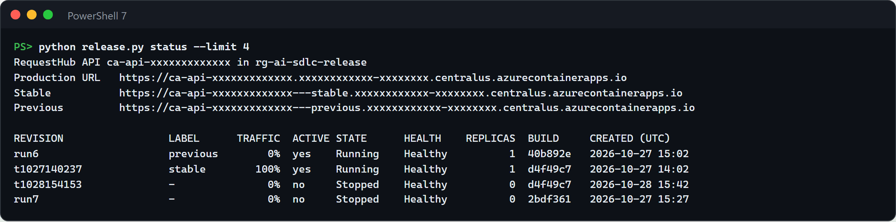

Evidence: [the starting state](evidence/2026-11-01-recorded-run.md#the-starting-state).

### 1. The build's push started the release

*23:58:50 to 00:00:42: the image was pushed 1 minute 50 seconds after the build started, and the release job started 2 seconds after the push.*

The operator started the registry's build task, `build-api`, for commit 74e59ec; with the task's commit trigger on, a merge to `main` starts the same build within seconds ([Use it the first time](#use-it-the-first-time)). Azure Container Registry built the API's image in 91 seconds and pushed it as `requesthub-api:74e59ec…` at 00:00:40. At 00:00:41, Event Grid delivered the push to the trigger function. In 728 milliseconds, the function checked the event and started the release job with the image's digest and its commit.

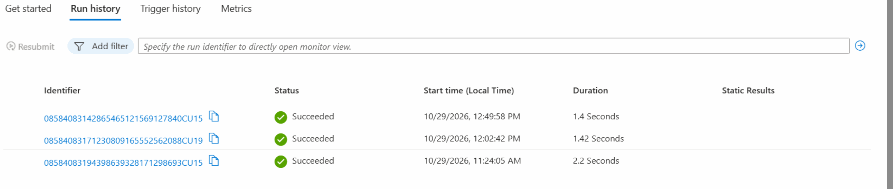

An event that fails a check starts nothing. About 25 minutes before the run, twelve events forged to test the function each failed with the checks they broke, for example one whose tag isn't a commit:

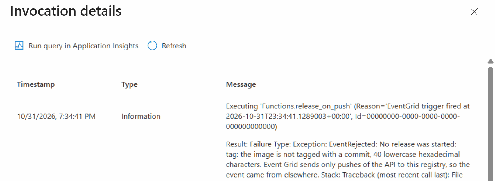

Evidence: [the build](evidence/2026-11-01-recorded-run.md#the-build) and [the trigger function](evidence/2026-11-01-recorded-run.md#the-trigger-function).

**What this shows:** the push to the registry started the release without a pipeline, and only a push of the API's image to this registry could.

### 2. Azure tested the candidate on its own URL, with no traffic

*00:00:42 to 00:03:06: the release job took 2 minutes 24 seconds, and the gate passed at 00:03:00.*

The release job read the commit baked into the image and added it to the API as revision r1101000111 at 00:01:19, labelled `candidate`, with 0% of traffic. The candidate was ready 31 seconds later. The gate then used the API on the candidate's own URL as people do, signed in as the release identity. It checked that the API reports build 74e59ec and requires sign-in, submitted a request and retried it safely, read it back, attached a file and downloaded the same bytes, checked that the requester can't approve their own request, read its audit history, and kept calling it for 60 seconds. All 11 checks passed. Meanwhile, all 91 calls the job made to production succeeded, and production kept serving build 440297a. Then the candidate waited for a person.

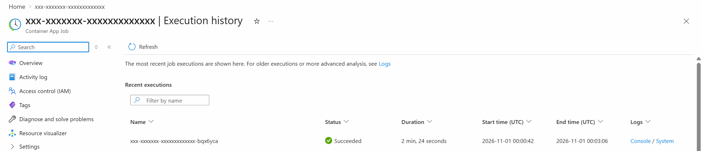


Evidence: [the release jobs](evidence/2026-11-01-recorded-run.md#the-release-jobs) and [the release's records](evidence/2026-11-01-recorded-run.md#the-release-execution-bqx6yca).

**What this shows:** the new build was tested where it would run, next to the old one, while every user stayed on the old one.

### 3. The operator read the record, then promoted the candidate

*At 00:15:06, after reading the record: the promote job took 58 seconds, and traffic switched in 13.*

The workbook **RequestHub release records** shows each step's record from Log Analytics; selecting the release job's `gate` row lists its checks. After reading it, and capturing these screenshots, the operator started the promote job: the go, which in your releases is the release manager's. The operator used `az containerapp job start`, which does what **Run now** does on the job's page. The promote job checked that the gate's verdict named this candidate and its image, checked the candidate again on its own URL, moved 100% of traffic to it in one change, and verified production. From 00:15:45 production served build 74e59ec, and all 68 calls to production during the step succeeded. The old stable revision kept running as `previous`.

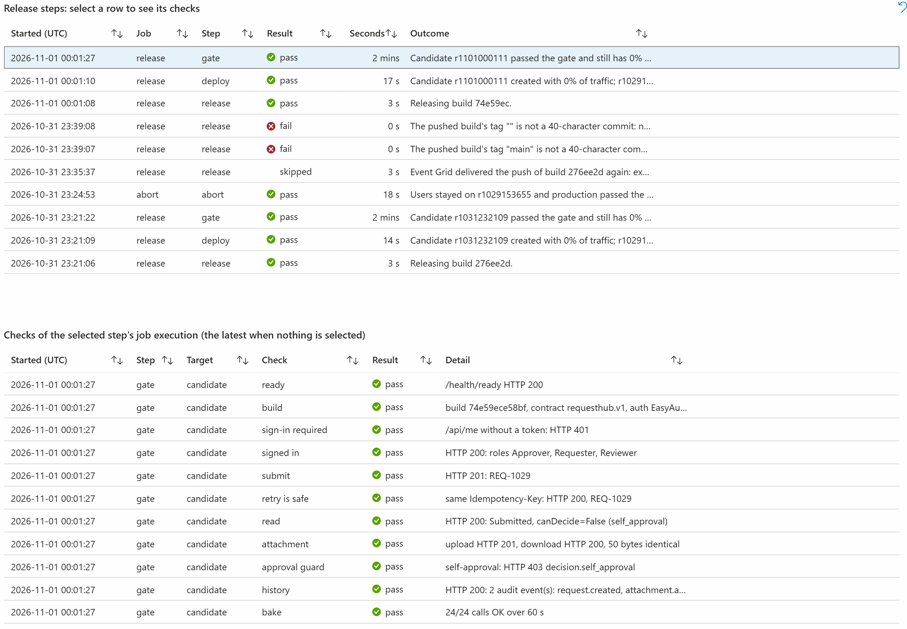

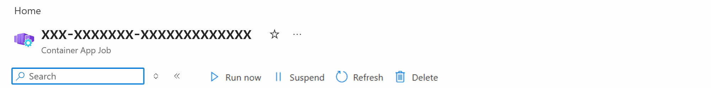

The screenshot of a job's page, above, was captured on 29 October.

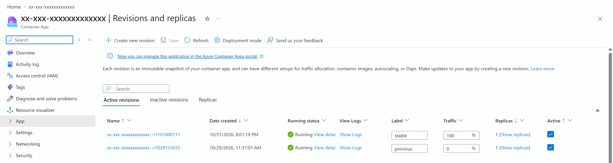

Evidence: [the promotion's record](evidence/2026-11-01-recorded-run.md#the-promotion-execution-3axbvgs) and [who started each step](evidence/2026-11-01-recorded-run.md#who-started-each-step).

**What this shows:** the gate is deterministic, but giving users the build took a go from outside the automation, and one traffic change.

### 4. A rehearsed bad release never received traffic

*00:17:29 to 00:19:51: the drill job took 2 minutes 22 seconds, and the gate failed 79 seconds after the candidate was created.*

The operator started the drill job. It deployed the stable build again as candidate d1101001758, with a setting that makes RequestHub's readiness probe fail and that switches itself off after 30 minutes. The candidate stayed **Activating** with 0% of traffic. The gate failed it 79 seconds after it was created: its container had started 62 seconds earlier and still wasn't ready. Before removing it, the gate read the candidate's live logs: Azure's readiness probe got HTTP 503 15 times, and the app's own health check reported the injected fault. The job removed the candidate 104 seconds after it was created, and production then passed all 10 checks; all 80 calls to production during the gate had succeeded. The drill job succeeded because the gate caught the fault.

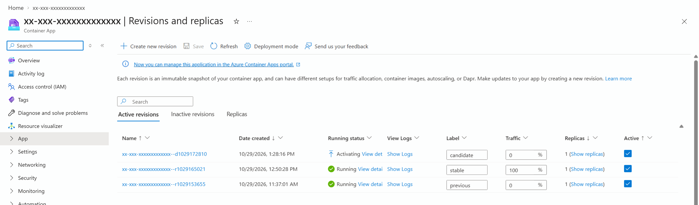

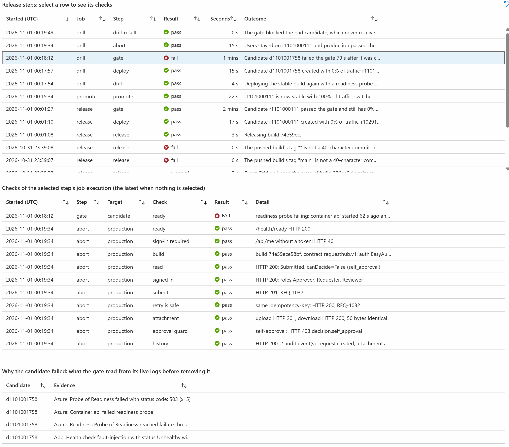

Evidence: [the drill's records](evidence/2026-11-01-recorded-run.md#the-drill-execution-htyg5y8).

**What this shows:** a build that never became ready was caught and removed before any user reached it, and the record said why, in Azure's words and the app's own.

### 5. Azure Copilot explained, in general terms

*About 4 minutes, from about 00:43 to 00:47:25, for two answers.*

In the portal, on the container app, the operator selected **Copilot** in the top bar and asked: *In a few sentences: why did revision d1101001758 of my container app never become ready, and did it receive any traffic?* Copilot asked to confirm the resource group, and the operator selected **Yes**. The first answer, on screen at 00:44:40, asked for the error message instead. Asked again, Copilot answered from general knowledge: a revision that never becomes ready typically receives no traffic, and the next checks are the revision's events and status, its container logs, its ingress and readiness settings, and the deployment history. It didn't say what this revision's probes or logs had reported; the gate's record in step 4 did.


Evidence: [Azure Copilot's answers](evidence/2026-11-01-recorded-run.md#azure-copilot), with their times.

**What this shows:** AI framed the next checks in plain language and changed nothing, while the facts came from Azure's own records.

### 6. The operator rolled back

*00:48:26 to 00:49:11: the rollback job took 45 seconds, and traffic switched in 16.*

Suppose users had reported a problem with the promoted build. The operator started the rollback job. It made one traffic change back to r1029153655, still running as `previous`, in 16 seconds, then verified production. From 00:48:58 production served build 440297a again, and all 79 calls to production during the step succeeded. Nothing was rebuilt or redeployed: the newer revision stayed running as `previous`, so running the rollback again rolls forward.

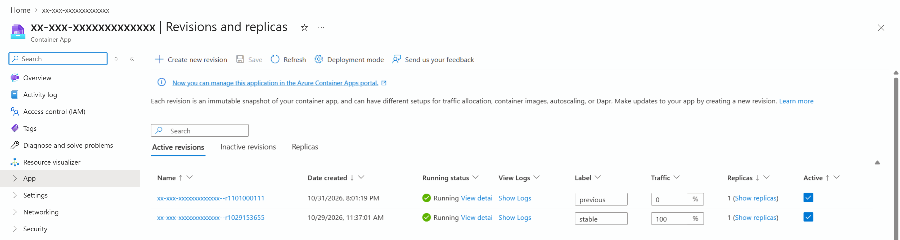

What users saw comes from a second run of steps 1 to 6, from 01:04 to 01:17 on build 786e099, while `python release.py watch` called the production URL every second from the operator's machine. During this run, that machine lost its network for two minutes during the release, and later slept for eight, so its own count of calls isn't usable; the jobs' calls to production from Azure, above, all succeeded. In the second run, 639 of 639 calls succeeded, with a median of 215 ms, and the build changed only at the promotion and the rollback:

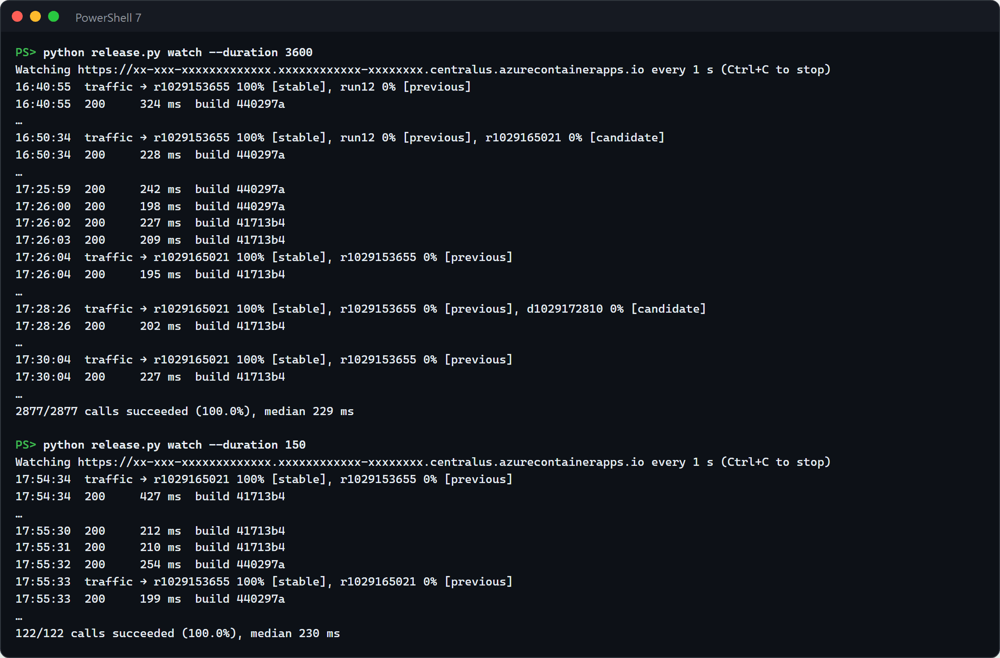

Evidence: [the rollback's record](evidence/2026-11-01-recorded-run.md#the-rollback-execution-efgfutt) and [the second run](evidence/2026-11-01-recorded-run.md#the-second-run).

**What this shows:** recovery was a traffic change to a revision that was still running, not a rebuild, and users kept getting answers throughout.

### 7. Azure recorded who did what

*Nothing ran: the workbook reads Azure's records. Its screenshot was taken at about 01:15, after the second run.*

The bottom of the workbook lists who started each step, from the Activity log: the trigger function's managed identity started the release job, and the owner's account, which the operator used, started the promote, drill, and rollback jobs. It also shows the traffic now, and every traffic change from Resource Graph's change history. In the screenshot, the top four rows are the second run's steps, and the drill at 12:17:29 AM and the rollback at 12:48:26 AM (UTC) are this run's. Resource Graph listed each run's rollback twice, a minute or more apart, while the Activity log shows one rollback per run.


Evidence: [who started each step](evidence/2026-11-01-recorded-run.md#who-started-each-step) and [the traffic changes](evidence/2026-11-01-recorded-run.md#traffic-changes).

**What this shows:** each go, no-go, and rollback is on Azure's own record with who started it, kept by Azure rather than by the release script.

## Results and value

**What the run left behind.**

- A release record for every step in Log Analytics, with each check, measurement, and outcome, which the workbook **RequestHub release records** shows.
- Who started each step, in the Activity log, and every traffic change, in Resource Graph's change history.
- Revision r1101000111, build 74e59ec: tested, promoted, and then kept running as `previous` after the rollback, ready to roll forward.
- [The evidence](evidence/2026-11-01-recorded-run.md) behind every number in [See it work](#see-it-work) and in these results, exported because Log Analytics keeps 30 days and Resource Graph 14.
- The go and the rollback: jobs started under the owner's account, which the Activity log records. Here the operator started them, as the run planned; in your releases they are the release manager's. Nothing in Azure promotes, aborts, or rolls back by itself: the only candidate it removes on its own is one that failed the gate.

**What was measured.**

| | In See it work |
| --- | --- |
| From the build's start to a tested candidate waiting for a person | 4 minutes 10 seconds |
| From the image push to the release job starting | 2 seconds |
| The release job: deploy and gate | 2 minutes 24 seconds |
| The gate's checks on the candidate's own URL | 11 of 11 passed, with 24 of 24 calls during the 60-second bake |
| The promotion: the job, and the traffic switch | 58 seconds, and 13 seconds |
| The bad release: the gate failed it, and the job removed it | 79 and 104 seconds after it was created; it never received traffic |
| The rollback: the job, and the traffic switch | 45 seconds, and 16 seconds |
| Calls the jobs made to production while they worked | 318 of 318 succeeded |
| What users saw, in the second run | 639 of 639 calls succeeded, median 215 ms |

**What a team gets.**

- **Time saved.** Nobody runs a pipeline or watches a deployment: a commit became a tested candidate in about 4 minutes, and promoting or rolling back took one job of under a minute.
- **Risk removed.** A build that fails the gate never receives a user request, and promote moves traffic only to the candidate and image the gate passed. A rollback rebuilds nothing. GitHub holds no Azure credential, and no pull request, from a fork or not, starts a build.
- **Evidence a reviewer or an auditor can follow.** Every step's checks and measurements are in Log Analytics, who started each step is in the Activity log, and every traffic change is in Resource Graph. The workbook shows all three.

## Try it first in a copy of this repository

Optional: the same solution on RequestHub, before you adapt anything. It needs the [prerequisites](#prerequisites), with RequestHub in place of your app, permission to create Microsoft Entra app registrations (RequestHub signs in with its own), and a region that allows PostgreSQL Flexible Server for your subscription. In the copy, the other solutions' workflows also see step 1's pull request: in our fresh setup, it started *Repository checks* and *Develop · GitHub · feature bounds*, and its merge *Repository checks* again, five jobs of under 10 seconds each, and no model ran. If 05-secure-microsoft is set up in the same copy, its posture Function receives the pull request too, and previews it only if it changes that solution's `infra/`.

The copy also has the folders of this one that belong to the demo: [`evidence/`](evidence/), what Azure recorded during the run in See it work, exported for anyone to check, and a setup from scratch that followed only this README, timed step by step; and [`images/`](images/), the screenshots of the run in See it work and of the Release combo. RequestHub lives in [`app/`](../../app/README.md). Its API module, [`app/infra/api.bicep`](../../app/infra/api.bicep), runs in multiple-revision mode with startup, liveness, and readiness probes. Its fault switch `Faults:FailReadiness`, which needs an expiry, makes a revision's readiness probe fail: the drill uses it to rehearse a bad release.

### Quick start

From the root of your copy of the repository, which the root README's [Try it in a copy of this repository](../../README.md#try-it-in-a-copy-of-this-repository) makes once for every solution:

```powershell
cd solutions/06-release-microsoft
az login
azd auth login
azd env new ai-sdlc-release --subscription (az account show --query id -o tsv) --location centralus
azd up
```

Then create the build task for your copy, as in [One-time setup, step 3](#3-let-azure-build-every-commit-of-main), and run `python preflight.py`: every line should read `PASS`.

`--subscription` deploys to the subscription that `az` signed in to, as in [Deploy](#1-deploy). The scripts use only Python's standard library, so this solution needs no `pip install`.

Allow about 20 minutes, plus the few minutes a person takes to create the token. In a fresh setup on 12 November 2026, `azd up` took 15 minutes 34 seconds from a clean state to the release jobs and the trigger connected, the lines of step 3 that create the build task 6 seconds once the token existed, and the preflight 1 minute 14 seconds: 17 minutes of commands ([the evidence](evidence/2026-11-12-fresh-setup.md#timeline)). Before the trigger function existed, RequestHub's platform and app took 12 minutes 13 seconds from a clean state, and the `azd provision` that added the trigger function's resources 5 minutes 38 seconds.

While deployed, the copy's resource group costs about $120 a month, measured in our subscription: Log Analytics about $50 (the API's telemetry, health probes included), Container Apps about $35 (the stable and previous revisions both stay running), two private endpoints about $15 (the app's storage and the trigger's), PostgreSQL about $13, and the registry about $7. While the database is stopped, every readiness probe logs an error, and Log Analytics costs nearer $85 a month. The trigger function, Event Grid, and the release jobs cost cents: they run only when a build is pushed or a person starts a step.

### What azd up creates

`azd up` ends with `SUCCESS`. It creates resource group `rg-ai-sdlc-release` with:

- **RequestHub's platform** from [`app/infra/requesthub.bicep`](../../app/infra/requesthub.bicep): a virtual network with a network security group on each subnet, a Container Apps environment, private PostgreSQL with Microsoft Entra authentication only, Blob storage reached through a private endpoint, a container registry, Log Analytics and Application Insights, and a Microsoft Entra app registration with RequestHub's app roles. You get every role. A deployment from before 12 November 2026 gets the network security groups at its next `azd provision` ([what that changes](../../app/README.md#deploy-it-to-azure)).
- **The app**, deployed once by azd: the API, in multiple-revision mode, and the notification worker. This first revision reports build `local` and has no label yet: the first release labels it `stable`.
- **The release**: the five jobs (`release`, `promote`, `abort`, `rollback`, and `drill`), running this folder's image; the release trigger function, with its own virtual network and a storage account reached through a private endpoint; an Event Grid subscription on the registry that sends every push of `requesthub-api:<tag>`, except `:main`, to the function; and the workbook **RequestHub release records**. Event Grid accepts only a function that is already deployed, so azd deploys every service first, then connects Event Grid to the function in the project's `postdeploy` hook. Its `predeploy` hook runs the unit tests: a change that breaks a safety rule never reaches Azure. Like RequestHub's, the trigger's network has a network security group with Azure's default rules on each subnet, and a deployment from before 12 November 2026 gets them at its next `azd provision` in the same way ([what that changes](../../app/README.md#deploy-it-to-azure)).
- **The release identity** the jobs run as, with Container Apps Contributor and Container Apps Jobs Reader on the resource group and AcrPull on the registry. It can't push images or assign roles.

### Check the starting state

About 2 minutes, from `solutions/06-release-microsoft`, before each run of the steps below; the commands took 1 minute 21 seconds in a fresh setup. You should see what [See it work](#see-it-work) shows as its starting state. Keep this terminal for the steps: their commands use `$rg` and `$job`, which the first two lines define.

```powershell
$rg = azd env get-value AZURE_RESOURCE_GROUP
$job = @{}; 'release', 'promote', 'abort', 'rollback', 'drill' | ForEach-Object { $job[$_] = (azd env get-value SERVICE_RELEASE_NAME) -replace '^caj-release-', "caj-$_-" }
python preflight.py                  # every line PASS
python release.py status --limit 4   # stable with 100% of traffic, possibly previous, no candidate, no release step running
```

After a fresh `azd up`, the one revision serves 100% of traffic with no label and build `local`, and the preflight says `no stable label yet: the first release adds it`.

- **Database** says `Stopped`: a tenant policy can stop PostgreSQL servers on a schedule, and then every revision fails readiness, so the gate would fail for the wrong reason. Start it, then run the preflight again after 3 to 5 minutes:

  ```powershell
  az postgres flexible-server start -g $rg -n (az postgres flexible-server list -g $rg --query "[0].name" -o tsv)
  ```

- **Build** warns that the commit trigger is off: turn it on with `Update-BuildTask`, as in [One-time setup, step 3](#3-let-azure-build-every-commit-of-main), or start the build yourself in step 1.
- **A `candidate` is waiting** from an earlier run: run the abort job, as in [Reset the copy for another run](#reset-the-copy-for-another-run).
- **The stable revision already runs the newest commit of `main`** (its **BUILD** column): run the rollback job first, so that the release shows a change. A build that already serves users is not released again.

Where to look, in the Azure portal (`azd env get-value` gives each name):

- The API's container app (`API_APP_NAME`) → **Application** → **Revisions and replicas**. The blade can take a minute to load; select **Refresh** to update it.
- The release job (`SERVICE_RELEASE_NAME`) → **Execution history**. The other jobs share its name, with `release` replaced by `promote`, `abort`, `rollback`, or `drill`; each one's **Overview** has **Run now**.
- The workbook: resource group `rg-ai-sdlc-release` → **RequestHub release records**.
- The trigger function (`RELEASE_TRIGGER_NAME`) → **release_on_push** → **Invocations**.
- RequestHub (`API_URL`), signed in. Use the production URL in the browser: label URLs can't complete sign-in.

### How long each step takes

| Step | Takes | In See it work | In the fresh setup |
| --- | --- | --- | --- |
| 1. Build a commit of main | about 2 minutes to the push | 1 minute 50 seconds | 2 minutes 5 seconds; the merge started the build 2.6 seconds after it |
| 2. Watch Azure test the candidate | about 2½ minutes | 2 minutes 24 seconds | 2 minutes 21 seconds; the gate passed 4 minutes 28 seconds after the merge |
| 3. Read the record, then promote | about 1 minute for the promote job, plus your reading | 58 seconds | 48 seconds |
| 4. Rehearse a bad release | about 2½ minutes | 2 minutes 22 seconds | 2 minutes 20 seconds |
| 5. Ask Azure Copilot | about 2 minutes a question | two answers in about 4 minutes | not run ([why](evidence/2026-11-12-fresh-setup.md#step-5-wasnt-run)) |
| 6. Roll back | about 1 minute | 45 seconds | 49 seconds |
| 7. See who did what | about 1 minute, once the Activity log has the last step | | under a minute; the Activity log had the rollback within 2 minutes |

The seven steps take about 15 minutes. In See it work, the build pushed its image in 1 minute 50 seconds and the four jobs ran for 6 minutes 29 seconds in all; between the steps, the operator read the records, asked Azure Copilot, and captured the screenshots, and the whole run took 50 minutes. A fresh setup on 12 November 2026 took 14 minutes for every step but Azure Copilot's, reading the records included, and its four jobs ran for 6 minutes 18 seconds ([the evidence](evidence/2026-11-12-fresh-setup.md#the-run)).

### 1. Build a commit of main

*About 2 minutes to the push. What you should see: [See it work, step 1](#1-the-builds-push-started-the-release).*

To see what users get during the steps, first run `python release.py watch` in a second terminal, in this folder. It calls the production URL every second and prints the status and the build it gets, plus a line whenever Azure's traffic changes; Ctrl+C stops it and prints the summary.

Then merge a pull request to `main` in your copy. With the commit trigger off, start the build yourself for the newest commit of `main`:

```powershell
git fetch origin main
$sha = git rev-parse origin/main
$repo = gh repo view --json url --jq .url
az acr task run --registry (azd env get-value AZURE_CONTAINER_REGISTRY_NAME) --name build-api `
  --context "$repo.git#$sha" --set "commit=$sha" --no-logs
```

The registry builds `requesthub-api:<commit>` and pushes it, and Event Grid delivers the push to the trigger function, which starts the release job. The function's **Invocations** list one row per push.

### 2. Watch Azure test the candidate

*About 2½ minutes. What you should see: [See it work, step 2](#2-azure-tested-the-candidate-on-its-own-url-with-no-traffic).*

Open the release job's **Execution history**: the execution succeeds when the gate passes. Then select **Refresh** in **Revisions and replicas**: the new revision has the label `candidate` and 0% of traffic. To see the build it runs, open `https://<app>---candidate.<domain>/api/meta`.

### 3. Read the record, then promote

*About 1 minute for the promote job. What you should see: [See it work, step 3](#3-the-operator-read-the-record-then-promoted-the-candidate).*

Open the workbook and select the release job's `gate` row: its checks are listed below it. Then the go: open the promote job and select **Run now**, or run:

```powershell
az containerapp job start -g $rg -n $job.promote --query name -o tsv
```

### 4. Rehearse a bad release

*About 2½ minutes. What you should see: [See it work, step 4](#4-a-rehearsed-bad-release-never-received-traffic).*

Open the drill job and select **Run now**, or run `az containerapp job start -g $rg -n $job.drill`. Select **Refresh** in **Revisions and replicas**: the candidate stays **Activating** with 0% of traffic. When the drill job has succeeded, select its `gate` row in the workbook.

### 5. Ask Azure Copilot

*About 2 minutes a question. What you should see: [See it work, step 5](#5-azure-copilot-explained-in-general-terms).*

In the portal, on the container app, select **Copilot** in the top bar and ask:

```text
In a few sentences: why did revision <suffix> of my container app never become ready, and did it receive any traffic?
```

Use the drill candidate's suffix, which starts with `d`: `python release.py status --limit 4` lists it among the inactive revisions. When Copilot asks whether it has the right resource, select **Yes**. Its answers vary: in See it work, it first asked for the error message, then answered from general knowledge. The drill's record in the workbook has the specific cause.

### 6. Roll back

*About 1 minute. What you should see: [See it work, step 6](#6-the-operator-rolled-back).*

Open the rollback job and select **Run now**, or run `az containerapp job start -g $rg -n $job.rollback`. Select **Refresh** in **Revisions and replicas**: the older revision is `stable` again, and the newer one keeps running as `previous`. Running the rollback again rolls forward. In the `watch` terminal, stop the watch with Ctrl+C to see how many of its calls succeeded.

### 7. See who did what

*About 1 minute. What you should see: [See it work, step 7](#7-azure-recorded-who-did-what).*

Scroll to the bottom of the workbook: who started each step, the traffic now, and every traffic change. Log Analytics shows a release record about a minute after a step writes it, and the Activity log can take a few minutes more.

Every step also runs from a terminal signed in with `az login`, for example `python release.py promote`, `python release.py drill`, or `python release.py rollback`. Prefer the jobs: only they write their records to Log Analytics, and the Activity log then shows who started each step.

### Reset the copy for another run

The steps end rolled back, so the copy is ready to run again: the next release brings the newer build back. If a candidate is waiting, run the abort job: `az containerapp job start -g $rg -n $job.abort`, with `$rg` and `$job` as in [Check the starting state](#check-the-starting-state). To end on the newer build instead, run the rollback job once more; it swaps `stable` and `previous`. Revisions you no longer need stay inactive (Container Apps keeps the last 10).

To put RequestHub's data back to its initial state, including the requests named `Release check <revision>` that every smoke test creates (you are an Admin):

```powershell
$token = az account get-access-token --scope "$(azd env get-value API_IDENTIFIER_URI)/user_impersonation" --query accessToken -o tsv
curl.exe -X POST -H "Authorization: Bearer $token" "$(azd env get-value API_URL)/api/admin/reset"
```

The reset empties the database; the smoke tests' small attachment files stay in the storage account until you remove the solution.

When you no longer need the copy, delete the build task's token and its webhook as in [Clean up](#clean-up), then remove what azd deployed, from `solutions/06-release-microsoft`:

```powershell
$app = az ad app show --id (azd env get-value API_CLIENT_ID) --query id -o tsv
$sp = az ad sp show --id (azd env get-value API_CLIENT_ID) --query id -o tsv
azd down --purge --force
az ad app delete --id $app
az rest --method delete --url "https://graph.microsoft.com/v1.0/directory/deletedItems/$app"
az rest --method delete --url "https://graph.microsoft.com/v1.0/directory/deletedItems/$sp"
```

`azd down` deletes the resource group, with the registry, the build task, the jobs, the trigger function and its network and storage, and the workbook, and `--purge` purges the Log Analytics workspace, so that its name can be used again at once. Without `--force`, `azd down` lists what it will delete and asks you to confirm; without a terminal to ask in, it stops there and deletes nothing. RequestHub's sign-in app registration is a Microsoft Entra object, which no resource group contains, so `az ad app delete` removes it, with its service principal, which Entra moves to its recycle bin with the app, and the two `az rest` calls empty both from the recycle bin. Without the first, a new `azd up` with the same environment name can't create the app registration again for 30 days. Deleting the group also moves the service principals of its three managed identities to the recycle bin: the app's, the release identity, and the trigger function's. Entra refused to purge them in our fresh setup; it removes them after 30 days.

Allow about half an hour: `azd down --purge --force` took 27 minutes 51 seconds in our fresh setup, most of it for the Container Apps environment. Afterwards nothing of the copy's environment was left in Azure, and in Microsoft Entra ID only those principals in the recycle bin ([the evidence](evidence/2026-11-12-fresh-setup.md#the-clean-up-and-what-is-left)).

The [root README](../../README.md#try-it-in-a-copy-of-this-repository) then says how to delete the copy itself.

### Troubleshooting the copy

- **The app times out, or every revision fails readiness and the gate fails before its smoke test.** The PostgreSQL server was stopped; a tenant policy can stop it on a schedule. The preflight's **Database** line shows it. Start it as in [Check the starting state](#check-the-starting-state) (3 to 5 minutes).
- **Signing in on a label URL fails with `AADSTS50011`.** Only the production URL is registered for sign-in. The gate calls the API with a token, and `/api/meta` and `/health/*` are anonymous, so open a candidate with `https://<app>---candidate.<domain>/api/meta`.
- **A button in RequestHub fails with HTTP 403 and no body.** You are on a revision label URL, which has a different origin, or the deployment predates [#134](https://github.com/melabadi/adept-assessment-northstars/pull/134). Use the production URL; for an older deployment, run `azd deploy api` from `main`. That deploy replaces the stable revision and clears the labels; the next release labels them again.
- **Attachment uploads return HTTP 500 and the gate's `attachment` check fails, while every revision is ready.** An Azure Policy disabled public network access on the storage account. The shared module reaches Blob storage through a private endpoint by default; run `azd provision` in this folder to add it to an environment created before that change (about 5 minutes; revisions and traffic are not touched).
- **`LocationIsOfferRestricted` for PostgreSQL during `azd up`.** Your subscription cannot create PostgreSQL Flexible Server in that region. Create a new azd environment in another region, for example `centralus`.
