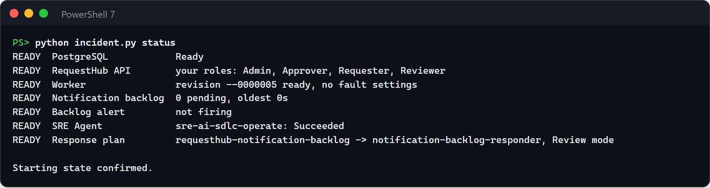
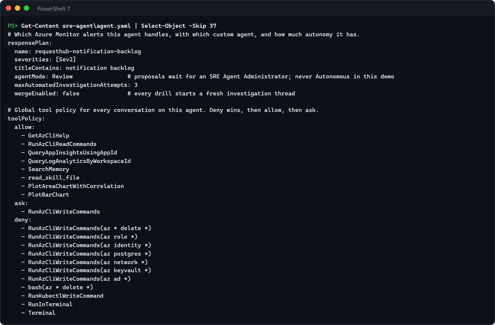
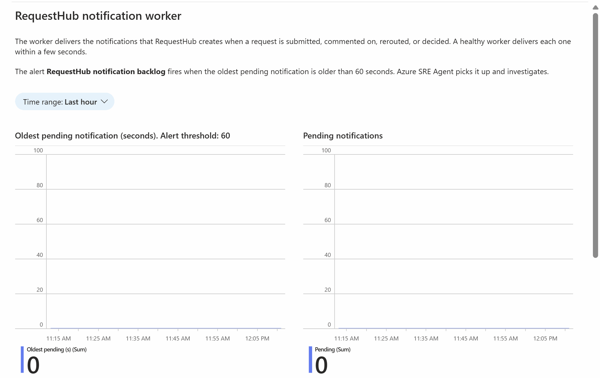
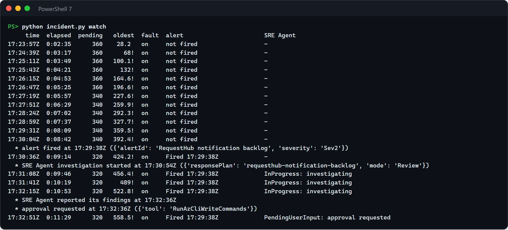
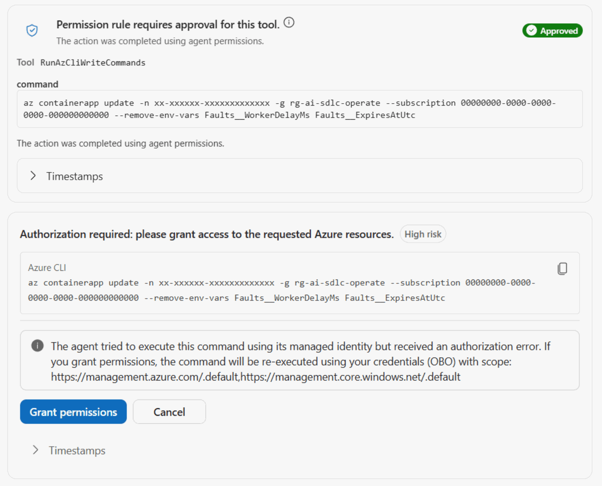
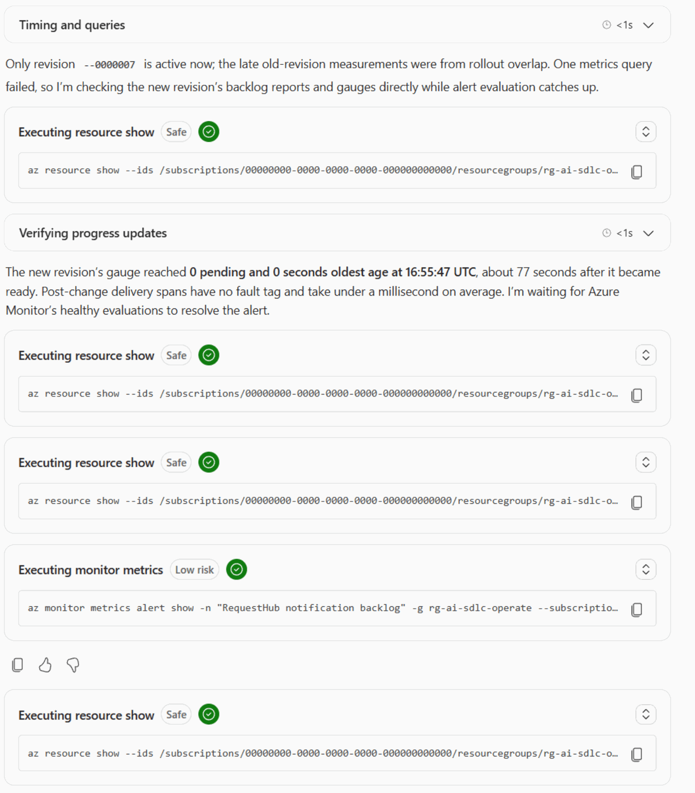
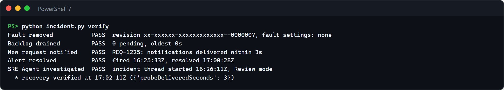
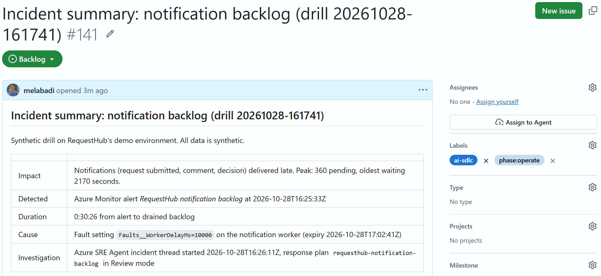

# Operate · Incident investigation with Azure SRE Agent

When an alert fires, the on-call engineer spends the first half hour gathering context: which dashboards, what changed,
which logs matter. In this solution an Azure Monitor alert on RequestHub's notification backlog goes straight to
**Azure SRE Agent**. Within minutes the agent measures the backlog, correlates it with the worker's telemetry and a
recent configuration change, rules out other causes, and proposes one scoped, reversible mitigation. A person approves
it, and it runs with that person's permissions because the agent itself can only read. The agent then verifies the
recovery. Its custom agent, skills, runbook, response plan, and tool policy are versioned in this folder and applied
like code.


## Where it fits

**Phase 7 of 7: Operate and improve.** The GitHub counterpart is [07-operate-github](../07-operate-github/).

| | Today | With this solution |
| --- | --- | --- |
| Detection | Someone notices late notifications, or an alert pages a person who starts from zero. | An Azure Monitor alert on the backlog's age opens an investigation in Azure SRE Agent about a minute after it fires. |
| Investigation | Open dashboards, query logs, ask who changed what. | The agent correlates metrics, logs, spans, and the worker's revision history in about three minutes, and separates facts from hypotheses. |
| Mitigation | The first plausible fix, run with broad permissions. | One proposed command, scoped to the worker. It runs only after an administrator approves it, with that administrator's permissions. |
| Recovery | "Looks fine now." | Evidence: fault gone, backlog drained, a new request's notifications delivered, alert resolved. |
| Agent changes | Edited by hand in a portal. | Instructions, skills, runbook, response plan, and tool policy reviewed in pull requests and checked against rules. `main` applies them; only an administrator can change the tool policy. |

## How it works


- **Azure Monitor** evaluates a metric alert every minute on `requesthub.notifications.oldest_pending_age_seconds`, a
  gauge that RequestHub's notification worker sends to Application Insights. The workbook
  *RequestHub notification worker* shows the backlog, deliveries per minute, and the worker's revisions on one page.
- **Azure SRE Agent** manages this resource group only, and receives its Azure Monitor alerts. A response plan sends
  the backlog alert to the custom agent `notification-backlog-responder` in **Review** mode. The agent's identities
  have Reader, Monitoring Reader, and Log Analytics Reader on the resource group, nothing more. Its tool policy lets
  it read freely, asks before any Azure CLI write, and denies deletes and changes to identities, roles, networking,
  Key Vault, and PostgreSQL. A Stop hook makes it show timestamps, facts versus hypotheses, and a rollback before it
  finishes.
- **The presenter** starts the drill, decides whether to apply the proposal, approves it, and checks recovery. Only an
  SRE Agent Administrator can approve. The change runs with the presenter's own Azure permissions, after a second
  click that lends them, and shows their name in the Activity Log.
- **GitHub Actions** ([`operate-microsoft-agent-config.yml`](.github/workflows/operate-microsoft-agent-config.yml))
  checks every change to `sre-agent/` against those rules, and applies it to the agent from `main` through OIDC. The
  GitHub environment accepts only `main`, and the workflow's identity cannot approve actions or change the global tool
  policy; an SRE Agent Administrator applies that with `python configure_sre_agent.py`.
- **GitHub Copilot** (custom agent [`operate-microsoft`](.github/agents/operate-microsoft.agent.md)) helps run the drill
  and changes the SRE Agent configuration through pull requests.

## What's in this folder

```text
07-operate-microsoft/
├── README.md
├── images/                            screenshots of a live run, used in this README
├── incident.py                        the drill: status, start, watch, verify, summary (sanitized, optional GitHub Issue), reset
├── configure_sre_agent.py             applies sre-agent/ to the live agent, or checks it offline (--check)
├── configure_github.py                azd hooks: connect the solution to GitHub Actions (OIDC environment)
├── azd_env.py                         reads settings from this solution's azd environment
├── requirements.txt                   Python packages
├── azure.yaml                         azd project: infra plus the shared app's api and worker, and the hooks
├── sre-agent/                         Azure SRE Agent configuration, versioned
│   ├── agent.yaml                     custom agent, skills, knowledge, response plan, tool policy
│   ├── instructions.md                how the custom agent investigates, and the only change it may propose
│   ├── skills/                        investigate-notification-backlog, verify-worker-recovery (KQL and read-only CLI)
│   ├── knowledge/                     requesthub-worker-runbook.md, the team's runbook
│   └── hooks/evidence-checklist.md    Stop hook: evidence, facts versus hypotheses, rollback, approval
├── infra/
│   ├── main.bicep                     resource group, RequestHub platform (app/infra), monitoring, SRE Agent
│   ├── monitoring.bicep               the backlog metric alert and the workbook
│   ├── workbook.json                  workbook tiles (KQL)
│   ├── sre-agent.bicep                the agent, its identities and read-only roles, telemetry connectors, AAU cap
│   └── main.parameters.json
└── .github/
    ├── agents/operate-microsoft.agent.md        Copilot agent for drills and agent-configuration changes
    ├── skills/
    │   ├── telemetry-investigation/             the agent's evidence, from a terminal
    │   └── recovery-verification/               when an incident is really over
    └── workflows/operate-microsoft-agent-config.yml
```

The app lives in [`app/`](../../app/README.md). Its notification worker already supports the fault used here:
`Faults__WorkerDelayMs` slows every delivery, and `Faults__ExpiresAtUtc` switches the fault off at a fixed time even if
nobody cleans up.

## Prerequisites

- An Azure subscription where you can create resource groups, Microsoft Entra app registrations, and role
  assignments, for example as Owner.
- A region that offers both PostgreSQL Flexible Server (for the app) and Azure SRE Agent. The examples use `centralus`.
  To see where your subscription can create the agent, run
  `az provider show -n Microsoft.App --query "resourceTypes[?resourceType=='agents'].locations" -o tsv`. If the list is
  empty, [register the subscription](https://learn.microsoft.com/azure/sre-agent/supported-regions#check-your-available-regions).
- [Azure CLI](https://learn.microsoft.com/cli/azure/install-azure-cli), [Azure Developer CLI](https://learn.microsoft.com/azure/developer/azure-developer-cli/install-azd),
  and the [GitHub CLI](https://cli.github.com/) signed in as a repository admin (the hooks create a GitHub environment).
- Python 3.12 or later, and PowerShell 7.4 or later for the commands in this README.
- A budget for the agent. Azure SRE Agent charges 4 Azure Agent Units (AAUs) per hour while it exists, plus AAUs for
  the work it does; an incident investigation uses roughly 10 to 35 AAUs. New customers can
  [evaluate it](https://learn.microsoft.com/azure/sre-agent/evaluate) without the hourly charge for 30 days. This
  solution caps active usage at 1,000 AAUs a month. See [pricing](https://learn.microsoft.com/azure/sre-agent/pricing-billing),
  and [remove it](#reset-and-clean-up) when you are done.

## Set up

Run once, from the repository root:

```powershell
cd solutions/07-operate-microsoft
pip install -r requirements.txt
az login
azd auth login
azd env new ai-sdlc-operate --location centralus
azd up
gh label create ai-sdlc --color 1D76DB --description "AI-SDLC demo work" --force
gh label create phase:operate --color C5DEF5 --description "SDLC phase 7: Operate" --force
python incident.py status
```

`azd up` takes about 15 minutes and ends with `SUCCESS: Your application was provisioned and deployed to Azure`. The
two labels are for the incident summary Issue in step 7. `status` prints `READY` on every line when the demo is ready
(see [Before each session](#before-each-session)). `azd up` creates resource group `rg-ai-sdlc-operate` and fills it as
follows:

- **RequestHub's platform** from [`app/infra/requesthub.bicep`](../../app/infra/requesthub.bicep), and the app as two
  container apps (API with web UI, and the notification worker). You get every RequestHub role.
- **The backlog alert** (*RequestHub notification backlog*, severity 2, oldest pending notification older than 60
  seconds) and the workbook *RequestHub notification worker*.
- **Azure SRE Agent** `sre-ai-sdlc-operate`: Reader-level access to this resource group, Review mode, Azure Monitor as
  its incident platform, connectors to the app's Application Insights and Log Analytics, and its own Application
  Insights for its activity. You get the **SRE Agent Administrator** role.
- **The agent's configuration**, applied by the `postprovision` hook (`configure_sre_agent.py`): the runbook, two
  skills, the custom agent with its Stop hook, the tool policy, and the response plan. The default quickstart plan is
  removed so the alert is not investigated twice.
- **GitHub environment `operate-microsoft`**, limited to `main`. The OIDC sign-in values and the resource names that
  carry the deployment's random suffix are environment secrets, so workflow logs show `***` instead of them; names
  without a suffix are variables.

Then open the agent once, with the URL from `azd env get-value SRE_AGENT_PORTAL_URL`, and sign in. The first visit
shows a setup checklist (2 log providers, 1 resource group, Azure Monitor connected). **Done and go to agent** opens a
*Team onboarding* chat in which the agent reads the resource group and writes notes about it to its memory; that uses
a few AAUs and changes nothing. Under **Incidents**, **Triggers & response plans** lists
`requesthub-notification-backlog`: On, `notification-backlog-responder`, Sev2, Review.

## Before each session

About 5 minutes, at least 15 minutes before you present.

1. **Confirm the starting state.** In this folder:

   ```powershell
   python incident.py status
   ```

   

   Every line must say `READY`. A `FIX` line prints the command that fixes it. The usual ones:
   - **PostgreSQL `Stopped`.** Some subscriptions stop PostgreSQL servers overnight with a governance automation. Run
     the printed `az postgres flexible-server start` command (about 3 minutes); the API answers a minute later.
   - **Fault settings on the worker, or a backlog.** A drill was not reset. Run `python incident.py reset`.
   - **Backlog alert firing.** Wait: Azure Monitor resolves it about 5 minutes after the backlog drains.
2. **Check your sign-in.** `az account show` must show the account that ran `azd up`. It is the SRE Agent
   Administrator who approves the mitigation, and its token reads RequestHub's Admin API.
3. **Open in advance**, signed in, one tab each:
   - The SRE Agent portal (`azd env get-value SRE_AGENT_PORTAL_URL`), on **Incidents**. Dismiss its tour if one
     appears.
   - The workbook: the Application Insights resource `appi-...` in `rg-ai-sdlc-operate`, **Workbooks**,
     *RequestHub notification worker*.
   - The same Application Insights resource, **Monitoring**, **Alerts**.
   - [`sre-agent/agent.yaml`](sre-agent/agent.yaml) in your editor.
   - Two PowerShell 7 terminals in this folder.
4. **Start early if your slot is short.** The alert fires about 6 minutes after `start` submits its requests, and the
   agent's report follows 2 to 3 minutes later. Run step 2 up to 10 minutes before you want to show the
   investigation, but not more than 30 minutes before: the fault switches itself off 45 minutes after `start`.
5. **Timings** from two live runs:

   | Step | What happens | Time |
   | --- | --- | --- |
   | 1. Show the guardrails | You walk through the configuration | 3 min |
   | 2. Start the incident | Fault applied, slowed revision takes over, 200 requests | 1 min |
   | 3. Watch it unfold | The backlog ages until the alert fires | 6 min |
   | 4. Follow the investigation | Investigation starts, then the report and the approval request | 2 to 3 min |
   | 5. Mitigate | Allow once, Grant permissions, a new worker revision | 1 to 2 min |
   | 6. Watch it recover | The backlog drains, then the alert resolves | 6 min |
   | 7. Verify and record | Five checks and the summary Issue | 1 min |

   About 25 minutes in total, most of it the agent and Azure Monitor working while you explain.

## Run the demo

Run the commands in this folder.

1. **Show the guardrails** (3 minutes). In the SRE Agent portal, open **Incidents**, then **Triggers & response
   plans**: one response plan sends the backlog alert to the custom agent, in **Review** mode.

   

   Show the same configuration as code in [`sre-agent/agent.yaml`](sre-agent/agent.yaml):

   

   In the Azure portal, the resource group's **Access control (IAM)** shows that the agent's identities only have
   reader roles. Finish on the workbook: nothing is pending.

   

   **Point out:** the agent can read everything it needs and change nothing on its own. Every write asks a person, and
   the riskiest commands are denied outright.

2. **Start the incident** (1 minute):

   ```powershell
   python incident.py start
   ```

   

   It prints the exact `az containerapp update` command that adds the fault: each delivery waits 10 seconds, and the
   fault expires after 45 minutes. It waits for the slowed revision to take over, then submits 200 synthetic requests.
   Expect about 360 pending notifications. At 6 a minute, the slowed worker would need an hour to deliver them, longer
   than the fault lasts, so the backlog only clears when someone acts.

   **Point out:** even a deliberate fault has an expiry, so a forgotten drill cannot outlive the session.

3. **Watch it unfold** in the second terminal (6 minutes):

   ```powershell
   python incident.py watch
   ```

   

   Every 30 seconds: pending notifications, the age of the oldest one (live from RequestHub's Admin API), the fault,
   the alert, and the SRE Agent investigation. The alert fires about 6 minutes after the requests, because the worker
   reports its backlog only after each slow batch. In Application Insights, **Alerts** lists it as a Sev2 alert whose
   condition is *Fired*; the agent has already acknowledged it.

   

   **Point out:** nobody is paged into an empty dashboard: the alert itself starts the investigation, under the
   reviewed response plan, in Review mode.

4. **Follow the investigation** (2 to 3 minutes). In the SRE Agent portal, open **Incidents**: the alert is listed with
   the agent *In progress*.

   

   Open it. The thread starts with the alert, then the agent searches its memory and finds the runbook from
   [`knowledge/`](sre-agent/knowledge/) and an earlier incident with the same symptoms.

   

   It then queries the metrics, logs, and delivery spans, lists the worker's revisions and the Activity Log, and
   compares the `Faults__` settings with the previous revision. It rules out database errors, API errors, and restarts,
   treats the burst of requests as a contributing factor only, and reports the impact, a UTC timeline, confirmed facts,
   hypotheses with their confidence, the root cause, and the smallest reversible mitigation with its rollback and the
   time the fault would have expired. Nothing has changed yet.

   

   **Point out:** facts are kept apart from hypotheses, and each fact names its evidence: the fault setting on the new
   revision, the worker's own `workerDelayFaultActive=True`, and delivery spans of about 10 seconds.

5. **Mitigate** (1 to 2 minutes). Right after its report the agent submits the command, and the platform holds it:
   *Permission rule requires approval for this tool*. It waits while you walk the audience through the report.

   

   Select **Allow once**. The agent's identity can only read, so its own attempt fails with an authorization error, by
   design, and a second card asks to run the command with your credentials (on-behalf-of). Select **Grant
   permissions**.

   

   A new worker revision starts without the fault, and the Activity Log shows your name on the change. To run the
   command yourself instead, select **Cancel** and use the command from the report. If the agent stops at its report
   without asking, reply *Apply the proposed mitigation.* With **Go back to legacy**, the portal's older navigation,
   the buttons are **Approve**, **Deny**, and **Authorize**.

   **Point out:** a person makes two decisions: approving this exact command, and lending it their permissions. The
   agent never holds write access.

6. **Watch it recover** (6 minutes). In the `watch` terminal the fault turns off and the backlog drains within about a
   minute and a half of the change. In the thread, the agent checks fresh telemetry from the new revision before it
   calls anything recovered.

   

   The alert resolves about 4.5 minutes after the backlog drains, after three healthy one-minute evaluations, and
   `watch` stops by itself. The workbook now tells the whole story.

   

   **Point out:** recovery is measured, not assumed: the agent waits for post-change data and the resolved alert.

7. **Verify and record** (1 minute):

   ```powershell
   python incident.py verify
   python incident.py summary --issue --label ai-sdlc --label phase:operate
   ```

   

   `verify` prints five checks: fault removed, backlog drained, a new request's notifications delivered, alert
   resolved, SRE Agent investigated. `summary` writes a timeline and the agent's report, files it as a GitHub Issue,
   and leaves out subscription, tenant, object, and thread ids, host names, the unique token in resource names, and
   e-mail addresses.

   

   To hand the follow-up to the GitHub track's incident triage ([07-operate-github](../07-operate-github/)), add
   `--label incident`. That label starts its agentic triage, so it needs that solution's Set up, including its Copilot
   token.

   **Point out:** the summary is safe to share: times are in UTC, and nothing in it identifies the tenant.

## What to observe

- **Time to context.** In two runs today the investigation started 38 and 76 seconds after the alert fired, and the
  root cause with its evidence, and the approval request, were ready 2 to 3 minutes after the alert. Nobody opened a
  dashboard.
- **It remembers.** The agent's first step searched its memory and found both the team's runbook and an earlier drill
  with the same symptoms.
- **Correlation, not guesswork.** The agent tied four kinds of evidence together: the backlog metric, the worker's own
  report (`workerDelayFaultActive=True`), delivery spans (10 seconds each instead of under a millisecond), and the
  revision that added the setting. It named what it could not prove, such as how much the burst of requests added.
- **Least privilege that holds.** The agent could not change the worker even after approval: its identity only reads.
  The change ran as the approving administrator, scoped to two settings on one container app.
- **Careful when something fails.** In one run the first approved command failed because it did not name its
  subscription and the approver's default subscription was another one. The agent did not retry blindly: it read the
  fault settings again and asked for approval once more. The command now always names its subscription, and the next
  run's first approved command succeeded.
- **Recovery with evidence.** The agent compared numbers from before and after the change and waited for the resolved
  alert before it called the incident over, and `verify` proved that a new request's notifications went out in
  seconds. In a rehearsal where the backlog had drained before the change, it said so: the change did not drain this
  backlog.
- **An honest weak spot.** The worker publishes its backlog only between batches, so a slow worker delays its own
  alert by a few minutes. It is a good follow-up for the repository: measure the queue independently of the worker.
- **Agent configuration is code.** A pull request that set the response plan to Autonomous or allowed writes without
  approval would fail the check before it reached the agent.

## Reset and clean up

After each drill (the threads stay in the agent's history as the record of past drills):

```powershell
python incident.py reset
python incident.py status
```

`reset` removes the fault if it is still set and reseeds RequestHub's demo data. `status` tells you when the next
drill can start: its alert line turns `READY` about 5 minutes after the backlog drains.

When you no longer need the solution, run from this folder:

```powershell
$app = az ad app show --id (azd env get-value API_CLIENT_ID) --query id -o tsv
azd down --purge
az ad app delete --id $app
az rest --method delete --url "https://graph.microsoft.com/v1.0/directory/deletedItems/$app"
gh api -X DELETE 'repos/{owner}/{repo}/environments/operate-microsoft'
```

`azd down` deletes the resource group, including the agent, which stops its charges. RequestHub's sign-in app
registration is a Microsoft Entra object, which no resource group contains, so `az ad app delete` removes it and
`az rest` empties it from the recycle bin. Without that last step, a new `azd up` with the same environment name can't
create the app registration again for 30 days.

## Use it in your own repository

1. Copy this folder, and its `.github/` contents into your repository's `.github/` folder.
2. Point the alert at your own signal in [`infra/monitoring.bicep`](infra/monitoring.bicep). Any platform metric, or
   any custom metric your app sends through OpenTelemetry, works the same way.
3. Grant the agent read access to your resource group only, as [`infra/sre-agent.bicep`](infra/sre-agent.bicep) does,
   and keep the response plan in Review mode until you trust its proposals.
4. Rewrite [`sre-agent/`](sre-agent/) for your service: the scope and the only changes it may propose
   (`instructions.md`), your KQL (`skills/`), your runbook (`knowledge/`), the alert's severity and title
   (`agent.yaml`). Name the subscription in every write command the agent may propose. Run
   `python configure_sre_agent.py --check`, then apply it.
5. Replace the drill in `incident.py` with a fault that fits your service, for example an
   [Azure Chaos Studio](https://learn.microsoft.com/azure/chaos-studio/chaos-studio-overview) experiment. Give every
   fault an expiry.

## Troubleshooting

- **`status` reports PostgreSQL `Stopped`, or every API call times out.** A governance automation in some
  subscriptions stops PostgreSQL servers overnight. Run the `az postgres flexible-server start` command that `status`
  prints, wait about 3 minutes, then a minute more for the API to reconnect.
- **The agent says it got an authorization error after you approved.** That is the design: its identity can only
  read. Select **Grant permissions** on the next card to run the command with your permissions, or run it yourself.
- **Grant permissions does not respond.** Reload the thread and select it again. If nothing happens, select **Cancel**
  on that card and run the command from the agent's report yourself; `incident.py watch` shows the fault turn off.
- **After Grant permissions, the run fails with "containerapp does not exist".** The command did not name its
  subscription, and your sign-in's default subscription is another one. The instructions in this folder include
  `--subscription`; keep it if you change them. The agent reads the fault settings again and asks for approval once
  more; if it stops instead, reply *Submit the same command again with --subscription for this resource group.*
- **The approved command fails with "OBO sandbox CLI dispatched but response failed".** The platform's on-behalf-of
  run failed, possibly before the command reached Azure. The `fault` column of `incident.py watch` shows whether the
  fault is still set. If it is, the agent submits the command again for approval; if it stops instead, reply
  *Approved, but the run failed and the fault is still set. Submit the command again.* You can also run the command
  from its report yourself.
- **A RequestHub button fails with HTTP 403 and no body.** The API was deployed before the fix that lets the app's own
  origin send requests through Container Apps authentication (#134). Run `azd deploy api` from `main`.
- **The alert takes several minutes to fire.** The worker reports its backlog after each batch of up to 20
  notifications, so at 10 seconds per delivery the gauge updates every few minutes. The live backlog in
  `incident.py watch` is ahead of the alert.
- **No investigation appears after the alert fires.** In the SRE Agent portal, **Incidents**, **Triggers & response
  plans**: the plan must be On, Sev2, with the title containing "notification backlog". Run
  `python configure_sre_agent.py` again to restore it.
- **`LocationIsOfferRestricted` for PostgreSQL during `azd up`.** Your subscription cannot create PostgreSQL Flexible
  Server in that region. Create a new azd environment in another region that also offers Azure SRE Agent.
- **`AzureCLICredential: exit status 1` during `azd up`.** azd could not get a token from the Azure CLI. Run
  `az account get-access-token`, then run `azd up` again.
- **A multi-line KQL query returns the whole table from `az monitor app-insights query`.** On Windows, `az` cuts an
  argument at its first line break. Put the query on one line.
