# Operate · Incident investigation with Azure SRE Agent

When an alert fires, the on-call engineer spends the first half hour gathering context: which dashboards, what changed,
which logs matter. Once the fire is out, someone writes the incident record from memory. In this solution an Azure
Monitor alert on RequestHub's notification backlog goes straight to **Azure SRE Agent**. Within minutes the agent
measures the backlog, correlates it with the worker's telemetry and a recent configuration change, rules out other
causes, and proposes one scoped, reversible mitigation. A person approves it, and it runs with that person's
permissions because the agent itself has no right to change the app. The agent then verifies the recovery and drafts
the incident record; a person reads it and files it as a GitHub Issue. Everything that does the work runs in Azure:
the alert, the agent, its configuration, and its guardrails. GitHub holds the code and the Issue.


## Where it fits

**Phase 7 of 7: Operate and improve.** The GitHub counterpart is [07-operate-github](../07-operate-github/).

| | Today | With this solution |
| --- | --- | --- |
| Detection | Someone notices late notifications, or an alert pages a person who starts from zero. | An Azure Monitor alert on the backlog's age opens an investigation in Azure SRE Agent about a minute after it fires. |
| Investigation | Open dashboards, query logs, ask who changed what. | The agent correlates metrics, logs, spans, and the worker's revision history in about three minutes, and separates facts from hypotheses. |
| Mitigation | The first plausible fix, run with broad permissions. | One proposed command, scoped to the worker. It runs only after an administrator approves it, with that administrator's permissions. |
| Recovery | "Looks fine now." | The agent compares telemetry from before and after the change, and waits for the alert to resolve. |
| Incident record | Written days later from memory, often with host names and ids pasted in. | The agent drafts it: UTC timeline, cause, fix, and one follow-up, with placeholders instead of identifiers. A person reads it and files it as a GitHub Issue; the agent can't write to GitHub. |
| Agent configuration | Clicked together in a portal. | Instructions, skills, runbook, response plan, tool policy, and guard hook live in this folder. `azd provision` applies them; `python configure_sre_agent.py --check` enforces the rules. |

## How it works

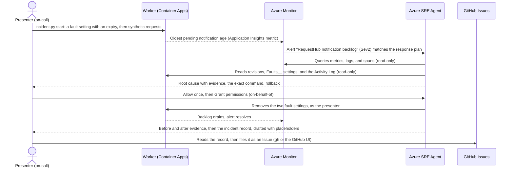

- **Azure Monitor** evaluates a metric alert every minute on `requesthub.notifications.oldest_pending_age_seconds`, a
  gauge that RequestHub's notification worker sends to Application Insights. The workbook
  *RequestHub notification worker* opens with a **Ready for a drill** table (from Azure Resource Graph: the database,
  the worker's fault settings, the alert, and the agent), then shows the backlog, deliveries per minute, and the
  worker's revisions on one page.
- **Azure SRE Agent** manages this resource group only, and receives its Azure Monitor alerts. A response plan sends
  the backlog alert to the custom agent `notification-backlog-responder` in **Review** mode. The agent's identities
  have Reader, Monitoring Reader, and Log Analytics Reader on the resource group. Because Azure Monitor is its incident
  platform, the platform also gives one of them **Monitoring Contributor on the subscription**, which it needs to
  acknowledge and close alerts
  ([Learn](https://learn.microsoft.com/azure/sre-agent/diagnose-azure-observability)); that role covers alerts, alert
  rules, action groups, and diagnostic settings, not the app. Its tool policy lets it read freely, asks a person
  before any Azure CLI write, and denies every `az monitor` write, deletes, changes to identities, roles, networking,
  Key Vault, and PostgreSQL, every GitHub tool that writes (Issues, comments, pull requests, workflows, branches,
  commits, merges, pushes, webhooks, files), and the terminal, shell, and Python tools. A Stop hook makes it show
  timestamps, facts versus hypotheses, and a rollback before it finishes.
- **The guard hook** ([`hooks/no-identifiers.py`](sre-agent/hooks/no-identifiers.py)) is a backstop. It runs before
  every call to a GitHub Issue tool, ahead of the tool policy, and blocks the GitHub write tools the policy denies, so
  they stay blocked even if someone edits the policy in the portal. For any other Issue tool, such as a read, it reads
  every key and string of the call, as written and with hidden characters, HTML, Markdown markers, and URL escapes
  undone, blocks the call if it finds a GUID or trace id, an Azure host name or resource id, an e-mail address, or a
  resource name with its random suffix, and otherwise asks a person. It is deterministic (regular expressions, no
  model), never allows a call on its own, and fails closed: unreadable or oversized input is blocked, and so is the
  call if the script fails.
- **GitHub** holds the code and the incident record. A person connects this repository once under **Code access**,
  with a read-only token for this repository, so the agent can read its code during an investigation. The agent has
  no GitHub tool that writes: it drafts the record, and the presenter files it. It doesn't file the Issue itself
  because SRE Agent's `CreateGithubIssue` tool adds tenant identifiers that no one can review first (see
  [Troubleshooting](#troubleshooting)).
- **The presenter** starts the drill, decides whether to apply the proposal, approves it, and lends it their Azure
  permissions with a second click. The change shows their name in the Activity Log. They also read the incident
  record before they file it: that read is the gate before anything reaches GitHub.
- **azd** deploys everything. Its `postprovision` hook, [`configure_sre_agent.py`](configure_sre_agent.py), applies
  the agent's configuration from [`sre-agent/`](sre-agent/) through the agent's own API and reads it back.

## What's in this folder

```text
07-operate-microsoft/
├── README.md
├── images/                            screenshots from live runs of the drill, used in this README
├── incident.py                        the drill harness: start (fault with an expiry, synthetic requests) and reset
├── configure_sre_agent.py             applies sre-agent/ to the live agent, or checks it offline (--check)
├── azd_env.py                         reads settings from this solution's azd environment
├── requirements.txt                   Python packages
├── azure.yaml                         azd project: infra plus the shared app's api and worker, and the postprovision hook
├── sre-agent/                         Azure SRE Agent configuration, versioned
│   ├── agent.yaml                     custom agent, skills, the GitHub write tools it denies, guard hook, response plan, tool policy
│   ├── instructions.md                how the custom agent investigates, and the only change it may propose
│   ├── skills/                        investigate-notification-backlog, verify-worker-recovery, draft-incident-record
│   ├── knowledge/                     requesthub-worker-runbook.md, the team's runbook
│   └── hooks/
│       ├── evidence-checklist.md      Stop hook: evidence, facts versus hypotheses, rollback, approval
│       └── no-identifiers.py          guard hook (backstop): blocks GitHub write tools, and identifiers in GitHub Issue calls
└── infra/
    ├── main.bicep                     resource group, RequestHub platform (app/infra), monitoring, SRE Agent
    ├── monitoring.bicep               the backlog metric alert and the workbook
    ├── workbook.json                  the workbook: readiness table (Azure Resource Graph) and KQL charts
    ├── sre-agent.bicep                the agent, its identities and read-only roles, telemetry connectors, AAU cap
    └── main.parameters.json
```

The app lives in [`app/`](../../app/README.md). Its notification worker already supports the fault used here:
`Faults__WorkerDelayMs` slows every delivery, and `Faults__ExpiresAtUtc` switches the fault off at a fixed time even if
nobody cleans up.

## Prerequisites

- An Azure subscription where you can create resource groups, Microsoft Entra app registrations, and role
  assignments, for example as Owner.
- A region that offers both PostgreSQL Flexible Server (for the app) and Azure SRE Agent. The examples use `centralus`.
  To see where your subscription can create the agent, run
  `az provider show -n Microsoft.App --query "resourceTypes[?resourceType=='agents'].locations" -o tsv`. If the list is
  empty, [register the subscription](https://learn.microsoft.com/azure/sre-agent/supported-regions#check-your-available-regions).
- [Azure CLI](https://learn.microsoft.com/cli/azure/install-azure-cli), [Azure Developer CLI](https://learn.microsoft.com/azure/developer/azure-developer-cli/install-azd),
  Python 3.12 or later, and PowerShell 7.4 or later for the commands in this README. The
  [GitHub CLI](https://cli.github.com/) creates the two labels in Set up and files the incident record in the demo;
  you can do both in GitHub instead.
- A GitHub account that can create a fine-grained personal access token for this repository, with read-only access
  to its code. Without it the demo still runs, and the agent investigates without reading the code.
- A budget. While deployed, this solution costs about **$375 a month**:
  - $292 for the agent's always-on flow: 4 Azure Agent Units (AAUs) an hour, at $0.10 per AAU, for as long as the
    agent exists. A new customer's [30-day evaluation](https://learn.microsoft.com/azure/sre-agent/evaluate) waives it;
    this demo's agent pays it from November 26, 2026.
  - About $85 for RequestHub's platform: Container Apps, PostgreSQL, Log Analytics, the blob private endpoint, and the
    container registry.
  - Each drill adds 15 to 25 AAUs ($1.50 to $2.50) of active flow and about $1 of log ingestion. The Bicep caps active
    flow at 1,000 AAUs a month.

  See [pricing](https://learn.microsoft.com/azure/sre-agent/pricing-billing), and [remove it](#reset-and-clean-up)
  when you are done.

## Set up

Run once, from the repository root:

```powershell
cd solutions/07-operate-microsoft
pip install -r requirements.txt
az login
azd auth login
azd env new ai-sdlc-operate --location centralus
azd up
gh label create ai-sdlc --color 1D76DB --description "AI-SDLC demo work" --force
gh label create phase:operate --color C5DEF5 --description "SDLC phase 7: Operate" --force
```

`azd up` takes about 15 minutes and ends with `SUCCESS: Your application was provisioned and deployed to Azure`. Just
before that, the `postprovision` hook lists every item it applied to the agent with `ok`, and ends with
`SRE Agent configured.` and `... every GitHub write tool is denied.` The two labels are the ones the incident record
gets. `azd up` creates resource group `rg-ai-sdlc-operate` and fills it as follows:

- **RequestHub's platform** from [`app/infra/requesthub.bicep`](../../app/infra/requesthub.bicep), and the app as two
  container apps (API with web UI, and the notification worker). You get every RequestHub role.
- **The backlog alert** (*RequestHub notification backlog*, severity 2, oldest pending notification older than 60
  seconds) and the workbook *RequestHub notification worker*.
- **Azure SRE Agent** `sre-ai-sdlc-operate`: Reader-level access to this resource group, Review mode, Azure Monitor as
  its incident platform, connectors to the app's Application Insights and Log Analytics, and its own Application
  Insights for its activity. You get the **SRE Agent Administrator** role. The platform itself adds one role that
  isn't in the Bicep: Monitoring Contributor on the subscription for the agent's identity, to acknowledge and close
  alerts. The tool policy denies `az monitor` writes, and [Reset and clean up](#reset-and-clean-up) removes the role.
- **The agent's configuration**, applied by the `postprovision` hook: the runbook, three skills, the custom agent with
  its Stop hook, the guard hook, the tool policy, and the response plan. The default quickstart plan is removed so the
  alert is not investigated twice.

Then open the agent once, with the URL from `azd env get-value SRE_AGENT_PORTAL_URL`, and sign in. The first visit
shows a setup checklist (2 log providers, 1 resource group, Azure Monitor connected). **Done and go to agent** opens a
*Team onboarding* chat in which the agent reads the resource group and writes notes about it to its memory; that uses
a few AAUs and changes nothing. Under **Incidents**, **Triggers & response plans** lists
`requesthub-notification-backlog`: On, `notification-backlog-responder`, Sev2, Review.

### Connect GitHub

A person does this once, because it gives an Azure service access to GitHub. The agent reads the repository's code
through **Code access**; it never writes to GitHub.

1. In GitHub, open **Settings**, **Developer settings**, **Personal access tokens**, **Fine-grained tokens**, and select
   **Generate new token**:
   - **Token name:** `sre-agent-operate-microsoft`. **Expiration:** 30 days.
   - **Repository access:** Only select repositories, and pick this repository.
   - **Permissions:** Repository permissions, **Contents: Read-only**: Code access clones the repository to connect it
     ([Learn](https://learn.microsoft.com/azure/sre-agent/github-connector#permissions-by-auth-type)). GitHub adds
     **Metadata: Read-only** by itself. Nothing else.

   Select **Generate token** and copy it.
2. In the [SRE Agent portal](https://sre.azure.com), open `sre-ai-sdlc-operate`, then **Build + setup**, **Code
   access**, the **GitHub** tab, and **Add repository**. In *Add repositories*, GitHub is selected:
   - **Repository URL:** this repository's URL, `https://github.com/<owner>/<repo>`.
   - **Connection method:** **Personal access token (PAT)**. Paste the token under **Provide PAT** and select
     **Connect**. A *Connected* card appears.

   Select **Next**, then **Save**. The repository is listed under **Code access** with a green connection and a
   **Last synced** time.
3. Check the connection:

   ```powershell
   python configure_sre_agent.py
   ```

   The `Tools` section reports `GitHub: <owner>/<repo> is connected, credential healthy, code ready; the agent can read
   its code and has no GitHub tool that writes`.

A token that allows more, for example one you share with other solutions, still doesn't let the agent write: the
custom agent has no GitHub tool, and the tool policy denies every GitHub tool that writes, Issue writes included, and
the terminal, shell, and Python tools, which could use the token. Two choices in the portal would widen the access:
**OAuth** in that dialog applies to every repository your GitHub account can reach, and the **GitHub** card under
**Build + setup**, **Connectors** is GitHub's MCP server, with GitHub's whole tool catalog. When the token expires,
create a new one the same way, then select the repository under **Code access** and connect again with the new token.

## Before each session

About 5 minutes, at least 15 minutes before you present.

1. **Confirm the starting state.** Open the workbook: in the Azure portal, the Application Insights resource `appi-...`
   in `rg-ai-sdlc-operate`, **Workbooks**, *RequestHub notification worker*. Every row of **Ready for a drill** must say
   **Ready**, and the charts below it stay at zero.

   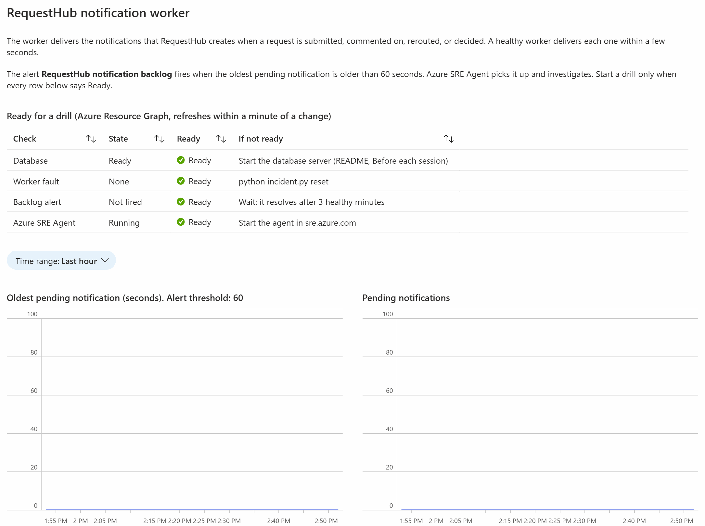

   The table reads Azure Resource Graph, which reflects a change within a minute or two. Select the workbook's refresh
   button after you fix something. The usual fixes:
   - **Database `Stopped`.** Some subscriptions stop PostgreSQL servers overnight with a governance automation. Start
     it (about 3 minutes; the API answers a minute later):

     ```powershell
     az postgres flexible-server start -g rg-ai-sdlc-operate -n (azd env get-value POSTGRES_HOST).Split('.')[0]
     ```

   - **Worker fault `Injected`.** A drill was not reset. Run `python incident.py reset`.
   - **Backlog alert `Fired`.** Wait: Azure Monitor resolves it after three healthy one-minute evaluations, about 5
     minutes after the backlog drains.
   - **Azure SRE Agent not `Running`.** In the SRE Agent portal, **Settings**, **Basics**, select **Start**.
2. **Check GitHub and your sign-in.** In the SRE Agent portal, **Build + setup**, **Code access**, **GitHub** lists
   this repository with a green connection. GitHub's **Fine-grained tokens** page shows when its token expires.
   `az account show` must show the account that ran `azd up`: it is the SRE Agent Administrator who approves the
   mitigation, and its token reads RequestHub's Admin API.
3. **Open in advance**, signed in, one tab each:
   - The SRE Agent portal (`azd env get-value SRE_AGENT_PORTAL_URL`), on **Incidents**. Dismiss its tour if one
     appears.
   - The workbook from step 1.
   - The same Application Insights resource, **Monitoring**, **Alerts**.
   - This repository's Issues, filtered with `label:phase:operate`.
   - [`sre-agent/agent.yaml`](sre-agent/agent.yaml) in your editor.
   - A PowerShell 7 terminal in this folder.
4. **Start early if your slot is short.** The alert fires about 6 minutes after `start` submits its requests, and the
   agent's report follows 2 to 3 minutes later. Run step 2 up to 10 minutes before you want to show the
   investigation, but not more than 30 minutes before: the fault switches itself off 45 minutes after `start`.
5. **Timings** from live runs:

   | Step | What happens | Time |
   | --- | --- | --- |
   | 1. Show the starting state and the guardrails | You walk through the workbook and the configuration | 3 min |
   | 2. Start the incident | Fault applied, slowed revision takes over, 200 requests | 1 to 2 min |
   | 3. Watch the alert fire | The backlog ages until the alert fires | 6 min |
   | 4. Follow the investigation | Investigation starts, then the report and the approval request | 2 to 3 min |
   | 5. Mitigate | Allow once, Grant permissions, a new worker revision | 1 to 2 min |
   | 6. Watch it recover | The backlog drains, the agent verifies, then the alert resolves | 6 min |
   | 7. Review and file the incident record | You read the agent's draft, then file it with `gh` or the GitHub UI | 2 min |

   About 25 minutes in total, most of it the agent and Azure Monitor working while you explain.

## Run the demo

Run the commands in this folder. The screenshots of steps 2 to 6 come from one live run of this drill, and those of
step 7 from a second run, so the times in the record differ from those in the earlier screenshots.

1. **Show the starting state and the guardrails** (3 minutes). The workbook's **Ready for a drill** table is all
   **Ready** (see [Before each session](#before-each-session)). In the SRE Agent portal, open **Incidents**, then
   **Triggers & response plans**: one response plan sends the backlog alert to the custom agent, in **Review** mode.

   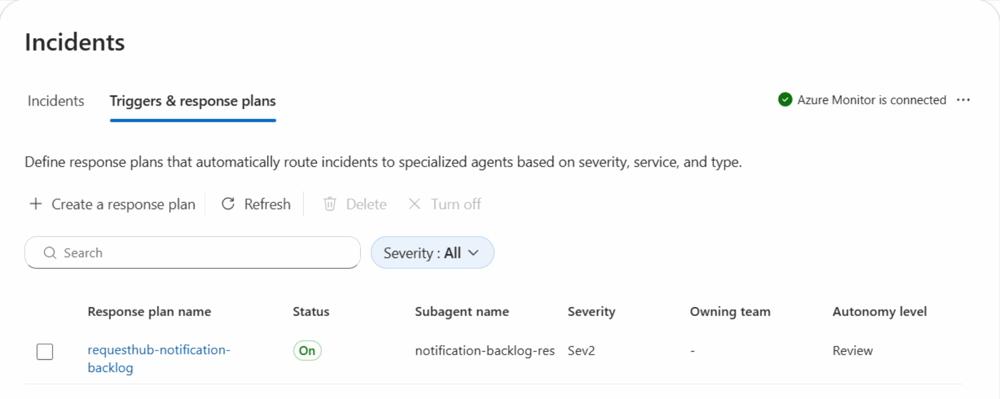

   Then open **Build + setup**, **Hooks**, and select the edit button of `no-identifiers-in-github`. The guard hook is a
   backstop: a Python script that runs in Azure before every GitHub Issue call and blocks the GitHub write tools, and
   its fail mode is **Block**. Close it with **Cancel**.

   

   The same configuration is versioned in [`sre-agent/agent.yaml`](sre-agent/agent.yaml): the GitHub write tools it
   denies, Issue writes included, the guard hook, and the tool policy. `azd provision` applies it.

   

   In the Azure portal, the resource group's **Access control (IAM)** shows the agent's identities with reader roles.
   The subscription's **Access control (IAM)** shows one more: Monitoring Contributor, which the platform added so the
   agent can acknowledge and close alerts. The tool policy denies every `az monitor` write, so the agent can't use it
   for anything else.

   **Point out:** the agent can read everything it needs and has no right to change the app. Every Azure write waits
   for a person, the riskiest commands are denied outright, and the agent can't write to GitHub at all.

2. **Start the incident** (1 to 2 minutes):

   ```powershell
   python incident.py start
   ```

   It prints the exact `az containerapp update` command that adds the fault: each delivery waits 10 seconds, and the
   fault expires after 45 minutes. It waits for the slowed revision to take over, then submits 200 synthetic requests.
   Expect about 360 pending notifications. At 6 a minute, the slowed worker would need an hour to deliver them, longer
   than the fault lasts, so the backlog only clears when someone acts.

   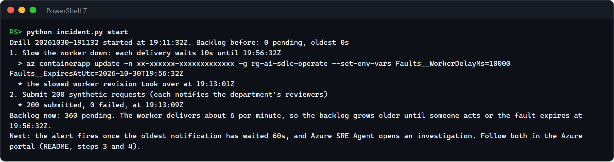

   **Point out:** even a deliberate fault has an expiry, so a forgotten drill cannot outlive the session.

3. **Watch the alert fire** (6 minutes). In the workbook, select refresh every minute or two: the oldest pending
   notification climbs in steps, because the slowed worker reports its backlog only after each batch. The **Ready for
   a drill** table now shows the worker fault as **Injected**.

   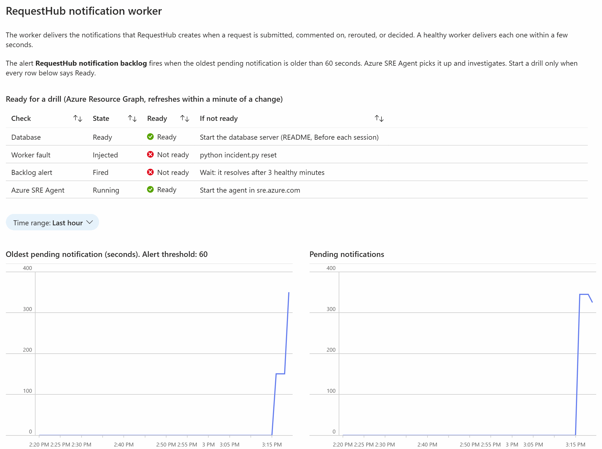

   About 6 minutes after the requests, Application Insights **Alerts** lists the Sev2 alert with condition *Fired*.
   The agent has already acknowledged it.

   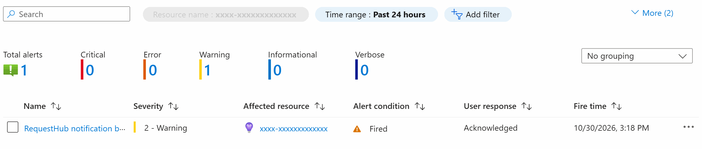

   **Point out:** nobody is paged into an empty dashboard: the alert itself starts the investigation, under the
   reviewed response plan, in Review mode.

4. **Follow the investigation** (2 to 3 minutes). In the SRE Agent portal, open **Incidents**: the alert is listed with
   the agent *In progress*, then *Pending user input* once its proposal waits for approval.

   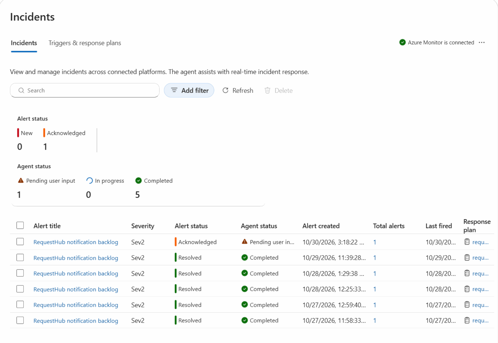

   Open it. The thread starts with the alert, then the agent searches its memory and finds the runbook from
   [`knowledge/`](sre-agent/knowledge/) and earlier incidents with the same symptoms.

   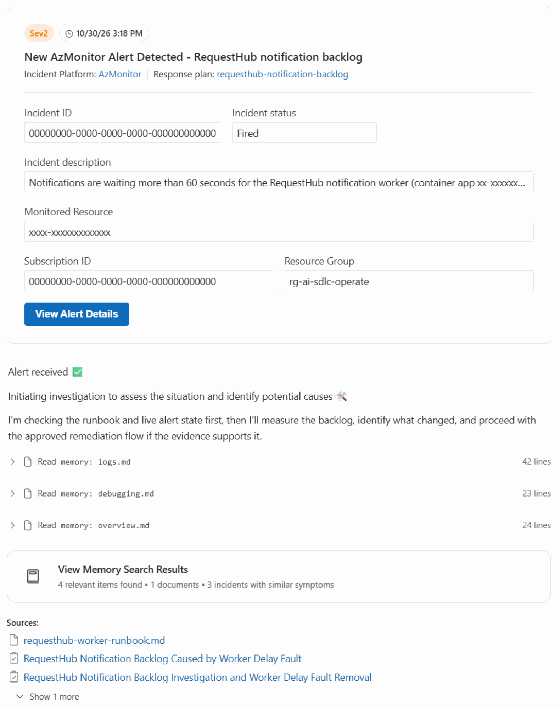

   It then queries the metrics, logs, and delivery spans, lists the worker's revisions and the Activity Log, and
   compares the `Faults__` settings with the previous revision. It rules out database errors, API errors, and restarts,
   and reports the impact, a UTC timeline, confirmed facts, hypotheses with their confidence, the root cause, and the
   smallest reversible mitigation with its rollback and the time the fault would have expired. Nothing has changed yet.

   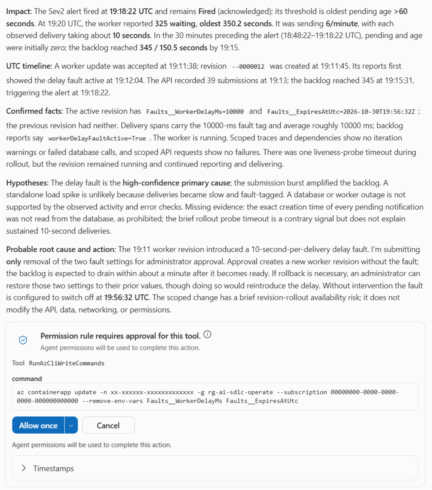

   **Point out:** facts are kept apart from hypotheses, and each fact names its evidence: the fault setting on the new
   revision, the worker's own `workerDelayFaultActive=True`, and delivery spans of about 10 seconds.

5. **Mitigate** (1 to 2 minutes). Right after its report the agent submits the command, and the platform holds it:
   *Permission rule requires approval for this tool*. It waits while you walk the audience through the report.

   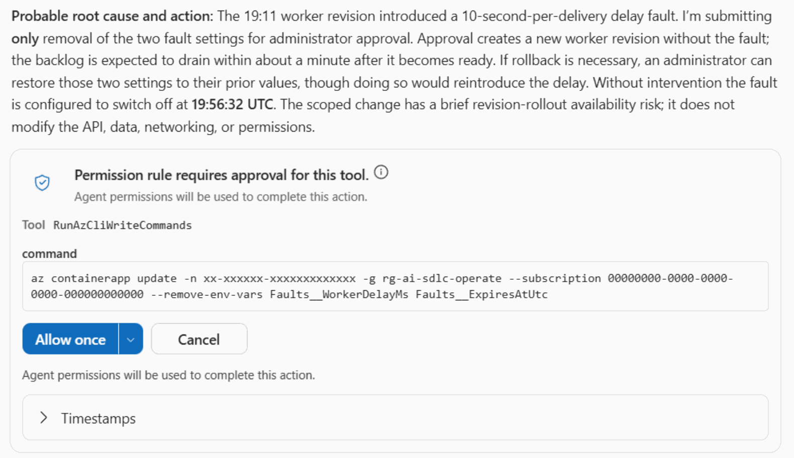

   Select **Allow once**. The card turns **Approved** and reads *The action was completed using agent permissions*:
   the platform ran the command with the agent's own identity. That identity has no right to change the worker, so
   the attempt failed with an authorization error, by design, and nothing has changed yet. The next card,
   **Authorization required**, asks to run the same command with your credentials (on-behalf-of). Select
   **Grant permissions**.

   

   A new worker revision starts without the fault, and the Activity Log shows your name on the change. To run the
   command yourself instead, select **Cancel** and use the command from the report. If the agent stops at its report
   without asking, reply *Apply the proposed mitigation.* With **Go back to legacy**, the portal's older navigation,
   the buttons are **Approve**, **Deny**, and **Authorize**.

   **Point out:** a person makes two decisions: approving this exact command, and lending it their permissions. The
   agent holds no right to change the app.

6. **Watch it recover** (6 minutes). Within about a minute and a half of the change the backlog drains. In the thread,
   the agent checks fresh telemetry from the new revision before it calls anything recovered. The titles of its
   command cards, such as *Starting Azure resource (Low risk)* or *Creating new Azure resource (Medium risk)*, are the
   platform's guesses from the command; the commands under them, `az containerapp show` and
   `az containerapp revision list`, only read. Only the command you approved changed anything.

   

   The alert resolves about 5 minutes after the backlog drains, after three healthy one-minute evaluations. The
   workbook now tells the whole story.

   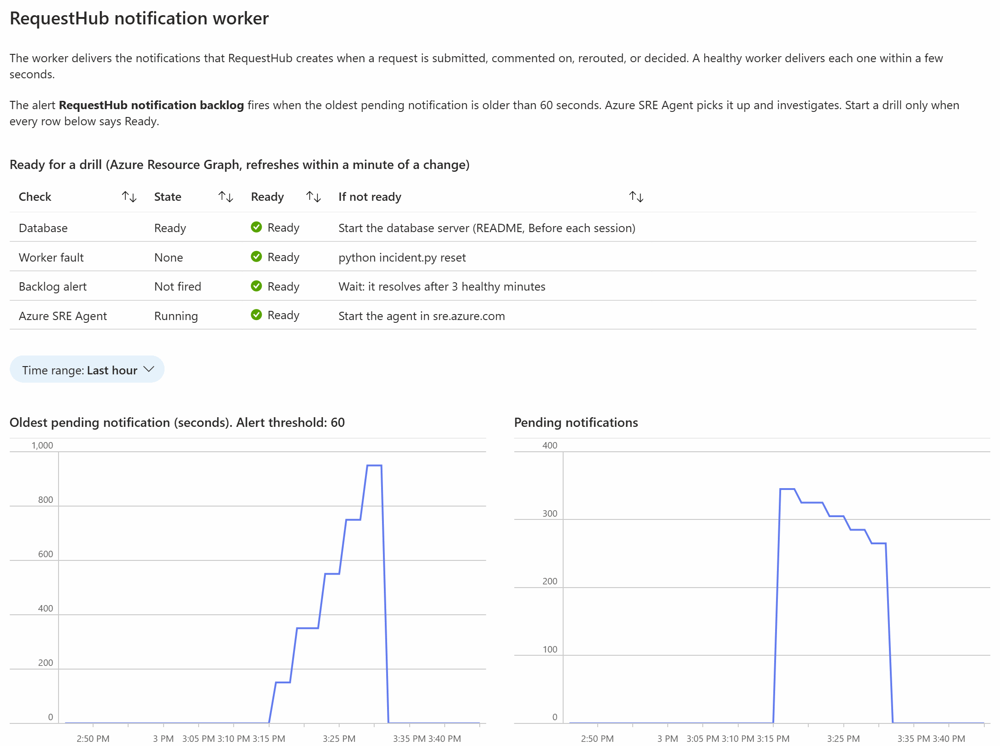

   **Point out:** recovery is measured, not assumed: the agent waits for post-change data and the resolved alert.

7. **Review and file the incident record** (2 minutes). After it verifies recovery, the agent ends its last reply with
   the record, drafted with its `draft-incident-record` skill: a title, the two labels, and the body in a code block,
   with placeholders ("the worker", "the API") instead of resource names or ids.

   

   Read it with the audience. This read is the human gate: nothing reaches GitHub until a person files it, and the
   agent can't. Remove anything that identifies the deployment. Then copy the body with the code block's copy button
   and file it, with the title from the draft:

   ```powershell
   Get-Clipboard -Raw | Set-Content $env:TEMP\record.md
   gh issue create --title "Incident record: notification backlog, <YYYY-MM-DD>" --label ai-sdlc --label phase:operate --body-file $env:TEMP\record.md
   ```

   `gh` prints the new Issue's URL. You can also paste the title and body into **New issue** in GitHub and add the two
   labels.

   

   **Point out:** the agent wrote the record from its own investigation, in its own words and with its evidence, but a
   person decided what went into GitHub.

## What to observe

- **Time to context.** In the live runs the investigation started about a minute after the alert fired, and the
  root cause with its evidence, and the approval request, were ready 2 to 3 minutes after the alert. Nobody opened a
  dashboard.
- **It remembers.** The agent's first step searched its memory and found both the team's runbook and earlier drills
  with the same symptoms. With the repository connected under Code access, it also read the runbook from the
  repository itself.
- **Correlation, not guesswork.** The agent tied four kinds of evidence together: the backlog metric, the worker's own
  report (`workerDelayFaultActive=True`), delivery spans (10 seconds each instead of under a millisecond), and the
  revision that added the setting. It named what it could not prove, such as how much the burst of requests added.
- **Least privilege that holds.** The agent could not change the worker even after approval: its identities read the
  resource group, and their one write role, Monitoring Contributor for alert handling, doesn't cover the app. The
  change ran as the approving administrator, scoped to two settings on one container app. In GitHub it can only read:
  it has no GitHub tool, and every GitHub tool that writes is denied.
- **Careful when something fails.** In one run the first approved command failed because it did not name its
  subscription and the approver's default subscription was another one. The agent did not retry blindly: it read the
  fault settings again and asked for approval once more. The command now always names its subscription.
- **Recovery with evidence.** The agent compared numbers from before and after the change and waited for the resolved
  alert before it called the incident over.
- **A record that is safe to share.** The record has a UTC timeline, the cause, the fix, and a follow-up, drafted by
  the agent from its own investigation with placeholders instead of identifiers, and a person read it before it
  became an Issue.
- **An honest weak spot.** The worker publishes its backlog only between batches, so a slow worker delays its own
  alert by a few minutes. It is a good follow-up: measure the queue independently of the worker.
- **Agent configuration is code.** A change that set the response plan to Autonomous, allowed writes without approval,
  allowed `az monitor` writes, gave the agent a GitHub tool, stopped denying `CreateGithubIssue` or any other GitHub
  write tool, stopped denying the terminal, let the guard hook fail open or stop blocking the denied tools, or stopped
  it from blocking an identifier in any of the forms it tests fails `python configure_sre_agent.py --check` before it
  reaches the agent.

## Reset and clean up

After each drill (the threads stay in the agent's history as the record of past drills):

```powershell
python incident.py reset
```

`reset` removes the fault if it is still set and reseeds RequestHub's demo data. The next drill can start when every
row of the workbook's **Ready for a drill** table says **Ready**: the alert row does about 5 minutes after the backlog
drains. The Issue you filed is the drill's record; close it once its follow-up is done.

When you no longer need the solution, first remove the agent's access to GitHub: in the SRE Agent portal select the
repository under **Build + setup**, **Code access**, **GitHub**, and select **Delete**. Then delete the token in GitHub
(**Settings**, **Developer settings**, **Personal access tokens**, **Fine-grained tokens**), which revokes it at once;
if other agents share it, wait until they no longer need it. Then run from this folder:

```powershell
$sre = (az identity list -g rg-ai-sdlc-operate -o json | ConvertFrom-Json | Where-Object name -like 'id-sre-*').principalId
az role assignment delete --assignee $sre --role "Monitoring Contributor" --scope "/subscriptions/$(azd env get-value AZURE_SUBSCRIPTION_ID)"
$app = az ad app show --id (azd env get-value API_CLIENT_ID) --query id -o tsv
azd down --purge
az ad app delete --id $app
az rest --method delete --url "https://graph.microsoft.com/v1.0/directory/deletedItems/$app"
```

The first two lines remove the Monitoring Contributor role the platform gave the agent's identity on the
subscription; `azd down` leaves it, because it isn't in the resource group. `azd down` deletes the resource group,
including the agent, which stops its charges. RequestHub's sign-in app registration is a Microsoft Entra object, which
no resource group contains, so `az ad app delete` removes it and `az rest` empties it from the recycle bin. Without
that last step, a new `azd up` with the same environment name can't create the app registration again for 30 days.

## Use it in your own repository

1. Copy this folder. It has no `.github/` files: everything runs in Azure.
2. Point the alert at your own signal in [`infra/monitoring.bicep`](infra/monitoring.bicep). Any platform metric, or
   any custom metric your app sends through OpenTelemetry, works the same way. Adapt the readiness rows in
   [`infra/workbook.json`](infra/workbook.json).
3. Grant the agent read access to your resource group only, as [`infra/sre-agent.bicep`](infra/sre-agent.bicep) does,
   and keep the response plan in Review mode until you trust its proposals. With Azure Monitor as the incident
   platform, the agent also gets Monitoring Contributor on the subscription; keep `az monitor` writes denied in its
   tool policy.
4. Rewrite [`sre-agent/`](sre-agent/) for your service: the scope and the only changes it may propose
   (`instructions.md`), your KQL (`skills/`), your runbook (`knowledge/`), your incident record template
   (`skills/draft-incident-record.md`), and the alert's severity and title (`agent.yaml`). Name the subscription in
   every write command the agent may propose. Run `python configure_sre_agent.py --check`, then `azd provision`.
5. Connect your repository under **Code access** with a read-only token (**Contents: Read-only**), as in
   [Connect GitHub](#connect-github).
6. Replace the drill in `incident.py` with a fault that fits your service, for example an
   [Azure Chaos Studio](https://learn.microsoft.com/azure/chaos-studio/chaos-studio-overview) experiment. Give every
   fault an expiry.

## Troubleshooting

- **The workbook shows the database `Stopped`, or `incident.py start` cannot read the backlog.** A governance
  automation in some subscriptions stops PostgreSQL servers overnight. Start it with the command in
  [Before each session](#before-each-session), wait about 3 minutes, then a minute more for the API to reconnect.
- **The agent says it got an authorization error after you approved.** That is the design: its identities have no
  right to change the worker. Select **Grant permissions** on the next card to run the command with your permissions,
  or run it yourself.
- **Grant permissions does not respond.** Reload the thread and select it again. If nothing happens, select **Cancel**
  on that card and run the command from the agent's report yourself; the workbook's worker fault row turns **None**.
- **After Grant permissions, the run fails with "containerapp does not exist".** The command did not name its
  subscription, and your sign-in's default subscription is another one. The instructions in this folder include
  `--subscription`; keep it if you change them. The agent reads the fault settings again and asks for approval once
  more; if it stops instead, reply *Submit the same command again with --subscription for this resource group.*
- **The approved command fails with "OBO sandbox CLI dispatched but response failed".** The platform's on-behalf-of
  run failed, possibly before the command reached Azure. The workbook's worker fault row shows whether the fault is
  still set. If it is, the agent submits the command again for approval; if it stops instead, reply
  *Approved, but the run failed and the fault is still set. Submit the command again.* You can also run the command
  from its report yourself.
- **Why doesn't the agent file the Issue itself?** Don't give it `CreateGithubIssue`, SRE Agent's own tool for filing
  Issues. After a person allows the call, the tool appends a footer: the agent's instance name, and a link to the
  thread with the subscription ID and the thread GUID. Neither the guard hook nor the approval card shows that footer,
  and the Issue's edit history keeps it even after someone edits it out. So the agent drafts the record and a person
  files it, and `python configure_sre_agent.py --check` fails unless the tool is denied by name.
- **The agent asks to create an Issue, or says a GitHub call was blocked.** That is the backstop working: the guard
  hook and the tool policy block every GitHub write tool. File the record from the agent's reply yourself, as in step
  7 of [Run the demo](#run-the-demo).
- **The repository's row under Code access shows Failed.** The token can't read the repository's contents. Create a
  token with **Contents: Read-only**, as in [Connect GitHub](#connect-github), and connect again.
- **A RequestHub button fails with HTTP 403 and no body.** The API was deployed before the fix that lets the app's own
  origin send requests through Container Apps authentication (#134). Run `azd deploy api` from `main`.
- **The alert takes several minutes to fire.** The worker reports its backlog after each batch of up to 20
  notifications, so at 10 seconds per delivery the gauge updates every few minutes.
- **No investigation appears after the alert fires.** In the SRE Agent portal, **Incidents**, **Triggers & response
  plans**: the plan must be On, Sev2, with the title containing "notification backlog". Run
  `python configure_sre_agent.py` again to restore it.
- **`LocationIsOfferRestricted` for PostgreSQL during `azd up`.** Your subscription cannot create PostgreSQL Flexible
  Server in that region. Create a new azd environment in another region that also offers Azure SRE Agent.
- **`AzureCLICredential: exit status 1` during `azd up`.** azd could not get a token from the Azure CLI. Run
  `az account get-access-token`, then run `azd up` again.
- **A multi-line KQL query returns the whole table from `az monitor app-insights query`.** On Windows, `az` cuts an
  argument at its first line break. Put the query on one line.
