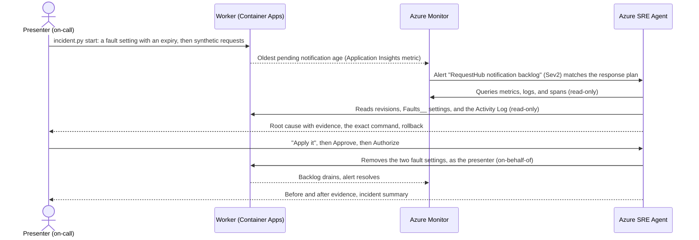

# Operate · Incident investigation with Azure SRE Agent

When an alert fires, the on-call engineer spends the first half hour gathering context: which dashboards, what changed,
which logs matter. In this solution an Azure Monitor alert on RequestHub's notification backlog goes straight to
**Azure SRE Agent**. Within minutes the agent measures the backlog, correlates it with the worker's telemetry and a
recent configuration change, rules out other causes, and proposes one scoped, reversible mitigation. A person approves
it, and it runs with that person's permissions because the agent itself can only read. The agent then verifies the
recovery. Its custom agent, skills, runbook, response plan, and tool policy are versioned in this folder and applied
like code.

## Where it fits

**Phase 7 of 7: Operate and improve.** The GitHub counterpart is [07-operate-github](../07-operate-github/).

| | Today | With this solution |
| --- | --- | --- |
| Detection | Someone notices late notifications, or an alert pages a person who starts from zero. | An Azure Monitor alert on the backlog's age opens an investigation in Azure SRE Agent about a minute after it fires. |
| Investigation | Open dashboards, query logs, ask who changed what. | The agent correlates metrics, logs, spans, and the worker's revision history in about three minutes, and separates facts from hypotheses. |
| Mitigation | The first plausible fix, run with broad permissions. | One proposed command, scoped to the worker. It runs only after an administrator approves it, with that administrator's permissions. |
| Recovery | "Looks fine now." | Evidence: fault gone, backlog drained, a new request's notifications delivered, alert resolved. |
| Agent changes | Edited by hand in a portal. | Instructions, skills, runbook, response plan, and tool policy reviewed in pull requests and checked against rules. `main` applies them; only an administrator can change the tool policy. |

## How it works



- **Azure Monitor** evaluates a metric alert every minute on `requesthub.notifications.oldest_pending_age_seconds`, a
  gauge that RequestHub's notification worker sends to Application Insights. The workbook
  *RequestHub notification worker* shows the backlog, deliveries per minute, and the worker's revisions on one page.
- **Azure SRE Agent** manages this resource group only, and receives its Azure Monitor alerts. A response plan sends
  the backlog alert to the custom agent `notification-backlog-responder` in **Review** mode. The agent's identities
  have Reader, Monitoring Reader, and Log Analytics Reader on the resource group, nothing more. Its tool policy lets
  it read freely, asks before any Azure CLI write, and denies deletes and changes to identities, roles, networking,
  Key Vault, and PostgreSQL. A Stop hook makes it show timestamps, facts versus hypotheses, and a rollback before it
  finishes.
- **The presenter** starts the drill, decides whether to apply the proposal, approves it, and checks recovery. Only an
  SRE Agent Administrator can approve. The change runs with the presenter's own Azure permissions and shows their name
  in the Activity Log.
- **GitHub Actions** ([`operate-microsoft-agent-config.yml`](.github/workflows/operate-microsoft-agent-config.yml))
  checks every change to `sre-agent/` against those rules, and applies it to the agent from `main` through OIDC. The
  GitHub environment accepts only `main`, and the workflow's identity cannot approve actions or change the global tool
  policy; an SRE Agent Administrator applies that with `python configure_sre_agent.py`.
- **GitHub Copilot** (custom agent [`operate-microsoft`](.github/agents/operate-microsoft.agent.md)) helps run the drill
  and changes the SRE Agent configuration through pull requests.

## What's in this folder

```text
07-operate-microsoft/
├── README.md
├── incident.py                        the drill: start, watch, verify, summary (sanitized, optional GitHub Issue), reset
├── configure_sre_agent.py             applies sre-agent/ to the live agent, or checks it offline (--check)
├── configure_github.py                azd hooks: connect the solution to GitHub Actions (OIDC environment)
├── azd_env.py                         reads settings from this solution's azd environment
├── requirements.txt                   Python packages
├── azure.yaml                         azd project: infra plus the shared app's api and worker, and the hooks
├── sre-agent/                         Azure SRE Agent configuration, versioned
│   ├── agent.yaml                     custom agent, skills, knowledge, response plan, tool policy
│   ├── instructions.md                how the custom agent investigates, and the only change it may propose
│   ├── skills/                        investigate-notification-backlog, verify-worker-recovery (KQL and read-only CLI)
│   ├── knowledge/                     requesthub-worker-runbook.md, the team's runbook
│   └── hooks/evidence-checklist.md    Stop hook: evidence, facts versus hypotheses, rollback, approval
├── infra/
│   ├── main.bicep                     resource group, RequestHub platform (app/infra), monitoring, SRE Agent
│   ├── monitoring.bicep               the backlog metric alert and the workbook
│   ├── workbook.json                  workbook tiles (KQL)
│   ├── sre-agent.bicep                the agent, its identities and read-only roles, telemetry connectors, AAU cap
│   └── main.parameters.json
└── .github/
    ├── agents/operate-microsoft.agent.md        Copilot agent for drills and agent-configuration changes
    ├── skills/
    │   ├── telemetry-investigation/             the agent's evidence, from a terminal
    │   └── recovery-verification/               when an incident is really over
    └── workflows/operate-microsoft-agent-config.yml
```

The app lives in [`app/`](../../app/README.md). Its notification worker already supports the fault used here:
`Faults__WorkerDelayMs` slows every delivery, and `Faults__ExpiresAtUtc` switches the fault off at a fixed time even if
nobody cleans up.

## Prerequisites

- An Azure subscription where you can create resource groups, Microsoft Entra app registrations, and role
  assignments, for example as Owner.
- A region that offers both PostgreSQL Flexible Server (for the app) and Azure SRE Agent. The examples use `centralus`.
  To see where your subscription can create the agent, run
  `az provider show -n Microsoft.App --query "resourceTypes[?resourceType=='agents'].locations" -o tsv`. If the list is
  empty, [register the subscription](https://learn.microsoft.com/azure/sre-agent/supported-regions#check-your-available-regions).
- [Azure CLI](https://learn.microsoft.com/cli/azure/install-azure-cli), [Azure Developer CLI](https://learn.microsoft.com/azure/developer/azure-developer-cli/install-azd),
  and the [GitHub CLI](https://cli.github.com/) signed in as a repository admin (the hooks create a GitHub environment).
- Python 3.12 or later.
- A budget for the agent. Azure SRE Agent charges 4 Azure Agent Units (AAUs) per hour while it exists, plus AAUs for
  the work it does; an incident investigation uses roughly 10 to 35 AAUs. New customers can
  [evaluate it](https://learn.microsoft.com/azure/sre-agent/evaluate) without the hourly charge for 30 days. This
  solution caps active usage at 1,000 AAUs a month. See [pricing](https://learn.microsoft.com/azure/sre-agent/pricing-billing),
  and [remove it](#reset-and-clean-up) when you are done.

## Set up

Run once, from this folder:

```powershell
cd solutions/07-operate-microsoft
pip install -r requirements.txt
az login
azd auth login
azd env new ai-sdlc-operate --location centralus
azd up
```

`azd up` takes about 15 minutes. It creates resource group `rg-ai-sdlc-operate` and fills it as follows:

- **RequestHub's platform** from [`app/infra/requesthub.bicep`](../../app/infra/requesthub.bicep), and the app as two
  container apps (API with web UI, and the notification worker). You get every RequestHub role.
- **The backlog alert** (*RequestHub notification backlog*, severity 2, oldest pending notification older than 60
  seconds) and the workbook *RequestHub notification worker*.
- **Azure SRE Agent** `sre-ai-sdlc-operate`: Reader-level access to this resource group, Review mode, Azure Monitor as
  its incident platform, connectors to the app's Application Insights and Log Analytics, and its own Application
  Insights for its activity. You get the **SRE Agent Administrator** role.
- **The agent's configuration**, applied by the `postprovision` hook (`configure_sre_agent.py`): the runbook, two
  skills, the custom agent with its Stop hook, the tool policy, and the response plan. The default quickstart plan is
  removed so the alert is not investigated twice.
- **GitHub environment `operate-microsoft`**, with the OIDC sign-in values and resource names the workflow needs.

Open the agent with the URL from `azd env get-value SRE_AGENT_PORTAL_URL`. Under **Builder**, **Incident response plans**
lists `requesthub-notification-backlog` → `notification-backlog-responder`, Review.

## Run the demo

About 30 minutes, most of it the agent working while you explain. Start step 2 before the audience segment if time is
short. Run the commands in this folder.

1. **Show the guardrails.** Open [`sre-agent/agent.yaml`](sre-agent/agent.yaml): the custom agent's tools, the response
   plan in Review mode, and the tool policy (reads allowed, Azure CLI writes ask, deletes denied). In the Azure portal,
   the resource group's **Access control (IAM)** shows that the agent's identities only have reader roles. Open the
   workbook (Application Insights, **Workbooks**, *RequestHub notification worker*): the oldest pending notification is a
   few seconds old.

2. **Start the incident** (about 2 minutes):

   ```powershell
   python incident.py start
   ```

   It prints the exact `az containerapp update` command that adds the fault: each delivery waits 10 seconds, and the
   fault expires after 45 minutes. It waits for the slowed revision to take over, then submits 80 synthetic requests.
   Expect about 144 pending notifications. The worker now delivers 6 a minute.

3. **Watch it unfold** in a second terminal:

   ```powershell
   python incident.py watch
   ```

   Every 30 seconds: pending notifications, the age of the oldest one (live from RequestHub's Admin API), the fault,
   the alert, and the SRE Agent investigation. The alert fires about 7 minutes after the requests, because the worker
   reports its backlog only after each slow batch. About a minute later the investigation starts.

4. **Follow the investigation.** In the SRE Agent portal, open **Incidents**, then **[Sev2] RequestHub notification
   backlog**. In about three minutes the agent searches the runbook, queries the metrics, logs, and delivery spans,
   lists the worker's revisions and the Activity Log, and compares the `Faults__` settings with the previous revision.
   It rules out database errors, API errors, restarts, and the load spike, then reports the root cause with high
   confidence, the exact command, a rollback, and when the fault would have expired. It states that nothing changed.

5. **Mitigate.** Right after its report the agent submits the command, and the platform pauses it for approval: the
   card shows the command and "Permission rule requires approval for this tool". Select **Approve**. The agent first
   tries with its own identity and gets an authorization error, by design. The card then offers to run the command
   with your credentials (on-behalf-of): select **Authorize**. A new worker revision starts without the fault. To run
   the command yourself instead, select **Deny** and use the command from the report. If the agent stops at its report
   without asking, reply *Apply the proposed mitigation.*

6. **Watch it recover.** In the `watch` terminal the fault turns off and the backlog drains within about a minute of
   the new revision. The alert resolves about 5 minutes later, after three healthy one-minute evaluations. In the
   thread, the agent reports before and after numbers and does not declare recovery until the alert resolves.
   `watch` stops by itself.

7. **Verify and record** (about 1 minute):

   ```powershell
   python incident.py verify
   python incident.py summary --issue --label ai-sdlc --label phase:operate
   ```

   `verify` prints five checks: fault removed, backlog drained, a new request's notifications delivered, alert
   resolved, SRE Agent investigated. `summary` writes a timeline and the agent's report, without subscription,
   tenant, or object ids or email addresses, and files it as a GitHub Issue. To hand the follow-up to the GitHub track's
   incident triage ([07-operate-github](../07-operate-github/)), add `--label incident`.

## What to observe

- **Time to context.** In the reference run the alert fired at 14:21:52 UTC, the investigation started at 14:23:08,
  and the root cause with evidence was ready at 14:25:57. Nobody opened a dashboard.
- **Correlation, not guesswork.** The agent tied four kinds of evidence together: the backlog metric, the worker's own
  report (`workerDelayFaultActive=True`), delivery spans (10 seconds each instead of 0.1 milliseconds), and the revision
  that added the setting. It named what it could not prove, such as a load spike that also added work.
- **Least privilege that holds.** The agent could not change the worker even after approval: its identity only reads.
  The change ran as the approving administrator, scoped to two settings on one container app.
- **Recovery with evidence.** The agent waited for fresh telemetry and the resolved alert before it called the
  incident over, and `verify` proved that a new request's notifications went out in seconds.
- **An honest weak spot.** The worker publishes its backlog only between batches, so a slow worker delays its own
  alert by a few minutes. The agent pointed this out. It is a good follow-up for the repository: measure the queue
  independently of the worker.
- **Agent configuration is code.** A pull request that set the response plan to Autonomous or allowed writes without
  approval would fail the check before it reached the agent.

## Reset and clean up

After each drill (the threads stay in the agent's history as the record of past drills):

```powershell
python incident.py reset
```

It removes the fault if it is still set and reseeds RequestHub's demo data. Wait for the alert to resolve before you
start another drill.

When you no longer need the solution, run from this folder:

```powershell
$app = az ad app show --id (azd env get-value API_CLIENT_ID) --query id -o tsv
azd down --purge
az ad app delete --id $app
az rest --method delete --url "https://graph.microsoft.com/v1.0/directory/deletedItems/$app"
gh api -X DELETE 'repos/{owner}/{repo}/environments/operate-microsoft'
```

`azd down` deletes the resource group, including the agent, which stops its charges. RequestHub's sign-in app
registration is a Microsoft Entra object, which no resource group contains, so `az ad app delete` removes it and
`az rest` empties it from the recycle bin. Without that last step, a new `azd up` with the same environment name can't
create the app registration again for 30 days.

## Use it in your own repository

1. Copy this folder, and its `.github/` contents into your repository's `.github/` folder.
2. Point the alert at your own signal in [`infra/monitoring.bicep`](infra/monitoring.bicep). Any platform metric, or
   any custom metric your app sends through OpenTelemetry, works the same way.
3. Grant the agent read access to your resource group only, as [`infra/sre-agent.bicep`](infra/sre-agent.bicep) does,
   and keep the response plan in Review mode until you trust its proposals.
4. Rewrite [`sre-agent/`](sre-agent/) for your service: the scope and the only changes it may propose
   (`instructions.md`), your KQL (`skills/`), your runbook (`knowledge/`), the alert's severity and title
   (`agent.yaml`). Run `python configure_sre_agent.py --check`, then apply it.
5. Replace the drill in `incident.py` with a fault that fits your service, for example an
   [Azure Chaos Studio](https://learn.microsoft.com/azure/chaos-studio/chaos-studio-overview) experiment. Give every
   fault an expiry.

## Troubleshooting

- **The agent says it got an authorization error after you approved.** That is the design: its identity can only
  read. Select **Authorize** on the card to run the command with your permissions, or run it yourself.
- **The alert takes several minutes to fire.** The worker reports its backlog after each batch of up to 20
  notifications, so at 10 seconds per delivery the gauge updates every few minutes. The live backlog in
  `incident.py watch` is ahead of the alert.
- **No investigation appears after the alert fires.** Check **Builder**, **Incident response plans**: the plan must be
  on, Sev2, title containing "notification backlog". Run `python configure_sre_agent.py` again to restore it.
- **`LocationIsOfferRestricted` for PostgreSQL during `azd up`.** Your subscription cannot create PostgreSQL Flexible
  Server in that region. Create a new azd environment in another region that also offers Azure SRE Agent.
- **`AzureCLICredential: exit status 1` during `azd up`.** azd could not get a token from the Azure CLI. Run
  `az account get-access-token`, then run `azd up` again.
- **A multi-line KQL query returns the whole table from `az monitor app-insights query`.** On Windows, `az` cuts an
  argument at its first line break. Put the query on one line.
