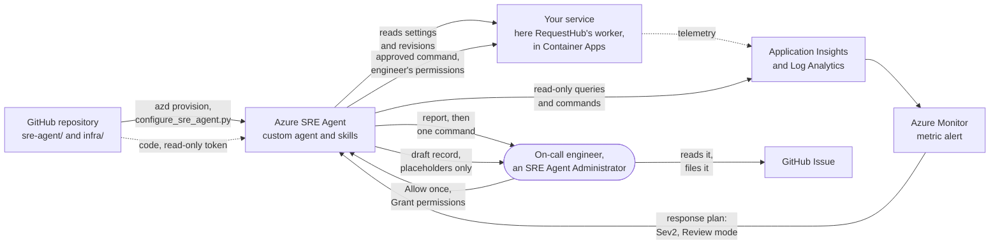
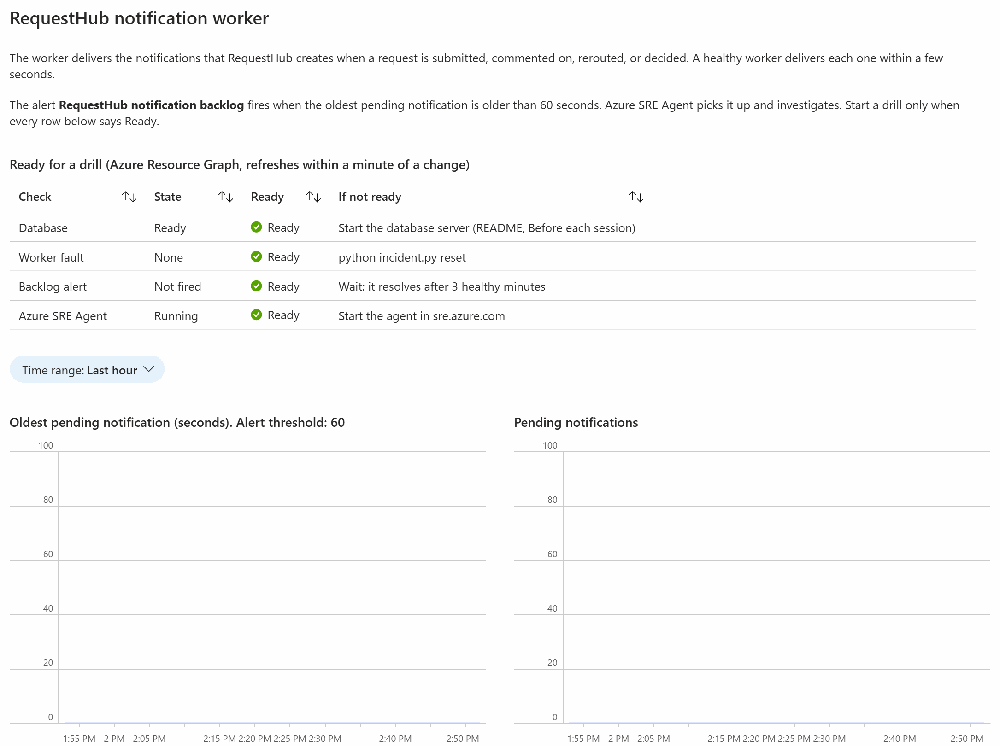
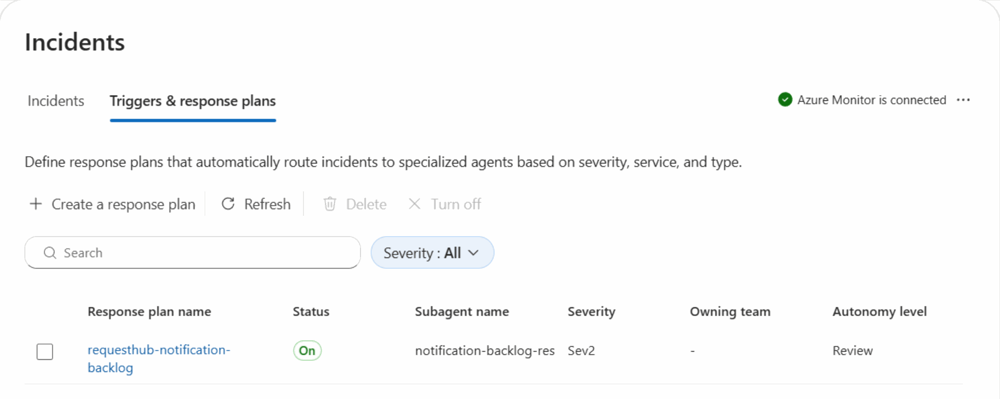
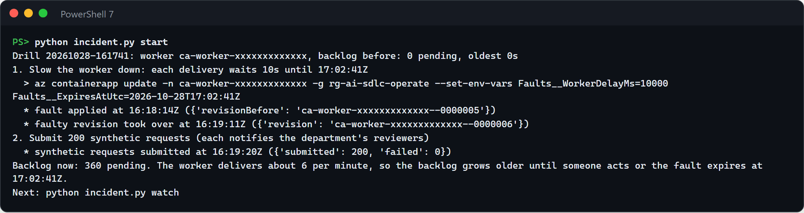
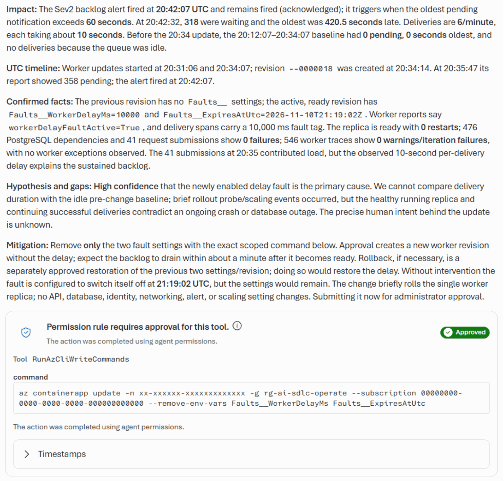

# Operate · Incident investigation with Azure SRE Agent

When an alert fires, the on-call engineer spends the first part of the incident gathering context: which dashboard, what changed, which logs matter. Afterwards, someone writes the incident record from memory. This solution gives your service an incident responder in Azure, set up from files in your repository. An Azure Monitor alert goes straight to **Azure SRE Agent**. Within minutes the agent measures the problem, correlates the telemetry and logs with the latest configuration change, rules out other causes, and proposes one scoped, reversible fix. A person approves the fix, and it runs with that person's permissions, because the agent itself can only read. The agent then checks the recovery against fresh telemetry and drafts the incident record, with placeholders instead of host names and ids, and a person reads the draft and files it as a GitHub Issue. The agent's instructions, skills, runbook, tool policy, guard hook, and response plan are files in your repository: `python configure_sre_agent.py --check` tests them offline, and `azd provision` applies them.


- **[See it work](#see-it-work):** a real run on RequestHub, this repository's sample app, on 10 November 2026. A slowed worker fired the alert, the agent proposed the fix with its evidence 2 minutes 34 seconds later, and the backlog drained 1 minute 49 seconds after the approved change began. The agent's draft became Issue [#301](https://github.com/melabadi/adept-assessment-northstars/issues/301), unchanged.
- **[Add it to your repository](#add-it-to-your-repository):** about 20 minutes of one-time setup in Azure and GitHub, once the alert, the agent's instructions, and its runbook describe your service.
- **[Try it first in a copy of this repository](#try-it-first-in-a-copy-of-this-repository):** about 20 minutes to set it up on RequestHub, then about 25 minutes for the steps of See it work.

## Why it matters

**Phase 7 of 7: Operate.** The GitHub counterpart is [07-operate-github](../07-operate-github/), where Copilot triages an incident Issue and the Copilot cloud agent opens a regression-test pull request, proven to fail without the fix. This solution handles the incident itself, with the AI and the orchestration in Azure. GitHub holds the code and the incident record. To follow one incident from this agent's recovery to a regression test that Copilot proves, use both as in the [Operate solution combo](../../PRESENTING.md#operate-azure-recovers-a-person-files-copilot-proves-the-follow-up); the GitHub side needs a paid GitHub Copilot plan.

| | Today | With this solution |
| --- | --- | --- |
| Detection | Someone notices late notifications, or an alert pages a person who starts from zero. | An Azure Monitor alert opens an investigation in Azure SRE Agent: 36 seconds after it fired, in See it work. |
| Investigation | Open dashboards, query logs, ask who changed what. | The agent correlates metrics, logs, spans, and the revision history, and keeps facts apart from hypotheses: its report came 2 minutes 34 seconds after the alert. |
| Mitigation | The first plausible fix, run with broad permissions. | One proposed command, scoped to the failing component. It runs only after an SRE Agent Administrator approves it, and with that person's permissions. |
| Recovery | "Looks fine now." | The agent compares telemetry from before and after the change, and waits for Azure Monitor to resolve the alert. |
| Incident record | Written days later from memory, often with host names and ids pasted in. | The agent drafts it from its investigation: a UTC timeline, the cause, the fix, and one follow-up, with placeholders instead of identifiers. A person reads it and files it as a GitHub Issue; the agent can't write to GitHub. |
| Agent configuration | Clicked together in a portal. | Instructions, skills, runbook, response plan, tool policy, and guard hook are files in the repository, reviewed in pull requests. `azd provision` applies them, and `python configure_sre_agent.py --check` rejects a change that weakens a guardrail. |

**The value:** the first minutes of an incident go to a decision instead of to gathering context, the fix runs only with a person's approval and permissions, and the record exists before anyone has to remember what happened. In [See it work](#see-it-work):

- The agent's report, with the root cause, its evidence, and the exact command, came 2 minutes 34 seconds after the alert fired. Nobody opened a dashboard.
- The approved command ran with the approver's permissions. The backlog drained 1 minute 49 seconds after the change began, and Azure Monitor resolved the alert 12 minutes 57 seconds after it fired.
- The record was filed unchanged as Issue #301, 1 minute 36 seconds after the agent's last reply, with no host name, GUID, or e-mail address in it.

## How it works



- **Azure Monitor** evaluates a metric alert every minute on `requesthub.notifications.oldest_pending_age_seconds`, a gauge that RequestHub's notification worker sends to Application Insights, and fires when it passes 60 seconds. The workbook *RequestHub notification worker* opens with a **Ready for a drill** table (from Azure Resource Graph: the database, the worker's fault settings, the alert, and the agent), then shows the backlog, deliveries per minute, and the worker's revisions on one page.
- **Azure SRE Agent** manages this resource group only, and receives its Azure Monitor alerts. A response plan sends the backlog alert to the custom agent `notification-backlog-responder` in **Review** mode: the agent proposes, and a person decides. The agent's identities have Reader, Monitoring Reader, and Log Analytics Reader on the resource group. Because Azure Monitor is its incident platform, the platform also gives one of them **Monitoring Contributor on the subscription**, which it needs to acknowledge and close alerts ([Learn](https://learn.microsoft.com/azure/sre-agent/diagnose-azure-observability)); that role covers alerts, alert rules, action groups, and diagnostic settings, not the app. Its tool policy lets it read freely, and asks a person before any Azure CLI write. It denies every `az monitor` write; deletes; changes to identities, roles, networking, Key Vault, and PostgreSQL; every GitHub tool that writes (Issues, comments, pull requests, workflows, branches, commits, merges, pushes, webhooks, files); and the terminal, shell, and Python tools. A Stop hook makes it show timestamps, facts apart from hypotheses, and a rollback before it finishes.
- **The guard hook** ([`hooks/no-identifiers.py`](sre-agent/hooks/no-identifiers.py)) is a backstop. It runs before every call to a GitHub Issue tool, ahead of the tool policy, and blocks the GitHub write tools the policy denies, so they stay blocked even if someone edits the policy in the portal. For any other Issue tool, such as a read, it reads every key and string of the call, as written and with hidden characters, HTML, Markdown markers, and URL escapes undone. It blocks the call if it finds a GUID or trace id, an Azure host name or resource id, an e-mail address, or a resource name with its random suffix, and otherwise asks a person. It is deterministic (regular expressions, no model), never allows a call on its own, and fails closed: unreadable or oversized input is blocked, and so is the call if the script fails.
- **GitHub** holds the code and the incident record. A person connects the repository once under **Code access**, with a read-only token, so the agent can read its code during an investigation. The agent has no GitHub tool that writes: it drafts the record, and a person files it. It doesn't file the Issue itself, because SRE Agent's `CreateGithubIssue` tool adds tenant identifiers that no one can review first (see [Troubleshooting](#troubleshooting)).
- **People.** The on-call engineer, an SRE Agent Administrator, decides whether to apply the proposal, approves it, and lends it their Azure permissions with a second click. The change shows their account in the Activity Log. They also read the record before they file it: that read is the gate before anything reaches GitHub.
- **azd** deploys everything. Its `postprovision` hook, [`configure_sre_agent.py`](configure_sre_agent.py), applies the agent's configuration from [`sre-agent/`](sre-agent/) through the agent's own API, and reads it back.

**Outside contributions.** Nothing here listens to GitHub. Azure Monitor alerts start the investigations, and the agent's GitHub access is a read-only token for this repository's code. On a public repository, nobody outside it can start an investigation; an Issue or a comment from outside reaches the agent only if a person asks it to read one, and every Issue tool asks a person first.

## See it work

On 10 November 2026, from 20:34 to 20:57 UTC, the solution ran once, end to end, against the real services in resource group `rg-ai-sdlc-operate` (Central US), on RequestHub, this repository's sample app. The operator was a GitHub Copilot agent session working for the repository owner. It ran the commands in PowerShell 7, signed in to Azure and GitHub as the owner, and selected **Allow once** and **Grant permissions** after the owner had confirmed the proposal, as pull request [#298](https://github.com/melabadi/adept-assessment-northstars/pull/298) records under *Decisions made at the owner's direction*. Azure Monitor and Azure SRE Agent did the rest. The agent ran with [`sre-agent/`](sre-agent/) as #298 merged it ([the configuration that ran](evidence/2026-11-10-recorded-run.md#the-configuration-that-ran)).

Every step links evidence that opens without signing in: Issue [#301](https://github.com/melabadi/adept-assessment-northstars/issues/301), the record the agent drafted, and [what Azure recorded](evidence/2026-11-10-recorded-run.md), exported from the Activity Log, the worker's revisions and telemetry, the alert's history, and the investigation thread. Times are UTC. The portal screenshots show the operator's local time, UTC−5: 3:42 PM is 20:42. Five screenshots come from an earlier run of the same drill, on 30 October, and say so.

**The starting state, at 20:34:04.** The worker reported 0 notifications pending, with no fault active. It ran revision `0000017`, without fault settings: an update at 20:31:06 had removed the expired fault of a drill earlier that day. The workbook's **Ready for a drill** table shows such a state; this screenshot is from 30 October.



Evidence: [worker revisions](evidence/2026-11-10-recorded-run.md#worker-revisions) and [the worker's backlog reports](evidence/2026-11-10-recorded-run.md#the-workers-backlog-reports).

### 1. The agent's configuration came from the repository

*Applied before the run, by `azd provision`.*

The agent's configuration is the folder [`sre-agent/`](sre-agent/), described by [`agent.yaml`](sre-agent/agent.yaml): the custom agent `notification-backlog-responder`, whose [instructions](sre-agent/instructions.md) allow it one change, removing the worker's two fault settings; three skills; the team's runbook; a Stop hook; the guard hook; the tool policy; and the response plan, which sends Sev2 alerts titled *notification backlog* to the custom agent in **Review** mode. `azd provision` ran [`configure_sre_agent.py`](configure_sre_agent.py), which checks these files against the solution's rules, applies them through the agent's API, and reads them back. Nobody configured the agent in the portal. These three screenshots were taken on 30 October; nothing they show has changed since.





Evidence: the files in the repository, as #298 merged them, and a [read-only comparison](evidence/2026-11-10-recorded-run.md#the-configuration-that-ran) of the live agent with them.

**What this shows:** the agent's behavior is code that people review, and a change that weakens a guardrail fails `python configure_sre_agent.py --check` before it reaches the agent.

### 2. A slowdown was injected

*20:34:07 to 20:35:47: the fault was live at 20:34:34, and 358 notifications were waiting at 20:35:47.*

The operator ran `python incident.py start`. At 20:34:07 it set two settings on the worker, `Faults__WorkerDelayMs=10000` and `Faults__ExpiresAtUtc` (21:19:02, 45 minutes later), which rolled out revision `0000018`; the worker reported the fault active at 20:34:34. From then on every delivery waited 10 seconds, about 6 notifications a minute. The script then submitted its synthetic requests, 200 by default. Application Insights, which keeps a sample of requests under load, recorded 41 of them, from 20:35:26 to 20:35:34, none failed. At 20:35:47 the worker reported 358 notifications pending. The screenshot shows the same command in the 30 October run.



Evidence: [Activity Log](evidence/2026-11-10-recorded-run.md#activity-log), [worker revisions](evidence/2026-11-10-recorded-run.md#worker-revisions), [the worker's backlog reports](evidence/2026-11-10-recorded-run.md#the-workers-backlog-reports), and [the synthetic requests](evidence/2026-11-10-recorded-run.md#the-synthetic-requests).

**What this shows:** the drill's fault switches itself off when it expires, so an interrupted drill can't leave the worker slow.

### 3. The alert fired

*20:42:07: 6 minutes 33 seconds after the last recorded request.*

The worker reports its backlog after each batch of up to 20 deliveries, and at 10 seconds a delivery a batch took 200 seconds. Its report at 20:39:07 was the first above the threshold: 338 pending, the oldest 220.7 seconds old. Azure Monitor fired the Sev2 alert on that value at 20:42:07. The oldest notification kept aging, to 819.7 seconds at 20:49:07.


Evidence: [the alert](evidence/2026-11-10-recorded-run.md#the-alert) and [the backlog gauges](evidence/2026-11-10-recorded-run.md#the-backlog-gauges-per-minute).

**What this shows:** the alert watches the symptom that people feel, notifications waiting, and it started the investigation without anyone being paged into an empty dashboard.

### 4. The agent investigated

*20:42:43 to 20:44:41: the investigation started 36 seconds after the alert fired, and the report came 2 minutes 34 seconds after it.*

The response plan sent the alert to the custom agent, which acknowledged it in Azure Monitor and opened a thread at 20:42:43. It read its memory: the team's runbook, from [`knowledge/`](sre-agent/knowledge/), and four earlier drills with similar symptoms. It queried Application Insights and Log Analytics, and ran 10 read-only Azure CLI commands as itself: the worker's revisions and their settings, its replicas, the alert, and the Activity Log.


At 20:44:41 it reported. The confirmed facts: the active revision had `Faults__WorkerDelayMs=10000`, which the previous one lacked; the worker reported `workerDelayFaultActive=True`; and each delivery took about 10 seconds. It had ruled out the alternatives: no restarts, and no failures among 476 database calls and 41 request submissions. It gave a high-confidence hypothesis with its gaps, including that it couldn't know why someone had made the change. And it proposed one mitigation, with its rollback and the time the fault would have expired on its own. Nothing had changed yet.



Evidence: [the investigation](evidence/2026-11-10-recorded-run.md#the-investigation), with [the report](evidence/2026-11-10-recorded-run.md#the-report) in full, and [the worker's telemetry](evidence/2026-11-10-recorded-run.md#the-workers-telemetry), which reproduces its numbers.

**What this shows:** the agent tied the symptom to the change that caused it, with evidence for each fact, and said what it could not prove.

### 5. The fix was approved, and ran with the approver's permissions

*20:44:41 to 20:48:35: Allow once 2 minutes 42 seconds after the request, Grant permissions 20 seconds later, and 51.5 seconds for the command to run.*

The tool policy held the one Azure CLI write for approval: `az containerapp update` on the worker, with its subscription, removing `Faults__WorkerDelayMs` and `Faults__ExpiresAtUtc`. Once the owner had confirmed it, **Allow once** was selected at 20:47:23, under the owner's account. The platform first ran the command with the agent's own identity, which has no right to change the worker, so it failed with an authorization error, as designed. **Grant permissions**, at 20:47:43, ran it again on behalf of the approver. The worker update began at 20:48:19 under the approver's account, and revision `0000019`, without the fault settings, was created at 20:48:26.


Evidence: [the approvals](evidence/2026-11-10-recorded-run.md#the-approvals), [Activity Log](evidence/2026-11-10-recorded-run.md#activity-log), and [worker revisions](evidence/2026-11-10-recorded-run.md#worker-revisions).

**What this shows:** nothing changed until a person approved one exact command, and the change ran with that person's permissions, under their name, never with the agent's.

### 6. The backlog drained, and the alert resolved

*20:48:19 to 20:55:04: the backlog drained 1 minute 49 seconds after the change began, and the alert resolved 6 minutes 45 seconds after it.*

The new worker container started at 20:49:08. Its first report, at 20:49:10, said the fault was off; the 278 notifications still waiting went out within a minute, and the oldest had waited 852.4 seconds. At 20:50:08 the gauges read 0 pending and 0 seconds. The agent didn't take the command's output, which still showed the old revision as ready, as proof: it checked the rollout and fresh telemetry, where 18 sampled deliveries averaged 0.059 ms, and waited for Azure Monitor. The alert resolved at 20:55:04, after three healthy one-minute evaluations and 12 minutes 57 seconds after it fired. The portal's titles for the agent's read-only commands, such as *Creating new Azure resource (Medium risk)* for `az containerapp replica list`, are its own words: those commands only read.


Evidence: [container events](evidence/2026-11-10-recorded-run.md#container-events), [the backlog gauges](evidence/2026-11-10-recorded-run.md#the-backlog-gauges-per-minute), [how long each delivery took](evidence/2026-11-10-recorded-run.md#how-long-each-delivery-took), and [the alert](evidence/2026-11-10-recorded-run.md#the-alert).

**What this shows:** the agent called the incident over on fresh evidence and the resolved alert, not on the command's success.

### 7. The agent drafted the record, and it was filed

*20:55:57 to 20:57:33: the draft came 53 seconds after the alert resolved, and was filed 1 minute 36 seconds later.*

The agent's last reply compared the numbers from before and after the change, said it could post to no incident system, and asked a person to read the draft and file it as a GitHub Issue, with its title and two labels, `ai-sdlc` and `phase:operate`. The record has a summary, the impact, a UTC timeline with the evidence for each row, the recent changes, the root cause, the mitigation written with placeholders (`<worker>`, `<resource group>`), one follow-up, and a status table. At 20:57:33 it was filed unchanged as [#301](https://github.com/melabadi/adept-assessment-northstars/issues/301), under the owner's account, with one more label: `incident`, which starts [07-operate-github](../07-operate-github/)'s triage.


Evidence: Issue [#301](https://github.com/melabadi/adept-assessment-northstars/issues/301), whose body is the draft, character for character ([the last reply](evidence/2026-11-10-recorded-run.md#the-last-reply)).

**What this shows:** the record came from the investigation itself, without identifiers, and nothing reached GitHub until someone filed it.

## Results and value

**What the run left behind.**

- Issue [#301](https://github.com/melabadi/adept-assessment-northstars/issues/301), the incident record that the agent drafted, filed unchanged. Its `incident` label then started 07-operate-github's triage, which opened the follow-up [#302](https://github.com/melabadi/adept-assessment-northstars/issues/302), and the Copilot cloud agent opened pull request [#303](https://github.com/melabadi/adept-assessment-northstars/pull/303) for it: the path that the [Operate solution combo](../../PRESENTING.md#operate-azure-recovers-a-person-files-copilot-proves-the-follow-up) follows.
- The investigation thread, in the agent's history: the report, the commands, the approval, the checks after the change, and the draft.
- The alert's history in Azure Monitor, acknowledged by the agent and resolved by Azure Monitor, and the one change in the Activity Log, under the approver's account.
- [The evidence](evidence/2026-11-10-recorded-run.md) behind every number in See it work and in these results.
- The decisions, left to people: whether to apply the fix, with whose permissions, and what goes into GitHub.

**What was measured.**

| | In See it work |
| --- | --- |
| From the alert firing to the investigation starting | 36 seconds |
| From the alert to the report, with the cause, its evidence, and one command | 2 minutes 34 seconds |
| From the approval request to Allow once: the person's decision | 2 minutes 42 seconds |
| From the change beginning to the backlog drained | 1 minute 49 seconds |
| From the alert firing to it resolving | 12 minutes 57 seconds |
| From the agent's last reply to the filed record | 1 minute 36 seconds |
| The whole drill, from the fault to the filed record | 23 minutes 26 seconds |
| The agent's Azure CLI commands | 33 that only read, as itself; 1 change, with the approver's permissions |
| Host names, GUIDs, and e-mail addresses in the record | none |

**What a team gets.**

- **Time saved.** Nobody gathers context by hand: the report with its evidence was ready 2 minutes 34 seconds after the alert, and the record 53 seconds after the recovery was confirmed. The engineer's time goes to the decision.
- **Risk removed.** The agent can read the resource group but not change it. Its one write ran only after a person approved the exact command, with that person's permissions and under their name. It can't write to GitHub at all, and the guard hook blocks identifiers in any Issue call.
- **Evidence a reviewer or an auditor can follow.** The thread keeps every command, approval, and result; the alert's history and the Activity Log record who acknowledged and who changed what; and the record in GitHub has a UTC timeline with the evidence for each row. The agent's configuration is code, reviewed in pull requests.

**What it doesn't do yet.** The worker reports its backlog only after a batch, so a slow worker delays its own alert: the first report above the threshold came 3 minutes 20 seconds after the previous report, and the alert fired 3 minutes after that. If your alert must be faster, measure the queue independently of the worker.

**The metric to track when you adopt it:** the time from an alert to a proposed mitigation with its evidence (2 minutes 34 seconds in See it work), the time from an alert to its resolution (12 minutes 57 seconds), and the share of incidents with a filed record. Compare them with your incidents before. A target is a goal you set, never a result.

## Add it to your repository

These are the steps that set the solution up on RequestHub, with what to change for your service. We have run them only on RequestHub: for your service, the commands stay the same, and the changes are the ones named below. Point the agent at a test environment of your service first, not at production.

### Prerequisites

- Your repository on GitHub, and the tools in the root README's [Before you start](../../README.md#before-you-start): the GitHub CLI, Python 3.12 or later, PowerShell 7, the Azure CLI, and the Azure Developer CLI.
- Your service in Azure, with Application Insights on a Log Analytics workspace, and a metric that shows the problem you want to catch: a platform metric, or a custom metric that your service sends through OpenTelemetry, as RequestHub's worker sends the age of its oldest pending notification.
- An Azure subscription where you can create resource groups and role assignments, for example as Owner, in a region that offers Azure SRE Agent. To see where your subscription can create the agent, run `az provider show -n Microsoft.App --query "resourceTypes[?resourceType=='agents'].locations" -o tsv`. If the list is empty, [register the subscription](https://learn.microsoft.com/azure/sre-agent/supported-regions#check-your-available-regions).
- A GitHub account that can create a fine-grained personal access token for your repository, with read-only access to its code. Without it the agent still investigates, without reading your code.

### What to copy and what to change

Copy this folder into your repository, two levels below its root, for example as `ops/incident-response/` (`azd_env.py` looks for the root two levels up). Leave out `incident.py`, `evidence/`, and `images/`, which belong to RequestHub and to the run in [See it work](#see-it-work). Then change these files:

| File | What it does here | What to change for your service |
| --- | --- | --- |
| [`infra/main.bicep`](infra/main.bicep) and [`main.parameters.json`](infra/main.parameters.json) | Deploys RequestHub's platform (`module app`), the alert and the workbook (`monitoring`), and the agent (`sreAgent`), and outputs the settings that the other files read | Remove `module app` and the outputs it fed. Pass your service's Application Insights and Log Analytics workspace to `monitoring` and `sreAgent`, and output the names your placeholders read, as `WORKER_APP_NAME` is now. Keep the agent in the resource group that `main.bicep` creates, never in your service's: `azd down --purge` deletes the whole group. |
| [`infra/monitoring.bicep`](infra/monitoring.bicep) | The backlog alert (Sev2; every minute, the maximum over one minute above 60 seconds; resolves itself) and the workbook | Your signal: the metric's namespace and name, the threshold, the severity, and the alert's name and description, which tell the agent what is wrong. Its `existing` Application Insights and workspace are in its own resource group: scope them to your service's group. |
| [`infra/workbook.json`](infra/workbook.json) | The workbook: the **Ready for a drill** table (Azure Resource Graph) and the backlog charts (KQL) | Your rows and charts, or leave the workbook out. |
| [`infra/sre-agent.bicep`](infra/sre-agent.bicep) | The agent, its identities and their read-only roles (Reader, Monitoring Reader, Log Analytics Reader) on the resource group, the resource groups it manages (`managedResources`), the Azure Monitor incident platform, the telemetry connectors, and the monthly cap on active flow | Add your service's resource group to `managedResources`, give the agent's identities the same three reader roles there (a module scoped to that group), and scope the `existing` Application Insights and workspace to it. `monthlyAgentUnitLimit` caps active flow, at 1,000 AAUs a month. |
| [`sre-agent/agent.yaml`](sre-agent/agent.yaml) | The custom agent, its skills and tools, the GitHub deny list and the guard hook, the response plan, and the tool policy | The response plan's `titleContains` and `severities`, to match your alert, and the custom agent's name and description. Keep the deny lists, and `agentMode: Review` until you trust its proposals. |
| [`sre-agent/instructions.md`](sre-agent/instructions.md) | How the custom agent investigates, and the only change it may propose: removing the worker's two fault settings | Your service's scope, and the changes the agent may propose, each naming its subscription (`--subscription`) so that it runs where you expect. |
| [`sre-agent/skills/`](sre-agent/skills/) | `investigate-notification-backlog` and `verify-worker-recovery`: RequestHub's KQL and read-only commands; `draft-incident-record`: the record's template, its title, and its labels | Your telemetry's KQL, your recovery criteria, and your incident record: the fields your incident process asks for, and your labels. |
| [`sre-agent/knowledge/`](sre-agent/knowledge/) | RequestHub's runbook, in the agent's knowledge base | Your runbook. |
| [`configure_sre_agent.py`](configure_sre_agent.py) and [`test_configure_sre_agent.py`](test_configure_sre_agent.py) | Applies `sre-agent/`, and checks it offline: the solution's rules, the guard hook's tests, and `RECORD_FIELDS`, what the record must state | `PLACEHOLDERS`, the `{{...}}` settings your files use; `RECORD_FIELDS`, if your record's fields differ; and `resource_suffixes()`, which takes the random suffix of your resource names from `WORKER_APP_NAME`. Update the tests to match. |
| [`azure.yaml`](azure.yaml) | The azd project: the infrastructure, RequestHub's `api` and `worker` services, and the `postprovision` hook | Remove the `api` and `worker` services. |

To rehearse an incident before a real one, write a drill for your service like [`incident.py`](incident.py), or use an [Azure Chaos Studio](https://learn.microsoft.com/azure/chaos-studio/chaos-studio-overview) experiment. Give every fault an expiry. Before you open the pull request, `python configure_sre_agent.py --check` runs the solution's rules and the guard hook's tests on your machine, with no Azure access.

### One-time setup

About 20 minutes, once the files describe your service. On RequestHub, `azd up` takes about 15 minutes, including the app.

#### 1. Deploy

From the folder you copied:

```powershell
pip install -r requirements.txt
az login
azd auth login
azd env new <environment name> --location <region>
azd up
```

**What you should see:** `azd up` ends with `SUCCESS: Your application was provisioned and deployed to Azure`. Just before that, the `postprovision` hook lists every item it applied to the agent with `ok`, and ends with `SRE Agent configured.` and `... every GitHub write tool is denied.` A file that breaks the solution's rules stops the hook before anything reaches the agent. You get the **SRE Agent Administrator** role on the agent. The platform adds one role that isn't in the Bicep: Monitoring Contributor on the subscription for the agent's identity, to acknowledge and close alerts. The tool policy denies `az monitor` writes, and [Clean up](#clean-up) removes the role.

Then create the labels your record asks for, as RequestHub's are created:

```powershell
gh label create ai-sdlc --color 1D76DB --description "AI-SDLC demo work" --force
gh label create phase:operate --color C5DEF5 --description "SDLC phase 7: Operate" --force
```

#### 2. Open the agent once

Open the URL from `azd env get-value SRE_AGENT_PORTAL_URL` and sign in.

**What you should see:** the first visit shows a setup checklist (2 log providers, 1 resource group, Azure Monitor connected). **Done and go to agent** opens a *Team onboarding* chat, in which the agent reads the resource group and writes notes about it to its memory; that uses a few AAUs and changes nothing. Under **Incidents**, **Triggers & response plans** lists your response plan: On, your custom agent, your severity, Review.

#### 3. Connect GitHub

A person does this once, because it gives an Azure service access to GitHub. The agent reads the repository's code through **Code access**; it never writes to GitHub.

1. In GitHub, open **Settings**, **Developer settings**, **Personal access tokens**, **Fine-grained tokens**, and select **Generate new token**:
   - **Token name:** for example `sre-agent-code-access`. **Expiration:** 30 days.
   - **Repository access:** Only select repositories, and pick your repository.
   - **Permissions:** Repository permissions, **Contents: Read-only**: Code access clones the repository to connect it ([Learn](https://learn.microsoft.com/azure/sre-agent/github-connector#permissions-by-auth-type)). GitHub adds **Metadata: Read-only** by itself. Nothing else.

   Select **Generate token** and copy it.
2. In the [SRE Agent portal](https://sre.azure.com), open your agent, then **Build + setup**, **Code access**, the **GitHub** tab, and **Add repository**. In *Add repositories*, GitHub is selected:
   - **Repository URL:** your repository's URL, `https://github.com/<owner>/<repo>`.
   - **Connection method:** **Personal access token (PAT)**. Paste the token under **Provide PAT** and select **Connect**. A *Connected* card appears.

   Select **Next**, then **Save**.
3. Check the connection, from the folder you copied:

   ```powershell
   python configure_sre_agent.py
   ```

**What you should see:** the repository is listed under **Code access** with a green connection and a **Last synced** time, and the script's `Tools` section reports `GitHub: <owner>/<repo> is connected, credential healthy, code ready; the agent can read its code and has no GitHub tool that writes`. The script applies the configuration again, unchanged.

A token that allows more, for example one you share with other tools, still doesn't let the agent write: the custom agent has no GitHub tool, and the tool policy denies every GitHub tool that writes, Issue writes included, and the terminal, shell, and Python tools, which could use the token. Two choices in the portal would widen the access: **OAuth** in that dialog applies to every repository your GitHub account can reach, and the **GitHub** card under **Build + setup**, **Connectors** is GitHub's MCP server, with GitHub's whole tool catalog. When the token expires, create a new one the same way, then select the repository under **Code access** and connect again with the new token.

### Use it the first time

Let your alert fire once in a test environment: inject a fault with an expiry, the way `incident.py` does on RequestHub, or lower the alert's threshold for a while.

**What you should see:** within about a minute of the alert, the SRE Agent portal's **Incidents** lists it, with the agent *In progress*, then *Pending user input* when its proposal waits for approval. Open it to follow the investigation and read the report. Approve the command only if it is the change you would make: **Allow once**, then **Grant permissions**, as in [step 5 of the copy](#5-approve-the-fix). After the recovery, the agent's last reply holds the draft: read it, then file it, as in [step 7 of the copy](#7-file-the-record). On RequestHub, the report came 2 minutes 34 seconds after the alert, and the whole drill took about 25 minutes.

Then make it part of your workflow:

- **Keep a person in the loop.** Leave the response plan in **Review** mode, so every proposal waits for an SRE Agent Administrator, and keep the deny lists: `configure_sre_agent.py --check` fails if a change sets the plan to Autonomous, allows writes without approval, allows `az monitor` writes, gives the agent a GitHub tool, stops denying a GitHub write tool or the terminal, or weakens the guard hook.
- **Change the agent in a pull request.** Edit `sre-agent/`, run `python configure_sre_agent.py --check`, and open the pull request. When it merges, `azd provision`, or only `python configure_sre_agent.py`, applies the change and reads it back.
- **Keep the evidence of an incident you want to show.** Export the alert's history, the Activity Log, and the queries behind your numbers with only the fields you need, as [`evidence/`](evidence/) does here, and check the export for host names, GUIDs, and e-mail addresses before you commit it. Application Insights keeps the telemetry only as long as your workspace's retention.

### What it costs

Your service bills as it already does. The agent's always-on flow costs 4 Azure Agent Units (AAUs) an hour, at $0.10 per AAU, for as long as the agent exists: about $292 a month. A new customer's [30-day evaluation](https://learn.microsoft.com/azure/sre-agent/evaluate) waives it. Each investigation adds active flow, roughly 10 to 35 AAUs ($1 to $3.50; our drills used 15 to 25), and about $1 of log ingestion; the Bicep caps active flow at 1,000 AAUs a month. See [pricing](https://learn.microsoft.com/azure/sre-agent/pricing-billing), and the root README's [what the Microsoft solutions cost](../../README.md#what-the-microsoft-solutions-cost).

## Try it first in a copy of this repository

Optional: the same solution on RequestHub, before you adapt anything. It needs the [prerequisites](#prerequisites), with RequestHub in place of your service, a region that also offers PostgreSQL Flexible Server (the examples use `centralus`), and permission to create Microsoft Entra app registrations: RequestHub signs in with its own.

### Quick start

From the root of your copy of the repository, which the root README's [Try it in a copy of this repository](../../README.md#try-it-in-a-copy-of-this-repository) makes once for every solution:

```powershell
cd solutions/07-operate-microsoft
pip install -r requirements.txt
az login
azd auth login
azd env new ai-sdlc-operate --location centralus
azd up
gh label create ai-sdlc --color 1D76DB --description "AI-SDLC demo work" --force
gh label create phase:operate --color C5DEF5 --description "SDLC phase 7: Operate" --force
```

Then open the agent once and connect your copy under **Code access**, as in [Open the agent once](#2-open-the-agent-once) and [Connect GitHub](#3-connect-github). Allow about 20 minutes in all: `azd up` takes about 15. To check the result, follow [Check the starting state](#check-the-starting-state).

While deployed, the copy's resource group costs about $375 a month: $292 for the agent, as in [What it costs](#what-it-costs), and about $85 for RequestHub's platform (Container Apps, PostgreSQL, Log Analytics, the blob private endpoint, and the container registry). Each drill adds roughly $2 to $4.50 of active flow and log ingestion.

### What azd up creates

`azd up` ends with `SUCCESS`. It creates resource group `rg-ai-sdlc-operate` with:

- **RequestHub's platform** from [`app/infra/requesthub.bicep`](../../app/infra/requesthub.bicep), and the app as two container apps: the API with its web UI, and the notification worker. You get every RequestHub role.
- **The backlog alert**, *RequestHub notification backlog* (severity 2, oldest pending notification older than 60 seconds), and the workbook *RequestHub notification worker*.
- **Azure SRE Agent** `sre-ai-sdlc-operate`: read-only roles on this resource group, Review mode, Azure Monitor as its incident platform, connectors to the app's Application Insights and Log Analytics, and its own Application Insights for its activity. You get the **SRE Agent Administrator** role.
- **The agent's configuration**, applied by the `postprovision` hook: the runbook, three skills, the custom agent with its Stop hook, the guard hook, the tool policy, and the response plan. The default quickstart plan is removed, so the alert is not investigated twice.

### Check the starting state

About 5 minutes, from `solutions/07-operate-microsoft`, before each run of the steps below. In the Azure portal, open the Application Insights resource `appi-...` in `rg-ai-sdlc-operate`, **Workbooks**, *RequestHub notification worker*. Every row of **Ready for a drill** must say **Ready**, as in [See it work's starting state](#see-it-work), and the charts below it stay at zero. The table reads Azure Resource Graph, which reflects a change within a minute or two: select the workbook's refresh button after you fix something.

- **Database `Stopped`.** Some subscriptions stop PostgreSQL servers overnight with a governance automation. Start it (about 3 minutes; the API answers a minute later):

  ```powershell
  az postgres flexible-server start -g rg-ai-sdlc-operate -n (azd env get-value POSTGRES_HOST).Split('.')[0]
  ```

- **Worker fault `Injected`.** A drill was not reset. Run `python incident.py reset`.
- **Backlog alert `Fired`.** Wait: Azure Monitor resolves it after three healthy one-minute evaluations, about 5 minutes after the backlog drains.
- **Azure SRE Agent not `Running`.** In the SRE Agent portal, **Settings**, **Basics**, select **Start**.

Also check that **Build + setup**, **Code access**, **GitHub** lists your copy with a green connection, and that `az account show` shows the account that ran `azd up`: it is the SRE Agent Administrator who approves the fix, and `incident.py` reads RequestHub's Admin API with its token.

### How long each step takes

| Step | Takes | In See it work |
| --- | --- | --- |
| 1. Look at the configuration | about 3 minutes | before the run |
| 2. Inject the slowdown | 1 to 2 minutes | 1 minute 27 seconds, from the worker update to the last recorded request |
| 3. The alert fires | about 6½ minutes after the requests | 6 minutes 33 seconds |
| 4. The investigation | 2 to 3 minutes to the report | 2 minutes 34 seconds |
| 5. Approve | as long as you take to decide, then about a minute | 2 minutes 42 seconds to decide, 20 seconds to grant, 51.5 seconds to run |
| 6. Recovery | about 2 minutes to drain, then about 5 for the alert to resolve | 1 minute 49 seconds, then 4 minutes 56 seconds |
| 7. File the record | about 2 minutes after the agent's last reply | 1 minute 36 seconds |

All seven steps take about 25 minutes, most of it the agent and Azure Monitor working: 23 minutes 26 seconds in See it work, from the fault to the filed record. The fault switches itself off 45 minutes after `start`.

### 1. Look at the agent's configuration

*About 3 minutes. What you should see: [See it work, step 1](#1-the-agents-configuration-came-from-the-repository).*

```powershell
python configure_sre_agent.py --check
```

It checks [`sre-agent/`](sre-agent/) against the solution's rules and runs the guard hook's tests, offline, and ends with `sre-agent/ is valid: ...`. In the SRE Agent portal, open **Incidents**, then **Triggers & response plans**: one response plan sends the backlog alert to the custom agent, in **Review** mode. Then open **Build + setup**, **Hooks**, and select the edit button of `no-identifiers-in-github`: its fail mode is **Block**. Close it with **Cancel**. In the Azure portal, the resource group's **Access control (IAM)** shows the agent's identities with reader roles, and the subscription's shows Monitoring Contributor, which the platform added.

### 2. Inject the slowdown

*1 to 2 minutes. What you should see: [See it work, step 2](#2-a-slowdown-was-injected).*

```powershell
python incident.py start
```

It prints the exact `az containerapp update` command that adds the fault: each delivery waits 10 seconds, and the fault expires after 45 minutes. It waits for the slowed revision to take over, then submits 200 synthetic requests. Expect about 360 pending notifications. At 6 a minute, the slowed worker would need an hour to deliver them, longer than the fault lasts, so the backlog clears only when someone acts.

### 3. Watch the alert fire

*About 6½ minutes after the requests. What you should see: [See it work, step 3](#3-the-alert-fired).*

In the workbook, select refresh every minute or two: the oldest pending notification climbs in steps, because the slowed worker reports its backlog only after each batch, and the **Ready for a drill** table shows the worker fault as **Injected**. When the alert fires, the Application Insights resource's **Monitoring**, **Alerts** lists *RequestHub notification backlog*, Sev2, *Fired*, already acknowledged by the agent. Select it for its details.

### 4. Follow the investigation

*2 to 3 minutes to the report. What you should see: [See it work, step 4](#4-the-agent-investigated).*

In the SRE Agent portal, open **Incidents**: the alert is listed with the agent *In progress*, then *Pending user input* once its proposal waits for approval. Open it to follow the thread: the alert, the memory search, the read-only commands, then the report with its facts, hypotheses, and the command it proposes.

### 5. Approve the fix

*As long as you take to decide, then about a minute. What you should see: [See it work, step 5](#5-the-fix-was-approved-and-ran-with-the-approvers-permissions).*

Read the command on the approval card. If it is the change you would make, select **Allow once**. The card turns **Approved** and reads *The action was completed using agent permissions*: the platform ran the command with the agent's own identity, which has no right to change the worker, so nothing has changed yet. The next card, **Authorization required**, asks to run the same command with your credentials. Select **Grant permissions**.


This screenshot, from the 30 October run, shows the second card before **Grant permissions**. To run the command yourself instead, select **Cancel** and use the command from the report. If the agent stops at its report without asking, reply *Apply the proposed mitigation.* With **Go back to legacy**, the portal's older navigation, the buttons are **Approve**, **Deny**, and **Authorize**.

### 6. Watch it recover

*About 2 minutes to drain, then about 5 for the alert. What you should see: [See it work, step 6](#6-the-backlog-drained-and-the-alert-resolved).*

A new worker revision starts without the fault, and the backlog drains within about a minute and a half of the change. In the thread, the agent checks fresh telemetry from the new revision and waits for the alert to resolve before it calls the incident recovered. In the workbook, every row of **Ready for a drill** turns **Ready** again, and the charts show the backlog's rise and its drop at the fix.

### 7. File the record

*About 2 minutes. What you should see: [See it work, step 7](#7-the-agent-drafted-the-record-and-it-was-filed).*

The agent ends its last reply with the record: a title, the two labels, and the body in a code block, with placeholders instead of resource names or ids. Read it: nothing reaches GitHub until a person files it, and the agent can't. Remove anything that identifies your deployment. Then copy the body with the code block's copy button and file it, with the title from the draft:

```powershell
Get-Clipboard -Raw | Set-Content $env:TEMP\record.md
gh issue create --title "Incident record: notification backlog, <YYYY-MM-DD>" --label ai-sdlc --label phase:operate --body-file $env:TEMP\record.md
```

`gh` prints the new Issue's URL. You can also paste the title and body into **New issue** in GitHub and add the two labels. To hand the incident to [07-operate-github](../07-operate-github/)'s triage, as in the [Operate solution combo](../../PRESENTING.md#operate-azure-recovers-a-person-files-copilot-proves-the-follow-up), also add the `incident` label.

### Reset the copy for another run

```powershell
python incident.py reset
gh issue close <number>
```

`reset` removes the fault if it is still set, and reseeds RequestHub's demo data. Close the Issue you filed once you no longer need it. The next run can start when every row of the workbook's **Ready for a drill** table says **Ready**: the alert row does about 5 minutes after the backlog drains. The investigation threads stay in the agent's history, as the record of past drills.

## Clean up

When you no longer need the solution, first remove the agent's access to GitHub: in the SRE Agent portal, select the repository under **Build + setup**, **Code access**, **GitHub**, and select **Delete**. Then delete the token in GitHub (**Settings**, **Developer settings**, **Personal access tokens**, **Fine-grained tokens**), which revokes it at once. Then, from the solution's folder:

- **In your repository:** remove the Monitoring Contributor role that the platform gave the agent's identity on the subscription, which `azd down` leaves because it isn't in the resource group. Then `azd down --purge` deletes the solution's resource group, with the agent, which stops its charges, the alert, and the workbook. Your service stays as it is.

  ```powershell
  $sre = (az identity list -g (azd env get-value AZURE_RESOURCE_GROUP) -o json | ConvertFrom-Json | Where-Object name -like 'id-sre-*').principalId
  az role assignment delete --assignee $sre --role "Monitoring Contributor" --scope "/subscriptions/$(azd env get-value AZURE_SUBSCRIPTION_ID)"
  azd down --purge
  ```

- **In the copy:** the same, and also the Microsoft Entra app registration that RequestHub signs in with. `azd down` doesn't remove it (Entra objects live outside resource groups), and a deleted app that is not purged stops a new `azd up` with the same environment name from creating it again for 30 days. Read its id before `azd down`, then delete it and purge it:

  ```powershell
  $sre = (az identity list -g rg-ai-sdlc-operate -o json | ConvertFrom-Json | Where-Object name -like 'id-sre-*').principalId
  az role assignment delete --assignee $sre --role "Monitoring Contributor" --scope "/subscriptions/$(azd env get-value AZURE_SUBSCRIPTION_ID)"
  $app = az ad app show --id (azd env get-value API_CLIENT_ID) --query id -o tsv
  azd down --purge
  az ad app delete --id $app
  az rest --method delete --url "https://graph.microsoft.com/v1.0/directory/deletedItems/$app"
  ```

## What's in this folder

```text
07-operate-microsoft/
├── README.md
├── evidence/
│   └── 2026-11-10-recorded-run.md     what Azure recorded during the run in See it work, exported for anyone to check
├── images/                            screenshots of the run in See it work, and of an earlier run on 30 October
├── incident.py                        RequestHub only: the drill, start (a fault with an expiry, synthetic requests) and reset
├── configure_sre_agent.py             applies sre-agent/ to the live agent, or checks it offline (--check)
├── test_configure_sre_agent.py        offline tests: the record states every fact an incident form asks for
├── azd_env.py                         reads settings from this solution's azd environment
├── requirements.txt                   Python packages
├── azure.yaml                         azd project: infra, the shared app's api and worker, and the postprovision hook
├── sre-agent/                         Azure SRE Agent configuration, versioned
│   ├── agent.yaml                     custom agent, skills, the GitHub write tools it denies, guard hook, response plan, tool policy
│   ├── instructions.md                how the custom agent investigates, and the only change it may propose
│   ├── skills/                        investigate-notification-backlog, verify-worker-recovery, draft-incident-record
│   ├── knowledge/                     requesthub-worker-runbook.md, the team's runbook
│   └── hooks/
│       ├── evidence-checklist.md      Stop hook: evidence, facts versus hypotheses, rollback, approval
│       └── no-identifiers.py          guard hook (backstop): blocks GitHub write tools, and identifiers in GitHub Issue calls
└── infra/
    ├── main.bicep                     resource group, RequestHub platform (app/infra), monitoring, SRE Agent
    ├── monitoring.bicep               the backlog metric alert and the workbook
    ├── workbook.json                  the workbook: readiness table (Azure Resource Graph) and KQL charts
    ├── sre-agent.bicep                the agent, its identities and read-only roles, telemetry connectors, AAU cap
    └── main.parameters.json
```

RequestHub lives in [`app/`](../../app/README.md). Its notification worker already supports the fault used here: `Faults__WorkerDelayMs` slows every delivery, and `Faults__ExpiresAtUtc` switches the fault off at a fixed time even if nobody cleans up. This folder has no `.github/` files: everything runs in Azure.

## Troubleshooting

- **The workbook shows the database `Stopped`, or `incident.py start` cannot read the backlog.** A governance automation in some subscriptions stops PostgreSQL servers overnight. Start it with the command in [Check the starting state](#check-the-starting-state), wait about 3 minutes, then a minute more for the API to reconnect.
- **The agent says it got an authorization error after you approved.** That is the design: its identities have no right to change the worker. Select **Grant permissions** on the next card to run the command with your permissions, or run it yourself.
- **Grant permissions does not respond.** Reload the thread and select it again. If nothing happens, select **Cancel** on that card and run the command from the agent's report yourself; the workbook's worker fault row turns **None**.
- **After Grant permissions, the run fails with "containerapp does not exist".** The command did not name its subscription, and your sign-in's default subscription is another one. The instructions in this folder include `--subscription`; keep it if you change them. The agent reads the fault settings again and asks for approval once more; if it stops instead, reply *Submit the same command again with --subscription for this resource group.*
- **The approved command fails with "OBO sandbox CLI dispatched but response failed".** The platform's on-behalf-of run failed, possibly before the command reached Azure. The workbook's worker fault row shows whether the fault is still set. If it is, the agent submits the command again for approval; if it stops instead, reply *Approved, but the run failed and the fault is still set. Submit the command again.* You can also run the command from its report yourself.
- **Why doesn't the agent file the Issue itself?** Don't give it `CreateGithubIssue`, SRE Agent's own tool for filing Issues. After a person allows the call, the tool appends a footer: the agent's instance name, and a link to the thread with the subscription ID and the thread GUID. Neither the guard hook nor the approval card shows that footer, and the Issue's edit history keeps it even after someone edits it out. So the agent drafts the record and a person files it, and `python configure_sre_agent.py --check` fails unless the tool is denied by name.
- **The agent asks to create an Issue, or says a GitHub call was blocked.** That is the backstop working: the guard hook and the tool policy block every GitHub write tool. File the record from the agent's reply yourself, as in [File the record](#7-file-the-record).
- **The repository's row under Code access shows Failed.** The token can't read the repository's contents. Create a token with **Contents: Read-only**, as in [Connect GitHub](#3-connect-github), and connect again.
- **A RequestHub button fails with HTTP 403 and no body.** The API was deployed before the fix that lets the app's own origin send requests through Container Apps authentication (#134). Run `azd deploy api` from `main`.
- **The alert takes several minutes to fire.** The worker reports its backlog after each batch of up to 20 notifications, so at 10 seconds per delivery the gauge updates every few minutes.
- **No investigation appears after the alert fires.** In the SRE Agent portal, **Incidents**, **Triggers & response plans**: the plan must be On, Sev2, with the title containing "notification backlog". Run `python configure_sre_agent.py` again to restore it.
- **`LocationIsOfferRestricted` for PostgreSQL during `azd up`.** Your subscription cannot create PostgreSQL Flexible Server in that region. Create a new azd environment in another region that also offers Azure SRE Agent.
- **`AzureCLICredential: exit status 1` during `azd up`.** azd could not get a token from the Azure CLI. Run `az account get-access-token`, then run `azd up` again.
- **A multi-line KQL query returns the whole table from `az monitor app-insights query`.** On Windows, `az` cuts an argument at its first line break. Put the query on one line.
